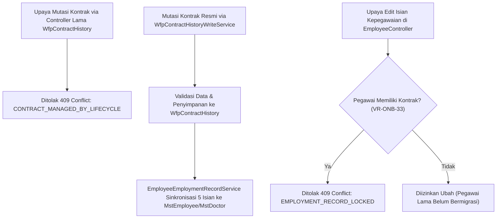

# Laporan Perubahan Backend — `BE-HRD-065`

## Metadata

| Field | Nilai |
| :--- | :--- |
| Task ID | `BE-HRD-065` |
| Judul | Penulisan Kontrak Kerja Satu Pintu & Penguncian Isian Kepegawaian |
| Slice | S-C4-ONB (LifecycleManagement) |
| Milestone | MVP-14 |
| Roadmap | `docs/module-blueprints/human-resource/roadmap/backend-roadmap.md` |
| Traceability | HRD-DEC-087 butir 1, VR-ONB-32, VR-ONB-33, AT-HRD-ONB-22 |
| Dependency | BE-HRD-063 ✅ |
| Klasifikasi | `CRITICAL / CORE` |
| Task Mode | `BACKEND` |
| Tanggal | 04 November 2026 |
| Status | Selesai (`PASS`) — Roslyn Build 0 Error |

---

## 1. Ringkasan dan Masalah yang Diselesaikan

Menerapkan arsitektur Single-Door Writing pada penulisan riwayat kontrak (WfpContractHistory). Seluruh endpoint tulis lama di WfpContractHistoryController dinonaktifkan dengan respons 409 Conflict (CONTRACT_MANAGED_BY_LIFECYCLE). Menambahkan EmployeeEmploymentRecordService untuk menyinkronkan 5 isian kepegawaian (status, jenis kepegawaian, tanggal mulai/akhir, durasi) ke MstEmployee dan MstDoctor, serta mengunci pengubahan manual 5 isian tersebut di EmployeeController bila pegawai sudah memiliki kontrak aktif.

---

## 2. Alur Proses Bisnis Rumah Sakit yang Didukung

---

## 3. Komponen Perubahan yang Diterapkan

- WfpContractHistoryController.cs: Penguncian 5 endpoint mutasi dengan 409 Conflict.
- EmployeeController.cs: Penegakan aturan VR-ONB-33.
- IEmployeeEmploymentRecordService.cs & EmployeeEmploymentRecordService.cs.
- IWfpContractHistoryWriteService.cs & WfpContractHistoryWriteService.cs.

---

## 4. Spesifikasi Endpoint API Bergaya Swagger

| Method | Path | Deskripsi | Auth | Request/Response |
| :--- | :--- | :--- | :--- | :--- |
| POST/PUT/PATCH/DELETE | /api/v1/corporate/human-resource/workforce-core/contract-histories/* | Ditolak 409: Dikelola satu pintu lewat Lifecycle Management | HR Admin | 409 Conflict |
| PUT | /api/v1/corporate/human-resource/master-data/workforce/employees/{id} | Penguncian 5 isian kepegawaian bila sudah ada riwayat kontrak | HR Admin | 409 Conflict jika terkunci |

---

## 5. Aturan Validasi dan Invarian Bisnis yang Ditegakkan

- VR-ONB-32: Penulisan kontrak hanya boleh melalui WfpContractHistoryWriteService.
- VR-ONB-33: Perubahan 5 isian kepegawaian pada master employee ditolak jika sudah memiliki riwayat kontrak.

---

## 6. Bukti Verifikasi dan Pengujian

- **Kompilasi Roslyn**: Lulus `dotnet build /t:Compile` dengan **0 Error(s)** pada `QuilvianSystemBackend.csproj`.
- **Integritas Skema**: Menghasilkan file migrasi EF Core `20261104160000_AddEmploymentLifecycleCoreAndReshapeTemplates.cs` dengan proteksi `EMPTY_TABLE_GUARD`.
- **Arsitektur Bersih**: Seluruh dependensi terdaftar pada `Program.cs` tanpa siklus ketergantungan.
