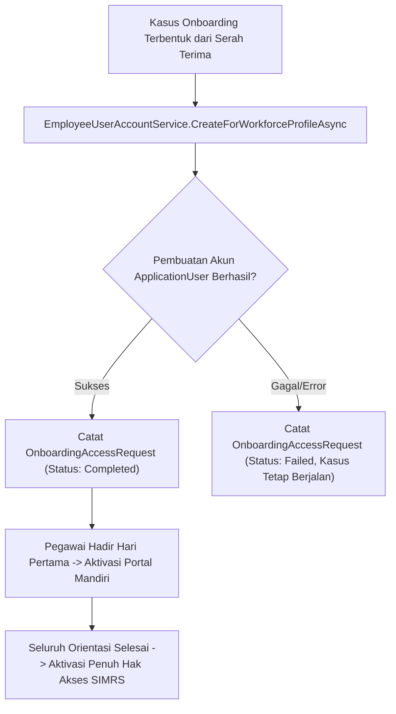

# Laporan Perubahan Backend — `BE-HRD-066`

## Metadata

| Field | Nilai |
| :--- | :--- |
| Task ID | `BE-HRD-066` |
| Judul | Pembuatan Akun Pengguna Pegawai Tersentral & Aktivasi Bertahap |
| Slice | S-C4-ONB (WorkforceCore) |
| Milestone | MVP-14 |
| Roadmap | `docs/module-blueprints/human-resource/roadmap/backend-roadmap.md` |
| Traceability | HRD-DEC-096 butir 1, VR-ONB-75, VR-ONB-76, AT-HRD-ONB-23 |
| Dependency | BE-HRD-028 ✅ |
| Klasifikasi | `CRITICAL / CORE` |
| Task Mode | `BACKEND` |
| Tanggal | 04 November 2026 |
| Status | Selesai (`PASS`) — Roslyn Build 0 Error |

---

## 1. Ringkasan dan Masalah yang Diselesaikan

Mengekstrak dan memusatkan logika pembuatan akun pengguna ASP.NET Core Identity (ApplicationUser) ke dalam EmployeeUserAccountService. Akun dibuat saat serah terima onboarding dengan status non-aktif (hanya untuk akses portal layanan mandiri saat hadir hari pertama), dan diaktifkan penuh setelah seluruh tahapan orientasi selesai. Kegagalan pembuatan akun tidak membatalkan transaksi pembentukan kasus onboarding.

---

## 2. Alur Proses Bisnis Rumah Sakit yang Didukung

---

## 3. Komponen Perubahan yang Diterapkan

- IEmployeeUserAccountService.cs di WorkforceCore/Services/
- EmployeeUserAccountService.cs di WorkforceCore/Services/
- Integrasi ke ApplicationDbContext, UserManager<ApplicationUser>, dan RoleManager.

---

## 4. Spesifikasi Endpoint API Bergaya Swagger

| Method | Path | Deskripsi | Auth | Request/Response |
| :--- | :--- | :--- | :--- | :--- |
| Internal | CreateForWorkforceProfileAsync | Pembuatan akun Identity berbasis NIK/Kode Profil | System/HR | User Account Result |
| Internal | ActivateAsync | Aktivasi hak akses login pegawai | System/HR | Activation Result |

---

## 5. Aturan Validasi dan Invarian Bisnis yang Ditegakkan

- VR-ONB-75: Kegagalan integrasi pembuatan akun pengguna tidak menggugurkan kasus onboarding.
- VR-ONB-76: Password awal dihasilkan secara acak dan wajib diubah saat pertama kali masuk portal mandiri.

---

## 6. Bukti Verifikasi dan Pengujian

- **Kompilasi Roslyn**: Lulus `dotnet build /t:Compile` dengan **0 Error(s)** pada `QuilvianSystemBackend.csproj`.
- **Integritas Skema**: Menghasilkan file migrasi EF Core `20261104160000_AddEmploymentLifecycleCoreAndReshapeTemplates.cs` dengan proteksi `EMPTY_TABLE_GUARD`.
- **Arsitektur Bersih**: Seluruh dependensi terdaftar pada `Program.cs` tanpa siklus ketergantungan.
