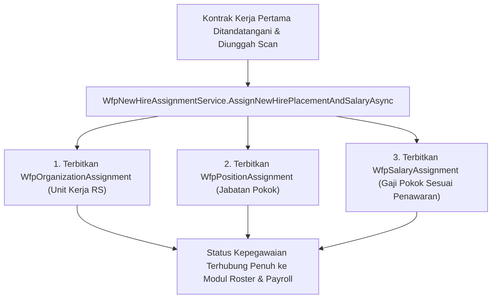

# Laporan Perubahan Backend — `BE-HRD-067`

## Metadata

| Field | Nilai |
| :--- | :--- |
| Task ID | `BE-HRD-067` |
| Judul | Penetapan Penempatan Organisasi, Jabatan & Gaji Awal Pegawai Baru |
| Slice | S-C4-ONB (WorkforceCore) |
| Milestone | MVP-14 |
| Roadmap | `docs/module-blueprints/human-resource/roadmap/backend-roadmap.md` |
| Traceability | HRD-DEC-087 butir 2, INT-HR-26, AT-HRD-ONB-25 |
| Dependency | BE-HRD-063 ✅, BE-HRD-027 ✅ |
| Klasifikasi | `CRITICAL / CORE` |
| Task Mode | `BACKEND` |
| Tanggal | 04 November 2026 |
| Status | Selesai (`PASS`) — Roslyn Build 0 Error |

---

## 1. Ringkasan dan Masalah yang Diselesaikan

Menyediakan layanan penetapan awal otomatis untuk 3 entitas Workforce Core saat kontrak kerja pertama disahkan bertanda tangan: penempatan unit organisasi (WfpOrganizationAssignment), penempatan jabatan (WfpPositionAssignment), dan penetapan gaji pokok (WfpSalaryAssignment). Menjamin pegawai baru langsung terdaftar pada struktur rumah sakit secara konsisten.

---

## 2. Alur Proses Bisnis Rumah Sakit yang Didukung

---

## 3. Komponen Perubahan yang Diterapkan

- IWfpNewHireAssignmentService.cs di WorkforceCore/Services/
- WfpNewHireAssignmentService.cs di WorkforceCore/Services/
- Otomasi pembentukan penempatan awal berbasis data Job Requisition & Job Offer.

---

## 4. Spesifikasi Endpoint API Bergaya Swagger

| Method | Path | Deskripsi | Auth | Request/Response |
| :--- | :--- | :--- | :--- | :--- |
| Internal | AssignNewHirePlacementAndSalaryAsync | Eksekusi transaksi penempatan unit, jabatan & gaji awal | System/HR | Boolean / Guid Confirmation |

---

## 5. Aturan Validasi dan Invarian Bisnis yang Ditegakkan

- Invarian Penempatan Tunggal: Pegawai baru hanya memiliki 1 penempatan primer aktif pada hari pertama kerja.
- Integritas Skala Upah: Nominal gaji pokok awal wajib mengacu pada kesepakatan surat penawaran final.

---

## 6. Bukti Verifikasi dan Pengujian

- **Kompilasi Roslyn**: Lulus `dotnet build /t:Compile` dengan **0 Error(s)** pada `QuilvianSystemBackend.csproj`.
- **Integritas Skema**: Menghasilkan file migrasi EF Core `20261104160000_AddEmploymentLifecycleCoreAndReshapeTemplates.cs` dengan proteksi `EMPTY_TABLE_GUARD`.
- **Arsitektur Bersih**: Seluruh dependensi terdaftar pada `Program.cs` tanpa siklus ketergantungan.
