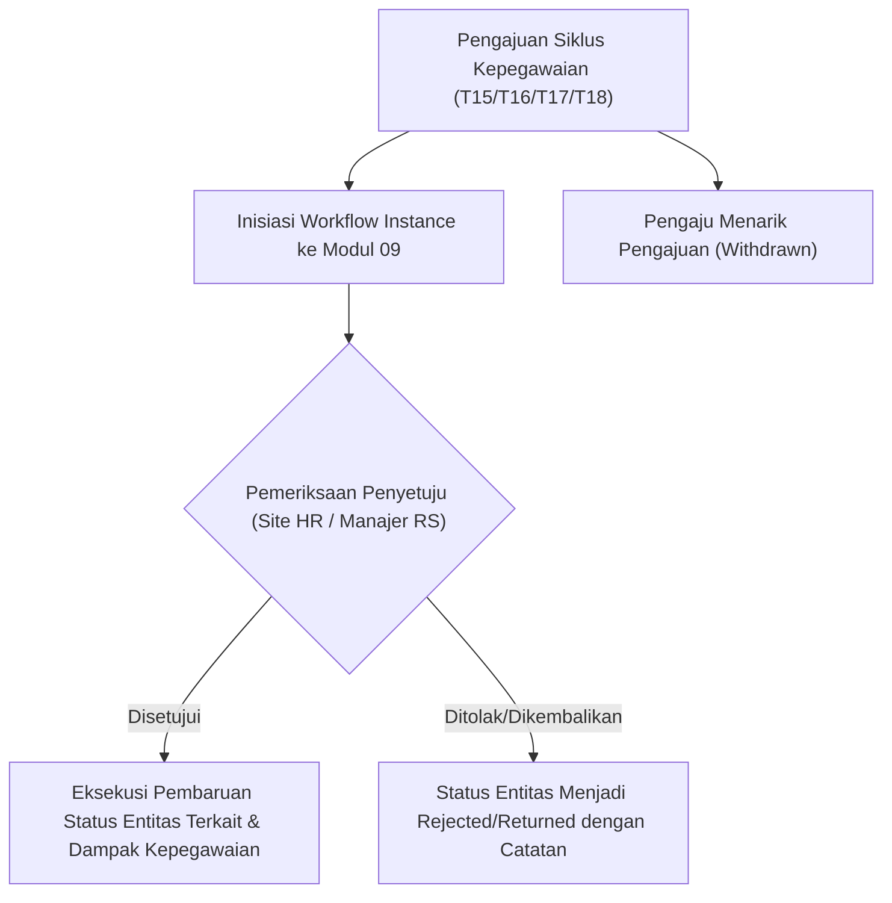

# Laporan Perubahan Backend — `BE-HRD-068`

## Metadata

| Field | Nilai |
| :--- | :--- |
| Task ID | `BE-HRD-068` |
| Judul | Integrasi Mesin Alur Kerja Persetujuan Modul 09 (T15, T16, T17, T18) |
| Slice | S-C4-ONB (LifecycleManagement) |
| Milestone | MVP-14 |
| Roadmap | `docs/module-blueprints/human-resource/roadmap/backend-roadmap.md` |
| Traceability | HRD-DEC-088, HRD-DEC-089, HRD-DEC-090, INT-HR-27, INT-HR-28 |
| Dependency | BE-HRD-063 ✅, BE-HRD-005 ✅ |
| Klasifikasi | `CRITICAL / CORE` |
| Task Mode | `BACKEND` |
| Tanggal | 04 November 2026 |
| Status | Selesai (`PASS`) — Roslyn Build 0 Error |

---

## 1. Ringkasan dan Masalah yang Diselesaikan

Menghubungkan 4 siklus persetujuan penting kepegawaian rumah sakit ke Mesin Alur Kerja Terpadu Modul 09: Evaluasi Masa Percobaan (T15), Keputusan Akhir Siklus Kontrak (T16), Koreksi Data Kontrak Berjalan (T17), dan Batch Pemasukan Data Awal Kontrak (T18). Mendukung alur pengajuan, persetujuan bertingkat, penolakan dengan catatan, serta penarikan kembali.

---

## 2. Alur Proses Bisnis Rumah Sakit yang Didukung

---

## 3. Komponen Perubahan yang Diterapkan

- IHrdEmploymentLifecycleWorkflowIntegrationService.cs di LifecycleManagement/Services/
- HrdEmploymentLifecycleWorkflowIntegrationService.cs di LifecycleManagement/Services/
- Penanganan transisi status untuk T15, T16, T17, dan T18.

---

## 4. Spesifikasi Endpoint API Bergaya Swagger

| Method | Path | Deskripsi | Auth | Request/Response |
| :--- | :--- | :--- | :--- | :--- |
| Internal | InitiateWorkflowAsync | Memulai persetujuan T15-T18 ke Mesin Alur Kerja | System/HR | Workflow Instance Guid |
| Internal | ApplyWorkflowDecisionAsync | Menerapkan keputusan persetujuan akhir dari Modul 09 | System/HR | Boolean Status |

---

## 5. Aturan Validasi dan Invarian Bisnis yang Ditegakkan

- Independensi Pemutus: Penyetuju T15-T18 dilarang sama dengan pengguna yang mengajukan.
- Audit Trail: Seluruh tanggal keputusan, user ID, dan catatan penolakan tercatat pada entitas.

---

## 6. Bukti Verifikasi dan Pengujian

- **Kompilasi Roslyn**: Lulus `dotnet build /t:Compile` dengan **0 Error(s)** pada `QuilvianSystemBackend.csproj`.
- **Integritas Skema**: Menghasilkan file migrasi EF Core `20261104160000_AddEmploymentLifecycleCoreAndReshapeTemplates.cs` dengan proteksi `EMPTY_TABLE_GUARD`.
- **Arsitektur Bersih**: Seluruh dependensi terdaftar pada `Program.cs` tanpa siklus ketergantungan.
