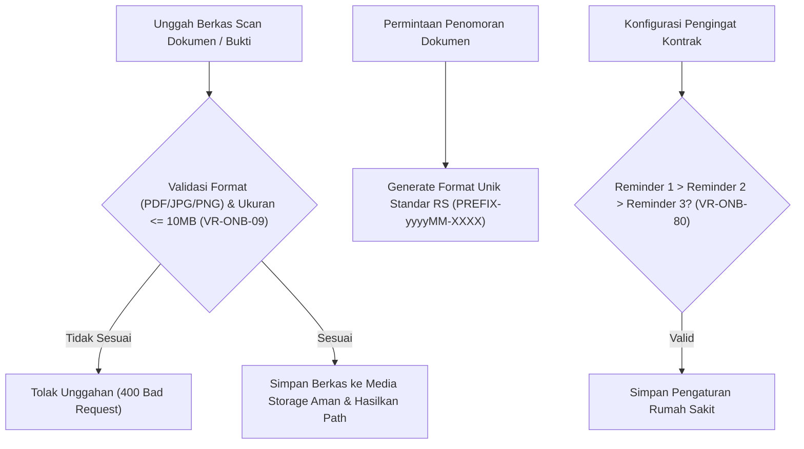

# Laporan Perubahan Backend — `BE-HRD-069`

## Metadata

| Field | Nilai |
| :--- | :--- |
| Task ID | `BE-HRD-069` |
| Judul | Pengelolaan Lampiran Berkas, Penomoran Dokumen & Konfigurasi Siklus |
| Slice | S-C4-ONB (LifecycleManagement) |
| Milestone | MVP-14 |
| Roadmap | `docs/module-blueprints/human-resource/roadmap/backend-roadmap.md` |
| Traceability | HRD-DEC-089 butir 8-9, VR-ONB-09, VR-ONB-80, AT-HRD-ONB-26 |
| Dependency | BE-HRD-063 ✅ |
| Klasifikasi | `CRITICAL / CORE` |
| Task Mode | `BACKEND` |
| Tanggal | 04 November 2026 |
| Status | Selesai (`PASS`) — Roslyn Build 0 Error |

---

## 1. Ringkasan dan Masalah yang Diselesaikan

Menyediakan generator penomoran otomatis untuk 6 jenis dokumen kepegawaian (Nomor Kasus Onboarding, Nomor Kontrak, Penilaian Masa Percobaan, Keputusan Kontrak, Koreksi Kontrak, dan Batch Kontrak), manajemen penyimpanan berkas scan tanda tangan dengan validasi format PDF/JPG/PNG maksimal 10MB (VR-ONB-09), serta layanan konfigurasi ambang batas pengingat masa kontrak dan masa percobaan per rumah sakit (VR-ONB-80).

---

## 2. Alur Proses Bisnis Rumah Sakit yang Didukung

---

## 3. Komponen Perubahan yang Diterapkan

- IHrdNumberSeriesService.cs & HrdNumberSeriesService.cs
- IHrdLifecycleAttachmentService.cs & HrdLifecycleAttachmentService.cs
- IHrdEmploymentLifecycleSettingService.cs & HrdEmploymentLifecycleSettingService.cs
- HrdEmploymentLifecycleSettingController.cs

---

## 4. Spesifikasi Endpoint API Bergaya Swagger

| Method | Path | Deskripsi | Auth | Request/Response |
| :--- | :--- | :--- | :--- | :--- |
| GET | /api/v1/corporate/human-resource/lifecycle-settings | Mengambil konfigurasi pengingat siklus per rumah sakit | HR Staff | Setting Response |
| PUT | /api/v1/corporate/human-resource/lifecycle-settings/{id} | Memperbarui batas hari pengingat kontrak & probation | HR Admin | Update Request / Response |

---

## 5. Aturan Validasi dan Invarian Bisnis yang Ditegakkan

- VR-ONB-09: Lampiran berkas scan wajib berekstensi .pdf, .jpg, .jpeg, atau .png dengan ukuran maksimal 10MB.
- VR-ONB-80: Ambang batas pengingat kontrak harus urut menurun (H-60 > H-30 > H-14).

---

## 6. Bukti Verifikasi dan Pengujian

- **Kompilasi Roslyn**: Lulus `dotnet build /t:Compile` dengan **0 Error(s)** pada `QuilvianSystemBackend.csproj`.
- **Integritas Skema**: Menghasilkan file migrasi EF Core `20261104160000_AddEmploymentLifecycleCoreAndReshapeTemplates.cs` dengan proteksi `EMPTY_TABLE_GUARD`.
- **Arsitektur Bersih**: Seluruh dependensi terdaftar pada `Program.cs` tanpa siklus ketergantungan.
