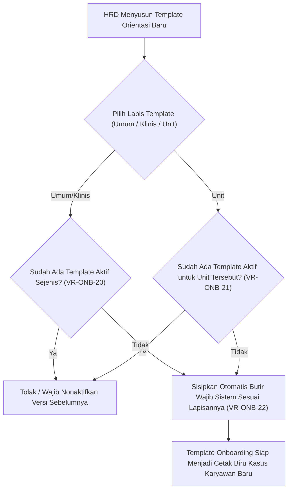

# Laporan Perubahan Backend — `BE-HRD-070`

## Metadata

| Field | Nilai |
| :--- | :--- |
| Task ID | `BE-HRD-070` |
| Judul | Manajemen Template Onboarding Tiga Lapis (Umum, Klinis & Unit) |
| Slice | S-C4-ONB (LifecycleManagement) |
| Milestone | MVP-14 |
| Roadmap | `docs/module-blueprints/human-resource/roadmap/backend-roadmap.md` |
| Traceability | HRD-DEC-086 butir 1-2, VR-ONB-20 s.d. VR-ONB-23, AT-HRD-ONB-27 |
| Dependency | BE-HRD-063 ✅ |
| Klasifikasi | `CRITICAL / CORE` |
| Task Mode | `BACKEND` |
| Tanggal | 04 November 2026 |
| Status | Selesai (`PASS`) — Roslyn Build 0 Error |

---

## 1. Ringkasan dan Masalah yang Diselesaikan

Mengelola master checklist orientasi tiga lapis: Lapis 1 (Umum - 1 aktif se-rumah sakit), Lapis 2 (Klinis - 1 aktif untuk tenaga medis/keperawatan), dan Lapis 3 (Unit - 1 aktif per unit kerja rumah sakit). Menjamin 5 butir wajib sistem (FIRST_DAY_ATTENDANCE, CONTRACT_SIGNED, FITNESS_CLEARANCE, DIRECT_SUPERVISOR_ASSIGNED, PRECEPTOR_ASSIGNED) terkunci dan otomatis disisipkan saat pembuatan template baru.

---

## 2. Alur Proses Bisnis Rumah Sakit yang Didukung

---

## 3. Komponen Perubahan yang Diterapkan

- OnboardingTemplateDtos.cs: Skema request dan response template & task.
- IHrdOnboardingTemplateService.cs & HrdOnboardingTemplateService.cs.
- HrdOnboardingTemplateController.cs: CRUD template dan pengelolaan butir checklist.

---

## 4. Spesifikasi Endpoint API Bergaya Swagger

| Method | Path | Deskripsi | Auth | Request/Response |
| :--- | :--- | :--- | :--- | :--- |
| GET | /api/v1/corporate/human-resource/onboarding-templates | Mengambil daftar template tiga lapis | HR Staff | PagedResult<TemplateListItem> |
| GET | /api/v1/corporate/human-resource/onboarding-templates/{id} | Mengambil detail template & butir tugas | HR Staff | TemplateDetailResponse |
| POST | /api/v1/corporate/human-resource/onboarding-templates | Membuat template baru dengan auto-inject butir sistem | HR Admin | CreateTemplateRequest / Response |
| PUT | /api/v1/corporate/human-resource/onboarding-templates/{id} | Memperbarui header template | HR Admin | UpdateTemplateRequest / Response |
| POST | /api/v1/corporate/human-resource/onboarding-templates/{id}/tasks | Menambah butir tugas custom pada template | HR Admin | CreateTaskRequest / Response |

---

## 5. Aturan Validasi dan Invarian Bisnis yang Ditegakkan

- VR-ONB-20: Hanya boleh ada tepat 1 template Umum dan 1 template Klinis yang aktif di seluruh sistem.
- VR-ONB-21: Hanya boleh ada tepat 1 template Unit yang aktif per unit kerja organisasi.
- VR-ONB-22: Butir sistem terkunci tidak boleh dihapus atau diubah tanda wajibnya.

---

## 6. Bukti Verifikasi dan Pengujian

- **Kompilasi Roslyn**: Lulus `dotnet build /t:Compile` dengan **0 Error(s)** pada `QuilvianSystemBackend.csproj`.
- **Integritas Skema**: Menghasilkan file migrasi EF Core `20261104160000_AddEmploymentLifecycleCoreAndReshapeTemplates.cs` dengan proteksi `EMPTY_TABLE_GUARD`.
- **Arsitektur Bersih**: Seluruh dependensi terdaftar pada `Program.cs` tanpa siklus ketergantungan.
