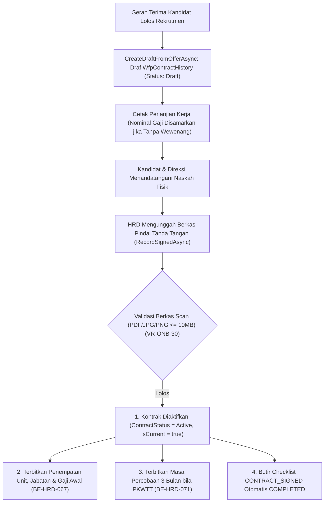

# Laporan Perubahan Backend — `BE-HRD-072`

## Metadata

| Field | Nilai |
| :--- | :--- |
| Task ID | `BE-HRD-072` |
| Judul | Penerbitan Kontrak Pertama: Draf dari Tawaran, Data Cetak & Pengesahan Tanda Tangan |
| Slice | S-C4-ONB (LifecycleManagement) |
| Milestone | MVP-14 |
| Roadmap | `docs/module-blueprints/human-resource/roadmap/backend-roadmap.md` |
| Traceability | HRD-DEC-087 butir 1-6, VR-ONB-30, VR-ONB-31, VR-ONB-34, AT-HRD-ONB-29 |
| Dependency | BE-HRD-064 ✅, BE-HRD-065 ✅, BE-HRD-067 ✅, BE-HRD-071 ✅ |
| Klasifikasi | `CRITICAL / CORE` |
| Task Mode | `BACKEND` |
| Tanggal | 04 November 2026 |
| Status | Selesai (`PASS`) — Roslyn Build 0 Error |

---

## 1. Ringkasan dan Masalah yang Diselesaikan

Menghasilkan draf kontrak kerja pertama secara idempoten dari surat penawaran kerja yang disetujui kandidat. Menyediakan API data cetak naskah perjanjian dengan penyamaran nilai nominal gaji bagi peran non-keuangan (VR-ONB-31). Menangani pencatatan pengesahan kontrak dengan unggahan berkas scan bertanda tangan (VR-ONB-30), yang secara atomik mengaktifkan kontrak, memicu penetapan penempatan & gaji awal (BE-HRD-067), membentuk masa percobaan PKWTT (BE-HRD-071), dan mencentang otomatis butir CONTRACT_SIGNED pada kasus onboarding.

---

## 2. Alur Proses Bisnis Rumah Sakit yang Didukung

---

## 3. Komponen Perubahan yang Diterapkan

- EmploymentContractDtos.cs di LifecycleManagement/DTOs/
- IHrdEmploymentContractService.cs & HrdEmploymentContractService.cs
- HrdEmploymentContractController.cs (Paged, Detail, Data Cetak, Catat Tanda Tangan, Unduh Scan).

---

## 4. Spesifikasi Endpoint API Bergaya Swagger

| Method | Path | Deskripsi | Auth | Request/Response |
| :--- | :--- | :--- | :--- | :--- |
| GET | /api/v1/corporate/human-resource/employment-contracts | Mengambil daftar seluruh riwayat kontrak kerja | HR Staff | PagedResult<ContractListItem> |
| GET | /api/v1/corporate/human-resource/employment-contracts/{id} | Mengambil detail lengkap kontrak kerja | HR Staff | EmploymentContractResponse |
| GET | /api/v1/corporate/human-resource/employment-contracts/{id}/print-data | Mengambil data cetak naskah kontrak (gaji disamarkan) | HR Staff | EmploymentContractPrintDataResponse |
| POST | /api/v1/corporate/human-resource/employment-contracts/{id}/signed | Mencatat pengesahan kontrak & unggah scan | HR Admin | RecordContractSignedRequest / Response |
| GET | /api/v1/corporate/human-resource/employment-contracts/{id}/document | Mengunduh berkas scan kontrak kerja bertanda tangan | HR Staff | FileStreamResult (PDF/JPG/PNG) |

---

## 5. Aturan Validasi dan Invarian Bisnis yang Ditegakkan

- VR-ONB-30: Pengesahan kontrak kerja wajib melampirkan berkas scan asli yang telah ditandatangani kedua belah pihak.
- VR-ONB-31: Informasi gaji pada data cetak wajib disamarkan jika pengguna tidak memiliki izin 'ViewAmount'.
- VR-ONB-34: Draf kontrak dari penawaran kerja bersifat idempoten per tawaran.

---

## 6. Bukti Verifikasi dan Pengujian

- **Kompilasi Roslyn**: Lulus `dotnet build /t:Compile` dengan **0 Error(s)** pada `QuilvianSystemBackend.csproj`.
- **Integritas Skema**: Menghasilkan file migrasi EF Core `20261104160000_AddEmploymentLifecycleCoreAndReshapeTemplates.cs` dengan proteksi `EMPTY_TABLE_GUARD`.
- **Arsitektur Bersih**: Seluruh dependensi terdaftar pada `Program.cs` tanpa siklus ketergantungan.
