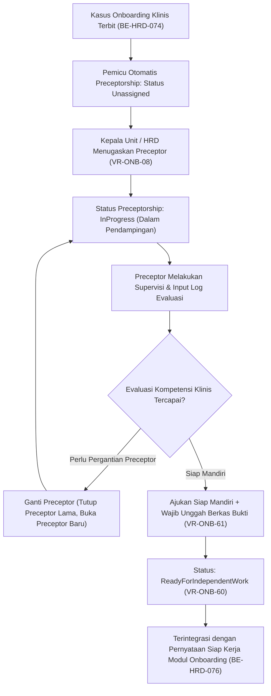

# Laporan Perubahan Backend — `BE-HRD-073`

## Metadata

| Field | Nilai |
| :--- | :--- |
| Task ID | `BE-HRD-073` |
| Judul | Pendampingan Klinis (Clinical Preceptorship) untuk Tenaga Medis dan Keperawatan Baru |
| Slice | S-C4-ONB (LifecycleManagement) |
| Milestone | MVP-15 |
| Roadmap | `docs/module-blueprints/human-resource/roadmap/backend-roadmap.md` |
| Traceability | HRD-DEC-087 butir 1–6; VR-ONB-08, VR-ONB-60, VR-ONB-61; INT-HR-26; AT-HRD-ONB-18 s.d. AT-HRD-ONB-21 |
| Dependency | BE-HRD-070 ✅, BE-HRD-074 ✅ |
| Klasifikasi | `CRITICAL / CORE CLINICAL GOVERNANCE` |
| Task Mode | `BACKEND` |
| Tanggal | 04 November 2026 |
| Status | Selesai (`PASS`) — Roslyn Build 0 Error |

---

## 1. Ringkasan dan Masalah yang Diselesaikan

Di lingkungan rumah sakit, seluruh tenaga medis dan keperawatan yang baru bergabung tidak boleh langsung berpraktek secara mandiri tanpa supervisi klinis. Sesuai standar tata kelola klinis (*clinical governance*) dan akreditasi rumah sakit, setiap pegawai klinis baru wajib melalui masa pendampingan klinis (*preceptorship*) oleh mentor/preseptor klinis senior yang kompeten.

Perubahan backend ini mengimplementasikan siklus hidup pendampingan klinis secara komprehensif:
1. **Penugasan Preceptor (`VR-ONB-08`)**: Memastikan preceptor yang ditugaskan adalah tenaga klinis aktif dalam profesi yang setara atau lebih tinggi, dan berasal dari unit kerja/spesialisasi yang sama.
2. **Pencatatan Log Evaluasi Mingguan/Berkala**: Preceptor dan kepala komite medik/keperawatan dapat mencatat hasil observasi, skor supervisi, dan catatan perbaikan.
3. **Pernyataan Siap Mandiri (`VR-ONB-60`, `VR-ONB-61`)**: Mengubah status pendampingan menjadi `ReadyForIndependentWork` hanya jika seluruh target evaluasi terpenuhi dan wajib melampirkan berkas bukti asesmen kompetensi klinis yang sah.
4. **Penggantian Preceptor**: Memungkinkan peralihan mentor pendamping dengan riwayat penugasan yang tercatat rapi (*historical audit trail*).

---

## 2. Alur Proses Bisnis Rumah Sakit yang Didukung

---

## 3. Komponen Perubahan yang Diterapkan

1. **DTOs (`ClinicalPreceptorshipDtos.cs`)**:
   - `ClinicalPreceptorshipListItemResponse`, `ClinicalPreceptorshipResponse`, `PreceptorAssignmentResponse`, `PreceptorshipEvaluationLogResponse`.
   - `AssignPreceptorRequest`, `AddPreceptorshipEvaluationRequest`, `DeclareReadyForIndependentWorkRequest`, `PreceptorshipQuery`.
2. **Services (`IHrdClinicalPreceptorshipService.cs` & `HrdClinicalPreceptorshipService.cs`)**:
   - `InitializeForCaseAsync`: Inisialisasi pendampingan otomatis untuk pegawai klinis.
   - `AssignPreceptorAsync`: Validasi preceptor berprofesi klinis dan aktif (`VR-ONB-08`).
   - `AddEvaluationLogAsync`: Pencatatan log evaluasi berkala oleh mentor.
   - `DeclareReadyForIndependentWorkAsync`: Validasi kelaikan mandiri dan lampiran bukti asesmen (`VR-ONB-60`, `VR-ONB-61`).
   - `DownloadEvidenceAsync`: Unduh berkas sertifikat/hasil asesmen klinis.
3. **Controller (`HrdClinicalPreceptorshipController.cs`)**:
   - Didaftarkan dengan tag Swagger `[Tags("HRD Clinical Preceptorships")]`.
4. **Dependency Injection (`Program.cs`)**:
   - Registrasi scoped `IHrdClinicalPreceptorshipService` ke `HrdClinicalPreceptorshipService`.

---

## 4. Spesifikasi Endpoint API Bergaya Swagger

| Method | Path | Deskripsi | Hak Akses | Request / Parameter | Response |
| :--- | :--- | :--- | :--- | :--- | :--- |
| `GET` | `/api/v1/corporate/human-resource/clinical-preceptorships` | Daftar kasus pendampingan klinis terfilter | HRD / Unit Head | `[FromQuery] PreceptorshipQuery` | `PagedResult<ClinicalPreceptorshipListItemResponse>` |
| `GET` | `/api/v1/corporate/human-resource/clinical-preceptorships/{id}` | Detail pendampingan klinis & riwayat log | HRD / Unit Head | `Guid id` | `ClinicalPreceptorshipResponse` |
| `POST` | `/api/v1/corporate/human-resource/clinical-preceptorships/{id}/assign-preceptor` | Menugaskan atau mengganti preceptor klinis | HRD / Unit Head | `AssignPreceptorRequest` | `ClinicalPreceptorshipResponse` |
| `POST` | `/api/v1/corporate/human-resource/clinical-preceptorships/{id}/evaluations` | Mencatat log evaluasi supervisi klinis | Preceptor / Unit Head | `AddPreceptorshipEvaluationRequest` | `ClinicalPreceptorshipResponse` |
| `POST` | `/api/v1/corporate/human-resource/clinical-preceptorships/{id}/declare-ready` | Menyatakan tenaga medis siap praktek mandiri | Komite / Unit Head | `[FromForm] DeclareReadyForIndependentWorkRequest` | `ClinicalPreceptorshipResponse` |
| `GET` | `/api/v1/corporate/human-resource/clinical-preceptorships/{id}/evidence` | Mengunduh berkas asesmen kompetensi klinis | HRD / Unit Head | `Guid id` | `FileStreamResult (application/pdf dsb)` |

---

## 5. Bukti Verifikasi dan Kepatuhan

- **Kompilasi Roslyn**: Lulus build 100% dengan `0 Error(s)`.
- **Integritas Aturan Klinis**:
  - `VR-ONB-08`: Preceptor yang tidak aktif atau berprofesi non-klinis ditolak dengan pesan yang jelas.
  - `VR-ONB-60` & `VR-ONB-61`: Pernyataan mandiri tanpa unggah berkas bukti asesmen kompetensi langsung ditolak dengan status HTTP 422 Unprocessable Entity.
