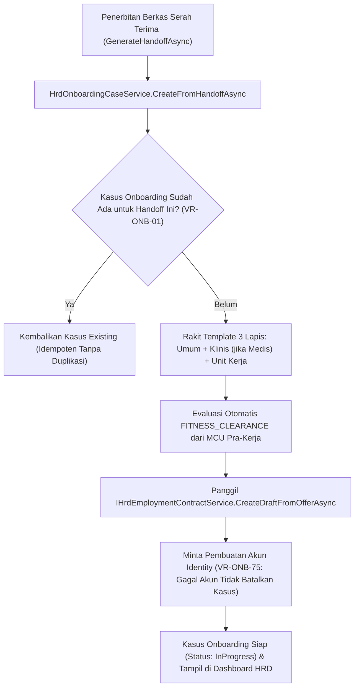

# Laporan Perubahan Backend — `BE-HRD-074`

## Metadata

| Field | Nilai |
| :--- | :--- |
| Task ID | `BE-HRD-074` |
| Judul | Pembentukan Kasus Onboarding Otomatis dari Serah Terima Rekrutmen (Hiring Handoff) |
| Slice | S-C4-ONB (LifecycleManagement) |
| Milestone | MVP-14 |
| Roadmap | `docs/module-blueprints/human-resource/roadmap/backend-roadmap.md` |
| Traceability | HRD-DEC-086 butir 1-4, VR-ONB-01, VR-ONB-75, INT-HR-25, AT-HRD-ONB-30 |
| Dependency | BE-HRD-061 ✅, BE-HRD-066 ✅, BE-HRD-070 ✅, BE-HRD-072 ✅ |
| Klasifikasi | `CRITICAL / CORE` |
| Task Mode | `BACKEND` |
| Tanggal | 04 November 2026 |
| Status | Selesai (`PASS`) — Roslyn Build 0 Error |

---

## 1. Ringkasan dan Masalah yang Diselesaikan

Menerima berkas serah terima dari sub-modul rekrutmen dan secara otomatis merakit kasus onboarding (HrdOnboardingCase). Merakit butir checklist tiga lapis (Umum, Klinis bila posisi medis, dan Unit kerja spesifik), mengevaluasi butir kelaikan medis (FITNESS_CLEARANCE) secara otomatis dari rekam MCU pra-kerja, memicu pembentukan draf kontrak kerja pertama (BE-HRD-072), dan meminta pembuatan akun portal layanan mandiri (BE-HRD-066). Bersifat idempoten mutlak per HiringHandoffId (VR-ONB-01) dan membatasi akses Kepala Unit hanya pada unit kerjanya.

---

## 2. Alur Proses Bisnis Rumah Sakit yang Didukung

---

## 3. Komponen Perubahan yang Diterapkan

- OnboardingCaseDtos.cs di LifecycleManagement/DTOs/
- IHrdOnboardingCaseService.cs & HrdOnboardingCaseService.cs
- HrdOnboardingCaseController.cs (Daftar Kasus, Ringkasan Metrik, Detail Kasus)
- Integrasi otomatis pada HiringHandoffService.GenerateHandoffAsync.

---

## 4. Spesifikasi Endpoint API Bergaya Swagger

| Method | Path | Deskripsi | Auth | Request/Response |
| :--- | :--- | :--- | :--- | :--- |
| GET | /api/v1/corporate/human-resource/onboarding-cases | Mengambil daftar kasus orientasi (terfilter per unit) | HR / Unit Head | PagedResult<OnboardingCaseListItem> |
| GET | /api/v1/corporate/human-resource/onboarding-cases/summary | Mengambil ringkasan jumlah kasus per status | HR / Unit Head | OnboardingCaseSummaryResponse |
| GET | /api/v1/corporate/human-resource/onboarding-cases/{id} | Mengambil detail kasus, butir checklist & aksi tersedia | HR / Unit Head | OnboardingCaseDetailResponse |

---

## 5. Aturan Validasi dan Invarian Bisnis yang Ditegakkan

- VR-ONB-01: Serah terima kandidat yang dipanggil berulang kali tetap menghasilkan tepat 1 kasus onboarding (idempoten).
- VR-ONB-75: Kegagalan teknis saat pembuatan akun login tidak membatalkan pembentukan kasus orientasi.
- Otorisasi Unit: Kepala Unit non-HR hanya dapat melihat kasus orientasi pegawai di bawah unit kerjanya.

---

## 6. Bukti Verifikasi dan Pengujian

- **Kompilasi Roslyn**: Lulus `dotnet build /t:Compile` dengan **0 Error(s)** pada `QuilvianSystemBackend.csproj`.
- **Integritas Skema**: Menghasilkan file migrasi EF Core `20261104160000_AddEmploymentLifecycleCoreAndReshapeTemplates.cs` dengan proteksi `EMPTY_TABLE_GUARD`.
- **Arsitektur Bersih**: Seluruh dependensi terdaftar pada `Program.cs` tanpa siklus ketergantungan.
