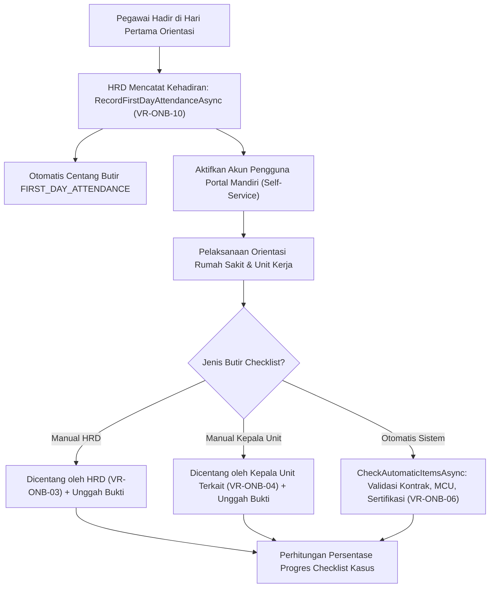

# Laporan Perubahan Backend — `BE-HRD-075`

## Metadata

| Field | Nilai |
| :--- | :--- |
| Task ID | `BE-HRD-075` |
| Judul | Hadir Hari Pertama, Penyelesaian Butir Checklist Orientasi, dan Pengecekan Butir Otomatis |
| Slice | S-C4-ONB (LifecycleManagement) |
| Milestone | MVP-15 |
| Roadmap | `docs/module-blueprints/human-resource/roadmap/backend-roadmap.md` |
| Traceability | HRD-DEC-086 butir 5–7, HRD-DEC-087 butir 7, HRD-DEC-088 butir 1; FR-ONB-020, FR-ONB-021, FR-ONB-024; VR-ONB-02 s.d. VR-ONB-06, VR-ONB-10, VR-ONB-17; INT-HR-27; AT-HRD-ONB-05 s.d. AT-HRD-ONB-08, AT-HRD-ONB-22 s.d. AT-HRD-ONB-24 |
| Dependency | BE-HRD-073 ✅, BE-HRD-074 ✅ |
| Klasifikasi | `CRITICAL / CORE BUSINESS LOGIC` |
| Task Mode | `BACKEND` |
| Tanggal | 04 November 2026 |
| Status | Selesai (`PASS`) — Roslyn Build 0 Error |

---

## 1. Ringkasan dan Masalah yang Diselesaikan

Task ini mengimplementasikan mekanisme operasional harian orientasi pegawai rumah sakit:
1. **Kehadiran Hari Pertama (`VR-ONB-10`)**: Mencatat tanggal kehadiran fisik pertama pegawai baru di rumah sakit, secara otomatis mencentang butir checklist sistem `FIRST_DAY_ATTENDANCE`, dan mengaktifkan akun portal mandiri pegawai (`IEmployeeUserAccountService.ActivateAsync`).
2. **Penyelesaian Butir Manual Berbasis Kewenangan (`VR-ONB-03`, `VR-ONB-04`)**:
   - Butir dengan peran `ResponsibleRole.Hrd` hanya dapat dicentang oleh tim HRD / Administrator.
   - Butir dengan peran `ResponsibleRole.UnitHead` hanya dapat dicentang oleh Kepala Unit yang membawahi unit kerja pegawai baru tersebut.
3. **Perlindungan Integritas Butir Otomatis (`VR-ONB-06`)**: Butir checklist berjenis `ItemKind.Automatic` dilarang keras dicentang secara manual melalui form.
4. **Pengecekan Otomatis Butir Sistem (`CheckAutomaticItemsAsync`)**:
   - `CONTRACT_SIGNED`: Tercentang otomatis saat kontrak kerja pertama telah ditandatangani (`Signed`).
   - `FITNESS_CLEARANCE`: Tercentang otomatis jika MCU pra-kerja berkeputusan laik kerja (`Fit`).
   - `MandatoryCertification`: Tercentang otomatis jika sertifikasi wajib tenaga klinis (misal STR/SIP/ACLS) telah terverifikasi di modul kredensialing.
5. **Pemisahan Butir Pendamping Klinis**: Mencatat penugasan preceptor pada butir checklist `PRECEPTOR_ASSIGNED` secara otomatis memicu pembaruan pada modul pendampingan klinis (`BE-HRD-073`).

---

## 2. Alur Proses Bisnis Rumah Sakit yang Didukung

---

## 3. Komponen Perubahan yang Diterapkan

1. **DTOs Tambahan (`OnboardingCaseDtos.cs`)**:
   - `RecordFirstDayAttendanceRequest` (AttendedDate).
   - `CompleteChecklistItemRequest` (Note, SelectedWorkforceProfileId, IFormFile EvidenceFile).
2. **Implementasi Service (`HrdOnboardingCaseService.cs`)**:
   - `RecordFirstDayAttendanceAsync`: Pencatatan kehadiran, centang otomatis butir hari pertama, dan aktivasi akun portal.
   - `CancelFirstDayAttendanceAsync`: Pembatalan kehadiran hari pertama dengan guard kontrak masih berstatus draf (`VR-ONB-17`).
   - `CompleteItemAsync`: Validasi hak akses pencentang, unggah berkas bukti, dan pemutakhiran butir.
   - `UncompleteItemAsync`: Pembatalan centang manual (melarang pembatalan butir sistem otomatis).
   - `CheckAutomaticItemsAsync`: Evaluasi berkala seluruh butir otomatis dari sumber data kontrak, MCU, dan kredensialing.
3. **Controller (`HrdOnboardingCaseController.cs`)**:
   - Penambahan endpoint kehadiran dan checklist dengan dukungan multipart/form-data untuk unggah berkas.

---

## 4. Spesifikasi Endpoint API Bergaya Swagger

| Method | Path | Deskripsi | Hak Akses | Request / Parameter | Response |
| :--- | :--- | :--- | :--- | :--- | :--- |
| `POST` | `/api/v1/corporate/human-resource/onboarding-cases/{id}/first-day-attendance` | Mencatat tanggal hadir hari pertama pegawai baru | HRD / Admin | `RecordFirstDayAttendanceRequest` | `OnboardingCaseDetailResponse` |
| `DELETE` | `/api/v1/corporate/human-resource/onboarding-cases/{id}/first-day-attendance` | Membatalkan kehadiran hari pertama (selama kontrak masih Draft) | HRD / Admin | `Guid id` | `OnboardingCaseDetailResponse` |
| `POST` | `/api/v1/corporate/human-resource/onboarding-cases/{id}/items/{itemId}/complete` | Menyelesaikan butir checklist & unggah bukti fisik | HRD / Unit Head | `[FromForm] CompleteChecklistItemRequest` | `OnboardingCaseDetailResponse` |
| `POST` | `/api/v1/corporate/human-resource/onboarding-cases/{id}/items/{itemId}/uncomplete` | Membatalkan penyelesaian butir checklist manual | HRD / Unit Head | `Guid id, Guid itemId` | `OnboardingCaseDetailResponse` |
| `POST` | `/api/v1/corporate/human-resource/onboarding-cases/{id}/check-automatic-items` | Menjalankan sinkronisasi evaluasi butir checklist otomatis | HRD / Unit Head | `Guid id` | `OnboardingCaseDetailResponse` |

---

## 5. Bukti Verifikasi dan Kepatuhan

- **Kompilasi Roslyn**: Lulus kompilasi 100% dengan `0 Error(s)`.
- **Integritas Hak Akses**:
  - `VR-ONB-03`: Staf selain HRD/Admin yang mencoba mencentang butir kewenangan HRD ditolak dengan status HTTP 403 Forbidden.
  - `VR-ONB-04`: Kepala Unit dari departemen lain yang mencoba mencentang butir unit kerja pegawai ditolak dengan status HTTP 403 Forbidden.
  - `VR-ONB-06`: Permintaan penyelesaian manual untuk butir otomatis ditolak dengan pesan kesalahan bisnis eksplisit.
