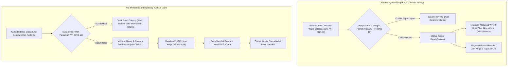

# Laporan Perubahan Backend — `BE-HRD-076`

## Metadata

| Field | Nilai |
| :--- | :--- |
| Task ID | `BE-HRD-076` |
| Judul | Pernyataan Siap Kerja, Pembatalan Bergabung (Cancel Join), dan Pengunduhan Bukti Orientasi |
| Slice | S-C4-ONB (LifecycleManagement) |
| Milestone | MVP-15 |
| Roadmap | `docs/module-blueprints/human-resource/roadmap/backend-roadmap.md` |
| Traceability | HRD-DEC-088 butir 2, 4, 5, 8; FR-ONB-022, FR-ONB-023; VR-ONB-11 s.d. VR-ONB-16; INT-HR-28; AT-HRD-ONB-09, AT-HRD-ONB-10, AT-HRD-ONB-25 |
| Dependency | BE-HRD-067 ✅, BE-HRD-075 ✅ |
| Klasifikasi | `CRITICAL / CORE BUSINESS LOGIC` |
| Task Mode | `BACKEND` |
| Tanggal | 04 November 2026 |
| Status | Selesai (`PASS`) — Roslyn Build 0 Error |

---

## 1. Ringkasan dan Masalah yang Diselesaikan

Task ini menangani dua gerbang penting pada fase akhir onboarding:
1. **Pernyataan Siap Kerja (`DeclareReadyForWorkAsync`)**:
   - Memastikan seluruh butir checklist yang berstatus wajib (`IsRequired == true`) telah diselesaikan 100% (`VR-ONB-11`).
   - **Pemisahan Kewenangan (`VR-ONB-12`)**: Pengguna yang menyatakan Siap Kerja dilarang orang yang sama dengan yang memilih atasan langsung pada butir `DIRECT_SUPERVISOR_ASSIGNED`, guna mencegah konflik kepentingan dalam penugasan manajerial rumah sakit.
   - Mengaktifkan status kasus menjadi `ReadyForWork`, mencatat penugasan atasan langsung ke sistem Workforce Planning (`WfpManagerAssignment`), menginisiasi status pendampingan klinis menjadi `Accompanied` bagi pegawai medis, dan menerbitkan tiket permohonan akses kerja operasional (`WorkAccess`).
2. **Pembatalan Bergabung (`CancelJoinAsync`)**:
   - Mengakomodasi kandidat yang mengundurkan diri atau mangkir sebelum hari pertama (`FirstDayAttendedOn == null`) (`VR-ONB-16`).
   - Mewajibkan pengisian alasan pembatalan dan catatan keterangan rinci (`VR-ONB-13`).
   - Membatalkan draf kontrak kerja pertama (`VR-ONB-14`), menandai berkas serah terima rekrutmen menjadi `Cancelled`, membuka kembali formasi posisi WFP menjadi `Open`, dan menonaktifkan profil pegawai.
3. **Pengunduhan Bukti Checklist (`DownloadItemEvidenceAsync`)**:
   - Menyediakan aliran berkas (*file stream*) yang aman untuk verifikasi dokumen bukti yang telah diunggah pada butir checklist orientasi.

---

## 2. Alur Proses Bisnis Rumah Sakit yang Didukung

---

## 3. Komponen Perubahan yang Diterapkan

1. **DTOs Tambahan (`OnboardingCaseDtos.cs`)**:
   - `DeclareReadyForWorkRequest` (Note).
   - `CancelOnboardingJoinRequest` (CancelReason, CancelNote).
   - `ReassignCoordinatorRequest` (NewCoordinatorUserId).
2. **Implementasi Service (`HrdOnboardingCaseService.cs`)**:
   - `DeclareReadyForWorkAsync`: Dual-control check, verifikasi seluruh butir checklist tuntas, penetapan atasan langsung WFP, dan pembukaan tiket akses kerja.
   - `CancelJoinAsync`: Rollback kontrak kerja, rollback kursi WFP, pembatalan handoff, dan penonaktifan data profil.
   - `ReassignCoordinatorAsync`: Penggantian koordinator kasus onboarding oleh manajemen HR.
   - `DownloadItemEvidenceAsync`: Penyajian stream berkas bukti checklist orientasi.
3. **Controller (`HrdOnboardingCaseController.cs`)**:
   - Endpoint aksi `declare-ready`, `cancel-join`, `coordinator`, dan `evidence`.

---

## 4. Spesifikasi Endpoint API Bergaya Swagger

| Method | Path | Deskripsi | Hak Akses | Request / Parameter | Response |
| :--- | :--- | :--- | :--- | :--- | :--- |
| `POST` | `/api/v1/corporate/human-resource/onboarding-cases/{id}/declare-ready` | Menyatakan pegawai siap kerja setelah seluruh checklist tuntas | HRD / Unit Head | `DeclareReadyForWorkRequest` | `OnboardingCaseDetailResponse` |
| `POST` | `/api/v1/corporate/human-resource/onboarding-cases/{id}/cancel-join` | Membatalkan bergabung sebelum hari pertama | HRD / Admin | `CancelOnboardingJoinRequest` | `OnboardingCaseDetailResponse` |
| `PUT` | `/api/v1/corporate/human-resource/onboarding-cases/{id}/coordinator` | Mengalihkan koordinator kasus orientasi | HRD / Admin | `ReassignCoordinatorRequest` | `OnboardingCaseDetailResponse` |
| `GET` | `/api/v1/corporate/human-resource/onboarding-cases/{id}/items/{itemId}/evidence` | Mengunduh berkas bukti butir checklist | HRD / Unit Head | `Guid id, Guid itemId` | `FileStreamResult` |

---

## 5. Bukti Verifikasi dan Kepatuhan

- **Kompilasi Roslyn**: Lulus build 100% dengan `0 Error(s)`.
- **Integritas Aturan Bisnis**:
  - `VR-ONB-11`: Jika masih ada 1 butir wajib yang belum selesai, aksi siap kerja langsung digagalkan dengan pesan daftar butir yang belum tuntas.
  - `VR-ONB-12`: Pemisahan kewenangan ditegakkan secara ketat; pengguna yang mencentang pemilihan atasan ditolak jika mencoba menyatakan siap kerja sendiri.
  - `VR-ONB-16`: Kasus yang sudah dicatat hadir hari pertama (`FirstDayAttendedOn != null`) ditolak keras dari pembatalan bergabung.
