# Laporan Perubahan Backend — `BE-HRD-077`

## Metadata

| Field | Nilai |
| :--- | :--- |
| Task ID | `BE-HRD-077` |
| Judul | Manajemen Permintaan Akun Pengguna dan Tiket Akses Kerja Onboarding |
| Slice | S-C4-ONB (LifecycleManagement) |
| Milestone | MVP-15 |
| Roadmap | `docs/module-blueprints/human-resource/roadmap/backend-roadmap.md` |
| Traceability | HRD-DEC-088 butir 3, 6, 8, HRD-DEC-032; FR-ONB-023; VR-ONB-75 s.d. VR-ONB-77; INT-HR-34; AT-HRD-ONB-26 |
| Dependency | BE-HRD-074 ✅ |
| Klasifikasi | `CORE SECURITY & WORKFORCE ACCESS` |
| Task Mode | `BACKEND` |
| Tanggal | 04 November 2026 |
| Status | Selesai (`PASS`) — Roslyn Build 0 Error |

---

## 1. Ringkasan dan Masalah yang Diselesaikan

Pegawai baru di rumah sakit memerlukan dua jenis akses sistem informasi:
1. **Akun Pengguna Mandiri (`AccountCreation`)**: Akun untuk mengakses aplikasi portal pegawai (pengajuan cuti, lihat jadwal, data profil).
2. **Tiket Akses Kerja Operasional (`WorkAccess`)**: Tiket permintaan akses ke sistem operasional spesifik (SIMRS, Rekam Medis Elektronik, Farmasi, Laboratorium, Kasir) yang ditangani oleh tim IT / Administrator Rumah Sakit.

Perubahan backend ini menyediakan alur kerja yang terstruktur dan aman:
1. **Daftar Permintaan Akses Terfilter (`VR-ONB-75`)**: Menyediakan daftar antrean permintaan akses bagi Administrator/IT berdasarkan jenis permintaan (`requestType`), status (`requestStatus`), dan lokasi cabang rumah sakit (`hospitalSiteId`).
2. **Penyelesaian Tiket Akses Kerja (`VR-ONB-76`)**: Administrator/IT dapat menandai tiket `WorkAccess` selesai (`Completed`) disertai catatan konfigurasi akses yang telah diberikan. Aksi ini dibatasi ketat hanya untuk tiket bertipe `WorkAccess` dengan status `Requested`.
3. **Pengulangan Pembuatan Akun yang Gagal (`VR-ONB-77`, `AT-HRD-ONB-26`)**: Jika proses otomatisasi pembuatan akun awal mengalami kegagalan (misalnya karena data email belum lengkap pada profil), tim HRD dapat memperbaiki data email profil lalu memicu pengulangan (`retry`). Bila akun berhasil dibuat dan pegawai sudah hadir hari pertama, akun portal mandiri akan langsung diaktifkan secara otomatis.
4. **Prinsip Keamanan Tanpa Peran Liar**: Sub-modul Lifecycle Management sama sekali tidak menetapkan peran wewenang (roles) secara sepihak kepada akun baru, mematuhi prinsip *least privilege*.

---

## 2. Alur Proses Bisnis Rumah Sakit yang Didukung

```mermaid
flowchart TD
    subgraph WorkAccessQueue["Antrean Tiket Akses Kerja Operasional (IT/Admin)"]
        A["Pegawai Dinyatakan Siap Kerja (Declare Ready)"] --> B["Terbit Tiket WorkAccess: Status Requested"]
        B --> C["Tim IT Mengkonfigurasi Akses Komputer, Jaringan, dan Akun SIMRS"]
        C --> D["IT Memanggil MarkCompletedAsync (VR-ONB-76)"]
        D --> E["Tiket WorkAccess: Status Completed + Catatan Konfigurasi"]
    end

    subgraph AccountRetry["Alur Pengulangan Pembuatan Akun (HRD)"]
        F["Pembuatan Akun Awal Gagal (Misal Email Kosong)"] --> G["Tiket AccountCreation: Status Failed (VR-ONB-75)"]
        G --> H["HRD Memperbarui Alamat Email di Profil Pegawai (AT-HRD-ONB-26)"]
        H --> I["HRD Memanggil RetryAccountCreationAsync (VR-ONB-77)"]
        I --> J{"Panggilan CreateForWorkforceProfileAsync Berhasil?"}
        J -->|Gagal Lagi| K["Update FailureMessage & Status Tetap Failed"]
        J -->|Berhasil| L["Tiket: Status Completed, Simpan ApplicationUserId"]
        L --> M{"Sudah Hadir Hari Pertama?"}
        M -->|Ya| N["Aktifkan Akun Pengguna Langsung (ActivateAsync)"]
        M -->|Belum| O["Menunggu Kehadiran Hari Pertama untuk Aktivasi"]
    end
```

---

## 3. Komponen Perubahan yang Diterapkan

1. **DTOs (`OnboardingAccessDtos.cs`)**:
   - `OnboardingAccessQuery`: Filter pencarian (PageNumber, PageSize, RequestType, RequestStatus, HospitalSiteId, Search).
   - `CompleteAccessRequest`: Catatan penyelesaian tiket akses.
   - `OnboardingAccessListItemResponse`: Data terpadu informasi tiket, pegawai, kasus onboarding, dan status akun.
2. **Services (`IHrdOnboardingAccessService.cs` & `HrdOnboardingAccessService.cs`)**:
   - `GetPagedAsync`: Pencarian dan paginasi daftar tiket akses onboarding.
   - `GetByIdAsync`: Detail tiket akses dan relasi kasusnya.
   - `MarkCompletedAsync`: Validasi `VR-ONB-76` dan penyelesaian tiket akses kerja oleh IT.
   - `RetryAccountCreationAsync`: Validasi `VR-ONB-77`, pengecekan email, pembuatan ulang akun melalui `IEmployeeUserAccountService`, dan aktivasi kondisional.
3. **Controller (`HrdOnboardingAccessRequestController.cs`)**:
   - Didaftarkan dengan tag Swagger `[Tags("Corporate / Human Resource / Lifecycle Management / Onboarding Access Request")]`.
   - Mendukung rute canonical `api/v1/corporate/human-resource/lifecycle-management/onboarding-access-requests` dan alias `api/v1/corporate/human-resource/onboarding-access-requests`.
4. **Dependency Injection (`Program.cs`)**:
   - Registrasi scoped `IHrdOnboardingAccessService` ke `HrdOnboardingAccessService`.

---

## 4. Spesifikasi Endpoint API Bergaya Swagger

| Method | Path | Deskripsi | Hak Akses | Request / Parameter | Response |
| :--- | :--- | :--- | :--- | :--- | :--- |
| `GET` | `/api/v1/corporate/human-resource/lifecycle-management/onboarding-access-requests` | Daftar tiket permintaan akses terfilter | IT / HRD / Admin | `[FromQuery] OnboardingAccessQuery` | `PagedResult<OnboardingAccessListItemResponse>` |
| `GET` | `/api/v1/corporate/human-resource/lifecycle-management/onboarding-access-requests/{id}` | Detail tiket permintaan akses | IT / HRD / Admin | `Guid id` | `OnboardingAccessListItemResponse` |
| `POST` | `/api/v1/corporate/human-resource/lifecycle-management/onboarding-access-requests/{id}/complete` | Menandai tiket akses kerja operasional telah selesai disiapkan | IT / Admin | `[FromBody] CompleteAccessRequest` | `OnboardingAccessListItemResponse` |
| `POST` | `/api/v1/corporate/human-resource/lifecycle-management/onboarding-access-requests/{id}/retry` | Mengulang pembuatan akun portal mandiri yang sebelumnya gagal | HRD / Admin | `Guid id` | `OnboardingAccessListItemResponse` |

---

## 5. Bukti Verifikasi dan Kepatuhan

- **Kompilasi Roslyn**: Lulus build 100% dengan `0 Error(s)`.
- **Integritas Aturan Bisnis**:
  - `VR-ONB-76`: Penandaan selesai terhadap tiket bertipe selain `WorkAccess` (seperti `AccountCreation`) atau berstatus selain `Requested` langsung ditolak dengan pesan HTTP 400 Bad Request.
  - `VR-ONB-77` & `AT-HRD-ONB-26`: Pengulangan pembuatan akun tanpa data email valid pada profil pegawai ditolak secara preventif sebelum memanggil engine Identity.
