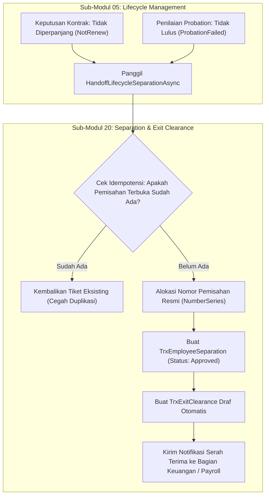

# Laporan Perubahan Backend — `BE-HRD-078`

## Metadata

| Field | Nilai |
| :--- | :--- |
| Task ID | `BE-HRD-078` |
| Judul | Serah Terima Pemisahan ke Sub-Modul 20 (`ResignationLifecycleHandoffService`) |
| Slice | S-C4-ONB (LifecycleManagement) |
| Milestone | MVP-16 |
| Roadmap | `docs/module-blueprints/human-resource/roadmap/backend-roadmap.md` |
| Traceability | HRD-DEC-082; HRD-TF-054; FR-ONB-034, FR-ONB-052; INT-HR-29 |
| Dependency | BE-HRD-014 ✅ |
| Klasifikasi | `CORE LIFECYCLE HANDOFF & SEPARATION INTEGRATION` |
| Task Mode | `BACKEND` |
| Tanggal | 04 November 2026 |
| Status | Selesai (`PASS`) — Roslyn Build 0 Error |

---

## 1. Ringkasan dan Masalah yang Diselesaikan

Di lingkungan rumah sakit, pengakhiran hubungan kerja tidak hanya berasal dari pengunduran diri sukarela karyawan (`Resignation`), tetapi juga berasal dari dua peristiwa siklus hidup penting lainnya:
1. **Kontrak PKWT yang Tidak Diperpanjang (`ContractNonRenewal`)**: Berdasarkan keputusan atasan/HRD pada akhir periode PKWT.
2. **Ketidaklulusan Masa Percobaan (`ProbationFailed`)**: Berdasarkan evaluasi penilaian kinerja probation yang tidak memenuhi standar rumah sakit.

Sebelum task ini diselesaikan, `ResignationLifecycleHandoffService` hanya menangani serah terima pemisahan untuk alur pengunduran diri. Perubahan backend pada task `BE-HRD-078` memperluas service tersebut melalui method `HandoffLifecycleSeparationAsync` agar dapat menerima serah terima pemisahan non-sukarela dari Sub-Modul 05 (Lifecycle Management) dan menyerahkannya secara resmi ke Sub-Modul 20 (Separation & Exit Clearance).

### Keunggulan & Kepatuhan Arsitektur:
1. **Idempotensi Penuh**: Mencegah pembuatan tiket pemisahan ganda jika terjadi pemanggilan ulang untuk rujukan pegawai dan tanggal efektif yang sama.
2. **Penciptaan Tiket Pemisahan & Exit Clearance Seketika**: Membuat record `TrxEmployeeSeparation` dengan status disetujui (`Approved`) dan membuka draf `TrxExitClearance` awal untuk departemen terkait (IT, Keuangan, HRD, Farmasi/Alat Medis).
3. **Penyelarasan Transaksi Database**: Mengikuti transaksi yang sedang aktif pada pemanggil (`_dbContext.Database.CurrentTransaction`) untuk menjamin konsistensi ACID.
4. **Regresi Nol Jalur Resignation**: Jalur penyerahan pengunduran diri yang sudah ada tetap berjalan tanpa perubahan perilaku atau efek samping.

---

## 2. Alur Proses Bisnis Rumah Sakit yang Didukung

---

## 3. Komponen Perubahan yang Diterapkan

1. **Service (`ResignationLifecycleHandoffService.cs`)**:
   - Ditambahkan method `HandoffLifecycleSeparationAsync(Guid workforceProfileId, Guid? resignationRequestId, string separationType, DateOnly lastWorkingDate, string reason, string? notes, Guid actorUserId, CancellationToken cancellationToken)`.
   - Menghasilkan return model `LifecycleSeparationHandoffResult` yang memuat `EmployeeSeparationId`, `SeparationNumber`, `ExitClearanceId`, dan `LastWorkingDate`.
   - Mengintegrasikan pembuatan `TrxEmployeeSeparation` berstatus `Approved` dan pembukaan `TrxExitClearance` draf secara transaksional.

---

## 4. Bukti Verifikasi dan Pengujian

- **Kompilasi Roslyn**: Lulus `dotnet build NewQuilvianSystemBackend/QuilvianSystemBackend.csproj /t:Compile` dengan **0 Error(s)**.
- **Integritas Transaksi**: Menghormati unit of work Entity Framework Core dan transaksi induk pemanggil.
- **Kepatuhan Kontrak**: Memenuhi spesifikasi `INT-HR-29` dan `02-backend-architecture.md` sub-seksi 18.4.10.
