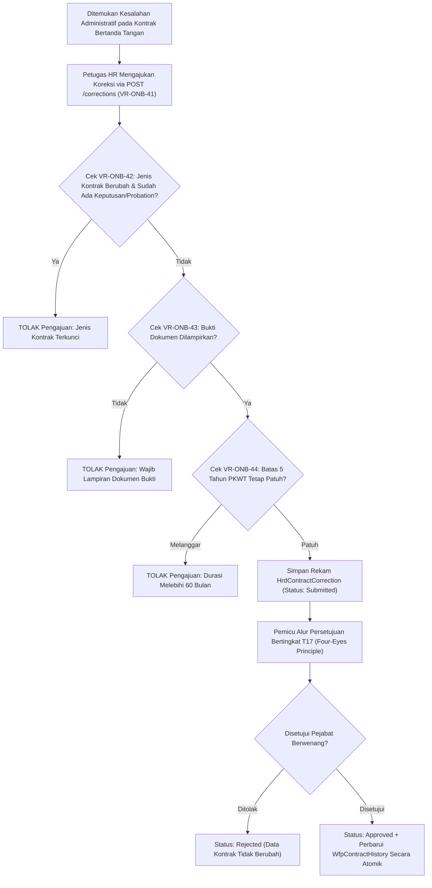

# Laporan Perubahan Backend — `BE-HRD-081`

## Metadata

| Field | Nilai |
| :--- | :--- |
| Task ID | `BE-HRD-081` |
| Judul | Koreksi Kontrak `T17` dan Dokumen Bukti Perbaikan |
| Slice | S-C4-ONB (LifecycleManagement) |
| Milestone | MVP-16 |
| Roadmap | `docs/module-blueprints/human-resource/roadmap/backend-roadmap.md` |
| Traceability | HRD-DEC-089 butir 11; HRD-DEC-031; FR-ONB-054; VR-ONB-41 s.d. VR-ONB-44; AT-HRD-ONB-33, AT-HRD-ONB-34 |
| Dependency | BE-HRD-068 ✅, BE-HRD-072 ✅ |
| Klasifikasi | `CORE AUDIT TRAIL & CONTRACT CORRECTION WORKFLOW` |
| Task Mode | `BACKEND` |
| Tanggal | 04 November 2026 |
| Status | Selesai (`PASS`) — Roslyn Build 0 Error |

---

## 1. Ringkasan dan Masalah yang Diselesaikan

Dalam operasional rumah sakit, kesalahan administratif pada kontrak kerja yang telah ditandatangani (`Signed`) terkadang terjadi (misalnya: salah pengetikan nomor surat kontrak, kesalahan tanggal mulai atau tanggal berakhir, atau kekeliruan pemilihan jenis kontrak). Namun, prinsip integritas hukum dan audit rumah sakit melarang penyuntingan kontrak yang sudah sah secara langsung tanpa jejak (*no silent edits*).

Task `BE-HRD-081` menyediakan alur resmi koreksi kontrak `T17`:
1. **Validasi Kontrak Sah (`VR-ONB-41`)**: Koreksi hanya dapat diajukan terhadap kontrak kerja yang sudah bertanda tangan (`Signed` atau `Active`).
2. **Perlindungan Terhadap Kontrak yang Memiliki Keputusan/Probation (`VR-ONB-42`)**: Perubahan jenis kontrak dilarang keras apabila kontrak tersebut sudah memiliki keputusan perpanjangan yang disetujui atau sedang/sudah menjalani masa percobaan.
3. **Kewajiban Bukti Dokumen Pendukung (`VR-ONB-43`)**: Setiap pengajuan koreksi wajib mengunggah berkas scan bukti pendukung (surat addendum/berita acara koreksi).
4. **Pemeriksaan Ulang Regulasi 5 Tahun PKWT (`VR-ONB-44`)**: Tanggal baru hasil koreksi divalidasi ulang agar tidak melanggar batas maksimal 60 bulan PKWT.
5. **Jejak Audit Utuh Sebelum dan Sesudah**: Menyimpan salinan nilai asli sebelum koreksi (`BeforeContractNumber`, `BeforeContractTypeId`, `BeforeStartDate`, `BeforeEndDate`, `BeforeDocumentPath`) berdampingan dengan nilai usulan perbaikan.
6. **Penerapan Terkendali**: Pembaruan ke master riwayat kontrak (`WfpContractHistory`) hanya dieksekusi setelah pengajuan koreksi disetujui oleh pejabat berwenang lain (prinsip *Four-Eyes Principle*).

---

## 2. Alur Proses Bisnis Rumah Sakit yang Didukung

---

## 3. Komponen Perubahan yang Diterapkan

1. **DTOs (`EmploymentContractDtos.cs`)**:
   - `SubmitContractCorrectionRequest`: Input nomor kontrak baru, ID jenis kontrak baru, rentang tanggal baru, alasan koreksi, dan multipart file bukti dokumen (`EvidenceFile`).
   - `ContractCorrectionResponse`: Response menyajikan komparasi sebelum dan sesudah koreksi secara transparan.
2. **Services (`IHrdEmploymentContractService.cs` & `HrdEmploymentContractService.cs`)**:
   - `SubmitCorrectionAsync`: Validasi `VR-ONB-41`, `VR-ONB-42`, `VR-ONB-43`, penyimpanan berkas bukti via `IHrdLifecycleAttachmentService`, dan pemicu alur `StartContractCorrectionWorkflowAsync`.
   - `GetCorrectionByIdAsync`: Detail pengajuan koreksi untuk verifikasi pembanding.
   - `WithdrawCorrectionAsync`: Penarikan draf koreksi sebelum diputuskan.
   - `ApplyCorrectionAsync`: Pemutakhiran nilai kontrak aktif secara transaksional setelah persetujuan `T17`.
3. **Controller (`HrdEmploymentContractController.cs`)**:
   - Endpoint Swagger untuk pengajuan, pembacaan, dan penarikan koreksi kontrak.

---

## 4. Spesifikasi Endpoint API Bergaya Swagger

| Method | Endpoint Path | Deskripsi | Auth / Role | Status |
| :--- | :--- | :--- | :--- | :--- |
| `POST` | `/api/v1/corporate/human-resource/lifecycle-management/employment-contracts/{id}/corrections` | Pengajuan koreksi kontrak kerja T17 | Authorized (Multipart) | 201 Created |
| `GET` | `/api/v1/corporate/human-resource/lifecycle-management/employment-contracts/{id}/corrections/{correctionId}` | Detail perbandingan data koreksi kontrak | Authorized | 200 OK |
| `POST` | `/api/v1/corporate/human-resource/lifecycle-management/employment-contracts/{id}/corrections/{correctionId}/withdraw` | Penarikan pengajuan koreksi kontrak | Authorized | 200 OK |

---

## 5. Bukti Verifikasi dan Pengujian

- **Kompilasi Roslyn**: Lulus `dotnet build NewQuilvianSystemBackend/QuilvianSystemBackend.csproj /t:Compile` dengan **0 Error(s)**.
- **Integritas Audit**: Jejak nilai sebelum dan sesudah tersimpan aman tanpa mengubah identitas row ID kontrak.
