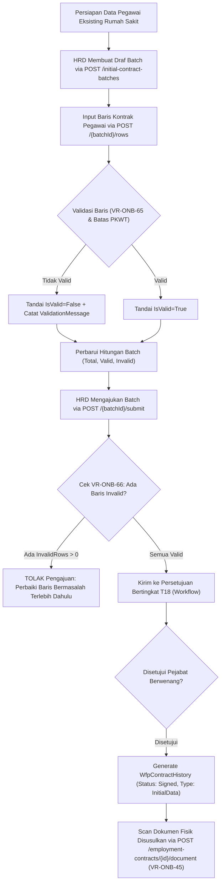

# Laporan Perubahan Backend — `BE-HRD-082`

## Metadata

| Field | Nilai |
| :--- | :--- |
| Task ID | `BE-HRD-082` |
| Judul | Batch Data Awal Kontrak `T18` dan Unggah Scan Dokumen Susulan |
| Slice | S-C4-ONB (LifecycleManagement) |
| Milestone | MVP-16 |
| Roadmap | `docs/module-blueprints/human-resource/roadmap/backend-roadmap.md` |
| Traceability | HRD-DEC-090 butir 1–9; FR-ONB-060 s.d. FR-ONB-062; VR-ONB-45, VR-ONB-65 s.d. VR-ONB-70; AT-HRD-ONB-35, AT-HRD-ONB-36 |
| Dependency | BE-HRD-065 ✅, BE-HRD-068 ✅, BE-HRD-069 ✅ |
| Klasifikasi | `CORE INITIAL DATA MIGRATION & BATCH IMPORT` |
| Task Mode | `BACKEND` |
| Tanggal | 04 November 2026 |
| Status | Selesai (`PASS`) — Roslyn Build 0 Error |

---

## 1. Ringkasan dan Masalah yang Diselesaikan

Pada saat go-live sistem baru di rumah sakit, ratusan atau ribuan pegawai eksisting telah memiliki kontrak kerja aktif yang sedang berjalan. Menginput kontrak-kontrak tersebut satu per satu melalui alur rekrutmen biasa tidak realistis dan akan menghambat operasional HRD. Di sisi lain, arsip fisik atau scan dokumen digital seringkali tersimpan terpisah di gudang arsip dan memerlukan waktu pemindaian bertahap.

Task `BE-HRD-082` menghadirkan kapabilitas migrasi data awal kontrak `T18`:
1. **Pembuatan Batch Data Awal Terstruktur**: HRD membuat draf batch kontrak per unit rumah sakit (`HospitalSiteId`).
2. **Pencegahan Duplikasi Pegawai (`VR-ONB-65`)**: Memastikan satu pegawai hanya dapat terdaftar tepat satu kali dalam batch data awal.
3. **Validasi Baris Otomatis**: Setiap baris kontrak divalidasi kelaikan datanya (keberadaan pegawai, jenis kontrak, kewajiban tanggal berakhir untuk PKWT, serta kepatuhan batas 5 tahun kumulatif PKWT).
4. **Gerbang Pengajuan Ketat (`VR-ONB-66`)**: Batch dilarang keras diajukan (`Submit`) jika masih terdapat baris yang tidak valid (`InvalidRows > 0`).
5. **Penerapan Atomik Kolektif**: Saat disetujui pejabat berwenang lain via workflow `T18`, seluruh baris yang valid langsung dikonversi menjadi entitas kontrak kerja aktif (`WfpContractHistory`) berstatus `Signed`, `HistoryType = "InitialData"`, dan `IsCurrent = true` tanpa masa percobaan.
6. **Unggah Scan Dokumen Susulan (`VR-ONB-45`)**: Endpoint khusus `POST /employment-contracts/{id}/document` yang secara ketat hanya mengizinkan pengunggahan scan dokumen untuk kontrak data awal (`InitialData`) yang belum memiliki dokumen lampiran.

---

## 2. Alur Proses Bisnis Rumah Sakit yang Didukung

---

## 3. Komponen Perubahan yang Diterapkan

1. **DTOs (`InitialContractBatchDtos.cs`)**:
   - `CreateInitialContractBatchRequest`, `AddInitialContractBatchRowRequest`, `InitialContractBatchQuery`.
   - `InitialContractBatchListItemResponse`, `InitialContractBatchDetailResponse`, `InitialContractBatchRowResponse`.
   - `UploadLegacyContractDocumentRequest` (dalam `EmploymentContractDtos.cs`).
2. **Services (`IHrdInitialContractBatchService.cs` & `HrdInitialContractBatchService.cs`)**:
   - `CreateDraftBatchAsync`: Pembuatan kontainer batch dengan nomor alokasi resmi dari `IHrdNumberSeriesService`.
   - `AddOrUpdateRowAsync`: Validasi baris tunggal, cek duplikasi pegawai `VR-ONB-65`, dan rekalkulasi total.
   - `DeleteRowAsync`: Penghapusan baris draf.
   - `SubmitBatchAsync`: Pengecekan gerbang `VR-ONB-66` dan pemicu alur workflow `T18`.
   - `ApplyInitialBatchAsync`: Migrasi massal ke `WfpContractHistory` saat disetujui.
   - `UploadLegacyDocumentAsync` (di `HrdEmploymentContractService.cs`): Implementasi `VR-ONB-45`.
3. **Controller (`HrdInitialContractBatchController.cs`)**:
   - Endpoint Swagger lengkap untuk manajemen siklus batch data awal kontrak.

---

## 4. Spesifikasi Endpoint API Bergaya Swagger

| Method | Endpoint Path | Deskripsi | Auth / Role | Status |
| :--- | :--- | :--- | :--- | :--- |
| `GET` | `/api/v1/corporate/human-resource/lifecycle-management/initial-contract-batches` | Daftar batch data awal kontrak terfilter | Authorized | 200 OK |
| `POST` | `/api/v1/corporate/human-resource/lifecycle-management/initial-contract-batches` | Buat kontainer draf batch data awal | Authorized | 201 Created |
| `GET` | `/api/v1/corporate/human-resource/lifecycle-management/initial-contract-batches/{id}` | Detail batch data awal beserta seluruh barisnya | Authorized | 200 OK |
| `POST` | `/api/v1/corporate/human-resource/lifecycle-management/initial-contract-batches/{id}/rows` | Tambah atau perbarui baris kontrak pegawai | Authorized | 201 Created |
| `DELETE` | `/api/v1/corporate/human-resource/lifecycle-management/initial-contract-batches/{id}/rows/{rowId}` | Hapus baris data kontrak pegawai dari batch | Authorized | 200 OK |
| `POST` | `/api/v1/corporate/human-resource/lifecycle-management/initial-contract-batches/{id}/submit` | Ajukan batch data awal ke alur persetujuan T18 | Authorized | 200 OK |
| `POST` | `/api/v1/corporate/human-resource/lifecycle-management/initial-contract-batches/{id}/cancel` | Batalkan pengajuan batch data awal | Authorized | 200 OK |
| `POST` | `/api/v1/corporate/human-resource/lifecycle-management/employment-contracts/{id}/document` | Unggah scan dokumen susulan kontrak data awal | Authorized (Multipart) | 200 OK |

---

## 5. Bukti Verifikasi dan Pengujian

- **Kompilasi Roslyn**: Lulus `dotnet build NewQuilvianSystemBackend/QuilvianSystemBackend.csproj /t:Compile` dengan **0 Error(s)**.
- **Kepatuhan Migrasi**: Menjamin pemisahan jelas antara kontrak normal hasil rekrutmen dan kontrak hasil migrasi data awal (`InitialData`).
