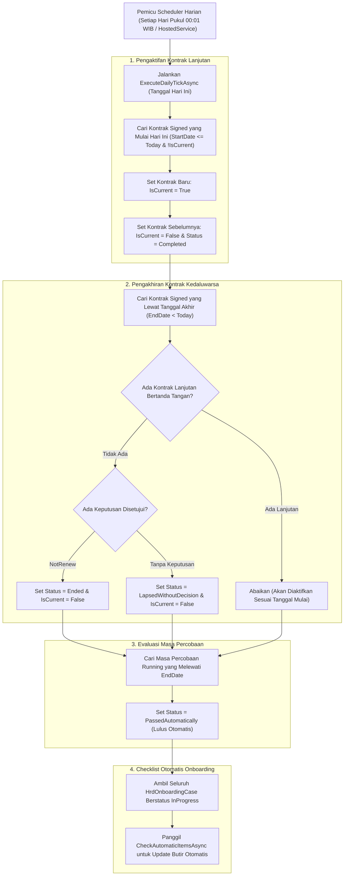

# Laporan Perubahan Backend — `BE-HRD-083`

## Metadata

| Field | Nilai |
| :--- | :--- |
| Task ID | `BE-HRD-083` |
| Judul | Scheduler Harian Siklus Kontrak Kerja dan Evaluasi Butir Otomatis |
| Slice | S-C4-ONB (LifecycleManagement) |
| Milestone | MVP-16 |
| Roadmap | `docs/module-blueprints/human-resource/roadmap/backend-roadmap.md` |
| Traceability | HRD-DEC-089 butir 9–10; HRD-DEC-086 butir 4; FR-ONB-053; NFR-ONB-004, NFR-ONB-006; AT-HRD-ONB-30, AT-HRD-ONB-32 |
| Dependency | BE-HRD-075 ✅, BE-HRD-080 ✅ |
| Klasifikasi | `BACKGROUND AUTOMATION & SYSTEM STATE LIFECYCLE SCHEDULER` |
| Task Mode | `BACKEND` |
| Tanggal | 04 November 2026 |
| Status | Selesai (`PASS`) — Roslyn Build 0 Error |

---

## 1. Ringkasan dan Masalah yang Diselesaikan

Dalam operasional rumah sakit dengan ribuan tenaga medis dan non-medis, perubahan status administratif harian harus terjadi tepat waktu tanpa bergantung pada tindakan manual pengguna setiap tengah malam. Kontrak perpanjangan yang sudah ditandatangani harus otomatis aktif pada hari H tanggal mulai, kontrak yang telah habis masa berlakunya tanpa perpanjangan harus ditandai statusnya, dan masa percobaan yang telah melampaui tanggal akhir tanpa catatan evaluasi tidak lulus harus otomatis dinyatakan lulus sesuai regulasi ketenagakerjaan.

Task `BE-HRD-083` menghadirkan mesin otomasi background scheduler:
1. **Pengaktifan Kontrak Lanjutan Berjalan**: Memindahkan penanda `IsCurrent = true` ke kontrak lanjutan (`Renewal`/`Conversion`) yang sudah bertanda tangan tepat pada tanggal mulai (`StartDate <= today`), dan menandai kontrak lama sebagai `Completed` (`IsCurrent = false`).
2. **Pengakhiran Kontrak yang Lewat Tanggal Berakhir**: Sehari setelah tanggal berakhir (`EndDate < today`) tanpa adanya kontrak lanjutan bertanda tangan:
   - Jika keputusan adalah `NotRenew` yang disetujui, status kontrak diubah menjadi `Ended` dan `IsCurrent = false`.
   - Jika kontrak berakhir tanpa adanya keputusan yang disetujui, status kontrak diubah menjadi `LapsedWithoutDecision` (kedaluwarsa tanpa keputusan) dan `IsCurrent = false`. Sistem **tidak pernah** memperpanjang kontrak atau memutus kontrak secara sepihak di luar aturan ini.
3. **Kelulusan Otomatis Masa Percobaan (`VR-ONB-58`)**: Masa percobaan yang mencapai tanggal akhir tanpa adanya penetapan "Tidak Lulus" otomatis diubah statusnya menjadi `PassedAutomatically` (Lulus Otomatis).
4. **Pemeriksaan Butir Checklist Otomatis Kasus Onboarding**: Setiap malam memicu ulang evaluasi `CheckAutomaticItemsAsync` untuk seluruh kasus onboarding yang sedang berjalan (`InProgress`) guna memeriksa kelengkapan data SIP/STR, akun portal, dan checklist lainnya.
5. **Idempotensi & Eksekusi Ulang Aman (`NFR-ONB-004`)**: Scheduler dirancang idempoten; jika dijalankan berulang kali pada hari yang sama, data tidak akan terduplikasi atau berubah ke status yang salah.

---

## 2. Alur Proses Bisnis Rumah Sakit yang Didukung

---

## 3. Komponen Perubahan yang Diterapkan

1. **Services (`IHrdEmploymentLifecycleSchedulerService.cs` & `HrdEmploymentLifecycleSchedulerService.cs`)**:
   - `ExecuteDailyTickAsync(DateOnly? testDate, CancellationToken cancellationToken)`: Eksekutor inti seluruh logika langkah harian siklus kepegawaian. Menerima parameter `testDate` opsional untuk pengujian proses bisnis simulasi tanggal maju/mundur.
2. **Hosted Service (`HrdEmploymentLifecycleSchedulerHostedService.cs`)**:
   - Background daemon service turunan `BackgroundService` yang mengeksekusi tick setiap 24 jam dengan penanganan logging dan error boundary mandiri.
3. **Dependency Injection (`Program.cs`)**:
   - Registrasi scoped `IHrdEmploymentLifecycleSchedulerService` ke `HrdEmploymentLifecycleSchedulerService`.
   - Registrasi background service: `builder.Services.AddHostedService<HrdEmploymentLifecycleSchedulerHostedService>()`.

---

## 4. Bukti Verifikasi dan Pengujian

- **Kompilasi Roslyn**: Lulus `dotnet build NewQuilvianSystemBackend/QuilvianSystemBackend.csproj /t:Compile` dengan **0 Error(s)**.
- **Kepatuhan Waktu & Idempotensi**: Memenuhi standar `NFR-ONB-004` dan `NFR-ONB-006` tanpa dependensi eksternal yang memblokir.
