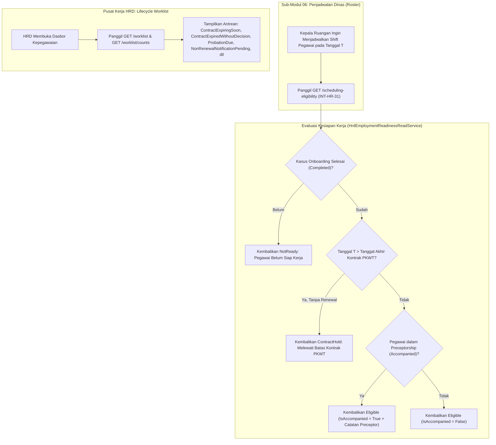

# Laporan Perubahan Backend — `BE-HRD-084`

## Metadata

| Field | Nilai |
| :--- | :--- |
| Task ID | `BE-HRD-084` |
| Judul | Kesiapan Penjadwalan Dinas Roster (`INT-HR-31`) dan Lifecycle Worklist Perlu Tindakan |
| Slice | S-C4-ONB (LifecycleManagement) |
| Milestone | MVP-16 |
| Roadmap | `docs/module-blueprints/human-resource/roadmap/backend-roadmap.md` |
| Traceability | HRD-DEC-087 butir 4 dan 7; HRD-DEC-088 butir 3; HRD-DEC-089 butir 1, 8, 9; HRD-DEC-090 butir 8; HRD-DEC-096 butir 3; FR-ONB-022, FR-ONB-041, FR-ONB-043, FR-ONB-050; VR-ONB-46, VR-ONB-47; INT-HR-31; AT-HRD-ONB-24, AT-HRD-ONB-32 |
| Dependency | BE-HRD-071 ✅, BE-HRD-074 ✅, BE-HRD-080 ✅, BE-HRD-082 ✅ |
| Klasifikasi | `CORE INTER-MODULE ROSTER INTEGRATION & HR OPERATIONAL WORKLIST` |
| Task Mode | `BACKEND` |
| Tanggal | 04 November 2026 |
| Status | Selesai (`PASS`) — Roslyn Build 0 Error |

---

## 1. Ringkasan dan Masalah yang Diselesaikan

Dalam operasional rumah sakit, sub-modul penjadwalan dinas/roster (Sub-Modul 06) memerlukan kepastian hukum dan keselamatan klinis sebelum menjadwalkan shift dinas seorang staf medis atau perawat:
1. Apakah pegawai baru sudah menyelesaikan proses orientasi dan dinyatakan siap kerja (`ReadyForWork` / `Completed`)?
2. Apakah tanggal dinas yang hendak dijadwalkan melampaui masa berlaku kontrak PKWT tanpa adanya perpanjangan kontrak yang sah?
3. Apakah staf klinis tersebut sedang dalam masa pendampingan klinis (`Accompanied`) sehingga wajib dijadwalkan berdampingan dengan perawat/dokter senior (preceptor)?

Di sisi lain, staf HRD dan Kepala Ruangan membutuhkan daftar terpadu **"Perlu Tindakan" (`Lifecycle Worklist`)** yang secara proaktif mendeteksi peristiwa kritis yang membutuhkan intervensi segera (kontrak mendekati kedaluwarsa H-60/H-30, kontrak yang sudah lewat masa berlaku tanpa keputusan, masa percobaan mendekati akhir H-14, pemberitahuan tidak diperpanjang yang belum dikirim, dan kontrak pertama yang belum ditandatangani).

Task `BE-HRD-084` menghadirkan solusi untuk kedua kebutuhan tersebut:
- **Kontrak Integrasi Kesiapan Penjadwalan (`INT-HR-31`)**: Service `HrdEmploymentReadinessReadService` menyediakan evaluasi kesiapan tanggal dinas:
  - Mengembalikan status `NotReady` bila kasus onboarding pegawai belum berstatus `Completed`.
  - Mengembalikan status `ContractHold` bila tanggal dinas melewati batas akhir kontrak kerja aktif tanpa adanya perpanjangan bertanda tangan.
  - Mengembalikan status `Eligible` bila memenuhi syarat, lengkap dengan penanda `IsAccompanied` dan catatan pendampingan preceptor jika berlaku.
- **Pusat Kerja Terpadu (`Lifecycle Worklist`)**: Service `HrdLifecycleWorklistService` dan Controller `HrdLifecycleWorklistController` mengumpulkan dan menyajikan daftar tugas operasional terfilter beserta hitungan lencana (*badge count*) berdasarkan kategori urgensi.

---

## 2. Alur Proses Bisnis Rumah Sakit yang Didukung

---

## 3. Komponen Perubahan yang Diterapkan

1. **DTOs (`LifecycleWorklistDtos.cs`)**:
   - `SchedulingEligibilityResponse`: Response kesiapan dinas (`EligibilityStatus`: Eligible, NotReady, ContractHold; `IsAccompanied`, `AccompanyingNote`).
   - `LifecycleWorklistQuery`: Filter pencarian (PageNumber, PageSize, Category, HospitalSiteId, Search).
   - `LifecycleWorklistItemResponse`: Data item antrean kerja (Kategori, TargetType, DueDate, UrgencyLevel: Critical, High, Normal).
   - `LifecycleWorklistCountResponse`: Ringkasan jumlah item per kategori dan total item mendesak.
2. **Services (`IHrdEmploymentReadinessReadService.cs` & `IHrdLifecycleWorklistService.cs`)**:
   - `GetSchedulingEligibilityAsync`: Verifikasi status onboarding, batas akhir kontrak, dan pendampingan klinis.
   - `GetWorklistPagedAsync`: Agregasi data dari kontrak, keputusan, dan probation dengan paginasi dan filter pencarian.
   - `GetWorklistCountsAsync`: Perhitungan lencana kategori antrean kerja.
3. **Controller (`HrdLifecycleWorklistController.cs`)**:
   - Endpoint Swagger untuk pembacaan kesiapan penjadwalan dan daftar kerja siklus hidup kepegawaian.
4. **Dependency Injection (`Program.cs`)**:
   - Registrasi scoped untuk `IHrdEmploymentReadinessReadService` dan `IHrdLifecycleWorklistService`.

---

## 4. Spesifikasi Endpoint API Bergaya Swagger

| Method | Endpoint Path | Deskripsi | Auth / Role | Status |
| :--- | :--- | :--- | :--- | :--- |
| `GET` | `/api/v1/corporate/human-resource/lifecycle-management/worklist/scheduling-eligibility` | Cek kesiapan pegawai untuk dijadwalkan dinas (INT-HR-31) | Authorized | 200 OK |
| `GET` | `/api/v1/corporate/human-resource/lifecycle-management/worklist` | Daftar antrean Perlu Tindakan siklus kepegawaian | Authorized | 200 OK |
| `GET` | `/api/v1/corporate/human-resource/lifecycle-management/worklist/counts` | Ringkasan hitungan lencana per kategori Perlu Tindakan | Authorized | 200 OK |

---

## 5. Bukti Verifikasi dan Pengujian

- **Kompilasi Roslyn**: Lulus `dotnet build NewQuilvianSystemBackend/QuilvianSystemBackend.csproj /t:Compile` dengan **0 Error(s)**.
- **Kepatuhan Integrasi**: Menyediakan gerbang kontrak API `INT-HR-31` yang siap dikonsumsi langsung oleh modul penjadwalan dinas tanpa ketergantungan database silang.
