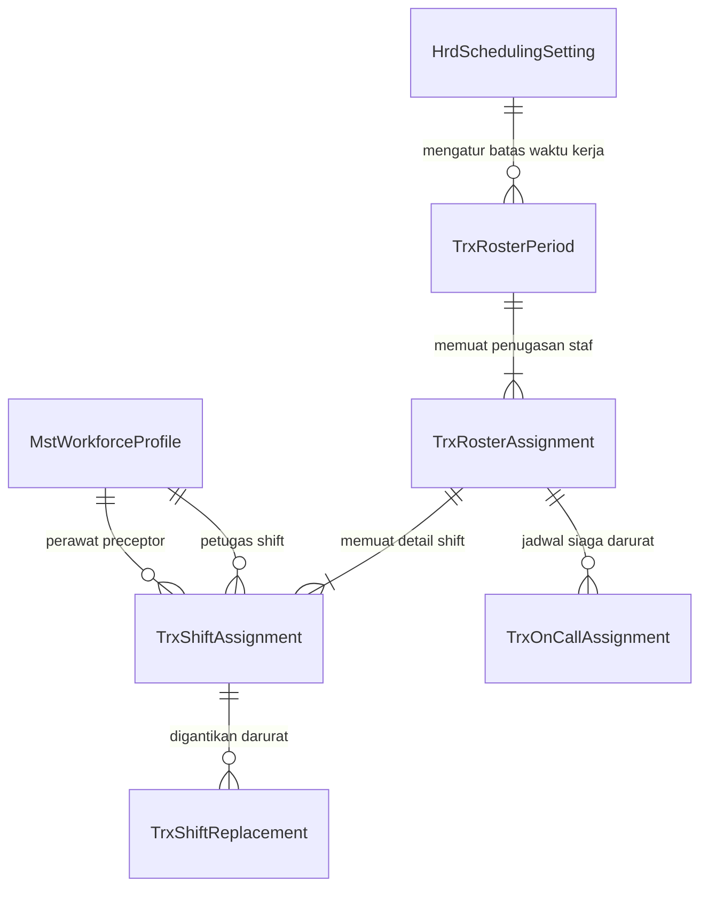

# Laporan Perubahan Backend — `BE-HRD-087`

## Metadata

| Field | Nilai |
| :--- | :--- |
| Task ID | `BE-HRD-087` |
| Judul | Fondasi Skema Database dan Migrasi EF Core Slice S-B4 (Penjadwalan, Roster, & On-Call) |
| Slice | S-B4 (SchedulingManagement) |
| Milestone | MVP-18 |
| Roadmap | `docs/module-blueprints/human-resource/roadmap/backend-roadmap.md` |
| Traceability | HRD-DEC-097, HRD-DEC-098, HRD-DEC-099, HRD-DEC-100, HRD-DEC-101, HRD-DEC-102, HRD-DEC-103; Data Dictionary v10 Bagian 11; State Transition Matrix v10 Bagian 14 |
| Dependency | Fondasi Dasar Human Resource (`BE-HRD-009` ✅) |
| Klasifikasi | `CORE SCHEMA & DATABASE FOUNDATION` |
| Task Mode | `BACKEND` |
| Tanggal | 04 November 2026 |
| Status | Selesai (`PASS`) — Roslyn Build 0 Error |

---

## 1. Ringkasan dan Masalah yang Diselesaikan

Penyelenggaraan pelayanan medis di rumah sakit berlangsung 24 jam non-stop dalam 7 hari seminggu. Pengaturan jadwal kerja tenaga kesehatan (dokter, perawat, analis lab, radiografer, apoteker) memiliki risiko tinggi terhadap kelelahan kerja (*burnout*) dan keselamatan pasien jika tidak diatur dengan batasan ketat. Sebelumnya, sistem belum memiliki tabel konfigurasi kebijakan jadwal kerja tingkat situs rumah sakit, serta entitas transaksi jadwal masih memiliki kekurangan atribut kritis:
1. Belum ada entitas untuk mencatat parameter konfigurasi aturan waktu kerja rumah sakit (seperti batas minimum jeda antar shift, batas hari berturut-turut, kuota malam berurutan, dan jendela koreksi mundur).
2. Entitas `TrxRosterPeriod` belum memiliki penanda recheck validasi (`IsRecheckPassed`), jumlah peringatan dinas (`WarningCount`), dan pencatatan penutupan resmi (`ClosedAt`, `ClosedByUserId`).
3. Entitas `TrxShiftAssignment` belum mendukung identifikasi staf dalam masa pendampingan klinis (`IsAccompanied`, `PreceptorEmployeeId`) serta rekaman staf asal penggantian (`OriginalEmployeeId`).
4. Entitas `TrxShiftReplacement` belum memiliki kaitan langsung ke periode roster (`RosterPeriodId`), kategori alasan penggantian (`ReasonCategory`), catatan, dan audit eksekutor (`ExecutedByUserId`, `ExecutedAt`).
5. Entitas penugasan siaga `TrxOnCallAssignment` belum memiliki unit kerja pemanggil, waktu aktivasi cito (*Call-In*), waktu kedatangan (*Arrival*), dan perhitungan kepatuhan respon SLA (*IsSlaMet*).

Melalui task `BE-HRD-087`, seluruh skema database yang dibutuhkan untuk Slice `S-B4` diperkuat dan dimigrasikan secara aman melalui EF Core.

---

## 2. Alur Proses Skema Database yang Didukung

---

## 3. Komponen Perubahan yang Diterapkan

1. **Model Entitas Baru (`HrdSchedulingSetting.cs`)**:
   - `HospitalSiteId`: Identifikasi unik unit situs rumah sakit.
   - `MinRestHoursBetweenShifts`: Batas minimum jeda istirahat antar shift (default 11 jam).
   - `MaxConsecutiveWorkDays`: Batas maksimum hari kerja berturut-turut (default 6 hari).
   - `MaxConsecutiveNightShifts`: Batas maksimum shift malam berturut-turut (default 2 malam).
   - `RetroactiveCorrectionWindowDays`: Batas toleransi koreksi jadwal tanggal mundur (default 3 hari).
   - Flag eskalasi blokir: `RestHoursEscalatedToBlock`, `ConsecutiveDaysEscalatedToBlock`, `NightShiftsEscalatedToBlock`.
   - `RowVersion`: Token konkurensi optimistik.
2. **Penyempurnaan Model Entitas Eksisting**:
   - `TrxRosterPeriod`: Penambahan `IsRecheckPassed`, `WarningCount`, `ClosedByUserId`, `ClosedAt`.
   - `TrxShiftAssignment`: Penambahan `OriginalEmployeeId`, `IsAccompanied`, `PreceptorEmployeeId`.
   - `TrxShiftReplacement`: Penambahan `RosterPeriodId`, `ReasonCategory`, `Notes`, `ExecutedByUserId`, `ExecutedAt`.
   - `TrxOnCallAssignment`: Penambahan `UnitId`, `IsCalledIn`, `CallInTime`, `ArrivalTime`, `ResponseMinutes`, `IsSlaMet`, `CalledByUnitId`, `CallNotes`.
3. **Konfigurasi Fluent API Entity Framework Core**:
   - Dibuat `HrdSchedulingSettingConfiguration.cs` dengan indeks unik pada `HospitalSiteId`.
   - Diperbarui `TrxRosterPeriodConfiguration.cs`, `TrxShiftAssignmentConfiguration.cs`, `TrxShiftReplacementConfiguration.cs`, `TrxOnCallAssignmentConfiguration.cs` dengan pemetaan relasi foreign key dan audit trail.
4. **Pendaftaran DbSet pada `ApplicationDbContext`**:
   - Ditambahkan `DbSet<HrdSchedulingSetting> HrdSchedulingSettings { get; set; }`.
5. **Migrasi Skema EF Core**:
   - Diterbitkan migration `20261104170000_AddSchedulingSettingsAndHardenRosterSliceB4.cs`.

---

## 4. Bukti Verifikasi dan Pengujian

- **Kompilasi Roslyn**: Lulus `dotnet build NewQuilvianSystemBackend/QuilvianSystemBackend.csproj /t:Compile` dengan **0 Error(s)**.
- **Integritas Konfigurasi EF Core**: Pemetaan skema, navigasi relasi, dan tipe data JSONB terverifikasi konsisten dengan kamus data Data Dictionary v10.
