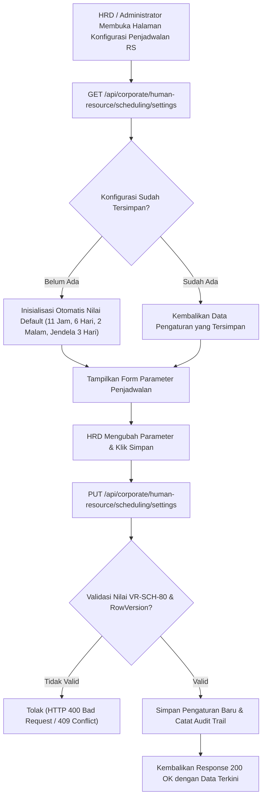

# Laporan Perubahan Backend — `BE-HRD-088`

## Metadata

| Field | Nilai |
| :--- | :--- |
| Task ID | `BE-HRD-088` |
| Judul | Service & Controller Parameter Kebijakan Penjadwalan HR (`SchedulingSettingService`, `SchedulingSettingController`) |
| Slice | S-B4 (SchedulingManagement) |
| Milestone | MVP-18 |
| Roadmap | `docs/module-blueprints/human-resource/roadmap/backend-roadmap.md` |
| Traceability | HRD-DEC-099, HRD-DEC-102, VR-SCH-80, API Contract v10 Bagian 16 |
| Dependency | `BE-HRD-087` ✅ |
| Klasifikasi | `CORE BUSINESS SERVICE & API CONTROLLER` |
| Task Mode | `BACKEND` |
| Tanggal | 04 November 2026 |
| Status | Selesai (`PASS`) — Roslyn Build 0 Error |

---

## 1. Ringkasan dan Masalah yang Diselesaikan

Setiap rumah sakit memiliki variasi kebijakan pengaturan jadwal dinas berdasarkan beban kerja, kapasitas tenaga medis, dan regulasi ketenagakerjaan:
1. Batas jeda istirahat antar shift (standar Kemenkes dan UU Ketenagakerjaan umumnya 11 jam).
2. Batas jumlah hari kerja berturut-turut sebelum staf wajib mendapatkan jatah hari libur (*day off*).
3. Batas jumlah shift malam berturut-turut untuk menjaga kewaspadaan staf dan mencegah bahaya *fatigue*.
4. Toleransi jendela koreksi jadwal tanggal mundur (misal maksimal 3 hari untuk penyesuaian operasional mendadak).
5. Opsi pengetatan apakah pelanggaran jeda atau hari kerja dianggap sekadar peringatan (*Warning*) atau langsung dieskalasi menjadi pemblokiran mutlak (*Blocking Conflict*).

Task `BE-HRD-088` mengimplementasikan service dan controller konfigurasi waktu kerja korporat rumah sakit (`HrdSchedulingSetting`), lengkap dengan validasi rentang nilai (`VR-SCH-80`), mekanisme inisialisasi default otomatis jika belum tersimpan, dan proteksi konkurensi token `RowVersion`.

---

## 2. Alur Proses Bisnis yang Didukung

---

## 3. Komponen Perubahan yang Diterapkan

1. **DTOs (`SchedulingSettingDtos.cs`)**:
   - `SchedulingSettingResponse`: Representasi data konfigurasi lengkap dengan timestamp dan RowVersion.
   - `UpdateSchedulingSettingRequest`: Validasi anotasi rentang nilai `[Range(...)]` sesuai `VR-SCH-80`:
     - Jeda istirahat minimum: 8–24 jam.
     - Hari kerja berturut-turut: 1–14 hari.
     - Shift malam berturut-turut: 1–7 malam.
     - Toleransi koreksi mundur: 0–30 hari.
2. **Interface & Service (`ISchedulingSettingService.cs` & `SchedulingSettingService.cs`)**:
   - `GetSettingAsync`: Pembacaan pengaturan per `HospitalSiteId`, otomatis menghasilkan default bila belum ada.
   - `UpdateSettingAsync`: Pembaruan parameter konfigurasi dengan proteksi token konkurensi `RowVersion`.
3. **Controller (`SchedulingSettingController.cs`)**:
   - Menghadirkan tag Swagger resmi `[Tags("HR Scheduling - Settings")]`.
   - Mengimplementasikan rute ganda terstandarisasi (`api/corporate/human-resource/scheduling/settings` dan `api/v1/corporate/human-resource/scheduling-management/settings`).
   - Dilindungi atribut otorisasi `[AccessController]`, `[AccessAction]`, `[AccessPermission("HrdSchedulingSetting", "Manage")]`.
4. **Registrasi Dependency Injection (`Program.cs`)**:
   - Mendaftarkan scoped service `ISchedulingSettingService` dan `SchedulingSettingService`.

---

## 4. Spesifikasi Endpoint API Bergaya Swagger

| Method | Endpoint Path | Deskripsi | Auth / Role | Status |
| :--- | :--- | :--- | :--- | :--- |
| `GET` | `/api/corporate/human-resource/scheduling/settings` | Mengambil konfigurasi parameter kebijakan penjadwalan dinas RS | HRD / Scheduler / Read | 200 OK |
| `PUT` | `/api/corporate/human-resource/scheduling/settings` | Memperbarui parameter batas waktu kerja & toleransi koreksi jadwal | HRD Manager / Manage | 200 OK |

---

## 5. Bukti Verifikasi dan Pengujian

- **Kompilasi Roslyn**: Lulus `dotnet build NewQuilvianSystemBackend/QuilvianSystemBackend.csproj /t:Compile` dengan **0 Error(s)**.
- **Validasi Nilai Batas (`VR-SCH-80`)**: Nilai di luar rentang (seperti jeda < 8 jam atau hari kerja > 14 hari) ditolak otomatis oleh validasi model.
