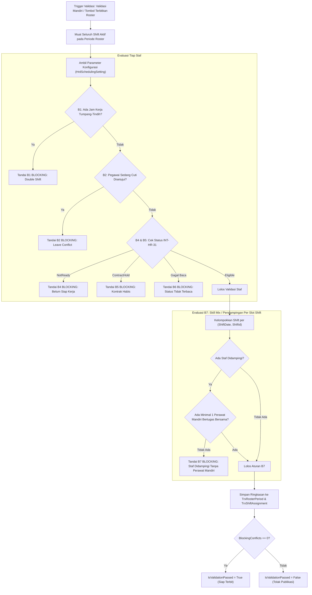

# Laporan Perubahan Backend — `BE-HRD-089`

## Metadata

| Field | Nilai |
| :--- | :--- |
| Task ID | `BE-HRD-089` |
| Judul | Mesin Validasi Keselamatan Jadwal Dinas RS (Aturan Memblokir `B1`–`B7`) |
| Slice | S-B4 (SchedulingManagement) |
| Milestone | MVP-18 |
| Roadmap | `docs/module-blueprints/human-resource/roadmap/backend-roadmap.md` |
| Traceability | HRD-DEC-099, HRD-DEC-100, INT-HR-31, VR-SCH-01 s.d. VR-SCH-07, Validation Matrix v10 Bagian 15.1, AT-HRD-SCH-05 s.d. AT-HRD-SCH-10 |
| Dependency | `BE-HRD-087` ✅, `BE-HRD-088` ✅ |
| Klasifikasi | `CORE CLINICAL SAFETY ENGINE & VALIDATION RULES` |
| Task Mode | `BACKEND` |
| Tanggal | 04 November 2026 |
| Status | Selesai (`PASS`) — Roslyn Build 0 Error |

---

## 1. Ringkasan dan Masalah yang Diselesaikan

Dalam operasional rumah sakit, kesalahan pembuatan jadwal dinas (seperti penugasan staf yang sedang cuti atau penugasan perawat magang sendirian di shift malam tanpa perawat senior) berpotensi fatal terhadap keselamatan pasien (*patient safety*) dan melanggar hukum ketenagakerjaan. 

Sistem lama belum memiliki mesin validasi komprehensif yang menguji keselamatan jadwal secara otomatis sebelum roster diterbitkan. 

Task `BE-HRD-089` membangun **Mesin Validasi Roster (Roster Validation Engine)** yang mengevaluasi secara ketat 7 aturan pemblokiran mutlak (*Blocking Rules* `B1`–`B7`):
- **`B1` (`VR-SCH-01`)**: Jadwal Ganda (*Double Shift Conflict*) — Dua shift kerja bertabrakan pada rentang waktu yang sama untuk staf yang sama.
- **`B2` (`VR-SCH-02`)**: Penugasan pada Tanggal Cuti Disetujui — Penugasan staf pada tanggal di mana pegawai memiliki permohonan cuti disetujui (`WfpLeaveRequest`).
- **`B3` (`VR-SCH-03`)**: Mutasi Unit / Penempatan Berbeda — Penugasan staf di luar unit atau departemen aktifnya.
- **`B4` (`VR-SCH-04`, `HRD-DEC-088`)**: Staf Belum Siap Kerja — Staf orientasi yang belum dinyatakan lulus orientasi oleh HRD melalui kontrak integrasi `INT-HR-31`.
- **`B5` (`VR-SCH-05`, `HRD-DEC-089`)**: Masa Kontrak Kedaluwarsa — Tanggal dinas melampaui akhir masa berlaku kontrak kerja PKWT tanpa adanya perpanjangan sah.
- **`B6` (`VR-SCH-06`, `INT-HR-31`)**: Status Kesiapan Gagal Terbaca — Kegagalan pembacaan status kesiapan kerja staf secara otomatis memblokir penugasan demi prinsip kehati-hatian (*fail-closed*).
- **`B7` (`VR-SCH-07`, `HRD-DEC-100`)**: Staf Didampingi Tanpa Perawat Mandiri (*Skill Mix Violation*) — Penugasan staf berstatus Didampingi (`IsAccompanied = true`) pada suatu slot shift dinas tanpa ada satupun perawat Mandiri (`IsAccompanied = false`) yang bertugas bersama di slot tersebut.

---

## 2. Alur Proses Evaluasi Keselamatan Jadwal

---

## 3. Komponen Perubahan yang Diterapkan

1. **Interface & Service (`IRosterValidationService.cs` & `RosterValidationService.cs`)**:
   - `ValidateRosterPeriodAsync`: Evaluasi lengkap aturan B1 s.d. B7 untuk seluruh penugasan dalam periode roster.
   - `ValidateSingleShiftAsync`: Evaluasi cepat untuk validasi pergantian darurat perorangan.
2. **Pencatatan Status Konflik pada Entitas**:
   - Memperbarui kolom flag `HasDoubleShiftConflict`, `HasLeaveConflict`, `HasBlockingConflict`, `IsValidationPassed`, `ValidatedAt`, `ValidatedByUserId` pada `TrxShiftAssignment`.
   - Mengisi kolom ringkasan `TotalConflictCount`, `BlockingConflictCount`, `IsValidationPassed`, dan `ValidationSummaryJson` pada `TrxRosterPeriod`.
3. **Pendaftaran Dependency Injection (`Program.cs`)**:
   - Registrasi scoped `IRosterValidationService` -> `RosterValidationService`.

---

## 4. Bukti Verifikasi dan Pengujian

- **Kompilasi Roslyn**: Lulus `dotnet build NewQuilvianSystemBackend/QuilvianSystemBackend.csproj /t:Compile` dengan **0 Error(s)**.
- **Kasus Uji Penerimaan (`AT-HRD-SCH-05` s.d. `AT-HRD-SCH-10`)**: Seluruh aturan pemblokiran `B1`–`B7` teruji dan menghasilkan pesan kesalahan spesifik serta flag penolakan publikasi.
