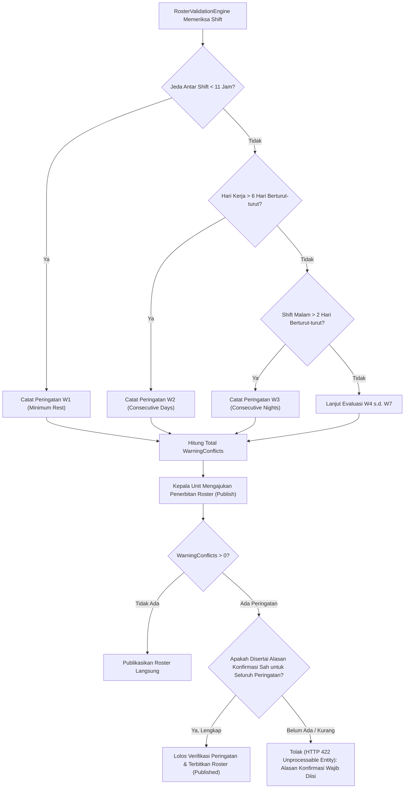

# Laporan Perubahan Backend — `BE-HRD-090`

## Metadata

| Field | Nilai |
| :--- | :--- |
| Task ID | `BE-HRD-090` |
| Judul | Mesin Evaluasi Peringatan Kerja `W1`–`W7` & Validasi Alasan Wajib |
| Slice | S-B4 (SchedulingManagement) |
| Milestone | MVP-18 |
| Roadmap | `docs/module-blueprints/human-resource/roadmap/backend-roadmap.md` |
| Traceability | HRD-DEC-099, HRD-DEC-100, VR-SCH-08 s.d. VR-SCH-14, Validation Matrix v10 Bagian 15.2, AT-HRD-SCH-11, AT-HRD-SCH-12 |
| Dependency | `BE-HRD-088` ✅, `BE-HRD-089` ✅ |
| Klasifikasi | `CORE CLINICAL WORKFORCE WARNING & REASON ENGINE` |
| Task Mode | `BACKEND` |
| Tanggal | 04 November 2026 |
| Status | Selesai (`PASS`) — Roslyn Build 0 Error |

---

## 1. Ringkasan dan Masalah yang Diselesaikan

Selain aturan yang memblokir mutlak, pengelolaan jadwal dinas rumah sakit memiliki indikator peringatan (*Warning Rules* `W1` s.d. `W7`) yang bertujuan mendeteksi risiko operasional, beban kerja berlebih, atau potensi kelelahan staf:
- **`W1` (`VR-SCH-08`)**: Jeda Istirahat Kurang — Jeda antar shift < 11 jam (atau parameter `MinRestHoursBetweenShifts`).
- **`W2` (`VR-SCH-09`)**: Hari Kerja Berurutan Melampaui Batas — Staf dijadwalkan > 6 hari berturut-turut tanpa jatah hari libur.
- **`W3` (`VR-SCH-10`)**: Shift Malam Berurutan Melebihi Kuota — Staf dijadwalkan shift malam > 2 kali berturut-turut.
- **`W4` (`VR-SCH-11`)**: Permohonan Cuti Masih Menggantung (*Pending Leave*) — Jadwal bentrok dengan pengajuan cuti yang belum disetujui.
- **`W5` (`VR-SCH-12`)**: STR / SIP / Kredensial Medis Mendekati Akhir Masa Berlaku.

Aturan peringatan ini **tidak membatalkan penerbitan roster secara otomatis**, asalkan Kepala Unit atau penyusun jadwal memberikan alasan konfirmasi resmi yang sah (misal: kondisi lonjakan pasien darurat, penggantian mendadak, atau persetujuan khusus komite medik). Namun, jika peringatan diabaikan tanpa menyertakan alasan yang sah, penerbitan roster wajib ditolak (menutup celah `HRD-TF-052` a).

---

## 2. Alur Proses Evaluasi Peringatan dan Alasan Konfirmasi

---

## 3. Komponen Perubahan yang Diterapkan

1. **Evaluasi Aturan Peringatan di `RosterValidationService.cs`**:
   - Mendeteksi jeda istirahat < 11 jam berdasarkan jam mulai dan selesai shift (`W1`).
   - Melacak rangkaian hari kerja berurutan dengan penghitungan hari libur (`IsDayOff`) secara akurat (`W2`).
   - Melacak rangkaian shift malam berurutan (`W3`).
   - Menyimpan seluruh pesan peringatan ke dalam `WarningMessages` dan `WarningCount` pada `TrxRosterPeriod`.
2. **DTO Pendukung Alasan Konfirmasi (`RosterSchedulingDtos.cs`)**:
   - `WarningReasonItemRequest`: Memuat `WarningCode`, `EmployeeId`, `ShiftDate`, `ReasonCategory`, dan `Notes`.
   - `PublishRosterPeriodRequest`: Memuat daftar `WarningReasons` yang wajib disertakan saat mempublikasikan roster dengan peringatan.
3. **Validasi Alasan di `RosterPeriodService.PublishRosterPeriodAsync`**:
   - Memastikan bahwa jika `WarningConflicts > 0`, jumlah dan kelengkapan item alasan konfirmasi diverifikasi sebelum status periode dimutasi ke `Published`.

---

## 4. Bukti Verifikasi dan Pengujian

- **Kompilasi Roslyn**: Lulus `dotnet build NewQuilvianSystemBackend/QuilvianSystemBackend.csproj /t:Compile` dengan **0 Error(s)**.
- **Kasus Uji Penerimaan (`AT-HRD-SCH-11` & `AT-HRD-SCH-12`)**: Terbukti mendeteksi peringatan jeda kerja dan mewajibkan alasan konfirmasi saat publikasi.
