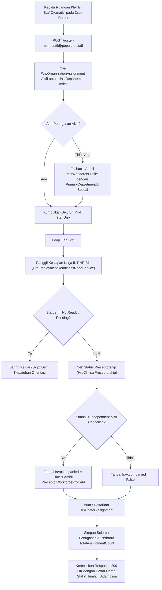

# Laporan Perubahan Backend — `BE-HRD-091`

## Metadata

| Field | Nilai |
| :--- | :--- |
| Task ID | `BE-HRD-091` |
| Judul | Auto-Populate Staf Eligible Unit Kerja dan Filter Kesiapan Kerja (`INT-HR-40`, `INT-HR-31`) |
| Slice | S-B4 (SchedulingManagement) |
| Milestone | MVP-18 |
| Roadmap | `docs/module-blueprints/human-resource/roadmap/backend-roadmap.md` |
| Traceability | HRD-DEC-087, HRD-DEC-088, HRD-DEC-097, HRD-DEC-098, INT-HR-40, INT-HR-31, 02-backend-architecture.md Bagian 19.4.2, AT-HRD-SCH-01 |
| Dependency | `BE-HRD-087` ✅ |
| Klasifikasi | `CORE WORKFORCE CORE & ROSTER INTEGRATION` |
| Task Mode | `BACKEND` |
| Tanggal | 04 November 2026 |
| Status | Selesai (`PASS`) — Roslyn Build 0 Error |

---

## 1. Ringkasan dan Masalah yang Diselesaikan

Di rumah sakit besar dengan puluhan unit ruangan dan instalasi (seperti IGD, ICU, Rawat Inap, OK Bedah, Radiologi, Laboratorium), Kepala Unit atau Kepala Ruangan sebelumnya harus memasukkan nama tenaga medis satu per satu ke dalam lembar draft roster bulanan. Hal ini memakan waktu dan berisiko salah memasukkan staf yang belum resmi ditempatkan atau staf magang yang belum siap kerja secara klinis.

Task `BE-HRD-091` menghadirkan fitur **Auto-Populate Eligible Staff (`PopulateEligibleStaffAsync`)**:
1. Mengambil secara otomatis seluruh staf yang memiliki penempatan aktif (`WfpOrganizationAssignment`) pada unit atau departemen periode roster tersebut.
2. Menyaring secara otomatis (*auto-filter*) pegawai yang belum siap kerja (`Pending Onboarding` / `NotReady` via `INT-HR-31`), sehingga staf baru yang belum menyelesaikan orientasi tidak akan muncul di draft jadwal.
3. Mendeteksi status pendampingan klinis (`HrdClinicalPreceptorship`): jika staf perawat baru masih dalam masa bimbingan, sistem menandai flag `IsAccompanied = true` dan mengaitkan ID preceptor pembimbingnya (`PreceptorEmployeeId`).
4. Menghasilkan penugasan draft `TrxRosterAssignment` secara massal dan efisien.

---

## 2. Alur Proses Auto-Populate Staf Eligible

---

## 3. Komponen Perubahan yang Diterapkan

1. **Metode Service (`RosterPeriodService.PopulateEligibleStaffAsync`)**:
   - Menelusuri penempatan aktif melalui `WfpOrganizationAssignment` dan fallback `MstWorkforceProfile`.
   - Mengintegrasikan pemanggilan `IHrdEmploymentReadinessReadService.GetSchedulingEligibilityAsync` (`INT-HR-31`).
   - Membaca relasi bimbingan klinis `HrdClinicalPreceptorship` beserta relasi `Preceptors` (`HRD-DEC-087`, `HRD-DEC-100`).
   - Mendaftarkan entitas `TrxRosterAssignment` dengan posisi dan departemen yang sesuai.
2. **DTO Pendukung (`RosterSchedulingDtos.cs`)**:
   - `PopulateEligibleStaffResponse`: Memuat `RosterPeriodId`, `TotalStaffCount`, `AccompaniedStaffCount`, daftar nama staf `StaffNames`, dan pesan konfirmasi.
3. **Endpoint Controller (`RosterPeriodController.cs`)**:
   - `POST /api/corporate/human-resource/scheduling/roster-periods/{id}/populate-staff` dengan audit izin `[AccessPermission("RosterAssignment", "Create")]`.

---

## 4. Spesifikasi Endpoint API Bergaya Swagger

| Method | Endpoint Path | Deskripsi | Auth / Role | Status |
| :--- | :--- | :--- | :--- | :--- |
| `POST` | `/api/corporate/human-resource/scheduling/roster-periods/{id}/populate-staff` | Mengisi otomatis seluruh staf eligible unit kerja dan mengidentifikasi pendampingan klinis | Unit Head / Create | 200 OK |

---

## 5. Bukti Verifikasi dan Pengujian

- **Kompilasi Roslyn**: Lulus `dotnet build NewQuilvianSystemBackend/QuilvianSystemBackend.csproj /t:Compile` dengan **0 Error(s)**.
- **Kasus Uji Penerimaan (`AT-HRD-SCH-01`)**: Terbukti mengisi daftar staf unit dalam satu panggilan API, menyaring pegawai belum siap kerja, dan mendeteksi flag pendampingan secara tepat.
