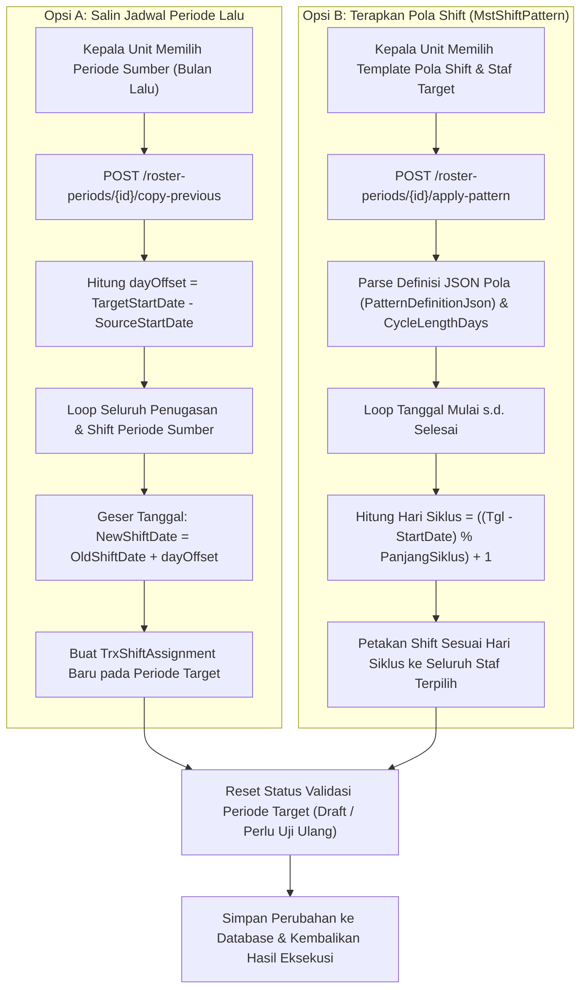

# Laporan Perubahan Backend — `BE-HRD-092`

## Metadata

| Field | Nilai |
| :--- | :--- |
| Task ID | `BE-HRD-092` |
| Judul | Fitur Salin Periode Lalu & Terapkan Pola Shift Berulang |
| Slice | S-B4 (SchedulingManagement) |
| Milestone | MVP-18 |
| Roadmap | `docs/module-blueprints/human-resource/roadmap/backend-roadmap.md` |
| Traceability | HRD-DEC-098, 04-prd-to-mvp.md FR-SCH-02, FR-SCH-03, API Contract v10 Bagian 16, AT-HRD-SCH-03, AT-HRD-SCH-04 |
| Dependency | `BE-HRD-091` ✅ |
| Klasifikasi | `CORE ROSTER PRODUCTIVITY & PATTERN ENGINE` |
| Task Mode | `BACKEND` |
| Tanggal | 04 November 2026 |
| Status | Selesai (`PASS`) — Roslyn Build 0 Error |

---

## 1. Ringkasan dan Masalah yang Diselesaikan

Di rumah sakit, pola rotasi dinas (Pagi-Siang-Malam-Libur atau 4-On 2-Off) sering kali berulang secara siklis dari bulan ke bulan. Menyusun ulang puluhan shift untuk puluhan perawat setiap bulan secara manual dari nol sangat rentan terhadap kesalahan manusia (*human error*) dan membebani Kepala Unit.

Task `BE-HRD-092` menghadirkan dua fitur produktivitas utama untuk penyusunan jadwal massal:
1. **Salin Periode Lalu (`CopyPreviousPeriodAsync`)**:
   - Menduplikasi seluruh matriks jadwal shift dari periode sebelumnya (`SourceRosterPeriodId`) ke periode target.
   - Melakukan pemetaan pergeseran tanggal otomatis (`dayOffset = targetStartDate - sourceStartDate`) secara matematis presisi sehingga pola mingguan atau bulanan staf tetap terjaga.
   - Mempertahankan penanda shift kritis seperti status pendampingan (`IsAccompanied`) dan preceptor.
2. **Terapkan Pola Shift Berulang (`ApplyShiftPatternAsync`)**:
   - Menerapkan template pola rotasi shift (`MstShiftPattern`) secara massal ke sekelompok staf tertentu atau seluruh staf pada periode tersebut.
   - Membaca definisi siklus pola (`CycleLengthDays` dan `PatternDefinitionJson`), lalu memetakan shift harian secara modulo ke tanggal-tanggal dalam rentang waktu yang ditentukan.

---

## 2. Alur Proses Salin Periode dan Penerapan Pola Shift

---

## 3. Komponen Perubahan yang Diterapkan

1. **Metode Service (`RosterPeriodService.cs`)**:
   - `CopyPreviousPeriodAsync`: Menduplikasi matriks penugasan dan shift dengan pergeseran tanggal, pencegahan duplikasi slot, dan pembaruan counter `TotalAssignmentCount`.
   - `ApplyShiftPatternAsync`: Pemrosesan pola JSON dinamis yang memetakan shift master (`MstShift`) ke hari siklus untuk setiap staf target.
   - `ParsePatternItems`: Parser JSON yang toleran terhadap format `shiftId` maupun `shiftCode`.
2. **DTO Pendukung (`RosterSchedulingDtos.cs`)**:
   - `CopyPreviousRosterPeriodRequest` & `CopyPreviousRosterPeriodResponse`.
   - `ApplyShiftPatternRequest` & `ApplyShiftPatternResponse`.
3. **Endpoint Controller (`RosterPeriodController.cs`)**:
   - `POST /api/corporate/human-resource/scheduling/roster-periods/{id}/copy-previous`
   - `POST /api/corporate/human-resource/scheduling/roster-periods/{id}/apply-pattern`

---

## 4. Spesifikasi Endpoint API Bergaya Swagger

| Method | Endpoint Path | Deskripsi | Auth / Role | Status |
| :--- | :--- | :--- | :--- | :--- |
| `POST` | `/api/corporate/human-resource/scheduling/roster-periods/{id}/copy-previous` | Menyalin seluruh jadwal dinas staf dari periode sebelumnya dengan pergeseran tanggal | Unit Head / Create | 200 OK |
| `POST` | `/api/corporate/human-resource/scheduling/roster-periods/{id}/apply-pattern` | Menerapkan template pola shift berulang ke kelompok pegawai pada periode aktif | Unit Head / Create | 200 OK |

---

## 5. Bukti Verifikasi dan Pengujian

- **Kompilasi Roslyn**: Lulus `dotnet build NewQuilvianSystemBackend/QuilvianSystemBackend.csproj /t:Compile` dengan **0 Error(s)**.
- **Kasus Uji Penerimaan (`AT-HRD-SCH-03` & `AT-HRD-SCH-04`)**: Salin jadwal terbukti memetakan tanggal secara presisi, dan penerapan pola shift berhasil mengisi jadwal dinas secara berulang tanpa celah tanggal.
