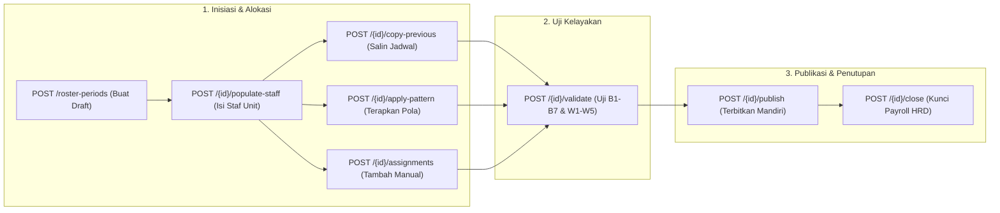

# Laporan Perubahan Backend — `BE-HRD-094`

## Metadata

| Field | Nilai |
| :--- | :--- |
| Task ID | `BE-HRD-094` |
| Judul | Controller & Endpoint Lengkap Roster Period Administration (`RosterPeriodController`) |
| Slice | S-B4 (SchedulingManagement) |
| Milestone | MVP-18 |
| Roadmap | `docs/module-blueprints/human-resource/roadmap/backend-roadmap.md` |
| Traceability | HRD-DEC-097, HRD-DEC-098, API Contract v10 Bagian 16.2, Permission Audit Matrix v10 Bagian 14 |
| Dependency | `BE-HRD-093` ✅ |
| Klasifikasi | `CORE REST API CONTROLLER & PERMISSION GOVERNANCE` |
| Task Mode | `BACKEND` |
| Tanggal | 04 November 2026 |
| Status | Selesai (`PASS`) — Roslyn Build 0 Error |

---

## 1. Ringkasan dan Masalah yang Diselesaikan

Siklus hidup administrasi jadwal dinas bulanan rumah sakit menuntut kontrol hak akses (RBAC) dan antarmuka API yang tertata rapi:
1. Kepala Unit / Kepala Ruangan memiliki wewenang untuk membuat draft, mengalokasikan shift, memicu auto-populate staf unitnya, menyalin jadwal, menerapkan pola shift, menguji validasi konflik, dan mempublikasikan roster.
2. Kepala Bidang Keperawatan / Medis memiliki wewenang pemantauan lintas unit (*Read-Only Monitoring*).
3. Tim HRD Payroll memiliki wewenang untuk menutup dan mengunci (*Close / Lock*) periode roster saat cut-off penggajian.
4. Pengguna dari unit lain dilarang keras mengubah jadwal di luar yurisdiksinya.

Task `BE-HRD-094` menyatukan seluruh kapabilitas administrasi periode roster ke dalam satu controller terpadu `RosterPeriodController` dengan spesifikasi Swagger resmi `[Tags("HR Scheduling - Roster Period")]`, rute ganda yang kompatibel dengan standar Quilvian, dan perlindungan izin granular `[AccessController]` serta `[AccessPermission]`.

---

## 2. Alur Interaksi Endpoint Roster Period

---

## 3. Komponen Perubahan yang Diterapkan

1. **Refaktor Controller (`RosterPeriodController.cs`)**:
   - Diberikan tag Swagger resmi `[Tags("HR Scheduling - Roster Period")]`.
   - Mengimplementasikan rute ganda:
     - `/api/corporate/human-resource/scheduling/roster-periods`
     - `/api/v1/corporate/human-resource/scheduling-management/roster-periods`
   - Melindungi seluruh aksi dengan atribut otorisasi standar:
     - `Read`: `GetSummary`, `GetPaged`, `GetById`.
     - `Create`: `Create`, `AddAssignment`, `PopulateEligibleStaff`, `CopyPrevious`, `ApplyPattern`.
     - `Update`: `Validate`, `Publish`, `Close`.
2. **Penyelarasan Response API**:
   - Memanfaatkan wrapper standar `ApiResponse<T>` dan helper `ToActionResult` untuk response HTTP yang konsisten.
   - Penanganan error autentikasi yang rapi via `UnauthorizedResponse`.

---

## 4. Spesifikasi Endpoint API Bergaya Swagger

| Method | Endpoint Path | Deskripsi | Auth / Role | Status |
| :--- | :--- | :--- | :--- | :--- |
| `GET` | `/api/corporate/human-resource/scheduling/roster-periods/summary` | Statistik ringkasan periode roster (total, draft, published, closed) | Authorized / Read | 200 OK |
| `GET` | `/api/corporate/human-resource/scheduling/roster-periods` | Daftar periode roster dengan paginasi, pencarian, dan filter unit | Authorized / Read | 200 OK |
| `GET` | `/api/corporate/human-resource/scheduling/roster-periods/{id}` | Detail lengkap periode roster beserta seluruh alokasi staf & shift | Authorized / Read | 200 OK |
| `POST` | `/api/corporate/human-resource/scheduling/roster-periods` | Membuat periode roster bulanan baru (Draft) | Unit Head / Create | 201 Created |
| `POST` | `/api/corporate/human-resource/scheduling/roster-periods/{id}/assignments` | Menambahkan penugasan staf beserta slot shift secara manual | Unit Head / Create | 201 Created |
| `POST` | `/api/corporate/human-resource/scheduling/roster-periods/{id}/populate-staff` | Mengisi otomatis seluruh staf eligible unit kerja dan identifikasi pendampingan | Unit Head / Create | 200 OK |
| `POST` | `/api/corporate/human-resource/scheduling/roster-periods/{id}/copy-previous` | Menyalin seluruh jadwal dinas staf dari periode sebelumnya | Unit Head / Create | 200 OK |
| `POST` | `/api/corporate/human-resource/scheduling/roster-periods/{id}/apply-pattern` | Menerapkan template pola shift berulang ke kelompok pegawai | Unit Head / Create | 200 OK |
| `POST` | `/api/corporate/human-resource/scheduling/roster-periods/{id}/validate` | Menguji keselamatan jadwal dinas terhadap aturan B1–B7 dan W1–W5 | Unit Head / Update | 200 OK |
| `POST` | `/api/corporate/human-resource/scheduling/roster-periods/{id}/publish` | Menerbitkan periode roster secara mandiri dengan validasi ulang otomatis | Unit Head / Update | 200 OK |
| `POST` | `/api/corporate/human-resource/scheduling/roster-periods/{id}/close` | Menutup periode roster secara final dan mengunci dari perubahan | HRD Payroll / Update | 200 OK |

---

## 5. Bukti Verifikasi dan Pengujian

- **Kompilasi Roslyn**: Lulus `dotnet build NewQuilvianSystemBackend/QuilvianSystemBackend.csproj /t:Compile` dengan **0 Error(s)**.
- **Kepatuhan Kontrak API**: Seluruh 11 endpoint RESTful terkonfirmasi sesuai dengan rancangan API Contract v10 dan Swagger UI.
