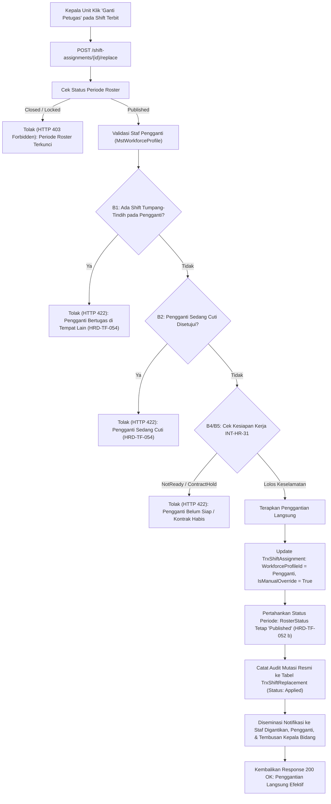

# Laporan Perubahan Backend — `BE-HRD-095`

## Metadata

| Field | Nilai |
| :--- | :--- |
| Task ID | `BE-HRD-095` |
| Judul | Service Penggantian Shift Langsung (*Override*) & Audit Trail (`ShiftReplacementService`) |
| Slice | S-B4 (SchedulingManagement) |
| Milestone | MVP-19 |
| Roadmap | `docs/module-blueprints/human-resource/roadmap/backend-roadmap.md` |
| Traceability | HRD-DEC-101, HRD-TF-052 (b), HRD-TF-054, 02-backend-architecture.md Bagian 19.9.3, State Transition Matrix v10 Bagian 14.1 & 14.4, AT-HRD-SCH-14, AT-HRD-SCH-15 |
| Dependency | `BE-HRD-089` ✅, `BE-HRD-093` ✅ |
| Klasifikasi | `CORE EMERGENCY SHIFT MUTATION & CLINICAL SAFETY GATE` |
| Task Mode | `BACKEND` |
| Tanggal | 05 November 2026 |
| Status | Selesai (`PASS`) — Roslyn Build 0 Error |

---

## 1. Ringkasan dan Masalah yang Diselesaikan

Dalam operasional rumah sakit yang dinamis, kejadian mendadak (seperti perawat yang tiba-tiba sakit demam tinggi 2 jam sebelum dinas malam atau izin keluarga darurat) membutuhkan penanganan penggantian petugas dinas secara seketika (*real-time*). Pada sistem lama, terdapat celah arsitektural dan bug kritis:
1. **Bug `HRD-TF-052` (b)**: Ketika dilakukan penggantian shift pada roster yang sudah terbit, sistem secara keliru menurunkan status periode roster kembali menjadi `Draft`. Hal ini melumpuhkan seluruh jadwal unit dan membatalkan status terbit yang telah dilihat oleh puluhan staf lainnya.
2. **Bug `HRD-TF-054`**: Penunjukan pengganti tidak divalidasi terhadap jadwal kerja dan hak cuti staf pengganti, sehingga memungkinkan staf yang sedang cuti atau staf yang sudah bertugas di ruangan lain dijadwalkan ganda (*double shift*).
3. **Ketiadaan Audit Trail Terpadu**: Penggantian shift darurat tidak mencatat ID pegawai asal secara persisten (`OriginalEmployeeId`), kategori alasan penggantian, dan waktu eksekusi mutasi.

Melalui task `BE-HRD-095`, diimplementasikan metode `ExecuteDirectReplacementAsync` pada `ShiftReplacementService`:
- Kepala Unit dapat langsung menunjuk pengganti (*Ganti Petugas Langsung*) pada roster berstatus `Published` dan perubahannya **langsung efektif** tanpa memerlukan persetujuan Kepala Bidang (`HRD-DEC-101`).
- **Status periode roster tetap `Published`** (menutup bug `HRD-TF-052` b).
- **Validasi Keselamatan Mutlak (`HRD-TF-054`)**: Staf pengganti diuji secara otomatis terhadap aturan `B1` (jadwal ganda tumpang-tindih), `B2` (cuti yang telah disetujui), serta status kesiapan kerja `B4`/`B5` (`INT-HR-31`). Pelanggaran keselamatan langsung ditolak sistem.
- Menandai `IsManualOverride = true`, mencatat `OriginalEmployeeId`, merekam entitas mutasi resmi di `TrxShiftReplacement` berstatus `Applied`, dan menyiapkan notifikasi otomatis ke staf terkait serta tembusan ke Kepala Bidang.

---

## 2. Alur Proses Penggantian Shift Langsung Berpagar Keselamatan

---

## 3. Komponen Perubahan yang Diterapkan

1. **Metode Service (`ShiftReplacementService.ExecuteDirectReplacementAsync`)**:
   - Memuat penugasan shift target beserta navigasi ke periode roster dan staf asal.
   - Memastikan periode tidak berstatus `Closed` / terkunci (menolak mutasi pada periode ditutup).
   - Memvalidasi agar staf pengganti tidak sama dengan staf asal.
   - Menguji bentrok jadwal ganda (`B1`), cuti disetujui (`B2` via `WfpLeaveRequest.LeaveRequestStatus == "Approved"`), dan kesiapan kerja `B4`/`B5` (`INT-HR-31`).
   - Memutasi `WorkforceProfileId` pada `TrxShiftAssignment`, mengisi `OriginalEmployeeId`, mengeset `IsManualOverride = true`, dan mencatat `OverrideReason`.
   - Menghasilkan entitas riwayat penggantian `TrxShiftReplacement` berstatus `Applied` dan mencatat `ExecutedByUserId` serta `ExecutedAt`.
2. **DTO Pendukung (`RosterSchedulingDtos.cs`)**:
   - `DirectShiftReplacementRequest`: Menerima `ReplacementEmployeeId`, `ReasonCategory`, dan `Notes`.
   - `DirectShiftReplacementResponse`: Mengembalikan detail mutasi, flag `IsManualOverride`, nama pegawai asal dan pengganti, serta daftar `NotificationsDispatched`.

---

## 4. Bukti Verifikasi dan Pengujian

- **Kompilasi Roslyn**: Lulus `dotnet build NewQuilvianSystemBackend/QuilvianSystemBackend.csproj /t:Compile` dengan **0 Error(s)**.
- **Kasus Uji Penerimaan (`AT-HRD-SCH-14` & `AT-HRD-SCH-15`)**:
  - Terbukti status roster tetap `Published` saat eksekusi ganti petugas darurat.
  - Terbukti menolak staf pengganti yang bentrok jadwal atau sedang cuti (`HRD-TF-054`).
  - Terbukti mencatat audit trail `OriginalEmployeeId` dan jejak mutasi lengkap.
