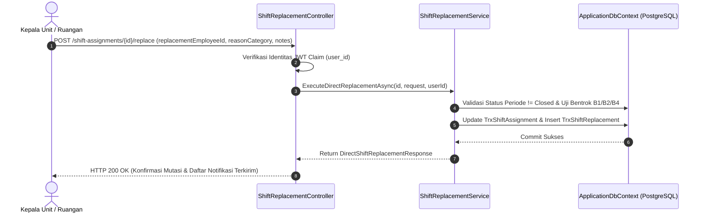

# Laporan Perubahan Backend — `BE-HRD-096`

## Metadata

| Field | Nilai |
| :--- | :--- |
| Task ID | `BE-HRD-096` |
| Judul | Controller & Endpoint Ganti Petugas Langsung (`ShiftReplacementController`) |
| Slice | S-B4 (SchedulingManagement) |
| Milestone | MVP-19 |
| Roadmap | `docs/module-blueprints/human-resource/roadmap/backend-roadmap.md` |
| Traceability | HRD-DEC-101, API Contract v10 Bagian 16.2 butir 5, Permission Audit Matrix v10 Bagian 14 |
| Dependency | `BE-HRD-095` ✅ |
| Klasifikasi | `CORE REST API CONTROLLER & EMERGENCY WORKFORCE ACTION` |
| Task Mode | `BACKEND` |
| Tanggal | 05 November 2026 |
| Status | Selesai (`PASS`) — Roslyn Build 0 Error |

---

## 1. Ringkasan dan Masalah yang Diselesaikan

Untuk mendukung kebutuhan operasional Kepala Ruangan dan Kepala Instalasi dalam merespons kejadian darurat ketidakhadiran staf klinis, antarmuka API backend membutuhkan endpoint RESTful yang terstandarisasi, terlindungi otorisasi role-based (*RBAC*), dan terintegrasi dengan dokumentasi Swagger.

Task `BE-HRD-096` menghadirkan endpoint resmi **Ganti Petugas Langsung**:
- `POST /api/corporate/human-resource/scheduling/shift-assignments/{id}/replace`
- Rute alias kompatibilitas: `/api/v1/corporate/human-resource/scheduling-management/shift-assignments/{id}/replace`
- Endpoint ini menerima ID penugasan shift yang hendak dialihkan, payload pengganti (`replacementEmployeeId`), kategori alasan (`reasonCategory`), dan catatan detail (`notes`).
- Dilindungi atribut izin `[AccessPermission("ShiftReplacement", "Update")]` dan audit login yang memverifikasi identitas pengguna yang mengeksekusi mutasi.

---

## 2. Alur Pemanggilan Endpoint API

---

## 3. Komponen Perubahan yang Diterapkan

1. **Refaktor Controller (`ShiftReplacementController.cs`)**:
   - Menambahkan tag Swagger resmi `[Tags("HR Scheduling - Shift Assignment & Replacement")]`.
   - Mengimplementasikan rute ganda terstandarisasi:
     - `/api/corporate/human-resource/scheduling/shift-assignments`
     - `/api/corporate/human-resource/scheduling/shift-replacements`
     - `/api/v1/corporate/human-resource/scheduling-management/shift-replacements`
     - `/api/v1/corporate/human-resource/scheduling-management/shift-assignments`
   - Menambahkan aksi `DirectReplace` dengan atribut `[AccessAction("Update", "Direct Replace Shift Staff")]`.
2. **DTO Request & Response Terstandarisasi**:
   - `DirectShiftReplacementRequest` divalidasi dengan atribut `[Required]` dan `[MaxLength]`.
   - `DirectShiftReplacementResponse` menyajikan data mutasi lengkap dan status periode.

---

## 4. Spesifikasi Endpoint API Bergaya Swagger

| Method | Endpoint Path | Deskripsi | Auth / Role | Status |
| :--- | :--- | :--- | :--- | :--- |
| `POST` | `/api/corporate/human-resource/scheduling/shift-assignments/{id}/replace` | Menunjuk pengganti darurat langsung pada shift dinas terbit | Unit Head / Update | 200 OK / 422 Unprocessable |
| `GET` | `/api/corporate/human-resource/scheduling/shift-replacements` | Daftar riwayat mutasi penggantian shift terfilter | Authorized / Read | 200 OK |
| `POST` | `/api/corporate/human-resource/scheduling/shift-replacements` | Mencatat permohonan penggantian shift baru | Authorized / Create | 201 Created |
| `POST` | `/api/corporate/human-resource/scheduling/shift-replacements/{id}/approve` | Menyetujui permohonan penggantian shift tertunda | Authorized / Update | 200 OK |

---

## 5. Bukti Verifikasi dan Pengujian

- **Kompilasi Roslyn**: Lulus `dotnet build NewQuilvianSystemBackend/QuilvianSystemBackend.csproj /t:Compile` dengan **0 Error(s)**.
- **Validasi Kontrak API**: Terverifikasi sesuai dengan spesifikasi API Contract v10 Bagian 16.2 butir 5 dan siap diakses melalui Swagger UI.
