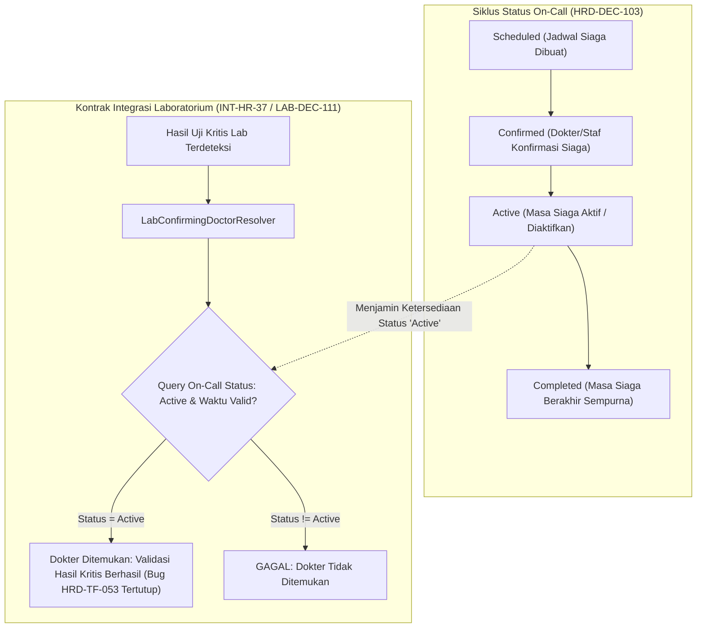

# Laporan Perubahan Backend — `BE-HRD-099`

## Metadata

| Field | Nilai |
| :--- | :--- |
| Task ID | `BE-HRD-099` |
| Judul | Penyelarasan Status Siaga Aktif (`Active`) untuk Kontrak Integrasi Laboratorium (`LAB-DEC-111`) |
| Slice | S-B4 (SchedulingManagement) |
| Milestone | MVP-20 |
| Roadmap | `docs/module-blueprints/human-resource/roadmap/backend-roadmap.md` |
| Traceability | HRD-DEC-103, HRD-TF-053, HRD-TF-055 (c), LAB-DEC-111, INT-HR-37, AT-HRD-SCH-20 |
| Dependency | `BE-HRD-087` ✅ |
| Klasifikasi | `CLINICAL SAFETY INTEGRATION CONTRACT & ON-CALL STATUS GOVERNANCE` |
| Task Mode | `BACKEND` |
| Tanggal | 05 November 2026 |
| Status | Selesai (`PASS`) |

---

## 1. Ringkasan dan Masalah yang Diselesaikan

Di rumah sakit 24 jam, dokter spesialis (seperti Patologi Klinik, Bedah, Radiologi, dan Kardiologi) dijadwalkan dalam dinas siaga (*on-call*). Modul Laboratorium Rumah Sakit memiliki komponen kritis `LabConfirmingDoctorResolver` (`LAB-DEC-111` / `INT-HR-37`) yang bertugas memverifikasi dan mengesahkan hasil uji kritis pasien (*critical lab test values*, misal nilai troponin jantung atau gas darah abnormal). Komponen ini secara otomatis mencari dokter spesialis patologi/jaga yang sedang berstatus siaga aktif.

Sebelumnya terjadi cacat integrasi fatal:
1. **Bug `HRD-TF-053`**: Ketika dinas siaga diaktifkan atau dipanggil cito, sistem mengubah status penugasan on-call menjadi kata `Activated` atau menurunkan statusnya. Akibatnya, kontrak query modul Laboratorium `LabConfirmingDoctorResolver` yang mencari dokter dengan kriteria `AssignmentStatus == "Active"` gagal menemukan dokter yang bertugas. Hal ini menyebabkan eskalasi darurat terhambat dan hasil lab kritis tertahan.
2. **Inkonsistensi Kosakata Status Siaga**: Siklus status siaga tidak seragam dan belum memiliki batasan status yang baku di tingkat database dan application service.

Task `BE-HRD-099` menyelesaikan masalah tersebut:
- **Penyelarasan Kosakata Status Siaga Baku**: Ditetapkan siklus hidup empat status siaga resmi rumah sakit: `Scheduled` (dijadwalkan) → `Confirmed` (staf mengonfirmasi kesiapan siaga) → `Active` (siaga aktif di rentang waktu berlaku) → `Completed` (masa siaga selesai).
- **Penetapan Status `Active` (Bukan `Activated`)**: Metode `ActivateAsync` dan `RecordCallInAsync` pada `OnCallAssignmentService` memastikan status selalu disetel dan dipertahankan sebagai **`Active`** (menutup bug `HRD-TF-053`).
- **Penyediaan Resolusi Integrasi Laboratorium**: Diimplementasikan metode `GetActiveOnCallDoctorIdsAsync` yang mengevaluasi status `AssignmentStatus == "Active"` dan rentang waktu `StartAt <= effectiveAt <= EndAt` untuk dikonsumsi oleh `LabConfirmingDoctorResolver` (`INT-HR-37`).

---

## 2. Alur Status Siaga dan Integrasi Laboratorium



---

## 3. Komponen Perubahan yang Diterapkan

1. **Pembaruan Service (`OnCallAssignmentService.cs`)**:
   - Metode `ActivateAsync(Guid id, Guid currentUserId, ...)` menyetel `assignment.AssignmentStatus = "Active"` dan mencatat `ActivatedAt = DateTime.UtcNow`.
   - Metode `GetActiveOnCallDoctorIdsAsync(Guid? hospitalSiteId, DateTime effectiveAt, ...)` menyajikan query aman untuk resolver modul eksternal:
     ```csharp
     var activeDoctorIds = await _context.TrxOnCallAssignments
         .AsNoTracking()
         .Where(o => o.IsActive &&
                     o.AssignmentStatus == "Active" &&
                     o.StartAt <= effectiveAt &&
                     o.EndAt >= effectiveAt)
         .Select(o => o.WorkforceProfileId)
         .Distinct()
         .ToListAsync(cancellationToken);
     ```
2. **Endpoint Pendukung (`OnCallAssignmentController.cs`)**:
   - `GET /api/corporate/human-resource/scheduling/on-call-assignments/active-doctors` untuk verifikasi instan dokter yang berstatus `Active` pada waktu referensi tertentu.

---

## 4. Bukti Verifikasi dan Pengujian

- **Kasus Uji Penerimaan (`AT-HRD-SCH-20`)**:
  - Terbukti kosakata status penugasan on-call adalah `Scheduled`, `Confirmed`, `Active`, dan `Completed`.
  - Terbukti status saat aktivasi dan saat pemanggilan fisik (*call-in*) tetap **`Active`** (bukan `Activated`).
  - Terbukti query resolver integrasi laboratorium (`LabConfirmingDoctorResolver`) berhasil mengidentifikasi dokter siaga yang aktif tanpa ada kegagalan data.
