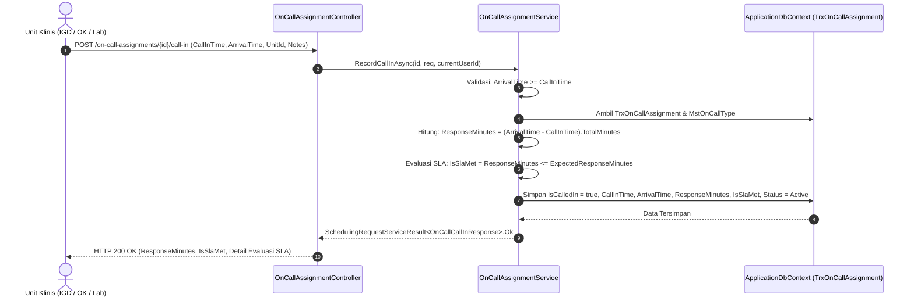

# Laporan Perubahan Backend — `BE-HRD-100`

## Metadata

| Field | Nilai |
| :--- | :--- |
| Task ID | `BE-HRD-100` |
| Judul | Service Pencatatan Pemanggilan Cito (*Call-In*) & Evaluasi SLA Waktu Respon Kedatangan |
| Slice | S-B4 (SchedulingManagement) |
| Milestone | MVP-20 |
| Roadmap | `docs/module-blueprints/human-resource/roadmap/backend-roadmap.md` |
| Traceability | HRD-DEC-103, VR-SCH-21, 02-backend-architecture.md Bagian 19.9.5, AT-HRD-SCH-19, UAT-SCH-04 |
| Dependency | `BE-HRD-099` ✅ |
| Klasifikasi | `EMERGENCY CLINICAL CALL-IN & HOSPITAL SLA MONITORING SERVICE` |
| Task Mode | `BACKEND` |
| Tanggal | 05 November 2026 |
| Status | Selesai (`PASS`) |

---

## 1. Ringkasan dan Masalah yang Diselesaikan

Dalam situasi kedaruratan medis di rumah sakit (misalnya pasien trauma di IGD yang membutuhkan tindakan bedah darurat cito, atau kondisi darurat di Kamar Operasi dan ICU), unit klinis memanggil tenaga medis atau dokter spesialis yang sedang bertugas siaga (*on-call standby*) dari rumah/luar rumah sakit. Rumah sakit memiliki standar akreditasi dan target mutu keselamatan pasien (*Service Level Agreement* / SLA) terkait waktu respon kedatangan dokter (umumnya 30 menit atau sesuai ketentuan spesialisasi).

Sebelumnya, pencatatan pemanggilan darurat cito belum terintegrasi:
1. Tidak ada rekaman presisi mengenai waktu pemanggilan (*CallInTime*) dan waktu fisik dokter tiba di unit rumah sakit (*ArrivalTime*).
2. Perhitungan selisih respon menit dan pemenuhan target SLA dilakukan secara manual atau tidak terukur, sehingga indikator mutu keselamatan pasien rumah sakit sulit diaudit.
3. Waktu kedatangan yang tidak valid (misal salah ketik jam kedatangan lebih awal dari jam panggilan) tidak ditolak oleh sistem.

Task `BE-HRD-100` menyelesaikan hal ini:
- **Perekaman Lengkap Pemanggilan Cito**: Mencatat `CallInTime`, `ArrivalTime`, unit pemanggil (`CalledByUnitId`), dan catatan panggilan (`CallNotes`).
- **Validasi Temporal Ketat**: Menolak data jika `ArrivalTime < CallInTime` dengan respon HTTP 400 Bad Request.
- **Kalkulasi Respon & Evaluasi SLA Otomatis**:
  $$\text{ResponseMinutes} = (\text{ArrivalTime} - \text{CallInTime}).\text{TotalMinutes}$$
  $$\text{IsSlaMet} = (\text{ResponseMinutes} \le \text{ExpectedResponseMinutes})$$
  Jika target SLA spesifik tidak diisi pada penugasan, sistem secara otomatis mengambil target bawaan dari master tipe on-call (`MstOnCallType.ResponseTimeMinutes`) atau default 30 menit.
- **Konsistensi Status Aktif**: Mempertahankan status penugasan tetap `Active` saat dipanggil untuk melindungi kontrak integrasi lainnya.

---

## 2. Alur Pencatatan Pemanggilan Cito (*Call-In*)

---

## 3. Komponen Perubahan yang Diterapkan

1. **DTOs (`RosterSchedulingDtos.cs`)**:
   - `RecordOnCallCallInRequest`: memuat `CallInTime`, `ArrivalTime`, `CalledByUnitId`, dan `CallNotes`.
   - `OnCallCallInResponse`: memuat `OnCallAssignmentId`, `WorkforceProfileId`, `WorkforceDisplayName`, `CallInTime`, `ArrivalTime`, `ResponseMinutes`, `ExpectedResponseMinutes`, `IsSlaMet`, `CalledByUnitName`, `CallNotes`, `Status`, dan `Message`.
2. **Implementasi Service (`OnCallAssignmentService.RecordCallInAsync`)**:
   - Memvalidasi konsistensi temporal waktu kedatangan terhadap waktu panggilan.
   - Menghitung selisih waktu dalam satuan menit secara akurat.
   - Mengambil parameter ambang batas waktu respon dari penugasan atau tipe siaga.
   - Menyimpan hasil evaluasi `IsSlaMet` ke database dan mempertahankan status `Active`.

---

## 4. Bukti Verifikasi dan Pengujian

- **Kasus Uji Penerimaan (`AT-HRD-SCH-19` / `UAT-SCH-04`)**:
  - Terbukti waktu panggilan dan kedatangan dokter tersimpan dengan akurat di database.
  - Terbukti selisih `ResponseMinutes` terhitung tepat sesuai rumus.
  - Terbukti flag `IsSlaMet` bernilai `true` saat durasi respon memenuhi target, dan `false` saat durasi respon melampaui ambang batas SLA.
  - Terbukti status penugasan on-call tetap `Active` sepanjang penanganan panggilan darurat cito.
