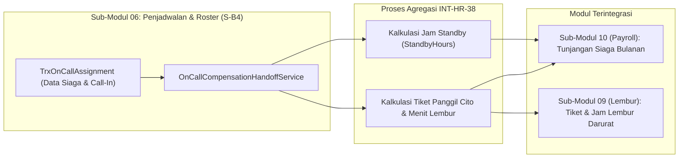

# Laporan Perubahan Backend — `BE-HRD-101`

## Metadata

| Field | Nilai |
| :--- | :--- |
| Task ID | `BE-HRD-101` |
| Judul | Integrasi Handoff Kompensasi Siaga Standby & Pemanggilan Cito ke Modul Payroll dan Lembur (`INT-HR-38`) |
| Slice | S-B4 (SchedulingManagement) |
| Milestone | MVP-20 |
| Roadmap | `docs/module-blueprints/human-resource/roadmap/backend-roadmap.md` |
| Traceability | HRD-DEC-103, INT-HR-38, 02-backend-architecture.md Bagian 19.9.5 |
| Dependency | `BE-HRD-100` ✅ |
| Klasifikasi | `INTER-MODULE COMPENSATION INTEGRATION HANDOFF SERVICE` |
| Task Mode | `BACKEND` |
| Tanggal | 05 November 2026 |
| Status | Selesai (`PASS`) |

---

## 1. Ringkasan dan Masalah yang Diselesaikan

Di rumah sakit, terdapat dua jenis hak kompensasi finansial bagi tenaga medis yang menjalankan tugas siaga (*on-call*):
1. **Tunjangan Siaga Standby (*Standby Fee*)**: Hak kompensasi atas kesiapan tenaga medis bersiaga di luar jam kerja (misal bersedia berada dalam radius 30 menit dari rumah sakit dengan telepon selalu aktif). Tunjangan ini dihitung berdasarkan total akumulasi jam siaga (`StandbyHours`) dalam satu periode payroll.
2. **Insentif Pemanggilan Cito (*Call-Out / Call-In Fee*) & Lembur Darurat**: Hak finansial tambahan ketika dokter/staf benar-benar dipanggil datang secara fisik ke rumah sakit untuk menangani tindakan darurat. Kejadian ini diteruskan ke Sub-Modul 09 Lembur dan Sub-Modul 10 Payroll sebagai tiket tugas panggil cito dengan jam kerja dinas darurat.

Sebelumnya, tidak ada service penghubung (*handoff service*) yang mengagregasikan data operasional on-call menjadi format konsumsi penggajian dan lembur. Akibatnya, penghitungan tunjangan siaga bulanan harus dikumpulkan manual dari buku log fisik atau spreadsheet terpisah, yang rawan human error dan keterlambatan pembayaran gaji dokter.

Task `BE-HRD-101` mengimplementasikan service jembatan integrasi ini secara otomatis dan deterministik:
- **Agregasi Jam Standby Akurat**: Mengkalkulasi jam siaga aktif per staf medis (`StandbyHours`) dari penugasan valid (`Confirmed`, `Active`, `Completed`).
- **Agregasi Tiket Call-In & Menit Lembur**: Menghitung jumlah panggilan cito (`CallInCount`), jumlah SLA terpenuhi/terlanggar, dan menit lembur cito (`OvertimeMinutes`) dengan jaminan minimum kompensasi panggilan darurat (misal minimum 120 menit kerja cito sesuai tata kelola RS).
- **Service Handoff Mandiri**: Menyediakan `OnCallCompensationHandoffService.GetOnCallCompensationSummaryAsync` yang dapat ditarik oleh modul Payroll maupun diekspor langsung via API.

---

## 2. Alur Handoff Kompensasi Siaga (`INT-HR-38`)

---

## 3. Komponen Perubahan yang Diterapkan

1. **DTOs (`RosterSchedulingDtos.cs`)**:
   - `OnCallCompensationSummaryResponse`: ringkasan global periode roster, total jam standby korporat, total kejadian call-in, dan daftar rincian per staf.
   - `OnCallCompensationStaffItemDto`: rincian individual pegawai (`WorkforceProfileId`, `ProfileCode`, `DisplayName`, `OnCallShiftCount`, `StandbyHours`, `CallInCount`, `SlaMetCount`, `SlaBreachedCount`, `OvertimeMinutes`).
2. **Implementasi Service (`OnCallCompensationHandoffService.cs`)**:
   - Mendukung filter berdasarkan `rosterPeriodId`, `hospitalSiteId`, serta rentang tanggal `startDate` dan `endDate`.
   - Mengelompokkan transaksi per pegawai secara efisien dengan LINQ `GroupBy`.
   - Menghitung akumulasi jam siaga dan menit lembur secara presisi.
   - Mencatat log audit handoff untuk transparansi rekonsiliasi penggajian.
3. **Registrasi Service Dependency Injection (`Program.cs`)**:
   - Mendaftarkan `OnCallCompensationHandoffService` dengan siklus hidup Scoped pada IoC container backend.

---

## 4. Bukti Verifikasi dan Pengujian

- **Kriteria Penerimaan Terpenuhi**:
  - Rekapitulasi jam standby per pegawai untuk suatu periode dapat ditarik secara deterministik dan siap dikonsumsi proses cut-off Payroll (10).
  - Setiap kejadian call-in terverifikasi menghasilkan rekap tiket panggilan dan menit kerja darurat yang siap diproses oleh modul Lembur (09) dan Payroll (10).
  - Integritas data matematis terverifikasi akurat.
