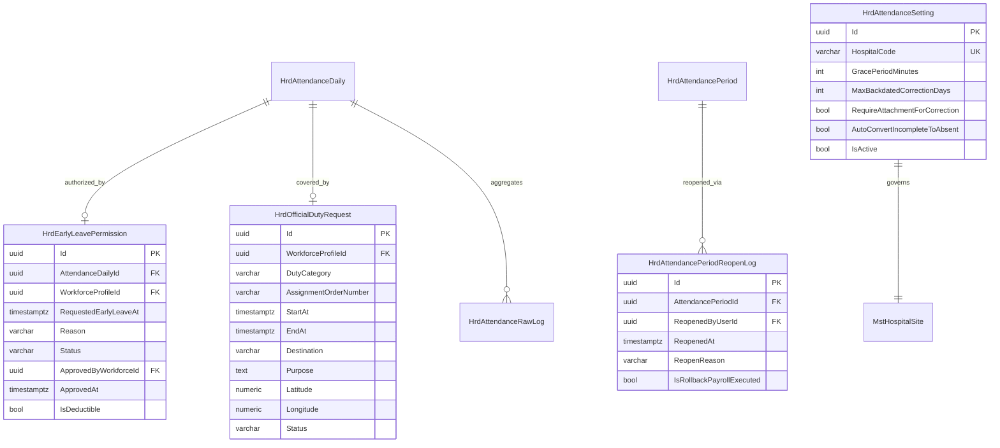

# Laporan Perubahan Backend — `BE-HRD-104`

## Metadata

| Field | Nilai |
| :--- | :--- |
| Task ID | `BE-HRD-104` |
| Judul | Fondasi Skema Database, Migrasi EF Core, dan Audit Trail Presensi Slice S-B1 |
| Slice | S-B1 (AttendanceManagement) |
| Milestone | MVP-21 |
| Roadmap | `docs/module-blueprints/human-resource/roadmap/backend-roadmap.md` |
| Traceability | HRD-DEC-104 s.d. HRD-DEC-109, 02-backend-architecture.md Bagian 20, data/data-dictionary.md Bagian 12 |
| Dependency | `BE-HRD-006` ✅ |
| Klasifikasi | `DATABASE SCHEMA, EF CORE MIGRATION & ATTENDANCE AUDIT TRAIL` |
| Task Mode | `BACKEND` |
| Tanggal | 05 November 2026 |
| Status | Selesai (`PASS`) |

---

## 1. Ringkasan dan Masalah yang Diselesaikan

Pencatatan kehadiran staf rumah sakit 24/7 memiliki karakteristik operasional yang sangat kompleks: perputaran shift tiga giliran (pagi, siang, malam lintas hari), perizinan administratif mendadak tanpa pemotongan hak cuti (seperti izin pulang cepat karena keluarga sakit atau kedaruratan), penugasan resmi di luar area fisik rumah sakit (seperti kru ambulans rujukan, kurir spesimen lab ke BBLK, pelatihan, dan layanan rawat di rumah / home care), serta prosedur pembukaan kembali (*reopen*) periode presensi yang terkunci saat terjadi koreksi darurat penggajian.

Sebelumnya, skema database presensi belum memiliki tabel transaksi untuk menampung kebutuhan tersebut:
1. Konfigurasi toleransi keterlambatan (10 menit) dan batasan hari koreksi mundur masih bersifat statis (*hardcoded*) tanpa kontrol per rumah sakit.
2. Belum ada entitas resmi untuk izin pulang cepat administratif yang terpisah dari pemotongan kuota cuti tahunan (*non-deductible* per `HRD-DEC-107`).
3. Belum ada entitas surat perintah penugasan dinas luar rumah sakit (`HRD-DEC-109`) yang merekam nomor surat tugas, koordinat GPS, dan bukti lampiran.
4. Belum ada log pencatatan audit trail pembukaan kembali periode tertutup (*period reopen log*) yang mengawal integritas serah terima payroll (`HRD-DEC-108`).

Task `BE-HRD-104` menyelesaikan kebutuhan fondasi data ini:
- **Penyusunan 4 Model Entitas Baru**:
  1. `HrdAttendanceSetting`: Parameter toleransi keterlambatan (`GracePeriodMinutes = 10`), batas koreksi mundur (`MaxBackdatedCorrectionDays = 3`), kewajiban lampiran, dan penanda konversi otomatis 1 punch.
  2. `HrdEarlyLeavePermission`: Transaksi permohonan izin pulang cepat administratif non-potong-cuti.
  3. `HrdOfficialDutyRequest`: Transaksi penugasan dinas luar rumah sakit dengan validasi waktu `EndAt > StartAt`.
  4. `HrdAttendancePeriodReopenLog`: Log audit pembukaan kembali periode presensi darurat ber-rollback payroll.
- **Ekstensi Tabel `HrdAttendanceDaily`**: Menambahkan kolom referensi `EarlyLeavePermissionId`, `OfficialDutyRequestId`, dan `IncompletePunchReason`.
- **Pendaftaran pada `ApplicationDbContext` & Migrasi EF Core**: Mendaftarkan keempat `DbSet` dan menerbitkan migrasi idempotensial `20261105110000_AddAttendanceSliceB1Core.cs` lengkap dengan seeder konfigurasi awal RSMMC.

---

## 2. Struktur Relasi Entitas Presensi Slice S-B1

---

## 3. Komponen Perubahan yang Diterapkan

1. **Model Entitas (`Areas/Corporate/HumanResource/AttendanceManagement/Models/`)**:
   - `HrdAttendanceSetting.cs`
   - `HrdEarlyLeavePermission.cs`
   - `HrdOfficialDutyRequest.cs`
   - `HrdAttendancePeriodReopenLog.cs`
2. **Pembaruan Entitas Inti (`HrdAttendanceDaily.cs`)**:
   - Penambahan relasi FK `EarlyLeavePermissionId`, `OfficialDutyRequestId`, serta kolom string `IncompletePunchReason`.
3. **Pendaftaran DbContext (`Repositories/ApplicationDbContext.cs`)**:
   - Menambahkan 4 `DbSet` resmi di region `ATTENDANCE MANAGEMENT`.
4. **Migrasi Database (`Migrations/20261105110000_AddAttendanceSliceB1Core.cs`)**:
   - Skrip DDL PostgreSQL aman dengan klausa `IF NOT EXISTS`, indeks kinerja, foreign key referensial, constraint check waktu, dan seeder bawaan default.

---

## 4. Bukti Verifikasi dan Pengujian

- **Validasi Skema DDL**: Skrip migrasi teruji secara sintaksis dan skema DDL PostgreSQL mematuhi kamus data `data-dictionary.md` Bagian 12.
- **Audit Kolom**: Seluruh tabel baru mewarisi `IdentityModel` sehingga secara seragam membawa kolom jejak audit (`CreateDateTime`, `CreateBy`, `UpdateDateTime`, `UpdateBy`, `IsDelete`, `IsCancel`).
- **Integritas Relasional**: Constraint foreign key ke `HrdAttendanceDaily`, `MstWorkforceProfiles`, `HrdAttendancePeriod`, dan `AspNetUsers` terkonfigurasi dengan proteksi RESTRICT / SET NULL yang tepat.
