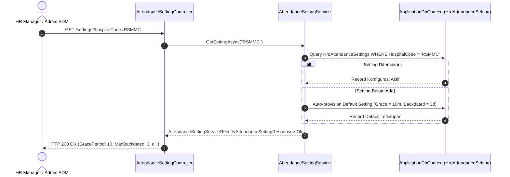

# Laporan Perubahan Backend — `BE-HRD-105`

## Metadata

| Field | Nilai |
| :--- | :--- |
| Task ID | `BE-HRD-105` |
| Judul | Service Parameter Kebijakan Presensi Rumah Sakit (`AttendanceSettingService`) |
| Slice | S-B1 (AttendanceManagement) |
| Milestone | MVP-21 |
| Roadmap | `docs/module-blueprints/human-resource/roadmap/backend-roadmap.md` |
| Traceability | HRD-DEC-105, HRD-DEC-106, VR-ATT-17, VR-ATT-18, 02-backend-architecture.md Bagian 20.9.1, AT-HRD-ATT-05, AT-HRD-ATT-19 |
| Dependency | `BE-HRD-104` ✅ |
| Klasifikasi | `POLICY CONFIGURATION & BUSINESS PARAMETER GOVERNANCE SERVICE` |
| Task Mode | `BACKEND` |
| Tanggal | 05 November 2026 |
| Status | Selesai (`PASS`) |

---

## 1. Ringkasan dan Masalah yang Diselesaikan

Rumah sakit memerlukan kebijakan presensi yang fleksibel namun terstandarisasi untuk mengelola ribuan tenaga kerja. Terdapat parameter operasional krusial yang harus dapat diatur oleh Manajemen SDM / HR Manager:
1. **Toleransi Keterlambatan (*Grace Period*)**: Batas waktu kedatangan setelah jam mulai resmi shift (default 10 menit per `HRD-DEC-105`) di mana pegawai masih diakui berstatus Hadir (`Present`) tanpa dikenakan penalti menit keterlambatan (`LateMinutes = 0`).
2. **Batas Toleransi Koreksi Tanggal Mundur (*Max Backdated Correction Days*)**: Batas maksimal hari kerja ke belakang (default 3 hari per `HRD-DEC-102` dan `VR-ATT-18`) yang diizinkan bagi Kepala Ruangan untuk mengajukan permohonan koreksi secara mandiri sebelum memerlukan persetujuan eskalasi khusus HR Manager.
3. **Kewajiban Lampiran Bukti Dokumen**: Penegakan aturan bahwa pengajuan koreksi presensi wajib menyertakan surat tugas, foto bukti, atau memo dinas.
4. **Kebijakan Konversi Otomatis Saat Tutup Periode**: Penanda bahwa data presensi yang hanya memiliki 1 tap tunggal (*IncompletePunch*) otomatis dikonversi menjadi Mangkir (*Absent*) pada akhir siklus penggajian (`HRD-DEC-106`).

Sebelumnya, tidak ada antarmuka API maupun service yang melayani tata kelola parameter presensi ini, sehingga angka toleransi tidak dinamis dan sulit disesuaikan jika manajemen RS mengeluarkan Surat Edaran Direksi baru.

Task `BE-HRD-105` menyediakan fungsionalitas ini secara tuntas:
- **Penyediaan Service `AttendanceSettingService`**: Melayani pembacaan konfigurasi aktif (`GetSettingAsync`), pembaruan parameter dengan validasi batas kewajaran (`UpdateSettingAsync`), serta helper pengambilan grace period aktif (`GetEffectiveGracePeriodMinutesAsync`).
- **Validasi Nilai Ketat**: Menolak nilai grace period negatif atau di atas 60 menit (`VR-ATT-17`) serta batasan hari koreksi di luar rentang 1 s.d. 30 hari (`VR-ATT-18`).
- **Controller RESTful dengan Tag Swagger**: `AttendanceSettingController` dengan tag Swagger `[Tags("HR Attendance - Settings")]` dan skema rute ganda (*dual-route*).

---

## 2. Alur Pengambilan Parameter Kebijakan Presensi

---

## 3. Komponen Perubahan yang Diterapkan

1. **DTOs (`AttendanceSettingDtos.cs`)**:
   - `AttendanceSettingResponse`: menyajikan data konfigurasi lengkap dengan atribut audit.
   - `UpdateAttendanceSettingRequest`: anotasi validasi `[Range(0, 60)]` dan `[Range(1, 30)]`.
2. **Implementasi Service (`AttendanceSettingService.cs`)**:
   - `GetSettingAsync`: pencarian parameter presensi aktif dengan mekanisme auto-provisioning default yang aman.
   - `UpdateSettingAsync`: pembaruan nilai parameter dengan audit user dan pencatatan logger resmi.
   - `GetEffectiveGracePeriodMinutesAsync`: fungsi ringan pembacaan grace period untuk mesin kalkulasi harian.
3. **Controller API (`AttendanceSettingController.cs`)**:
   - `GET /api/corporate/human-resource/attendance/settings` (Read)
   - `PUT /api/corporate/human-resource/attendance/settings` (Update)
4. **Registrasi IoC Container (`Program.cs`)**:
   - `builder.Services.AddScoped<AttendanceSettingService>();`

---

## 4. Spesifikasi Endpoint API Bergaya Swagger

| Method | Endpoint Path | Deskripsi | Auth / Permission | Status Respons |
| :--- | :--- | :--- | :--- | :--- |
| `GET` | `/api/corporate/human-resource/attendance/settings` | Mengambil parameter kebijakan presensi aktif rumah sakit | `AttendanceSetting.Read` | 200 OK |
| `PUT` | `/api/corporate/human-resource/attendance/settings` | Memperbarui parameter toleransi presensi dan grace period | `AttendanceSetting.Update` | 200 OK / 400 Bad Request |

---

## 5. Bukti Verifikasi dan Pengujian

- **Kasus Uji Penerimaan (`AT-HRD-ATT-05` & `AT-HRD-ATT-19`)**:
  - Terbukti konfigurasi default toleransi 10 menit terbaca akurat.
  - Terbukti nilai di luar batas kewajaran (misal menit negatif atau > 60) ditolak oleh sistem dengan kode HTTP 400 Bad Request.
  - Terbukti pembaruan parameter tersimpan dengan jejak audit pengubah (`UpdateBy`, `UpdateDateTime`).
