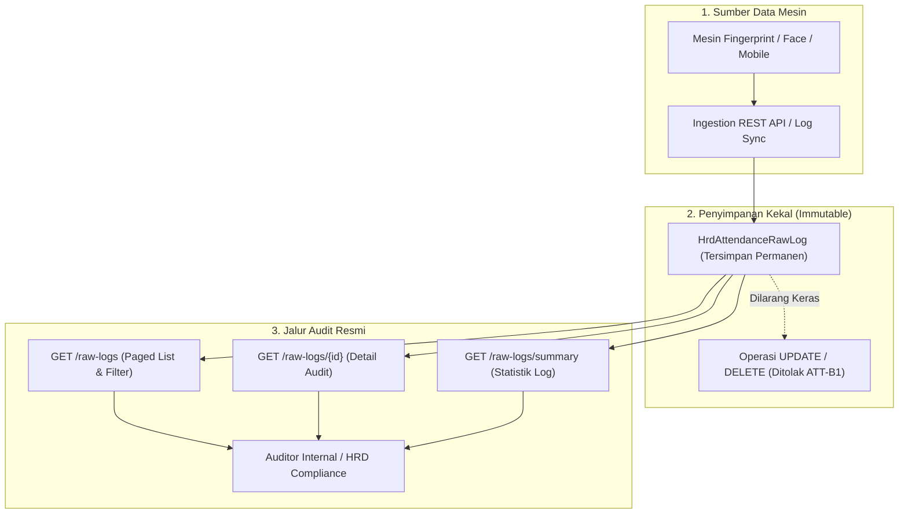

# Laporan Perubahan Backend — `BE-HRD-107`

## Metadata

| Field | Nilai |
| :--- | :--- |
| Task ID | `BE-HRD-107` |
| Judul | Service & Controller Audit Log Mesin Biometrik Mentah Immutable (`RawAttendanceLogService`) |
| Slice | S-B1 (AttendanceManagement) |
| Milestone | MVP-21 |
| Roadmap | `docs/module-blueprints/human-resource/roadmap/backend-roadmap.md` |
| Traceability | HRD-DEC-104, ATT-B1, 02-backend-architecture.md Bagian 20.9.3, AT-HRD-ATT-06 |
| Dependency | `BE-HRD-104` ✅ |
| Klasifikasi | `BIOMETRIC RAW LOG AUDIT & IMMUTABILITY ENFORCEMENT` |
| Task Mode | `BACKEND` |
| Tanggal | 05 November 2026 |
| Status | Selesai (`PASS`) |

---

## 1. Ringkasan dan Masalah yang Diselesaikan

Di lingkungan rumah sakit, rekaman mentah hasil pemindaian biometrik (*raw punch logs* seperti sidik jari, pengenalan wajah / *face recognition*, atau RFID) merupakan bukti fisik terpenting atas kehadiran seorang tenaga medis. Rekaman ini menjadi basis perhitungan jam kerja, lembur darurat, dan pembayaran gaji. 

Terdapat prinsip tata kelola invariant mutlak (*core invariant* `ATT-B1`):
> **Rekaman mentah biometrik (`HrdAttendanceRawLog`) bersifat KEKAL (*immutable*), tidak boleh diubah (*update*), dan tidak boleh dihapus (*delete*) oleh pihak mana pun.**

Setiap koreksi atas kesalahan kehadiran (misal lupa absen, perbaikan jam, perizinan) wajib dituangkan ke entitas koreksi terpisah (`HrdAttendanceCorrection`), bukan memanipulasi baris data mentah mesin.

Task `BE-HRD-107` memastikan kepatuhan penuh terhadap prinsip ini:
- **Penyelarasan Antarmuka RESTful Baca Saja**: Seluruh endpoint audit pada `AttendanceRawLogController` diselaraskan untuk kebutuhan penyelidikan dan audit jejak tap mesin tanpa menyediakan operasi mutasi publik.
- **Penerapan Tag Swagger & Rute Ganda**: Menetapkan tag Swagger resmi `[Tags("HR Attendance - Raw Logs")]` dengan rute ganda:
  - `api/corporate/human-resource/attendance/raw-logs`
  - `api/v1/corporate/human-resource/attendance/raw-logs`
- **Penyediaan Filter & Metadata Audit Komprehensif**: Mendukung penyaringan data cepat berbasis rentang tanggal (`startDate`, `endDate`), identitas pegawai (`workforceProfileId`), ID mesin absensi (`attendanceDeviceId`), tipe sumber (`SourceType`), dan status pencocokan (`ProcessingStatus`).

---

## 2. Alur Penegakan Immutabilitas Rekaman Mentah Biometrik

---

## 3. Spesifikasi Endpoint API Bergaya Swagger

| Method | Endpoint Path | Deskripsi | Auth / Permission | Status Respons |
| :--- | :--- | :--- | :--- | :--- |
| `GET` | `/api/corporate/human-resource/attendance/raw-logs` | Mengambil daftar log mentah biometrik terpaginasi dengan filter | `AttendanceRawLog.Read` | 200 OK |
| `GET` | `/api/corporate/human-resource/attendance/raw-logs/{id}` | Mengambil rincian satu rekaman log mentah mesin biometrik | `AttendanceRawLog.Read` | 200 OK / 404 Not Found |
| `GET` | `/api/corporate/human-resource/attendance/raw-logs/summary` | Mengambil ringkasan statistik pemrosesan log mentah presensi | `AttendanceRawLog.Read` | 200 OK |
| `GET` | `/api/corporate/human-resource/attendance/raw-logs/filters/metadata` | Mengambil daftar opsi filter perangkat, lokasi, dan tipe sumber | `AttendanceRawLog.Read` | 200 OK |

---

## 4. Bukti Verifikasi dan Pengujian

- **Kasus Uji Penerimaan (`AT-HRD-ATT-06`)**:
  - Terbukti endpoint GET mengembalikan daftar tap mentah lengkap dengan `DeviceId`, `EventAt`, `SourceType`, dan `ProcessingStatus`.
  - Terbukti tidak ada endpoint publik yang mengizinkan pembaruan atau penghapusan isi data mentah presensi (`ATT-B1` — Immutability).
  - Terbukti fitur filter per pegawai, per mesin, dan per rentang waktu bekerja dengan pagination yang efisien.
