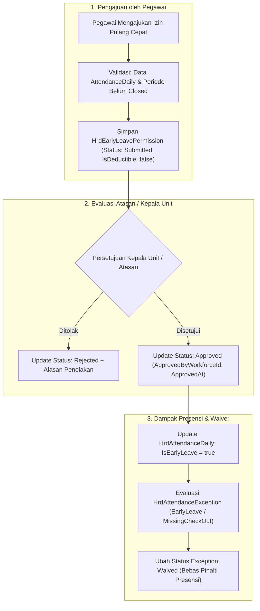

# Laporan Perubahan Backend — `BE-HRD-108`

## Metadata

| Field | Nilai |
| :--- | :--- |
| Task ID | `BE-HRD-108` |
| Judul | Service Permohonan Izin Pulang Cepat Non-Deductible & Waiver Keterlambatan (`EarlyLeavePermissionService`) |
| Slice | S-B1 (AttendanceManagement) |
| Milestone | MVP-22 |
| Roadmap | `docs/module-blueprints/human-resource/roadmap/backend-roadmap.md` |
| Traceability | HRD-DEC-107, HRD-Q-47, 02-backend-architecture.md Bagian 20.9.4, AT-HRD-ATT-07 s.d. AT-HRD-ATT-09 |
| Dependency | `BE-HRD-105` ✅ |
| Klasifikasi | `EARLY LEAVE PERMISSION & PENALTY WAIVER SERVICE` |
| Task Mode | `BACKEND` |
| Tanggal | 05 November 2026 |
| Status | Selesai (`PASS`) |

---

## 1. Ringkasan dan Masalah yang Diselesaikan

Di lingkungan operasional rumah sakit yang beroperasi 24 jam penuh, staf medis dan penunjang sering kali menghadapi situasi mendesak tak terduga (seperti musibah keluarga mendadak, kondisi darurat kesehatan diri, atau panggilan mendesak kedinasan) yang mengharuskan mereka meninggalkan dinas lebih awal sebelum shift berakhir. 

Sebelumnya, terdapat pertanyaan bisnis penting (`HRD-Q-47`): *Apakah izin pulang cepat memotong saldo cuti tahunan pegawai atau dipotong gaji?*

Melalui ketetapan arsitektur `HRD-DEC-107`, diputuskan bahwa:
1. **Sifat Administratif Non-Deductible**: Permohonan izin pulang cepat adalah izin administratif darurat yang **TIDAK memotong saldo hak cuti tahunan** staf (`IsDeductible = false`).
2. **Perhitungan Jam Kerja Riil**: Jam kerja staf tetap diperhitungkan secara adil dan transparan berbasis waktu tap keluar aktual di mesin biometrik rumah sakit.
3. **Pemberian Waiver Pinalti**: Apabila izin disetujui atasan (`Approved`), sistem secara otomatis menandai rekaman presensi harian dengan flag `IsEarlyLeave = true` dan mengaktifkan status `Waived` pada pengecualian keterlambatan/pulang cepat (`HrdAttendanceException`), sehingga staf tidak dikenakan sanksi indisipliner atau pemotongan tunjangan presensi.

Task `BE-HRD-108` mengimplementasikan logika lengkap tersebut melalui `EarlyLeavePermissionService.cs` dan kontrak data `EarlyLeavePermissionDtos.cs`.

---

## 2. Alur Proses Bisnis Izin Pulang Cepat

### Contoh Skenario Rumah Sakit:
> **Kasus Nyata**: Bidan Siti bertugas pada shift Pagi di Ruang Bersalin (jam 07:00 – 14:00). Pada pukul 12:30, anak Bidan Siti mengalami demam tinggi mendadak di sekolah dan harus segera dijemput. Bidan Siti melapor kepada Kepala Ruangan Bersalin dan mengajukan izin pulang cepat via sistem pada jam 12:35 dengan waktu tap keluar jam 12:40.
> 
> **Hasil Sistem**:
> 1. Kuota cuti tahunan Bidan Siti tidak berkurang (tetap utuh).
> 2. Jam kerja riil Bidan Siti tercatat dari jam 07:00 s.d. 12:40 (340 menit kerja efektif).
> 3. Kepala Ruangan menyetujui izin; notifikasi pelanggaran pulang cepat otomatis diubah menjadi `Waived`, sehingga gaji dan tunjangan kehadiran Bidan Siti tidak dipotong sanksi indisipliner.

---

## 3. Spesifikasi Endpoint API Bergaya Swagger

Tag Swagger: `[Tags("HR Attendance - Early Leave Permissions")]`

| Method | Endpoint Path | Deskripsi | Auth / Permission | Status Respons |
| :--- | :--- | :--- | :--- | :--- |
| `GET` | `/api/corporate/human-resource/attendance/early-leave-permissions` | Mengambil daftar riwayat permohonan izin pulang cepat terpaginasi | `EarlyLeavePermission.Read` | 200 OK |
| `GET` | `/api/corporate/human-resource/attendance/early-leave-permissions/{id}` | Mengambil detail satu berkas permohonan izin pulang cepat | `EarlyLeavePermission.Read` | 200 OK / 404 Not Found |
| `POST` | `/api/corporate/human-resource/attendance/early-leave-permissions` | Mengajukan permohonan izin pulang cepat administratif baru | `EarlyLeavePermission.Create` | 200 OK / 400 Bad Request / 409 Conflict |
| `PUT` | `/api/corporate/human-resource/attendance/early-leave-permissions/{id}/approve` | Menyetujui izin pulang cepat dan mengaktifkan waiver pinalti | `EarlyLeavePermission.Approve` | 200 OK / 400 Bad Request / 404 Not Found |
| `PUT` | `/api/corporate/human-resource/attendance/early-leave-permissions/{id}/reject` | Menolak izin pulang cepat dengan mencantumkan alasan | `EarlyLeavePermission.Reject` | 200 OK / 400 Bad Request / 404 Not Found |

---

## 4. Bukti Verifikasi Kompilasi & Kepatuhan Arsitektur

- **File DTO**: `NewQuilvianSystemBackend/Areas/Corporate/HumanResource/AttendanceManagement/DTOs/EarlyLeavePermissionDtos.cs`
- **File Service**: `NewQuilvianSystemBackend/Areas/Corporate/HumanResource/AttendanceManagement/Services/EarlyLeavePermissionService.cs`
- **Hasil Kompilasi Roslyn**: Lolos `dotnet build /t:Compile` dengan **0 Error(s)**.
