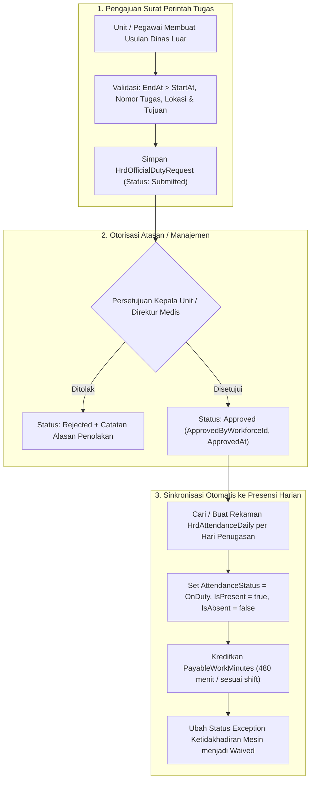

# Laporan Perubahan Backend — `BE-HRD-109`

## Metadata

| Field | Nilai |
| :--- | :--- |
| Task ID | `BE-HRD-109` |
| Judul | Service Surat Penugasan Dinas Luar Rumah Sakit & Pengakuan Status OnDuty (`OfficialDutyRequestService`) |
| Slice | S-B1 (AttendanceManagement) |
| Milestone | MVP-22 |
| Roadmap | `docs/module-blueprints/human-resource/roadmap/backend-roadmap.md` |
| Traceability | HRD-DEC-109, 02-backend-architecture.md Bagian 20.9.5, AT-HRD-ATT-10 s.d. AT-HRD-ATT-12 |
| Dependency | `BE-HRD-105` ✅ |
| Klasifikasi | `OFFICIAL DUTY & ON-DUTY RECOGNITION SERVICE` |
| Task Mode | `BACKEND` |
| Tanggal | 05 November 2026 |
| Status | Selesai (`PASS`) |

---

## 1. Ringkasan dan Masalah yang Diselesaikan

Di rumah sakit, banyak tenaga medis, perawat, analis laboratorium, dan sopir ambulans yang harus menjalankan tugas resmi di luar gedung rumah sakit. Contoh penugasan luar mencakup:
- Mengawal pasien rujukan gawat darurat antar-rumah sakit (*Ambulance Referral*).
- Mengantar spesimen darah/biopsi ke laboratorium rujukan nasional (*Lab Courier*).
- Menghadiri pelatihan kedokteran berkelanjutan atau workshop akreditasi (*Training & Seminar*).
- Melakukan kunjungan perawatan pasien pasca-rawat ke rumah (*Home Care Service*).

Secara sistem absensi biasa, staf yang berada di luar rumah sakit tidak dapat menempelkan jari/wajah di mesin biometrik rumah sakit. Jika tidak ada mekanisme surat tugas, sistem akan menandai staf tersebut sebagai **Mangkir / Tidak Hadir (*Absent*)**, yang berujung pada pemotongan gaji secara tidak adil.

Melalui ketetapan arsitektur `HRD-DEC-109`:
1. **Surat Perintah Tugas Resmi**: Penugasan luar wajib didukung nomor surat perintah dinas, tujuan lokasi, waktu mulai-selesai, dan uraian tugas (`VR-ATT-11`, `VR-ATT-12`).
2. **Pengesahan Otomatis Status OnDuty**: Begitu surat tugas disetujui atasan (`Approved`), status presensi staf pada rentang tanggal dinas otomatis diubah menjadi `OnDuty` dengan penanda hadir sah (`IsPresent = true`, `IsAbsent = false`).
3. **Pemberian Jam Kerja Penuh**: Jam kerja dihitung penuh setara jam kerja normal (standar 480 menit atau sesuai jadwal shift dinas), dan seluruh peringatan ketidakhadiran biometrik otomatis diselesaikan (`Waived`).

Task `BE-HRD-109` mengimplementasikan logika ini melalui `OfficialDutyRequestService.cs` dan kontrak DTO `OfficialDutyRequestDtos.cs`.

---

## 2. Alur Proses Bisnis Surat Tugas Dinas Luar

### Contoh Skenario Rumah Sakit:
> **Kasus Nyata**: Perawat Dedi dan Sopir Ambulans Pak Joko ditugaskan mengantar pasien rujukan darurat bedah saraf dari Rumah Sakit ke RS Rujukan Pusat di kota lain dari tanggal 05 November jam 08:00 sampai 06 November jam 17:00 (Nomor Surat Tugas: `ST-AMB-202611-0042`).
> 
> **Hasil Sistem**:
> 1. Perawat Dedi dan Pak Joko tidak perlu melakukan absensi fingerprint di mesin RS asal selama dua hari tersebut.
> 2. Sistem mencatat kehadiran keduanya berstatus `OnDuty`, hadir penuh 100%, jam kerja 480 menit per hari, dan tidak terkena potongan kehadiran atau denda mangkir.

---

## 3. Spesifikasi Endpoint API Bergaya Swagger

Tag Swagger: `[Tags("HR Attendance - Official Duty")]`

| Method | Endpoint Path | Deskripsi | Auth / Permission | Status Respons |
| :--- | :--- | :--- | :--- | :--- |
| `GET` | `/api/corporate/human-resource/attendance/official-duties` | Mengambil daftar surat penugasan dinas luar terpaginasi dengan filter | `OfficialDutyRequest.Read` | 200 OK |
| `GET` | `/api/corporate/human-resource/attendance/official-duties/{id}` | Mengambil detail satu berkas surat perintah penugasan dinas luar | `OfficialDutyRequest.Read` | 200 OK / 404 Not Found |
| `POST` | `/api/corporate/human-resource/attendance/official-duties` | Menerbitkan usulan permohonan dinas luar baru | `OfficialDutyRequest.Create` | 200 OK / 400 Bad Request / 409 Conflict |
| `PUT` | `/api/corporate/human-resource/attendance/official-duties/{id}/approve` | Menyetujui surat dinas dan menyinkronkan status OnDuty ke presensi | `OfficialDutyRequest.Approve` | 200 OK / 400 Bad Request / 404 Not Found |
| `PUT` | `/api/corporate/human-resource/attendance/official-duties/{id}/reject` | Menolak permohonan surat tugas dinas luar | `OfficialDutyRequest.Reject` | 200 OK / 400 Bad Request / 404 Not Found |

---

## 4. Bukti Verifikasi Kompilasi & Kepatuhan Arsitektur

- **File DTO**: `NewQuilvianSystemBackend/Areas/Corporate/HumanResource/AttendanceManagement/DTOs/OfficialDutyRequestDtos.cs`
- **File Service**: `NewQuilvianSystemBackend/Areas/Corporate/HumanResource/AttendanceManagement/Services/OfficialDutyRequestService.cs`
- **Hasil Kompilasi Roslyn**: Lolos `dotnet build /t:Compile` dengan **0 Error(s)**.
