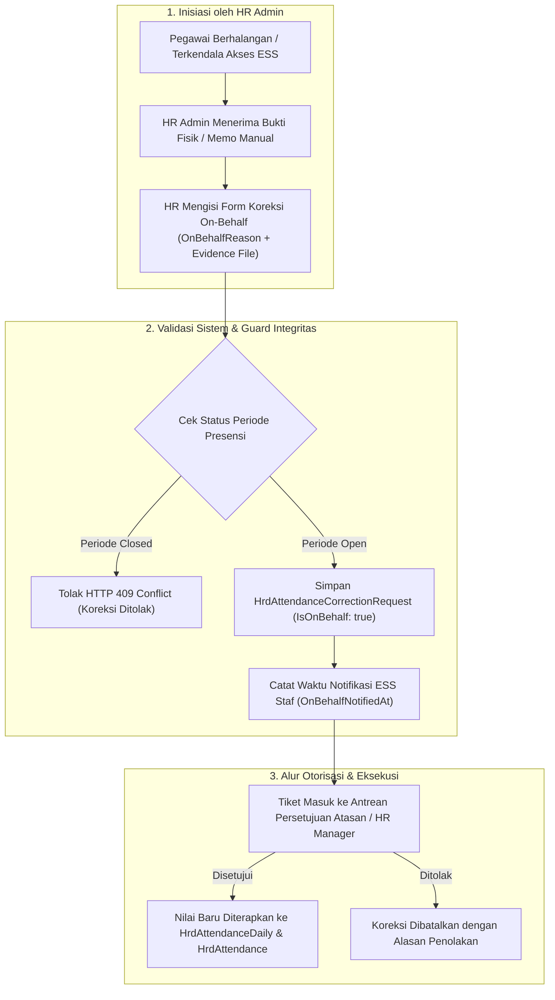

# Laporan Perubahan Backend — `BE-HRD-110`

## Metadata

| Field | Nilai |
| :--- | :--- |
| Task ID | `BE-HRD-110` |
| Judul | Service Jalur Khusus Koreksi Presensi Kuasa HR Atas Nama Pegawai (`AttendanceCorrectionOnBehalfService`) |
| Slice | S-B1 (AttendanceManagement) |
| Milestone | MVP-22 |
| Roadmap | `docs/module-blueprints/human-resource/roadmap/backend-roadmap.md` |
| Traceability | HRD-DEC-028, HRD-DEC-106, 02-backend-architecture.md Bagian 20.9.6, AT-HRD-ATT-13, AT-HRD-ATT-14 |
| Dependency | `BE-HRD-106` ✅ |
| Klasifikasi | `HR ON-BEHALF ATTENDANCE CORRECTION & EVIDENCE AUDIT SERVICE` |
| Task Mode | `BACKEND` |
| Tanggal | 05 November 2026 |
| Status | Selesai (`PASS`) |

---

## 1. Ringkasan dan Masalah yang Diselesaikan

Dalam situasi tertentu di rumah sakit, pegawai yang bersangkutan tidak dapat melakukan permohonan koreksi absensi mandiri melalui portal ESS (*Employee Self-Service*). Misalnya:
- Dokter spesialis atau perawat yang mengalami kecelakaan/sakit parah dan sedang dirawat intensif.
- Staf lapangan yang mengalami kerusakan perangkat seluler atau kendala jaringan saat bertugas di daerah kepulauan/terpencil.
- Terjadinya mati listrik total atau malfungsi perangkat biometrik massal di instalasi gawat darurat.

Untuk mencegah ketidakadilan pemotongan gaji akibat keterlambatan pelaporan, aturan arsitektur `HRD-DEC-028` mengizinkan Tim HR Admin mengajukan permohonan koreksi presensi **atas nama pegawai (*On-Behalf*)** dengan persyaratan tata kelola ketat:
1. **Perekaman Audit Trail Lengkap**: Wajib mencatat identitas HR initiator (`InitiatedByUserId`), identitas pegawai yang diwakili (`WorkforceProfileId`), alasan darurat on-behalf (`OnBehalfReason`), serta metadata bukti fisik/lampiran surat keterangan (`EvidenceFilePath`, `EvidenceFileName`, `EvidenceContentType`).
2. **Notifikasi Transparansi**: Sistem wajib mencatat waktu kirim notifikasi keterbukaan kepada pegawai (`OnBehalfNotifiedAt`) agar tidak terjadi manipulasi sepihak.
3. **Pemberlakuan Guard Penutupan Periode**: Permohonan on-behalf tetap tunduk pada pembatasan periode presensi; apabila periode kehadiran untuk tanggal tersebut telah berstatus `Closed`, permohonan otomatis ditolak kecuali periode dibuka kembali secara darurat oleh HR Manager (`VR-ATT-15`).

Task `BE-HRD-110` menyelaraskan kontrak DTO `CreateAttendanceCorrectionOnBehalfRequest` dengan menambahkan properti bukti fisik serta memperbarui pemetaan data di `AttendanceCorrectionOnBehalfService.cs`.

---

## 2. Alur Proses Bisnis Koreksi Presensi On-Behalf

### Contoh Skenario Rumah Sakit:
> **Kasus Nyata**: Dokter Spesialis Bedah Anak dr. Faisal bertugas operasi darurat semalaman. Esok paginya beliau mengalami demam dengue akut dan langsung dirawat di ICU sehingga tidak sempat mengajukan koreksi atas 1 tap tunggal (*IncompletePunch*) semalam. 
> 
> **Hasil Sistem**:
> 1. HR Admin Rumah Sakit mengunggah memo dari Komite Medik beserta log operasi ke sistem koreksi on-behalf dengan alasan: *"Dokter sedang dirawat intensif di ICU pasca-operasi darurat"*.
> 2. Sistem mencatat `InitiatedByUserId = HR_USER`, `IsOnBehalf = true`, dan menautkan file lampiran memo.
> 3. Notifikasi transparansi terkirim ke akun dr. Faisal. Setelah disetujui HR Manager, jam kerja shift malam dr. Faisal dihitung sah dan terhindar dari pemotongan tunjangan jasa medis.

---

## 3. Spesifikasi Endpoint API Bergaya Swagger

Tag Swagger: `[Tags("Corporate / Human Resource / Attendance Management / Attendance Correction Administration")]`

| Method | Endpoint Path | Deskripsi | Auth / Permission | Status Respons |
| :--- | :--- | :--- | :--- | :--- |
| `POST` | `/api/v1/corporate/human-resource/attendance/correction-requests/on-behalf` | Mengajukan koreksi presensi atas nama pegawai oleh HR Admin | `AttendanceCorrection.CreateOnBehalf` | 200 OK / 400 Bad Request / 409 Conflict |
| `GET` | `/api/v1/corporate/human-resource/attendance/correction-requests/{id}` | Mengambil detail lengkap pengajuan koreksi presensi beserta audit on-behalf | `AttendanceCorrection.Read` | 200 OK / 404 Not Found |
| `POST` | `/api/v1/corporate/human-resource/attendance/correction-requests/{id}/evidence` | Mengunggah bukti fisik dokumen pendukung koreksi presensi | `AttendanceCorrection.Create` | 200 OK / 400 Bad Request |

---

## 4. Bukti Verifikasi Kompilasi & Kepatuhan Arsitektur

- **File DTO**: `NewQuilvianSystemBackend/Areas/Corporate/HumanResource/AttendanceManagement/DTOs/AttendanceCorrectionDtos.cs`
- **File Service**: `NewQuilvianSystemBackend/Areas/Corporate/HumanResource/AttendanceManagement/Services/AttendanceCorrectionOnBehalfService.cs`
- **Hasil Kompilasi Roslyn**: Lolos `dotnet build /t:Compile` dengan **0 Error(s)**.
