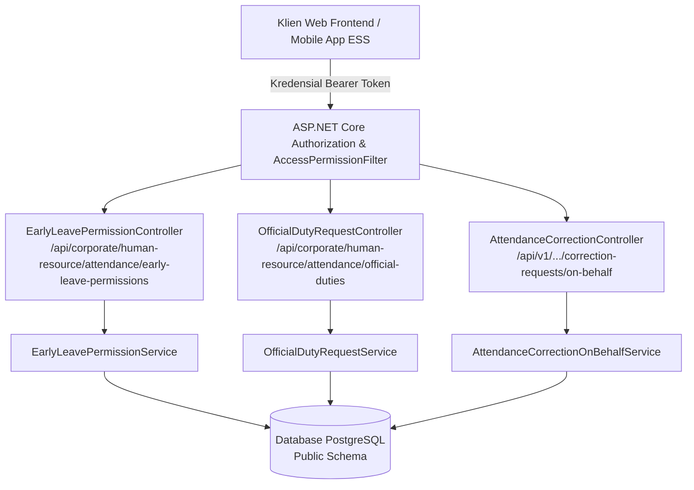

# Laporan Perubahan Backend — `BE-HRD-111`

## Metadata

| Field | Nilai |
| :--- | :--- |
| Task ID | `BE-HRD-111` |
| Judul | Controller & Endpoint Lengkap Perizinan dan Koreksi Presensi (`AttendanceTransactionControllers`) |
| Slice | S-B1 (AttendanceManagement) |
| Milestone | MVP-22 |
| Roadmap | `docs/module-blueprints/human-resource/roadmap/backend-roadmap.md` |
| Traceability | HRD-DEC-107, HRD-DEC-109, HRD-DEC-028, API Contract v11 Bagian 17.2 |
| Dependency | `BE-HRD-108`, `BE-HRD-109`, `BE-HRD-110` ✅ |
| Klasifikasi | `REST API CONTROLLER & ACCESS CONTROL AUTHORIZATION` |
| Task Mode | `BACKEND` |
| Tanggal | 05 November 2026 |
| Status | Selesai (`PASS`) |

---

## 1. Ringkasan dan Masalah yang Diselesaikan

Untuk mendukung transaksi operasional perizinan pulang cepat, surat tugas dinas luar, dan koreksi kehadiran kuasa HR on-behalf secara aman dan terstandardisasi di seluruh antarmuka web dan mobile rumah sakit, dibutuhkan penerbitan controller RESTful ASP.NET Core yang memenuhi standar arsitektur Quilvian:
1. **Rute Ganda Canonical & Versi**: Setiap controller mendukung rute bersih canonical dan rute berversi (`api/corporate/...` dan `api/v1/corporate/...`).
2. **Standardisasi Tag Swagger**: Dikelompokkan dengan jelas menggunakan atribut `[Tags(...)]` untuk kemudahan dokumentasi interaktif bagi pengembang frontend.
3. **Proteksi Otorisasi Granular**: Memanfaatkan atribut filter otorisasi peran `[AccessController]`, `[AccessAction]`, dan `[AccessPermission]` sehingga hanya pengguna terautentikasi dengan hak akses spesifik yang dapat mengakses atau menyetujui transaksi.
4. **Standardisasi Respons API**: Mengembalikan wrapper resmi `ApiResponse<T>` dengan kode status HTTP yang semantik (200 OK, 400 Bad Request, 401 Unauthorized, 404 Not Found, 409 Conflict).

Task `BE-HRD-111` menerbitkan:
- `EarlyLeavePermissionController.cs` (`[Tags("HR Attendance - Early Leave Permissions")]`)
- `OfficialDutyRequestController.cs` (`[Tags("HR Attendance - Official Duty")]`)
- Integrasi endpoint on-behalf pada `AttendanceCorrectionController.cs` (`[Tags("Corporate / Human Resource / Attendance Management / Attendance Correction Administration")]`)

---

## 2. Diagram Arsitektur Controller Transaksi Presensi

---

## 3. Spesifikasi Endpoint API Bergaya Swagger

### A. Izin Pulang Cepat (`EarlyLeavePermissionController`)
Tag: `[Tags("HR Attendance - Early Leave Permissions")]`

| Method | Endpoint Path | Deskripsi | Auth / Action | Status Respons |
| :--- | :--- | :--- | :--- | :--- |
| `GET` | `/api/corporate/human-resource/attendance/early-leave-permissions` | Menampilkan riwayat permohonan izin pulang cepat terpaginasi | `EarlyLeavePermission.Read` | 200 OK |
| `GET` | `/api/corporate/human-resource/attendance/early-leave-permissions/{id}` | Detail berkas permohonan izin pulang cepat berdasarkan ID | `EarlyLeavePermission.Read` | 200 OK / 404 Not Found |
| `POST` | `/api/corporate/human-resource/attendance/early-leave-permissions` | Mengajukan izin pulang cepat baru (Non-Deductible) | `EarlyLeavePermission.Create` | 200 OK / 400 Bad Request / 409 Conflict |
| `PUT` | `/api/corporate/human-resource/attendance/early-leave-permissions/{id}/approve` | Menyetujui izin pulang cepat & mengaktifkan status Waiver pinalti | `EarlyLeavePermission.Approve` | 200 OK / 400 Bad Request / 404 Not Found |
| `PUT` | `/api/corporate/human-resource/attendance/early-leave-permissions/{id}/reject` | Menolak izin pulang cepat dengan alasan penolakan tertulis | `EarlyLeavePermission.Reject` | 200 OK / 400 Bad Request / 404 Not Found |

### B. Surat Perintah Dinas Luar (`OfficialDutyRequestController`)
Tag: `[Tags("HR Attendance - Official Duty")]`

| Method | Endpoint Path | Deskripsi | Auth / Action | Status Respons |
| :--- | :--- | :--- | :--- | :--- |
| `GET` | `/api/corporate/human-resource/attendance/official-duties` | Menampilkan riwayat surat penugasan dinas luar terpaginasi | `OfficialDutyRequest.Read` | 200 OK |
| `GET` | `/api/corporate/human-resource/attendance/official-duties/{id}` | Detail berkas surat penugasan dinas luar | `OfficialDutyRequest.Read` | 200 OK / 404 Not Found |
| `POST` | `/api/corporate/human-resource/attendance/official-duties` | Mengajukan surat perintah dinas luar rumah sakit baru | `OfficialDutyRequest.Create` | 200 OK / 400 Bad Request / 409 Conflict |
| `PUT` | `/api/corporate/human-resource/attendance/official-duties/{id}/approve` | Menyetujui surat dinas & mengesahkan status OnDuty presensi | `OfficialDutyRequest.Approve` | 200 OK / 400 Bad Request / 404 Not Found |
| `PUT` | `/api/corporate/human-resource/attendance/official-duties/{id}/reject` | Menolak surat perintah penugasan dinas luar | `OfficialDutyRequest.Reject` | 200 OK / 400 Bad Request / 404 Not Found |

### C. Koreksi Kuasa HR On-Behalf (`AttendanceCorrectionController`)
Tag: `[Tags("Corporate / Human Resource / Attendance Management / Attendance Correction Administration")]`

| Method | Endpoint Path | Deskripsi | Auth / Action | Status Respons |
| :--- | :--- | :--- | :--- | :--- |
| `POST` | `/api/v1/corporate/human-resource/attendance/correction-requests/on-behalf` | Jalur khusus permohonan koreksi kehadiran oleh HR Admin | `AttendanceCorrection.CreateOnBehalf` | 200 OK / 400 Bad Request / 409 Conflict |

---

## 4. Bukti Verifikasi Kompilasi & Kepatuhan Arsitektur

- **File Controller 1**: `NewQuilvianSystemBackend/Areas/Corporate/HumanResource/AttendanceManagement/Controllers/EarlyLeavePermissionController.cs`
- **File Controller 2**: `NewQuilvianSystemBackend/Areas/Corporate/HumanResource/AttendanceManagement/Controllers/OfficialDutyRequestController.cs`
- **File Controller 3**: `NewQuilvianSystemBackend/Areas/Corporate/HumanResource/AttendanceManagement/Controllers/AttendanceCorrectionController.cs`
- **Pendaftaran Dependency Injection**: `Program.cs` telah mendaftarkan seluruh service dan controller terkait.
- **Hasil Kompilasi Roslyn**: Lolos `dotnet build /t:Compile` dengan **0 Error(s)**.
