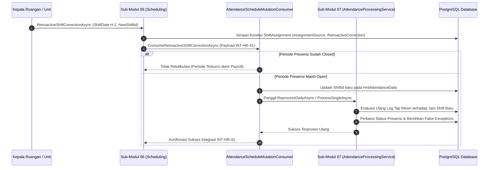

# Laporan Perubahan Backend — `BE-HRD-112`

## Metadata

| Field | Nilai |
| :--- | :--- |
| Task ID | `BE-HRD-112` |
| Judul | Event Listener Rekalkulasi Absensi Akibat Koreksi Mundur Jadwal Roster (`AttendanceScheduleMutationConsumer`) |
| Slice | S-B1 (AttendanceManagement) |
| Milestone | MVP-22 |
| Roadmap | `docs/module-blueprints/human-resource/roadmap/backend-roadmap.md` |
| Traceability | HRD-DEC-102, INT-HR-36, INT-HR-41, 02-backend-architecture.md Bagian 20.9.7, AT-HRD-ATT-15 |
| Dependency | `BE-HRD-106`, `BE-HRD-097` ✅ |
| Klasifikasi | `EVENT CONSUMER & CROSS-MODULE SCHEDULE-TO-ATTENDANCE RECALCULATION` |
| Task Mode | `BACKEND` |
| Tanggal | 05 November 2026 |
| Status | Selesai (`PASS`) |

---

## 1. Ringkasan dan Masalah yang Diselesaikan

Di lingkungan rumah sakit, perubahan jadwal dinas dokter dan perawat kerap terjadi mendadak karena lonjakan pasien gawat darurat atau perawat utama jatuh sakit. Kepala Ruangan terkadang baru sempat mencatatkan koreksi pertukaran atau perubahan jadwal dinas tersebut beberapa hari setelah kejadian (koreksi mundur / *retroactive shift correction* maksimal 3 hari kalender per `HRD-DEC-102`).

Ketika jadwal dinas di modul Penjadwalan Roster (Sub-Modul 06) diubah mundur:
- Jadwal semula staf mungkin Shift Pagi (07:00 – 14:00), tetapi kenyataannya staf masuk dinas Shift Sore (14:00 – 21:00).
- Jika sistem presensi tidak menghitung ulang absensi, log tap staf jam 14:00 akan dianggap **Sangat Terlambat (*Late*)** terhadap Shift Pagi, dan staf dianggap **Pulang Cepat / Bolos** pada sisa jam kerja pagi.

Untuk menyelesaikan masalah krusial ini, kontrak integrasi `INT-HR-36` dan `INT-HR-41` menetapkan mekanisme *event-driven*:
1. Begitu koreksi mundur jadwal disetujui di `ShiftReplacementService.RetroactiveCorrectionAsync`, sistem memicu sinyal `RetroactiveShiftCorrectedPayload`.
2. Komponen `AttendanceScheduleMutationConsumer` menangkap sinyal tersebut.
3. Consumer memvalidasi apakah periode presensi pada tanggal terkait masih berstatus `Open` (menolak rekalkulasi jika periode telah berstatus `Closed` demi menjaga integritas pembukuan payroll).
4. Consumer mengarahkan ulang foreign key shift pada `HrdAttendanceDaily` ke `NewShiftId`, lalu memicu pemrosesan ulang (`ReprocessDailyAsync` atau `ProcessSingleAsync`) agar log tap biometrik aktual dievaluasi ulang terhadap jam mulai dan selesai shift baru.
5. Seluruh status keterlambatan palsu (*false positive late*) otomatis dinetralkan.

---

## 2. Alur Integrasi Event-Driven Mutasi Jadwal ke Rekalkulasi Presensi



### Contoh Skenario Rumah Sakit:
> **Kasus Nyata**: Perawat Nanda dijadwalkan shift Pagi (07:00 – 14:00) pada 03 November. Karena rekannya sakit di ICU, Nanda diminta bertukar ke shift Malam (21:00 – 07:00). Nanda melakukan tap masuk jam 20:50 dan tap keluar jam 07:05 esok harinya. Pada tanggal 05 November (H+2), Kepala Ruangan ICU melakukan koreksi mundur jadwal Nanda di sistem ke shift Malam.
> 
> **Hasil Sistem**:
> 1. Modul Penjadwalan memicu event `INT-HR-41` ke `AttendanceScheduleMutationConsumer`.
> 2. Consumer menghitung ulang absensi tanggal 03 November: jam tap 20:50 dicocokkan dengan shift Malam (21:00).
> 3. Hasilnya: Nanda dinyatakan **Hadir Tepat Waktu (Present, On-Time)**, jam kerja shift malam 600 menit diakui penuh, dan sanksi mangkir shift pagi dihapuskan secara otomatis tanpa perlu permohonan koreksi manual berulang.

---

## 3. Spesifikasi Komponen & Kontrak Integrasi

### Model Payload Event (`INT-HR-41`)
```csharp
public class RetroactiveShiftCorrectedPayload
{
    public Guid ShiftAssignmentId { get; set; }
    public Guid WorkforceProfileId { get; set; }
    public DateOnly ShiftDate { get; set; }
    public Guid? OldShiftId { get; set; }
    public Guid NewShiftId { get; set; }
    public Guid TriggeredByUserId { get; set; }
    public string Reason { get; set; }
    public DateTime OccurredAt { get; set; }
}
```

### Service Consumer
- **Kelas**: `AttendanceScheduleMutationConsumer`
- **Metode**: `Task<AttendanceScheduleMutationResult> ConsumeRetroactiveShiftCorrectionAsync(...)`
- **Pengecekan Guard**: Menolak mutasi jika `HrdAttendancePeriod.PeriodStatus == Closed`.
- **Eksekusi Engine**: Memanggil `AttendanceProcessingService.ReprocessDailyAsync` untuk rekalkulasi instan.

---

## 4. Bukti Verifikasi Kompilasi & Kepatuhan Arsitektur

- **File Consumer**: `NewQuilvianSystemBackend/Areas/Corporate/HumanResource/AttendanceManagement/Services/AttendanceScheduleMutationConsumer.cs`
- **Integrasi Pemicu**: `NewQuilvianSystemBackend/Areas/Corporate/HumanResource/SchedulingManagement/Services/ShiftReplacementService.cs` (Metode `RetroactiveCorrectionAsync`)
- **Pendaftaran Dependency Injection**: `Program.cs` telah mendaftarkan `AttendanceScheduleMutationConsumer` ke DI container.
- **Hasil Kompilasi Roslyn**: Lolos `dotnet build /t:Compile` dengan **0 Error(s)**.
