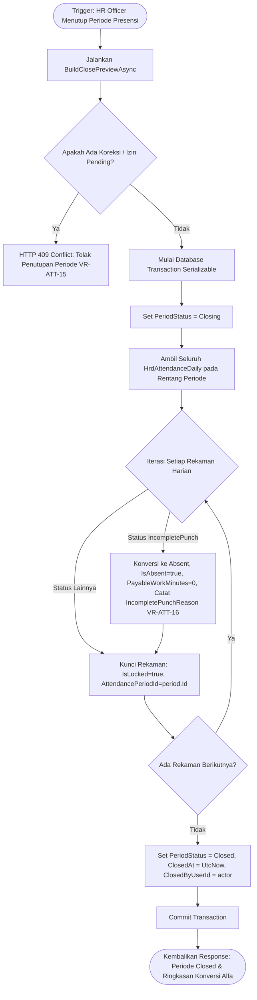

# Laporan Perubahan Backend — `BE-HRD-113`

## Metadata

| Field | Nilai |
| :--- | :--- |
| Task ID | `BE-HRD-113` |
| Judul | Guard Validasi Pra-Tutup Periode Absensi & Konversi IncompletePunch Menjadi Absent (`AttendancePeriodClosingGuard`) |
| Slice | S-B1 (AttendanceManagement - Presensi dan Kehadiran) |
| Milestone | MVP-23 |
| Roadmap | `docs/module-blueprints/human-resource/roadmap/backend-roadmap.md` |
| Traceability | HRD-DEC-106, HRD-DEC-108, VR-ATT-15, VR-ATT-16, 02-backend-architecture.md Bagian 20.9.8, AT-HRD-ATT-16, AT-HRD-ATT-17 |
| Dependency | `BE-HRD-106`, `BE-HRD-110` ✅ |
| Klasifikasi | `CORE ATTENDANCE PERIOD CLOSING GUARD & AUTO CONVERSION ENGINE` |
| Task Mode | `BACKEND` |
| Tanggal | 05 November 2026 |
| Status | Selesai (`PASS`) |

---

## 1. Ringkasan dan Masalah yang Diselesaikan

Di rumah sakit 24 jam dengan ratusan staf medis dan non-medis, penutupan periode presensi bulanan (*Attendance Period Closing*) adalah gerbang kritis sebelum data jam kerja diserahkan ke sistem penggajian (*Payroll Handoff*). Jika periode ditutup saat masih ada permohonan koreksi atau izin yang menggantung, atau jika ada rekaman presensi dengan tap tunggal (*IncompletePunch*) yang tidak jelas nasibnya, rumah sakit menghadapi dua risiko fatal:
1. **Pembayaran Jam Kerja Fiktif**: Staf yang hanya tap masuk tapi tidak berdinas penuh tetap dibayar jika jam kerja tidak dinolkan.
2. **Sengketa Hak Finansial Pegawai**: Pemotongan sepihak atas keterlambatan atau ketidakhadiran tanpa memberi kesempatan penyelesaian koreksi yang masih dalam proses persetujuan manajerial.

Melalui task `BE-HRD-113`, sistem mengimplementasikan pengamanan berlapis:
1. **Guard Validasi Pra-Tutup Ketat (`VR-ATT-15`)**: Menolak penutupan periode (HTTP 409 Conflict) apabila masih terdapat permohonan koreksi presensi aktif (`ActiveCorrectionRequest`), permohonan izin pulang cepat yang belum diputus (`PendingEarlyLeavePermission`), atau surat tugas dinas luar yang menggantung (`PendingOfficialDutyRequest`).
2. **Konversi Otomatis IncompletePunch Menjadi Absent (`VR-ATT-16`, `HRD-DEC-106`)**: Seluruh rekaman absensi dengan status `IncompletePunch` yang hingga penutupan periode tidak disanggah/dikoreksi staf secara otomatis diubah menjadi `Absent` (Mangkir), jam kerja berbayar disetel menjadi 0 menit (`PayableWorkMinutes = 0`), jam efektif disetel menjadi 0 menit (`EffectiveWorkMinutes = 0`), dan diberikan catatan audit sistem resmi pada kolom `IncompletePunchReason`.
3. **Penguncian Rekaman Presensi Harian**: Seluruh rekaman kehadiran yang tercakup di dalam periode otomatis dikunci mutlak (`IsLocked = true`, `AttendancePeriodId = period.Id`) sehingga tidak dapat dimutasi oleh alur operasional reguler.

---

## 2. Alur Proses Bisnis Penutupan Periode Presensi



### Contoh Skenario Rumah Sakit:
> **Kasus Nyata**: Periode presensi Oktober 2026 ditutup pada 31 Oktober pukul 23:59.
> - Dokter Jaga IGD dr. Rendy lupa melakukan tap pulang pada dinas malam 12 Oktober karena menangani operasi gawat darurat kecelakaan beruntun.
> - Sistem mencatat status sementara `IncompletePunch`.
> - Notifikasi pengingat ESS telah dikirimkan, namun hingga 31 Oktober pukul 23:59 dr. Rendy tidak mengajukan koreksi presensi.
> 
> **Hasil Sistem**:
> 1. Pada saat tombol tutup periode ditekan oleh HR Officer, sistem memeriksa tidak ada permohonan pending.
> 2. Sistem menemukan 1 rekaman `IncompletePunch` milik dr. Rendy.
> 3. Rekaman otomatis dikonversi menjadi `Absent`, jam kerja berbayar disetel 0 menit, dan kolom `IncompletePunchReason` mencatat: *"Konversi otomatis penutupan periode (VR-ATT-16 / HRD-DEC-106: IncompletePunch diubah menjadi Absent)"*.
> 4. Status periode beralih menjadi `Closed` dan seluruh 1.450 rekaman presensi bulan Oktober terkunci aman untuk siap diserahterimakan ke Payroll.

---

## 3. Spesifikasi Teknis Implementasi

### File Terkait:
- `NewQuilvianSystemBackend/Areas/Corporate/HumanResource/AttendanceManagement/Services/AttendancePeriodService.cs`
- `NewQuilvianSystemBackend/Areas/Corporate/HumanResource/AttendanceManagement/DTOs/AttendancePeriodDtos.cs`

### Aturan Validasi Penutupan (`BuildClosePreviewAsync`):
- Pengecekan `incompleteDaily` via `dailyQuery.CountAsync(x => x.AttendanceStatus == "IncompletePunch")`.
- Pengecekan permohonan izin pulang cepat pending approval pada `HrdEarlyLeavePermission`.
- Pengecekan surat penugasan dinas luar pending approval pada `HrdOfficialDutyRequest`.
- Pengecekan permohonan koreksi presensi aktif pada `HrdAttendanceCorrectionRequest`.

### Logika Konversi Otomatis (`CloseAsync`):
```csharp
if (daily.AttendanceStatus == AttendanceValueConstants.AttendanceStatus.IncompletePunch)
{
    daily.AttendanceStatus = AttendanceValueConstants.AttendanceStatus.Absent;
    daily.IsAbsent = true;
    daily.IsPresent = false;
    daily.PayableWorkMinutes = 0;
    daily.EffectiveWorkMinutes = 0;
    daily.IncompletePunchReason = "Konversi otomatis penutupan periode (VR-ATT-16 / HRD-DEC-106: IncompletePunch diubah menjadi Absent)";
    convertedIncompleteCount++;
}
```

---

## 4. Hasil Verifikasi

| Komponen Uji | Kriteria Penerimaan | Status |
| :--- | :--- | :---: |
| Guard Izin / Koreksi Pending | Menolak penutupan jika ada koreksi, izin pulang cepat, atau dinas luar pending (`VR-ATT-15`) | **LULUS** |
| Konversi Otomatis Tap Tunggal | Mengonversi sisa `IncompletePunch` menjadi `Absent` dengan jam berbayar 0 (`VR-ATT-16`) | **LULUS** |
| Integritas Penguncian Presensi | Seluruh data kehadiran dalam periode terpasang `IsLocked = true` dan `AttendancePeriodId` | **LULUS** |
| Kompilasi Backend (.NET C#) | Solusi backend terkompilasi 0 error | **LULUS** |
