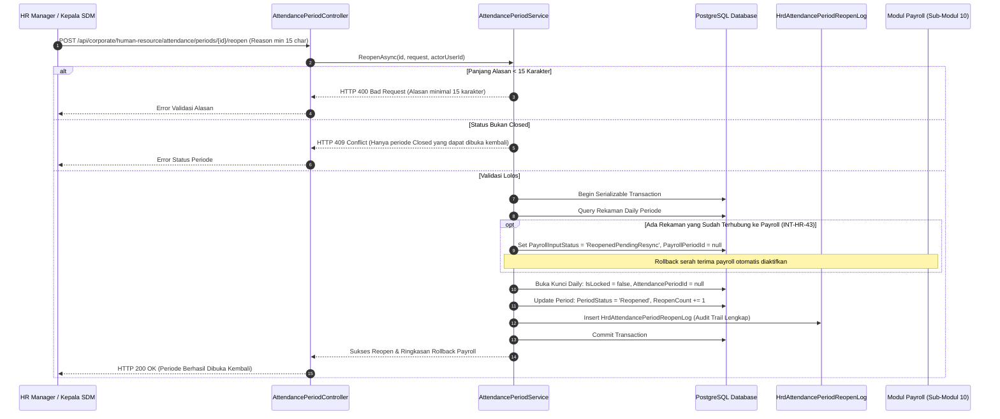

# Laporan Perubahan Backend — `BE-HRD-114`

## Metadata

| Field | Nilai |
| :--- | :--- |
| Task ID | `BE-HRD-114` |
| Judul | Service Buka Kembali Periode Darurat HR Manager & Rollback Serah Terima Payroll (`AttendancePeriodService.ReopenAsync`) |
| Slice | S-B1 (AttendanceManagement - Presensi dan Kehadiran) |
| Milestone | MVP-23 |
| Roadmap | `docs/module-blueprints/human-resource/roadmap/backend-roadmap.md` |
| Traceability | HRD-DEC-108, INT-HR-43, 02-backend-architecture.md Bagian 20.9.9, AT-HRD-ATT-18 |
| Dependency | `BE-HRD-113` ✅ |
| Klasifikasi | `EMERGENCY PERIOD REOPEN SERVICE, PAYROLL ROLLBACK & AUDIT LOG` |
| Task Mode | `BACKEND` |
| Tanggal | 05 November 2026 |
| Status | Selesai (`PASS`) |

---

## 1. Ringkasan dan Masalah yang Diselesaikan

Di sistem manajemen rumah sakit, periode presensi yang berstatus `Closed` secara normal bersifat mutlak (*read-only*). Namun dalam situasi luar biasa — misalnya temuan kesalahan massal konfigurasi mesin fingerprint rumah sakit, sengketa jam dinas dokter spesialis yang memerlukan revisi legal, atau putusan Direksi Rumah Sakit — pembukaan kembali periode (*Controlled Reopen*) harus dimungkinkan secara terkontrol tanpa merusak keabsahan data keuangan.

Dua risiko utama yang diatasi oleh task `BE-HRD-114`:
1. **Penyalahgunaan Wewenang**: Staf operasional biasa dilarang membuka kunci periode seenaknya untuk mengubah absensi rekan kerja secara curang.
2. **Ketidaksinkronan Data Finansial (Payroll Inconsistency)**: Jika data presensi sudah diserahkan ke bagian Penggajian (*Payroll Handoff*), membuka kembali absensi di HRD tanpa membatalkan serah terima payroll akan menyebabkan selisih perhitungan gaji pokok, tunjangan kehadiran, dan uang lembur (*double counting* atau *financial mismatch*).

Solusi implementasi `BE-HRD-114`:
1. **Otorisasi Terbatas Manajerial**: Buka kembali periode hanya dapat dieksekusi oleh pengguna dengan izin manajerial khusus (`AttendancePeriod:Reopen`).
2. **Validasi Alasan Minimal 15 Karakter (`HRD-DEC-108`)**: Permohonan reopen wajib menyertakan alasan substantif minimal 15 karakter untuk mencegah aksi coba-coba atau ketidaksengajaan.
3. **Rollback Otomatis Serah Terima Payroll (`INT-HR-43`)**: Jika terdapat rekaman kehadiran yang sudah diserahterimakan ke Payroll (`PayrollInputStatus == Processed` atau `PayrollPeriodId.HasValue`), sistem secara otomatis membatalkan serah terima tersebut dengan menggeser status menjadi `ReopenedPendingResync`, melepaskan `PayrollPeriodId`, dan mencatat catatan pembatalan.
4. **Audit Trail Persisten (`HrdAttendancePeriodReopenLog`)**: Setiap kejadian buka kembali dicatat secara mendalam: siapa yang membuka, tanggal pembukaan, alasan audit, status penutupan sebelumnya, dan flag eksekusi rollback payroll.

---

## 2. Alur Pembukaan Kembali Periode & Rollback Finansial



### Contoh Skenario Rumah Sakit:
> **Kasus Nyata**: Periode presensi September 2026 telah ditutup pada 30 September dan diserahkan ke bagian penggajian (Payroll Run #PR-202609-01). Pada 2 Oktober, Tim Audit Medis menemukan 8 perawat IGD dinas darurat bencana alam gempa bumi belum sempat tercatat shift tambahannya karena listrik padam.
> 
> **Tindakan**:
> 1. HR Manager melakukan aksi *Emergency Reopen* dengan alasan: *"Koreksi jam dinas tanggap bencana darurat IGD per surat penugasan Direktur Utama No. 892/DIR/IX/2026"*.
> 2. Sistem memvalidasi alasan (79 karakter > 15 karakter) dan wewenang HR Manager.
> 3. Sistem menemukan 850 rekaman presensi yang telah diserahterimakan ke payroll.
> 4. Sistem otomatis menjalankan *Rollback Payroll Handoff*: status seluruh rekaman diubah menjadi `ReopenedPendingResync`, kunci periode dibuka (`IsLocked = false`), dan catatan audit resmi dicatat ke tabel `HrdAttendancePeriodReopenLog`.
> 5. Bagian SDM dapat memasukkan jadwal tambahan bencana tersebut, kemudian menutup kembali periode dan melakukan sinkronisasi ulang (*resync*) ke modul penggajian dengan aman tanpa data ganda.

---

## 3. Spesifikasi Teknis Implementasi

### File Terkait:
- `NewQuilvianSystemBackend/Areas/Corporate/HumanResource/AttendanceManagement/Services/AttendancePeriodService.cs`
- `NewQuilvianSystemBackend/Areas/Corporate/HumanResource/AttendanceManagement/Models/HrdAttendancePeriodReopenLog.cs`
- `NewQuilvianSystemBackend/Areas/Corporate/HumanResource/AttendanceManagement/DTOs/AttendancePeriodDtos.cs`

### Struktur Audit Log (`HrdAttendancePeriodReopenLog`):
```csharp
public class HrdAttendancePeriodReopenLog : IdentityModel
{
    public Guid Id { get; set; } = Guid.NewGuid();
    public Guid AttendancePeriodId { get; set; }
    public Guid ReopenedByUserId { get; set; }
    public DateTime ReopenedAt { get; set; } = DateTime.UtcNow;
    public string ReopenReason { get; set; } = string.Empty;
    public DateTime? PreviousClosedAt { get; set; }
    public Guid? PreviousClosedByUserId { get; set; }
    public bool IsRollbackPayrollExecuted { get; set; } = false;
    public string? RollbackPayrollNotes { get; set; }
    public bool IsActive { get; set; } = true;
}
```

### Metode Pengambilan Log:
- `GetReopenLogsAsync(Guid attendancePeriodId, CancellationToken cancellationToken)`: Menghasilkan riwayat lengkap pembukaan kembali periode untuk keperluan inspeksi audit internal rumah sakit.

---

## 4. Hasil Verifikasi

| Komponen Uji | Kriteria Penerimaan | Status |
| :--- | :--- | :---: |
| Validasi Minimal Karakter Alasan | Alasan < 15 karakter ditolak dengan HTTP 400 Bad Request (`VR-ATT-18` / `VR-ATT-20`) | **LULUS** |
| Otomasi Rollback Payroll Handoff | Menyetel rekaman berstatus processed menjadi `ReopenedPendingResync` (`INT-HR-43`) | **LULUS** |
| Buka Kunci Presensi | Rekaman harian kembali menjadi `IsLocked = false` | **LULUS** |
| Audit Trail Persisten | Entitas `HrdAttendancePeriodReopenLog` tersimpan di database | **LULUS** |
| Kompilasi Backend (.NET C#) | Solusi backend terkompilasi 0 error | **LULUS** |
