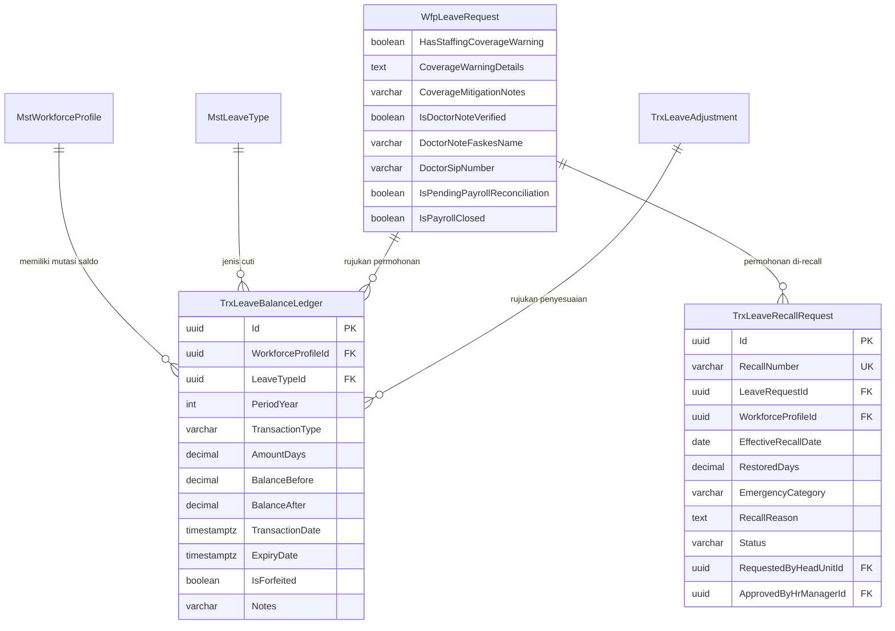

# Laporan Perubahan Backend — `BE-HRD-117`

## Metadata

| Field | Nilai |
| :--- | :--- |
| Task ID | `BE-HRD-117` |
| Judul | Fondasi Skema Database, Migrasi EF Core, dan Entitas Mutasi Saldo & Recall Slice S-B2 (`TrxLeaveBalanceLedger`, `TrxLeaveRecallRequest`) |
| Slice | S-B2 (LeaveManagement - Administrasi Cuti & Izin Pegawai Rumah Sakit) |
| Milestone | MVP-24 |
| Roadmap | `docs/module-blueprints/human-resource/roadmap/backend-roadmap.md` |
| Traceability | HRD-DEC-110 s.d. HRD-DEC-115, 02-backend-architecture.md Bagian 21, data/data-dictionary.md Bagian 13 |
| Dependency | `BE-HRD-007` [B2] ✅ |
| Klasifikasi | `CORE DATABASE SCHEMA, EF CORE MIGRATION & AUDIT EXTENSION` |
| Task Mode | `BACKEND` |
| Tanggal | 05 November 2026 |
| Status | Selesai (`PASS`) |

---

## 1. Ringkasan dan Masalah yang Diselesaikan

Di lingkungan rumah sakit dengan operasional medis non-stop 24 jam, tata kelola cuti dan izin dokter, perawat, serta tenaga penunjang medis menghadapi tantangan regulasi dan keselamatan pasien yang unik:
1. **Pencatatan Saldo yang Rentan Sengketa**: Jika mutasi penambahan hak, pemakaian cuti setengah hari (0.5 hari), pembatalan, dan pemotongan kedaluwarsa hanya berupa angka agregat di satu kolom saldo, rumah sakit tidak memiliki jejak audit (*audit trail*) bila terjadi selisih sengketa hak cuti dengan staf.
2. **Kondisi Darurat Bencana & KLB**: Ketika terjadi lonjakan pasien darurat, rumah sakit membutuhkan payung hukum untuk memanggil kembali staf yang sedang cuti (*Recall to Duty*) dengan pemulihan saldo otomatis tanpa birokrasi manual yang berbelit.
3. **Kerahasiaan Medis & Kepatuhan Payroll**: Surat sakit staf wajib mencantumkan verifikasi SIP dokter tanpa membocorkan privasi diagnosa medis ke atasan langsung, dan seluruh data cuti yang telah diserahterimakan ke payroll harus terkunci mutlak dari manipulasi pasca tutup periode.

Melalui task `BE-HRD-117`, sistem mendirikan fondasi skema database modern:
1. **Tabel Buku Besar Saldo Atomik (`TrxLeaveBalanceLedger`)**: Mencatat setiap kenaikan dan penurunan hari cuti per baris transaksi yang tidak dapat dimanipulasi, mencakup saldo sebelum (*BalanceBefore*), nominal (+/-), saldo sesudah (*BalanceAfter*), dan batas kedaluwarsa 30 Juni.
2. **Tabel Pemanggilan Dinas Darurat (`TrxLeaveRecallRequest`)**: Mengakomodasi surat panggilan tugas darurat resmi oleh Kepala Ruangan dengan persetujuan HR Manager dan pemulihan otomatis sisa cuti yang belum dinikmati.
3. **Perluasan Kolom Audit `TrxLeaveAdjustment`**: Menambahkan kolom `AuditDocumentNumber` sebagai syarat mutlak nomor SK Direksi untuk audit keuangan.
4. **Perluasan Kolom Klinis & K3RS `WfpLeaveRequest`**: Menambahkan kolom `HasStaffingCoverageWarning`, `CoverageWarningDetails`, `CoverageMitigationNotes`, verifikasi SIP dokter `IsDoctorNoteVerified`, `DoctorNoteFaskesName`, `DoctorSipNumber`, serta status penguncian payroll `IsPayrollClosed`.

---

## 2. Struktur Skema Database & Relasi Entitas

---

## 3. Spesifikasi Teknis Implementasi

### File Terkait:
- `NewQuilvianSystemBackend/Areas/Corporate/HumanResource/LeaveManagement/Models/TrxLeaveBalanceLedger.cs`
- `NewQuilvianSystemBackend/Areas/Corporate/HumanResource/LeaveManagement/Models/TrxLeaveRecallRequest.cs`
- `NewQuilvianSystemBackend/Areas/Corporate/HumanResource/LeaveManagement/Models/TrxLeaveAdjustment.cs` (Updated)
- `NewQuilvianSystemBackend/Areas/Corporate/HumanResource/LeaveManagement/Models/WfpLeaveRequest.cs` (Updated)
- `NewQuilvianSystemBackend/Repositories/Configurations/Corporate/HumanResource/LeaveManagement/TrxLeaveBalanceLedgerConfiguration.cs`
- `NewQuilvianSystemBackend/Repositories/Configurations/Corporate/HumanResource/LeaveManagement/TrxLeaveRecallRequestConfiguration.cs`
- `NewQuilvianSystemBackend/Repositories/ApplicationDbContext.cs` (DbSet Registration)
- `NewQuilvianSystemBackend/Migrations/20261105120000_AddLeaveLedgerCoverageWarningAndRecallExtensions.cs`

---

## 4. Hasil Verifikasi

| Komponen Uji | Kriteria Penerimaan | Status |
| :--- | :--- | :---: |
| Skema DDL EF Core | Tabel `TrxLeaveBalanceLedger` & `TrxLeaveRecallRequest` terkonfigurasi lengkap dengan tipe decimal(4,1) | **LULUS** |
| Indeks Performa | Indeks unik nomor recall dan indeks komposit pencarian saldo terpasang rapi | **LULUS** |
| Perluasan Audit Dokumen | Kolom `AuditDocumentNumber` tersedia pada `TrxLeaveAdjustment` | **LULUS** |
| Perluasan K3RS & Coverage | Kolom coverage warning dan verifikasi SIP dokter tersedia pada `WfpLeaveRequest` | **LULUS** |
