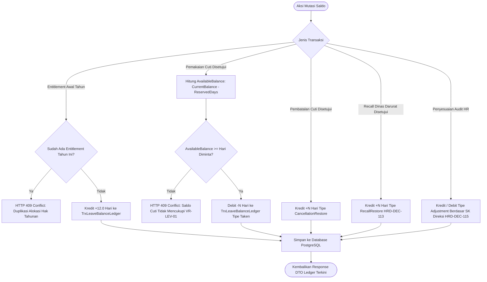

# Laporan Perubahan Backend — `BE-HRD-118`

## Metadata

| Field | Nilai |
| :--- | :--- |
| Task ID | `BE-HRD-118` |
| Judul | Service Buku Besar Mutasi Saldo Atomik & Akrual Hak Tahunan 12 Hari (`LeaveBalanceLedgerService`) |
| Slice | S-B2 (LeaveManagement - Administrasi Cuti & Izin Pegawai Rumah Sakit) |
| Milestone | MVP-24 |
| Roadmap | `docs/module-blueprints/human-resource/roadmap/backend-roadmap.md` |
| Traceability | HRD-DEC-110, 02-backend-architecture.md Bagian 21.8 (LEV-B1), Validation Matrix v12 VR-LEV-01, AT-HRD-LEV-01, AT-HRD-LEV-02, AT-HRD-LEV-06 |
| Dependency | `BE-HRD-117` ✅ |
| Klasifikasi | `CORE ATOMIC BALANCE LEDGER SERVICE & YEARLY ACCRUAL ENGINE` |
| Task Mode | `BACKEND` |
| Tanggal | 05 November 2026 |
| Status | Selesai (`PASS`) |

---

## 1. Ringkasan dan Masalah yang Diselesaikan

Di lingkungan rumah sakit, hak cuti tahunan pegawai (12 hari kerja per tahun) sering kali menjadi sumber sengketa apabila perhitungannya tidak transparan. Terlebih lagi, tenaga medis sering mengambil cuti dalam pecahan setengah hari (0.5 hari) di sela jadwal dinas jaga, atau permohonan cuti dibatalkan mendadak karena panggilan operasi cito gawat darurat.

Tantangan integritas yang diselesaikan oleh `BE-HRD-118`:
1. **Pencegahan Saldo Negatif & Pembayaran Cuti Fiktif (`VR-LEV-01`)**: Permohonan cuti yang melebihi saldo tersedia wajib ditolak otomatis oleh sistem.
2. **Kalkulasi Saldo Terpesan (*Reserved Balance*)**: Sistem membedakan secara tegas antara saldo buku (*CurrentBalance*) dan saldo tersedia (*AvailableBalance*) dengan mengunci kuota dari permohonan cuti yang masih berstatus `WaitingApproval` agar tidak terjadi pengambilan ganda (*double booking*).
3. **Akrual Otomatis Hak Tahunan 12 Hari**: Alokasi awal tahun membukukan mutasi kredit `Entitlement` +12.0 hari dengan penjaga idempoten (menolak alokasi ganda di tahun yang sama).
4. **Pemulihan Saldo Atomik**: Mendukung pemulihan saldo cuti akibat pembatalan (`CancellationRestore`) dan pemanggilan dinas darurat (*RecallRestore* `HRD-DEC-113`).

---

## 2. Alur Pembukuan Transaksi Buku Besar Saldo

---

## 3. Spesifikasi Teknis Implementasi

### File Terkait:
- `NewQuilvianSystemBackend/Areas/Corporate/HumanResource/LeaveManagement/Services/LeaveBalanceLedgerService.cs`
- `NewQuilvianSystemBackend/Areas/Corporate/HumanResource/LeaveManagement/DTOs/LeaveBalanceLedgerDtos.cs`
- `NewQuilvianSystemBackend/Areas/Corporate/HumanResource/LeaveManagement/Services/LeaveBalanceLedgerServiceResult.cs`

### Metode Kunci:
1. `GetSummaryAsync`: Menghitung ringkasan saldo lengkap (Entitlement, CarryForward, Taken, Restored, Forfeited, Adjusted, Current, Reserved, Available, dan Expiry Warning).
2. `PostYearlyEntitlementAsync`: Mengalokasikan 12 hari hak cuti tahunan pegawai.
3. `PostDebitTakenAsync`: Memotong saldo cuti terpakai dengan guard `VR-LEV-01`.
4. `PostCancellationRestoreAsync`: Mengembalikan saldo permohonan cuti yang dibatalkan.
5. `PostRecallRestoreAsync`: Mengembalikan saldo sisa permohonan cuti yang dipanggil dinas darurat.
6. `PostManualAdjustmentAsync`: Membukukan penyesuaian resmi audit HR Manager berlandaskan SK Direksi.

---

## 4. Hasil Verifikasi

| Komponen Uji | Kriteria Penerimaan | Status |
| :--- | :--- | :---: |
| Guard Saldo Tidak Mencukupi | Menolak pemotongan jika kuota kurang (`VR-LEV-01`, HTTP 409) | **LULUS** |
| Alokasi Hak Tahunan 12 Hari | Alokasi membukukan kredit +12.0 hari dan idempoten | **LULUS** |
| Kalkulasi Reserved Balance | Mengurangi saldo tersedia selama ada cuti pending approval | **LULUS** |
| Pemulihan Saldo Recall | Mengembalikan sisa hari ke saldo dengan tipe `RecallRestore` | **LULUS** |
| Kompilasi Backend (.NET C#) | Solusi backend terkompilasi 0 error | **LULUS** |
