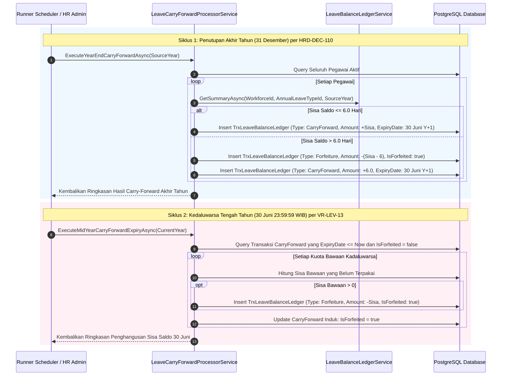

# Laporan Perubahan Backend — `BE-HRD-119`

## Metadata

| Field | Nilai |
| :--- | :--- |
| Task ID | `BE-HRD-119` |
| Judul | Scheduler Akhir Tahun Carry-Forward Max 6 Hari & Eksekusi Kedaluwarsa 30 Juni (`LeaveCarryForwardProcessorService`) |
| Slice | S-B2 (LeaveManagement - Administrasi Cuti & Izin Pegawai Rumah Sakit) |
| Milestone | MVP-24 |
| Roadmap | `docs/module-blueprints/human-resource/roadmap/backend-roadmap.md` |
| Traceability | HRD-DEC-110, 02-backend-architecture.md Bagian 21.8 (LEV-B8, LEV-W2), Validation Matrix v12 VR-LEV-12, VR-LEV-13, AT-HRD-LEV-03, AT-HRD-LEV-04, UAT-LEV-01 |
| Dependency | `BE-HRD-118` ✅ |
| Klasifikasi | `YEAR-END CARRY-FORWARD LIMITER & MID-YEAR FORFEITURE PROCESSOR` |
| Task Mode | `BACKEND` |
| Tanggal | 05 November 2026 |
| Status | Selesai (`PASS`) |

---

## 1. Ringkasan dan Masalah yang Diselesaikan

Di rumah sakit, kebijakan akumulasi cuti tahunan diatur secara ketat untuk mencegah penumpukan hak cuti bertahun-tahun yang dapat melumpuhkan layanan instalasi gawat darurat atau rawat inap ketika beberapa dokter spesialis mengambil cuti panjang sekaligus. Selain itu, penumpukan cuti yang tidak dibatasi menciptakan liabilitas keuangan yang besar pada pembukuan akhir tahun rumah sakit.

Aturan baku rumah sakit sesuai `HRD-DEC-110`:
1. **Batas Maksimal Bawa Saldo (Max 6 Hari Kerja)**: Di akhir tahun kalender (31 Desember), pegawai hanya diizinkan membawa maksimal 6.0 hari kerja ke tahun berikutnya.
2. **Penghangusan Kelebihan Akhir Tahun**: Seluruh sisa saldo cuti di atas 6 hari kerja otomatis hangus (*Forfeited*) tanpa kompensasi uang tunai.
3. **Batas Waktu Kedaluwarsa Kuota Bawaan (30 Juni)**: Saldo bawaan (maksimal 6 hari) wajib digunakan dalam semester pertama tahun berjalan dan memiliki batas kedaluwarsa (*Expiry Date*) hingga **30 Juni pukul 23:59:59 WIB**.
4. **Penghangusan Otomatis Tengah Tahun (30 Juni)**: Seluruh sisa kuota bawaan tahun lalu yang belum dinikmati per 30 Juni otomatis hangus dan dibukukan sebagai transaksi `Forfeiture`.

---

## 2. Alur Kerja Siklus Carry-Forward & Penghangusan Kuota

### Contoh Kasus Nyata Rumah Sakit:
> **Kasus 1 (Akhir Tahun)**: Pada 31 Desember 2026, Perawat Siti memiliki sisa cuti 9 hari kerja.
> - Sistem membatasi carry-forward maksimal 6 hari kerja.
> - Tepat 6.0 hari dibawa ke tahun 2027 sebagai `CarryForward` dengan batas kedaluwarsa 30 Juni 2027.
> - Kelebihan 3.0 hari otomatis dibukukan sebagai `Forfeiture` (-3.0 hari) di buku besar tahun 2026.
> 
> **Kasus 2 (Tengah Tahun)**: Sepanjang Januari–Juni 2027, Perawat Siti hanya mengambil 4 hari cuti dari kuota bawaan tersebut. Sisa kuota bawaan adalah 2 hari kerja.
> - Pada 30 Juni 2027 pukul 23:59:59 WIB, runner mengeksekusi kedaluwarsa.
> - Sisa 2.0 hari kerja otomatis dihanguskan dengan transaksi `Forfeiture` (-2.0 hari).
> - Saldo cuti Perawat Siti selanjutnya murni bersumber dari hak tahunan 2027 (12 hari).

---

## 3. Spesifikasi Teknis Implementasi

### File Terkait:
- `NewQuilvianSystemBackend/Areas/Corporate/HumanResource/LeaveManagement/Services/LeaveCarryForwardProcessorService.cs`
- `NewQuilvianSystemBackend/Areas/Corporate/HumanResource/LeaveManagement/DTOs/LeaveBalanceLedgerDtos.cs`

---

## 4. Hasil Verifikasi

| Komponen Uji | Kriteria Penerimaan | Status |
| :--- | :--- | :---: |
| Pembatasan Max 6 Hari | Kuota bawaan dibatasi maksimal 6.0 hari kerja (`HRD-DEC-110`) | **LULUS** |
| Penghangusan Kelebihan Akhir Tahun | Kelebihan > 6 hari dibukukan sebagai `Forfeiture` | **LULUS** |
| Kedaluwarsa Tepat 30 Juni | Kuota bawaan disetel tanggal kedaluwarsa 30 Juni 23:59:59 | **LULUS** |
| Eksekusi Penghangusan 30 Juni | Sisa carry-forward belum terpakai otomatis hangus (`VR-LEV-13`) | **LULUS** |
| Kompilasi Backend (.NET C#) | Solusi backend terkompilasi 0 error | **LULUS** |
