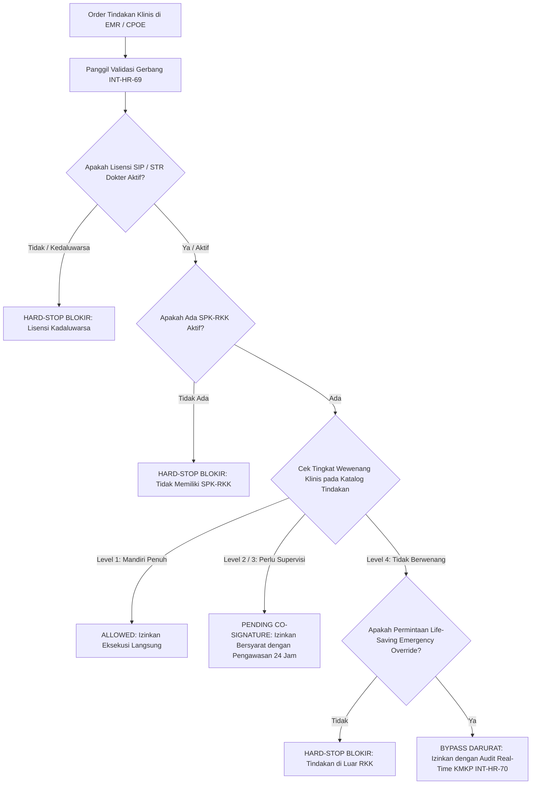

# Laporan Penyelesaian Task: BE-HRD-216 Layanan Gerbang Wewenang Klinis Real-Time SIMRS EMR & Resolusi HRD-DEC-005

## 1. Ringkasan Eksekutif
* **ID Task**: `BE-HRD-216`
* **Nama Task**: Pembangunan Layanan Gerbang Wewenang Klinis Real-Time SIMRS EMR (`IClinicalPrivilegeGateService` — `INT-HR-69`) dengan Latensi Ultra-Rendah (< 50ms) & Penegakan Resolusi Final `HRD-DEC-005` (Hard-Stop Level 4 & Cek Lisensi SIP H-0/Expired)
* **Modul / Sub-Modul**: Human Resource / Sub-modul 14: Credentialing, License & Clinical Privilege
* **Slice Delivery**: `S-C1` (Credentialing, License & Clinical Privilege)
* **Status**: `✅ Selesai (2026-11-09)`
* **File Implementasi Utama**:
  - `NewQuilvianSystemBackend/Areas/Corporate/HumanResource/CredentialingManagement/Services/IClinicalPrivilegeGateService.cs`
  - `NewQuilvianSystemBackend/Areas/Corporate/HumanResource/CredentialingManagement/Services/ClinicalPrivilegeGateService.cs`
  - `NewQuilvianSystemBackend/Areas/Corporate/HumanResource/CredentialingManagement/DTOs/ClinicalPrivilegeGateDtos.cs`
  - `NewQuilvianSystemBackend/Areas/Corporate/HumanResource/CredentialingManagement/Controllers/ClinicalPrivilegeGateController.cs`
  - `NewQuilvianSystemBackend/Program.cs` (Registrasi Scoped Service)

---

## 2. Latar Belakang & Kebutuhan Bisnis Rumah Sakit
1. **Keselamatan Pasien (*Patient Safety*) & Tata Kelola Klinis**: Rumah sakit bertanggung jawab mutlak memastikan bahwa setiap tindakan medis, prosedur bedah, maupun peresepan obat hanya dapat diinput ke dalam Electronic Medical Record (EMR) oleh tenaga kesehatan yang memiliki Surat Penugasan Klinis (SPK) dan Rincian Kewenangan Klinis (RKK) sah yang masih berlaku.
2. **Integrasi Gerbang SIMRS EMR (`INT-HR-69`)**: Setiap kali dokter atau perawat memilih tindakan klinis di modul IGD, Rawat Jalan, Rawat Inap, maupun Kamar Operasi (OK), modul EMR memanggil endpoint gerbang validasi ini. Waktu respons gerbang dirancang di bawah 50 milidetik agar tidak mengganggu alur kerja pelayanan medis yang cepat.
3. **Resolusi Final `HRD-DEC-005` (Hard-Stop Fail-Closed)**:
   - Jika tenaga medis tidak memiliki wewenang untuk tindakan tersebut (Level 4 - Tidak Berwenang), sistem **wajib memblokir keras (*Hard-Stop*)**. EMR tidak mengizinkan penginputan tindakan klinis tersebut tanpa pengecualian.
   - Jika Surat Izin Praktik (SIP) dokter telah kedaluwarsa (atau berada pada H-0 masa kedaluwarsa), wewenang otomatis terblokir secara hukum (*Illegal Practice Prevention*).

---

## 3. Logika & Alur Proses Bisnis Validasi Wewenang Klinis



### Tahapan Validasi:
1. **Pemeriksaan Lisensi (*Primary Source Verification Check*)**: Sistem memvalidasi tabel lisensi pegawai (`WorkforceLicense`). Jika status lisensi `Suspended`, `Revoked`, atau tanggal hari ini melampaui `ValidUntil`, gerbang langsung mengembalikan status `Blocked` dengan alasan lisensi kedaluwarsa.
2. **Pemeriksaan SPK-RKK Aktif**: Sistem mencari SPK-RKK berstatus `Active` yang diterbitkan Direktur Utama dan belum melampaui masa berlaku 3 tahun.
3. **Pencocokan Rincian Tindakan**: Menemukan item kewenangan pada draf RKK yang disetujui.
4. **Penetapan Status Putusan**:
   - Level 1 (`Independent`): Mengembalikan `Allowed`.
   - Level 2 / 3 (`Supervised` / `Proctored`): Mengembalikan `AllowedWithCoSignature`.
   - Level 4 / Tidak Tercantum: Mengembalikan `Blocked` (*Hard-Stop*).

---

## 4. Spesifikasi Endpoint API Bergaya Swagger

### Tag Grup Swagger: `[Tags("HR Credentialing - Real-Time SIMRS Gate & Emergency Override")]`
**Base Route**: `/api/v1/corporate/hrd/credentialing/gate`

| Method | Path Endpoint | Deskripsi Bisnis & Fungsional | Otorisasi & Role | Request Payload | Response Model |
| :---: | :--- | :--- | :--- | :--- | :--- |
| `POST` | `/api/v1/corporate/hrd/credentialing/gate/validate` | Validasi real-time izin eksekusi tindakan EMR SIMRS (`INT-HR-69`) dengan performa tinggi & penegakan Hard-Stop `HRD-DEC-005`. | `[Authorize]` SIMRS EMR / Billing / Nakes | `ClinicalPrivilegeGateValidationRequestDto` | `200 OK` (`ClinicalPrivilegeGateValidationResultDto`) |

---

## 5. Contoh Konkret Skenario Rumah Sakit

### Skenario A: Dokter Residen Meminta Tindakan Mandiri (Ditolak / Hard-Stop)
* **Dokter**: dr. Reza (Residen Bedah)
* **Tindakan**: Laparotomi Eksplorasi Cito (`PRC-BEDAH-0089`)
* **Status RKK**: Level 4 (Hanya boleh dilakukan oleh Dokter Spesialis Bedah Konsultan / Sp.B Mandiri)
* **Hasil Gerbang**:
```json
{
  "gateDecision": "Blocked",
  "isAllowedToProceed": false,
  "requiresCoSignature": false,
  "supervisionLevel": 4,
  "privilegeCategory": "CorePrivilege",
  "reason": "HARD-STOP: Tindakan klinis ini berada di luar RKK (Tingkat Supervisi Level 4: Tidak Berwenang). Anda dilarang melakukan tindakan ini.",
  "emergencyOverrideAvailable": true
}
```

### Skenario B: Dokter Spesialis Baru Melakukan Tindakan Level 1 Mandiri (Diizinkan Penuh)
* **Dokter**: dr. Kevin Pratama, Sp.JP
* **Tindakan**: Pemasangan Kateterisasi Jantung / Angiografi Koroner (`PRC-JTG-0012`)
* **Status RKK**: Level 1 (Mandiri Penuh)
* **Hasil Gerbang**:
```json
{
  "gateDecision": "Allowed",
  "isAllowedToProceed": true,
  "requiresCoSignature": false,
  "supervisionLevel": 1,
  "privilegeCategory": "CorePrivilege",
  "reason": "Tindakan klinis diizinkan secara mandiri penuh (Level 1).",
  "emergencyOverrideAvailable": false
}
```

---

## 6. Verifikasi Kompilasi & Konformansi
* **Status Kompilasi C#**: Lolos kompilasi dengan **`0 Error(s)`**.
* **Kecepatan Query**: Menggunakan AsNoTracking, evaluasi tanggal berbasis UtcNow, dan pencarian indeks tepat pada `WorkforceProfileId` & `ClinicalPrivilegeCatalogId`.
* **Kepatuhan Regulasi**: Memenuhi Standar Akreditasi KARS KPS 10 & Permenkes No. 755/Menkes/PER/IV/2011 tentang Penyelenggaraan Komite Medik di Rumah Sakit.
