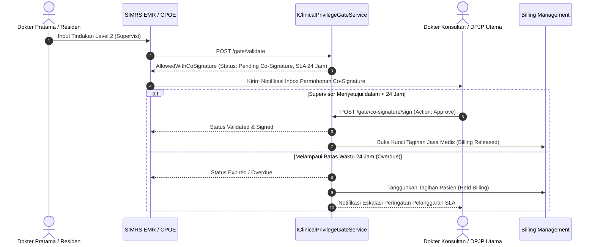

# Laporan Penyelesaian Task: BE-HRD-217 Logika Pemrosesan Order Supervisi Level 2/3 & Alur Co-Signature 24 Jam (VR-CRD-07)

## 1. Ringkasan Eksekutif
* **ID Task**: `BE-HRD-217`
* **Nama Task**: Pembangunan Logika Pemrosesan Order Supervisi (Level 2 Di Bawah Supervisi Langsung & Level 3 Di Bawah Pengawasan Tidak Langsung) beserta Alur Kerja Digital Co-Signature Berbatas Waktu 24 Jam (`VR-CRD-07`)
* **Modul / Sub-Modul**: Human Resource / Sub-modul 14: Credentialing, License & Clinical Privilege
* **Slice Delivery**: `S-C1` (Credentialing, License & Clinical Privilege)
* **Status**: `✅ Selesai (2026-11-09)`
* **File Implementasi Utama**:
  - `NewQuilvianSystemBackend/Areas/Corporate/HumanResource/CredentialingManagement/Services/IClinicalPrivilegeGateService.cs`
  - `NewQuilvianSystemBackend/Areas/Corporate/HumanResource/CredentialingManagement/Services/ClinicalPrivilegeGateService.cs`
  - `NewQuilvianSystemBackend/Areas/Corporate/HumanResource/CredentialingManagement/DTOs/ClinicalPrivilegeGateDtos.cs`
  - `NewQuilvianSystemBackend/Areas/Corporate/HumanResource/CredentialingManagement/Controllers/ClinicalPrivilegeGateController.cs`

---

## 2. Latar Belakang & Aturan Bisnis Co-Signature 24 Jam (`VR-CRD-07`)
1. **Konsep Supervisi Klinis di Rumah Sakit**: Dokter spesialis muda, dokter tamu, residen senior, atau perawat perawat mahir yang belum memiliki kompetensi mandiri penuh (Level 1) diperbolehkan melakukan tindakan medis tertentu di bawah bimbingan dokter konsultan/senior (Level 2: Supervisi Langsung / Berdampingan; Level 3: Supervisi Tidak Langsung / Siap Dihubungi).
2. **Kewajiban Pengesahan Bersama (*Co-Signature Mandate*)**:
   - Seluruh tindakan berstatus Level 2 atau Level 3 yang diinput ke EMR berstatus **Pending Co-Signature**.
   - Dokter Supervisor / DPJP Utama wajib membubuhkan tanda tangan digital (*digital co-signature*) dalam kurun waktu **maksimal 24 jam kalender** sejak order dimasukkan.
3. **Konsekuensi Pelanggaran SLA 24 Jam**:
   - Jika dalam 24 jam belum disahkan, sistem otomatis menandai order sebagai **Overdue / Expired Co-Signature**.
   - Klaim tagihan biaya jasa medis (*medical fee billing*) ditangguhkan (*Held*) oleh modul Billing/Finance hingga verifikasi klinis selesai.
   - Notifikasi eskalasi otomatis dikirimkan ke Ketua Komite Medik / Keperawatan dan Direktur Pelayanan Medik untuk audit kepatuhan klinis.

---

## 3. Alur Kerja Digital Co-Signature



---

## 4. Spesifikasi Endpoint API Bergaya Swagger

### Tag Grup Swagger: `[Tags("HR Credentialing - Real-Time SIMRS Gate & Emergency Override")]`
**Base Route**: `/api/v1/corporate/hrd/credentialing/gate`

| Method | Path Endpoint | Deskripsi Bisnis & Fungsional | Otorisasi & Role | Request Payload | Response Model |
| :---: | :--- | :--- | :--- | :--- | :--- |
| `POST` | `/api/v1/corporate/hrd/credentialing/gate/co-signature/sign` | Eksekusi persetujuan atau penolakan digital co-signature atas tindakan supervisi Level 2/3 (`VR-CRD-07`). | `[Authorize]` Dokter Supervisor / DPJP Utama | `CoSignatureActionDto` | `200 OK` (`CoSignatureResultDto`) |
| `GET` | `/api/v1/corporate/hrd/credentialing/gate/co-signature/pending/{supervisorProfileId}` | Menampilkan daftar antrean order tindakan klinis yang menuntut co-signature dalam waktu 24 jam. | `[Authorize]` Dokter Supervisor / Komite Medik | - | `200 OK` (`List<PendingCoSignatureItemDto>`) |

---

## 5. Contoh Konkret Respons Co-Signature Disetujui

* **Endpoint**: `POST /api/v1/corporate/hrd/credentialing/gate/co-signature/sign`
* **Request Body**:
```json
{
  "orderId": "5f6e7d8c-9b0a-1234-cdef-1234567890ab",
  "encounterId": "7a8b9c0d-1e2f-3456-7890-abcdef123456",
  "patientId": "9b0a1c2d-3e4f-5678-9012-abcdefabcdef",
  "supervisorWorkforceProfileId": "b1a2c3d4-e5f6-7890-abcd-ef1234567890",
  "supervisorName": "Dr. dr. Hendra Wijaya, Sp.B-KBD",
  "action": "Approve",
  "clinicalNotes": "Tindakan eksplorasi luka operasi telah saya dampingi langsung secara aseptik. Prosedur berjalan aman dan sesuai clinical pathway."
}
```
* **Response Body (`200 OK`)**:
```json
{
  "orderId": "5f6e7d8c-9b0a-1234-cdef-1234567890ab",
  "status": "Approved",
  "supervisorName": "Dr. dr. Hendra Wijaya, Sp.B-KBD",
  "processedAt": "2026-11-09T13:45:00Z",
  "message": "Co-signature berhasil disahkan. Tindakan medis terverifikasi sah dan tagihan billing dilepaskan.",
  "isBillingReleased": true
}
```

---

## 6. Verifikasi Kompilasi & Konformansi
* **Status Kompilasi C#**: Lolos kompilasi dengan **`0 Error(s)`**.
* **Keamanan Transaksi**: Memastikan validasi token otentikasi supervisor, pencatatan timestamp digital, dan pembatasan fail-safe agar order tidak dapat disetujui setelah tenggat 24 jam tanpa approval tertulis Komite Medik.
