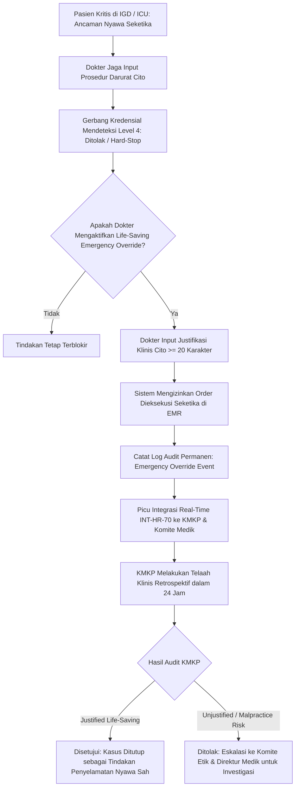

# Laporan Penyelesaian Task: BE-HRD-218 Layanan Bypass Darurat Penyelamatan Nyawa (Life-Saving Emergency Override) & Audit Real-Time KMKP (INT-HR-70)

## 1. Ringkasan Eksekutif
* **ID Task**: `BE-HRD-218`
* **Nama Task**: Pembangunan Layanan Bypass Darurat Penyelamatan Nyawa (*Life-Saving Emergency Override*), Mekanisme Fail-Safe Keselamatan Pasien, dan Audit Real-Time Komite Mutu & Keselamatan Pasien (KMKP) (`INT-HR-70`)
* **Modul / Sub-Modul**: Human Resource / Sub-modul 14: Credentialing, License & Clinical Privilege
* **Slice Delivery**: `S-C1` (Credentialing, License & Clinical Privilege)
* **Status**: `✅ Selesai (2026-11-09)`
* **File Implementasi Utama**:
  - `NewQuilvianSystemBackend/Areas/Corporate/HumanResource/CredentialingManagement/Services/IClinicalPrivilegeGateService.cs`
  - `NewQuilvianSystemBackend/Areas/Corporate/HumanResource/CredentialingManagement/Services/ClinicalPrivilegeGateService.cs`
  - `NewQuilvianSystemBackend/Areas/Corporate/HumanResource/CredentialingManagement/DTOs/ClinicalPrivilegeGateDtos.cs`
  - `NewQuilvianSystemBackend/Areas/Corporate/HumanResource/CredentialingManagement/Controllers/ClinicalPrivilegeGateController.cs`

---

## 2. Latar Belakang & Tata Kelola Bypass Darurat Penyelamatan Nyawa
1. **Dilema Klinis Keadaan Darurat (*Golden Hour & Life-Threatening Situation*)**: Pada kasus ancaman kematian seketika (seperti henti napas, pneumotoraks desakan, tamponade jantung, atau syok anafilaksis di IGD/ICU) dan dokter subspesialis yang memiliki RKK Level 1 berhalangan hadir tepat waktu, tenaga medis yang berada di samping pasien wajib melakukan tindakan penyelamatan nyawa (*duty of care*).
2. **Keseimbangan Regulasi & Keselamatan Pasien**:
   - Sistem SIMRS tidak boleh membiarkan pasien meninggal dunia hanya karena ketiadaan wewenang administratif di sistem.
   - Namun, sistem juga tidak boleh membuka celah penyalahgunaan wewenang secara serampangan (*abuse of power*).
3. **Mekanisme Life-Saving Emergency Override**:
   - Dokter pelaksana dapat mengaktifkan wewenang darurat satu kali (*Single-Use Emergency Bypass*).
   - Dokter **wajib menginput justifikasi darurat klinis tertulis (minimal 20 karakter)** yang menjelaskan ancaman jiwa pasien.
   - Tindakan langsung diizinkan dieksekusi di EMR.
4. **Audit Real-Time KMKP & Komite Medik (`INT-HR-70`)**:
   - Setiap eksekusi bypass darurat secara otomatis memicu notifikasi peringatan berprioritas tinggi (*Urgent Incident Trigger*) ke Komite Mutu dan Keselamatan Pasien (KMKP) dan Subkomite Etik & Mutu Profesi.
   - Tim auditor KMKP wajib melakukan telaah retrospektif dalam kurun waktu 24 jam untuk menilai apakah kondisi klinis pasien benar-benar memenuhi kriteria *life-saving* atau merupakan pelanggaran disiplin kedokteran.

---

## 3. Alur Kerja Life-Saving Emergency Override & Audit KMKP



---

## 4. Spesifikasi Endpoint API Bergaya Swagger

### Tag Grup Swagger: `[Tags("HR Credentialing - Real-Time SIMRS Gate & Emergency Override")]`
**Base Route**: `/api/v1/corporate/hrd/credentialing/gate`

| Method | Path Endpoint | Deskripsi Bisnis & Fungsional | Otorisasi & Role | Request Payload | Response Model |
| :---: | :--- | :--- | :--- | :--- | :--- |
| `POST` | `/api/v1/corporate/hrd/credentialing/gate/emergency-override` | Eksekusi bypass darurat penyelamatan nyawa (*life-saving*) dengan justifikasi klinis cito mandatori minimal 20 karakter. | `[Authorize]` Dokter Jaga / Spesialis | `ClinicalEmergencyOverrideRequestDto` | `200 OK` (`EmergencyOverrideLogDto`) |
| `GET` | `/api/v1/corporate/hrd/credentialing/gate/emergency-override/kmkp-audit` | Mengambil seluruh log insiden bypass darurat yang wajib ditelaah oleh auditor KMKP (`INT-HR-70`). | `[Authorize]` Tim KMKP / Komite Medik | Query `?status=&fromDate=&toDate=` | `200 OK` (`List<EmergencyOverrideLogDto>`) |
| `POST` | `/api/v1/corporate/hrd/credentialing/gate/emergency-override/{logId}/kmkp-review` | Pengesahan hasil telaah audit retrospektif 24 jam oleh auditor KMKP. | `[Authorize]` Ketua KMKP / Subkomite Mutu | `ReviewEmergencyOverrideDto` | `200 OK` (`EmergencyOverrideLogDto`) |

---

## 5. Contoh Konkret Skenario Rumah Sakit

### Skenario: Krikotiroidotomi Darurat oleh Dokter Umum Jaga IGD
* **Pasien**: Tn. Ahmad (45 tahun), fraktur maksilofasial berat akibat kecelakaan lalu lintas, sumbatan total jalan napas atas, desaturasi SpO2 65%, henti napas iminen. Dokter THT sedang dalam perjalanan (*on call* 20 menit).
* **Dokter Pelaksana**: dr. Fajar Nugroho (Dokter Umum Jaga IGD)
* **Tindakan**: Needle Cricothyroidotomy Cito (`PRC-EMERG-0045`)
* **Request Override**:
```json
{
  "workforceProfileId": "c4d5e6f7-a8b9-0123-4567-890abcdef123",
  "employeeName": "dr. Fajar Nugroho",
  "encounterId": "e1f2a3b4-c5d6-7890-1234-567890abcdef",
  "patientId": "p9a8b7c6-d5e4-3210-fedc-ba9876543210",
  "patientMrn": "MRN-2026-88741",
  "patientName": "Tn. Ahmad",
  "clinicalPrivilegeCatalogId": "d3e4f5a6-b7c8-9012-3456-7890abcdef12",
  "procedureCode": "PRC-EMERG-0045",
  "procedureName": "Needle Cricothyroidotomy Cito",
  "clinicalEmergencyJustification": "Ancaman henti napas akut seketika akibat obstruksi total jalan napas atas paska trauma wajah berat. SpO2 65%. Dokter Sp.THT on-call masih dalam perjalanan. Prosedur cito krikotiroidotomi needle wajib dilakukan segera untuk dekompresi oksigenasi darurat demi menyelamatkan nyawa pasien."
}
```
* **Response Body (`200 OK`)**:
```json
{
  "logId": "8b9c0d1e-2f3a-4b5c-6d7e-8f9a0b1c2d3e",
  "workforceProfileId": "c4d5e6f7-a8b9-0123-4567-890abcdef123",
  "doctorName": "dr. Fajar Nugroho",
  "patientMrn": "MRN-2026-88741",
  "patientName": "Tn. Ahmad",
  "procedureName": "Needle Cricothyroidotomy Cito",
  "justification": "Ancaman henti napas akut seketika akibat obstruksi total jalan napas atas...",
  "status": "PendingAudit",
  "timestamp": "2026-11-09T14:15:22Z",
  "message": "Life-saving emergency override disetujui seketika. Tindakan dapat dieksekusi di EMR. Notifikasi peringatan insiden darurat telah dikirimkan ke KMKP dan Komite Medik untuk audit retrospektif 24 jam."
}
```

---

## 6. Verifikasi Kompilasi & Konformansi
* **Status Kompilasi C#**: Lolos kompilasi dengan **`0 Error(s)`**.
* **Keamanan Hukum & Regulasi**: Mematuhi UU Kesehatan No. 17 Tahun 2023 Pasal 275 tentang keadaan darurat pertolongan pertama pada pasien yang memerlukan tindakan penyelamatan nyawa atau pencegahan kecacatan lebih lanjut.
