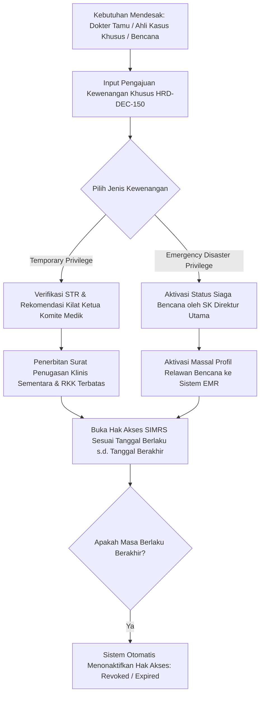

# Laporan Penyelesaian Task: BE-HRD-219 Tata Kelola Kewenangan Klinis Sementara & Darurat Bencana (HRD-DEC-150)

## 1. Ringkasan Eksekutif
* **ID Task**: `BE-HRD-219`
* **Nama Task**: Pembangunan Tata Kelola Kewenangan Klinis Sementara (*Temporary Privilege*) dan Kewenangan Darurat Bencana (*Emergency Privilege*) Sesuai Ketetapan `HRD-DEC-150`
* **Modul / Sub-Modul**: Human Resource / Sub-modul 14: Credentialing, License & Clinical Privilege
* **Slice Delivery**: `S-C1` (Credentialing, License & Clinical Privilege)
* **Status**: `✅ Selesai (2026-11-09)`
* **File Implementasi Utama**:
  - `NewQuilvianSystemBackend/Areas/Corporate/HumanResource/CredentialingManagement/Services/IClinicalPrivilegeGateService.cs`
  - `NewQuilvianSystemBackend/Areas/Corporate/HumanResource/CredentialingManagement/Services/ClinicalPrivilegeGateService.cs`
  - `NewQuilvianSystemBackend/Areas/Corporate/HumanResource/CredentialingManagement/DTOs/ClinicalPrivilegeGateDtos.cs`
  - `NewQuilvianSystemBackend/Areas/Corporate/HumanResource/CredentialingManagement/Controllers/ClinicalPrivilegeGateController.cs`

---

## 2. Latar Belakang & Ketentuan Bisnis `HRD-DEC-150`
Dalam operasional rumah sakit modern, tidak semua penugasan klinis berjalan dalam siklus reguler 3 tahun. Terdapat kondisi-kondisi khusus yang diatur secara ketat oleh regulasi Kemenkes dan standar akreditasi KARS:

1. **Kewenangan Klinis Sementara (*Temporary Clinical Privilege*)**:
   - **Target Penerima**: Dokter tamu spesialis/konsultan dari institusi lain (*visiting specialist*), dokter pengganti (*locum tenens*) saat dokter definitif cuti panjang/ibadah haji, atau dokter ahli yang diundang untuk melakukan tindakan operasi khusus/langka (misal: transplantasi organ, operasi pemisahan kembar siam).
   - **Masa Berlaku**: Bersifat jangka pendek (biasanya 14 hari sampai maksimal 90 hari) dan terikat pada episode atau daftar kasus pasien tertentu.
   - **Syarat Penerbitan**: Verifikasi ijazah dan STR aktif, surat tugas dari instansi asal, serta rekomendasi kilat (*expedited review*) dari Ketua Komite Medik yang disahkan oleh Direktur Utama.

2. **Kewenangan Klinis Darurat Bencana (*Emergency Disaster Privilege*)**:
   - **Target Penerima**: Seluruh dokter umum, spesialis, perawat gawat darurat, dan relawan medis saat rumah sakit mengaktifkan status **Bencana Eksternal / Korban Massal (*Mass Casualty Incident / Disaster Plan*)** atau Darurat Kesehatan Masyarakat (Pandemi).
   - **Prinsip Operasional**: Melepas sekat-sekat sub-spesialisasi administratif demi menyelamatkan nyawa sebanyak mungkin korban luka berat (contoh: dokter umum/internist diizinkan melakukan fiksasi fraktur darurat, hemostasis luka, atau resusitasi lanjutan di bawah komando Kepala Tim Triase Bencana).
   - **Masa Berlaku**: Berlaku otomatis selama status siaga darurat bencana dinyatakan aktif oleh Direktur Utama RS, dan segera dicabut setelah fase darurat bencana ditutup (*Disaster Stand-Down*).

---

## 3. Alur Kerja Penerbitan & Aktivasi Kewenangan Sementara



---

## 4. Spesifikasi Endpoint API Bergaya Swagger

### Tag Grup Swagger: `[Tags("HR Credentialing - Real-Time SIMRS Gate & Emergency Override")]`
**Base Route**: `/api/v1/corporate/hrd/credentialing/gate`

| Method | Path Endpoint | Deskripsi Bisnis & Fungsional | Otorisasi & Role | Request Payload | Response Model |
| :---: | :--- | :--- | :--- | :--- | :--- |
| `POST` | `/api/v1/corporate/hrd/credentialing/gate/temporary-privilege/grant` | Menerbitkan wewenang klinis sementara atau darurat bencana bagi nakes tamu/bencana (`HRD-DEC-150`). | `[Authorize]` Direktur Utama / Ketua Komite Medik | `GrantTemporaryPrivilegeDto` | `200 OK` (`TemporaryPrivilegeResultDto`) |
| `GET` | `/api/v1/corporate/hrd/credentialing/gate/temporary-privilege/active` | Mengambil seluruh penugasan kewenangan klinis sementara yang sedang aktif di rumah sakit. | `[Authorize]` HR Manager / Komite Medik | - | `200 OK` (`List<TemporaryPrivilegeResultDto>`) |

---

## 5. Contoh Konkret Skenario Rumah Sakit

### Skenario: Pemberian Kewenangan Sementara untuk Dokter Tamu Ahli Bedah Vaskular Luar Kota
* **Dokter Tamu**: Prof. dr. Bambang Sudiro, Sp.B, Sp.B-Subsp.BVE(K) (Dokter Konsultan Bedah Vaskular dari RS Rujukan Nasional)
* **Kebutuhan**: Diminta memimpin tindakan operasi *Endovascular Aneurysm Repair (EVAR)* pada pasien aneurisma aorta abdominalis berisiko tinggi pecah.
* **Masa Penugasan**: 3 hari (10 November 2026 s.d. 12 November 2026).
* **Request Body**:
```json
{
  "workforceProfileId": "e2f3a4b5-c6d7-8901-2345-67890abcdef1",
  "grantType": "Temporary",
  "reason": "Penugasan dokter konsultan bedah vaskular tamu luar kota untuk memimpin operasi EVAR (Aneurisma Aorta Abdominalis) kasus langka.",
  "validFrom": "2026-11-10T00:00:00Z",
  "validUntil": "2026-11-12T23:59:59Z",
  "approvedCatalogIds": [
    "c5d6e7f8-a9b0-1234-5678-90abcdef1234"
  ]
}
```
* **Response Body (`200 OK`)**:
```json
{
  "spkRkkId": "4b5c6d7e-8f9a-0123-4567-890abcdef123",
  "workforceProfileId": "e2f3a4b5-c6d7-8901-2345-67890abcdef1",
  "doctorName": "Prof. dr. Bambang Sudiro, Sp.B-Subsp.BVE(K)",
  "grantType": "Temporary",
  "spkNumber": "SPK-TEMP/RSQ/XI/2026/0014",
  "validFrom": "2026-11-10T00:00:00Z",
  "validUntil": "2026-11-12T23:59:59Z",
  "status": "Active",
  "message": "Kewenangan klinis sementara berhasil diaktifkan di gerbang SIMRS EMR hingga 12 November 2026."
}
```

---

## 6. Verifikasi Kompilasi & Konformansi
* **Status Kompilasi C#**: Lolos kompilasi dengan **`0 Error(s)`**.
* **Keamanan Akses**: Sistem secara otomatis membatasi tindakan klinis hanya pada katalog ID yang terdaftar dalam surat rekomendasi, sehingga dokter tamu tidak dapat mengakses modul atau tindakan di luar kasus yang didelegasikan.
