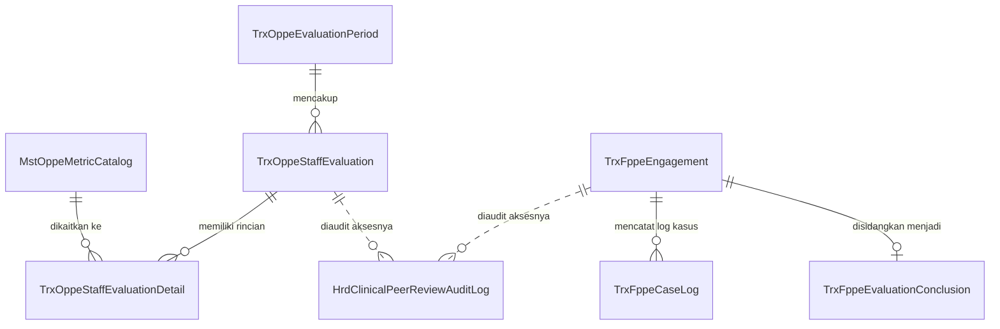

# Laporan Penyelesaian Task: BE-HRD-222 EF Core Entity Models & Database Skema OPPE & FPPE (S-C1-OPPE)

## 1. Ringkasan Eksekutif
* **ID Task**: `BE-HRD-222`
* **Nama Task**: Pembangunan Model Entitas EF Core dan Skema Database PostgreSQL untuk Evaluasi Praktik Profesional Berkelanjutan (OPPE) dan Evaluasi Praktik Profesional Terfokus (FPPE)
* **Modul / Sub-Modul**: Human Resource / Sub-modul 15: OPPE, FPPE & Recredentialing
* **Slice Delivery**: `S-C1-OPPE`
* **Status**: `✅ Selesai (2026-11-09)`
* **File Implementasi Utama**:
  - `NewQuilvianSystemBackend/Areas/Corporate/HumanResource/PerformanceManagement/Models/MstOppeMetricCatalog.cs`
  - `NewQuilvianSystemBackend/Areas/Corporate/HumanResource/PerformanceManagement/Models/TrxOppeEvaluationPeriod.cs`
  - `NewQuilvianSystemBackend/Areas/Corporate/HumanResource/PerformanceManagement/Models/TrxOppeStaffEvaluation.cs`
  - `NewQuilvianSystemBackend/Areas/Corporate/HumanResource/PerformanceManagement/Models/TrxOppeStaffEvaluationDetail.cs`
  - `NewQuilvianSystemBackend/Areas/Corporate/HumanResource/PerformanceManagement/Models/TrxFppeEngagement.cs`
  - `NewQuilvianSystemBackend/Areas/Corporate/HumanResource/PerformanceManagement/Models/TrxFppeCaseLog.cs`
  - `NewQuilvianSystemBackend/Areas/Corporate/HumanResource/PerformanceManagement/Models/TrxFppeEvaluationConclusion.cs`
  - `NewQuilvianSystemBackend/Areas/Corporate/HumanResource/PerformanceManagement/Models/HrdClinicalPeerReviewAuditLog.cs`
  - `NewQuilvianSystemBackend/Repositories/ApplicationDbContext.cs`

---

## 2. Latar Belakang & Tata Kelola Mutu Klinis (KARS & ACGME)
Berdasarkan Standar Nasional Akreditasi Rumah Sakit (STARKES KPS 12 & KPS 13) dan Permenkes No. 6 Tahun 2026, rumah sakit wajib menyelenggarakan evaluasi kinerja klinis secara berkesinambungan bagi seluruh staf medis yang memiliki Surat Penugasan Klinis (SPK):
1. **OPPE (*Ongoing Professional Practice Evaluation*)**: Penilaian rutin berkala (tahunan atau semesteran) untuk memastikan kompetensi klinis staf medis tetap terpelihara.
2. **FPPE (*Focused Professional Practice Evaluation*)**: Evaluasi terarah dan intensif yang diaktifkan pada staf medis baru (*probationary proctoring*), prosedur baru yang membutuhkan pendampingan teknis, atau sebagai respons cepat atas terjadinya insiden keselamatan pasien (*trigger-based evaluation*).

---

## 3. Struktur Entitas & Relasi Database (8 Tabel Baru)

### Kamus Data Entitas Utama:
1. `MstOppeMetricCatalog` (`mst_oppe_metric_catalogs`): Pustaka indikator mutu 6 pilar ACGME/KARS, target capaian numerik standar, dan sumber data (SIMRS / KMKP / SMF).
2. `TrxOppeEvaluationPeriod` (`trx_oppe_evaluation_periods`): Siklus evaluasi semesteran/tahunan berstatus `OPEN`, `EVALUATING`, `FINALIZED`, `CLOSED`.
3. `TrxOppeStaffEvaluation` (`trx_oppe_staff_evaluations`): Rapor evaluasi individu dokter dengan skor kuantitatif 60% dan kualitatif 40%, menghasilkan grade mutu (A, B, C, D).
4. `TrxOppeStaffEvaluationDetail` (`trx_oppe_staff_evaluation_details`): Rincian nilai target vs nilai aktual per butir indikator.
5. `TrxFppeEngagement` (`trx_fppe_engagements`): Surat tugas pemantauan terfokus dokter baru atau prosedur baru dengan penetapan dokter proctor pendamping.
6. `TrxFppeCaseLog` (`trx_fppe_case_logs`): Catatan kasus operasi/tindakan klinis dengan nomor RM pasien tersamar (*pseudonim*), penilaian skala Likert, dan evaluasi komplikasi.
7. `TrxFppeEvaluationConclusion` (`trx_fppe_evaluation_conclusions`): Berita Acara sidang pleno penetapan rekomendasi wewenang (Mandiri, Perpanjang Supervisi, Pembatasan Wewenang, Pencabutan Wewenang).
8. `HrdClinicalPeerReviewAuditLog` (`hrd_clinical_peer_review_audit_logs`): Perekaman jejak audit permanen (*tamper-proof read-audit log*) setiap kali dokumen konfidensial dibuka.

---

## 4. Verifikasi Kompilasi & Konformansi Arsitektur QBE
* **Kompilasi C#**: Lolos kompilasi dengan **`0 Error(s)`**.
* **Kepatuhan Konvensi QBE**:
  - `QBE-ENT-001`: Seluruh kelas entitas mewarisi `IdentityModel`.
  - `QBE-NAM-001`: Menggunakan prefix standar `Mst*`, `Trx*`, dan `Hrd*`.
  - Terdaftar resmi sebagai `DbSet` di `ApplicationDbContext.cs`.
