# Laporan Task Tracked Backend — Multi-Step Onboarding Pegawai Baru 7 Tahap (`FIN-HRD-ONB-WIZ-01..02`)

| Atribut | Nilai |
| --- | --- |
| **Label Kerja Lokal** | `FIN-HRD-ONB-WIZ-01`, `FIN-HRD-ONB-WIZ-02` *(slice `S-C4-ONB` — Penerimaan & Onboarding)* |
| **Hubungan Task Canonical** | Pelengkap integrasi alur lintas `BE-HRD-070` s.d. `BE-HRD-078` *(status task canonical tetap utuh)* |
| **Sumber Instruksi** | [`INSTRUKSI_AGENT_HRD_ONBOARDING_WIZARD.md`](../../../docs/instruksi/INSTRUKSI_AGENT_HRD_ONBOARDING_WIZARD.md) |
| **Repositori & Branch** | `NewQuilvianSystemBackend` — branch `MHamzah` |
| **Commit Referensi** | `db900f14` dan `b1cb2333` (`fix: correct salary field name and update work location retrieval logic`) |
| **Tanggal Penyelesaian & Uji** | 26 November 2026 |
| **Skema Database / Migration** | **NO MIGRATION** *(tidak ada tabel baru maupun perubahan kolom database)* |
| **Status Akhir** | 🟡 **IMPLEMENTED** *(build `0 Error`, QBE Strict `PASS`, `3/3` SQLite xUnit `PASS`, live API biner `b1cb2333` `ok: true`; DB dev masih `0` kasus onboarding dan server lokal port `7184` masih menjalankan biner lama sebelum `db900f14`/`b1cb2333`)* |

---

## 1. Masalah yang Diperbaiki

Sebelumnya, pengelolaan onboarding pegawai baru di area *Penerimaan & Onboarding* masih tersebar pada aksi-aksi terpisah tanpa satu pembacaan perjalanan kasus yang utuh dan penegakan pagar aturan lintas tahap secara konsisten. Berdasarkan hasil penelusuran kode sebelum implementasi dan penyempurnaan pasca-tinjauan (`db900f14` serta `b1cb2333`), celah yang ditangani pada backend meliputi:

1. **Belum tersedianya ringkasan perjalanan onboarding 7 tahap berbasis read-only**: Frontend membutuhkan satu endpoint terpadu untuk menampilkan status 7 tahap secara berurutan (*Konfirmasi Penerimaan*, *Data Pegawai*, *Perjanjian Kerja*, *Penempatan Pegawai*, *Orientasi & Pendampingan*, *Permintaan Akses IT*, dan *Verifikasi Siap Kerja*), lengkap dengan daftar penghalang (*blockers*), peringatan non-blokir kredensial klinis (`H+14`), aksi yang berhak dilakukan aktor (`actorContext` / `availableActions`), serta `RowVersion` untuk mencegah penimpaan data.
2. **Penyelarasan field gaji dan lokasi kerja (`b1cb2333`)**: Pada `HrdOnboardingCaseService.cs`, pengambilan nominal gaji penawaran harus membaca `OfferedBasicSalary` dari penawaran kerja dan `CandidateCode` kandidat secara tepat, serta lokasi kerja penempatan harus melakukan fallback ke `MstEmployees.WorkLocation` maupun `MstDoctors.WorkLocation` saat tidak tersedia langsung pada struktur penempatan primer.
3. **Pemisahan kewenangan HRD vs Kepala Unit (`ONB-G04` dan `VR-ONB-03`)**: Item orientasi milik Kepala Unit tidak boleh diselesaikan secara sepihak oleh HRD (tanpa jalan pintas), dan item milik HRD tidak boleh diselesaikan oleh Kepala Unit, termasuk pembatasan ruang lingkup unit pada unduhan bukti orientasi, daftar permintaan akses, worklist lifecycle, dan pendampingan klinis.
4. **Penjagaan keabsahan kontrak kerja dan kasus *Rehire***: Kontrak aktif lama milik pegawai *Rehire* tidak boleh secara keliru meloloskan pemeriksaan otomatis kontrak onboarding baru, dan kontrak berstatus `Signed`/`Active` tetap wajib melampirkan dokumen scan sebelum dinyatakan sah oleh `CheckAutomaticItemsAsync`.
5. **Validasi berkas bukti, siklus atasan langsung, aturan empat mata (`VR-ONB-12`), dan sanitasi pesan error**:
   - Item checklist berjenis `EvidenceRequired` wajib menolak unggahan kosong maupun file `.pdf` palsu yang tidak diawali header biner `%PDF-1.4` / `%PDF`.
   - Penetapan atasan langsung wajib menolak penunjukan diri sendiri maupun pembentukan siklus hirarki manajer (`A -> B -> A`).
   - Pengesahan *Siap Kerja* (`DeclareReadyForWorkAsync`) wajib menolak jika penyelesai item penetapan atasan langsung sama dengan penyetuju *Siap Kerja* (`VR-ONB-12`), serta mengembalikan HTTP `409 Conflict` saat `RowVersion` sudah kedaluwarsa.
   - Kegagalan aktivasi akun otomatis tidak boleh membocorkan pengecualian internal database seperti `NpgsqlException` ke `FailureMessage`.

---

## 2. Proses Bisnis yang Didukung (Skenario RS MMC Jakarta)

Agar mudah dipahami oleh HRD, Kepala Unit Perawatan, Tim IT/SIMRS, dan Manajemen RS MMC Jakarta, berikut contoh alur nyata penerimaan **Ns. Rina Putri Santoso, S.Kep.** (*Perawat Pelaksana ICU*):

```mermaid
flowchart LR
    H["HND-2026-0014<br/>Serah Terima ke HR"] --> S1["Tahap 1: Penerimaan<br/>& Hadir Hari Pertama"]
    S1 --> S2["Tahap 2: Audit 9<br/>Kelompok Data Pegawai"]
    S2 --> S3["Tahap 3: Kontrak<br/>Signed + Scan PDF"]
    S3 --> S4["Tahap 4: Penempatan<br/>& Atasan Langsung"]
    S4 --> S5["Tahap 5: Orientasi HRD<br/>& Kepala Unit ICU"]
    S5 --> S6["Tahap 6: Akun ESS<br/>& Tiket Akses SIMRS"]
    S6 --> S7["Tahap 7: Siap Kerja<br/>(Aturan Empat Mata)"]
```



1. **Pemicu Kasus dari Serah Terima (`CreateFromHandoffAsync`)**: Saat HRD menerbitkan kasus dari serah terima `HND-2026-0014`, sistem bekerja secara **idempoten** (pemanggilan ulang untuk handoff yang sama mengembalikan kasus yang sama tanpa menggandakan data), menyusun daftar periksa 3 lapis (umum RS, khusus klinis, dan khusus unit ICU), serta menginisialisasi permintaan akun ESS dan akses SIMRS.
2. **Tahap 1 — Konfirmasi Penerimaan**:
   - HRD mencatat tanggal masuk nyata melalui `RecordFirstDayAttendanceAsync`. Jika tanggal lebih awal dari rencana mulai kerja (`PlannedStartDate`), sistem menolak dengan HTTP `422` (`VR-ONB-10`).
   - Apabila sebelum kontrak sah ternyata tanggal hadir keliru, HRD dapat membatalkan catatan hadir (`CancelFirstDayAttendanceAsync`). Bila kandidat mengundurkan diri **sebelum** hari pertama dicatat, `CancelJoinAsync` membatalkan kasus (`Cancelled`), mengembalikan kursi formasi ke status `Open`, dan mengunci seluruh mutasi berikutnya (`422`).
   - Jika kasus masih berjalan, HRD dapat mengalihkan penanggung jawab melalui `ReassignCoordinatorAsync`.
3. **Tahap 2 — Data Pegawai**: Backend mengaudit 9 kelompok data pegawai dan menyamarkan nomor identitas sensitif (contoh: NIK menjadi `3174********0009`) serta menampilkan informasi pemisahan master data (`HRD-DEC-087`).
4. **Tahap 3 — Perjanjian Kerja**: Informasi gaji hanya dikembalikan jika pengguna memiliki izin melihat nominal (`CanViewAmount`); staf tanpa izin (misalnya staf administrasi kepegawaian tertentu) menerima `CanViewAmount = false` dan `BaseSalaryAmount = null`. Ketika kontrak sudah ditandatangani (`Signed`) dan diunggah scan-nya, `CheckAutomaticItemsAsync` memperbarui item otomatis `CONTRACT_SIGNED` menjadi selesai.
5. **Tahap 4 — Penempatan Pegawai**: Kepala Unit ICU menetapkan atasan langsung (menolak penunjukan diri sendiri atau siklus hirarki) serta preceptor klinis aktif (menolak pegawai/preceptor nonaktif dengan `422`).
6. **Tahap 5 — Orientasi & Pendampingan**: Item umum dikelola HRD (termasuk kewajiban unggah PDF asli yang diverifikasi *magic bytes*), sedangkan item klinis/unit seperti `UNIT-VENT` dikunci hanya untuk Kepala Unit ICU. Kepala Unit IGD akan langsung ditolak (`403`) saat mencoba melihat, menyelesaikan, atau mengunduh bukti milik unit ICU.
7. **Tahap 6 — Permintaan Akses IT**: Bila pembuatan akun ESS gagal sementara, pesan kegagalan disanitasi tanpa eksposur galat database mentah dan HRD dapat menekan ulang (`Retry`). Tiket akses kerja SIMRS diselesaikan terpisah sesuai antrean unit.
8. **Tahap 7 — Verifikasi Siap Kerja (`DeclareReadyForWorkAsync`)**: Sistem memastikan seluruh penghalang telah bersih, memeriksa token `RowVersion` (`409` jika usang), dan menegakkan aturan **Empat Mata (`VR-ONB-12`)**: pejabat HRD kedua yang tidak menetapkan atasan langsung mengesahkan status kasus menjadi `Completed`, mengaktifkan relasi manajer `WfpManagerAssignment`, menerbitkan tiket akses kerja lanjutan (`WorkAccess`), mengubah kelayakan penjadwalan di `HrdEmploymentReadinessReadService` menjadi `Eligible` dengan status pendampingan `IsAccompanied = true`, sementara item orientasi yang sifatnya opsional tetap dapat disesuaikan pasca-siap-kerja (`HRD-DEC-088`).

---

## 3. Perubahan yang Dikerjakan

Seluruh perubahan backend berada di repositori `NewQuilvianSystemBackend` pada commit `db900f14` dan perbaikan lanjutan `b1cb2333`:

| Komponen / File | Ringkasan Perubahan Nyata |
| --- | --- |
| [`HrdOnboardingCaseController.cs`](../../../../../../Areas/Corporate/HumanResource/LifecycleManagement/Controllers/HrdOnboardingCaseController.cs) | Menambahkan endpoint read-only perjalanan 7 tahap (`GET onboarding-cases/{id}/journey`), opsi koordinator (`GET coordinator-options`), pengalihan koordinator (`PUT coordinator`), pembatalan kehadiran (`DELETE first-day-attendance`), serta pengikatan izin akses `OnboardingCaseExplicitPermissions`. |
| [`HrdOnboardingCaseService.cs`](../../../../../../Areas/Corporate/HumanResource/LifecycleManagement/Services/HrdOnboardingCaseService.cs) | Mengimplementasikan orkestrasi 7 tahap (`GetByIdAsync`/journey projection, masker NIK & gaji berbasis izin, `CreateFromHandoffAsync` idempoten, `RecordFirstDayAttendanceAsync`, `CancelFirstDayAttendanceAsync`, `CancelJoinAsync`, `CompleteItemAsync`, `UncompleteItemAsync`, `DownloadItemEvidenceScopedAsync`, `CheckAutomaticItemsAsync`, `DeclareReadyForWorkAsync`, `GetCoordinatorOptionsAsync`, `ReassignCoordinatorAsync`), validasi *magic bytes* PDF, isolasi peran tanpa bypass HR, pencegahan siklus hirarki manajer, serta perbaikan `OfferedBasicSalary`, `CandidateCode`, dan fallback `WorkLocation` (`b1cb2333`). |
| [`IHrdOnboardingCaseService.cs`](../../../../../../Areas/Corporate/HumanResource/LifecycleManagement/Services/IHrdOnboardingCaseService.cs) | Kontrak antarmuka service onboarding kasus beserta operasi journey, koordinator, pembatalan hadir, dan unduhan bukti terlingkup unit. |
| [`OnboardingCaseDtos.cs`](../../../../../../Areas/Corporate/HumanResource/LifecycleManagement/DTOs/OnboardingCaseDtos.cs) & [`OnboardingAccessDtos.cs`](../../../../../../Areas/Corporate/HumanResource/LifecycleManagement/DTOs/OnboardingAccessDtos.cs) | DTO terstruktur untuk 7 `Stages`, `AcceptanceSummary`, `EmployeeDataSummary` (9 kelompok + masker), `ContractSummary` (`CanViewAmount`), `PlacementSummary` (atasan + deteksi konflik), `PreceptorshipSummary`, `Readiness`, `ActorContext`, daftar `Items`, dan opsi koordinator. |
| [`OnboardingCasePolicy.cs`](../../../../../../Areas/Corporate/HumanResource/LifecycleManagement/Services/OnboardingCasePolicy.cs) & [`OnboardingCaseExplicitPermissions.cs`](../../../../../../Areas/Corporate/HumanResource/LifecycleManagement/OnboardingCaseExplicitPermissions.cs) | Kebijakan ruang lingkup unit, pemisahan kewenangan HRD vs Kepala Unit (`ONB-G04`), penolakan *Rehire* memakai kontrak lama, aturan empat mata (`VR-ONB-12`), pembatasan aksi pasca-ready untuk item wajib vs opsional (`HRD-DEC-088`), serta definisi hak akses eksplisit onboarding. |
| [`HrdOnboardingAccessService.cs`](../../../../../../Areas/Corporate/HumanResource/LifecycleManagement/Services/HrdOnboardingAccessService.cs), [`HrdClinicalPreceptorshipService.cs`](../../../../../../Areas/Corporate/HumanResource/LifecycleManagement/Services/HrdClinicalPreceptorshipService.cs), [`HrdLifecycleWorklistService.cs`](../../../../../../Areas/Corporate/HumanResource/LifecycleManagement/Services/HrdLifecycleWorklistService.cs) | Penegakan scoping organisasi/unit secara konsisten untuk permintaan akses IT, pendampingan klinis, dan worklist lifecycle sehingga Kepala Unit IGD tidak dapat mengakses kasus/tiket/pendampingan milik ICU. |
| [`HrdEmploymentReadinessReadService.cs`](../../../../../../Areas/Corporate/HumanResource/LifecycleManagement/Services/HrdEmploymentReadinessReadService.cs), [`HrdLifecycleAttachmentService.cs`](../../../../../../Areas/Corporate/HumanResource/LifecycleManagement/Services/HrdLifecycleAttachmentService.cs), [`HrdNumberSeriesService.cs`](../../../../../../Areas/Corporate/HumanResource/LifecycleManagement/Services/HrdNumberSeriesService.cs), [`Program.cs`](../../../../../../Program.cs) | Penyelarasan status kelayakan penjadwalan (`GetSchedulingEligibilityAsync`: `NotReady` -> `Eligible` + `IsAccompanied`), validasi berkas bukti lampiran, seri penomoran, dan registrasi dependensi di `Program.cs`. |

---

## 4. Dokumentasi Endpoint Bergaya Swagger

Berikut spesifikasi endpoint backend yang dikonsumsi alur *Penerimaan & Onboarding*, dikelompokkan mengikuti tag Swagger controller terkait:

### Group `[Tags("Corporate / Human Resource / Lifecycle Management / Onboarding Cases")]`
**Base Path:** `/api/v1/corporate/human-resource/onboarding-cases`

| Method | Path Relatif | Deskripsi Fungsional | Auth & Izin | Request / Parameter Utama | Response Utama |
| --- | --- | --- | --- | --- | --- |
| `GET` | `/` | Daftar paginasi kasus onboarding pegawai terfilter hak akses unit/izin. | Cookie Auth + `WorkforceOnboardingCase.Read` | Query `page`, `pageSize` | `200` daftar kasus; `401`/`403` |
| `GET` | `/coordinator-options` | Daftar kandidat koordinator kasus HRD yang dapat dipilih saat reassign. | Cookie Auth + izin pengelolaan kasus | Query opsional filter koordinator | `200` array `{ userId, displayName, positionName, departmentName }` |
| `GET` | `/{id:guid}` & `/{id:guid}/journey` | Mengambil detail kasus beserta proyeksi wizard 7 tahap, ringkasan, penghalang, dan `actorContext`. | Cookie Auth + scoping unit/peran | Path `id` (GUID) | `200` detail wizard; `403` lintas unit; `404` tidak ditemukan |
| `POST` | `/{id:guid}/first-day-attendance` | Mencatat tanggal hadir hari pertama (`AttendedDate >= PlannedStartDate`). | Cookie Auth + `RecordAttendance` | Body `{ attendedDate, rowVersion }` | `200` state terbaru; `409` concurrency; `422` sebelum `PlannedStartDate` |
| `DELETE` | `/{id:guid}/first-day-attendance` | Membatalkan catatan hadir hari pertama selama kontrak belum sah (`VR-ONB-17`). | Cookie Auth + `CancelAttendance` | Path `id` | `200` state terbaru; `404`; `422` jika sudah terkunci |
| `PUT` | `/{id:guid}/coordinator` | Mengalihkan koordinator kasus ke pengguna HRD yang valid. | Cookie Auth + `ReassignCoordinator` | Body `{ newCoordinatorUserId }` | `200` state terbaru; `403`; `422` koordinator tidak valid |
| `POST` | `/{id:guid}/check-automatic-items` | Mengevaluasi ulang item otomatis (seperti kontrak `Signed`/`Active` + dokumen scan). | Cookie Auth + izin kasus | Path `id` | `200` state & status kelayakan terbaru; `404`; `422` pasca-batal |
| `POST` | `/{id:guid}/items/{itemId:guid}/complete` | Menyelesaikan satu item checklist sesuai peran penanggung jawab & lampiran PDF bila wajib. | Cookie Auth + peran item (HRD atau Kepala Unit) | Multipart/Form `{ note, evidenceFile, selectedWorkforceProfileId }` | `200` state terbaru; `403` lintas peran (`ONB-G04`); `422` bukti kosong/palsu atau siklus manajer |
| `POST` | `/{id:guid}/items/{itemId:guid}/uncomplete` | Membatalkan penyelesaian item manual (dilarang untuk item wajib setelah status *Siap Kerja*). | Cookie Auth + peran item | Path `id`, `itemId` | `200`; `403`; `422` item wajib pasca-ready |
| `GET` | `/{id:guid}/items/{itemId:guid}/evidence` | Mengunduh berkas bukti PDF item orientasi secara aman terlingkup unit. | Cookie Auth + scoping unit | Path `id`, `itemId` | `200` `application/pdf`; `403` lintas unit; `404` |
| `POST` | `/{id:guid}/declare-ready` | Mengesahkan kasus *Siap Kerja* (`Completed`), menuntut 0 blocker, empat mata `VR-ONB-12`, & `RowVersion`. | Cookie Auth + `DeclareReady` (bukan pembuat atasan) | Body `{ note, rowVersion }` | `200` `Completed`; `403`; `409` `RowVersion` usang; `422` blocker / Four-Eyes |
| `POST` | `/{id:guid}/cancel-join` | Membatalkan penerimaan sebelum hari pertama tercatat & mengembalikan kursi formasi ke `Open`. | Cookie Auth + `CancelJoin` | Body `{ cancelReason, cancelNote }` | `200` `Cancelled`; `403`; `404`; `422` sesudah hadir |

### Group Tag Pendamping di Ekosistem Onboarding

| Tag Swagger | Endpoint Terverifikasi di Lingkup Uji | Peran dalam Onboarding 7 Tahap |
| --- | --- | --- |
| `[Tags("Corporate / Human Resource / Lifecycle Management / Onboarding Access Requests")]` | `GET /api/v1/corporate/human-resource/onboarding-access-requests`, `POST .../{id}/retry`, `POST .../{id}/complete` | Mengelola antrean pembuatan akun ESS & tiket SIMRS (Tahap 6 dan Submenu 6 dengan filter `?onboardingCaseId=`). |
| `[Tags("Corporate / Human Resource / Lifecycle Management / Clinical Preceptorship")]` | `GET /api/v1/corporate/human-resource/clinical-preceptorships` & detailnya | Mengelola pendampingan klinis perceptor terlingkup unit (Submenu 5). |
| `[Tags("Corporate / Human Resource / Lifecycle Management / Lifecycle Worklist")]` | `GET /api/v1/corporate/human-resource/worklist` | Menampilkan antrean lintas tugas lifecycle terlingkup unit/otoritas pengguna (Submenu 1). |

---

## 5. Verifikasi (Berbasis Bukti Terukur)

Seluruh pemeriksaan berikut dijalankan **setelah commit terakhir `b1cb2333`**:

1. **Kompilasi Backend (.NET 9)**:
   ```text
   dotnet build "NewQuilvianSystemBackend\QuilvianSystemBackend.csproj" --no-restore -p:SkipMigrationMetadata=true -v minimal -o ...\scratch\be-build-out5
   Hasil: Build succeeded. 0 Error(s)
   ```
2. **Audit Arsitektur & Konformansi QBE (Strict Mode)**:
   ```text
   Invoke-QbeConformanceCheck.ps1 -Mode Strict -Path ...\HrdOnboardingCaseService.cs
   Hasil: Files evaluated: 1, VIOLATION: 0, REVIEW: 0, INFO: 0, Final result: PASS
   ```
3. **Suite Pengujian Integrasi In-Memory SQLite (`OnbRunner.csproj` — `OnboardingWizardTests.cs`)**:
   ```text
   dotnet test ...\scratch\temp-tests\OnbRunner.csproj -v normal
   Hasil: Test Run Successful. Total tests: 3, Passed: 3, Total time: 1.5468m, 0 Warning(s), 0 Error(s)
   ```
   - `Full_7Stage_Journey_RBAC_Separation_FourEyes_And_Readiness_Guards` (`PASS`): memverifikasi idempotensi `CreateFromHandoffAsync`, urutan 7 key tahap, masker NIK `3174********0009`, izin `CanViewAmount` (HR1 vs Yudha), isolasi unit Kepala Unit IGD `403`, tolak hadir sebelum `PlannedStartDate` (`422`), kunci `CancelJoin` sesudah hadir (`422`), isolasi dua arah item HRD vs Kepala Unit tanpa jalan pintas HRD (`403`), tolak bukti kosong & `.pdf` palsu (`422`) vs terima `%PDF-1.4` (`200`), larangan unduh bukti lintas unit (`403`), tolak preceptor nonaktif & atasan diri sendiri (`422`), kontrak `Signed` tanpa scan tetap `Pending`, validasi dengan scan menjadikan `Readiness.Eligible = true`, konflik `RowVersion` (`409`), blokir Empat Mata `VR-ONB-12` (`422`), pengesahan HR2 menjadi `Completed` + `WfpManagerAssignment` + `WorkAccess`, editabilitas item opsional pasca-siap (`HRD-DEC-088`) vs blokir item wajib (`422`), serta transisi kesiapan jadwal dari `NotReady` menjadi `Eligible` + `IsAccompanied`.
   - `Rehire_CancelAttendance_CancelJoin_And_Sanitized_AccountFailure` (`PASS`): memverifikasi sanitasi `FailureMessage` (tidak mengandung `NpgsqlException`), isolasi kontrak *Rehire* lama agar tidak lolos kontrak onboarding baru, `CancelFirstDayAttendanceAsync` sebelum kontrak sah, serta `CancelJoinAsync` mengunci seluruh mutasi berikutnya (`422`).
   - `SupervisorCycle_And_CompanionService_UnitScoping_Enforced` (`PASS`): memverifikasi penolakan siklus hirarki atasan (`422`), pembatasan ruang lingkup unit pada `HrdOnboardingAccessService`, `HrdLifecycleWorklistService`, dan `HrdClinicalPreceptorshipService`, `GetCoordinatorOptionsAsync`, serta validasi `ReassignCoordinatorAsync`.
4. **Live API Check terhadap Biner Kompilasi `b1cb2333` (`be-live-api-check.mjs` di port `7195` & `7194`)**:
   - `unauthenticated_401`: `GET /onboarding-cases` tanpa sesi -> `401`.
   - `superadmin_onboarding_cases_200`, `superadmin_coordinator_options_200_count_30`: endpoint `coordinator-options` pada biner baru mengembalikan HTTP `200` dengan `30` pilihan koordinator. *(Catatan operasional: proses backend dev di port `7184` PID `8376` masih menjalankan DLL build tanggal `11/25` sehingga sebelumnya mengembalikan `400` pada route tersebut dan perlu di-restart/rebuild dari `b1cb2333`).*
   - `superadmin_journey_404`, `superadmin_onboarding_404_routes_verified`, `superadmin_7_submenu_endpoints_verified`, `swagger_ui_200`: seluruh route 7 submenu & Swagger UI aktif (`200`) serta ID acak ditangani bersih (`404`).
   - `rbac_403_no_grant_on_hartini_yudha_endang_novi` & `novi_403_worklist`: di database dev saat ini, akun tanpa grant `SysAccessPolicy` untuk `WorkforceOnboardingCase` ditolak dengan `403`.

---

## 6. Acceptance Criteria dan Definition of Done

| Kriteria | Status | Bukti |
| --- | :---: | --- |
| Orkestrasi wizard 7 tahap read-only + aksi lengkap tanpa tabel/migration baru | ✅ | `db900f14`, `NO MIGRATION`, `dotnet build` `0 Error` |
| Fix field gaji `OfferedBasicSalary`, `CandidateCode`, & fallback `WorkLocation` | ✅ | `b1cb2333` terverifikasi kompilasi + QBE Strict `PASS` |
| Isolasi peran HRD vs Kepala Unit (`ONB-G04`), unit scoping, & masker data sensitif | ✅ | `OnboardingWizardTests` `3/3 PASS` + `be-live-api-check.mjs` |
| Validasi *magic bytes* PDF, kontrak `Signed+Scan` & *Rehire*, Four-Eyes `VR-ONB-12`, concurrency `409` | ✅ | `OnboardingWizardTests` assertions pada baris 465–686 |
| Audit arsitektur QBE Strict lulus tanpa pelanggaran | ✅ | `Invoke-QbeConformanceCheck.ps1` -> `VIOLATION: 0, PASS` |
| Laporan tracked, roadmap backend, & traceability diperbarui | ✅ | Dokumen ini, [backend-roadmap.md](../../../roadmap/backend-roadmap.md), [requirement-traceability.md](../../../roadmap/requirement-traceability.md) |

---

## 7. Catatan Penutup

1. **Tidak ada migrasi database** pada pekerjaan ini.
2. **Lingkungan DB Dev `QuilvianNewDevHamzah`**: Saat ini memiliki `0` baris `HrdOnboardingCase`, `0` `HrdCandidateHiringHandoff`, `0` `MstOnboardingTemplateTask`, dan grant `SysAccessPolicy` untuk `WorkforceOnboardingCase` belum dibagikan kepada akun operasional non-SuperAdmin di DB dev (`403` terkonfirmasi). Oleh karena itu seluruh alur mutasi lengkap diverifikasi di SQLite xUnit (`3/3`) dan endpoint/izin live diverifikasi melalui `be-live-api-check.mjs`.
3. **Restart Backend Lokal Port `7184`**: Proses backend eksisting (`PID 8376`) di lingkungan pengembang masih memuat `bin\Debug\net9.0\QuilvianSystemBackend.dll` build `11/25`; pengembang perlu membangun ulang dan me-restart host `7184` agar perubahan `db900f14` dan `b1cb2333` aktif di `https://localhost:7184`.
4. **Sinkronisasi Memori Modul**: Berkas `human-resource/memory.md` belum tersedia sehingga berstatus `MEMORY_PENDING_SYNC`.
