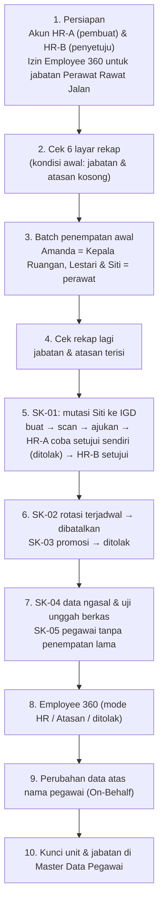

# Laporan Live Browser Testing — Administrasi Kepegawaian (Workforce Core)

| Item | Keterangan |
| --- | --- |
| Menu yang diuji | **Sumber Daya Manusia → Administrasi Kepegawaian** (Sub-Modul 02 Workforce Core) |
| Tanggal uji | Selasa, 3 November 2026, pukul 09.50–10.30 WIB |
| Penguji | AI Agent (Claude Code, skill `live-browser-testing`) memakai Chromium (Google Chrome) mode visual/headed |
| Lingkungan | Frontend `http://localhost:3000` (`QuilvianSystemFrontendDev` HEAD `66b7e5600`), backend `https://localhost:7184` (`NewQuilvianSystemBackend` HEAD `26066c76`, build 0 error) |
| Database | `QuilvianNewDevHamzah` (database pengembang bersama) |
| Persetujuan pemilik | Pemilik menyetujui penulisan data uji lewat aplikasi/API resmi, pemberian izin lewat layar Akses Role, dan penyalaan server oleh agent (3 Nov 2026) |
| Panduan terkait | [PANDUAN_PENGGUNA.md Sub-Modul 02](../../docs/UserGuide/02-workforce-core/PANDUAN_PENGGUNA.md) (daftar KI-01 s.d. KI-13) |

---

## 1. Ringkasan Eksekutif

**Kesimpulan: menu Administrasi Kepegawaian BELUM SIAP dipakai HR dari layar web.** Inti logika backend sudah berjalan benar, tetapi **4 alur utama tidak bisa diselesaikan dari layar** dan ditemukan **6 kondisi yang berujung HTTP 500**.

Contoh dampaknya di rumah sakit: Kepala SDM yang menolak usulan promosi seorang perawat lewat tombol **Tolak SK** akan melihat pesan "Terjadi kesalahan pada server". SK itu tetap menggantung di status *Menunggu Persetujuan* sampai seseorang memprosesnya lewat API.

| Ringkasan | Jumlah |
| --- | ---: |
| Test case | 52 |
| ✅ Lulus | 23 |
| ❌ Gagal | 26 |
| ⏸️ Tertahan / tidak dapat diuji | 3 (ditambah 2 skenario yang dilewati, lihat bagian 7) |
| Temuan unik (LBT-WFC-xx) | 26 (P0: 7 · P1: 6 · P2/P3: 5 · P4: 4 · P5: 4) |

**Yang sudah berjalan baik:**
- Enam layar rekap lintas-pegawai termuat, tidak menyediakan tombol edit/hapus di baris tabel, dan respons daftar gaji tidak memuat nominal.
- Alur SK lewat layar dari **buat draf → unggah scan → ajukan → disetujui pejabat lain** berjalan, termasuk dua penjaganya: wajib scan, dan larangan menyetujui SK sendiri.
- Saat SK diterapkan, penempatan lama ditutup H-1 dan penempatan baru tercatat dengan rujukan nomor SK.
- Batch penempatan awal lewat API membentuk jabatan dan atasan untuk 3 pegawai, dan tidak bisa dijalankan dua kali.
- Form Master Data Pegawai mengunci unit/jabatan, baik di layar maupun di backend.

**Lima perbaikan dengan dampak terbesar:**
1. Kirim field `reason` (dan `counterOrderNumber`) dari tombol Tolak/Batalkan SK (LBT-WFC-01).
2. Perbaiki alamat endpoint Employee 360, Batch, dan On-Behalf di frontend (LBT-WFC-03, -04, -05).
3. Tangani kesalahan database dan batas panjang teks agar tidak menjadi HTTP 500 (LBT-WFC-02, -06, -07).
4. Batch harus menolak eksekusi bila belum *Validated*, menolak pegawai ganda, dan memberi tahu bila gaji tidak terbentuk (LBT-WFC-08, -09, -10).
5. Aktifkan gaya tampilan di lima layar baru, yang saat ini memakai class Tailwind padahal Tailwind tidak terpasang (LBT-WFC-19).

---

## 2. Alur Proses Bisnis yang Diuji

Urutan uji mengikuti cara HR rumah sakit memakai menu ini dalam kehidupan nyata:

**Cerita data uji (Departemen Keperawatan):**
- **Amanda Fitriani** diangkat menjadi Kepala Ruangan, dengan atasan Mira Safitri.
- **Lestari Wulandari** adalah perawat rawat jalan di bawah Amanda.
- **Siti Nurhaliza** adalah perawat rawat inap di bawah Mira, yang kemudian dimutasi ke IGD lewat SK.
- **Dewi Anggraeni** diusulkan rotasi mulai 1 Desember.
- **Bagas Saputra** adalah pegawai tanpa akun dan tanpa penempatan; profilnya dipakai untuk uji data tidak wajar.

Semua teks uji diberi label **"DATA UJI AGENT"**.

---

## 3. Persiapan Lingkungan & Data

| Item | Isi |
| --- | --- |
| Akun HR-A (pembuat SK) | `superadmin@admin.com`, peran SuperAdmin |
| Akun HR-B (penyetuju SK) | `mira.safitri@rsmmc.local`, peran SuperAdmin |
| Akun atasan non-admin | `amanda.fitriani@rsmmc.local`: **login gagal**, password bukan lagi password awal (lihat bagian 7) |
| Akun bukan atasan | `dewi.anggraeni@rsmmc.local`: tidak dicoba, karena password tidak diketahui |
| Izin yang ditambahkan | `HrdEmployee360 : Read` untuk **Keperawatan / Perawat Rawat Jalan**, lewat layar *Manajemen Role → Akses Role* |
| Katalog hak akses | Controller `HrdPersonnelActionOrder`, `HrdEmployee360`, `HrdInitialPlacementBatch`, dan aksi `EmployeeProfileChange : Create` baru terdaftar setelah backend dinyalakan (seeder bawaan `AccessMenuSeeder`) |
| Berkas uji | 10 berkas di `QuilvianSystemFrontendDev/test-with-agy/fixtures/workforce-core/`: PDF/PNG/JPG valid, PDF 9,9 MB dan 10,1 MB, berkas 0 byte, `.txt`, `.docx`, teks bernama `.pdf` |
| Manifest data | `QuilvianSystemFrontendDev/test-with-agy/scripts/wfc-1103-data.json` (UUID pegawai, unit, jabatan, payload tiap skenario) |
| Server | Backend dijalankan dari folder build sementara (folder `Uploads` repo tidak tersentuh); frontend `npm run dev` |

Catatan dari layar Akses Role: saat izin disimpan, dua kebijakan lama `Queue : Read/Update` ikut dinonaktifkan. Keduanya menunjuk ke controller `Queue` yang sudah dihapus dari katalog, sehingga **hak akses efektif jabatan itu tidak berubah** selain penambahan Employee 360.

---

## 4. Endpoint yang Diuji

### `[Tags("Corporate / Human Resource / Workforce Core / Personnel Action Order")]`

| Method | Path | Deskripsi | Auth | Request | Response yang teramati |
| --- | --- | --- | --- | --- | --- |
| GET | `/api/v1/corporate/human-resource/personnel-action-orders` | Daftar SK berpaging | `HrdPersonnelActionOrder : Read` | query `pageNumber`, `pageSize`, filter | 200 `PagedResult` |
| GET | `.../personnel-action-orders/{id}` | Detail SK | `: Read` | — | 200 |
| POST | `.../personnel-action-orders` | Buat draf | `: Create` | `CreatePersonnelActionOrderRequest` (JSON) | 201; 400 bila UUID tidak valid/pegawai tidak ada; **500 bila `reasonText` > 1.500 karakter** |
| POST | `.../{id}/attachments` | Unggah scan SK | `: Update` | multipart `file` | 200; 400 untuk 0 byte / ekstensi salah / > 10 MB |
| POST | `.../{id}/submit` | Ajukan | `: Update` | — | 200; 400 tanpa scan |
| POST | `.../{id}/approve` | Setujui & terapkan | `: Update` | — | 200 Applied/Scheduled; 400 menyetujui sendiri; **500 pegawai tanpa penempatan lama** |
| POST | `.../{id}/reject` | Tolak | `: Update` | `{ "reason": "..." }` | 200; **500 bila memakai `rejectionReason` (payload frontend)** |
| POST | `.../{id}/cancel` | Batalkan | `: Update` | `{ "reason": "...", "counterOrderNumber": "..." }` | 200; 400 SK Applied tanpa nomor kontra; **500 nomor kontra > 60 karakter; 500 payload frontend** |

### `[Tags("Corporate / Human Resource / Workforce Core / Initial Placement Batch")]`

| Method | Path | Deskripsi | Auth | Request | Response yang teramati |
| --- | --- | --- | --- | --- | --- |
| GET | `/api/v1/corporate/human-resource/workforce-core/initial-batches/template` | Template baris pegawai | `HrdInitialPlacementBatch : Read` | — | 200, 41 baris |
| POST | `.../initial-batches/validate` | Validasi baris | `: Read` | array baris | 200; **400 bila `organizationUnitId: null` (nilai dari template)** |
| POST | `.../initial-batches` | Buat batch | `: Create` | `{ batchName, rows[] }` | 201 Validated/Draft; **500 bila pegawai tidak ada** |
| POST | `.../initial-batches/{id}/execute` | Eksekusi | `: Update` | — | 200; 400 bila sudah dieksekusi; **200 juga untuk batch Draft** |
| GET | `/api/v1/corporate/human-resource/initial-placement-batches` | (dipanggil frontend) | — | — | **404, route tidak ada** |

### `[Tags("Corporate / Human Resource / Workforce Core / Employee 360")]`

| Method | Path | Deskripsi | Auth | Response yang teramati |
| --- | --- | --- | --- | --- |
| GET | `/api/v1/corporate/human-resource/workforce-profiles/{workforceProfileId}/employee-360` | Profil terpadu | `HrdEmployee360 : Read` | 200 mode HR (data rahasia lengkap) |
| GET | `/api/v1/corporate/human-resource/employee-360/{id}` | (dipanggil frontend) | — | **404, route tidak ada** |

### `[Tags("Corporate / Human Resource / Workforce Core / Employee Profile Change Administration")]`

| Method | Path | Deskripsi | Auth | Request | Response yang teramati |
| --- | --- | --- | --- | --- | --- |
| POST | `/api/v1/corporate/human-resource/employee-profile-changes/on-behalf` | Pengajuan atas nama pegawai | `EmployeeProfileChange : Create` | multipart (`WorkforceProfileId`, `RequestCategory`, `OnBehalfReason`, `Details[i].*`, `EvidenceFile`) | **415 bila JSON (payload frontend)**; 400 tanpa alasan kuasa; 400 pegawai tanpa data karyawan |
| GET | `.../employee-profile-changes/filters/metadata` | Daftar field yang boleh diubah | `: Read` | — | 200, 27 field, tidak ada rekening bank |

### `[Tags("Corporate / Human Resource / Workforce Core / Cross-Employee Administration")]` dan `[Tags("Corporate / Human Resource / Master Data / Employee")]`

| Method | Path | Deskripsi | Response yang teramati |
| --- | --- | --- | --- |
| GET | `/api/v1/corporate/human-resource/workforce-core/{organization\|position\|manager}-assignments`, `employment-histories`, `salary-assignments` | Rekap lintas-pegawai | 200 |
| PUT | `/api/v1/corporate/human-resource/master-data/employees/{id}` | Ubah data induk pegawai | 400 bila jabatan/departemen utama diubah, data tidak berubah |

---

## 5. Rincian Test Case

Keterangan status: ✅ lulus · ❌ gagal · ⏸️ tertahan/tidak dapat diuji. Lokasi bukti relatif terhadap `QuilvianSystemFrontendDev/test-with-agy/screenshots/workforce-core-1103/`.

### P0 — Critical / Fatal Functional

| ID | Skenario | Ekspektasi | Hasil | Status | Bukti |
| --- | --- | --- | --- | :---: | --- |
| TC-01 | Login HR-A & HR-B | Masuk dashboard | Berhasil | ✅ | `t00-login/` |
| TC-02 | Buka 6 layar rekap | Termuat tanpa crash | Semua 200; organisasi 49 data, lainnya kosong sebelum batch | ✅ | `t02-rekap-sebelum-batch/` |
| TC-03 | Buka layar Batch Penempatan Awal | Daftar batch tampil | "Request failed with status code 404" | ❌ LBT-WFC-03 | `t03-batch-ui/01-layar-batch.png` |
| TC-04 | Buat batch dari form layar | Batch tercipta | `POST 404`; form juga mengirim `rows: []` | ❌ LBT-WFC-03 | `t03-batch-ui/04-form-batch-setelah-simpan.png` |
| TC-05 | Buat batch berisi pegawai yang tidak ada (API) | Baris ditandai tidak valid | **HTTP 500** (pelanggaran foreign key) | ❌ LBT-WFC-06 | log backend |
| TC-06 | SK-01: buat → unggah → ajukan → setujui (layar) | Status Diterapkan | Berhasil, SK-RSMMC-20261103-0001 Diterapkan | ✅ | `t05-sk01/` |
| TC-07 | Tolak SK-03 lewat tombol layar | Status Ditolak | **HTTP 500** "Terjadi kesalahan pada server" | ❌ LBT-WFC-01 | `t06-sk02-sk03/99-fatal-error-tolak-sk-ui-500.png` |
| TC-08 | Batalkan SK-02 lewat tombol layar | Status Dibatalkan | **HTTP 500** | ❌ LBT-WFC-01 | `t06-sk02-sk03/` (cancel) |
| TC-09 | Setujui SK-05 (Bagas, tanpa penempatan lama, hanya unit) | Diterapkan atau ditolak dengan pesan | **HTTP 500** (FK `DepartmentId`); transaksi di-rollback, status tetap Menunggu Persetujuan | ❌ LBT-WFC-02 | `t08-sk05-ki09/99-fatal-error-setujui-sk05-ui.png` |
| TC-10 | Alasan SK 1.501 karakter | Ditolak dengan pesan batas | **HTTP 500** | ❌ LBT-WFC-07 | `t07-sk-ngasal/F-alasan-1501.png` |
| TC-11 | Nomor SK kontra 61 karakter | Ditolak dengan pesan batas | **HTTP 500** | ❌ LBT-WFC-07 | log jaringan `t06-sk-api/` |
| TC-12 | Buka layar Employee 360 | Profil tampil | "Request failed with status code 404" | ❌ LBT-WFC-04 | `t09-employee360-hrB-mira/ui-Lestari.png` |
| TC-13 | Ajukan perubahan data atas nama pegawai dari layar | Draf tercipta | **HTTP 415** | ❌ LBT-WFC-05 | `t10-onbehalf-ui/03-setelah-ajukan.png` |

### P1 — Business Compliance

| ID | Skenario | Ekspektasi | Hasil | Status |
| --- | --- | --- | --- | :---: |
| TC-14 | Ajukan SK tanpa scan bertanda tangan (`AT-HRD-A1-26`) | Ditolak | 400 + pesan HRD-DEC-056 tampil di layar | ✅ |
| TC-15 | HR-A menyetujui SK yang diajukannya sendiri (`AT-HRD-A1-07`) | Ditolak 403 | Ditolak dengan pesan jelas, tetapi kodenya **400** | ✅ (deviasi LBT-WFC-14) |
| TC-16 | Efek SK-01 Diterapkan | Penempatan lama ditutup H-1, penempatan baru merujuk SK | Unit & jabatan lama berakhir 1 Nov, IGD/Perawat IGD mulai 2 Nov, atasan tetap | ✅ |
| TC-17 | SK-02 tanggal efektif 1 Des | Status Terjadwal | Terjadwal | ✅ |
| TC-18 | Penerapan otomatis SK Terjadwal saat tanggal tiba | Diterapkan otomatis | Tidak ada job (KI-06) | ⏸️ |
| TC-19 | Batalkan SK Diterapkan tanpa nomor kontra (`AT-HRD-A1-27`) | Ditolak 409 | Ditolak **400** dengan pesan HRD-DEC-057 | ✅ (deviasi LBT-WFC-14) |
| TC-20 | Batalkan SK Diterapkan dengan nomor kontra | Matriks: ditolak 409 | Diterima; status Dibatalkan, **penempatan Siti tetap di IGD** | ❌ LBT-WFC-12 |
| TC-21 | Eksekusi batch berstatus Draft (0 baris valid) | Ditolak | Dieksekusi, ringkasan "Sukses ... 1 pegawai" | ❌ LBT-WFC-09 |
| TC-22 | Pegawai yang sama dua kali dalam satu batch (VR-WFC-08) | Ditolak | Lolos validasi | ❌ LBT-WFC-10 |
| TC-23 | Pegawai yang sudah pernah dibatch masuk batch baru (`AT-HRD-A1-23`) | Ditolak | Lolos validasi | ❌ LBT-WFC-10 |
| TC-24 | Batch 3 pegawai dengan gaji | Jabatan, atasan, gaji tercipta | Jabatan & atasan tercipta; **gaji 0 baris**, ringkasan tetap "Sukses" | ❌ LBT-WFC-08 |
| TC-25 | Eksekusi ulang batch yang sudah Executed | Ditolak | 400 "sudah dieksekusi sebelumnya" | ✅ |
| TC-26 | Employee 360 mode HR (API) | Data rahasia tampil | `viewMode: HR`, NIK/gaji/rekening/keluarga/sanksi ada | ✅ |
| TC-27 | Employee 360 oleh atasan langsung (`AT-HRD-A1-22`) | Gaji/NIK/rekening tersembunyi | Akun atasan tidak bisa login | ⏸️ |
| TC-28 | Employee 360 oleh bukan atasan | Ditolak 403 | Akun tidak bisa login | ⏸️ |
| TC-29 | Form edit Master Data mengunci unit & jabatan (`AT-HRD-A1-17`) | Dropdown nonaktif + pesan | Departemen & Jabatan nonaktif, pesan SK tampil | ✅ |
| TC-30 | PUT master pegawai dengan jabatan diubah | Ditolak 422 | Ditolak **400** dengan pesan SK; data tidak berubah | ✅ (deviasi LBT-WFC-14) |
| TC-31 | Nominal gaji tidak ada di daftar rekap (`AT-HRD-A1-08`) | Tidak ada `baseSalary` | Tidak ada | ✅ |
| TC-32 | SK dengan gaji pokok −5.000.000 | Ditolak | Diterima, tampil "IDR -5.000.000" | ❌ LBT-WFC-11 |
| TC-33 | Riwayat Kepegawaian setelah mutasi SK | Mutasi tercatat | Tidak bertambah (tetap 1 baris lama) | ❌ LBT-WFC-13 |

### P2 & P3 — Functional & Validation (termasuk data ngasal)

| ID | Skenario | Ekspektasi | Hasil | Status |
| --- | --- | --- | --- | :---: |
| TC-34 | Validasi batch: atasan = diri sendiri, pegawai tidak ada, jabatan kosong, tanggal kosong | Ditolak dengan pesan per baris | Keempatnya ditolak dengan pesan jelas | ✅ |
| TC-35 | Kirim baris template apa adanya ke validasi batch | Diterima | **400**, karena `organizationUnitId` null tidak bisa dikonversi | ❌ LBT-WFC-15 |
| TC-36 | Validasi batch dengan array kosong | Pesan "baris kosong" | `isAllValid: false` tanpa pesan | ❌ LBT-WFC-17 |
| TC-37 | Form SK: UUID pegawai teks `abc` | Pesan ramah | 400, layar menampilkan "Request failed with status code 400" | ❌ LBT-WFC-23 |
| TC-38 | Form SK: pegawai tidak ada | Pesan jelas | "Data pegawai target tidak ditemukan." | ✅ |
| TC-39 | Form SK: alasan < 10 karakter | Ditahan di layar | "Alasan ... minimal 10 karakter." | ✅ |
| TC-40 | Form SK: tanggal efektif kosong | Ditahan di layar | Validasi browser "Please fill out this field." | ✅ |
| TC-41 | XSS `<script>` & `` di catatan/alasan | Tampil sebagai teks | Tampil sebagai teks, tidak ada dialog JS | ✅ |
| TC-42 | Unggah 0 byte / `.txt` / `.docx` / 10,1 MB | Ditolak | Semua 400 dengan pesan jelas | ✅ |
| TC-43 | Unggah PDF 9,9 MB | Diterima | 200 | ✅ |
| TC-44 | Unggah teks biasa bernama `.pdf` | Ditolak | **Diterima** | ❌ LBT-WFC-16 |
| TC-45 | On-Behalf API: JSON / tanpa alasan kuasa / pegawai tanpa data karyawan | Ditolak | 415 / 400 / 400 | ✅ |
| TC-46 | Tampilan rekap saat API gagal (`AT-HRD-A1-16`) | Pesan + tombol coba lagi | "Tidak dapat terhubung ke server · Data gagal dimuat · Coba lagi" | ✅ |
| TC-47 | Rekap Penempatan Organisasi 55 baris (`AT-HRD-A1-15`) | 55 | 49 (14 profil belum punya unit organisasi) | ❌ LBT-WFC-18 |
| TC-48 | Tidak ada tombol edit/hapus di baris 6 rekap (`AT-HRD-A1-24`) | Tidak ada | Tidak ada | ✅ |

### P4 — Visual & P5 — UI/UX

| ID | Skenario | Hasil | Status |
| --- | --- | --- | :---: |
| TC-49 | Tata letak layar buat/detail SK, Batch, Employee 360, On-Behalf | Tampil seperti HTML polos: label menempel di field, tanpa grid | ❌ LBT-WFC-19 |
| TC-50 | Lencana status di detail SK | "Diterapkan" hampir tidak terlihat (teks putih di latar terang) | ❌ LBT-WFC-20 |
| TC-51 | Lencana status rekap organisasi | Penempatan berakhir 30/6/2026 tetap berlencana "Active" | ❌ LBT-WFC-21 |
| TC-52 | Navigasi & umpan balik | Pesan teknis mentah 400/404/415; scan salah tidak bisa diganti; menu SK/360/Batch tidak ada di sidebar; form SK meminta UUID diketik | ❌ LBT-WFC-22 s.d. -26 |

---

## 6. Daftar Temuan & Rekomendasi

### P0 — Fatal (alur berhenti atau HTTP 500)

| ID | Temuan | Penyebab (bukti source) | Rekomendasi |
| --- | --- | --- | --- |
| **LBT-WFC-01** | Tombol **Tolak SK** dan **Batalkan SK** di layar selalu gagal 500 (KI-03) | Frontend mengirim `{ rejectionReason }` / `{ cancellationReason }`, padahal backend membaca `reason`. Alasan kosong memicu `ArgumentException` yang tidak ditangkap controller, sehingga dibalas 500 oleh `GlobalExceptionMiddleware`. Payload yang benar terbukti 200. | Frontend kirim `reason` dan `counterOrderNumber` (`personnel-action-order-detail-view.jsx`). Backend tangkap `ArgumentException` menjadi 400 |
| **LBT-WFC-02** | Menyetujui SK untuk pegawai yang belum punya penempatan dan hanya mengisi unit menghasilkan 500 (KI-09). Contoh: SK pertama untuk pegawai baru yang belum pernah dipetakan | `ApplyOrderAssignmentsAsync` mengisi `DepartmentId/PositionId = Guid.Empty`, sehingga melanggar FK | Wajibkan departemen + jabatan saat pegawai belum punya penempatan aktif (validasi saat buat/ajukan, bukan saat menyetujui) |
| **LBT-WFC-03** | Layar Batch tidak bisa dipakai sama sekali (KI-02) | Frontend memanggil `/initial-placement-batches`, `/{id}/validate`, `/{id}/apply`; backend memakai `/workforce-core/initial-batches`, `/validate` (body baris), `/{id}/execute`. Form juga hanya mengirim nama & catatan dengan `rows: []` | Samakan service frontend dengan backend; tambahkan alur "ambil template → isi jabatan/atasan/gaji → validasi → buat → eksekusi" di layar |
| **LBT-WFC-04** | Layar Employee 360 selalu 404 (KI-01) | Frontend `/employee-360/{id}`, backend `/workforce-profiles/{id}/employee-360` | Perbaiki `employee-360-service.js` |
| **LBT-WFC-05** | Form On-Behalf selalu 415 (KI-04) | Frontend kirim JSON datar; backend `multipart/form-data` dengan `OnBehalfReason`, `Details[i]`, `EvidenceFile` | Kirim `FormData` sesuai kontrak |
| **LBT-WFC-06** | Membuat batch berisi pegawai yang tidak ada menghasilkan 500 | Baris tidak valid tetap disimpan, sehingga melanggar FK `HrdInitialPlacementBatchRow → MstWorkforceProfile` | Tolak pembuatan batch bila ada pegawai/jabatan/atasan yang tidak ada (400 + daftar baris) |
| **LBT-WFC-07** | Teks melebihi batas kolom menghasilkan 500. Contoh: alasan SK 1.501 karakter, nomor SK kontra 61 karakter | DTO tanpa `[MaxLength]`; kolom DB 1.500/60/500 | Tambahkan `[MaxLength]` sesuai kolom dan `maxLength` di input frontend |

### P1 — Kepatuhan bisnis

| ID | Temuan | Contoh di rumah sakit | Rekomendasi |
| --- | --- | --- | --- |
| **LBT-WFC-08** | Batch melaporkan "Sukses" padahal **gaji tidak terbentuk** | HR mengira gaji pokok 3 perawat sudah masuk dan siap dipakai Payroll, padahal kosong | Bila tidak ada `MstSalaryStructure` aktif, tolak baris bergaji atau tampilkan peringatan per baris. DB dev saat ini tidak punya struktur gaji aktif |
| **LBT-WFC-09** | Batch Draft (0 baris valid) tetap bisa dieksekusi (KI-07) | Batch salah ketik bisa "disahkan" dan dianggap selesai | Eksekusi hanya untuk status `Validated`; baris tidak valid membuat batch `Failed` |
| **LBT-WFC-10** | Pegawai ganda dalam satu batch, atau pegawai yang sudah pernah dibatch, tetap lolos validasi | Satu perawat bisa mendapat dua jabatan utama dari dua baris | Validasi duplikat dalam batch dan terhadap penempatan aktif (VR-WFC-08/09) |
| **LBT-WFC-11** | Gaji pokok negatif diterima di SK | SK promosi dengan gaji −5 juta bisa disetujui | Tolak `targetBaseSalary ≤ 0` di backend dan frontend |
| **LBT-WFC-12** | Membatalkan SK Diterapkan hanya mengubah status; penempatan tetap. Matriks uji (`AT-HRD-A1-27`) justru mengharuskan pembatalan SK Diterapkan ditolak | Daftar SK menunjukkan mutasi Siti "Dibatalkan", padahal Siti masih tercatat di IGD. Laporan dan kenyataan berbeda | **Perlu keputusan pemilik:** tolak pembatalan SK Diterapkan (sesuai matriks) atau terapkan SK kontra yang mengembalikan penempatan |
| **LBT-WFC-13** | Riwayat Kepegawaian tidak mencatat mutasi dari SK | Riwayat karier Siti tidak menunjukkan mutasi ke IGD | Tulis `WfpEmploymentHistory` saat SK diterapkan, atau jelaskan bahwa riwayat kini dibaca dari daftar SK |

### P2/P3 — Fungsional & validasi

| ID | Temuan | Rekomendasi |
| --- | --- | --- |
| **LBT-WFC-14** | Kode status berbeda dari matriks uji: menyetujui sendiri 400 (matriks 403), batal SK Diterapkan 400 (matriks 409), kunci master 400 (matriks 422). Pesan sudah benar | Samakan kode dengan matriks, atau perbarui matriks |
| **LBT-WFC-15** | Template batch mengembalikan `organizationUnitId: null`, tetapi DTO baris mewajibkan `Guid` non-null, sehingga baris template ditolak 400. Solusi sementara: kirim `00000000-0000-0000-0000-000000000000` | Jadikan `OrganizationUnitId` nullable di `CreateInitialBatchRowDto` |
| **LBT-WFC-16** | Berkas teks bernama `.pdf` diterima sebagai scan SK, karena hanya ekstensi yang diperiksa | Periksa *magic bytes* (PDF `%PDF`, PNG, JPEG) |
| **LBT-WFC-17** | Validasi batch tanpa baris membalas tanpa pesan | Kembalikan pesan "Baris batch tidak boleh kosong" |
| **LBT-WFC-18** | Rekap organisasi berisi 49 baris, bukan 55 (`AT-HRD-A1-15`); 14 profil belum punya unit organisasi dan tidak bisa diinisialisasi lewat batch (KI-08) | Putuskan jalur penempatan awal untuk 14 profil ini |

### P4 — Visual

| ID | Temuan | Rekomendasi |
| --- | --- | --- |
| **LBT-WFC-19** | Lima layar baru (buat/detail SK, Batch, Employee 360, On-Behalf) memakai 17–49 class Tailwind (`px-3`, `border-slate-300`, `grid-cols-*`, dll.), padahal **Tailwind tidak terpasang**. Akibatnya layout tampil polos/berantakan | Ganti dengan komponen & CSS module standar Quilvian seperti layar rekap |
| **LBT-WFC-20** | Lencana "Diterapkan" di detail SK hampir tidak terlihat | Pakai `StatusBadge` standar |
| **LBT-WFC-21** | Rekap organisasi menampilkan "Active" untuk penempatan yang sudah berakhir (dr. Ranger Biru, 9/6–30/6/2026) | Status mengikuti masa berlaku, bukan hanya `IsActive` |
| **LBT-WFC-22** | Lencana "Dibatalkan" di daftar SK terpotong menjadi dua baris | Lebar minimum kolom status |

### P5 — UI/UX

| ID | Temuan | Rekomendasi |
| --- | --- | --- |
| **LBT-WFC-23** | Pesan teknis mentah "Request failed with status code 400/404/415" tampil ke pengguna | Tampilkan pesan backend, atau pesan ramah bawaan |
| **LBT-WFC-24** | Setelah satu scan terunggah, form unggah hilang sehingga scan yang salah tidak bisa diganti | Sediakan "Ganti berkas" selama status Draft |
| **LBT-WFC-25** | Menu SK Kepegawaian, Employee 360, dan Batch tidak ada di sidebar (KI-11) | Tambahkan ke grup Administrasi Kepegawaian |
| **LBT-WFC-26** | Form SK meminta UUID pegawai/unit/jabatan/atasan diketik manual | Ganti dengan dropdown pencarian |

---

## 7. Tidak Dapat Diuji / Tertahan

| Skenario | Alasan | Yang dibutuhkan untuk melanjutkan |
| --- | --- | --- |
| Employee 360 mode Atasan Langsung & penolakan 403 (`AT-HRD-A1-22`) | Password `amanda.fitriani@rsmmc.local` bukan lagi password awal pola `ddMMMyyyy`; login ditolak "Email atau password salah" (3 dari 5 percobaan sebelum terkunci). Aplikasi tidak menyediakan fitur reset password untuk akun karyawan | Password yang benar dari pemilik akun, atau fitur/izin resmi untuk mengatur ulang password |
| Jalur sukses On-Behalf & larangan verifikasi sendiri (`AT-HRD-A1-21`) | Dilewati atas keputusan pemilik. Semua pegawai yang punya data karyawan juga punya akun ESS, dan draf On-Behalf akan mengunci pengajuan ESS mereka (KI-05) | Perbaikan KI-05 lebih dulu |
| Penolakan SK berlaku surut pada periode presensi tertutup (`AT-HRD-A1-19`) | Tabel periode presensi kosong | Periode presensi berstatus Closed |
| Penerapan otomatis SK Terjadwal (`AT-HRD-A1-25`) | Tidak ada job terjadwal (KI-06) | Implementasi job |

---

## 8. Data Uji yang Tertinggal di `QuilvianNewDevHamzah`

| Data | Kondisi sekarang | Cara mengembalikan |
| --- | --- | --- |
| Izin `HrdEmployee360 : Read` untuk Keperawatan / Perawat Rawat Jalan | Aktif | Akses Role → Keperawatan / Perawat Rawat Jalan → Workforce Core → hapus centang Read Hrd Employee360 → Simpan |
| `BATCH-INIT-20261103-0001` | Executed, tanpa penempatan (bukti LBT-WFC-09) | Tidak berdampak |
| `BATCH-INIT-20261103-0002` | Executed: Amanda = Kepala Ruangan (atasan Mira), Lestari = Perawat Rawat Jalan (atasan Amanda), Siti = Perawat Rawat Inap (atasan Mira). Gaji tidak terbentuk | Dibiarkan sebagai baseline, atau ditutup lewat SK |
| SK-RSMMC-20261103-0001 | Dibatalkan (SK kontra `SK-KONTRA-UJI-001`); **Siti tetap di IGD / Perawat IGD sejak 2 Nov 2026** | Butuh SK baru untuk mengembalikan Siti, setelah keputusan LBT-WFC-12 |
| SK-RSMMC-20261103-0002 / 0003 / 0004 / 0005 | Dibatalkan / Ditolak / Dibatalkan / Dibatalkan | Tidak berdampak pada penempatan |
| Berkas scan uji | Folder build backend sementara di scratchpad agent (bukan repo) | Hapus bersama folder sementara |
| `AccessFailedCount` akun Amanda | 3 | Kembali 0 setelah login berhasil |

---

## 9. Lampiran Teknis

- **Skrip uji:** `QuilvianSystemFrontendDev/test-with-agy/scripts/wfc-1103-*.mjs`. Helper: `wfc-1103-cdp.mjs` (CDP port 9335, sesi browser yang sama dipakai untuk panggilan API resmi).
- **Pembuat berkas uji:** `wfc-1103-make-fixtures.py`.
- **Screenshot & log jaringan per topik:** `QuilvianSystemFrontendDev/test-with-agy/screenshots/workforce-core-1103/<topik>/` (setiap folder punya `network.log`).
- Folder `t09-employee360-BATAL-login-amanda-gagal-sesi-mira/` **bukan** bukti mode atasan, karena login Amanda gagal dan sesi yang aktif masih Mira. Disimpan hanya sebagai jejak.

---

## 10. Tindak Lanjut

| Tanggal | Temuan | Tindak lanjut |
| --- | --- | --- |
| 2026-11-03 | `LBT-WFC-01`, `-04`, `-19`, `-20`, `-22`, `-23`, `-24`, `-25`, `-26` | Diperbaiki di frontend lewat [ISSUE-HRD-002](../../docs/issue/issue-002-tampilan-workforce-core-tanpa-gaya.md) / [PLAN-REPAIR-HRD-002](../../docs/plan-repair/plan-repair-002-tampilan-workforce-core-tanpa-gaya.md) (`FIX-HRD-002-01` s.d. `-08`). Belum di-commit. |
| 2026-11-03 | `LBT-WFC-03`, `-05` | Tampilan dibangun ulang; penyambungan kontrak backend tertahan di `FIX-HRD-002-09` ⛔ |
| 2026-11-03 | `LBT-WFC-09` (sebagian) | Layar Batch kini menahan Eksekusi bila ada baris tidak valid; penolakan di backend tetap dibutuhkan |
| 2026-11-03 | `LBT-WFC-11` | Form Buat SK menolak gaji pokok ≤ 0 di layar; validasi backend tetap dibutuhkan |
| 2026-11-03 | `LBT-WFC-07` (sebagian) | Isian alasan SK dibatasi 1.500 karakter dan alasan Tolak/Batal 500 karakter di layar; `[MaxLength]` backend tetap dibutuhkan |
