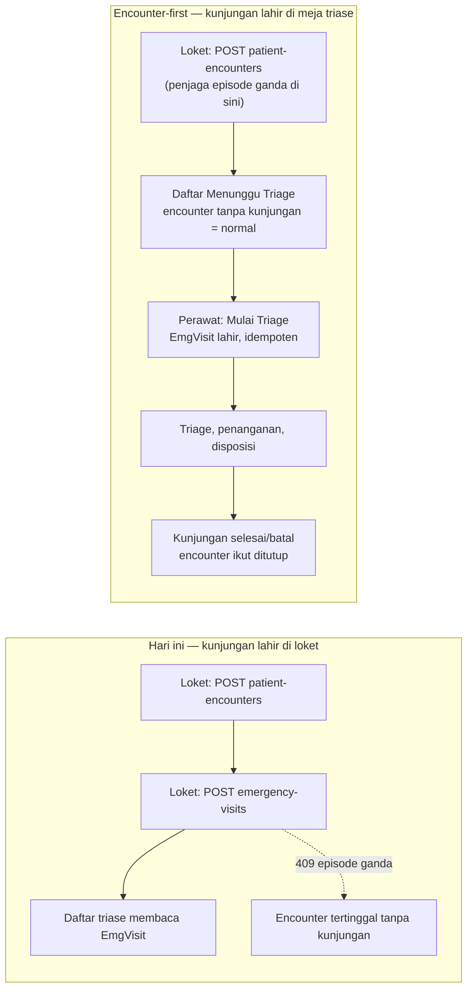

# IGD — Interview Decisions

| Field                | Value                                                                           |
| -------------------- | ------------------------------------------------------------------------------- |
| Blueprint ID         | `IGD-BP-001`                                                                    |
| Revision             | `4`                                                                             |
| Status               | `approved sebagian` — lihat [Approval 2026-08-14](#approval-2026-08-14)         |
| Interview mode       | `Closure pass`                                                                  |
| Product/domain owner | Pemegang sementara sesuai `IGD-DEC-046`; nama formal perlu diisi                |
| Backend SHA          | `pending-trace`                                                                 |
| Frontend SHA         | `pending-trace`                                                                 |
| Primary evidence     | `docs/Modul-RS/Alur_Bisnis_Modul_IGD_NewQuilvian.md`, versi 1.0, 5 Agustus 2026 |

## Scope dan Outcome

- **Fact:** Closure Pass 13 Agustus 2026 membaca `01-existing-capability-map.md` dan
  menemukan bahwa model encounter yang diaudit masih membutuhkan identitas pasien, sementara
  kontrak representasi pasien provisional sebelum `PatientId` definitif belum memiliki owner
  maupun approval otoritatif. Ini adalah blocker desain untuk jalur provisional; keputusan dan
  histori Scope Pass sebelumnya tetap berlaku.
- **Fact:** Dokumen sumber mencakup kedatangan, triage/retriage, registrasi, pelayanan
  klinis, observasi, resusitasi, transfer, disposition, billing/administrasi, dan penutupan
  kunjungan IGD.
- **Fact:** Outcome yang dinyatakan adalah satu episode IGD yang dapat ditelusuri melalui
  `EncounterId`, tanpa menduplikasi data klinis umum dan tanpa menghambat pasien gawat.
- **Assumption:** Blueprint bernama canonical `igd` dan dokumen sumber menjadi input Scope
  Pass, bukan bukti approval final.
- **Assumption:** Audit capability backend dan frontend belum dilakukan; nama class, tabel,
  konfigurasi, dan integrasi di dokumen sumber masih harus dibuktikan dari source code.
- **Decision (draft):** Mode korban massal/bencana termasuk scope rilis awal modul IGD.

## Glossary

| Istilah                          | Makna kerja saat ini                                                                                                                                                                                     | Status                                                                                                                               |
| -------------------------------- | -------------------------------------------------------------------------------------------------------------------------------------------------------------------------------------------------------- | ------------------------------------------------------------------------------------------------------------------------------------ |
| Episode IGD                      | Satu rangkaian pelayanan IGD yang berpusat pada satu `TrxPatientEncounter` dan satu `TrxEmergencyVisit` aktif                                                                                            | `draft`                                                                                                                              |
| Encounter provisional            | Encounter yang memungkinkan pasien gawat atau pasien dengan identitas/administrasi belum lengkap langsung memperoleh pelayanan IGD tanpa menunggu registrasi lengkap                                     | `draft`; field minimum ditetapkan pada `IGD-DEC-016`                                                                                 |
| Temporary patient                | Identitas sementara yang dipakai ketika pasien belum dapat diidentifikasi definitif saat pelayanan IGD dimulai                                                                                           | `draft`; lifecycle ditetapkan pada `IGD-DEC-017`                                                                                     |
| Reconciliation temporary patient | Proses terkontrol untuk menghubungkan `TemporaryPatientId` ke `PatientId` definitif tanpa membuat encounter baru atau memindahkan transaksi klinis                                                       | `draft`; role approver kasus ambigu mengikuti SOP MMC Hospital                                                                       |
| Registrasi lengkap               | `AdministrativeStatus = Complete` setelah seluruh data administratif wajib menurut SOP/konfigurasi registrasi MMC terpenuhi                                                                              | `draft`; daftar field final tidak di-hardcode di workflow IGD                                                                        |
| Stabil                           | Kondisi yang menurut tenaga klinis berwenang memungkinkan proses administratif dilakukan; sistem tidak menentukannya otomatis dari triase atau vital sign                                                | `draft`                                                                                                                              |
| Disposition                      | Keputusan klinis dokter mengenai kelanjutan pasien                                                                                                                                                       | `draft`                                                                                                                              |
| Transfer                         | Eksekusi perpindahan pasien, terpisah dari keputusan disposition                                                                                                                                         | `draft`                                                                                                                              |
| Selesai/Completed                | Episode klinis selesai setelah disposition dieksekusi dan seluruh clinical/transfer/discharge closure gate terpenuhi                                                                                     | `draft`; billing final bukan universal gate                                                                                          |
| Billing status                   | Lifecycle finansial terpisah: `NotStarted`, `InProgress`, `Pending`, `Outstanding`, `Final`, atau `Cancelled`                                                                                            | `draft`; nama enum final mengikuti convention existing setelah capability audit                                                      |
| Financial clearance              | Evaluasi bahwa tanggung jawab finansial encounter cukup terselesaikan untuk mengizinkan physical release; berbeda dari billing completion, pelunasan seluruh invoice, atau penerimaan seluruh receivable | `draft`; hasil konseptual: `Pending`, `ClearedByPayment`, `ClearedByCoverage`, `ClearedByGuarantee`, `ClearedByException`, `Blocked` |
| Exceptional departure            | Event ketika pasien faktual meninggalkan rumah sakit tanpa financial clearance atau exception berwenang; bukan `AdministrativeReleaseStatus = Released`                                                  | `draft`; nama final, misalnya `LeftWithoutFinancialClearance`, mengikuti convention/SOP                                              |
| Administrative release status    | Keputusan kesiapan/pelepasan fisik pasien yang terpisah dari completion klinis: `NotReady`, `Waiting`, `Cleared`, atau `Released`                                                                        | `draft`; nama enum final mengikuti convention existing setelah capability audit                                                      |

## Aktor dan Tanggung Jawab

| Aktor                                | Tanggung jawab yang dinyatakan dokumen                                                                                                                                                                                | Status                                                                         |
| ------------------------------------ | --------------------------------------------------------------------------------------------------------------------------------------------------------------------------------------------------------------------- | ------------------------------------------------------------------------------ |
| Petugas penerimaan/registrasi        | Identifikasi awal, membuat atau melengkapi encounter, penjamin, penanggung jawab, dan rujukan                                                                                                                         | `draft`                                                                        |
| Petugas Registrasi/Master Patient    | Melakukan pencarian kandidat dan reconciliation temporary patient; dapat menyelesaikan kasus simple-match dengan permission `PatientIdentity.Reconcile`/`PatientIdentity.Merge`, atau menjadi maker pada kasus ambigu | `draft`; pemetaan nama role organisasi bersifat configurable                   |
| Approver patient identity            | Menyetujui atau menolak merge/reconciliation ambigu atau konflik dengan permission `PatientIdentity.ApproveAmbiguousMerge`; harus berbeda `UserId` dari maker                                                         | `draft`; nama role organisasi final mengikuti struktur kewenangan MMC Hospital |
| Perawat triage                       | Triage awal, ABCDE/red flag, level prioritas, dan retriage                                                                                                                                                            | `draft`                                                                        |
| Dokter IGD                           | SOAP/konsultasi, diagnosis, tindakan, serta menetapkan disposition                                                                                                                                                    | `draft`                                                                        |
| Perawat IGD                          | Monitoring, CPPT, observasi, edukasi, dan handover sesuai kewenangan klinis                                                                                                                                           | `draft`                                                                        |
| Tim/unit tujuan                      | Menerima atau menolak transfer dan mengonfirmasi kedatangan                                                                                                                                                           | `draft`                                                                        |
| Billing/administrasi                 | Finalisasi biaya dan kekurangan administrasi sebelum penutupan sesuai kebijakan                                                                                                                                       | `draft`                                                                        |
| Product/domain owner                 | Memutus scope dan aturan bisnis IGD                                                                                                                                                                                   | `OPEN — orang/role belum ditetapkan`                                           |
| Clinical governance owner            | Menyetujui sistem triage, target respons, override, dan aturan keselamatan klinis                                                                                                                                     | `OPEN — orang/role belum ditetapkan`                                           |
| Security/privacy owner               | Menyetujui akses, audit, data pasien tak dikenal, serta retention                                                                                                                                                     | `OPEN — orang/role belum ditetapkan`                                           |
| Kepala IGD                           | Mengaktifkan mode korban massal/bencana dalam status menunggu konfirmasi; tidak boleh menonaktifkan kecuali resmi merangkap incident commander                                                                        | `draft`                                                                        |
| Incident commander                   | Mengaktifkan langsung sebagai terkonfirmasi dan dapat menonaktifkan mode korban massal/bencana                                                                                                                        | `draft`                                                                        |
| Direktur rumah sakit                 | Mengonfirmasi/menolak aktivasi, menerima notifikasi, dan dapat menonaktifkan mode                                                                                                                                     | `draft`                                                                        |
| Pejabat/komite bencana yang ditunjuk | Mengonfirmasi/menolak aktivasi dan menerima notifikasi sesuai penunjukan resmi                                                                                                                                        | `draft`                                                                        |

## Business Rules dan Invariants

Pernyataan berikut berasal dari dokumen sumber dan dicatat sebagai keputusan **draft**, belum
sebagai fakta source code atau approval manusia:

1. Encounter IGD menggunakan tipe `OP`, asal kunjungan IGD, dan `ServiceUnitId` IGD.
2. `TrxPatientEncounter` menjadi pusat episode; `TrxEmergencyVisit` menjadi extension IGD.
3. Satu `EncounterId` hanya boleh memiliki satu `TrxEmergencyVisit` aktif.
4. Pelengkapan administrasi provisional tidak boleh membuat encounter kedua.
5. Pasien level 1–2 dapat dilayani dengan encounter provisional dan identitas minimum.
6. Data klinis umum dimiliki Clinical Management; data yang unik bagi IGD dimiliki
   Emergency Installation Management.
7. Retriage adalah transaksi baru pada visit yang sama dan tidak menimpa histori triage.
8. Tindakan utama tetap menjadi `TrxPatientProcedure`; atribut khusus IGD menjadi extension.
9. Observation/resuscitation tidak boleh selesai sebelum waktu mulai.
10. Disposition dan transfer adalah konsep terpisah.
11. Visit hanya dapat ditutup setelah disposition dieksekusi dan gate yang relevan terpenuhi.
12. Data klinis memakai soft delete dan audit trail.
13. Log mutasi tidak boleh membawa identitas pasien atau payload klinis lengkap.
14. Arah triase yang dipilih adalah kategori warna Indonesia: Merah, Kuning, Hijau, dan
    Hitam. Permenkes 47/2018 menerapkan kategori ini pada pelayanan IGD rumah sakit;
    kejadian bencana/korban massal menambahkan tag triase dan tata kelola krisis.
15. Kategori Hitam tidak boleh ditentukan otomatis oleh aplikasi. Dokumen regulasi
    mendefinisikannya sebagai pasien meninggal atau cedera fatal yang jelas dan tidak mungkin
    diresusitasi; penetapan pada pasien konkret memerlukan tenaga klinis berwenang, alasan,
    waktu, dan audit trail.
16. Aktivasi oleh Kepala IGD menghasilkan status `Active — Pending Confirmation` agar respons
    klinis dan operasional tidak menunggu administrasi.
17. Aktivasi oleh incident commander yang telah ditetapkan resmi menghasilkan status
    `Active — Confirmed`; direktur dan komite bencana tetap menerima notifikasi.
18. Penonaktifan hanya boleh dilakukan incident commander atau direktur. Kepala IGD hanya
    boleh menonaktifkan apabila pada saat itu juga ditetapkan resmi sebagai incident commander.
19. Aktivasi, konfirmasi, penolakan konfirmasi, dan penonaktifan wajib mencatat identitas dan
    jabatan pelaku, waktu server, alasan, jenis/lokasi kejadian, sumber laporan, referensi
    bukti, serta status sebelum dan sesudah tindakan.
20. Lampiran bukti tidak boleh menjadi prasyarat aktivasi. Alasan dan sumber laporan wajib
    saat aktivasi; dokumen/foto/bukti tambahan boleh dilengkapi setelah mode aktif.
21. Bukti sensitif disimpan pada penyimpanan terbatas. Audit log hanya menyimpan ID/referensi
    bukti dan tidak boleh memuat identitas pasien atau payload klinis lengkap.
22. Batas waktu konfirmasi dan jalur eskalasi mengikuti SOP internal MMC Hospital atau
    Hospital Disaster Plan yang dapat dikonfigurasi; keduanya tidak boleh di-hardcode.
23. Penolakan konfirmasi tidak menonaktifkan mode korban massal/bencana atau menghentikan
    pelayanan yang sedang berjalan. Mode tetap aktif dengan penanda `Confirmation Rejected`
    sampai incident commander atau direktur melakukan penonaktifan eksplisit; penolakan dan
    penonaktifan dicatat sebagai event audit terpisah.
24. Provisional encounter memungkinkan pelayanan IGD segera bagi pasien gawat atau pasien
    dengan identitas/administrasi belum lengkap. Field wajibnya adalah `EncounterId` buatan
    sistem; `PatientId` atau `TemporaryPatientId`; nama/alias sementara, jenis kelamin, dan
    perkiraan umur/tanggal lahir bila diketahui; `ServiceUnitId` IGD; tipe/asal kunjungan IGD;
    waktu kedatangan; cara kedatangan bila diketahui; alasan provisional; serta `CreatedBy` dan
    `CreatedAt`.
25. NIK, nomor rekam medis existing, alamat lengkap, nomor telepon, keluarga/penanggung jawab,
    penjamin/asuransi, dokumen identitas, dan data rujukan bukan blocker pembuatan provisional
    encounter bagi pasien gawat atau pasien tidak dikenal.
26. Administrasi dilengkapi sesegera mungkin ketika tenaga klinis berwenang menyatakan kondisi
    pasien memungkinkan proses administratif. Reminder dan eskalasi mengikuti SOP rumah sakit
    yang dapat dikonfigurasi, tanpa batas waktu hard-code; keterlambatan tidak boleh otomatis
    menghentikan atau memblokir pelayanan klinis yang berjalan.
27. Petugas registrasi/admission IGD adalah penanggung jawab utama pelengkapan registrasi.
    Dokter dan perawat bertanggung jawab atas data klinis dan dapat menyatakan bahwa proses
    administratif sudah dapat dilakukan.
28. Pelengkapan provisional menjadi registrasi lengkap dilakukan pada `EncounterId` yang sama;
    sistem tidak boleh membuat encounter kedua dan seluruh triage, retriage, tindakan,
    observasi, order, serta data klinis yang ada tetap tertaut kepadanya.
29. Status klinis dan administratif dipisahkan. Encounter provisional dapat memiliki
    `EncounterStatus = Provisional`, `AdministrativeStatus = Incomplete`, dan
    `ClinicalServiceStatus = InProgress`. `AdministrativeStatus` hanya menjadi `Complete`
    setelah seluruh data administratif wajib menurut SOP/konfigurasi registrasi MMC terpenuhi;
    daftar field final tidak di-hardcode di workflow IGD.
30. `TemporaryPatientId` digunakan bila pasien belum dapat diidentifikasi definitif saat
    pelayanan IGD dimulai. Lifecycle-nya adalah `Temporary → IdentityFound →
ReconciliationPending → Merged / Resolved`; sistem tidak melakukan merge otomatis ketika
    identitas mulai diketahui.
31. Sebelum membuat `PatientId` definitif, sistem wajib mencari kandidat pasien existing dengan
    prioritas identifier nasional yang valid, nomor rekam medis existing, kombinasi nama dan
    tanggal lahir/umur serta jenis kelamin, lalu nomor telepon atau demografi lain bila tersedia.
    Hasilnya hanya candidate match; similarity nama/demografi tidak boleh memicu automatic merge.
32. Bila satu kandidat diyakini benar, petugas berwenang melakukan reconciliation ke `PatientId`
    tersebut. Bila kandidat lebih dari satu, identifier bertentangan, atau identitas diragukan,
    status tetap `ReconciliationPending` sampai diverifikasi oleh role berwenang lebih tinggi.
    Jika tidak ada pasien existing setelah pencarian, petugas Registrasi/Master Patient dapat
    membuat `PatientId` definitif baru dan melakukan reconciliation.
33. Petugas Registrasi/Master Patient bertanggung jawab utama atas reconciliation. Dokter dan
    perawat dapat mencatat informasi identitas baru serta menandai `IdentityFound`, tetapi tidak
    boleh merge master patient. Kasus ambigu, konflik duplikasi, atau identitas tidak konsisten
    membutuhkan approval Supervisor Registrasi/Master Patient atau role yang ditetapkan SOP.
34. Reconciliation/merge tidak boleh menghentikan pelayanan klinis. Setelah berhasil,
    `PatientId` definitif dipakai selanjutnya, sedangkan `TemporaryPatientId` tidak dihapus,
    berstatus `Merged`/`Resolved`, dan menyimpan referensi historis ke `PatientId` definitif.
35. Reconciliation tidak boleh mengubah `EncounterId`, membuat encounter baru, atau menyalin
    ulang transaksi klinis. Seluruh triage, retriage, tindakan, observasi, CPPT, order, farmasi,
    lab, radiologi, billing, transfer, dan transaksi klinis lain tetap pada encounter yang sama.
36. Setiap reconciliation mencatat `TemporaryPatientId`, `PatientId` definitif, actor dan role,
    approver beserta role bila diperlukan, waktu server, alasan, metode verifikasi identitas,
    status sebelum/sesudah, serta reference ID evidence bila ada. Mutation/audit log hanya
    menyimpan identifier/reference dan metadata perubahan, tanpa PHI atau payload klinis lengkap.
37. Merge bersifat idempotent; request yang sama tidak menghasilkan merge berulang atau
    duplikasi `PatientId`. Temporary patient berstatus `Merged` tidak boleh digunakan untuk
    membuat encounter baru. Kesalahan reconciliation ditangani melalui workflow
    correction/reversal terkontrol dengan authorization dan audit trail tersendiri, tanpa
    menghapus histori atau mengubah merge secara diam-diam.
38. Separation of duties wajib untuk patient merge/reconciliation yang ambigu atau memiliki
    konflik. Kasus simple-match dapat diselesaikan tanpa approval kedua oleh petugas berwenang
    dengan permission `PatientIdentity.Reconcile`/`PatientIdentity.Merge` apabila ada identifier
    kuat yang cocok (misalnya NIK atau nomor rekam medis), hanya satu kandidat valid, tidak ada
    konflik identifier/demografi material, serta tidak ada indikasi dua `PatientId` aktif
    mewakili orang berbeda.
39. Kasus ambigu/konflik wajib memakai maker-checker. Maker mencari kandidat, memeriksa evidence
    identitas, mencatat perbedaan data, memilih kandidat usulan, dan mengajukan reconciliation.
    Approver menyetujui atau menolak dengan permission `PatientIdentity.ApproveAmbiguousMerge`.
    Maker dan approver harus memiliki `UserId` berbeda; self-approval dilarang.
40. Approval wajib apabila ada lebih dari satu kandidat; NIK/identifier bertentangan; nomor
    rekam medis berbeda tetapi diduga pasien sama; konflik material nama/tanggal lahir/jenis
    kelamin; temporary patient memiliki transaksi klinis signifikan tetapi kandidat meragukan;
    dua `PatientId` definitif diduga duplikat; merge pernah dilakukan atau dibatalkan; atau maker
    meminta eskalasi manual. Dokter/perawat bukan approver merge, tetapi dapat memberi informasi
    klinis/identitas pendukung.
41. Business rule tidak boleh meng-hardcode jabatan organisasi. Permission
    `PatientIdentity.Reconcile`, `PatientIdentity.Merge`,
    `PatientIdentity.ApproveAmbiguousMerge`, dan `PatientIdentity.ReverseMerge` dipetakan ke
    role organisasi melalui konfigurasi authorization. Nama role maker dan approver MMC Hospital
    wajib diverifikasi dari SOP, struktur organisasi, atau keputusan owner sebelum produksi.
42. Audit merge/reconciliation mencatat maker dan role; approver dan role bila diperlukan;
    `TemporaryPatientId`; source dan target `PatientId`; waktu server; alasan; hasil pemeriksaan
    duplicate; evidence/reference; status sebelum/sesudah; serta keputusan approve/reject dan
    alasannya. Rejection tidak menghapus data atau mengubah `EncounterId`; temporary patient
    tetap aktif/pending reconciliation. Reversal merge yang salah wajib memakai workflow khusus,
    bukan edit langsung database.
43. Capability model patient identity dikunci dengan `PatientIdentity.Reconcile`,
    `PatientIdentity.Merge`, `PatientIdentity.ApproveAmbiguousMerge`, dan
    `PatientIdentity.ReverseMerge`. Capability reconcile/merge dipetakan ke maker administrasi/
    master patient; approve ambiguous merge ke approver berwenang lebih tinggi yang berbeda
    `UserId` dari maker; dan reverse merge ke role khusus berwenang lebih tinggi.
44. Nama role organisasi MMC Hospital tidak boleh di-hardcode pada business rule atau source
    code. Mapping `Organization Role → Permission/Capability` harus configurable melalui
    authorization system dan dilakukan berdasarkan evidence SOP, struktur organisasi, atau
    keputusan owner tanpa mengubah workflow bisnis utama. Satu role boleh memegang beberapa
    capability jika SOP menetapkannya, namun self-approval untuk merge ambigu/konflik tetap
    dilarang. Sampai evidence tersedia, mapping nama role berstatus `OPEN` dan bukan blocker
    desain modul IGD.
45. Lifecycle encounter IGD memakai authority berbasis capability yang divalidasi backend.
    Registrasi/admission dapat membuat encounter normal atau provisional; clinician berwenang
    dapat membuat provisional dalam emergensi. Dokter IGD berwenang menetapkan/mengubah
    disposition; unit tujuan menerima/menolak transfer; unit pengirim mencatat `Departed`; dan
    unit penerima mengonfirmasi `Arrived`.
46. Completion hanya terjadi setelah backend memvalidasi disposition telah ditetapkan dan
    dieksekusi, gate klinis terpenuhi, transfer telah `Arrived` bila relevan, gate billing/
    administratif terpenuhi sesuai aturan physical release dan payer/payment yang berlaku, serta
    tidak ada mandatory workflow aktif.
    Cancellation hanya untuk encounter keliru tanpa aktivitas klinis material; correction bersifat
    amendment/append-only; reopening adalah exception dengan authorization lebih tinggi.
47. Pasien yang datang kembali setelah episode IGD selesai harus memperoleh `EncounterId` baru,
    bukan membuka kembali encounter lama. Reopen hanya untuk koreksi atau penyelesaian transaksi
    episode lama yang sah dan dapat memakai maker-checker untuk kasus high-impact.
48. Setiap command yang mengubah state wajib memiliki authorization backend, server timestamp,
    actor `UserId`, previous/new state, alasan untuk exception/correction/cancel/reopen/reject,
    idempotency protection, dan immutable audit trail. Frontend hanya menggunakan permission dari
    backend dan tidak menentukan sendiri hak transisi.
49. Clinical completion, billing completion, dan administrative release adalah lifecycle terpisah.
    Encounter IGD boleh `Completed` setelah disposition dan seluruh closure gate klinis/transfer/
    discharge yang relevan terpenuhi walaupun `BillingStatus` masih `Pending` atau `Outstanding`.
    Billing final bukan universal blocker clinical completion.
50. Completion klinis wajib mencerminkan keadaan klinis sebenarnya dan tidak boleh menahan pasien
    sebagai aktif di IGD semata-mata karena billing belum final. Ini mencegah distorsi LOS,
    occupancy, patient queue, workload, dan dashboard operasional.
51. Bila encounter completed dengan billing `Pending`/`Outstanding`, sistem wajib membuat billing
    handoff berisi `EncounterId`, billing status, alasan, owner/queue penanggung jawab, waktu,
    billing/claim reference bila ada, nilai outstanding bila diketahui, next action, SLA/escalasi
    menurut SOP, dan audit trail. Billing tetap diproses sampai final melalui Billing Management
    dengan `EncounterId` yang sama.
52. Late charge, koreksi billing, claim adjustment, biaya tambahan valid, atau proses finansial
    setelah clinical completion memakai post-close financial adjustment pada `EncounterId` yang
    sama dan tidak otomatis reopen clinical encounter.
53. Physical release terpisah dari clinical completion. Misalnya `EncounterStatus = Completed`,
    `BillingStatus = Pending`, `AdministrativeReleaseStatus = Waiting` diperbolehkan. Jika SOP
    mengizinkan pasien pulang saat outstanding, status `Completed` + `Outstanding` + `Released`
    juga diperbolehkan dengan reason, owner, next action, dan audit trail. Financial clearance
    untuk physical release mengikuti SOP dan payer/payment class yang configurable, tidak boleh
    di-hardcode atau mempertahankan `EncounterStatus = InService`.
54. Financial clearance wajib dievaluasi sebelum `AdministrativeReleaseStatus = Released`, tetapi
    tidak berarti `BillingStatus = Final`, seluruh invoice telah dibayar, atau seluruh receivable
    rumah sakit telah diterima. Prinsipnya: clinical completion ≠ billing completion ≠ financial
    clearance ≠ administrative release; `Released` hanya setelah financial clearance `Cleared`.
55. Untuk self-pay/pasien umum, patient responsibility wajib diselesaikan melalui payment method
    valid sebelum released sebagai default. `Cash` bukan uang tunai literal dan dapat memakai
    cash, debit, credit card, transfer, QRIS, atau metode aktif lain. `Outstanding + Released`
    hanya melalui financial exception berwenang (misalnya deferred payment, assistance, waiver,
    atau exception SOP), tanpa generic bypass. Exception mencatat encounter, responsibility dan
    outstanding amount, jenis/reason, requester/approver/waktu approval, owner, due date/next
    action bila relevan, notes, dan audit trail.
56. Untuk insurance, actual payment dari insurer tidak wajib diterima sebelum released. Clearance
    diberikan bila eligibility/policy valid, authorization/referral dan guarantee/coverage
    confirmation yang diwajibkan tersedia, benefit/limit diketahui, serta copayment, deductible,
    excess, atau non-covered patient responsibility telah diselesaikan sesuai SOP. Eligibility
    invalid, policy tidak aktif, dokumen wajib tidak tersedia, coverage ditolak/tidak cukup dengan
    excess belum selesai, atau payer tidak jelas menghasilkan `Pending`/`Blocked` kecuali ada
    exception berwenang.
57. Corporate/company guarantee memakai prinsip insurance: eligibility karyawan, guarantor dan
    benefit plan valid, verifikasi karyawan/dokumen/coverage yang diwajibkan terpenuhi, serta
    patient responsibility diselesaikan. Guarantee tidak tersedia/ditolak/kedaluwarsa, limit
    terlampaui, atau excess pasien mengubah bagian itu menjadi patient responsibility yang harus
    selesai sebelum released kecuali ada exception berwenang.
58. Patient outstanding harus dipisahkan dari payer outstanding. Minimum konsepnya
    `PatientResponsibilityAmount`, `PayerResponsibilityAmount`, `PatientOutstandingAmount`, dan
    `PayerOutstandingAmount`. Jika patient outstanding nol dan coverage/guarantee payer disetujui,
    clearance dapat `Cleared`; bila patient outstanding lebih dari nol tanpa arrangement deferred/
    exception disetujui, clearance harus `Pending`/`Blocked`. Payer receivable dapat tetap
    outstanding setelah released dan bukan unresolved patient liability.
59. Setiap financial clearance menyimpan snapshot/evidence: encounter, kategori payer/payment,
    total responsibility, responsibility/outstanding pasien dan payer, reference coverage/
    guarantee, hasil clearance, waktu dan evaluator, reference exception bila ada, notes, serta
    audit trail. Nama enum final mengikuti convention existing setelah capability audit.
60. Untuk self-pay, `PatientOutstandingAmount > 0` tanpa approved financial exception berarti
    financial clearance tidak boleh `Cleared` dan administrative release tidak boleh `Released`.
    `Outstanding + Released` adalah controlled exception, bukan normal flow.
61. Capability model financial exception minimal mencakup kategori `DeferredPayment`,
    `FinancialAssistanceOrWaiver`, `PaymentInfrastructureFailure`,
    `HospitalBillingReconciliation`, dan `DepositSecuredRelease`; daftar final mengikuti SOP MMC.
    Tidak boleh ada generic bypass "Release Anyway" tanpa exception type, reason, outstanding,
    responsible party, requester, approval, next action, dan audit trail.
62. Pasien yang faktual meninggalkan rumah sakit tanpa clearance/exception tidak boleh ditandai
    `AdministrativeReleaseStatus = Released` atau dipalsukan menjadi financial clearance
    `Cleared`. Sistem mencatat exceptional departure event tersendiri sesuai SOP dengan audit.
63. Deposit dapat dipakai dalam evaluasi clearance hanya setelah dialokasikan terhadap patient
    responsibility dan diverifikasi cukup, dengan mempertimbangkan `AvailableDepositAmount`,
    `PatientResponsibilityAmount`, `PatientOutstandingAmount`, dan
    `PendingOrUnpostedPatientCharges`. Deposit semata tidak otomatis clearance dan
    `ClearedByDeposit` berbeda dari waiver/exception; sisa deposit memakai workflow refund/credit
    terpisah. Unresolved financial exposure membuat clearance `Pending` kecuali ada exception
    berwenang.
64. Approval exception memakai capability `FinancialRelease.Exception.Request`,
    `FinancialRelease.Exception.ApproveTier1`, `FinancialRelease.Exception.ApproveTier2`,
    `FinancialRelease.Exception.ApproveTier3`, dan `FinancialRelease.DepositClear`. Maker dan
    approver harus berbeda untuk exception yang menghasilkan patient outstanding lebih dari nol
    dengan status released; self-approval dilarang.
65. Approval matrix dikonfigurasi menurut exception type, minimum/maksimum amount, required tier,
    kebutuhan second approval, dan izin release; juga dapat mempertimbangkan kategori pasien,
    riwayat exception berulang, coverage deposit/pembayaran, financial risk, serta special-case
    flags. Nominal threshold, dual approval per tipe, dan nama jabatan approver tidak di-hardcode
    dan menunggu SOP/delegation-of-authority MMC.
66. Approved outstanding release mencatat encounter/patient, exception type, patient
    responsibility, paid/deposit applied/outstanding amount, reason, requester/approver, tier,
    waktu approval, next action, due date bila relevan, owner/queue, reference/evidence, serta
    audit trail. Approval tidak mengubah histori billing atau menghapus outstanding; pembayaran
    berikutnya memakai billing/payment workflow normal pada encounter yang sama tanpa reopen
    clinical encounter.
67. Diagnostic result yang final setelah clinical completion tetap terkait pada
    `DiagnosticOrderId`, `Result`/`ReportId`, dan `EncounterId` asal. Late result tidak otomatis
    mengubah `Completed → InService` atau reopen clinical encounter; sistem menggunakan workflow
    review/follow-up terpisah.
68. Setiap diagnostic order memiliki `ReviewOwner` eksplisit. Default IGD adalah ordering/
    requesting clinician; bila tidak tersedia, ownership dialihkan kepada designated IGD covering
    clinician dari roster/authorization configuration. Untuk internal transfer, review owner dapat
    berpindah ke receiving responsible clinician/team hanya setelah handover diterima eksplisit,
    dengan histori ordering clinician, encounter asal, transferred owner, waktu handover, dan
    penerima tetap tersimpan.
69. Hasil late-result pasien pulang direview clinician berwenang, yang memilih action seperti
    no further action, contact patient, outpatient follow-up, consult clinician lain, rekomendasi
    kembali ke emergency, atau action klinis berwenang lain. Staf administratif/perawat dapat
    membantu komunikasi sesuai capability/SOP tetapi tidak menafsirkan hasil klinis.
70. Workflow non-critical adalah `FinalResultAvailable → ReviewPending → Reviewed →
FollowUpClosed`, dengan reviewer/waktu, interpretation/action, follow-up requirement, dan
    clinical note/reference tercatat. SLA review non-critical mengikuti SOP dan tidak di-hardcode.
71. Critical result menjalankan `CriticalResultVerified → CriticalNotificationPending →
ClinicianAcknowledged → ClinicalActionDetermined → PatientOrReceivingFacilityContacted →
FollowUpClosed`. Notification sent tidak cukup; acknowledgement harus dapat dibuktikan.
    Unit diagnostik memulai notifikasi ke review owner dan mengeskalasi ke covering clinician
    lalu authority klinis lebih tinggi bila belum di-acknowledge, menurut SOP.
72. Hasil critical/high-risk yang membutuhkan contact dan pasien tidak dapat dihubungi tidak boleh
    langsung ditutup; gunakan escalation workflow. Contact attempt membedakan `Attempted`,
    `Reached`, dan `Acknowledged`, serta mencatat waktu, metode, target, outcome, dan actor.
    Komunikasi memakai channel yang disetujui, minimum necessary information, serta tidak
    mengirim payload hasil penuh/PHI tak perlu melalui infrastructure notification.
73. Pasien yang kembali karena late result memperoleh `EncounterId` baru; encounter asal tetap
    completed dan encounter baru mereferensikan original encounter, diagnostic order/result, dan
    follow-up record. Dokumentasi episode lama menggunakan amendment/addendum/follow-up record,
    bukan overwrite discharge/disposition atau reopen.
74. Late-result follow-up mengaudit identifier order/result dan source system; waktu final/
    verified; critical rule; review owner/reviewer; action; contact, acknowledgement, escalation,
    instruction, status, dan closure. Mutation/integration/notification log hanya menyimpan
    identifier/reference serta metadata tanpa full result payload atau PHI tak perlu. Repeated
    delivery LIS/RIS memakai stable external/result identifier dan idempotency agar tidak membuat
    duplicate result, review task, atau critical-result case.
75. Transaksi lintas modul tidak menggunakan distributed ACID transaction. Setiap bounded context
    memiliki data/state sendiri dan memakai local atomic commit + transactional outbox +
    idempotent receiver/inbox + acknowledgement + retry + reconciliation. Database transaction
    lokal tidak boleh ditahan selama network call ke dependency.
76. Mutating command/event lintas modul memuat `MessageId`/`CommandId`, `IdempotencyKey`,
    `CorrelationId`, `CausationId` bila relevan, `EncounterId`, aggregate/resource identifier,
    operation type, waktu request/occurred, source/destination module, dan schema/version tanpa
    PHI tak perlu. Retry selalu menggunakan idempotency key sama.
77. Receiver menyimpan processed-command/message registry atau unique constraint dalam local
    transaction bersama business mutation. Key sama dengan logical request sama me-replay outcome
    sebelumnya tanpa side effect kedua; key sama dengan payload berbeda menghasilkan
    `IdempotencyConflict` dan audit.
78. Delivery memakai at-least-once dengan idempotent processing untuk effectively-once business
    side effects, bukan klaim true exactly-once. Outbox disimpan bersama domain change dalam local
    transaction dan dispatcher mengirim setelah commit; receiver inbox menandai processed dalam
    transaction yang konsisten bersama mutasi bisnis.
79. Automatic retry hanya untuk transient failure secara bounded dengan exponential backoff+jitter;
    retry harus mengikuti error classification dan konfigurasi per destination. Validation,
    unauthorized/forbidden, invalid state, malformed identifier, unsupported operation, dan
    business rule rejection tidak di-loop otomatis. HTTP 401 hanya dapat refresh credential bila
    integration contract mendukungnya.
80. Interactive retry hanya menggunakan latency budget operasi pengguna; setelah habis, return
    state deterministik `Accepted`/`Pending` atau `DependencyUnavailable` sesuai semantik. Outbox
    background memiliki retry window lebih panjang; setelah limit, message masuk
    `NeedsReconciliation`/dead-letter queue, tidak di-drop, dan reprocess berwenang diaudit.
81. Network call memiliki finite timeout yang configurable. Timeout bukan otomatis business
    failure: bila remote mungkin sudah memproses, status menjadi `OutcomeUnknown`/`Unconfirmed`
    dan direkonsiliasi memakai idempotency/command/correlation/external reference atau status API;
    tidak membuat command baru dengan key baru.
82. Business state dipisahkan dari integration delivery state (misalnya `Pending`, `Dispatching`,
    `Accepted`, `RetryScheduled`, `OutcomeUnknown`, `Rejected`, `NeedsReconciliation`,
    `Completed`). Partial failure tidak memakai destructive global rollback: encounter/tindakan
    klinis yang sah tetap valid dan downstream billing/pharmacy/lab menjadi pending atau perlu
    rekonsiliasi.
83. Domain compensation digunakan bila perlu (misalnya `CancelOrder` yang sah), bukan generic
    rollback lintas modul. Tindakan yang sudah dilakukan tidak dihapus; gunakan correction,
    amendment, atau reconciliation. Transfer berubah state hanya setelah acknowledgement
    authoritative dan transport timeout tidak berarti acceptance.
84. Out-of-order/duplicate event harus ditangani dengan aggregate ID dan version/sequence bila
    perlu agar event lama tidak memundurkan state. `CorrelationId` stabil diteruskan untuk tracing
    lintas module dan bukan patient identifier publik.
85. Reconciliation record menyimpan ID pesan/idempotensi/korelasi/encounter, source/destination,
    operation, integration status, attempt/waktu retry, safe error metadata, external reference,
    serta outcome/actor/waktu reconciliation tanpa PHI/payload klinis penuh. Technical transport
    ownership dipisahkan dari business/clinical authority untuk correction/compensation.
86. UI membedakan `Succeeded`, `Pending`, `Failed`/`Rejected`, dan `NeedsAttention`; tidak boleh
    menampilkan success hanya karena local API menerima request ketika remote acknowledgement
    penting. Manual retry memakai transaksi asal dan key yang sama atau linked retry sesuai
    contract, membutuhkan authorization/audit, serta tidak boleh menduplikasi klinis.
87. Resilience/circuit policy mencegah synchronous hammering ketika dependency gagal berulang.
    Jika aman, workflow lokal berlanjut dan integration pending; bila acknowledgement downstream
    wajib untuk keamanan, tampilkan blocked/pending dan lakukan escalation. Observability minimal
    memantau timeout, retry, retry success, duplicate prevention, pending/age, reconciliation,
    rejection, dan dependency availability dengan alert berdasar impact klinis/bisnis.
88. Timeout, attempts, backoff, jitter, retry classification, reconciliation/circuit threshold,
    dan perubahan konfigurasi bersifat per destination, controlled, dan auditable; tidak
    di-hardcode satu angka untuk seluruh module.
89. Authorization IGD adalah capability-based, context-aware, dan backend-enforced. Role
    organisasi hanya mapping configurable terhadap capability. Mutation diizinkan hanya bila
    `HasCapability`, context, state transition, credential/privilege, dan segregation of duties
    semuanya valid; frontend hanya menampilkan allowed action dan mengirim command.
90. Capability sensitif dipisahkan secara granular (view/create/update draft/finalize/amend/
    correct/approve/reject/cancel/reopen/merge/reverse/override/break-glass/export/print/
    disclosure), bukan generic CRUD. Hak view tidak otomatis memberikan export, print, atau
    disclosure; akses PHI mengikuti minimum necessary dan treatment/business relationship.
91. Registrasi/Master Patient mengelola encounter administratif dan identity workflow, tetapi
    tidak otomatis mendapat triage, clinical diagnosis/order, disposition, clinical amendment,
    atau financial exception approval. Merge simple-match tetap memerlukan strong verified match,
    satu candidate definitif, tanpa material conflict, serta policy authorization.
92. Perawat memiliki capability yang unit-, credential-, dan encounter-context-scoped untuk
    start service, triage/retriage, nursing/vital/observation/resuscitation record, authorized
    medication/procedure administration, transfer departure, dan clinical communication. Perawat
    tidak otomatis menetapkan diagnosis/disposition, membuat physician-only order, merge identity,
    approve financial exception, atau bertindak sebagai receiving unit di luar contextnya.
93. Dokter IGD memiliki capability yang clinical privilege/unit/state-aware untuk assessment,
    diagnosis, diagnostic/medication/procedure order, resuscitation action, disposition,
    transfer request, clinical amendment, dan late-result review/follow-up. Clinical role tidak
    otomatis memberi patient identity approval/reverse merge, financial approval, user/capability
    management, atau unrestricted technical administration.
94. Unit tujuan adalah authorization context, bukan role universal. `Transfer.Accept`, `Reject`,
    `MarkArrived`, clinical handover, atau late-result ownership hanya berlaku bila destination
    unit sesuai authorized unit user dan state valid. Authority transfer dipisahkan: clinician
    request/disposition, sender `MarkDeparted`, receiver accept/reject/arrived.
95. Billing/Finance mengelola financial view/posting/adjust/reconcile/payment/clearance,
    exception request, deposit/refund bila capability tersedia, dan collection. Finance tidak
    mengubah clinical truth, disposition, atau reopen encounter untuk billing. Financial exception
    menggunakan requester/approver tier berbeda dan approval self tidak diperbolehkan.
96. Supervisor bersifat domain-scoped, bukan allow-everything. Registration supervisor dapat
    memiliki identity approval/reverse; clinical supervisor dapat higher-risk correction/reopen/
    cancel/disposition correction; finance supervisor dapat financial exception/adjustment/refund/
    write-off approval—semua hanya bila policy memberi capability eksplisit.
97. Technical administrator dapat mengelola user, mapping role-capability, configuration,
    integration/reprocess, system health/audit, dan reference data sesuai delegasi, namun bukan
    business superuser. Tidak ada direct database/state mutation sebagai normal workflow; repair
    darurat memakai technical incident procedure terpisah. Admin tidak otomatis memiliki clinical,
    identity merge, financial approval, reopen, atau blanket PHI access.
98. Break-glass adalah capability terpisah dan time-bounded dengan reason, target patient/
    encounter, emergency scope, actor/waktu server, immutable audit, dan post-event review. Tidak
    dipakai untuk kenyamanan finansial, bypass merge/billing, atau workflow rutin.
99. Segregation of duties wajib untuk merge ambigu, financial release exception, sender/receiver
    transfer, clinical versus financial truth, technical administration versus business approval,
    reverse merge, dan high-impact correction/reopen/cancel sesuai risk configuration. High-risk
    audit memuat actor, capability efektif, assignment context, action/resource, prior/new state,
    result authorization, reason/approver, server time, dan correlation/reference tanpa PHI tak
    perlu.
100. Temporary cover/on-call memakai delegated contextual assignment (unit, scope, effective
     start/end, delegator/reference, audit), bukan broad permanent permission. Backend mengecek
     unit/encounter/state/authorized units/credential/privilege/assignment, payer/exception
     context, serta requester-approver `UserId`; hidden UI button bukan security.
101. Respons klinis IGD memakai clock server-authoritative yang terpisah: `ArrivalAt →
TriageStartedAt` (door-to-triage), `ArrivalAt → FirstQualifiedClinicalResponseAt`
     (door-to-qualified-clinical-response), dan `TriageCategoryEffectiveAt →
FirstClinicalInterventionAt` (triage-to-intervention). Ketiganya tidak saling menggantikan.
102. KPI patient-safety utama adalah `ArrivalAt → FirstQualifiedClinicalResponseAt`,
     dikelompokkan menurut initial triage category. `ArrivalAt` adalah waktu pasien aktual
     diterima di IGD, bukan registration-completed; pre-arrival ambulance notification disimpan
     terpisah dan bukan SLA start kecuali SOP mengatur. Triage start berarti clinical personnel
     berwenang benar memulai triase, bukan membuka halaman/encounter.
103. `TriageCategoryEffectiveAt` direkam per assessment append-only. Qualifying clinical response
     berasal dari aktivitas klinis nyata menurut policy (misalnya assessment/primary survey/
     resuscitation), bukan membaca chart/notifikasi; intervention adalah tindakan nyata, bukan
     sekadar draft order kecuali policy eksplisit menganggapnya qualifying.
104. Merah memiliki target `Immediate`/zero-minute response dan tidak menunggu registrasi,
     payer/admin/form/queue/billing. Audit performance tetap menyimpan elapsed duration presisi.
     SLA Merah dievaluasi dari `ArrivalAt`; clinical care/intervention boleh berjalan paralel atau
     mendahului triage form. Kuning/Hijau memakai target duration configurable dan versioned,
     tanpa angka hard-code sampai SOP MMC tersedia.
105. Hitam bukan ordinary waiting-queue SLA. Klasifikasi tetap clinical-authorized dengan reason,
     waktu server, clinical basis, dan audit; target confirmation/family/mortuary/medicolegal,
     bila ada, menjadi workflow SLA terpisah. Retriage append-only membuka active SLA window baru
     dari retriage effective time tanpa mengubah arrival atau menghapus historical wait/breach.
106. Upgrade triage langsung menerapkan target kategori lebih tinggi; downgrade tidak menghapus
     breach historis. Ketika target terlewati, status `Breached` tetap tercatat walau kemudian
     mendapat response, dengan breach/responded/resolved time dan escalation status.
107. Escalation lifecycle adalah `OnTrack → Warning → Breached → Escalated → Acknowledged →
ClinicalResponseRecorded → Resolved`. Merah langsung menimbulkan alert/escalation aktif;
     Kuning/Hijau memakai warning/deadline/tier/interval configurable. Acknowledgement bukan
     clinical response dan escalation tidak mengubah triage, diagnosis, disposition, timestamp,
     intervention, atau closure.
108. Escalation recipient ditentukan oleh capability, assignment/shift, unit, privilege, dan
     on-call/coverage context—not hard-coded job title. Queue/resource load tidak menghentikan
     atau mereset raw clock; reason operasional dicatat terpisah. Exclusion/adjustment bila sah
     menyimpan raw immutable duration, adjusted duration, reason, dan policy version.
109. Disaster mode memakai `OperationMode` eksplisit dan policy SLA bisa berbeda dari normal;
     monitoring tidak dimatikan diam-diam. Policy memakai configuration versioned/effective-dated
     menurut metric, category, operation mode, target/warning/escalation, berlaku dari/sampai,
     dan setiap evaluasi mereferensikan applied policy/version historis.
110. Backend menjadi authority timestamp, SLA calculation, breach/escalation, policy version,
     acknowledgement, dan resolution. Frontend hanya menampilkan timer/status/allowed action.
     Audit metric memuat encounter/visit/assessment, kategori dan seluruh clock, policy, warning/
     breach/escalation/acknowledgement/response/resolution, serta server time tanpa PHI tak perlu.
111. IGD mempunyai tepat satu accountable Product/Domain Owner untuk scope, workflow,
     prioritization, backlog, cross-domain coordination, operational acceptance/readiness, dan
     escalation governance. Owner bukan universal final approver; nama/jabatan/pemegang MMC tetap
     menunggu evidence internal.
112. Final approval dipisahkan sebagai governance capability konseptual Product/Operational,
     Clinical, Finance, Privacy, Security, dan Integration. Capability mengikuti convention
     authorization existing bila tersedia dan dipetakan secara configurable ke posisi organisasi,
     bukan hard-coded title/person.
113. Clinical approver berwenang final atas patient safety, triage, assessment, resuscitation,
     observation, diagnosis/procedure/medication workflow, disposition, clinical documentation/
     amendment, clinical SLA, dan escalation. Product owner maupun technical administrator tidak
     dapat meng-override clinical safety/policy.
114. Finance approver berwenang final atas billing/tariff, payer/guarantee, financial release,
     outstanding/reconciliation, correction/write-off/adjustment, dan financial closure gate.
     Privacy approver berwenang atas patient data use/disclosure/sharing/minimization/retention/
     secondary use dan privacy integration. Security approver berwenang atas privileged access,
     authentication/secrets, technical access exception, risk acceptance, and security control.
     Privacy dan security tetap distinct accountability walau MMC kelak dapat memetakan keduanya
     ke pihak sama.
115. Integration approval memisahkan business/data-semantic approval dari technical interface
     approval. Clinical, financial, atau identity integration memerlukan affected domain approval
     serta integration technical approval dan privacy/security bila data/risk terdampak; IT tidak
     boleh menjadi sole final approver atas arti klinis/finansial data.
116. Cross-domain decision membutuhkan seluruh mandatory impacted-domain approval, bukan majority
     vote. Tidak ada super approver berdasarkan hierarchy/CEO/director/admin semata; emergency/
     break-glass mengikuti policy tersendiri. Product owner dapat propose/prioritize/coordinate/
     accept operational delivery, tetapi tidak unilateral waive clinical, finance, privacy,
     security, atau cross-domain production integration control.
117. Governance approval mengikuti capability/context/backend validation dan maker-checker bila
     diwajibkan; technical admin tidak boleh self-assign atau bypass business approval. Decision
     record menyimpan domain, change/evidence/SOP/policy reference, proposer/reviewer/approver/
     rejection, effective dates/version/status dan audit tanpa PHI. Multi-domain lifecycle adalah
     `Draft → UnderReview → PartiallyApproved → Approved/Rejected → Effective → Superseded`, dan
     approved hanya bila semua domain wajib telah menyetujui; perubahan menghasilkan version/
     superseding decision, bukan overwrite.
118. High-impact encounter operation ditentukan oleh impact clinical, identity, financial,
     downstream, legal/regulatory, finalization, dan workflow—not operation name atau senioritas.
     Authorization tetap capability/context/impacted-domain/segregation-of-duties dan backend
     validated.
119. Correction high-impact bila mengubah clinical meaning, identity linkage, record signed/
     finalized/completed, authoritative chronology/SLA/KPI timestamp, downstream-consumed/
     external data, material financial/claim/guarantee data, completed history, executed workflow,
     legal/regulatory data, bulk records, atau record dengan correction/reversal/dispute history.
     Low-impact hanya clerical non-material sebelum final, tanpa clinical/identity/financial/
     downstream/SLA/legal/workflow impact, dan tetap auditable.
120. High-impact correction wajib maker-checker: maker `UserId` berbeda checker dan checker
     memiliki approval capability impacted domain. Cross-domain correction membutuhkan seluruh
     approval domain menurut `IGD-DEC-028`. Low-impact correction dapat one-actor bila SOP tidak
     menuntut checker. Technical detection dapat membuat alert/request tetapi tidak self-approve
     business correction.
121. Cancellation hanya untuk encounter erroneous/duplicate/mistakenly created tanpa material
     clinical activity. Triage/retriage, material clinical documentation, diagnosis, procedure,
     medication, lab/radiology, observation/resuscitation, disposition, executed transfer, atau
     consequential financial/claim/downstream transaction membuat cancellation ditolak; approval
     tidak boleh meng-override invariant. Gunakan amendment/correction/void/closure sesuai kasus,
     tanpa physical delete.
122. Eligible cancellation menghasilkan semantic cancelled state dengan reason, actor, waktu
     server, dependency/downstream check, immutable audit, dan idempotency. Empty deterministic
     error dapat one-actor bila policy mengizinkan; identity ambiguity, external/downstream,
     finalized state yang diizinkan SOP, cross-domain impact, history/dispute/escalation, atau SOP
     requirement menjadikannya high-risk eligible cancellation dan wajib maker-checker.
123. Setiap manual `Encounter.Reopen` selalu high-impact dan maker-checker wajib. Reopen hanya
     untuk scoped historical correction/omitted transaction approved, bukan membuka semua record
     lama; physical patient return selalu `EncounterId` baru. Request menyimpan encounter/target/
     change/reason/domain/evidence/requester/waktu/current state/expected scope.
124. Approved reopen dibatasi target eksplisit, lalu correction, validation, downstream
     reconciliation, dan re-close. Impact downstream memakai state reconciliation seperti pending,
     in progress, reconciled, failed, atau manual review; local audit tidak boleh fake success
     bila external system belum mengakui correction.
125. Capability konseptualnya `Encounter.CorrectionRequest`/`Correct`/`CorrectionApprove`,
     `Encounter.Cancel`/`CancelApprove`, dan `Encounter.ReopenRequest`/`Reopen`/`ReopenApprove`;
     gunakan convention authorization existing bila compatible. Backend memvalidasi maker/checker
     identity/capability/context/domain/approval/state/target; UI hanya menampilkan action.
126. High-impact audit memuat operation/encounter/type/domain/reason, maker/checker/capability/
     decision/timestamps, evidence, previous/effective state, target resource, execution,
     reconciliation, dan version. Correction mengikuti original + amendment + current effective
     representation; request/approve/reject/execute/cancel/reopen idempotent dan rejected request
     tetap historis—perubahan material membuat request/version baru.
127. Pada production awal, self-pay dengan `BillingStatus = Outstanding` tidak dapat memperoleh
     normal `AdministrativeReleaseStatus = Released` (fail-closed financial exception). Backend
     menolak release bila tidak ada approved policy/exception valid; eligibility, threshold,
     deposit, reason, evidence, approval, settlement SLA, dan escalation tidak boleh diarang atau
     di-hardcode.
128. Clinical completion tetap mengikuti `IGD-DEC-021`: encounter dapat `Completed` dengan billing
     outstanding dan `AdministrativeReleaseStatus = PendingFinancialClearance`, tanpa dianggap
     tetap `InService`. Financial rule fail-closed tidak menjadi clinical-care blocker; emergency
     care, resuscitation, required intervention, safe transfer, dan clinical disposition berjalan
     tanpa menunggu finance approval, dengan billing handoff/reconciliation.
129. Administrative release berbeda dari fakta physical departure. Sistem dapat mencatat
     `PhysicalDepartureAt` dan `PhysicalDepartureReason` saat pasien benar-benar pergi, meskipun
     administrative clearance masih pending; status tidak boleh dipalsukan menjadi pasien aktif
     IGD atau administratively released.
130. Bila kemudian diaktifkan, self-pay `Outstanding + Released` adalah high-impact controlled
     exception dengan policy versioned/effective-dated yang memuat payer, allowed release,
     maximum outstanding amount/percentage, minimum deposit amount/percentage, reason code,
     required approval/evidence, settlement SLA/escalation, dan active period. Maker-checker
     wajib (`UserId` berbeda), Finance adalah mandatory approval domain, dan cross-domain approval
     mengikuti `IGD-DEC-028`.
131. Financial handoff mencatat encounter, billing/outstanding, pending reason, owner/queue,
     next action, due/SLA, billing reference, waktu/creator. Future exception audit mencatat
     outstanding/deposit, reason/policy, maker/checker, request/approval/release, evidence, dan
     previous/new state menggunakan server time tanpa PHI/payload billing penuh pada generic log.
132. Identity merge maker adalah Registration/Master Patient actor ber-capability reconcile/merge.
     Ambiguous merge maker-checker dan reverse merge selalu high-impact; tanpa mapped approver,
     ambiguous/reverse merge disabled dan case tetap `ReconciliationPending`. Clinician hanya
     flag/support identity issue dan cross-domain consequence menambah approval sesuai `IGD-DEC-028`.
133. Late result default owner adalah ordering/requesting clinician dengan IGD covering clinician
     fallback; ownership transfer internal hanya setelah acceptance eksplisit. Criticality memakai
     versioned clinical-governance catalog, not generic abnormal flag. Critical result dimulai dari
     `ResultVerifiedAt`, target baseline <30 menit, dan non-critical default review ≤24 jam;
     acknowledgement dan documented follow-up wajib sebelum close.
134. Semua integration production memiliki Reliability Profile. Baseline API internal synchronous
     timeout 10 detik dan maksimal 2 interactive attempts yang safe/idempotent; external/vendor
     timeout 30 detik. State-changing vendor call tanpa idempotency/status-query terbukti tidak
     boleh blind retry—gunakan `OutcomeUnknown` + reconciliation. Profile belum lengkap berarti
     integration tidak production-active.
135. Capability menggunakan functional bundle configurable, credential/privilege effective-dated,
     transfer authority terpisah, delegation scoped/audited, and deny-by-default sensitive output.
     Break-glass terpisah, scope/time-bounded, audited/reviewed, dan tidak untuk finance/identity/
     routine. Technical admin tidak mendapat blanket PHI/clinical/business approval.
136. SLA Merah immediate; Kuning/Hijau `TargetUnconfigured` sampai SOP authoritative tersedia dan
     status itu bukan compliant/breached. Qualifying response adalah earliest primary survey,
     initial clinical assessment, atau first emergency clinical intervention oleh actor berwenang;
     chart/view/acknowledge/draft order bukan qualifying. Disaster tanpa profile memakai Normal
     conservative fallback dengan marker `FallbackPolicyUsed`.
137. Sebelum production, governance assignment aktif wajib tersedia untuk Product Owner,
     Clinical, Finance, Privacy, Security, and Integration approver, memakai UserId/capability/
     validity/evidence record. Affected governance decision fail-closed bila approver wajib tidak
     terkonfigurasi; historical assignment tidak di-overwrite.
138. Financial impact non-nol pada finalized record dan bulk yang memengaruhi ≥2 encounter atau
     ≥2 patient default high-impact sampai threshold SOP tersedia. Approval expiry menjadi
     overdue/escalated, tidak auto-approved; checker mapping kosong membuat operation fail-closed.
139. `SelfPayOutstandingReleaseEnabled = false` sampai written policy, catalog exception, threshold,
     deposit, maker-checker Finance+Product approval, evidence, receivable ownership, audit, UAT,
     dan effective-dated feature flag tersedia. Outstanding tetap receivable dan physical departure
     terpisah; financial exception tidak menghambat care/resuscitation/required transfer/disposition.

## State dan Transition

State utama yang tersirat pada dokumen sumber:

`Provisional → Registered → In Service → Disposition → Completed`

Untuk encounter provisional, state administratif dan pelayanan klinis berjalan terpisah:

`EncounterStatus = Provisional` + `AdministrativeStatus = Incomplete` +
`ClinicalServiceStatus = InProgress`

Pelengkapan registrasi memperbarui `AdministrativeStatus` menjadi `Complete` pada
`EncounterId` yang sama setelah field SOP/konfigurasi terpenuhi; hal ini tidak otomatis
menghentikan pelayanan klinis.

Status klinis, billing, dan physical release terpisah. Contoh state valid:

`EncounterStatus = Completed` + `BillingStatus = Pending` +
`AdministrativeReleaseStatus = Waiting`

atau, bila SOP/payer mengizinkan:

`EncounterStatus = Completed` + `BillingStatus = Outstanding` +
`AdministrativeReleaseStatus = Released`

Nilai enum final mengikuti convention source code setelah capability audit.

Physical release selalu membutuhkan hasil financial clearance `Cleared`. Contoh insurance valid:

`PatientOutstandingAmount = 0` + `PayerOutstandingAmount > 0` +
`FinancialClearanceStatus = ClearedByCoverage` +
`AdministrativeReleaseStatus = Released`

Approved self-pay exception juga dapat menghasilkan:

`EncounterStatus = Completed` + `BillingStatus = Outstanding` +
`PatientOutstandingAmount > 0` + `FinancialClearanceStatus = ClearedByException` +
`AdministrativeReleaseStatus = Released`

Lifecycle temporary patient:

`Temporary → IdentityFound → ReconciliationPending → Merged / Resolved`

`ReconciliationPending` dipertahankan untuk kandidat ganda, identifier bertentangan, atau
keraguan identitas hingga role berwenang mengonfirmasi. Reconciliation tidak mengubah
`EncounterId` maupun menghentikan pelayanan klinis.

Untuk kasus ambigu/konflik, transisi dari `ReconciliationPending` ke `Merged`/`Resolved`
memerlukan maker-checker dengan `UserId` berbeda. Penolakan mengembalikan/menahan kasus pada
`ReconciliationPending` tanpa menghapus data atau mengubah `EncounterId`.

Transfer rawat inap yang dinyatakan:

`None → Requested → Accepted → Departed → Arrived`

atau `Requested → Rejected`; penolakan tidak otomatis mengubah disposition dokter.

State aktivasi mode korban massal/bencana yang sudah diputuskan secara draft:

- Kepala IGD: `Inactive → Active — Pending Confirmation`.
- Incident commander resmi: `Inactive → Active — Confirmed`.
- `Active — Pending Confirmation → Active — Confirmed` melalui konfirmasi direktur,
  incident commander, atau pejabat/komite bencana yang ditunjuk.
- `Active — Pending Confirmation → Active — Pending Confirmation` dengan penanda
  `Confirmation Rejected` melalui penolakan konfirmasi; state ini tidak menghentikan
  pelayanan yang sedang berjalan.
- `Active → Deactivated` hanya oleh incident commander atau direktur.

Hal yang belum ditentukan:

- legal transition, guard, actor, dan timestamp untuk setiap perpindahan state;
- perilaku penolakan transfer, pembatalan, koreksi, reopening, dan duplicate command;
- apakah `Registered` selalu mengikuti `Provisional` atau keduanya alternatif initial state;
- sinkronisasi status emergency visit, encounter, billing, admission, dan transfer;
- behavior ketika dependency lintas modul unavailable atau hanya sebagian berhasil.

### Capability-Based Lifecycle Authority

Nama jabatan organisasi MMC tidak menjadi business rule atau source-code constant. Seluruh
mapping `Organization Role → Capability` configurable melalui authorization system dan menunggu
evidence SOP/struktur/keputusan owner.

| Command/transition                     | Capability                                                         | Authority dan guard                                                                                                                                                                                                                                                                                                            |
| -------------------------------------- | ------------------------------------------------------------------ | ------------------------------------------------------------------------------------------------------------------------------------------------------------------------------------------------------------------------------------------------------------------------------------------------------------------------------ |
| Membuat encounter normal/provisional   | `Encounter.Create`, `Encounter.CreateProvisional`                  | Registrasi/admission sesuai kewenangan; clinician IGD berwenang dapat membuat provisional saat emergensi. `EncounterId` dibuat sistem; provisional mencatat actor, waktu server, dan alasan; emergency visit aktif kedua untuk encounter yang sama ditolak; approval kedua tidak diperlukan pada alur normal.                  |
| `Registered`/`Provisional → InService` | `Encounter.StartService`                                           | Dokter atau perawat IGD yang berwenang pada encounter. Encounter provisional dapat langsung memulai layanan; administrasi belum lengkap bukan blocker; waktu mulai memakai waktu server.                                                                                                                                       |
| `InService → Disposition`              | `Disposition.Set`                                                  | Hanya dokter IGD dengan clinical authority. Catat actor, waktu, jenis disposition, serta clinical reason/reference; bukan keputusan administrasi, frontend, atau sistem otomatis.                                                                                                                                              |
| Mengubah disposition                   | `Disposition.Change`                                               | Dokter IGD berwenang. Sebelum eksekusi: reason wajib dan histori disposition dipertahankan. Setelah admission/transfer/discharge mulai dieksekusi: gunakan controlled correction/change workflow, periksa dependency, dan terapkan approval SOP untuk high-impact.                                                             |
| `Transfer.None → Requested`            | `Transfer.Request`                                                 | Dokter IGD atau workflow admission berwenang, dengan disposition/order klinis yang mendasari. Disposition dan transfer tetap state terpisah.                                                                                                                                                                                   |
| `Requested → Accepted`/`Rejected`      | `Transfer.Accept`, `Transfer.Reject`                               | Tim/unit tujuan berwenang. Catat actor, unit, dan waktu; reject wajib beralasan serta mengembalikan keputusan alternatif kepada workflow dokter/IGD.                                                                                                                                                                           |
| `Accepted → Departed`                  | `Transfer.MarkDeparted`                                            | Petugas/perawat unit pengirim setelah handover sesuai SOP; waktu keberangkatan memakai waktu server.                                                                                                                                                                                                                           |
| `Departed → Arrived`                   | `Transfer.MarkArrived`                                             | Petugas/perawat unit penerima; konfirmasi tidak boleh dilakukan unit pengirim dan wajib mencatat actor, waktu, serta unit tujuan.                                                                                                                                                                                              |
| `Disposition → Completed`              | `Encounter.Complete`                                               | Actor berwenang dapat memicu evaluasi, tetapi backend melakukan final transition hanya setelah seluruh closure gate tervalidasi. Catat triggering actor bila manual, `completedAt`, disposition final, dan hasil evaluasi gate.                                                                                                |
| Cancel encounter                       | `Encounter.Cancel`                                                 | Hanya ketika encounter keliru dan belum memiliki aktivitas klinis material (triage/retriage, SOAP/CPPT, diagnosis, procedure, medication, order lab/radiologi, observasi/resusitasi, atau disposition). Wajib alasan, actor, waktu, audit; SOP dapat meminta approval supervisor untuk kasus berisiko.                         |
| Correction/amendment                   | `Encounter.Correct`, `ClinicalRecord.Amend`, `Disposition.Correct` | Model `Original Record → Amendment/Correction → Current Effective Value`; nilai asli tetap ter-audit. Reason, actor, dan waktu wajib. Koreksi klinis oleh clinical role dan administratif oleh administrative role. Dampak pada disposition/transfer/billing/admission memakai controlled workflow dan approval sesuai dampak. |
| Reopen completed encounter             | `Encounter.Reopen`                                                 | Exception untuk koreksi/penyelesaian episode lama yang sah, bukan pasien kembali. Wajib reason, actor, waktu, referensi encounter, daftar gate/state yang dibuka, dan audit. Membutuhkan authority lebih tinggi dari complete biasa; high-impact menggunakan maker-checker tanpa self-approval.                                |

### Late Diagnostic Result Follow-Up

| Area                   | Rule                                                                                                                                                                                                                                                                                                                                                                                           |
| ---------------------- | ---------------------------------------------------------------------------------------------------------------------------------------------------------------------------------------------------------------------------------------------------------------------------------------------------------------------------------------------------------------------------------------------- |
| Review ownership       | Setiap order memiliki `ReviewOwner`: default ordering/requesting clinician, dengan fallback covering clinician dari roster/authorization. Hasil tidak boleh hanya bergantung pada inbox satu dokter tanpa fallback.                                                                                                                                                                            |
| Pasien pulang          | Clinician berwenang menentukan `NoFurtherAction`, `ContactPatient`, `ArrangeOutpatientFollowUp`, `ConsultOtherClinician`, `RecommendReturnToEmergency`, atau action lain sesuai convention.                                                                                                                                                                                                    |
| Transfer internal      | Pending order wajib masuk handover. Ownership berganti ke receiving responsible clinician/team hanya setelah acceptance eksplisit; provenance ordering clinician/order/encounter tidak berubah.                                                                                                                                                                                                |
| Transfer eksternal     | Hasil yang perlu follow-up dikomunikasikan aktif ke fasilitas/team penerima melalui channel disetujui. Critical result memerlukan acknowledgement atau escalation, termasuk facility/reference, recipient/role, metode, waktu contact, acknowledgement dan waktunya.                                                                                                                           |
| Non-critical           | `FinalResultAvailable → ReviewPending → Reviewed → FollowUpClosed`; exact review SLA mengikuti SOP MMC.                                                                                                                                                                                                                                                                                        |
| Critical               | `CriticalResultVerified → CriticalNotificationPending → ClinicianAcknowledged → ClinicalActionDetermined → PatientOrReceivingFacilityContacted → FollowUpClosed`. `CriticalResultVerifiedAt` menjadi titik awal monitoring SLA bila baseline regulatori yang diklaim telah terverifikasi; target internal boleh lebih ketat, tidak boleh lebih longgar dari requirement yang terbukti berlaku. |
| Escalation & read-back | Primary target adalah current review owner, lalu covering clinician, lalu higher clinical escalation authority mengikuti SOP. Untuk komunikasi verbal/telepon yang membutuhkan read-back, simpan notifier, waktu, penerima, status read-back/confirmation, dan acknowledgement time.                                                                                                           |
| Patient contact        | Gunakan channel approved dan minimum necessary information. Status contact: `ContactPending`, `Attempted`, `Reached`, `Acknowledged`, `UnableToReach`, `Escalated`, `Closed`; attempt bukan reached dan reached bukan acknowledgement.                                                                                                                                                         |
| Unreachable & return   | Critical/high-risk `UnableToReach` tetap dieskalasi. Bila pasien kembali, buat encounter baru yang mereferensikan episode/order/result/follow-up asal; jangan reopen encounter asal.                                                                                                                                                                                                           |
| Audit & idempotency    | Audit memuat order/result/encounter/source, waktu final/verified, criticality/rule, ownership/review/action/contact/acknowledgement/escalation/instruction/status/closure. LIS/RIS repeated delivery harus idempotent berdasarkan stable external/result identifier.                                                                                                                           |

### Cross-Module Reliability Contract

| Area                    | Rule                                                                                                                                                                                                                                                                                                                               |
| ----------------------- | ---------------------------------------------------------------------------------------------------------------------------------------------------------------------------------------------------------------------------------------------------------------------------------------------------------------------------------- |
| Local transaction       | Simpan domain change dan outbox message dalam satu local transaction, commit, lalu dispatcher mengirim. Jangan membuka transaction lalu menunggu HTTP Lab/Radiology/Billing/etc.                                                                                                                                                   |
| Idempotency             | `CreateLabOrder`, `CreateRadiologyOrder`, `DispenseMedication`, `CreateCharge`, `RequestTransfer`, `AcceptTransfer`, `SendDiagnosticResult`, dan `PostBillingItem` memakai stable `IdempotencyKey`. Key tidak berubah karena UI resubmit, timeout, dispatcher retry, atau restart.                                                 |
| Retry classification    | Transient: network error/reset, safe timeout, 408, 429 dengan `Retry-After`, 502/503/504, atau dependency temporary unavailable. Business/permanent: umumnya 400/401/403/409/422, invalid validation/state/payload, dan rule rejection. HTTP 5xx lain retryable hanya bila contract menyatakannya.                                 |
| Unknown outcome         | Timeout setelah pengiriman yang mungkin diterima tidak boleh langsung failed atau membuat request baru; gunakan `OutcomeUnknown` lalu status query/reconciliation memakai correlation/idempotency/external reference.                                                                                                              |
| Examples                | Clinical order valid + Lab pending: order tetap valid. Prescription created + Pharmacy belum accept: tampilkan dispensing belum confirmed. Procedure/medication sah + billing gagal: clinical record tetap valid, billing `NeedsReconciliation`.                                                                                   |
| Compensation            | Batal yang sah menghasilkan domain command, misalnya `CancelOrder`; tidak menghapus tindakan atau encounter yang telah terjadi.                                                                                                                                                                                                    |
| Reconciliation          | Technical team menangani transport/queue; clinical/business owner menangani kebenaran transaksi dan patient-safety impact. Manual retry/reprocess berwenang, memakai transaksi asal/key terkait, dan diaudit.                                                                                                                      |
| Config & open inventory | Per destination: timeout, max attempts, base/max delay, jitter, retry classification, reconciliation threshold/window, circuit threshold, dan retention idempotency record. Nilai Lab, Radiology, Pharmacy, Billing, Inpatient, external API serta status-query/native-idempotency vendor menunggu integration inventory/evidence. |

### Authorization Model

`Allowed = HasCapability ∧ ContextValid ∧ StateTransitionValid ∧ CredentialOrPrivilegeValid ∧ SegregationOfDutiesPass`

| Domain/context              | Capability and guardrail                                                                                                                                                                                                                                                                                                         |
| --------------------------- | -------------------------------------------------------------------------------------------------------------------------------------------------------------------------------------------------------------------------------------------------------------------------------------------------------------------------------- |
| Registration/Master Patient | `Encounter.Create`, `Encounter.CreateProvisional`, `Encounter.CompleteRegistration`, `PatientDemographics.UpdateAdministrative`, `PatientIdentity.Reconcile`, `PatientIdentity.FlagPotentialDuplicate`, dan merge simple-match sesuai policy. Tidak otomatis memiliki clinical/triage/disposition/financial-approval capability. |
| Identity ambiguous merge    | Maker `PatientIdentity.Reconcile`/`Merge`; checker `PatientIdentity.ApproveAmbiguousMerge`, dengan `UserId` berbeda. `PatientIdentity.ReverseMerge` adalah higher privilege terpisah.                                                                                                                                            |
| Nursing                     | `Encounter.StartService`, `Triage.Create`/`Retriage`, nursing/vital/observation/resuscitation record, authorized medication/procedure administration bila order/protocol dan credential valid, `Transfer.MarkDeparted`, serta clinical communication berdasarkan instruction/SOP.                                                |
| Clinical doctor             | Assessment, diagnosis, diagnostic/medication/procedure order, clinical resuscitation, `Disposition.Set`/`Change`, `Transfer.Request`, clinical amendment, late-result review/follow-up, semuanya tunduk pada credential, privilege, unit, encounter, dan state.                                                                  |
| Receiving unit              | `Transfer.Accept`, `Transfer.Reject`, `Transfer.MarkArrived`, `ClinicalHandover.Accept`, `LateResult.AcceptReviewOwnership` hanya saat `DestinationUnitId` sesuai unit user dan workflow state benar. Exact receiving actor per transfer type tetap configurable.                                                                |
| Billing/Finance             | Billing/payment/clearance/reconciliation, exception request, deposit/refund hanya bila capability terimplementasi. Tidak mengubah clinical state atau reopen untuk memperbaiki billing.                                                                                                                                          |
| Supervisory authority       | Domain-scoped approval/exception saja: identity, clinical, dan finance supervisor memiliki capability eksplisit berbeda. Tidak ada `Supervisor => Allow Everything`.                                                                                                                                                             |
| Technical administrator     | User/config/integration/reprocess/health/audit/reference configuration sesuai delegasi, tetapi tidak otomatis clinical/business authority atau unrestricted PHI.                                                                                                                                                                 |
| Break-glass                 | `EmergencyAccess.BreakGlass` terpisah, beralasan dan time-bounded, dengan post-event review; bukan side effect administrator/supervisor.                                                                                                                                                                                         |
| Context checks              | Evaluasi meliputi service unit, encounter/state, authorized units, clinical credential/privilege, current/on-call assignment, transfer source/destination, payer/exception amount/type, serta requester/approver identity.                                                                                                       |

### Governance and Approval Model

| Governance domain    | Accountable approval boundary                                                                                                                                                                  |
| -------------------- | ---------------------------------------------------------------------------------------------------------------------------------------------------------------------------------------------- |
| Product/Operational  | Satu Product/Domain Owner accountable untuk end-to-end operational scope, prioritization, coordination, dan delivery acceptance; bukan approver universal.                                     |
| Clinical             | Patient safety, clinical workflow/documentation, triage/SLA/escalation, disposition, dan clinical correction.                                                                                  |
| Finance              | Billing/tariff, payer/guarantee, financial clearance/release, reconciliation/correction/write-off, dan financial closure.                                                                      |
| Privacy              | Patient-data use/disclosure/sharing/minimization/retention/secondary use dan privacy aspect of integration.                                                                                    |
| Security             | Privileged access, authentication/secrets, security control/exception, risk acceptance, dan production security requirement.                                                                   |
| Integration          | Technical API/transport/connectivity/protocol/credentials/reliability/observability; data semantics tetap pada affected clinical/finance/identity domain.                                      |
| Cross-domain         | Semua mandatory impacted domains wajib approve. Decision hanya `Approved` setelah seluruh approval wajib terpenuhi.                                                                            |
| Organization mapping | Governance capability dipetakan ke posisi/user MMC secara configurable. Historical approval menyimpan user sebenarnya saat keputusan dibuat tanpa mengikat workflow code pada person tertentu. |

### High-Impact Encounter Governance

| Operation              | Rule                                                                                                                                                                                                                                    |
| ---------------------- | --------------------------------------------------------------------------------------------------------------------------------------------------------------------------------------------------------------------------------------- |
| High-impact correction | Any clinical/identity/finalized/timestamp/downstream/financial/legal/bulk/history impact requires maker-checker. Cross-domain change requires all mandatory domain approvals.                                                           |
| Low-impact correction  | Only pre-final clerical non-material correction without identity/clinical/finance/downstream/SLA/legal/workflow impact. Single authorized actor allowed only if SOP permits; original remains auditable.                                |
| Cancellation           | Only erroneous/duplicate/mistaken encounter without material clinical activity or consequential transaction. Material activity means cancellation is denied—not approvable. Successful cancel is semantic state, never physical delete. |
| Reopen                 | Every manual reopen is high-impact and maker-checker mandatory. Scope must identify target transaction/change; once handled, reconcile downstream and re-close. Return visit always creates a new encounter.                            |
| Decision controls      | Maker and checker have different `UserId`; checker has impacted-domain approval capability. Backend validates capability/context/domain/current state/target state and idempotency.                                                     |
| Open configuration     | MMC organization mapping, material finance/bulk threshold, empty-cancel checker policy, exact activity definition, rejection/escalation path, approval SLA, and existing authorization mapping.                                         |

### Mandatory Production Configuration and Activation Gates

These are not unresolved architecture questions. Missing mandatory configuration produces a
fail-closed outcome for the affected privileged, financial, or integration action; emergency
clinical care remains patient-safety-first.

#### `IGD-DEC-031` — Identity Merge Authority

- Maker: Registration/Master Patient with `PatientIdentity.Reconcile` and `PatientIdentity.Merge`.
- Ambiguous merge: `MakerUserId != CheckerUserId`, checker requires
  `PatientIdentity.ApproveAmbiguousMerge`; missing mapping disables ambiguous merge and leaves the
  case `ReconciliationPending`.
- Reverse merge is always high-impact using separate request/approve capability and is disabled
  without mapped approver. Impacted Clinical/Finance/Claim/Medication/Lab/Radiology/downstream
  domains add mandatory review/approval.

#### `IGD-DEC-032` — Late Diagnostic Result Governance

- Owner defaults to ordering/requesting clinician, with designated IGD covering clinician fallback.
  Internal handover changes ownership only after explicit acceptance; external contact needs
  facility, recipient/role, contact time, and acknowledgement.
- Criticality comes from a versioned Clinical Governance catalog. Critical baseline starts at
  `ResultVerifiedAt`, targets under 30 minutes, and escalates: immediate notification, Tier 1 at
  T+5, Tier 2 at T+10, highest configured clinical escalation at T+20, and breach at T+30.
- Non-critical review defaults to within 24 hours. Critical `UnableToReach` never auto-closes.
  Approved channel/minimum-necessary contact, acknowledgement, documented follow-up, new encounter
  on return, and no automatic reopen remain mandatory.

#### `IGD-DEC-033` — Integration Reliability Profile

- Every integration requires a production profile: internal synchronous timeout 10 seconds with at
  most 2 safe/idempotent interactive attempts; external/vendor timeout 30 seconds.
- State-changing vendor calls may retry only after verified idempotency/deduplication. Otherwise a
  timeout is `OutcomeUnknown` and must reconcile, never blind retry.
- Vendor matrix declares native idempotency, status query, correlation echo, async acknowledgement,
  retry-after, deduplication, cancellation, reversal, and webhook callback. Unknown means
  unsupported/untrusted. Missing profile/ownership means activation denied.

#### `IGD-DEC-034` — Capability Assignment and Privileged Access

- Use configurable functional bundles—not MMC job-title constants—for registration/master-patient,
  IGD nurse/physician/supervisor, receiving unit, finance, privacy/security/integration, and
  technical administration.
- Transfer: physician sets disposition/requests; sender marks departed; receiving clinical actor
  accepts/rejects; receiving nurse/staff marks arrived. Bed/admission coordination is not clinical
  acceptance.
- Credential/privilege uses authoritative registry or effective-dated assignment. Delegation is
  capability/unit/time scoped and audited; sensitive PHI output is deny-by-default and split among
  view/print/export/disclose.

#### `IGD-DEC-035` — Triage SLA Operational Policy

- Retains `IGD-DEC-027`: Red is immediate; Yellow/Green remain `TargetUnconfigured` rather than
  compliant/breached until SOP config exists. Normal and Disaster profiles are separate/versioned;
  disaster without a profile uses marked Normal fallback.
- A qualifying response is the earliest valid `PrimarySurveyStarted`,
  `InitialClinicalAssessmentStarted`, or `FirstEmergencyClinicalIntervention`; viewing or drafting
  does not qualify. Triage colour conflict remains recorded and does not alter `IGD-DEC-007`.

#### `IGD-DEC-036` — Governance Assignment

- Mandatory go-live `GovernanceAssignment` exists for Product Owner and Clinical/Finance/Privacy/
  Security/Integration approver, with governance domain, stable UserId, capability,
  primary/delegate, validity, assigner, and evidence reference.
- Missing required approver fails the affected decision closed. Assignment/person details are go-live
  evidence/configuration, not remaining architecture questions.

#### `IGD-DEC-037` — High-Impact Parameters

- Always high-impact: clinical/identity/disposition/safety-critical correction, material clinical
  timestamp, finalized/completed record, downstream/external data, and every manual reopen.
- Until threshold exists, finalized financial impact ≠ 0 is high-impact; bulk impact ≥2 encounter
  or ≥2 patient is high-impact. Material clinical activity always denies cancellation.
- Approval expiry is `Overdue → Escalated`, never auto-approval. Missing checker mapping denies
  execution.

#### `IGD-DEC-038` — Future Self-Pay Outstanding + Released Activation

- Default flag is false. Activation needs policy/version/owner, approved reason catalog, threshold,
  deposit formula/allocation/refund, requester≠approver, Finance + Product governance, evidence,
  receivable owner/amount/due/next action/collection/escalation, audit, full UAT, and an
  effective-dated feature flag that can be disabled without deployment.
- Receivable is never deleted to release a patient. Physical departure is separate from release;
  patient-safety clinical actions remain unrestricted by this financial gate.

## Skenario Normal dan Exception

Skenario awal dari dokumen sumber:

- pasien lama level 4 melalui registrasi standar;
- pasien tak dikenal level 1 melalui temporary patient dan provisional encounter;
- kondisi memburuk dari level 3 ke level 2 melalui retriage tanpa menghapus histori;
- observasi berkala mereferensikan vital sign tanpa duplikasi;
- rawat inap mensyaratkan admission/unit tujuan dan transfer sampai `Arrived`;
- pulang mensyaratkan instruksi, resep, billing, dan administrasi;
- PAPS mensyaratkan alasan, consent/saksi, kondisi keluar, instruksi keselamatan, dan audit;
- pembuatan emergency visit aktif kedua ditolak.

Skenario yang masih terbuka:

- pasien datang kembali setelah visit selesai;
- salah identitas dan merge temporary patient;
- koreksi triage/disposition tanpa merusak audit trail;
- pembatalan atau perubahan disposition;
- pasien meninggal sebelum identitas/administrasi lengkap;
- pasien kabur saat billing, resep, atau hasil penunjang belum selesai;
- unit rawat inap menolak atau membatalkan penerimaan setelah sebelumnya menerima;
- downtime/offline, retry, duplicate submit, timeout, serta partial failure antar modul;
- hasil lab/radiologi datang setelah pasien meninggalkan IGD;
- penutupan visit ketika billing belum final tetapi pasien secara klinis sudah boleh keluar.

## Frontend Decision Authority

| Decision ID  | Area                                                                    | Owner                               | Status                                       | Allowed range                                                                            | Evidence                                      |
| ------------ | ----------------------------------------------------------------------- | ----------------------------------- | -------------------------------------------- | ---------------------------------------------------------------------------------------- | --------------------------------------------- |
| `IGD-UI-001` | Privacy dan masking data klinis/identitas                               | Security/privacy owner              | `open`                                       | Harus mengikuti klasifikasi data dan permission approved                                 | Belum tersedia                                |
| `IGD-UI-002` | Siapa boleh melihat/mengubah state klinis dan administratif             | Product/domain + security owner     | `open`                                       | Tidak boleh ditentukan oleh frontend                                                     | Belum tersedia                                |
| `IGD-UI-003` | Peringatan SLA triage dan eskalasi                                      | Clinical governance + product owner | `open`                                       | Severity dan tindakan harus berasal dari rule approved                                   | Dokumen §5 belum menetapkan escalation policy |
| `IGD-UI-004` | Menu, route, bentuk page/tab/modal/drawer, layout, dan warna presentasi | Frontend authority                  | `DEV_DISCRETION` setelah constraint approved | Ikuti project convention dan accessibility; warna klinis tidak boleh mengubah arti level | Belum diaudit                                 |
| `IGD-UI-005` | Kontrol aktivasi, konfirmasi, penolakan, dan penonaktifan mode bencana  | Product/domain + security owner     | `draft`                                      | UI wajib mengikuti role dan legal transition; tidak boleh didelegasikan ke developer     | Jawaban user 13 Agustus 2026                  |

## Decision Log

| Decision ID        | Type                                       | Keputusan/pertanyaan                                                                                                                                                                                                                                                                                                                                                                                                                                                                                                                                                                                                                                                                                                                                                                                                                                                                                                                                                                                       | Owner                                                                                | Status                                                                            | Approved by/at                                                                          | Evidence                                                                                                                                                          |
| ------------------ | ------------------------------------------ | ---------------------------------------------------------------------------------------------------------------------------------------------------------------------------------------------------------------------------------------------------------------------------------------------------------------------------------------------------------------------------------------------------------------------------------------------------------------------------------------------------------------------------------------------------------------------------------------------------------------------------------------------------------------------------------------------------------------------------------------------------------------------------------------------------------------------------------------------------------------------------------------------------------------------------------------------------------------------------------------------------------- | ------------------------------------------------------------------------------------ | --------------------------------------------------------------------------------- | --------------------------------------------------------------------------------------- | ----------------------------------------------------------------------------------------------------------------------------------------------------------------- |
| `IGD-DEC-001`      | Decision                                   | Gunakan satu encounter OP asal/unit IGD untuk satu episode, dengan emergency visit sebagai extension                                                                                                                                                                                                                                                                                                                                                                                                                                                                                                                                                                                                                                                                                                                                                                                                                                                                                                       | Product/domain owner + Registration API owner                                        | `draft`                                                                           | —                                                                                       | Dokumen §1–4 dan §9                                                                                                                                               |
| `IGD-DEC-002`      | Decision                                   | Pasien gawat boleh memakai provisional encounter tanpa menunggu administrasi lengkap                                                                                                                                                                                                                                                                                                                                                                                                                                                                                                                                                                                                                                                                                                                                                                                                                                                                                                                       | Product/domain + clinical governance owner                                           | `draft`                                                                           | —                                                                                       | Dokumen §4.2                                                                                                                                                      |
| `IGD-DEC-003`      | Decision                                   | Data klinis umum tidak diduplikasi di modul IGD                                                                                                                                                                                                                                                                                                                                                                                                                                                                                                                                                                                                                                                                                                                                                                                                                                                                                                                                                            | Product/domain + data/API owners                                                     | `draft`                                                                           | —                                                                                       | Dokumen §1, §2, dan §6                                                                                                                                            |
| `IGD-DEC-004`      | Decision                                   | Retriage append-only dan mereferensikan histori sebelumnya                                                                                                                                                                                                                                                                                                                                                                                                                                                                                                                                                                                                                                                                                                                                                                                                                                                                                                                                                 | Clinical governance owner                                                            | `draft`                                                                           | —                                                                                       | Dokumen §5.2                                                                                                                                                      |
| `IGD-DEC-005`      | Decision                                   | Disposition terpisah dari eksekusi transfer                                                                                                                                                                                                                                                                                                                                                                                                                                                                                                                                                                                                                                                                                                                                                                                                                                                                                                                                                                | Product/domain + clinical governance owner                                           | `draft`                                                                           | —                                                                                       | Dokumen §7.3–8                                                                                                                                                    |
| `IGD-DEC-006`      | Decision                                   | Mutation logging tidak menyimpan PHI/payload klinis lengkap                                                                                                                                                                                                                                                                                                                                                                                                                                                                                                                                                                                                                                                                                                                                                                                                                                                                                                                                                | Security/privacy owner                                                               | `draft`                                                                           | —                                                                                       | Dokumen §9.3                                                                                                                                                      |
| `IGD-OQ-001`       | Conflict                                   | Sistem triage disebut “ATS atau ESI”, tetapi level, warna, target waktu, dan fast-track digabung seolah satu skema                                                                                                                                                                                                                                                                                                                                                                                                                                                                                                                                                                                                                                                                                                                                                                                                                                                                                         | Clinical governance owner                                                            | `superseded` oleh `IGD-DEC-007`                                                   | —                                                                                       | Dokumen §5; jawaban user 13 Agustus 2026                                                                                                                          |
| `IGD-OQ-002`       | Open Question                              | Siapa product/domain owner dan siapa approver final keputusan kritis?                                                                                                                                                                                                                                                                                                                                                                                                                                                                                                                                                                                                                                                                                                                                                                                                                                                                                                                                      | Sponsor modul                                                                        | `superseded` oleh `IGD-DEC-028` untuk governance model                            | —                                                                                       | Jawaban user 13 Agustus 2026                                                                                                                                      |
| `IGD-OQ-003`       | Open Question                              | Apa field minimum provisional encounter dan kapan administrasi dianggap lengkap/stabil?                                                                                                                                                                                                                                                                                                                                                                                                                                                                                                                                                                                                                                                                                                                                                                                                                                                                                                                    | Registration + product/domain owner                                                  | `superseded` oleh `IGD-DEC-016`                                                   | —                                                                                       | Jawaban user 13 Agustus 2026                                                                                                                                      |
| `IGD-OQ-004`       | Open Question                              | Bagaimana lifecycle, merge, deduplication, dan audit temporary patient?                                                                                                                                                                                                                                                                                                                                                                                                                                                                                                                                                                                                                                                                                                                                                                                                                                                                                                                                    | Master Patient owner + privacy owner                                                 | `superseded` oleh `IGD-DEC-017`                                                   | —                                                                                       | Jawaban user 13 Agustus 2026                                                                                                                                      |
| `IGD-OQ-005`       | Open Question                              | Apa legal transition dan permission untuk visit, disposition, transfer, correction, cancellation, dan reopening?                                                                                                                                                                                                                                                                                                                                                                                                                                                                                                                                                                                                                                                                                                                                                                                                                                                                                           | Product/domain + clinical governance owner                                           | `superseded` oleh `IGD-DEC-020`                                                   | —                                                                                       | Jawaban user 13 Agustus 2026                                                                                                                                      |
| `IGD-OQ-006`       | Open Question                              | Apakah billing harus benar-benar final untuk close, atau boleh outstanding/ditagihkan dengan reason dan owner?                                                                                                                                                                                                                                                                                                                                                                                                                                                                                                                                                                                                                                                                                                                                                                                                                                                                                             | Finance/billing + product owner                                                      | `superseded` oleh `IGD-DEC-021`                                                   | —                                                                                       | Jawaban user 13 Agustus 2026                                                                                                                                      |
| `IGD-OQ-007`       | Open Question                              | Bagaimana aturan hasil penunjang terlambat dan clinical follow-up setelah pasien keluar?                                                                                                                                                                                                                                                                                                                                                                                                                                                                                                                                                                                                                                                                                                                                                                                                                                                                                                                   | Clinical governance owner                                                            | `superseded` oleh `IGD-DEC-024` untuk prinsip workflow                            | —                                                                                       | Jawaban user 13 Agustus 2026                                                                                                                                      |
| `IGD-OQ-008`       | Open Question                              | Apa failure/retry/idempotency policy untuk transaksi lintas Registration, Clinical, Pharmacy, Lab/Radiology, Billing, dan Inpatient?                                                                                                                                                                                                                                                                                                                                                                                                                                                                                                                                                                                                                                                                                                                                                                                                                                                                       | API/data owners                                                                      | `superseded` oleh `IGD-DEC-025` untuk architectural policy                        | —                                                                                       | Jawaban user 13 Agustus 2026                                                                                                                                      |
| `IGD-OQ-009`       | Open Question                              | Permission matrix dan separation of duties per aktor belum ditentukan                                                                                                                                                                                                                                                                                                                                                                                                                                                                                                                                                                                                                                                                                                                                                                                                                                                                                                                                      | Product/domain + security owner                                                      | `superseded` oleh `IGD-DEC-026` untuk authorization architecture                  | —                                                                                       | Jawaban user 13 Agustus 2026                                                                                                                                      |
| `IGD-OQ-010`       | Open Question                              | Apakah target response adalah SLA ke triage, kontak klinis pertama, atau intervensi; dari timestamp mana dihitung dan apa eskalasinya?                                                                                                                                                                                                                                                                                                                                                                                                                                                                                                                                                                                                                                                                                                                                                                                                                                                                     | Clinical governance owner                                                            | `superseded` oleh `IGD-DEC-027` untuk response measurement architecture           | —                                                                                       | Jawaban user 13 Agustus 2026                                                                                                                                      |
| `IGD-DEC-007`      | Decision                                   | Gunakan sistem triase warna Indonesia: Merah, Kuning, Hijau, dan Hitam; jangan memakai label ATS/ESI sebagai source of truth                                                                                                                                                                                                                                                                                                                                                                                                                                                                                                                                                                                                                                                                                                                                                                                                                                                                               | Clinical governance owner                                                            | `draft`                                                                           | —                                                                                       | Jawaban user 13 Agustus 2026; Permenkes 47/2018                                                                                                                   |
| `IGD-OQ-011`       | Open Question                              | Apakah satu skema empat warna berlaku sama untuk IGD harian dan bencana/mass-casualty, khususnya penggunaan kategori Hitam?                                                                                                                                                                                                                                                                                                                                                                                                                                                                                                                                                                                                                                                                                                                                                                                                                                                                                | Clinical governance + product/domain owner                                           | `superseded` oleh `IGD-FACT-001` dan `IGD-OQ-012`                                 | —                                                                                       | Permenkes 47/2018 dan Kepmenkes 1502/2023 memberi jawaban normatif yang lebih tepat                                                                               |
| `IGD-FACT-001`     | Fact                                       | Empat kategori warna berlaku pada pelayanan IGD; bencana/korban massal menambahkan tag triase, manajemen korban massal, dan organisasi krisis. Status harus dinilai ulang dan perubahan dicatat sebagai retriase                                                                                                                                                                                                                                                                                                                                                                                                                                                                                                                                                                                                                                                                                                                                                                                           | —                                                                                    | `approved`                                                                        | Kemenkes evidence verified/13 Agustus 2026                                              | Permenkes 47/2018; Permenkes 1/2026; Kepmenkes 1502/2023                                                                                                          |
| `IGD-OQ-012`       | Open Question                              | Apakah disaster/mass-casualty mode termasuk scope rilis awal modul IGD atau menjadi fase terpisah setelah alur IGD harian?                                                                                                                                                                                                                                                                                                                                                                                                                                                                                                                                                                                                                                                                                                                                                                                                                                                                                 | Product/domain owner                                                                 | `superseded` oleh `IGD-DEC-009`                                                   | —                                                                                       | Jawaban user 13 Agustus 2026                                                                                                                                      |
| `IGD-DEC-008`      | Decision                                   | Pada korban massal/bencana, korban tetap diklasifikasikan dengan empat warna berdasarkan tingkat kegawatdaruratan; perubahan kategori dilakukan melalui retriase dan histori tidak ditimpa                                                                                                                                                                                                                                                                                                                                                                                                                                                                                                                                                                                                                                                                                                                                                                                                                 | Clinical governance + product/domain owner                                           | `draft`                                                                           | —                                                                                       | Jawaban user 13 Agustus 2026; Permenkes 47/2018; Kepmenkes 1502/2023                                                                                              |
| `IGD-DEC-009`      | Decision                                   | Mode korban massal/bencana termasuk scope rilis awal modul IGD                                                                                                                                                                                                                                                                                                                                                                                                                                                                                                                                                                                                                                                                                                                                                                                                                                                                                                                                             | Product/domain owner                                                                 | `draft`                                                                           | —                                                                                       | Jawaban user “ya”, 13 Agustus 2026; owner/approver belum diidentifikasi                                                                                           |
| `IGD-OQ-013`       | Open Question                              | Siapa yang boleh mengaktifkan dan menonaktifkan mode korban massal/bencana di rumah sakit, termasuk aktivasi sementara sebelum status eksternal diterbitkan?                                                                                                                                                                                                                                                                                                                                                                                                                                                                                                                                                                                                                                                                                                                                                                                                                                               | Product/domain + clinical governance + security owner                                | `superseded` oleh `IGD-DEC-010` sampai `IGD-DEC-013`                              | —                                                                                       | Jawaban user 13 Agustus 2026                                                                                                                                      |
| `IGD-DEC-010`      | Decision                                   | Kepala IGD mengaktifkan sebagai `Active — Pending Confirmation`; incident commander resmi mengaktifkan sebagai `Active — Confirmed`                                                                                                                                                                                                                                                                                                                                                                                                                                                                                                                                                                                                                                                                                                                                                                                                                                                                        | Product/domain + clinical governance owner                                           | `draft`                                                                           | User stated approval/13 Agustus 2026; authority unverified                              | Jawaban user butir 1–3                                                                                                                                            |
| `IGD-DEC-011`      | Decision                                   | Direktur, incident commander, atau pejabat/komite bencana yang ditunjuk dapat mengonfirmasi; aktivasi terkonfirmasi oleh incident commander tetap menotifikasi direktur dan komite                                                                                                                                                                                                                                                                                                                                                                                                                                                                                                                                                                                                                                                                                                                                                                                                                         | Product/domain + security owner                                                      | `draft`                                                                           | User stated approval/13 Agustus 2026; authority unverified                              | Jawaban user butir 2–3                                                                                                                                            |
| `IGD-DEC-012`      | Decision                                   | Hanya incident commander atau direktur yang dapat menonaktifkan; Kepala IGD hanya bila resmi merangkap incident commander                                                                                                                                                                                                                                                                                                                                                                                                                                                                                                                                                                                                                                                                                                                                                                                                                                                                                  | Product/domain + security owner                                                      | `draft`                                                                           | User stated approval/13 Agustus 2026; authority unverified                              | Jawaban user butir 4                                                                                                                                              |
| `IGD-DEC-013`      | Decision                                   | Semua perubahan state memakai waktu server dan audit lengkap; bukti boleh menyusul, disimpan terbatas, dan audit hanya menyimpan referensi tanpa PHI/payload klinis                                                                                                                                                                                                                                                                                                                                                                                                                                                                                                                                                                                                                                                                                                                                                                                                                                        | Security/privacy + product/domain owner                                              | `draft`                                                                           | User stated approval/13 Agustus 2026; authority unverified                              | Jawaban user butir 5–7                                                                                                                                            |
| `IGD-OQ-014`       | Open Question                              | Apa dampak penolakan konfirmasi terhadap mode dan pelayanan korban yang sudah berjalan?                                                                                                                                                                                                                                                                                                                                                                                                                                                                                                                                                                                                                                                                                                                                                                                                                                                                                                                    | Clinical governance + incident command + product/domain owner                        | `superseded` oleh `IGD-DEC-014`                                                   | —                                                                                       | Jawaban user 13 Agustus 2026                                                                                                                                      |
| `IGD-DEC-014`      | Decision                                   | Penolakan konfirmasi tidak menonaktifkan mode atau menghentikan pelayanan yang sedang berjalan. Mode tetap aktif dengan penanda `Confirmation Rejected` sampai incident commander atau direktur melakukan penonaktifan eksplisit; keduanya dicatat sebagai event audit terpisah                                                                                                                                                                                                                                                                                                                                                                                                                                                                                                                                                                                                                                                                                                                            | Clinical governance + incident command + product/domain owner                        | `draft`                                                                           | User stated approval/13 Agustus 2026; authority unverified                              | Jawaban user 13 Agustus 2026                                                                                                                                      |
| `IGD-OQ-015`       | Open Question                              | Berapa batas waktu konfirmasi dan eskalasinya?                                                                                                                                                                                                                                                                                                                                                                                                                                                                                                                                                                                                                                                                                                                                                                                                                                                                                                                                                             | MMC Hospital Disaster Plan/SOP owner                                                 | `superseded` oleh `IGD-DEC-015`                                                   | —                                                                                       | Jawaban user 13 Agustus 2026                                                                                                                                      |
| `IGD-DEC-015`      | Decision                                   | Batas waktu konfirmasi dan jalur eskalasi mengikuti SOP internal MMC Hospital atau Hospital Disaster Plan yang dapat dikonfigurasi; angka maupun jalur eskalasi tidak di-hardcode                                                                                                                                                                                                                                                                                                                                                                                                                                                                                                                                                                                                                                                                                                                                                                                                                          | MMC Hospital Disaster Plan/SOP owner + product/domain owner                          | `draft`                                                                           | User stated approval/13 Agustus 2026; authority unverified                              | Jawaban user 13 Agustus 2026                                                                                                                                      |
| `IGD-DEC-016`      | Decision                                   | Provisional encounter dibuat dengan field minimum yang ditetapkan untuk memungkinkan pelayanan IGD segera. Pelengkapan registrasi dilakukan pada `EncounterId` yang sama oleh registrasi/admission saat kondisi pasien memungkinkan menurut tenaga klinis; status administratif dan klinis dipisahkan, seluruh field final/reminder/eskalasi mengikuti SOP yang dapat dikonfigurasi tanpa hard-code, dan keterlambatan administrasi tidak memblokir pelayanan klinis                                                                                                                                                                                                                                                                                                                                                                                                                                                                                                                                       | Registration/admission IGD + clinical governance + product/domain owner              | `draft`                                                                           | User stated approval/13 Agustus 2026; authority unverified                              | Jawaban user 13 Agustus 2026                                                                                                                                      |
| `IGD-DEC-017`      | Decision                                   | Temporary patient memakai lifecycle terkontrol dari `Temporary` hingga `Merged`/`Resolved`; pencarian kandidat wajib sebelum membuat master patient baru, tidak ada automatic merge, reconciliation tidak mengubah `EncounterId` atau menghentikan pelayanan, dan seluruh mutasi dapat diaudit tanpa PHI/payload klinis lengkap                                                                                                                                                                                                                                                                                                                                                                                                                                                                                                                                                                                                                                                                            | Registration/Master Patient + security/privacy + product/domain owner                | `draft`                                                                           | User stated approval/13 Agustus 2026; authority unverified                              | Jawaban user 13 Agustus 2026                                                                                                                                      |
| `IGD-DEC-018`      | Decision                                   | Separation of duties wajib untuk patient merge/reconciliation yang ambigu atau memiliki konflik. Maker dan approver harus berbeda. Reconciliation sederhana dapat dilakukan oleh petugas berwenang tanpa approval kedua jika memenuhi kriteria strong-match dan tidak terdapat konflik                                                                                                                                                                                                                                                                                                                                                                                                                                                                                                                                                                                                                                                                                                                     | Registration/Master Patient + security/privacy + product/domain owner                | `draft`                                                                           | User stated approval/13 Agustus 2026; authority unverified                              | Jawaban user 13 Agustus 2026                                                                                                                                      |
| `IGD-DEC-019`      | Decision                                   | Capability patient identity dikunci sebagai `PatientIdentity.Reconcile`, `PatientIdentity.Merge`, `PatientIdentity.ApproveAmbiguousMerge`, dan `PatientIdentity.ReverseMerge`; mapping nama role organisasi configurable berbasis evidence dan tidak mengubah workflow bisnis utama                                                                                                                                                                                                                                                                                                                                                                                                                                                                                                                                                                                                                                                                                                                        | Registration/Master Patient + security/privacy + product/domain owner                | `draft`                                                                           | User stated approval/13 Agustus 2026; authority unverified                              | Jawaban user 13 Agustus 2026                                                                                                                                      |
| `IGD-OQ-016`       | Open Question                              | Siapa nama role organisasi final MMC Hospital yang dipetakan sebagai maker dan approver patient merge/reconciliation?                                                                                                                                                                                                                                                                                                                                                                                                                                                                                                                                                                                                                                                                                                                                                                                                                                                                                      | Master Patient/SOP owner + security/privacy owner                                    | `superseded` oleh `IGD-DEC-031`                                                   | —                                                                                       | Jawaban user 13 Agustus 2026; mapping role menjadi mandatory governance configuration                                                                             |
| `IGD-DEC-020`      | Decision                                   | Lifecycle encounter IGD menggunakan capability-based transition authority. Registrasi/authorized clinician membuat encounter; dokter berwenang menetapkan dan mengubah disposition; unit tujuan menerima/menolak transfer; unit pengirim mencatat Departed dan unit penerima mencatat Arrived; completion divalidasi backend berdasarkan disposition dan closure gates. Cancellation hanya untuk encounter tanpa aktivitas klinis material, correction bersifat amendment/append-only, dan reopening merupakan exception dengan authorization lebih tinggi. Pasien yang kembali setelah encounter selesai harus memperoleh encounter baru, bukan reopening encounter lama                                                                                                                                                                                                                                                                                                                                  | Product/domain + clinical governance + security/privacy owner                        | `draft`                                                                           | User stated approval/13 Agustus 2026; authority unverified                              | Jawaban user 13 Agustus 2026                                                                                                                                      |
| `IGD-OQ-017`       | Open Question                              | Apa level approval dan capability final untuk high-impact correction/reopen?                                                                                                                                                                                                                                                                                                                                                                                                                                                                                                                                                                                                                                                                                                                                                                                                                                                                                                                               | Clinical governance + product/domain + security owner                                | `superseded` oleh `IGD-DEC-029` untuk classification dan maker-checker governance | —                                                                                       | Jawaban user 13 Agustus 2026                                                                                                                                      |
| `IGD-DEC-021`      | Decision                                   | Clinical completion, billing completion, dan administrative release merupakan lifecycle terpisah. Encounter IGD dapat Completed setelah disposition dan seluruh closure gate klinis/transfer yang relevan terpenuhi meskipun billing masih Pending atau Outstanding, selama terdapat billing handoff dengan reason, owner, next action, dan audit trail. Billing yang belum final tidak membuat pasien tetap dianggap aktif secara klinis di IGD. Aturan physical release dan financial clearance mengikuti SOP serta kategori penjamin/pembayaran MMC                                                                                                                                                                                                                                                                                                                                                                                                                                                     | Finance/billing + product/domain + clinical governance owner                         | `draft`                                                                           | User stated approval/13 Agustus 2026; authority unverified                              | Jawaban user 13 Agustus 2026                                                                                                                                      |
| `IGD-OQ-018`       | Open Question                              | Payer/payment class mana yang mensyaratkan financial clearance sebelum physical release, termasuk pasien umum/tunai, asuransi/corporate/guarantee, dan pengecualian `Outstanding + Released`?                                                                                                                                                                                                                                                                                                                                                                                                                                                                                                                                                                                                                                                                                                                                                                                                              | Finance/billing + product/domain + payer policy owner                                | `superseded` oleh `IGD-DEC-022`                                                   | —                                                                                       | Jawaban user 13 Agustus 2026                                                                                                                                      |
| `IGD-GAP-001`      | Capability Gap (pending audit)             | Bila capability audit membuktikan `EmergencyVisitStatus.Disposed` sekaligus mengisi `VisitCompletedAt` tanpa explicit completed/closure state dan evaluasi gate, model state belum memisahkan disposition/disposed dari clinical completion                                                                                                                                                                                                                                                                                                                                                                                                                                                                                                                                                                                                                                                                                                                                                                | Backend/API owner + product/domain owner                                             | `pending-audit`                                                                   | —                                                                                       | Klaim source dari user 13 Agustus 2026; harus diverifikasi di source code                                                                                         |
| `IGD-CONFLICT-001` | Potential Conflict (pending audit)         | Bila implementasi backend lain mengharuskan billing `Final` untuk clinical completion, implementasi tersebut bertentangan dengan `IGD-DEC-021` dan tidak boleh mengubah requirement operasional secara diam-diam                                                                                                                                                                                                                                                                                                                                                                                                                                                                                                                                                                                                                                                                                                                                                                                           | Backend/API + Finance/billing + product owner                                        | `pending-audit`                                                                   | —                                                                                       | `IGD-DEC-021`; verifikasi capability audit diperlukan                                                                                                             |
| `IGD-DEC-022`      | Decision                                   | Financial clearance merupakan gate wajib sebelum physical release pasien tetapi tidak mensyaratkan seluruh billing atau receivable telah settled. Untuk self-pay, patient responsibility secara default harus diselesaikan sebelum Released kecuali terdapat authorized financial exception. Untuk insurance dan corporate/guarantee, pasien dapat Released ketika eligibility, authorization/guarantee, coverage, dan patient responsibility telah resolved; receivable yang menjadi tanggung jawab payer/guarantor boleh tetap Outstanding setelah pasien Released                                                                                                                                                                                                                                                                                                                                                                                                                                       | Finance/billing + product/domain + payer policy owner                                | `draft`                                                                           | User stated approval/13 Agustus 2026; authority unverified                              | Jawaban user 13 Agustus 2026; elaborasi `IGD-DEC-021`                                                                                                             |
| `IGD-OQ-019`       | Open Question                              | Apa konfigurasi SOP final untuk financial exception dan financial clearance: jenis exception self-pay, approver `Outstanding + Released`, threshold approval, deposit, co-pay/deductible/excess, dokumen guarantee/authorization, SLA collection, serta coverage dispute pasca-release?                                                                                                                                                                                                                                                                                                                                                                                                                                                                                                                                                                                                                                                                                                                    | Finance/billing + product/domain + payer policy owner                                | `superseded` oleh `IGD-DEC-023` untuk prinsip workflow                            | —                                                                                       | Jawaban user 13 Agustus 2026                                                                                                                                      |
| `IGD-GAP-002`      | Capability Gap (pending audit)             | Jika source audit membuktikan encounter payment type aktif hanya mendukung Cash/Insurance sementara corporate masih berada pada legacy type, corporate encounter payment belum dapat dianggap fully implemented                                                                                                                                                                                                                                                                                                                                                                                                                                                                                                                                                                                                                                                                                                                                                                                            | Backend/API + Finance/billing owner                                                  | `pending-audit`                                                                   | —                                                                                       | Klaim source dari user 13 Agustus 2026; verifikasi model, kontrak API, migration, dan penggunaan legacy diperlukan                                                |
| `IGD-AUDIT-001`    | Audit Item                                 | Audit penggunaan `PatientEncounterGuarantorType` dan `PatientEncounterGuarantorStatus` legacy untuk menentukan apakah masih kontrak API/database/migration atau dead capability; jangan diaktifkan atau dihapus sebelum evidence tersedia                                                                                                                                                                                                                                                                                                                                                                                                                                                                                                                                                                                                                                                                                                                                                                  | Backend/API + data owner                                                             | `pending-audit`                                                                   | —                                                                                       | Klaim source dari user 13 Agustus 2026                                                                                                                            |
| `IGD-DEC-023`      | Decision                                   | Untuk self-pay, Outstanding + Released merupakan controlled financial exception dan bukan normal flow. Exception hanya dapat terjadi melalui kategori yang diizinkan policy, reason, explicit approval, responsible owner, next action, dan immutable audit trail. Deposit dapat digunakan untuk financial clearance hanya setelah dialokasikan terhadap patient responsibility dan dinyatakan mencukupi oleh clearance evaluator; keberadaan deposit semata tidak otomatis memberikan clearance. Approval menggunakan configurable tier/capability matrix, sedangkan nominal threshold dan mapping jabatan MMC tetap mengikuti SOP/delegation-of-authority                                                                                                                                                                                                                                                                                                                                                | Finance/billing + product/domain + security/privacy owner                            | `draft`                                                                           | User stated approval/13 Agustus 2026; authority unverified                              | Jawaban user 13 Agustus 2026; elaborasi `IGD-DEC-022`                                                                                                             |
| `IGD-FACT-002`     | Fact                                       | MMC menerima pasien dengan pembayaran tunai maupun jaminan perusahaan/asuransi                                                                                                                                                                                                                                                                                                                                                                                                                                                                                                                                                                                                                                                                                                                                                                                                                                                                                                                             | —                                                                                    | `approved`                                                                        | User stated fact/13 Agustus 2026                                                        | Evidence operasional dari user; tidak membuktikan capability teknis corporate pada encounter payment model                                                        |
| `IGD-OQ-020`       | Open Question                              | Apa konfigurasi SOP final financial exception self-pay: kategori yang benar-benar diizinkan, role per approval tier, threshold, dual approval, formula deposit, refund/credit, tenor deferred payment, repeat exception, dan escalation/default collection?                                                                                                                                                                                                                                                                                                                                                                                                                                                                                                                                                                                                                                                                                                                                                | Finance/billing + product/domain + payer policy owner                                | `superseded` oleh `IGD-DEC-030` untuk production activation gate                  | —                                                                                       | Jawaban user 13 Agustus 2026                                                                                                                                      |
| `IGD-GAP-003`      | Capability Gap (pending audit)             | Belum ada capability source yang terverifikasi untuk patient deposit, deferred-payment agreement, financial release exception, tiered approval, atau self-pay outstanding release; telusuri sebelum membuat duplikasi implementasi                                                                                                                                                                                                                                                                                                                                                                                                                                                                                                                                                                                                                                                                                                                                                                         | Backend/API + Finance/billing owner                                                  | `pending-audit`                                                                   | —                                                                                       | Klaim source dari user 13 Agustus 2026; harus diverifikasi di source code                                                                                         |
| `IGD-DEC-024`      | Decision                                   | Diagnostic result yang menjadi final setelah clinical completion IGD tetap terikat ke diagnostic order dan EncounterId asal dan tidak melakukan automatic reopen. Setiap late result menghasilkan separate review/follow-up workflow dengan explicit clinical ReviewOwner dan fallback owner. Critical results harus masuk acknowledgement dan escalation workflow sesuai batas pelaporan hasil kritis yang berlaku. Pasien atau receiving clinical facility dihubungi berdasarkan keputusan clinical reviewer dan seluruh review, contact attempt, acknowledgement, escalation, serta follow-up diaudit. Apabila pasien kembali untuk pelayanan baru, dibuat EncounterId baru yang mereferensikan episode dan hasil sebelumnya                                                                                                                                                                                                                                                                            | Clinical governance + diagnostic services + product/domain owner                     | `draft`                                                                           | User stated approval/13 Agustus 2026; authority unverified                              | Jawaban user 13 Agustus 2026                                                                                                                                      |
| `IGD-OQ-021`       | Open Question                              | Apa konfigurasi SOP MMC untuk late-result follow-up: role review owner/fallback, critical value/findings, internal SLA, escalation hierarchy/interval, channel contact, emergency contact, attempts/unreachable, read-back, dan acceptance handover?                                                                                                                                                                                                                                                                                                                                                                                                                                                                                                                                                                                                                                                                                                                                                       | Clinical governance + diagnostic services + product/domain owner                     | `superseded` oleh `IGD-DEC-032`                                                   | —                                                                                       | Jawaban user 13 Agustus 2026; configuration yang belum ada fail-closed sesuai policy                                                                              |
| `IGD-REG-001`      | Regulatory Baseline (pending verification) | Klaim bahwa standar akreditasi RS Indonesia mewajibkan pelaporan critical diagnostic result kurang dari 30 menit sejak verifikasi PPA pada unit diagnostik, mencakup lab, radiologi/imaging, cardiac diagnostics, dan POCT                                                                                                                                                                                                                                                                                                                                                                                                                                                                                                                                                                                                                                                                                                                                                                                 | Clinical governance + compliance owner                                               | `pending-verification`                                                            | —                                                                                       | Klaim user 13 Agustus 2026; tautan/edisi standar yang berlaku harus diverifikasi sebelum dijadikan batas hard rule                                                |
| `IGD-GAP-004`      | Capability Gap (pending audit)             | Belum ada capability source yang terverifikasi untuk diagnostic order/result lab-radiologi, DiagnosticReport, post-encounter review, critical acknowledgement, atau late-result contact/escalation; audit integration layer dan alternate naming sebelum membuat model baru                                                                                                                                                                                                                                                                                                                                                                                                                                                                                                                                                                                                                                                                                                                                | Backend/API + Lab/Radiology integration owners                                       | `pending-audit`                                                                   | —                                                                                       | Klaim source trace user 13 Agustus 2026; harus diverifikasi di source code                                                                                        |
| `IGD-DEC-025`      | Decision                                   | Transaksi lintas modul IGD tidak menggunakan distributed ACID transaction. Setiap module melakukan local atomic commit dan komunikasi lintas module menggunakan stable Command/Message Id, IdempotencyKey, CorrelationId, transactional outbox serta idempotent receiver/inbox. Automatic retry hanya untuk transient failure dengan bounded exponential backoff dan configuration-driven timeout. Timeout tidak otomatis berarti business failure; bila remote outcome tidak diketahui transaksi masuk state OutcomeUnknown dan harus direkonsiliasi sebelum command baru dibuat. Partial failure tidak melakukan destructive global rollback: clinical transaction yang sah tetap dipertahankan sedangkan downstream failure dicatat sebagai Pending/Retry/NeedsReconciliation. Permanent business failure memerlukan correction atau domain-specific compensation dan seluruh retry/reconciliation harus auditable tanpa menyimpan unnecessary PHI                                                      | Backend/API + data/integration + product/domain owner                                | `draft`                                                                           | User stated approval/13 Agustus 2026; authority unverified                              | Jawaban user 13 Agustus 2026                                                                                                                                      |
| `IGD-OQ-022`       | Open Question                              | Apa nilai konfigurasi dan ownership final per integration: timeout, retry/backoff, retry window, retention idempotency, reconciliation SLA/queue owner, circuit threshold, serta status-query/native-idempotency vendor?                                                                                                                                                                                                                                                                                                                                                                                                                                                                                                                                                                                                                                                                                                                                                                                   | Integration/API + operations + product/domain owners                                 | `superseded` oleh `IGD-DEC-033`                                                   | —                                                                                       | Jawaban user 13 Agustus 2026; integration profile mandatory sebelum production activation                                                                         |
| `IGD-EVID-001`     | Capability Evidence (pending trace)        | Klaim source audit: precedent `IdempotencyKey`, `RequestCorrelationId`, unique DB index pada sejumlah model HR, local transaction PatientEncounter, serta commit encounter yang tidak dibatalkan ketika realtime notification gagal                                                                                                                                                                                                                                                                                                                                                                                                                                                                                                                                                                                                                                                                                                                                                                        | Backend/API owner                                                                    | `pending-trace`                                                                   | —                                                                                       | Klaim user 13 Agustus 2026; file/class/commit trace belum dicatat di blueprint                                                                                    |
| `IGD-GAP-005`      | Capability Gap (pending audit)             | Pattern commit lalu send notification dengan hanya log jika gagal tidak memberi guaranteed cross-module delivery; transactional outbox/inbox/reconciliation perlu diaudit atau diimplementasikan sebelum diandalkan                                                                                                                                                                                                                                                                                                                                                                                                                                                                                                                                                                                                                                                                                                                                                                                        | Backend/API + integration owner                                                      | `pending-audit`                                                                   | —                                                                                       | Klaim source user 13 Agustus 2026; verifikasi existing implementation diperlukan                                                                                  |
| `IGD-DEC-026`      | Decision                                   | Authorization IGD menggunakan capability-based, context-aware, dan backend-enforced model. Organizational role hanya merupakan configurable mapping terhadap capability. Registration/Master Patient berwenang pada administrative dan identity workflow; perawat pada triage, nursing care, serta authorized administration; dokter pada clinical decision, order, disposition, dan clinical follow-up; receiving unit pada transfer acceptance/rejection/arrival sesuai destination context; Billing/Finance pada financial processing dan clearance; supervisor hanya memiliki exception/approval capability sesuai domainnya; technical administrator tidak otomatis memiliki clinical atau business authority. Maker-checker wajib untuk ambiguous identity reconciliation dan financial release exception, authority sending/receiving transfer dipisahkan, serta seluruh operation tetap tunduk pada resource context, state transition, credential/privilege, dan segregation-of-duties validation | Security/privacy + product/domain + clinical governance owners                       | `draft`                                                                           | User stated approval/13 Agustus 2026; authority unverified                              | Jawaban user 13 Agustus 2026                                                                                                                                      |
| `IGD-OQ-023`       | Open Question                              | Apa konfigurasi MMC final untuk mapping job-title ke capability, receiving actor per transfer type, credential source, high-impact approval, finance tier, break-glass review, delegation/on-call, PHI output, dan implementasi authorization existing?                                                                                                                                                                                                                                                                                                                                                                                                                                                                                                                                                                                                                                                                                                                                                    | Security/privacy + product/domain + clinical governance owners                       | `superseded` oleh `IGD-DEC-034`                                                   | —                                                                                       | Jawaban user 13 Agustus 2026; configuration/assignment mandatory untuk action terkait                                                                             |
| `IGD-GAP-006`      | Capability Gap (pending audit)             | Jika authorization existing hanya broad role/controller/action dan tidak dapat mengekspresikan resource/unit scope, credential, maker-checker, approval tier, atau temporary delegation, capability framework perlu diperluas secara terkontrol                                                                                                                                                                                                                                                                                                                                                                                                                                                                                                                                                                                                                                                                                                                                                            | Backend/API + security/privacy owner                                                 | `pending-audit`                                                                   | —                                                                                       | Klaim source trace belum memadai menurut user 13 Agustus 2026; audit authentication, policy/claim, endpoint, assignment, dan credential implementation diperlukan |
| `IGD-DEC-027`      | Decision                                   | Respons klinis IGD diukur menggunakan distinct server-authoritative clinical clocks, sekurang-kurangnya Arrival-to-Triage, Arrival-to-Qualified-Clinical-Response, dan Triage-Category-to-First-Clinical-Intervention. Primary patient-safety KPI memakai ArrivalAt sampai FirstQualifiedClinicalResponseAt berdasarkan initial triage category. Merah bertarget Immediate/Zero-Minute tanpa menunggu administrasi; Kuning/Hijau configurable sampai SOP MMC tersedia; Hitam bukan ordinary queue SLA. Retriage append-only membuka category window baru tanpa menghapus arrival/breach. Breach memicu escalation berbasis capability/context dan tetap historis; policy SLA/escalation versioned, effective-dated, dan memiliki profile Normal/Disaster                                                                                                                                                                                                                                                   | Clinical governance + product/domain + security/privacy owners                       | `draft`                                                                           | User stated approval/13 Agustus 2026; authority unverified                              | Jawaban user 13 Agustus 2026; Permenkes 47/2018 untuk baseline kategori/response Merah                                                                            |
| `IGD-OQ-024`       | Open Question                              | Apa konfigurasi SOP MMC final untuk SLA triase: target Kuning/Hijau, qualifying event, door-to-triage, warning/escalation, Hitam, Normal/Disaster, adjustment, dan policy reuse?                                                                                                                                                                                                                                                                                                                                                                                                                                                                                                                                                                                                                                                                                                                                                                                                                           | Clinical governance + product/domain owner                                           | `superseded` oleh `IGD-DEC-035`                                                   | —                                                                                       | Jawaban user 13 Agustus 2026; target Kuning/Hijau `TargetUnconfigured` sampai SOP tersedia                                                                        |
| `IGD-CONFLICT-002` | Policy Conflict (pending verification)     | Situs publik MMC diklaim menyebut Merah/Jingga/Kuning/Hijau, berkonflik dengan `IGD-DEC-007` dan baseline Permenkes 47/2018 Merah/Kuning/Hijau/Hitam                                                                                                                                                                                                                                                                                                                                                                                                                                                                                                                                                                                                                                                                                                                                                                                                                                                       | Clinical governance + product/domain owner                                           | `pending-verification`                                                            | —                                                                                       | Klaim user 13 Agustus 2026; perlu snapshot/URL dan SOP triase MMC yang berlaku. Jangan mengubah `IGD-DEC-007` diam-diam                                           |
| `IGD-GAP-007`      | Capability Gap (pending audit)             | Belum ada evidence source yang cukup mengenai engine SLA triase per kategori, breach/escalation policy, atau model timestamp arrival/triage/qualified response yang authoritative; trace model/controller/service/settings sebelum membangun baru                                                                                                                                                                                                                                                                                                                                                                                                                                                                                                                                                                                                                                                                                                                                                          | Backend/API + clinical governance owner                                              | `pending-audit`                                                                   | —                                                                                       | Klaim branch trace MHamzah dari user 13 Agustus 2026; extend reusable infrastructure bila ada                                                                     |
| `IGD-DEC-028`      | Decision                                   | IGD menggunakan satu accountable Product/Domain Owner untuk end-to-end ownership terhadap scope, workflow, prioritization, cross-domain coordination, dan operational acceptance. Product/Domain Owner bukan universal final approver. Final approval dipisahkan menjadi Clinical, Finance, Privacy, Security, dan Integration authority. Keputusan multi-domain membutuhkan seluruh mandatory impacted-domain approval. Integration memerlukan business/data semantics approval dari affected domain, technical interface approval dari Integration authority, serta Privacy/Security sesuai impact. Authority memakai explicit capability + context, backend validation, separation of duties, dan tidak diturunkan dari technical administrator privilege. Nama orang, jabatan MMC, serta mapping capability existing tetap menunggu evidence internal/source                                                                                                                                           | Product/domain + clinical + finance + privacy + security + integration governance    | `draft`                                                                           | User stated approval/13 Agustus 2026; authority unverified                              | Jawaban user 13 Agustus 2026                                                                                                                                      |
| `IGD-OQ-025`       | Open Question                              | Apa pemetaan MMC final untuk Product Owner, Clinical/Finance/Privacy/Security/Integration approver, existing capability, maker-checker governance, dan escalation jika mandatory approver tidak sepakat?                                                                                                                                                                                                                                                                                                                                                                                                                                                                                                                                                                                                                                                                                                                                                                                                   | MMC governance sponsor + all domain owners                                           | `superseded` oleh `IGD-DEC-036`                                                   | —                                                                                       | Jawaban user 13 Agustus 2026; assignment mandatory go-live configuration                                                                                          |
| `IGD-FACT-004`     | Fact                                       | Evidence publik MMC menyatakan komitmen keselamatan pasien, tata kelola manajerial/klinis, TIK terintegrasi, dan pembatasan personal information kepada authorized staff; evidence tersebut tidak menetapkan owner/approver IGD definitif                                                                                                                                                                                                                                                                                                                                                                                                                                                                                                                                                                                                                                                                                                                                                                  | —                                                                                    | `approved`                                                                        | User stated fact/13 Agustus 2026                                                        | Evidence publik MMC sebagaimana dirujuk user; detail sumber/URL belum dicatat di blueprint                                                                        |
| `IGD-GAP-008`      | Capability Gap (pending audit)             | Source trace belum membuktikan mapping authority existing untuk Product Owner, Clinical/Finance/Privacy/Security/Integration approver; trace authorization/role/claim/policy and existing mapping sebelum membangun duplicate framework                                                                                                                                                                                                                                                                                                                                                                                                                                                                                                                                                                                                                                                                                                                                                                    | Backend/API + security/privacy + governance owners                                   | `pending-audit`                                                                   | —                                                                                       | Klaim user 13 Agustus 2026; gunakan capability existing bila compatible                                                                                           |
| `IGD-DEC-029`      | Decision                                   | High-impact encounter operation ditentukan berdasarkan clinical, identity, financial, downstream, legal/regulatory, finalization, dan workflow impact. High-impact correction wajib maker-checker. Cancellation hanya diperbolehkan untuk erroneous/duplicate/mistaken encounter tanpa material clinical activity; jika aktivitas material ada, cancellation dilarang dan tidak dapat dilegalkan oleh approval. Low-risk empty cancellation dapat one-actor bila SOP mengizinkan, sedangkan high-risk eligible cancellation wajib maker-checker. Manual reopen selalu high-impact, maker-checker, dan bounded terhadap specific scope; physical return setelah completed selalu encounter baru. Maker berasal dari affected-domain actor, checker UserId berbeda dengan approval capability domain, dan cross-domain operation mengikuti `IGD-DEC-028`. Semua backend-validated, immutable-audited, server-timestamped, idempotent, tanpa destructive clinical mutation                                    | Clinical + registration/master patient + finance + security/privacy governance       | `draft`                                                                           | User stated approval/13 Agustus 2026; authority unverified                              | Jawaban user 13 Agustus 2026                                                                                                                                      |
| `IGD-OQ-026`       | Open Question                              | Apa parameter SOP MMC final untuk high-impact operation: maker/checker mapping, financial/bulk threshold, material clinical activity, empty-cancel checker, rejection/escalation, approval SLA, dan capability mapping existing?                                                                                                                                                                                                                                                                                                                                                                                                                                                                                                                                                                                                                                                                                                                                                                           | Clinical + finance + registration/master patient + security/privacy governance       | `superseded` oleh `IGD-DEC-037`                                                   | —                                                                                       | Jawaban user 13 Agustus 2026; missing checker/configuration fails closed                                                                                          |
| `IGD-GAP-009`      | Capability Gap (pending audit)             | Source trace belum membuktikan end-to-end workflow request-approval-execution untuk encounter correction, cancellation, atau reopen; audit/extend infrastructure compatible sebelum membuat framework baru                                                                                                                                                                                                                                                                                                                                                                                                                                                                                                                                                                                                                                                                                                                                                                                                 | Backend/API + security/privacy + governance owners                                   | `pending-audit`                                                                   | —                                                                                       | Klaim user 13 Agustus 2026; reuse/extend jika capability approval/audit/maker-checker tersedia                                                                    |
| `IGD-DEC-030`      | Decision                                   | Pada production awal, self-pay dengan BillingStatus Outstanding tidak dapat memperoleh normal AdministrativeReleaseStatus Released. Encounter tetap dapat Completed secara klinis sesuai `IGD-DEC-021` dan billing outstanding tidak boleh membuat pasien tetap dianggap aktif secara klinis di IGD. Financial clearance tidak boleh menghambat emergency care atau clinically required disposition/transfer. Physical departure dicatat terpisah dari financial administrative release. Outstanding + Released hanya dapat diaktifkan sebagai high-impact maker-checker controlled exception setelah SOP/authority MMC menetapkan eligibility, threshold, deposit, reason, evidence, approval authority, settlement SLA, dan escalation. Finance adalah mandatory approval domain; cross-domain approval mengikuti `IGD-DEC-028`                                                                                                                                                                          | Finance/billing + product/domain + clinical governance owners                        | `draft`                                                                           | User stated approval/13 Agustus 2026; authority unverified                              | Jawaban user 13 Agustus 2026; elaborasi `IGD-DEC-021`/`IGD-DEC-023`                                                                                               |
| `IGD-OQ-027`       | Open Question                              | Apa policy MMC final untuk mengaktifkan self-pay `Outstanding + Released`: eligibility, threshold/percentage, deposit, reason/evidence, finance maker-checker, settlement SLA/escalation, dan physical departure sebelum clearance?                                                                                                                                                                                                                                                                                                                                                                                                                                                                                                                                                                                                                                                                                                                                                                        | Finance/billing + product/domain + payer policy owner                                | `superseded` oleh `IGD-DEC-038`                                                   | —                                                                                       | Jawaban user 13 Agustus 2026; feature flag disabled sampai seluruh activation gate tersedia                                                                       |
| `IGD-EVID-002`     | Capability Evidence (pending trace)        | Klaim source: EmergencyVisitService memungkinkan transition klinis ke Disposed tanpa billing validation dan BillingManagement belum menunjukkan transactional financial-release governance                                                                                                                                                                                                                                                                                                                                                                                                                                                                                                                                                                                                                                                                                                                                                                                                                 | Backend/API + Finance/billing owner                                                  | `pending-trace`                                                                   | —                                                                                       | Klaim user 13 Agustus 2026; file/class/commit trace belum dicatat di blueprint                                                                                    |
| `IGD-GAP-010`      | Capability Gap (pending audit)             | Financial-release policy/workflow untuk self-pay outstanding belum boleh dianggap ada sampai implementation/evidence teridentifikasi; audit/extend capability existing sebelum membangun baru                                                                                                                                                                                                                                                                                                                                                                                                                                                                                                                                                                                                                                                                                                                                                                                                              | Backend/API + Finance/billing owner                                                  | `pending-audit`                                                                   | —                                                                                       | `IGD-DEC-030`; klaim source user 13 Agustus 2026                                                                                                                  |
| `IGD-DEC-031`      | Decision                                   | Identity merge menggunakan maker Registration/Master Patient ber-capability; ambiguous merge dan reverse merge maker-checker/high-impact, fail-closed bila approver belum dipetakan, dan cross-domain impact mengikuti `IGD-DEC-028`                                                                                                                                                                                                                                                                                                                                                                                                                                                                                                                                                                                                                                                                                                                                                                       | Master Patient + security/privacy + impacted-domain governance                       | `draft`                                                                           | User stated approval/13 Agustus 2026; authority unverified                              | Jawaban user 13 Agustus 2026                                                                                                                                      |
| `IGD-DEC-032`      | Decision                                   | Late result memakai ordering clinician dengan covering fallback, critical catalog/version, acknowledgment/follow-up wajib, escalation critical T+0/T+5/T+10/T+20 dan breach T+30, serta default review non-critical ≤24 jam                                                                                                                                                                                                                                                                                                                                                                                                                                                                                                                                                                                                                                                                                                                                                                                | Clinical governance + diagnostic services + product/domain owner                     | `draft`                                                                           | User stated approval/13 Agustus 2026; authority unverified                              | Jawaban user 13 Agustus 2026                                                                                                                                      |
| `IGD-DEC-033`      | Decision                                   | Setiap integration production membutuhkan Reliability Profile: internal timeout 10s/≤2 safe attempts, external timeout 30s, state-changing vendor retry hanya bila idempotency terbukti, otherwise OutcomeUnknown + reconciliation, dan local outbox/inbox architecture tetap berlaku                                                                                                                                                                                                                                                                                                                                                                                                                                                                                                                                                                                                                                                                                                                      | Integration/API + operations + product/domain owners                                 | `draft`                                                                           | User stated approval/13 Agustus 2026; authority unverified                              | Jawaban user 13 Agustus 2026                                                                                                                                      |
| `IGD-DEC-034`      | Decision                                   | Capability assignment memakai functional bundle/configuration, credential effective-dated, transfer authority terpisah, scoped/audited delegation, separate break-glass, dan deny-by-default PHI output tanpa blanket technical-admin access                                                                                                                                                                                                                                                                                                                                                                                                                                                                                                                                                                                                                                                                                                                                                               | Security/privacy + product/domain + clinical governance owners                       | `draft`                                                                           | User stated approval/13 Agustus 2026; authority unverified                              | Jawaban user 13 Agustus 2026                                                                                                                                      |
| `IGD-DEC-035`      | Decision                                   | Triage SLA operational policy mempertahankan Red immediate, Yellow/Green TargetUnconfigured sampai SOP ada, qualifying clinical response yang eksplisit, versioned Normal/Disaster profile, Normal fallback dalam disaster bila profile belum tersedia, dan immutability retriage/breach                                                                                                                                                                                                                                                                                                                                                                                                                                                                                                                                                                                                                                                                                                                   | Clinical governance + product/domain owner                                           | `draft`                                                                           | User stated approval/13 Agustus 2026; authority unverified                              | Jawaban user 13 Agustus 2026                                                                                                                                      |
| `IGD-DEC-036`      | Decision                                   | Mandatory GovernanceAssignment harus aktif sebelum production untuk Product Owner dan approver Clinical/Finance/Privacy/Security/Integration; missing assignment fail-closed untuk affected governance decision dan exact person/job-title menjadi go-live evidence/configuration                                                                                                                                                                                                                                                                                                                                                                                                                                                                                                                                                                                                                                                                                                                          | MMC governance sponsor + all domain owners                                           | `draft`                                                                           | User stated approval/13 Agustus 2026; authority unverified                              | Jawaban user 13 Agustus 2026                                                                                                                                      |
| `IGD-DEC-037`      | Decision                                   | High-impact parameter memakai conservative defaults: finalized financial impact non-nol dan bulk ≥2 encounter/patient high-impact, approval expiry tidak auto-approve, missing checker fails closed, material clinical activity denies cancellation, dan manual reopen always high-impact/scoped/maker-checker                                                                                                                                                                                                                                                                                                                                                                                                                                                                                                                                                                                                                                                                                             | Clinical + finance + registration/master patient + security/privacy governance       | `draft`                                                                           | User stated approval/13 Agustus 2026; authority unverified                              | Jawaban user 13 Agustus 2026                                                                                                                                      |
| `IGD-DEC-038`      | Decision                                   | Self-pay Outstanding + Released tetap disabled sampai seluruh written policy, exception catalog, threshold/deposit, maker-checker Finance+Product governance, evidence, receivable ownership, audit, UAT, dan feature-flag activation gate terpenuhi; clinical safety tidak dihambat                                                                                                                                                                                                                                                                                                                                                                                                                                                                                                                                                                                                                                                                                                                       | Finance/billing + product/domain + clinical governance owners                        | `draft`                                                                           | User stated approval/13 Agustus 2026; authority unverified                              | Jawaban user 13 Agustus 2026                                                                                                                                      |
| `IGD-OQ-028`       | Open Question                              | Siapa owner Registration/Master Patient yang berwenang menyetujui kontrak provisional identity, termasuk representasi yang sah sebelum `PatientId` definitif ada dan boundary terhadap `TemporaryPatientId`?                                                                                                                                                                                                                                                                                                                                                                                                                                                                                                                                                                                                                                                                                                                                                                                               | Registration/Master Patient owner + Product/Domain Owner                             | `superseded` oleh `IGD-DEC-039`                                                   | —                                                                                     | Closure Pass 13 Agustus 2026; jawaban user memilih opsi A                                                                                                         |
| `IGD-DEC-039`      | Decision                                   | Registration Management accountable atas representasi provisional identity pada encounter. Patient Management menyetujui boundary lifecycle/reconciliation terhadap master patient, dan Product/Domain Owner menyetujui kontrak lintas-domain. Keputusan ini tidak membuat `TemporaryPatientId` atau master patient IGD baru dan tetap memerlukan approval formal dari owner berwenang.                                                                                                                                                                                                                                                                                                                                                                                                                                                                                                                                                                                                                    | Registration Management + Patient Management + Product/Domain Owner                  | `draft`                                                                           | User selected option A/13 Agustus 2026; authority formal belum diidentifikasi           | Closure Pass 13 Agustus 2026; `01-existing-capability-map.md` ownership map untuk encounter dan master patient                                                    |
| `IGD-OQ-029`       | Open Question                              | Siapa pemilik dan approver kontrak clinical context untuk pelayanan IGD provisional, agar Clinical Management dan Pharmacy dapat memakai encounter yang sama tanpa duplikasi rekam klinis?                                                                                                                                                                                                                                                                                                                                                                                                                                                                                                                                                                                                                                                                                                                                                                                                                 | Clinical Management owner + Registration API owner + Pharmacy owner                  | `superseded` oleh `IGD-DEC-040`                                                   | —                                                                                     | Closure Pass 13 Agustus 2026; jawaban user memilih opsi A                                                                                                         |
| `IGD-OQ-030`       | Conflict                                   | Apakah `EncounterType.Outpatient` tetap menjadi contract canonical IGD, atau target harus diubah menjadi `EncounterType.Emergency`, mengingat frontend saat ini mengirim Emergency sementara service emergency visit hanya menerima Outpatient?                                                                                                                                                                                                                                                                                                                                                                                                                                                                                                                                                                                                                                                                                                                                                            | Product/Domain Owner + Registration API owner + Emergency Installation owner         | `superseded` oleh `IGD-DEC-041`                                                   | —                                                                                     | Closure Pass 13 Agustus 2026; jawaban user memilih opsi A                                                                                                         |
| `IGD-OQ-031`       | Open Question                              | Siapa owner canonical untuk disposition, transfer, clinical completion, administrative release, dan billing completion, serta bagaimana kontrak state antar-owner tersebut disetujui tanpa menjadikan salah satu state sebagai proxy bagi yang lain?                                                                                                                                                                                                                                                                                                                                                                                                                                                                                                                                                                                                                                                                                                                                                       | Clinical governance + Emergency Installation + Registration + Finance/Billing owners | `superseded` oleh `IGD-DEC-042`                                                   | —                                                                                     | Closure Pass 13 Agustus 2026; jawaban user memilih opsi A                                                                                                         |
| `IGD-OQ-032`       | Unknown                                    | Sistem apa yang memiliki order/result lab-radiologi, critical-result routing, dan late-result follow-up; siapa owner yang menyetujui semantic contract, reliability profile, serta responsibility handover ke IGD?                                                                                                                                                                                                                                                                                                                                                                                                                                                                                                                                                                                                                                                                                                                                                                                         | Diagnostic Services + Clinical governance + Integration owners                       | `superseded` oleh `IGD-DEC-043`                                                   | —                                                                                     | Closure Pass 13 Agustus 2026; jawaban user memilih opsi A                                                                                                         |
| `IGD-OQ-033`       | Open Question                              | Apakah mass-casualty state merupakan source of truth domain incident/disaster eksternal atau dimiliki Emergency Installation Management, dan siapa approver contract aktivasi/konfirmasi/penonaktifannya?                                                                                                                                                                                                                                                                                                                                                                                                                                                                                                                                                                                                                                                                                                                                                                                                  | Incident command + Product/Domain Owner + Integration owner                          | `superseded` oleh `IGD-DEC-044`                                                   | —                                                                                     | Closure Pass 13 Agustus 2026; jawaban user memilih opsi A                                                                                                         |
| `IGD-OQ-034`       | Ownership                                  | Siapa assignee formal untuk Product/Domain, Clinical, Finance, Privacy, Security, dan Integration approval; serta siapa escalation authority ketika mandatory approver lintas-domain tidak sepakat?                                                                                                                                                                                                                                                                                                                                                                                                                                                                                                                                                                                                                                                                                                                                                                                                        | MMC governance sponsor                                                               | `superseded` oleh `IGD-DEC-045`                                                   | —                                                                                     | Closure Pass 13 Agustus 2026; jawaban user memilih opsi A                                                                                                         |
| `IGD-DEC-040`      | Decision                                   | Clinical Management menjadi accountable owner kontrak clinical context untuk encounter provisional. `EncounterId` adalah konteks klinis canonical. Registration Management menyetujui aturan penggunaan encounter/provisional dan Pharmacy Management menyetujui kompatibilitas konsumsi konteks. Kontrak tidak boleh membuat atau menduplikasi rekam klinis IGD.                                                                                                                                                                                                                                                                                                                                                                                                                                                                                                                                                                                                                                          | Clinical Management + Registration Management + Pharmacy Management                  | `draft`                                                                           | User memilih opsi A/13 Agustus 2026; authority formal belum diidentifikasi              | Closure Pass 13 Agustus 2026; `01-existing-capability-map.md` ownership map shared clinical facts, encounter, dan pharmacy                                        |
| `IGD-DEC-041`      | Decision                                   | `EncounterType.Outpatient` tetap menjadi tipe encounter canonical IGD sesuai `IGD-DEC-001`. Frontend wajib diselaraskan dengan kontrak backend; `EncounterType.Emergency` pada frontend saat ini adalah conflict provider/consumer dan bukan kontrak target yang disetujui.                                                                                                                                                                                                                                                                                                                                                                                                                                                                                                                                                                                                                                                                                                                                | Product/Domain Owner + Registration API owner + Emergency Installation owner         | `draft`                                                                           | User memilih opsi A/13 Agustus 2026; authority formal belum diidentifikasi              | Closure Pass 13 Agustus 2026; `IGD-DEC-001`; `01-existing-capability-map.md` provider/consumer mismatch encounter type                                            |
| `IGD-DEC-042`      | Decision                                   | Ownership state bersifat federated: Emergency Installation mengelola disposition, transfer, dan closure episode; Clinical Governance menyetujui guard clinical completion; Registration mengelola administrative release; Finance/Billing mengelola billing dan financial clearance. Kontrak state wajib versioned dan satu state tidak boleh menjadi proxy bagi state milik domain lain.                                                                                                                                                                                                                                                                                                                                                                                                                                                                                                                                                                                                                  | Emergency Installation + Clinical Governance + Registration + Finance/Billing        | `draft`                                                                           | User memilih opsi A/13 Agustus 2026; authority formal belum diidentifikasi              | Closure Pass 13 Agustus 2026; `IGD-DEC-020`, `IGD-DEC-021`; `01-existing-capability-map.md` closure-state conflict                                                |
| `IGD-DEC-043`      | Decision                                   | Sistem/domain Diagnostic Services yang ditunjuk menjadi source of truth untuk diagnostic order dan result. IGD mengelola acknowledgement dan handover follow-up, Integration menyetujui Reliability Profile, dan Clinical Governance menyetujui semantic serta critical-result rule. Sampai sistem dan owner bernama dibuktikan, IGD tidak boleh menduplikasi fakta diagnostik atau mengaktifkan integrasi produksi.                                                                                                                                                                                                                                                                                                                                                                                                                                                                                                                                                                                       | Diagnostic Services + Clinical Governance + Integration + Emergency Installation     | `draft`                                                                           | User memilih opsi A/13 Agustus 2026; sistem/authority formal belum diidentifikasi       | Closure Pass 13 Agustus 2026; `IGD-DEC-024`, `IGD-DEC-032`, `IGD-DEC-033`; `01-existing-capability-map.md` diagnostic owner/contract belum teridentifikasi        |
| `IGD-DEC-044`      | Decision                                   | Sementara itu Emergency Installation menjadi source of truth state operasional mode korban massal/bencana berdasarkan `IGD-DEC-010` sampai `IGD-DEC-015`. Sinkronisasi otomatis dengan domain incident/disaster eksternal diblokir sampai owner, kontrak, approver, dan reliability evidence eksternal terbukti. Keputusan ini bukan penetapan permanent enterprise source of truth.                                                                                                                                                                                                                                                                                                                                                                                                                                                                                                                                                                                                                       | Emergency Installation + Incident Command + Product/Domain Owner + Integration       | `draft`                                                                           | User memilih opsi A/13 Agustus 2026; authority formal belum diidentifikasi              | Closure Pass 13 Agustus 2026; `IGD-DEC-010`–`IGD-DEC-015`; `01-existing-capability-map.md` disaster domain di luar repository belum diketahui                     |
| `IGD-DEC-045`      | Decision                                   | Sponsor governance MMC menetapkan `GovernanceAssignment` untuk Product/Domain, Clinical, Finance, Privacy, Security, dan Integration, masing-masing dengan `UserId`, capability, scope, primary/delegate, masa berlaku, dan evidence. Direktur atau pejabat governance yang ditunjuk menjadi authority eskalasi deadlock. Assignment dan jalur eskalasi belum dianggap aktif sampai evidence penetapan formal tersedia.                                                                                                                                                                                                                                                                                                                                                                                                                                                                                                                                                                                    | MMC governance sponsor                                                               | `draft`                                                                           | User memilih opsi A/13 Agustus 2026; assignee dan authority formal belum diidentifikasi | Closure Pass 13 Agustus 2026; `IGD-DEC-028`; `IGD-DEC-036`                                                                                                        |

## Evidence Eksternal Indonesia

- [Permenkes Nomor 1 Tahun 2026 tentang KLB, Wabah, dan Krisis Kesehatan](https://jdih.kemkes.go.id/documents/peraturan-menteri-kesehatan-nomor-1-tahun-2026)
  adalah payung terkini dan berlaku sejak 21 Januari 2026. Regulasi ini mencabut Permenkes
  75/2019 dan Permenkes 19/2016; ketentuan SPGDT kini berada di Permenkes 1/2026.
- [Permenkes Nomor 47 Tahun 2018 tentang Pelayanan Kegawatdaruratan](https://jdih.kemkes.go.id/documents/peraturan-menteri-kesehatan-nomor-47-tahun-2018)
  tercatat tetap berlaku pada JDIH Kementerian Kesehatan per 13 Agustus 2026. Regulasi ini
  menetapkan empat warna untuk triase IGD, retriase berkelanjutan, dan tag triase ketika
  menangani bencana/korban dalam jumlah banyak.
- [Kepmenkes HK.01.07/Menkes/1502/2023 tentang Pedoman Nasional Penanggulangan Krisis Kesehatan](https://jdih.kemkes.go.id/documents/keputusan-menteri-kesehatan-nomor-hk0107menkes15022023)
  tercatat tetap berlaku dan menjadi pedoman operasional klaster kesehatan, EMT, triase,
  surge, rujukan, data/surveilans, serta penanganan lintas sub-klaster.
- [Pedoman Nasional Penanggulangan Krisis Kesehatan](https://pusatkrisis.kemkes.go.id/__pub/files49279Final_Pedoman_Nasional_Penanggulangan_Krisis_Kesehatan.pdf)
  mendefinisikan kategori Merah, Kuning, Hijau, dan Hitam berdasarkan prioritas serta ABCDE
  dalam konteks krisis/bencana dan triase di fasilitas kesehatan.
- [Artikel Direktorat Jenderal Kesehatan Lanjutan mengenai IGD RSUP Dr. Sardjito](https://keslan.kemkes.go.id/view_artikel/1081/ruang-resusitasi-igd-rsup-dr-sardjito-yogyakarta-untuk-pelayanan-lebih-baik)
  mendeskripsikan penggunaan empat warna pada pemilahan pasien IGD.
- [Playbook SATUSEHAT Pelayanan IGD](https://satusehat.kemkes.go.id/platform/docs/id/interoperability/igd/)
  menjadi evidence awal bahwa data triase terhubung ke satu `Encounter`; pemetaan kontrak
  final tetap menunggu capability audit.

## Acceptance Criteria

Acceptance criteria awal dari dokumen sumber, seluruhnya berstatus `draft` sampai owner dan
rule terkait disetujui:

1. Sistem menolak emergency visit aktif kedua pada encounter yang sama.
2. Pelengkapan encounter provisional mempertahankan `EncounterId` dan seluruh relasi klinis.
3. Pasien level cepat dapat memperoleh tindakan/resusitasi tanpa menunggu administrasi
   lengkap, tetapi setiap transaksi tetap tertaut ke encounter.
4. Retriage membuat record baru dan mempertahankan record sebelumnya.
5. Observation detail dapat mereferensikan vital sign/CPPT tanpa menyalin data klinis umum.
6. Rawat inap tidak menutup visit sebelum admission, handover, dan transfer mencapai state
   yang disetujui.
7. PAPS menyimpan alasan, bukti consent/saksi, kondisi saat keluar, instruksi keselamatan,
   dan audit.
8. Semua mutasi penting dapat diaudit tanpa mengekspos PHI pada payload log.
9. Dalam mode korban massal/bencana, setiap korban memiliki hasil triase empat warna yang
   tertaut pada konteks insiden; retriase membuat histori baru tanpa menimpa hasil sebelumnya.
10. Aktivasi oleh Kepala IGD langsung berhasil tanpa lampiran dan menghasilkan `Active —
Pending Confirmation`, sedangkan incident commander resmi menghasilkan `Active —
Confirmed` serta notifikasi kepada direktur dan komite.
11. Kepala IGD yang tidak merangkap incident commander ditolak ketika mencoba menonaktifkan
    mode; incident commander dan direktur dapat menonaktifkannya.
12. Setiap perubahan state menggunakan waktu server dan menyimpan seluruh field audit yang
    diputuskan; audit log tidak memuat PHI atau payload klinis lengkap.
13. Bukti tambahan dapat ditautkan setelah aktivasi tanpa mengubah histori aktivasi awal dan
    hanya dapat diakses oleh role yang berwenang.
14. Penolakan konfirmasi tidak menonaktifkan mode atau menghentikan pelayanan; mode tetap
    aktif dengan penanda `Confirmation Rejected` hingga incident commander atau direktur
    menonaktifkannya secara eksplisit, dan kedua event memiliki audit trail terpisah.
15. Batas waktu konfirmasi dan jalur eskalasi berasal dari konfigurasi SOP yang berlaku dan
    tidak di-hardcode.
16. Provisional encounter dapat dibuat dengan field minimum `IGD-DEC-016` tanpa NIK, nomor
    rekam medis existing, alamat lengkap, kontak, penanggung jawab, penjamin/asuransi,
    dokumen identitas, atau data rujukan sebagai blocker bagi pasien gawat/tidak dikenal.
17. Pelengkapan registrasi menggunakan `EncounterId` yang sama dan tidak memutus relasi triage,
    retriage, tindakan, observasi, order, atau data klinis yang telah terbentuk.
18. Keterlambatan pelengkapan administrasi tidak otomatis menghentikan atau memblokir pelayanan
    klinis; `AdministrativeStatus = Complete` hanya tercapai ketika field SOP/konfigurasi
    registrasi MMC terpenuhi.
19. Temporary patient melalui lifecycle `Temporary → IdentityFound → ReconciliationPending →
Merged / Resolved`; pencarian kandidat pasien existing wajib sebelum membuat `PatientId`
    definitif baru dan sistem tidak melakukan automatic merge dari similarity data.
20. Reconciliation tidak mengubah `EncounterId`, tidak membuat encounter baru atau menyalin
    transaksi klinis, tidak menghentikan pelayanan, dan menyisakan `TemporaryPatientId` sebagai
    historical linkage ke `PatientId` definitif.
21. Merge idempotent, temporary patient yang telah `Merged` tidak dapat membuat encounter baru,
    dan kesalahan reconciliation memakai correction/reversal terkontrol dengan audit trail.
22. Audit reconciliation menyimpan metadata keputusan dan reference ID evidence tanpa PHI atau
    payload klinis lengkap.
23. Reconciliation simple-match tanpa konflik dapat diselesaikan oleh permission
    `PatientIdentity.Reconcile`/`PatientIdentity.Merge`; kasus ambigu/konflik wajib memakai
    maker-checker dengan `UserId` maker dan approver yang berbeda.
24. Penolakan approval tidak menghapus data atau mengubah `EncounterId`; temporary patient tetap
    pending reconciliation. Reversal merge yang salah hanya memakai workflow khusus dan tidak
    boleh dilakukan lewat edit langsung database.
25. Capability patient identity dikunci dan mapping `Organization Role → Permission/Capability`
    configurable; nama role organisasi MMC tidak di-hardcode, menunggu evidence, dan bukan
    blocker desain modul IGD.
26. Backend menolak transisi lifecycle tanpa capability yang sesuai, menyimpan audit immutable,
    dan menerapkan idempotency pada seluruh command perubahan state.
27. Completion hanya berhasil setelah backend memvalidasi disposition dan seluruh closure gate;
    transfer rawat inap/transfer harus `Arrived` sebelum completion.
28. Cancel ditolak setelah ada aktivitas klinis material; correction menggunakan amendment yang
    mempertahankan histori; pasien kembali setelah completed memperoleh encounter baru.
29. Encounter dapat completed dengan billing `Pending`/`Outstanding` hanya setelah seluruh
    clinical closure gate terpenuhi dan billing handoff berisi reason, owner, next action,
    SLA/escalation SOP, serta audit trail telah dibuat.
30. Late charge, koreksi/adjustment billing, dan proses finansial pasca-close tidak otomatis
    reopen clinical encounter dan tetap mereferensikan `EncounterId` yang sama.
31. Physical release mengikuti aturan financial clearance yang configurable menurut payer/payment
    class; billing belum final tidak mempertahankan pasien pada `InService`.
32. `AdministrativeReleaseStatus = Released` ditolak bila financial clearance belum `Cleared`,
    kecuali hasil clearance menunjukkan exception berwenang dengan evidence dan audit lengkap.
33. Payer receivable dapat outstanding setelah release jika coverage/guarantee disetujui dan
    `PatientOutstandingAmount = 0`; patient outstanding tanpa arrangement disetujui memblokir
    release.
34. Self-pay release dengan patient outstanding hanya dapat terjadi melalui exception berwenang;
    self-approval dilarang dan outstanding tetap menjadi receivable yang dilunasi tanpa reopen
    clinical encounter.
35. Deposit tidak otomatis clearance; sistem wajib memvalidasi alokasi, kecukupan terhadap
    responsibility, dan charge mandatory yang masih belum terposting.
36. Late result tidak otomatis reopen encounter; review/follow-up, contact, acknowledgement, dan
    escalation tercatat terpisah serta idempotent terhadap repeated delivery diagnostic result.
37. Critical result ditutup hanya setelah acknowledgement dan action/follow-up yang disyaratkan;
    pasien kembali karena late result memperoleh encounter baru yang mereferensikan episode asal.
38. Cross-module retry memakai idempotency key yang sama, bounded retry hanya untuk failure
    transient, dan `OutcomeUnknown` wajib direkonsiliasi sebelum command baru dibuat.
39. Partial failure tidak menghapus transaksi klinis yang sah; delivery state ditampilkan dan
    diaudit terpisah, dengan reconciliation/compensation sesuai domain.
40. Semua mutation endpoint melakukan capability, context, state, credential/privilege, dan
    segregation-of-duties validation di backend; role organisasi/frontend flag tidak cukup.
41. Maker-checker wajib pada identity merge ambigu dan financial release exception; transfer
    sender/receiver, clinical/finance, dan technical/business authority dipisahkan.
42. SLA triase dihitung backend dari clinical clock server-authoritative; Merah immediate tanpa
    menunggu administrasi, Kuning/Hijau configurable, dan breach/escalation tetap audit-historis.
43. Retriage membuka SLA window kategori baru tanpa mengubah `ArrivalAt` atau menghapus breach;
    operation mode/policy version disimpan pada setiap evaluasi.
44. Product/Domain Owner accountable atas operasi tetapi bukan universal approver; keputusan
    lintas domain hanya approved setelah seluruh capability domain wajib telah menyetujui.
45. Approval governance memakai capability/context/backend validation, versioned decision record,
    dan maker-checker sesuai risk; technical access tidak memberi business approval authority.
46. High-impact correction dan seluruh manual reopen wajib maker-checker; cancellation ditolak
    setelah aktivitas klinis material dan tidak dapat di-override oleh approval.
47. Correction/cancel/reopen append-only, bounded, idempotent, auditable, serta merekonsiliasi
    downstream tanpa physical delete atau silent overwrite.
48. Self-pay outstanding tidak dapat administrative release pada production awal; encounter tetap
    clinical completed dan physical departure dicatat terpisah bila terjadi.
49. Aktivasi future `Outstanding + Released` membutuhkan policy/evidence, Finance maker-checker,
    dan cross-domain approval; financial exception tidak menunda tindakan keselamatan pasien.
50. Ambiguous/reverse identity merge ditolak saat checker/approver assignment belum tersedia;
    case mempertahankan status pending tanpa auto-merge.
51. Critical late result menghasilkan escalation T+0/T+5/T+10/T+20 dan breach T+30; non-critical
    review default tercatat paling lambat 24 jam, dan critical `UnableToReach` tidak auto-close.
52. Integration tanpa Reliability Profile ditolak dari production activation; vendor state-changing
    timeout tanpa idempotency/status-query menjadi `OutcomeUnknown`, bukan blind retry.
53. Transfer, credential/delegation, break-glass, dan PHI output ditolak di backend tanpa
    capability/context/effective assignment yang valid.
54. Triage Yellow/Green tanpa target policy tampil `TargetUnconfigured`, bukan compliant/breached;
    disaster tanpa profile memakai Normal fallback yang tercatat.
55. Governance decision dengan mandatory approver yang belum terassignment tidak menjadi approved;
    high-impact operation tanpa checker tidak dapat dieksekusi atau auto-approved ketika SLA lewat.
56. Financialized record dengan impact non-nol dan bulk impact minimal dua encounter/patient
    diperlakukan high-impact sampai threshold policy yang lebih spesifik tersedia.
57. Feature self-pay outstanding release tetap disabled sampai seluruh policy, approval, evidence,
    receivable ownership, audit, UAT, dan effective-dated activation gate terpenuhi.
58. Clinical Management dan Pharmacy menggunakan `EncounterId` yang sama sebagai clinical context
    provisional; modul IGD tidak membuat rekam klinis paralel.
59. Frontend mengirim `EncounterType.Outpatient` untuk episode IGD dan backend menolak kontrak
    type yang tidak canonical secara konsisten.
60. Disposition/transfer/episode closure, clinical-completion guard, administrative release, serta
    billing/financial clearance hanya dapat dimutasi oleh owner domainnya dan tidak saling
    mengimplikasikan state lain tanpa kontrak versioned yang disetujui.
61. Diagnostic order/result canonical tetap berada pada Diagnostic Services; tanpa sistem/owner
    bernama, semantic contract, dan Reliability Profile yang disetujui, integrasi diagnostik
    produksi tidak aktif dan fakta diagnostik tidak diduplikasi di IGD.
62. State operasional mode korban massal/bencana dikelola Emergency Installation sementara;
    sinkronisasi otomatis ke domain incident/disaster eksternal tetap diblokir sampai kontrak dan
    reliability evidence eksternal disetujui.
63. Governance decision lintas-domain tidak dapat menjadi approved tanpa `GovernanceAssignment`
    aktif dan terbukti; deadlock mengikuti authority eskalasi yang ditetapkan formal.

## Open Questions dan Blocker

### Status arsitektur saat ini

`IGD-DEC-031` sampai `IGD-DEC-045` menutup pertanyaan arsitektur yang saat ini telah dijawab
secara draft. Tidak satu pun merupakan approval formal: `IGD-DEC-039` sampai `IGD-DEC-045`
menunggu assignment dan approval owner yang berwenang.

Sebelum production, wajib tersedia: governance assignment; identity merge checker/reverse approver;
nama sistem/owner serta kontrak Diagnostic Services; critical-result catalog dan escalation;
Integration Reliability Profile/vendor matrix; bukti runtime/test registrasi `Emergency*Service`
dan aktivasi controller; SLA Kuning/Hijau dan Disaster profile atau fallback; high-impact
checker/approval configuration; serta self-pay outstanding release yang tetap disabled hingga
seluruh activation gate terpenuhi.

Item `IGD-GAP-*`, `IGD-EVID-*`, `IGD-AUDIT-*`, `IGD-CONFLICT-*`, dan `IGD-REG-001` adalah audit/
evidence item, bukan open architecture question. Missing configuration/evidence bersifat
fail-closed; clinical emergency care tetap patient-safety-first.

### Pertanyaan aktif — jawab satu per giliran

Tidak ada `IGD-OQ` aktif. `IGD-OQ-028` sampai `IGD-OQ-034` telah tersupersesi oleh
`IGD-DEC-039` sampai `IGD-DEC-045` sebagai draft. Evidence dan konfigurasi yang belum tersedia
tetap mandatory go-live gate dengan behavior fail-closed; layanan klinis emergensi tidak boleh
diasumsikan menunggu administrasi.

### Catatan blocker historis (superseded)

- Kewenangan aktivasi/penonaktifan serta behavior penolakan konfirmasi ditutup secara draft
  melalui `IGD-DEC-010` sampai `IGD-DEC-014`.
- Nilai batas waktu dan jalur eskalasi harus diisi serta dikelola dari SOP yang berlaku sebelum
  konfigurasi mode bencana digunakan secara operasional.
- Model governance telah ditutup melalui `IGD-DEC-028`; pemetaan MMC final dan deadlock
  escalation tetap terbuka pada `IGD-OQ-025`.
- `IGD-OQ-016` hanya menunggu evidence pemetaan nama role organisasi dan bukan blocker desain;
  capability, separation of duties, dan safety rule temporary patient telah ditutup secara draft
  melalui `IGD-DEC-017` sampai `IGD-DEC-019`.
- Parameter dan mapping high-impact correction/reopen terbuka pada `IGD-OQ-026`; guardrail
  workflow telah dikunci melalui `IGD-DEC-029`.
- Parameter self-pay outstanding-release terbuka pada `IGD-OQ-027`; production gate telah dikunci
  melalui `IGD-DEC-030`, tanpa mengubah clinical completion pada `IGD-DEC-021`.
- `IGD-GAP-001` dan `IGD-CONFLICT-001` menunggu capability audit backend; keduanya belum
  merupakan fakta source code.
- `IGD-GAP-002` dan `IGD-AUDIT-001` menunggu audit model corporate serta enum guarantor legacy;
  corporate encounter payment belum boleh diasumsikan tersedia.
- `IGD-GAP-003` menunggu capability audit finansial; tidak boleh membuat duplikasi bila capability
  deposit, deferred payment, exception, atau approval bertingkat ternyata sudah tersedia.
- `IGD-EVID-002` dan `IGD-GAP-010` menunggu trace/audit financial-release implementation;
  outstanding release self-pay tidak boleh diasumsikan tersedia.
- `IGD-OQ-021`, `IGD-REG-001`, dan `IGD-GAP-004` menunggu SOP/evidence regulatori serta audit
  capability diagnostic-result; workflow patient-safety telah dikunci melalui `IGD-DEC-024`.
- Nilai konfigurasi reliability dan evidence outbox/inbox menunggu `IGD-OQ-022`, `IGD-EVID-001`,
  serta `IGD-GAP-005`; architectural policy telah dikunci melalui `IGD-DEC-025`.
- Pemetaan organisasi dan authorization evidence menunggu `IGD-OQ-023` dan `IGD-GAP-006`;
  capability/context/SOD model telah dikunci melalui `IGD-DEC-026`.
- Parameter SLA klinis, conflict warna, dan capability engine menunggu `IGD-OQ-024`,
  `IGD-CONFLICT-002`, dan `IGD-GAP-007`; measurement architecture telah dikunci melalui
  `IGD-DEC-027`.
- Governance mapping/evidence menunggu `IGD-OQ-025` dan `IGD-GAP-008`; high-impact
  correction/reopen detail masih diblokir oleh `IGD-OQ-026`.
  Pass cukup.

## Closure Pass 2026-08-14

Pass ini menutup blocker yang menghalangi `design-business-module` melewati gerbang input.
Konteks lengkap ada di `docs/agency/update-skills/03-revisi-design-business-module.md`.

### Fakta yang ditemukan dari source, bukan dari wawancara

| ID             | Fakta                                                                                                                                                                                    | Bukti                                                                                                       |
| -------------- | ---------------------------------------------------------------------------------------------------------------------------------------------------------------------------------------- | ----------------------------------------------------------------------------------------------------------- |
| `IGD-FACT-005` | Skema warna triase belum ada di kode. `MstEmergencyTriageLevel` memiliki kolom `ColorName` dan `ColorHex`, tetapi tidak ada seeder level triase                                          | `Areas/HealthServices/MasterData/Models/MstEmergencyTriageLevel.cs`; pencarian seeder tidak menemukan hasil |
| `IGD-FACT-006` | Enum `EmergencyTriageSystem` hanya memuat `ATS` dan `ESI`, keduanya skala lima level, sedangkan Permenkes 47/2018 memakai empat kategori warna. Pemetaan warna ke level belum ditetapkan | `Areas/HealthServices/EmergencyInstallationManagement/Enums/EmergencyTriageSystem.cs`                       |
| `IGD-FACT-007` | Modul IGD tidak memiliki satu pun rujukan ke billing. Status akhir kunjungan adalah `Disposed`, tidak ada status `Closed` terpisah                                                       | Pencarian pada seluruh `Areas/HealthServices/EmergencyInstallationManagement/`; `EmergencyVisitStatus.cs`   |
| `IGD-FACT-008` | Tidak ada file `.cs` maupun `src/` yang berubah antara snapshot manifest revision 3 dan HEAD kedua repository. Bukti source pada capability map masih sahih                              | Impact scan `fa772b71..HEAD` backend dan `e77ebd80..HEAD` frontend                                          |

### Keputusan

| ID            | Jenis    | Isi                                                                                                                                                                                                                                                                                                                                                                                                                  | Owner                | Status     | Bukti                                       | Catatan                                                                                                                                 |
| ------------- | -------- | -------------------------------------------------------------------------------------------------------------------------------------------------------------------------------------------------------------------------------------------------------------------------------------------------------------------------------------------------------------------------------------------------------------------- | -------------------- | ---------- | ------------------------------------------- | --------------------------------------------------------------------------------------------------------------------------------------- |
| `IGD-DEC-046` | Decision | Product/Domain Owner IGD dipegang sementara oleh pemilik suite skill, berwenang atas scope, workflow, prioritisasi, dan penerimaan operasional. Clinical governance owner dan security/privacy owner tetap `OPEN` dan menjadi syarat go-live. Keputusan klinis tidak disahkan oleh Product/Domain Owner; keputusan tersebut memakai regulasi yang berlaku sebagai baseline sampai clinical governance owner ditunjuk | Product/domain owner | `approved` | Jawaban pemilik suite skill 14 Agustus 2026 | Menutup blocker kepemilikan pada gerbang `design-business-module`. Nama orang perlu diisi sebelum dipakai sebagai bukti approval formal |

### Blocker yang tersisa dan penanganannya

| ID                                          | Status                       | Penanganan                                                                                                                     |
| ------------------------------------------- | ---------------------------- | ------------------------------------------------------------------------------------------------------------------------------ |
| `IGD-CONFLICT-002`                          | Sedang ditutup pada pass ini | Skema kategori triase                                                                                                          |
| `IGD-CONFLICT-001`                          | Sedang ditutup pada pass ini | Penutupan klinis versus billing                                                                                                |
| `IGD-GAP-006`, `IGD-GAP-007`, `IGD-GAP-008` | Bukan pertanyaan wawancara   | Jawabannya ada di source code. Diteruskan ke `/trace-existing-capabilities` mode impact scan, bukan ditanyakan kepada pengguna |

| `IGD-DEC-047` | Decision | Skema kategori triase IGD memakai baseline regulasi Permenkes 47/2018: Merah, Kuning, Hijau, dan Hitam. Klaim skema Merah/Jingga/Kuning/Hijau dari situs publik MMC dicatat sebagai evidence belum terverifikasi dan tidak dipakai. Klaim tersebut hanya boleh menggantikan baseline apabila SOP triase MMC yang disahkan dan masih berlaku diserahkan, disertai snapshot atau URL sumber | Product/domain owner, dengan clinical governance owner sebagai approver akhir saat ditunjuk | `approved` | Jawaban pemilik suite skill 14 Agustus 2026; hierarki sumber kebenaran project menaruh regulasi di urutan 1 dan klaim tanpa bukti di urutan 7 | Menutup `IGD-CONFLICT-002`. Tidak mengubah `IGD-DEC-007`, melainkan menegaskannya. Keputusan ini dibuat sebagai baseline regulasi sesuai `IGD-DEC-046`, bukan sebagai persetujuan klinis |
| `IGD-DEC-048` | Decision | Skala triase tetap memakai `EmergencyTriageSystem` ATS atau ESI dengan `Level` 1 sampai 5 sebagaimana enum yang sudah ada di kode. Kategori warna Permenkes menjadi pengelompokan atas skala tersebut: Merah untuk level 1 dan 2, Kuning untuk level 3, Hijau untuk level 4 dan 5. Hitam adalah kategori tersendiri di luar skala antrean dan tidak menjadi nilai `Level` biasa | Product/domain owner, dengan clinical governance owner sebagai approver akhir saat ditunjuk | `approved` | Jawaban pemilik suite skill 14 Agustus 2026 | Menjaga makna frasa "pasien level 1–2" dan "pasien tak dikenal level 1" pada keputusan terdahulu tetap sama. Sejalan dengan keputusan bahwa Hitam bukan SLA antrean biasa dan tidak boleh ditentukan otomatis oleh aplikasi |

### Hasil audit source untuk conflict dan gap

| ID                 | Status baru                      | Temuan                                                                                                                                                                                                                                                                                                                                                                                                                                                                                                       |
| ------------------ | -------------------------------- | ------------------------------------------------------------------------------------------------------------------------------------------------------------------------------------------------------------------------------------------------------------------------------------------------------------------------------------------------------------------------------------------------------------------------------------------------------------------------------------------------------------ |
| `IGD-CONFLICT-001` | `resolved — tidak terkonfirmasi` | Tidak ditemukan satu pun implementasi backend yang mensyaratkan billing `Final` untuk clinical completion. `BillingManagement` tidak merujuk `EncounterId` sama sekali, dan modul IGD tidak memiliki rujukan billing. Satu-satunya keterkaitan billing yang ditemukan ada di `PharmacyManagement/Services/PrescriptionWorkflowService.cs` baris 68, yaitu resep harus final sebelum billing dibuat — arah kebalikannya dan bukan tentang penutupan encounter. `IGD-DEC-021` tidak bertentangan dengan source |
| `IGD-GAP-001`      | `confirmed`                      | `TrxEmergencyVisit` memiliki `VisitCompletedAt` pada baris 67, tetapi `EmergencyVisitStatus` tidak memiliki nilai `Completed`. Status yang tersedia hanya `Arrived`, `WaitingForTriage`, `Triaged`, `InTreatment`, `UnderObservation`, `AwaitingDisposition`, `Disposed`, dan `Cancelled`. Model state memang belum memisahkan disposition dari clinical completion, persis seperti yang diduga gap ini                                                                                                      |

| ID            | Jenis    | Isi                                                                                                                                                                                                                                                                                                                                                                           | Owner                                                                                       | Status     | Bukti                                                                              | Catatan                                                                                                                                                                                                                                                                                      |
| ------------- | -------- | ----------------------------------------------------------------------------------------------------------------------------------------------------------------------------------------------------------------------------------------------------------------------------------------------------------------------------------------------------------------------------- | ------------------------------------------------------------------------------------------- | ---------- | ---------------------------------------------------------------------------------- | -------------------------------------------------------------------------------------------------------------------------------------------------------------------------------------------------------------------------------------------------------------------------------------------- |
| `IGD-DEC-049` | Decision | `EmergencyVisitStatus` mendapat nilai baru `Completed` yang ditempatkan setelah `Disposed`. `Disposed` berarti dokter telah menetapkan tindak lanjut; `Completed` berarti seluruh kewajiban klinis dan transfer yang relevan telah tuntas dan `VisitCompletedAt` terisi. Transisi `Disposed` ke `Completed` hanya sah bila seluruh closure gate klinis dan transfer terpenuhi | Product/domain owner, dengan clinical governance owner sebagai approver akhir saat ditunjuk | `approved` | Jawaban pemilik suite skill 14 Agustus 2026; `IGD-GAP-001` terkonfirmasi di source | Menutup `IGD-GAP-001`. Tidak membuka keputusan baru karena `IGD-DEC-021` sudah menyatakan encounter dapat `Completed` setelah disposition. Konsekuensi implementasi: penambahan nilai enum berarti perubahan model dan migration, ditambah aturan transisi baru pada state-transition matrix |

### Penutupan Closure Pass 2026-08-14

| Blocker                                                       | Status akhir      | Ditutup oleh                                                                                                                                    |
| ------------------------------------------------------------- | ----------------- | ----------------------------------------------------------------------------------------------------------------------------------------------- |
| B1 — Kepemilikan keputusan                                    | `resolved`        | `IGD-DEC-046`                                                                                                                                   |
| B2 — Skema kategori triase                                    | `resolved`        | `IGD-DEC-047` dan `IGD-DEC-048`                                                                                                                 |
| B3 — Penutupan klinis versus billing                          | `resolved`        | Audit source: `IGD-CONFLICT-001` tidak terkonfirmasi; `IGD-GAP-001` ditutup `IGD-DEC-049`                                                       |
| B4 — Capability gap authorization, SLA, dan authority mapping | **masih terbuka** | Bukan pertanyaan wawancara. Diteruskan ke `/trace-existing-capabilities` mode impact scan untuk `IGD-GAP-006`, `IGD-GAP-007`, dan `IGD-GAP-008` |

Catatan penting: decision log ini berubah pada pass tersebut, sehingga `input_hashes` pada
`blueprint-manifest.md` menjadi stale dan wajib diperbarui saat blueprint dinaikkan ke
revision 4.

### Tambahan pasca impact scan 2026-08-14

| ID             | Jenis    | Isi                                                                                                                                                                                                                                                                                                                                                                                                                   | Owner                                                                                                     | Status     | Bukti                                                                                                                                                                                                                                      | Catatan                                                                                                                                                                                                                                    |
| -------------- | -------- | --------------------------------------------------------------------------------------------------------------------------------------------------------------------------------------------------------------------------------------------------------------------------------------------------------------------------------------------------------------------------------------------------------------------- | --------------------------------------------------------------------------------------------------------- | ---------- | ------------------------------------------------------------------------------------------------------------------------------------------------------------------------------------------------------------------------------------------ | ------------------------------------------------------------------------------------------------------------------------------------------------------------------------------------------------------------------------------------------ |
| `IGD-FACT-009` | Fact     | Endpoint bertanda `IsSystemOnly` sengaja dikecualikan dari pencarian policy pada `AccessPermissionService`, sehingga saat ini hanya dapat diakses melalui bypass SuperAdmin. Contoh pemakaian ada pada `HumanResourceContextController`                                                                                                                                                                               | —                                                                                                         | `approved` | backend + `Services/Security/AccessPermissionService.cs` baris 65 dan 70; `Attributes/AccessControllerAttribute.cs` baris 30; `Areas/SelfServices/HumanResource/Controllers/HumanResourceContextController.cs` baris 23 dan 44 + `e5331a0` | Bypass SuperAdmin memiliki fungsi teknis yang sah dan sedang dipakai                                                                                                                                                                       |
| `IGD-FACT-010` | Fact     | Tidak ada mekanisme break-glass atau emergency access pada kode aplikasi                                                                                                                                                                                                                                                                                                                                              | —                                                                                                         | `approved` | Pencarian pada seluruh source backend + `e5331a0`                                                                                                                                                                                          | Akses darurat klinis belum punya jalur resmi                                                                                                                                                                                               |
| `IGD-DEC-050`  | Decision | Kewenangan SuperAdmin dipisahkan menurut jenis endpoint. Untuk endpoint bertanda `IsSystemOnly`, SuperAdmin tetap berwenang penuh karena itu wilayah teknis. Untuk endpoint klinis dan bisnis, SuperAdmin wajib melewati pemeriksaan policy seperti pengguna lain dan tidak lagi memperoleh bypass. Akses darurat klinis ditangani mekanisme break-glass tersendiri yang tercatat, berbatas waktu, dan dapat ditinjau | Product/domain owner sebagai baseline desain; security/privacy owner sebagai approver akhir saat ditunjuk | `approved` | Jawaban pemilik suite skill 14 Agustus 2026                                                                                                                                                                                                | Menutup `IGD-CONFLICT-003` tanpa memutus jalur teknis yang sedang berjalan. Mekanisme break-glass belum ada di kode sehingga menjadi kebutuhan desain baru. Persetujuan security/privacy owner menjadi syarat go-live sesuai `IGD-DEC-046` |

### Status gerbang `design-business-module` setelah pass ini

| Blocker                            | Status                                                  |
| ---------------------------------- | ------------------------------------------------------- |
| B1 Kepemilikan keputusan           | `resolved` — `IGD-DEC-046`                              |
| B2 Skema kategori triase           | `resolved` — `IGD-DEC-047`, `IGD-DEC-048`               |
| B3 Penutupan klinis versus billing | `resolved` — audit source dan `IGD-DEC-049`             |
| B4 Capability gap                  | `resolved` — impact scan 2026-08-14 pada capability map |
| `IGD-CONFLICT-003`                 | `resolved` — `IGD-DEC-050`                              |

Tidak ada blocker tersisa yang menghalangi penulisan blueprint revision 4.

## Approval 2026-08-14

Pemegang Product/Domain Owner sementara sesuai `IGD-DEC-046` menyatakan persetujuan atas
seluruh butir yang diajukan pada 14 Agustus 2026. Persetujuan dicatat menurut batas kewenangan
yang ditetapkan `IGD-DEC-046` sendiri.

### Yang menjadi `approved` oleh persetujuan ini

| Butir                                                            | Keputusan terkait            | Akibat                                                                   |
| ---------------------------------------------------------------- | ---------------------------- | ------------------------------------------------------------------------ |
| Scope, workflow, dan urutan prioritas modul IGD                  | `IGD-DEC-046`                | Blueprint revision 4 menjadi baseline delivery                           |
| Status `Completed` pada kunjungan IGD                            | `IGD-DEC-049`                | Nilai enum baru dan endpoint penyelesaian boleh dibangun                 |
| Penanda pelampauan target respons dan hosted service pemantaunya | `IGD-GAP-007`, `IGD-DEC-027` | Kolom breach, index, worker, dan endpoint daftar breach boleh dibangun   |
| Kontrak API, state, validasi, integrasi, dan permission          | seluruhnya                   | Naik dari `0.2.0-draft` menjadi `0.2.0` dan hash-nya dikunci di manifest |

### Yang **tidak** berubah statusnya walaupun disetujui

Ketiga butir berikut berada di luar kewenangan Product/Domain Owner menurut `IGD-DEC-046`.
Pernyataan setuju dicatat sebagai dukungan pemilik proses, bukan sebagai pengesahan.

| Butir                                                     | Menunggu                  | Status tetap                                                        |
| --------------------------------------------------------- | ------------------------- | ------------------------------------------------------------------- |
| Nilai target waktu triase level 2 sampai 5                | SOP triase MMC            | `TargetUnconfigured`; angka tidak boleh ditebak                     |
| Pemisahan kewenangan SuperAdmin dan mekanisme break-glass | Security/privacy owner    | Boleh dirancang dan dibangun, tidak boleh diaktifkan di produksi    |
| Skema kategori triase sebagai aturan klinis               | Clinical governance owner | Tetap baseline regulasi Permenkes 47/2018, bukan persetujuan klinis |

### Catatan yang harus diisi sebelum dipakai sebagai bukti formal

Nama dan jabatan pemegang Product/Domain Owner belum tertulis. Sampai diisi, baris
`approved_by` pada manifest bernilai peran, bukan orang, sehingga belum memenuhi syarat
`GovernanceAssignment` pada `IGD-DEC-036` dan `IGD-DEC-045`.

---

## Closure Pass terbatas 2026-08-19 — amendment revision 4

| Field                          | Value                                                             |
| ------------------------------ | ----------------------------------------------------------------- |
| Blueprint ID                   | `IGD-BP-001`                                                      |
| Revision dasar                 | `4`                                                               |
| Status pass                    | `draft` — wawancara berjalan; belum merupakan approval amendment  |
| Backend SHA saat pass dimulai  | `a468a4506a03ad5795b4b581bcb72c582936d2d0`                        |
| Frontend SHA saat pass dimulai | `db9fb86735207b3db25ec3ed82fe5e9a5e5823d9`                        |
| Contract dasar                 | API, State, Validation, Integration, dan Permission/Audit `0.2.0` |

### Scope yang dikonfirmasi

Pass ini hanya menutup empat topik yang menghalangi kelanjutan roadmap backend:

1. representasi kategori triase Hitam;
2. relasi pengguna dengan unit pelayanan;
3. mekanisme dan owner akses darurat _break-glass_;
4. approval serta urutan `backend-roadmap.md`.

Di luar scope pass ini adalah implementasi source dan migration, desain UI frontend, nilai
target SLA level 2 sampai 5, serta coverage gap `CG-01` sampai `CG-07` selain titik yang
bersinggungan langsung dengan empat topik di atas.

### Decision log pass berjalan

| ID            | Jenis         | Isi                                                                                                                                                                                                                                                                                                                                                                                                         | Owner                                                                                                       | Status                                                                                                                                                               | Approved by/at                                         | Evidence                                                                                                      |
| ------------- | ------------- | ----------------------------------------------------------------------------------------------------------------------------------------------------------------------------------------------------------------------------------------------------------------------------------------------------------------------------------------------------------------------------------------------------------- | ----------------------------------------------------------------------------------------------------------- | -------------------------------------------------------------------------------------------------------------------------------------------------------------------- | ------------------------------------------------------ | ------------------------------------------------------------------------------------------------------------- |
| `IGD-DEC-051` | Decision      | Closure Pass tetap dibatasi pada empat topik: kategori Hitam, relasi pengguna–unit, break-glass, dan approval/urutan roadmap backend. Coverage gap lain dibahas pada pass terpisah                                                                                                                                                                                                                          | Product/Domain Owner                                                                                        | `draft` — pilihan pengguna sudah jelas, tetapi identitas dan kewenangan formal pemberi jawaban belum dicatat                                                         | Jawaban pengguna 19 Agustus 2026; authority unverified | Pilihan A pada konfirmasi scope Closure Pass                                                                  |
| `IGD-OQ-035`  | Open Question | Bagaimana kategori Hitam direpresentasikan tanpa menjadikannya level antrean biasa?                                                                                                                                                                                                                                                                                                                         | Product/Domain Owner + Clinical Governance                                                                  | `superseded` oleh `IGD-DEC-052`                                                                                                                                      | Jawaban pengguna 19 Agustus 2026; authority unverified | `IGD-DEC-047`, `IGD-DEC-048`; blocker pada laporan `BE-IGD-003`                                               |
| `IGD-OQ-036`  | Open Question | Apa sumber kebenaran relasi pengguna dengan unit pelayanan dan masa berlakunya?                                                                                                                                                                                                                                                                                                                             | Product/Domain Owner + Security/Privacy + Workforce/Organization owner                                      | `superseded` oleh `IGD-DEC-053`                                                                                                                                      | Jawaban pengguna 19 Agustus 2026; authority unverified | `IGD-DEC-026`, `IGD-GAP-006`                                                                                  |
| `IGD-OQ-037`  | Open Question | Siapa yang boleh menerbitkan, memakai, meninjau, dan mencabut break-glass, serta berapa batas waktunya?                                                                                                                                                                                                                                                                                                     | Security/Privacy + Clinical Governance                                                                      | `draft` — memblokir desain `BE-IGD-011` dan aktivasi `BE-IGD-012`                                                                                                    | —                                                      | `IGD-DEC-034`, `IGD-DEC-050`                                                                                  |
| `IGD-OQ-038`  | Open Question | Siapa approver bernama untuk roadmap backend dan apakah urutan `BE-IGD-001` sampai `BE-IGD-014` diterima?                                                                                                                                                                                                                                                                                                   | Product/Domain Owner                                                                                        | `draft` — memblokir perubahan roadmap dari `DRAFT` menjadi approved                                                                                                  | —                                                      | `IGD-DEC-046`; `backend-roadmap.md` revision 1                                                                |
| `IGD-DEC-052` | Decision      | Hitam adalah kategori klinis tersendiri di luar `Level` 1 sampai 5. Hanya tenaga klinis berwenang yang boleh menetapkannya. Setiap penetapan wajib memuat alasan, waktu dari server, dan jejak audit yang tidak dapat diubah. Kategori ini memerlukan desain dan penyimpanan khusus; tidak memperoleh `ResponseDueAt`, tidak mengikuti SLA antrean biasa, dan tidak boleh ditetapkan otomatis oleh aplikasi | Product/Domain Owner, dengan Clinical Governance sebagai approver akhir                                     | `draft` — pilihan pengguna sudah jelas, tetapi identitas/kewenangan formal pemberi jawaban dan approval Clinical Governance belum tercatat                           | Jawaban pengguna 19 Agustus 2026; authority unverified | Pilihan A; memperinci `IGD-DEC-048` tanpa mengubah skala triase level 1 sampai 5                              |
| `IGD-DEC-053` | Decision      | Sumber kebenaran relasi pengguna dengan unit pelayanan adalah penugasan tersendiri yang memiliki tanggal mulai dan tanggal berakhir. Workforce/Organization mengelola penugasan tersebut dan authorization memakainya sebagai batas unit pelayanan. Penugasan unit tidak memberikan capability klinis atau bisnis dengan sendirinya; tindakan tetap memerlukan capability yang sesuai menurut `IGD-DEC-026` | Product/Domain Owner + Workforce/Organization owner, dengan Security/Privacy sebagai approver authorization | `draft` — pilihan pengguna sudah jelas, tetapi identitas/kewenangan formal pemberi jawaban serta approval Workforce/Organization dan Security/Privacy belum tercatat | Jawaban pengguna 19 Agustus 2026; authority unverified | Pilihan A; menutup sumber kebenaran pada `IGD-OQ-036` dan melengkapi kekurangan scope unit pada `IGD-GAP-006` |

### Acceptance criteria yang dapat diuji dari `IGD-DEC-052`

1. Sistem tidak dapat menyimpan kategori Hitam melalui nilai `Level` 1 sampai 5.
2. Permintaan dari pengguna yang bukan tenaga klinis berwenang ditolak dan tidak mengubah kategori pasien.
3. Penetapan kategori Hitam tanpa alasan ditolak.
4. Waktu penetapan berasal dari server, bukan waktu yang dikirim pengguna.
5. Setiap penetapan menyimpan pelaku, alasan, waktu server, dan riwayat audit yang tidak dapat ditimpa.
6. Pasien berkategori Hitam tidak menerima `ResponseDueAt`, tidak dihitung sebagai pelampauan SLA antrean biasa, dan tidak pernah ditetapkan Hitam secara otomatis.

**Contoh:** tenaga klinis berwenang menetapkan kategori Hitam dengan alasan klinis yang
tercatat. Sistem menyimpan waktu server dan pelakunya, mempertahankan riwayat tersebut untuk
audit, serta tidak memasukkan pasien ke perhitungan keterlambatan respons level 1 sampai 5.

### Acceptance criteria yang dapat diuji dari `IGD-DEC-053`

1. Setiap penugasan menghubungkan satu pengguna dengan satu unit pelayanan serta memiliki
   tanggal mulai dan tanggal berakhir.
2. Authorization hanya menganggap penugasan berlaku ketika waktu server berada dalam masa
   berlakunya.
3. Penugasan yang belum dimulai atau sudah berakhir tidak dapat dipakai untuk membuka akses
   unit pelayanan.
4. Pengguna yang ditugaskan pada suatu unit tetapi tidak memiliki capability tindakan tetap
   ditolak.
5. Workforce/Organization menjadi pengelola penugasan; perubahan relasi tidak bersumber
   hanya dari claim atau token sesi.

**Contoh:** seorang perawat mendapat penugasan sementara di IGD dari 19 sampai 21 Agustus 2026. Selama rentang itu, penugasan dapat memenuhi batas unit IGD, tetapi tindakan triase
tetap ditolak jika perawat tersebut tidak memiliki capability triase. Setelah tanggal akhir,
permintaan baru ke resource IGD ditolak meskipun sesi login lama masih aktif.

---

## Amendment Pass 2026-08-20 — Pengkajian Keperawatan IGD Setelah Triase

| Field                          | Value                                                             |
| ------------------------------ | ----------------------------------------------------------------- |
| Blueprint ID                   | `IGD-BP-001`                                                      |
| Revision dasar                 | `4`                                                               |
| Status pass                    | `draft` — wawancara berjalan; belum merupakan approval amendment  |
| Backend SHA saat pass dimulai  | `2285e303c0bb1930d847d5a408b58d8633decdd2`                        |
| Frontend SHA saat pass dimulai | `db9fb86735207b3db25ec3ed82fe5e9a5e5823d9`                        |
| Contract dasar                 | API, State, Validation, Integration, dan Permission/Audit `0.2.0` |

### Scope yang dikonfirmasi

**Batas scope:** pass ini menetapkan proses pengkajian keperawatan lengkap yang dilakukan
setelah triase pada encounter IGD yang sama.

Di dalam scope:

1. primary survey ABCDE;
2. secondary survey;
3. tanda vital dan penilaian nyeri;
4. alergi dan riwayat kesehatan yang relevan;
5. penilaian risiko keperawatan;
6. intervensi awal oleh perawat sesuai kewenangan;
7. evaluasi atau pengkajian ulang; dan
8. serah terima hasil pengkajian.

Di luar scope pass ini adalah pengkajian medis dokter, penetapan diagnosis medis, order
dokter, proses billing, bentuk menu atau layout frontend, implementasi source, migration,
serta perubahan terhadap keputusan triase yang sudah ada. Modul lain hanya dibahas pada
titik serah-terima atau data bersama yang langsung dibutuhkan pengkajian keperawatan IGD.

### Decision log pass berjalan

| ID            | Jenis         | Isi                                                                                                                                                                                                                                                                                                                                                                                                                                                                                                                                                                                                                                   | Owner                                                                                                                        | Status                                                                                                                                                                      | Approved by/at                                         | Evidence                                                                                                                       |
| ------------- | ------------- | ------------------------------------------------------------------------------------------------------------------------------------------------------------------------------------------------------------------------------------------------------------------------------------------------------------------------------------------------------------------------------------------------------------------------------------------------------------------------------------------------------------------------------------------------------------------------------------------------------------------------------------- | ---------------------------------------------------------------------------------------------------------------------------- | --------------------------------------------------------------------------------------------------------------------------------------------------------------------------- | ------------------------------------------------------ | ------------------------------------------------------------------------------------------------------------------------------ |
| `IGD-DEC-054` | Decision      | Pengkajian keperawatan IGD lengkap menjadi proses tersendiri setelah triase. Cakupannya meliputi primary survey ABCDE, secondary survey, tanda vital, nyeri, alergi, riwayat kesehatan yang relevan, risiko keperawatan, intervensi awal sesuai kewenangan, evaluasi atau pengkajian ulang, dan serah terima. Pengkajian tetap terhubung pada encounter IGD yang sama dan selesainya triase tidak berarti pengkajian keperawatan lengkap sudah selesai                                                                                                                                                                                | Product/Domain Owner, dengan Clinical Governance dan Nursing authority sebagai approver akhir                                | `draft` — pilihan pengguna sudah jelas, tetapi identitas/kewenangan formal pemberi jawaban serta approval klinis dan keperawatan belum tercatat                             | —                                                      | Jawaban pengguna 20 Agustus 2026; pilihan A pada konfirmasi scope                                                              |
| `IGD-OQ-039`  | Open Question | Kapan pengkajian keperawatan lengkap wajib dimulai setelah triase, khususnya untuk pasien Merah yang memerlukan tindakan penyelamatan segera?                                                                                                                                                                                                                                                                                                                                                                                                                                                                                         | Product/Domain Owner + Clinical Governance + Nursing authority                                                               | `superseded` oleh `IGD-DEC-055`                                                                                                                                             | Jawaban pengguna 20 Agustus 2026; authority unverified | Tindak lanjut `IGD-DEC-054`                                                                                                    |
| `IGD-DEC-055` | Decision      | Waktu mulai dan kelengkapan pengkajian mengikuti kegawatan. Pasien Merah langsung mendapat tindakan penyelamatan; pemeriksaan klinis serta dokumentasi minimum berjalan bersama resusitasi sejauh aman, sedangkan bagian lengkap diselesaikan setelah pasien stabil. Pasien selain Merah langsung menjalani pengkajian keperawatan setelah triase. Dokumentasi tidak boleh menunda tindakan penyelamatan                                                                                                                                                                                                                              | Product/Domain Owner, dengan Clinical Governance dan Nursing authority sebagai approver akhir                                | `draft` — pilihan pengguna sudah jelas, tetapi identitas/kewenangan formal pemberi jawaban serta approval klinis dan keperawatan belum tercatat                             | —                                                      | Jawaban pengguna 20 Agustus 2026; pilihan B untuk `IGD-OQ-039`                                                                 |
| `IGD-OQ-040`  | Open Question | Bagian pengkajian apa yang wajib terisi agar pengkajian boleh dinyatakan selesai, dan bagaimana mencatat bagian yang tidak dapat dinilai karena kondisi pasien?                                                                                                                                                                                                                                                                                                                                                                                                                                                                       | Product/Domain Owner + Clinical Governance + Nursing authority                                                               | `superseded` oleh `IGD-DEC-056`                                                                                                                                             | Jawaban pengguna 21 Agustus 2026; authority unverified | Tindak lanjut `IGD-DEC-054` dan `IGD-DEC-055`                                                                                  |
| `IGD-DEC-056` | Decision      | Syarat kelengkapan pengkajian menyesuaikan kondisi pasien. Data inti tetap wajib. Bagian yang secara klinis tidak relevan boleh ditandai tidak berlaku, sedangkan bagian yang relevan tetapi tidak dapat dinilai wajib disertai alasan. Sistem harus membedakan nilai normal, tidak berlaku, belum dinilai, dan tidak dapat dinilai; sistem tidak boleh mengisi nilai klinis secara otomatis untuk sekadar meloloskan validasi. Aturan ini berlaku antara lain untuk pasien tidak sadar, pasien anak, dan pasien tanpa keluarga atau sumber informasi                                                                                 | Product/Domain Owner, dengan Clinical Governance dan Nursing authority sebagai approver akhir                                | `draft` — pilihan pengguna sudah jelas, tetapi identitas/kewenangan formal pemberi jawaban serta approval klinis dan keperawatan belum tercatat                             | —                                                      | Jawaban pengguna 21 Agustus 2026; pilihan A untuk `IGD-OQ-040`                                                                 |
| `IGD-OQ-041`  | Open Question | Data apa saja yang menjadi data inti minimum dan harus tersedia sebelum pengkajian boleh dinyatakan selesai?                                                                                                                                                                                                                                                                                                                                                                                                                                                                                                                          | Product/Domain Owner + Clinical Governance + Nursing authority                                                               | `superseded` oleh `IGD-DEC-057`                                                                                                                                             | Jawaban pengguna 21 Agustus 2026; authority unverified | Tindak lanjut `IGD-DEC-056`                                                                                                    |
| `IGD-DEC-057` | Decision      | Data inti minimum pengkajian terdiri atas referensi encounter dan pasien definitif atau pasien sementara, identitas perawat pengkaji dan waktu server, sumber informasi, hasil primary survey ABCDE, tanda vital atau alasan tidak dapat diukur, hasil penilaian nyeri, status alergi, risiko utama, intervensi awal, evaluasi, dan serah terima. Seluruh unsur harus memiliki nilai yang sah atau status pengecualian yang diperbolehkan `IGD-DEC-056` sebelum pengkajian dinyatakan selesai. Identitas pasien sementara tidak boleh menghalangi pengkajian                                                                          | Product/Domain Owner, dengan Clinical Governance dan Nursing authority sebagai approver akhir                                | `draft` — pilihan pengguna sudah jelas, tetapi identitas/kewenangan formal pemberi jawaban serta approval klinis dan keperawatan belum tercatat                             | —                                                      | Jawaban pengguna 21 Agustus 2026; pilihan A untuk `IGD-OQ-041`                                                                 |
| `IGD-OQ-042`  | Open Question | Siapa yang boleh membuat, menyelesaikan, mengoreksi, dan membatalkan pengkajian keperawatan IGD?                                                                                                                                                                                                                                                                                                                                                                                                                                                                                                                                      | Product/Domain Owner + Nursing authority + Security/Privacy                                                                  | `superseded` oleh `IGD-DEC-058`                                                                                                                                             | Jawaban pengguna 21 Agustus 2026; authority unverified | Tindak lanjut `IGD-DEC-057`                                                                                                    |
| `IGD-DEC-058` | Decision      | Perawat hanya boleh membuat dan menyelesaikan pengkajian bila memiliki penugasan IGD yang aktif dan capability pengkajian yang sesuai. Koreksi dilakukan secara append-only: nilai asli tetap tersimpan, sedangkan koreksi wajib mencatat pelaku, waktu server, dan alasan. Pembatalan hanya diperbolehkan untuk pengkajian duplikat atau keliru oleh perawat yang berwenang atau supervisor sesuai capability. Catatan yang sudah selesai tidak boleh dihapus. Penugasan unit saja tidak memberikan capability klinis dan capability saja tidak melewati batas penugasan unit                                                        | Product/Domain Owner, dengan Nursing authority dan Security/Privacy sebagai approver akhir                                   | `draft` — pilihan pengguna sudah jelas, tetapi identitas/kewenangan formal pemberi jawaban serta approval keperawatan dan keamanan belum tercatat                           | —                                                      | Jawaban pengguna 21 Agustus 2026; pilihan A untuk `IGD-OQ-042`; konsisten dengan `IGD-DEC-053`                                 |
| `IGD-OQ-043`  | Open Question | Bagaimana memperlakukan pengkajian berstatus selesai yang kemudian terbukti duplikat dibandingkan pengkajian yang isi klinisnya salah?                                                                                                                                                                                                                                                                                                                                                                                                                                                                                                | Product/Domain Owner + Nursing authority + Clinical Governance                                                               | `superseded` oleh `IGD-DEC-059`                                                                                                                                             | Jawaban pengguna 21 Agustus 2026; authority unverified | Tindak lanjut `IGD-DEC-058`                                                                                                    |
| `IGD-DEC-059` | Decision      | Pengkajian duplikat dan pengkajian dengan kesalahan isi klinis memakai jalur berbeda. Catatan duplikat ditandai `Void` atau batal, tetap dipertahankan, dan wajib menunjuk pengkajian sah yang menggantikannya. Kesalahan isi klinis diperbaiki melalui amendment append-only; nilai asli tetap tersedia dan nilai hasil amendment menjadi nilai efektif terbaru. Seluruh referensi downstream harus tetap dapat ditelusuri ke catatan asal, status void, catatan sah, dan amendment terkait; tidak ada hard delete atau pemutusan referensi                                                                                          | Product/Domain Owner, dengan Nursing authority dan Clinical Governance sebagai approver akhir                                | `draft` — pilihan pengguna sudah jelas, tetapi identitas/kewenangan formal pemberi jawaban serta approval klinis dan keperawatan belum tercatat                             | —                                                      | Jawaban pengguna 21 Agustus 2026; pilihan A untuk `IGD-OQ-043`                                                                 |
| `IGD-OQ-044`  | Open Question | Kapan evaluasi atau pengkajian ulang wajib dilakukan setelah pengkajian awal?                                                                                                                                                                                                                                                                                                                                                                                                                                                                                                                                                         | Product/Domain Owner + Nursing authority + Clinical Governance                                                               | `superseded` oleh `IGD-DEC-060`                                                                                                                                             | Jawaban pengguna 21 Agustus 2026; authority unverified | Tindak lanjut cakupan evaluasi pada `IGD-DEC-054`                                                                              |
| `IGD-DEC-060` | Decision      | Evaluasi atau pengkajian ulang wajib mengikuti tingkat kegawatan dan kejadian klinis. Pemicu minimum adalah setelah intervensi, ketika kondisi berubah, pada perpindahan atau serah terima, dan sebelum disposition. Pengkajian ulang juga mengikuti interval SOP per tingkat kegawatan. Nilai interval tidak boleh ditebak atau di-hardcode; nilai tersebut harus dapat dikonfigurasi dari SOP yang disahkan. Interval yang belum dikonfigurasi harus ditandai sebagai belum tersedia dan tidak boleh dianggap patuh atau terlambat secara otomatis. Keterlambatan dokumentasi tidak boleh memblokir tindakan klinis yang dibutuhkan | Product/Domain Owner, dengan Nursing authority dan Clinical Governance sebagai approver akhir                                | `draft` — pilihan pengguna sudah jelas, tetapi identitas/kewenangan formal pemberi jawaban, approval klinis/keperawatan, dan SOP interval belum tercatat                    | —                                                      | Jawaban pengguna 21 Agustus 2026; pilihan A untuk `IGD-OQ-044`                                                                 |
| `IGD-OQ-045`  | Open Question | Kapan serah terima pengkajian dianggap selesai dan apakah penerima wajib memberikan pengakuan?                                                                                                                                                                                                                                                                                                                                                                                                                                                                                                                                        | Product/Domain Owner + Nursing authority + Clinical Governance                                                               | `superseded` oleh `IGD-DEC-061`                                                                                                                                             | Jawaban pengguna 21 Agustus 2026; authority unverified | Tindak lanjut `IGD-DEC-057` dan `IGD-DEC-060`                                                                                  |
| `IGD-DEC-061` | Decision      | Serah terima pengkajian selesai hanya setelah penerima yang berwenang meninjau dan menyatakan menerima. Pengirim mengirim ringkasan dan status menjadi `Pending`; penerima dapat mengubahnya menjadi `Accepted` atau `Rejected`. Penolakan wajib menyimpan alasan, pelaku, dan waktu server. Serah terima yang belum diakui tetap berstatus tertunda dan mengikuti eskalasi yang dapat diaudit. Status tertunda atau penolakan tidak boleh menghentikan pelayanan klinis darurat                                                                                                                                                      | Product/Domain Owner, dengan Nursing authority dan Clinical Governance sebagai approver akhir                                | `draft` — pilihan pengguna sudah jelas, tetapi identitas/kewenangan formal pemberi jawaban, approval klinis/keperawatan, dan aturan waktu eskalasi belum tercatat           | —                                                      | Jawaban pengguna 21 Agustus 2026; pilihan A untuk `IGD-OQ-045`                                                                 |
| `IGD-OQ-046`  | Open Question | Siapa yang memegang tanggung jawab klinis selama serah terima masih `Pending` atau `Rejected`?                                                                                                                                                                                                                                                                                                                                                                                                                                                                                                                                        | Product/Domain Owner + Nursing authority + Clinical Governance                                                               | `superseded` oleh `IGD-DEC-062`                                                                                                                                             | Jawaban pengguna 21 Agustus 2026; authority unverified | Tindak lanjut `IGD-DEC-061`                                                                                                    |
| `IGD-DEC-062` | Decision      | Tanggung jawab klinis mengikuti keberadaan fisik pasien. Status serah terima `Pending` atau `Rejected` tidak boleh menyebabkan pasien kehilangan owner klinis. Selama pasien masih berada di unit asal, tanggung jawab klinis tetap pada unit atau perawat pengirim. Setelah pasien berada di unit penerima, pelayanan klinis aktif menjadi tanggung jawab unit penerima. Unit atau perawat pengirim tetap bertanggung jawab melengkapi dan mengoreksi dokumentasi serah terima sampai handover berstatus `Accepted`; sebelum itu handover tetap tercatat sebagai outstanding                                                         | Product/Domain Owner, dengan Nursing authority dan Clinical Governance sebagai approver akhir                                | `draft` — pengguna menyatakan pilihan B disetujui, tetapi identitas/kewenangan formal pemberi persetujuan serta approval keperawatan dan clinical governance belum tercatat | —                                                      | Jawaban pengguna 21 Agustus 2026; pilihan B untuk `IGD-OQ-046`; melengkapi `IGD-DEC-061`                                       |
| `IGD-OQ-047`  | Open Question | Bagaimana batas waktu dan jalur eskalasi handover `Pending` atau `Rejected` tanpa menghambat pelayanan klinis?                                                                                                                                                                                                                                                                                                                                                                                                                                                                                                                        | Product/Domain Owner + Nursing authority + Clinical Governance                                                               | `superseded` oleh `IGD-DEC-063`                                                                                                                                             | Jawaban pengguna 21 Agustus 2026; authority unverified | Tindak lanjut `IGD-DEC-061` dan `IGD-DEC-062`                                                                                  |
| `IGD-DEC-063` | Decision      | Handover `Pending` mengikuti batas waktu berdasarkan tingkat kegawatan. Handover `Rejected` langsung menghasilkan notifikasi kepada pengirim. Jika handover belum diselesaikan, sistem melakukan eskalasi bertahap kepada penanggung jawab shift atau unit. Nilai batas waktu dan urutan eskalasi wajib berasal dari konfigurasi SOP yang disahkan dan tidak boleh di-hardcode. Reminder atau eskalasi tidak boleh otomatis mengubah handover menjadi `Accepted` dan tidak boleh menunda atau menghambat pelayanan klinis                                                                                                             | Product/Domain Owner, dengan Nursing authority dan Clinical Governance sebagai approver akhir                                | `draft` — pilihan pengguna sudah jelas, tetapi identitas/kewenangan formal pemberi jawaban, approval keperawatan/clinical governance, dan SOP waktu eskalasi belum tercatat | —                                                      | Jawaban pengguna 21 Agustus 2026; pilihan B untuk `IGD-OQ-047`; melengkapi `IGD-DEC-061` dan `IGD-DEC-062`                     |
| `IGD-OQ-048`  | Open Question | Bukti sistem apa yang menjadi sumber kebenaran bahwa pasien telah tiba secara fisik di unit penerima sehingga owner pelayanan klinis berpindah?                                                                                                                                                                                                                                                                                                                                                                                                                                                                                       | Product/Domain Owner + Nursing authority + Clinical Governance                                                               | `superseded` oleh `IGD-DEC-064`                                                                                                                                             | Jawaban pengguna 21 Agustus 2026; authority unverified | Tindak lanjut `IGD-DEC-062`; harus tetap terpisah dari status penerimaan dokumentasi handover                                  |
| `IGD-DEC-064` | Decision      | Petugas unit penerima yang berwenang mencatat event `Arrived` sebagai bukti sistem bahwa pasien telah tiba secara fisik. Event ini wajib mencatat pelaku, waktu server, dan waktu kedatangan aktual apabila pencatatannya terlambat. `Arrived` memindahkan owner pelayanan klinis aktif ke unit penerima, tetapi tidak otomatis mengubah handover dokumentasi menjadi `Accepted`                                                                                                                                                                                                                                                      | Product/Domain Owner, dengan Nursing authority dan Clinical Governance sebagai approver akhir                                | `draft` — pilihan pengguna sudah jelas, tetapi identitas/kewenangan formal pemberi jawaban serta approval keperawatan dan clinical governance belum tercatat                | —                                                      | Jawaban pengguna 21 Agustus 2026; pilihan A untuk `IGD-OQ-048`; memperinci trigger pada `IGD-DEC-062`                          |
| `IGD-OQ-049`  | Open Question | Bagaimana menjaga ownership dan audit ketika pasien sudah tiba tetapi event `Arrived` belum dapat dicatat karena downtime atau kondisi darurat?                                                                                                                                                                                                                                                                                                                                                                                                                                                                                       | Product/Domain Owner + Nursing authority + Clinical Governance + Integration/Operations owner                                | `superseded` oleh `IGD-DEC-065`                                                                                                                                             | Jawaban pengguna 21 Agustus 2026; authority unverified | Tindak lanjut `IGD-DEC-062` dan `IGD-DEC-064`                                                                                  |
| `IGD-DEC-065` | Decision      | Jika event `Arrived` tidak dapat dicatat karena downtime atau kondisi darurat, petugas memakai catatan downtime/manual dan melakukan pencatatan susulan setelah sistem tersedia. Tanggung jawab klinis berpindah ke unit penerima sejak waktu kedatangan aktual, bukan sejak waktu entri susulan. Entri susulan wajib menyimpan waktu kedatangan aktual, waktu server saat pencatatan, pelaku, alasan keterlambatan, dan referensi catatan downtime/manual                                                                                                                                                                            | Product/Domain Owner, dengan Nursing authority, Clinical Governance, dan Integration/Operations owner sebagai approver akhir | `draft` — pilihan pengguna sudah jelas, tetapi identitas/kewenangan formal pemberi jawaban, approval owner terkait, dan SOP downtime belum tercatat                         | —                                                      | Jawaban pengguna 21 Agustus 2026; pilihan A untuk `IGD-OQ-049`; melengkapi failure behavior `IGD-DEC-064`                      |
| `IGD-OQ-050`  | Open Question | Bagaimana memperbaiki event `Arrived` yang salah pasien, salah unit, atau salah waktu tanpa menghilangkan histori perpindahan ownership?                                                                                                                                                                                                                                                                                                                                                                                                                                                                                              | Product/Domain Owner + Nursing authority + Clinical Governance + Security/Privacy                                            | `superseded` oleh `IGD-DEC-066`                                                                                                                                             | Jawaban pengguna 21 Agustus 2026; authority unverified | Tindak lanjut `IGD-DEC-062`, `IGD-DEC-064`, dan `IGD-DEC-065`                                                                  |
| `IGD-DEC-066` | Decision      | Koreksi event `Arrived` bersifat append-only dan mengikuti tingkat dampak. Kesalahan waktu dapat diperbaiki melalui amendment oleh petugas berwenang dengan alasan. Kesalahan pasien atau unit memerlukan reversal dan persetujuan petugas kedua atau supervisor; pembuat dan pemberi persetujuan harus berbeda. Event asli tidak dihapus, tetapi ditandai tidak berlaku dan dihubungkan ke amendment atau event pengganti yang sah                                                                                                                                                                                                   | Product/Domain Owner, dengan Nursing authority, Clinical Governance, dan Security/Privacy sebagai approver akhir             | `draft` — pilihan pengguna sudah jelas, tetapi identitas/kewenangan formal pemberi jawaban dan approval owner terkait belum tercatat                                        | —                                                      | Jawaban pengguna 21 Agustus 2026; pilihan A untuk `IGD-OQ-050`; melengkapi tata kelola koreksi `IGD-DEC-064` dan `IGD-DEC-065` |
| `IGD-OQ-051`  | Open Question | Apa yang wajib dilakukan terhadap unit, petugas, dan catatan downstream yang telah memakai event `Arrived` sebelum event tersebut dikoreksi atau dibalik?                                                                                                                                                                                                                                                                                                                                                                                                                                                                             | Product/Domain Owner + Nursing authority + Clinical Governance + Integration owner                                           | `draft` — memblokir aturan propagasi koreksi, notifikasi, dan penanganan dampak downstream                                                                                  | —                                                      | Tindak lanjut `IGD-DEC-066`; koreksi tidak boleh dilakukan diam-diam                                                           |

### Acceptance criteria awal dari `IGD-DEC-054`

1. Sistem membedakan status selesai triase dari status selesai pengkajian keperawatan
   lengkap.
2. Pengkajian keperawatan menggunakan encounter IGD yang sama dengan triase dan tidak
   membuat kunjungan kedua.
3. Pengkajian menyediakan cakupan minimum yang telah dipilih, tetapi field wajib, aturan
   pengosongan, dan kewenangan final menunggu keputusan lanjutan dalam pass ini.
4. Pengkajian medis dokter dan diagnosis medis tidak dianggap sebagai bagian yang harus
   diisi perawat.
5. Bentuk menu, halaman, tab, atau layout belum diputuskan dan tetap mengikuti hierarchy
   kewenangan UI saat desain dilakukan.
6. Pada pasien Merah, sistem tidak mewajibkan penyelesaian seluruh dokumentasi sebelum
   tindakan penyelamatan dimulai.
7. Pada pasien Merah, sistem dapat membedakan dokumentasi minimum saat resusitasi dari
   pengkajian lengkap setelah pasien stabil.
8. Pada pasien selain Merah, pengkajian keperawatan dimulai setelah triase tanpa menunggu
   instruksi dokter sebagai pemicu umum.
9. Sistem tidak boleh menganggap tertundanya dokumentasi lengkap selama resusitasi sebagai
   alasan untuk menolak atau menghentikan tindakan klinis.
10. Validasi kelengkapan menyesuaikan usia, kesadaran, kondisi klinis, dan ketersediaan
    sumber informasi pasien.
11. Bagian yang tidak relevan dan bagian yang relevan tetapi tidak dapat dinilai memiliki
    makna berbeda dan tidak boleh disimpan sebagai keadaan yang sama.
12. Bagian yang relevan tetapi tidak dapat dinilai wajib menyimpan alasan yang dapat dibaca
    oleh petugas berikutnya dan auditor klinis.
13. Sistem tidak boleh menganggap field kosong sebagai `Normal`, `Tidak Ada`, atau hasil
    klinis lain tanpa pilihan eksplisit dari perawat.
14. Pengkajian tidak dapat berstatus selesai bila referensi encounter, identitas pengkaji,
    waktu, sumber informasi, ABCDE, tanda vital, nyeri, status alergi, risiko utama,
    intervensi, evaluasi, atau serah terima belum memiliki nilai atau pengecualian yang sah.
15. Waktu pencatatan inti berasal dari server dan identitas pengkaji berasal dari pengguna
    yang terautentikasi, bukan teks bebas yang dapat mengganti pelaku.
16. Pasien dengan identitas sementara tetap dapat menjalani pengkajian pada encounter yang
    sama; rekonsiliasi identitas kemudian tidak membuat pengkajian baru.
17. Alasan tanda vital tidak dapat diukur harus tersimpan sebagai alasan, bukan diubah
    menjadi angka nol atau nilai normal.
18. Permintaan membuat atau menyelesaikan pengkajian ditolak bila penugasan IGD tidak aktif
    atau capability pengkajian tidak dimiliki.
19. Koreksi tidak mengubah atau menghapus nilai lama; pembaca dapat mengetahui nilai
    efektif terbaru beserta riwayat koreksinya.
20. Koreksi tanpa alasan, pelaku terautentikasi, atau waktu server harus ditolak.
21. Penghapusan permanen terhadap pengkajian yang sudah selesai tidak tersedia.
22. Pembatalan hanya dapat diajukan ketika keberadaan catatannya keliru, termasuk catatan
    duplikat; pembatalan tetap menyimpan pelaku, waktu, alasan, serta rekam asal untuk audit.
23. Catatan duplikat berstatus void tidak boleh dibaca sebagai pengkajian klinis yang masih
    berlaku dan wajib menunjuk catatan yang sah.
24. Kesalahan nilai klinis tidak diselesaikan dengan void bila catatan memang mewakili
    pengkajian yang benar-benar dilakukan; perbaikannya memakai amendment.
25. Consumer downstream harus dapat menentukan nilai efektif terbaru tanpa kehilangan
    kemampuan menelusuri nilai asli dan alasan perubahan.
26. Operasi void atau amendment tidak boleh menghapus referensi yang sudah dibuat oleh
    dokumentasi klinis lain.
27. Pengkajian ulang wajib dapat ditautkan ke pemicu kejadian klinis atau jadwal SOP yang
    mendasarinya.
28. Intervensi, perubahan kondisi, perpindahan/serah terima, dan keadaan sebelum disposition
    masing-masing dapat memicu pengkajian ulang tanpa menimpa pengkajian sebelumnya.
29. Sistem tidak boleh membuat angka interval sendiri ketika konfigurasi SOP belum tersedia.
30. Interval yang belum dikonfigurasi tidak boleh menghasilkan klaim pasien patuh atau
    terlambat terhadap interval pengkajian ulang.
31. Pengkajian ulang yang terlambat tetap dapat dicatat dan tindakan klinis tetap dapat
    dilakukan; keterlambatan disimpan untuk audit dan tindak lanjut.
32. Tindakan mengirim serah terima hanya menghasilkan status `Pending` dan belum membuktikan
    bahwa penerima telah mengambil alih.
33. Hanya penerima berwenang yang dapat menghasilkan status `Accepted` atau `Rejected`.
34. Penolakan tanpa alasan, identitas penerima, atau waktu server harus ditolak.
35. Riwayat pengiriman, penerimaan, penolakan, pengiriman ulang, dan eskalasi tidak boleh
    ditimpa.
36. Serah terima yang tertunda atau ditolak tidak boleh menutup akses terhadap tindakan
    klinis darurat yang dibutuhkan pasien.
37. Selama pasien masih berada di unit asal, sistem harus menunjukkan unit atau perawat
    pengirim sebagai owner pelayanan klinis aktif.
38. Ketika keberadaan fisik pasien tercatat sudah berpindah ke unit penerima, sistem harus
    menunjukkan unit penerima sebagai owner pelayanan klinis aktif walaupun handover masih
    `Pending` atau `Rejected`.
39. Handover `Pending` atau `Rejected` tidak boleh menghasilkan keadaan tanpa owner klinis
    maupun mengembalikan tanggung jawab klinis pasien yang sudah berada di unit penerima
    kepada unit asal.
40. Perpindahan owner klinis tidak otomatis mengubah handover menjadi `Accepted`.
41. Sampai penerima menyatakan `Accepted`, unit atau perawat pengirim tetap menjadi owner
    penyelesaian dokumentasi dan wajib dapat melengkapi atau mengoreksi ringkasan serah
    terima tanpa mengubah histori pengiriman sebelumnya.
42. Sistem harus dapat menampilkan secara terpisah owner pelayanan klinis aktif dan owner
    penyelesaian dokumentasi handover agar pengguna tidak menganggap keduanya selalu pihak
    yang sama.
43. Handover `Pending` harus memperoleh batas waktu berdasarkan tingkat kegawatan dari
    konfigurasi SOP aktif, bukan dari angka yang ditanam langsung dalam aplikasi.
44. Handover `Rejected` harus langsung mengirim notifikasi kepada pengirim tanpa menunggu
    batas waktu `Pending` berakhir.
45. Handover yang belum selesai setelah batas waktunya harus dieskalasikan secara bertahap
    kepada penanggung jawab shift atau unit sesuai konfigurasi SOP.
46. Setiap reminder dan eskalasi harus mencatat handover, penerima notifikasi, tahap
    eskalasi, waktu server, dan hasil pengiriman agar dapat diaudit.
47. Reminder atau eskalasi tidak boleh otomatis mengubah status menjadi `Accepted`, karena
    hanya penerima berwenang yang dapat menyatakan penerimaan.
48. Kegagalan pengiriman notifikasi atau handover yang melewati batas waktu tidak boleh
    memblokir pelayanan klinis, tetapi tetap harus tercatat sebagai outstanding dan dapat
    dilihat oleh pihak yang bertanggung jawab.
49. Jika konfigurasi SOP untuk tingkat kegawatan terkait belum tersedia, sistem tidak boleh
    menebak batas waktu atau menyatakan handover patuh maupun terlambat; status konfigurasi
    yang belum tersedia harus terlihat dan pelayanan klinis tetap berjalan.
50. Hanya petugas unit penerima yang berwenang yang dapat mencatat event `Arrived`.
51. Event `Arrived` harus menyimpan identitas pelaku dan waktu pencatatan dari server.
52. Jika pencatatan dilakukan setelah pasien tiba, event harus membedakan waktu kedatangan
    aktual dari waktu pencatatan server agar keterlambatan dokumentasi dapat ditelusuri.
53. Event `Arrived` harus memindahkan owner pelayanan klinis aktif ke unit penerima.
54. Event `Arrived` tidak boleh otomatis mengubah handover menjadi `Accepted`; penerimaan
    dokumentasi tetap memerlukan tindakan terpisah dari penerima berwenang.
55. Permintaan `Arrived` yang dikirim ulang tidak boleh menghasilkan perpindahan owner atau
    event kedatangan ganda.
56. Ketika sistem tidak tersedia, pelayanan dan perpindahan tanggung jawab klinis tidak
    boleh menunggu pencatatan event elektronik.
57. Catatan downtime/manual harus dapat direferensikan secara unik oleh entri susulan agar
    auditor dapat mencocokkan kejadian fisik dengan pencatatan elektronik.
58. Entri susulan harus menyimpan waktu kedatangan aktual secara terpisah dari waktu server
    saat data dimasukkan.
59. Entri susulan tanpa pelaku terautentikasi, alasan keterlambatan, atau referensi catatan
    downtime/manual harus ditolak.
60. Sistem harus merekonstruksi owner klinis berdasarkan waktu kedatangan aktual yang sah,
    tanpa menyamarkan bahwa event elektronik dicatat kemudian.
61. Pencatatan susulan yang dikirim ulang untuk referensi downtime yang sama tidak boleh
    membuat event kedatangan atau perpindahan owner ganda.
62. Kesalahan waktu kedatangan harus diperbaiki melalui amendment yang menyimpan nilai
    lama, nilai baru, pelaku, waktu server, dan alasan koreksi.
63. Kesalahan pasien atau unit tidak boleh diselesaikan dengan mengubah atau menghapus event
    asli secara langsung.
64. Reversal akibat salah pasien atau unit harus diajukan oleh petugas berwenang dan
    disetujui petugas kedua atau supervisor dengan identitas pengguna berbeda.
65. Event yang dibalik harus tetap tersedia untuk audit, ditandai tidak berlaku, dan
    menunjuk event pengganti yang sah bila pengganti diperlukan.
66. Sistem harus dapat merekonstruksi urutan event asli, permintaan koreksi, persetujuan atau
    penolakan, reversal, serta event pengganti tanpa kehilangan histori ownership.
67. Permintaan amendment atau reversal tanpa alasan, pelaku terautentikasi, dan waktu server
    harus ditolak.

**Contoh:** setelah triase pasien selesai, perawat melanjutkan pengkajian keperawatan pada
encounter yang sama. Sistem tidak boleh menandai pengkajian lengkap hanya karena kategori
triase sudah tersimpan. Perawat masih perlu mencatat bagian pengkajian yang diwajibkan dan
menyelesaikan proses sesuai keputusan klinis yang akan ditutup dalam pass ini.

**Contoh kegawatan:** pasien Merah datang dengan gangguan jalan napas. Perawat langsung
membantu resusitasi dan mencatat data minimum yang aman dicatat saat tindakan berlangsung.
Riwayat kesehatan lengkap tidak boleh menjadi prasyarat untuk membuka atau mencatat
tindakan tersebut. Setelah kondisi pasien stabil, perawat melengkapi bagian pengkajian yang
tertunda pada encounter yang sama.

**Contoh kelengkapan kontekstual:** pasien dewasa datang tidak sadar tanpa keluarga. Bagian
riwayat alergi tetap relevan, tetapi belum dapat diperoleh dari pasien atau keluarga. Perawat
tidak boleh memilih `Tidak Ada Alergi` hanya agar formulir selesai. Perawat mencatat bahwa
alergi tidak dapat dinilai beserta alasannya. Sebaliknya, pertanyaan perkembangan khusus
anak dapat ditandai tidak berlaku karena pasien adalah orang dewasa.

**Contoh data inti:** pasien belum teridentifikasi definitif dan memakai identitas sementara.
Perawat tetap mencatat ABCDE, tanda vital, nyeri, status alergi, risiko, intervensi, evaluasi,
dan serah terima pada encounter tersebut. Ketika identitas pasien kemudian ditemukan,
sistem mempertahankan pengkajian yang sama dan hanya merekonsiliasi referensi pasien sesuai
workflow identitas yang berwenang.

**Contoh kewenangan:** seorang perawat memiliki penugasan aktif di IGD tetapi belum memiliki
capability pengkajian. Sistem menolak penyelesaian pengkajian. Setelah capability diberikan
melalui proses yang berwenang, perawat dapat menyelesaikannya. Jika kemudian ada kesalahan
isi, perawat membuat koreksi beralasan; sistem mempertahankan nilai sebelumnya dan tidak
menghapus catatan yang sudah selesai.

**Contoh void dan amendment:** dua pengkajian tidak sengaja dibuat untuk pemeriksaan yang
sama. Perawat berwenang menandai salah satunya void dan menghubungkannya ke pengkajian yang
sah. Bila pada pengkajian sah tekanan darah tertulis `120/80` padahal catatan sumber yang
benar adalah `170/100`, perawat tidak membatalkan seluruh pengkajian. Perawat membuat
amendment beralasan sehingga `170/100` menjadi nilai efektif, sementara `120/80` tetap dapat
ditelusuri sebagai nilai asli.

**Contoh pengkajian ulang:** setelah pemberian intervensi awal, perawat mencatat respons
pasien sebagai pengkajian ulang baru. Ketika pasien kemudian akan dipindahkan, perawat
melakukan pengkajian ulang sebelum serah terima. Jika SOP interval per tingkat kegawatan
belum tersedia di konfigurasi, sistem tidak menebak angka menit dan tidak memberi label
patuh atau terlambat, tetapi pemicu berbasis kejadian klinis tetap berlaku.

**Contoh serah terima:** perawat IGD mengirim ringkasan kepada perawat unit penerima. Status
menjadi `Pending`, bukan langsung selesai. Jika penerima menemukan informasi penting belum
jelas, penerima menolak dengan alasan dan status menjadi `Rejected`. Pengirim memperbaiki
atau melengkapi ringkasan lalu mengirim ulang. Seluruh kejadian tetap tersimpan, sementara
pelayanan yang diperlukan pasien terus berjalan.

**Contoh ownership selama handover:** ketika pasien masih berada di IGD dan handover ke
unit rawat inap berstatus `Pending`, IGD tetap menjadi owner pelayanan klinis. Setelah pasien
secara fisik tiba di unit rawat inap, unit tersebut menjadi owner pelayanan klinis aktif
meskipun handover masih `Rejected` karena ringkasannya belum lengkap. Perawat IGD tetap wajib
memperbaiki ringkasan sampai penerima menyatakan `Accepted`, tetapi kekurangan dokumentasi
tersebut tidak membuat pasien kehilangan owner klinis di unit rawat inap.

**Contoh eskalasi:** handover pasien dengan tingkat kegawatan tertentu masih `Pending`.
Sistem memakai batas waktu dari konfigurasi SOP aktif dan mengirim reminder ketika batas
tersebut tercapai. Jika penerima menolak ringkasan, sistem langsung memberi tahu pengirim.
Apabila pengirim belum menyelesaikannya, sistem meneruskan eskalasi kepada penanggung jawab
shift lalu unit sesuai urutan SOP. Eskalasi tidak mengubah status menjadi `Accepted` dan
tidak menghentikan pelayanan pasien.

**Contoh event kedatangan:** pasien tiba di unit rawat inap pada pukul 14.05 dan petugas
penerima berwenang mencatat `Arrived`. Sistem menyimpan identitas petugas dan waktu server,
lalu memindahkan owner pelayanan klinis aktif ke unit rawat inap. Jika ringkasan handover
masih belum lengkap, status dokumentasinya tetap `Pending` atau `Rejected`, bukan otomatis
`Accepted`.

**Contoh downtime:** pasien tiba di unit rawat inap pukul 14.05 ketika sistem tidak dapat
digunakan. Petugas penerima mencatat kedatangan pada formulir downtime dan langsung menjadi
owner pelayanan klinis karena pasien sudah berada di unit tersebut. Sistem kembali tersedia
pukul 14.40. Petugas membuat entri susulan yang menyimpan pukul 14.05 sebagai waktu
kedatangan aktual, pukul 14.40 sebagai waktu pencatatan server, identitas pelaku, alasan
keterlambatan, dan referensi formulir downtime. Sistem tidak boleh menyamarkan seolah-olah
entri elektronik dibuat pukul 14.05.

**Contoh koreksi:** petugas mencatat pasien tiba pukul 14.50, tetapi bukti kedatangan yang
sah menunjukkan pukul 14.05. Petugas berwenang membuat amendment beralasan; sistem tetap
menyimpan kedua nilai dan memakai nilai hasil amendment sebagai waktu efektif. Jika event
ternyata dicatat untuk pasien atau unit yang salah, petugas mengajukan reversal dan petugas
kedua atau supervisor menyetujuinya. Event asli tetap terlihat sebagai tidak berlaku dan
ditautkan ke event pengganti yang benar.

### Blocker pass berjalan

Urutan tindakan dan dokumentasi, kelengkapan, data inti, kewenangan, koreksi, void,
pengkajian ulang, pengakuan serah terima, serta pembagian ownership klinis dan dokumentasi
telah dipilih pada `IGD-DEC-055` sampai `IGD-DEC-062`. Keputusan terakhir tetap menunggu
pencatatan identitas dan kewenangan formal pemberi persetujuan serta approval Nursing
authority dan Clinical Governance. Aturan batas waktu dan jalur eskalasi untuk handover
`Pending` atau `Rejected` telah dipilih pada `IGD-DEC-063`, tetapi nilai waktunya masih
menunggu SOP yang disahkan. Event `Arrived` sebagai sumber kebenaran sistem untuk perpindahan
owner klinis telah dipilih pada `IGD-DEC-064`. Failure behavior ketika event tersebut belum
dapat dicatat akibat downtime atau kondisi darurat telah dipilih pada `IGD-DEC-065`, tetapi
SOP downtime masih menunggu bukti dan approval. Mekanisme koreksi atau reversal event
`Arrived` yang salah telah dipilih pada `IGD-DEC-066`. Propagasi koreksi kepada unit,
petugas, dan catatan downstream yang telah memakai event lama belum diputuskan.

---

## Amendment Pass 2026-08-24 — Kaji Ulang Menyeluruh IGD: Pendaftaran sampai Transfer ke Rawat Inap

| Field                              | Value                                                                                                                                                                                                                    |
| ---------------------------------- | ------------------------------------------------------------------------------------------------------------------------------------------------------------------------------------------------------------------------ |
| Blueprint ID                       | `IGD-BP-001`                                                                                                                                                                                                             |
| Revision dasar                     | `4`                                                                                                                                                                                                                      |
| Status pass                        | `draft` — wawancara berjalan; **bukan** approval amendment                                                                                                                                                               |
| Backend SHA saat pass dimulai      | `dd64c16` (branch `rizkiG`, 21 Agustus 2026)                                                                                                                                                                             |
| Frontend SHA saat pass dimulai     | `96a912011` (branch `RizkiV2`, 21 Agustus 2026)                                                                                                                                                                          |
| SHA pada capability map revision 2 | Backend `e5331a0`, Frontend `08c84d371`                                                                                                                                                                                  |
| Akibat perbedaan SHA               | `01-existing-capability-map.md` **berpotensi basi**. Pass ini memakai pembacaan source langsung tanggal 24 Agustus 2026 sebagai bukti, bukan capability map                                                              |
| Contract dasar                     | API, State, Validation, Integration, dan Permission/Audit `0.2.0`                                                                                                                                                        |
| Pemicu                             | Permintaan pengguna 24 Agustus 2026: audit menyeluruh proses bisnis IGD dari Pendaftaran sampai Transfer ke Rawat Inap, lintas frontend, kontrak API, backend, entity, basis data, integrasi, lifecycle, dan jejak audit |

### Batas scope pass ini

**Satu kalimat batas:** pass ini menutup aturan bisnis satu episode pasien IGD, sejak pasien
tiba di IGD sampai tanggung jawab klinisnya berpindah ke unit rawat inap penerima.

**Di dalam scope:**

1. pendaftaran pasien IGD, termasuk pasien tanpa identitas dan pendaftaran sementara;
2. triase dan penilaian ulang (retriase);
3. penetapan dokter pemeriksa setelah triase;
4. pengkajian keperawatan dan pengkajian medis di IGD, termasuk primary survey ABCDE;
5. pemantauan berkala: tanda vital serial, GCS, nyeri, respons pasien, perburukan kondisi;
6. permintaan dan pelaksanaan penunjang, obat, tindakan, dan konsultasi **sebatas titik
   sentuh IGD** — aturan internal modul Laboratorium, Radiologi, dan Farmasi tetap milik
   modul masing-masing;
7. keputusan tindak lanjut (disposition) beserta koreksinya;
8. permintaan rawat inap, unit tujuan, permintaan dan penetapan tempat tidur;
9. kesiapan pindah, perpindahan internal, serah terima klinis, perpindahan fisik, kedatangan,
   penerimaan, dan penutupan episode IGD;
10. kepemilikan klinis pasien (siapa yang bertanggung jawab) pada setiap tahap;
11. jejak audit, koreksi, pembatalan, dan perilaku saat gagal untuk seluruh butir di atas.

**Di luar scope pass ini — milik modul lain:**

| Kemampuan                                              | Pemilik                                             | Alasan                                                         |
| ------------------------------------------------------ | --------------------------------------------------- | -------------------------------------------------------------- |
| Aturan internal pemeriksaan laboratorium dan radiologi | Modul Diagnostic Services (**belum ada di source**) | IGD hanya memesan dan menerima hasil                           |
| Aturan racik, telaah, dan penyerahan obat              | Modul Farmasi (`PharmacyManagement`)                | Sudah ada; IGD hanya titik pemesanan dan pemberian             |
| Aturan tarif, klaim, dan penagihan                     | Modul Billing (`BillingManagement`)                 | `IGD-DEC-021` sudah memisahkan penutupan klinis dari penagihan |
| Aturan internal perawatan di bangsal rawat inap        | Modul Rawat Inap (**belum ada di source**)          | IGD berhenti pada titik serah terima                           |
| Aturan master pengguna, jabatan, dan unit organisasi   | Modul Corporate/HR                                  | Dibutuhkan IGD, tetapi bukan IGD yang memutuskan bentuknya     |
| Bentuk menu, route, tab, warna, dan layout             | `DEV_DISCRETION` sesuai hierarchy kewenangan UI     | Tidak ditetapkan agent                                         |

### Fakta yang ditemukan dari source, bukan dari wawancara

Seluruh butir di bawah adalah **Fact** hasil pembacaan source pada SHA di atas. Butir ini
tidak ditanyakan kepada pengguna.

#### F-1. Alur pendaftaran IGD yang benar-benar berjalan

Layar pendaftaran memanggil tiga endpoint berurutan:

| Urutan | Endpoint                                                                          | Akibat                   |
| ------ | --------------------------------------------------------------------------------- | ------------------------ |
| 1      | `POST /api/v1/health-services/patient-management/master-data/patients`            | Hanya bila pasien baru   |
| 2      | `POST /api/v1/health-services/registration-management/patient-encounters`         | Membuat kunjungan pasien |
| 3      | `POST /api/v1/health-services/emergency-installation-management/emergency-visits` | Membuat kunjungan IGD    |

Bukti: `use-emergency-registration.js` baris 909–1035.

Langkah 2 dan 3 **tidak berada dalam satu transaksi**. Bila langkah 3 gagal, encounter
langkah 2 sudah tersimpan. Kode sudah menyadari ini dan menahan hasil langkah 2 supaya
percobaan berikutnya memakai encounter yang sama, tetapi bila petugas menutup layar,
encounter itu menjadi **encounter menggantung** tanpa kunjungan IGD dan tanpa jalan
pembersihan.

#### F-2. Jenis kunjungan IGD dipaksa menjadi Rawat Jalan

`EmergencyVisitService.ValidateRequestAsync` menolak encounter yang jenisnya bukan
`EncounterType.Outpatient`, dengan pesan "Jenis kunjungan pasien IGD harus OP".

Padahal enum `EncounterType` **sudah memiliki nilai `Emergency = 2`** yang tidak pernah
dipakai satu pun jalur IGD.

#### F-3. Pendaftaran IGD tidak membuat antrean

Tidak ada satu pun jalur yang membuat baris `TrxQueue` untuk pasien IGD. Ini konsisten
dengan sifat IGD yang tidak mengantre. Akibatnya diuraikan pada F-8.

#### F-4. Tidak ada penjagaan episode ganda

Yang dijaga hanya "satu encounter hanya boleh punya satu kunjungan IGD" lewat index unik pada
`TrxEmergencyVisit.EncounterId`. Tidak ada pemeriksaan yang mencegah **pasien yang sama**
memiliki dua encounter IGD aktif sekaligus.

Contoh: pasien Budi didaftarkan pukul 08.00, lalu petugas lain mendaftarkannya lagi pukul
08.05 karena mengira belum terdaftar. Sistem menerima keduanya. Sekarang ada dua episode IGD
aktif untuk satu orang, dengan triase, tanda vital, dan tindak lanjut yang terpecah dua.

#### F-5. Pengaturan IGD tersimpan tetapi tidak menjalankan apa pun

Empat kolom pada `MstEmergencySetting` **hanya disimpan dan divalidasi rentangnya**, tidak
pernah dipakai untuk memutuskan apa pun dalam alur kerja:

| Kolom                                         | Maksud yang tersirat dari namanya         | Dipakai memutuskan? |
| --------------------------------------------- | ----------------------------------------- | ------------------- |
| `AutoCreateProvisionalEncounter`              | Membuat encounter sementara otomatis      | **Tidak**           |
| `ImmediateCareLevelThreshold`                 | Batas level yang boleh langsung ditangani | **Tidak**           |
| `RequireRegistrationBeforeTreatmentFromLevel` | Level yang wajib daftar dulu              | **Tidak**           |
| `RequireTriageBeforeStandardRegistration`     | Triase dulu baru daftar lengkap           | **Tidak**           |

Satu-satunya sumber izin "boleh ditangani sebelum administrasi selesai" adalah
`MstEmergencyTriageLevel.AllowsTreatmentBeforeRegistration`, yang disalin ke
`TrxEmergencyTriage.ImmediateCareAllowed` lalu ke `TrxEmergencyVisit.IsImmediateCareAllowed`.

#### F-6. Penetapan dokter hanya menimpa satu kolom

Layar triase memanggil
`PATCH /api/v1/health-services/registration-management/patient-encounters/{id}/doctor`.
Endpoint itu hanya menulis `TrxPatientEncounter.DoctorId`.

Yang **tidak** ada: riwayat penetapan, waktu penetapan, siapa yang menetapkan (selain
`UpdateBy` yang tertimpa perubahan berikutnya), alasan, konsep DPJP, penerimaan oleh dokter,
dan kaitan ke hasil triase yang mendasarinya. Menetapkan dokter kedua menghapus jejak dokter
pertama.

#### F-7. Status kunjungan dapat mundur, melewati aturan transisinya sendiri

`EmergencyVisitService.CanTransition` mendefinisikan transisi yang sah. Tetapi dua tempat
menulis `visit.VisitStatus = Triaged` **secara langsung tanpa memanggil `CanTransition`**:

- `EmergencyTriageController.Create` ketika triase langsung berstatus `Completed`;
- `EmergencyTriageController.UpdateTriageStatus` ketika triase menjadi `Completed`.

Akibat nyata: pasien yang sudah `InTreatment` lalu dinilai ulang akan **kembali** ke
`Triaged`. Lebih jauh, `UpdateTriageStatus` tidak memeriksa status kunjungan sama sekali,
sehingga triase yang masih `Draft` pada kunjungan yang sudah `Disposed` dapat diselesaikan
dan **membuka kembali kunjungan yang sudah ditutup**.

#### F-8. Rantai wajib yang memutus pencatatan klinis IGD

Empat tabel klinis mewajibkan kolom yang tidak pernah ada pada pasien IGD:

| Tabel                   | Kolom wajib            | Rantai kebutuhannya | Akibat pada IGD                                                |
| ----------------------- | ---------------------- | ------------------- | -------------------------------------------------------------- |
| `TrxPatientAssessment`  | `QueueId` wajib        | Butuh `TrxQueue`    | Pengkajian keperawatan **tidak dapat dibuat** untuk pasien IGD |
| `TrxDoctorConsultation` | `QueueId` wajib        | Butuh `TrxQueue`    | Konsultasi dokter tidak dapat dibuat                           |
| `TrxPatientDiagnosis`   | `ConsultationId` wajib | Butuh konsultasi    | Diagnosis medis IGD tidak dapat dicatat                        |
| `TrxPatientProcedure`   | `ConsultationId` wajib | Butuh konsultasi    | Tindakan tidak dapat dicatat                                   |
| `TrxPrescription`       | `ConsultationId` wajib | Butuh konsultasi    | Resep IGD tidak dapat dibuat                                   |

`TrxEmergencyProcedureDetail.PatientProcedureId` juga wajib, sehingga detail tindakan IGD
ikut terkunci di ujung rantai yang sama.

Yang **tidak** terkunci: `TrxPatientVitalSign` dan `TrxPatientIntegratedProgressNote`,
karena `QueueId` dan `ConsultationId` keduanya boleh kosong.

#### F-9. Layar pengkajian IGD sebagian besar hanya membaca

Layar `emergency-assessment` memiliki sembilan tab. Yang benar-benar dapat menyimpan hanya
tujuh:

| Tab                  | Dapat menyimpan?                     | Endpoint tulis                                                   |
| -------------------- | ------------------------------------ | ---------------------------------------------------------------- |
| Assesmen Awal IGD    | **Tidak** — hanya menampilkan daftar | —                                                                |
| Tanda Vital          | Ya                                   | `POST .../clinical-management/patient-vital-signs`               |
| SOAP                 | Ya                                   | `POST .../clinical-management/patient-integrated-progress-notes` |
| Nosokomial           | Ya                                   | `POST .../clinical-management/nosocomial-infections`             |
| Catatan Terintegrasi | Ya                                   | `POST .../clinical-management/patient-integrated-progress-notes` |
| Observasi            | Ya                                   | `POST .../emergency-observations`                                |
| Tindak Lanjut        | Ya                                   | `POST .../emergency-dispositions`                                |
| Resep                | **Tidak** — hanya menampilkan daftar | —                                                                |
| Transfer Pasien      | Ya                                   | `POST .../emergency-transfers`                                   |

#### F-10. Urutan tindak lanjut dan perpindahan saling mengunci

Tiga aturan yang sudah ada bertabrakan:

1. `EmergencyDispositionController.UpdateDispositionStatus` mengubah kunjungan menjadi
   `Disposed` begitu tindak lanjut dijalankan (`Executed`);
2. `EmergencyTransferService.ValidateRequestAsync` **menolak** pembuatan perpindahan bila
   kunjungan sudah `Disposed`;
3. `EmergencyDispositionService.ValidateVisitClosureAsync` **mewajibkan** kunjungan sudah
   `Disposed` sebelum boleh diselesaikan, dan mewajibkan tidak ada perpindahan yang belum
   tuntas.

Akibat nyata: bila dokter menjalankan keputusan "Rawat inap" lebih dulu — urutan yang paling
masuk akal bagi manusia — perpindahan pasien **tidak dapat lagi dibuat**. Satu-satunya urutan
yang berhasil adalah membuat perpindahan **sebelum** tindak lanjut dijalankan. Tidak ada satu
pun pesan yang memberitahu petugas hal ini.

Hal yang sama berlaku untuk observasi: `EmergencyObservationService` juga menolak kunjungan
yang sudah `Disposed`.

#### F-11. Penanda `ClosesEmergencyVisit` tidak pernah dipakai

`MstEmergencyDispositionType.ClosesEmergencyVisit` diisi `true` untuk seluruh tujuh jenis
tindak lanjut oleh seeder, dikirim pada balasan API, tetapi **tidak pernah dibaca untuk
memutuskan apa pun**. "Pulang" dan "Rawat inap" diperlakukan sama persis, padahal yang satu
mengakhiri kehadiran pasien dan yang satu lagi baru memulai perpindahan.

#### F-12. Tempat tidur dan ruangan pada perpindahan adalah angka bebas

`TrxEmergencyTransfer` memiliki `FromRoomId`, `ToRoomId`, `FromBedId`, dan `ToBedId`.
Keempatnya **diberi index tetapi tidak diberi foreign key dan tidak punya navigation
property** (`TrxEmergencyTransferConfiguration.cs` baris 29–32).

Artinya: nilai apa pun dapat disimpan di sana, termasuk id tempat tidur yang tidak ada, id
tempat tidur milik unit lain, atau id tempat tidur yang sedang dipakai pasien lain. Tidak ada
pemesanan tempat tidur, tidak ada perubahan `MstBed.BedStatus`, dan tidak ada pencegahan dua
pasien dialokasikan ke satu tempat tidur.

#### F-13. Modul Rawat Inap belum ada

| Yang dicari                                        | Hasil                                                    |
| -------------------------------------------------- | -------------------------------------------------------- |
| Entity permintaan rawat inap (_admission request_) | Tidak ada                                                |
| Entity pemesanan/alokasi tempat tidur              | Tidak ada                                                |
| Entity kunjungan rawat inap aktif                  | Tidak ada                                                |
| `EncounterStatus` untuk rawat inap                 | Tidak ada — daftarnya berhenti di alur poliklinik        |
| Master tempat tidur `MstBed`                       | **Ada**, tetapi hanya master; tidak ada transaksi hunian |

`EncounterType.Inpatient = 3` ada di enum, tetapi tidak ada satu pun proses yang membuatnya.

#### F-14. Perpindahan tidak membedakan kejadian yang berbeda

`EmergencyTransferStatus` hanya punya enam nilai: `Requested`, `Accepted`, `InTransit`,
`Completed`, `Rejected`, `Cancelled`.

Yang **tidak** terbedakan:

| Kejadian nyata                  | Terwakili?                             |
| ------------------------------- | -------------------------------------- |
| Tempat tidur sudah dialokasikan | Tidak                                  |
| Pasien sudah siap dipindahkan   | Tidak                                  |
| Serah terima dokumen diajukan   | Tercampur dengan `Requested`           |
| Serah terima diterima penerima  | Tercampur dengan `Accepted`            |
| Pasien meninggalkan IGD         | Hanya kolom `DepartedAt`, tanpa status |
| Pasien tiba di unit tujuan      | Hanya kolom `ArrivedAt`, tanpa status  |
| Pasien diterima unit tujuan     | Tercampur dengan `Completed`           |

`Accepted` karena itu ambigu: ia dapat berarti "unit tujuan setuju menerima" atau "pasien
sudah diterima secara fisik". `DepartedAt` dan `ArrivedAt` tidak pernah diisi oleh satu pun
endpoint yang ditemukan; keduanya hanya kolom kosong.

Serah terima juga tidak punya isi minimum: hanya satu kolom teks bebas `HandoverSummary`
sepanjang 2000 karakter. Tidak ada SBAR, tidak ada pemisahan serah terima perawat dan dokter,
tidak ada daftar barang atau obat yang ikut, tidak ada eskalasi.

#### F-15. Hak akses tidak mengenal unit pelayanan

Seluruh controller IGD memakai `[Authorize]` ditambah `AccessPermission` per resource.
Sesuai laporan `BE-IGD-010` tanggal 18 Agustus 2026, **tidak ada jalur data apa pun dari
pengguna ke unit pelayanan** di dalam basis data.

Akibat nyata: perawat unit mana pun yang memiliki izin `EmergencyTransfer.Update` dapat
menerima perpindahan pasien ke unit mana pun, termasuk unit yang bukan tempatnya bertugas.

#### F-16. Jejak audit hanya menyimpan penulis terakhir

Basis audit adalah `IdentityModel`: `CreateBy`, `CreateDateTime`, `UpdateBy`,
`UpdateDateTime`, `DeleteBy`, `CancelBy`.

Artinya hanya perubahan **terakhir** yang tercatat. Bila catatan klinis diubah tiga kali,
sistem hanya tahu siapa yang mengubahnya paling akhir. Nilai sebelumnya hilang.
`LoggerService.AuditAsync` menulis ke Serilog (berkas log), bukan ke tabel yang dapat
ditelusuri per baris data.

Pengecualian yang sudah benar: **retriase bersifat append-only**. Penilaian lama menjadi
`Superseded` dan penilaian baru menunjuk yang lama.

#### F-17. Tidak ada modul penunjang diagnostik

Pencarian berkas dengan kata `laborator`, `radiolog`, `specimen`, dan `imaging` di seluruh
`Areas/` menghasilkan **nol berkas**. Permintaan laboratorium dan radiologi belum ada dalam
bentuk apa pun.

#### F-18. Pemberian obat belum terbedakan dari peresepan

Modul Farmasi memiliki resep, telaah, racikan, penyiapan, dan penyerahan. Yang **tidak** ada
adalah catatan pemberian obat kepada pasien (_medication administration record_): siapa
menyuntikkan, pukul berapa, dosis berapa, dan bagaimana reaksi pasien.

Untuk IGD ini penting karena obat gawat darurat diberikan langsung oleh perawat, bukan
diserahkan ke pasien.

### Yang sudah benar dan tidak perlu diubah

| Kemampuan                                                                    | Bukti                                                                                     | Klasifikasi      |
| ---------------------------------------------------------------------------- | ----------------------------------------------------------------------------------------- | ---------------- |
| Retriase append-only dengan riwayat utuh                                     | `EmergencyTriageService.RetriageAsync` — satu transaksi, `Superseded`, `PreviousTriageId` | `REUSE_EXISTING` |
| Target waktu triase yang belum disahkan dibiarkan kosong, bukan dianggap nol | `MaxWaitingMinutesSnapshot` dan `ResponseDueAt` boleh kosong                              | `REUSE_EXISTING` |
| Penanda pelampauan batas waktu bersifat permanen dan idempoten               | `MarkSlaBreachesAsync` menyaring `!IsSlaBreached`                                         | `REUSE_EXISTING` |
| Salinan nilai master pada saat penilaian dibuat                              | `MaxWaitingMinutesSnapshot`, `IndicatorCodeSnapshot`, `IndicatorNameSnapshot`             | `REUSE_EXISTING` |
| Pemisahan "keputusan sudah ditetapkan" dari "pelayanan sudah tuntas"         | `Disposed` versus `Completed`, dan `VisitCompletedAt` hanya diisi endpoint `complete`     | `REUSE_EXISTING` |
| Gerbang penutupan kunjungan                                                  | `ValidateVisitClosureAsync` menolak observasi dan perpindahan yang belum tuntas           | `REUSE_EXISTING` |
| Pasien tanpa identitas dapat didaftarkan                                     | `IsUnknownPatient`, `TemporaryPatientAlias`                                               | `REUSE_EXISTING` |
| Nomor dokumen unik tidak menyaring data terhapus                             | `GenerateVisitNumberAsync`                                                                | `REUSE_EXISTING` |
| Alasan wajib saat membatalkan tindak lanjut dan menolak perpindahan          | `BE-IGD-016`                                                                              | `REUSE_EXISTING` |

### Matriks kesenjangan

| ID            | Kesenjangan                                                                                                          | Klasifikasi       | Tingkat    | Bukti                                                              |
| ------------- | -------------------------------------------------------------------------------------------------------------------- | ----------------- | ---------- | ------------------------------------------------------------------ |
| `IGD-GAP-011` | Pengkajian keperawatan IGD tidak dapat disimpan karena `TrxPatientAssessment` mewajibkan `QueueId`                   | `MODIFY_EXISTING` | `CRITICAL` | F-3, F-8, F-9                                                      |
| `IGD-GAP-012` | Pengkajian medis dokter, diagnosis, tindakan, dan resep IGD terkunci di balik `ConsultationId`                       | `MODIFY_EXISTING` | `CRITICAL` | F-8                                                                |
| `IGD-GAP-013` | Urutan tindak lanjut dan perpindahan saling mengunci; jalur rawat inap dapat buntu                                   | `MODIFY_EXISTING` | `CRITICAL` | F-10                                                               |
| `IGD-GAP-014` | Status kunjungan dapat mundur dan kunjungan tertutup dapat terbuka kembali                                           | `MODIFY_EXISTING` | `CRITICAL` | F-7                                                                |
| `IGD-GAP-015` | Tidak ada pemilik klinis yang tercatat pada tahap menunggu tempat tidur, serah terima tertunda, dan dalam perjalanan | `MISSING_NEW`     | `CRITICAL` | F-14, `IGD-DEC-062`                                                |
| `IGD-GAP-016` | Modul rawat inap, permintaan rawat inap, dan alokasi tempat tidur belum ada                                          | `MISSING_NEW`     | `CRITICAL` | F-13                                                               |
| `IGD-GAP-017` | Tempat tidur dan ruangan pada perpindahan tanpa foreign key dan tanpa pencegahan tabrakan                            | `MODIFY_EXISTING` | `CRITICAL` | F-12                                                               |
| `IGD-GAP-018` | Perpindahan tidak membedakan alokasi, kesiapan, keberangkatan, kedatangan, dan penerimaan                            | `EXTEND_EXISTING` | `HIGH`     | F-14                                                               |
| `IGD-GAP-019` | Serah terima tanpa isi minimum, tanpa pemisahan perawat dan dokter, tanpa eskalasi                                   | `EXTEND_EXISTING` | `HIGH`     | F-14                                                               |
| `IGD-GAP-020` | Jejak audit hanya menyimpan penulis terakhir; nilai klinis sebelumnya hilang                                         | `MODIFY_EXISTING` | `HIGH`     | F-16                                                               |
| `IGD-GAP-021` | Hak akses tidak mengenal unit pelayanan                                                                              | `MISSING_NEW`     | `HIGH`     | F-15                                                               |
| `IGD-GAP-022` | Penetapan dokter tanpa riwayat, waktu, alasan, dan penerimaan                                                        | `EXTEND_EXISTING` | `HIGH`     | F-6                                                                |
| `IGD-GAP-023` | Pemantauan berkala tidak punya pemicu, jadwal, dan penanda perburukan                                                | `MISSING_NEW`     | `HIGH`     | F-9                                                                |
| `IGD-GAP-024` | Permintaan laboratorium dan radiologi belum ada                                                                      | `MISSING_NEW`     | `HIGH`     | F-17                                                               |
| `IGD-GAP-025` | Catatan pemberian obat belum ada                                                                                     | `MISSING_NEW`     | `HIGH`     | F-18                                                               |
| `IGD-GAP-026` | Pesanan yang belum selesai saat pasien pindah tidak punya perlakuan                                                  | `MISSING_NEW`     | `HIGH`     | F-10, F-13                                                         |
| `IGD-GAP-027` | Primary survey ABCDE hanya berupa enam kolom ringkasan teks pada triase                                              | `EXTEND_EXISTING` | `MEDIUM`   | `TrxEmergencyTriage` kolom `AirwaySummary` sampai `RedFlagSummary` |
| `IGD-GAP-028` | Pendaftaran dan kunjungan IGD tidak atomik; encounter dapat menggantung                                              | `MODIFY_EXISTING` | `MEDIUM`   | F-1                                                                |
| `IGD-GAP-029` | Tidak ada penjagaan episode IGD ganda untuk satu pasien                                                              | `EXTEND_EXISTING` | `MEDIUM`   | F-4                                                                |
| `IGD-GAP-030` | Jenis kunjungan IGD dipaksa Rawat Jalan walau `EncounterType.Emergency` tersedia                                     | `UNVERIFIED`      | `MEDIUM`   | F-2                                                                |
| `IGD-GAP-031` | Empat pengaturan IGD tersimpan tetapi tidak menjalankan apa pun                                                      | `MODIFY_EXISTING` | `MEDIUM`   | F-5                                                                |
| `IGD-GAP-032` | `ClosesEmergencyVisit` tidak pernah dipakai memutuskan                                                               | `MODIFY_EXISTING` | `MEDIUM`   | F-11                                                               |
| `IGD-GAP-033` | Backend tidak punya proyek test; tidak satu pun `AT-IGD-*` dapat dijalankan                                          | `MISSING_NEW`     | `MEDIUM`   | Tidak ada `*.Tests.csproj`                                         |

### Ketergantungan regulasi dan SOP

Tidak ada satu pun butir di bawah yang diverifikasi terhadap teks regulasi dalam sesi ini.
Seluruhnya berstatus `REGULATORY_VERIFICATION_REQUIRED` sampai diperiksa pemilik yang
berwenang.

| ID            | Topik                                                            | Klasifikasi sementara              | Menunggu                                                                       |
| ------------- | ---------------------------------------------------------------- | ---------------------------------- | ------------------------------------------------------------------------------ |
| `IGD-REG-002` | Kewajiban jejak audit rekam medis elektronik per baris perubahan | `REGULATORY_VERIFICATION_REQUIRED` | Security/Privacy owner + rujukan Permenkes rekam medis elektronik yang berlaku |
| `IGD-REG-003` | Kewajiban serah terima pasien antar unit dan isinya              | `HOSPITAL_SOP_REQUIREMENT`         | SOP MMC + Clinical Governance                                                  |
| `IGD-REG-004` | Interval pengkajian ulang per tingkat kegawatan                  | `HOSPITAL_SOP_REQUIREMENT`         | SOP MMC — sudah menjadi blocker `IGD-DEC-060`                                  |
| `IGD-REG-005` | Batas waktu respons triase level 2 sampai 5                      | `HOSPITAL_SOP_REQUIREMENT`         | SOP triase MMC — blocker lama yang masih terbuka                               |
| `IGD-REG-006` | Kewajiban visum dan pelaporan kematian di IGD                    | `REGULATORY_VERIFICATION_REQUIRED` | Legal + Clinical Governance                                                    |

### Antrean pertanyaan pass ini

Urutan disusun menurut ketergantungan: pertanyaan di atas menentukan jawaban di bawahnya.

| Urutan | ID           | Pokok                                                                                                   | Memblokir                                                           |
| -----: | ------------ | ------------------------------------------------------------------------------------------------------- | ------------------------------------------------------------------- |
|      1 | `IGD-OQ-052` | Bentuk episode IGD: satu encounter untuk seluruh episode, atau encounter terpisah saat masuk rawat inap | `DESIGN` — menentukan ERD, lifecycle, dan seluruh transisi transfer |
|      2 | `IGD-OQ-053` | Cara memutus rantai `QueueId` dan `ConsultationId` agar pencatatan klinis IGD dapat berjalan            | `IMPLEMENTATION`                                                    |
|      3 | `IGD-OQ-054` | Urutan sah antara keputusan tindak lanjut dan proses perpindahan                                        | `DESIGN`                                                            |
|      4 | `IGD-OQ-055` | Daftar kejadian perpindahan yang wajib dibedakan dan artinya masing-masing                              | `DESIGN`                                                            |
|      5 | `IGD-OQ-056` | Siapa pemilik klinis pada setiap tahap, dan apa buktinya di sistem                                      | `DESIGN`                                                            |
|      6 | `IGD-OQ-057` | Siapa yang memesan dan mengalokasikan tempat tidur, dan aturan tabrakan alokasi                         | `DESIGN`                                                            |
|      7 | `IGD-OQ-058` | Perlakuan pesanan yang belum selesai saat pasien pindah                                                 | `DESIGN`                                                            |
|      8 | `IGD-OQ-059` | Isi minimum serah terima dan siapa yang wajib menandatangani                                            | `DESIGN`                                                            |
|      9 | `IGD-OQ-060` | Kedalaman jejak audit perubahan catatan klinis                                                          | `DESIGN`                                                            |
|     10 | `IGD-OQ-061` | Hubungan pengguna ke unit pelayanan dan pengisian data lama                                             | `IMPLEMENTATION`                                                    |
|     11 | `IGD-OQ-062` | Riwayat dan penerimaan penetapan dokter pemeriksa                                                       | `LATER SLICE`                                                       |
|     12 | `IGD-OQ-063` | Pemicu dan jadwal pemantauan berkala                                                                    | `LATER SLICE`                                                       |
|     13 | `IGD-OQ-064` | Penjagaan episode IGD ganda dan penggabungan bila terlanjur                                             | `LATER SLICE`                                                       |

`IGD-OQ-051` dari pass 2026-08-20 **tetap terbuka** dan tidak digantikan pass ini.

### Decision log pass berjalan

| ID           | Jenis         | Isi                                                                                                                                                                         | Owner                                                               | Status                                                               | Approved by/at | Evidence                       |
| ------------ | ------------- | --------------------------------------------------------------------------------------------------------------------------------------------------------------------------- | ------------------------------------------------------------------- | -------------------------------------------------------------------- | -------------- | ------------------------------ |
| `IGD-OQ-052` | Open Question | Ketika pasien IGD diputuskan rawat inap, apakah episode rawat inap memakai kunjungan (encounter) yang sama dengan IGD, atau kunjungan baru yang terhubung ke kunjungan IGD? | Product/Domain Owner + Registration API owner + Clinical Governance | `draft` — memblokir ERD, lifecycle, dan seluruh transisi perpindahan | —              | F-2, F-13, F-14; `IGD-DEC-001` |

### Temuan lintas modul 2026-08-24 — blueprint Rawat Inap sudah menjawab sebagian

Pengguna menunjuk `docs/module-blueprints/rawat-inap/04-prd-to-mvp.md`. Blueprint itu ada,
lengkap, dan **statusnya lebih maju daripada blueprint IGD**.

| Field                                 | Nilai                                                                     |
| ------------------------------------- | ------------------------------------------------------------------------- |
| `blueprint_id`                        | `RWI-BP-001`                                                              |
| `revision`                            | `3`                                                                       |
| `status`                              | `approved` — disetujui **Muhammad Hamzah** 2026-08-24 lewat `RWI-DEC-067` |
| `registry_lifecycle`                  | `ACTIVE`                                                                  |
| Modul                                 | `InPatientManagement`, prefix entity `Inp`                                |
| Dampak kompatibilitas yang dijanjikan | **Tiga belas tabel baru, nol perubahan kolom pada tabel modul lain**      |
| Backend SHA                           | `5afb54bd` (branch `MHamzah`)                                             |
| Frontend SHA                          | `dec4fdef` (branch `HamzahV2`)                                            |

#### Yang sudah diputuskan pihak Rawat Inap dan menyentuh IGD

| ID milik Rawat Inap          | Isi                                                                                                                                                                                                       | Status di sana                                                                                                          |
| ---------------------------- | --------------------------------------------------------------------------------------------------------------------------------------------------------------------------------------------------------- | ----------------------------------------------------------------------------------------------------------------------- |
| `RWI-DEC-041`                | Saat disposisi `RANAP` dijalankan, kunjungan IGD **ditutup** dan kunjungan baru bertipe rawat inap **dibuat** sebagai jangkar episode                                                                     | `approved` untuk arah desain; **implementasi terblokir** menunggu persetujuan pemilik `EmergencyInstallationManagement` |
| `RWI-RULE-029`               | Tujuh aturan rinci serah terima IGD ke rawat inap                                                                                                                                                         | Terkunci di sisi Rawat Inap                                                                                             |
| `RWI-RULE-026` aturan 6      | Pelonggaran keharusan antrean dan konsultasi **hanya** untuk kunjungan bertipe rawat inap. Perilaku rawat jalan, **IGD**, dan medical check-up **tidak boleh berubah sedikit pun**                        | Terkunci di sisi Rawat Inap                                                                                             |
| `RWI-OQ-034` / `DEC-INP-002` | Pertanyaan formal kepada pemilik IGD: setujukah bahwa disposisi `RANAP` menutup kunjungan IGD dan membuat kunjungan rawat inap baru, serta setujukah `ClosesEmergencyVisit` mulai benar-benar dijalankan? | `OPEN` — memblokir slice `INP-S09`                                                                                      |

Isi lengkap `RWI-RULE-029`:

|  No | Aturan                                                                                                                                        |
| --: | --------------------------------------------------------------------------------------------------------------------------------------------- |
|   1 | Disposisi `RANAP` dijalankan → kunjungan IGD **ditutup**, kunjungan baru bertipe rawat inap **dibuat**. Kunjungan baru itulah jangkar episode |
|   2 | Kedua kunjungan dihubungkan sebagai **satu rangkaian kedatangan**                                                                             |
|   3 | Kunjungan rawat inap mewarisi pasien dan penjamin dari kunjungan IGD. Unit, kelas, dan DPJP diisi admisi rawat inap                           |
|   4 | Penutupan IGD dan pembuatan kunjungan rawat inap adalah **satu tindakan utuh** — berhasil dua-duanya atau tidak ada yang berubah              |
|   5 | Bila gagal di tengah, kunjungan IGD tetap terbuka. Tidak boleh ada pasien "tidak ada di mana-mana"                                            |
|   6 | Catatan klinis IGD **tetap menempel** pada kunjungan IGD. Tidak dipindah, tidak disalin                                                       |
|   7 | `ClosesEmergencyVisit` menjadi penentu perilaku ini dan mulai benar-benar dijalankan. `RANAP` tetap `true`                                    |

#### Akibat pada `IGD-OQ-052`

`RWI-DEC-041` **identik dengan pilihan B** pada `IGD-OQ-052`. Pertanyaan itu karena itu tidak
lagi terbuka sebagai pilihan bebas; yang tersisa adalah persetujuan pemilik IGD atas arah yang
sudah dipilih pihak Rawat Inap.

#### Tiga konflik yang ditemukan antara kedua blueprint

| ID                 | Konflik                                                                                                                                                                                                                                                                                                                               | Tingkat    | Bukti                                                                                                                                        |
| ------------------ | ------------------------------------------------------------------------------------------------------------------------------------------------------------------------------------------------------------------------------------------------------------------------------------------------------------------------------------- | ---------- | -------------------------------------------------------------------------------------------------------------------------------------------- |
| `IGD-CONFLICT-003` | Blueprint Rawat Inap menganggap kunjungan IGD bertipe `Emergency`. Source memaksa `Outpatient`                                                                                                                                                                                                                                        | `HIGH`     | `RWI-RULE-029` bagian "Keadaan yang menjadi masalah" dan contoh pukul 20:10 versus `EmergencyVisitService.ValidateRequestAsync` (F-2)        |
| `IGD-CONFLICT-004` | `RWI-RULE-026` aturan 6 melarang perilaku IGD berubah, padahal pembatas yang sama persis — `QueueId` dan `ConsultationId` wajib — adalah penyebab `IGD-GAP-011` dan `IGD-GAP-012` yang membuat pengkajian, diagnosis, tindakan, dan resep IGD tidak dapat disimpan                                                                    | `CRITICAL` | `RWI-RULE-026` aturan 3 dan 6 versus F-8                                                                                                     |
| `IGD-CONFLICT-005` | `RWI-RULE-029` aturan 2 mewajibkan kedua kunjungan dihubungkan, tetapi kolom penghubungnya **tidak ada di ERD, kamus data, arsitektur, maupun kontrak Rawat Inap**. Manifest Rawat Inap juga menjanjikan "nol perubahan kolom pada tabel modul lain", sedangkan penghubung itu hanya mungkin sebagai kolom pada `TrxPatientEncounter` | `HIGH`     | Pencarian "rangkaian kedatangan" hanya ditemukan di `00-interview-decisions.md`; `InpEpisode.EncounterId` menunjuk kunjungan rawat inap saja |

**Penjelasan `IGD-CONFLICT-004` dengan contoh.** `RWI-RULE-026` melonggarkan keharusan
`QueueId` dan `ConsultationId` **hanya** untuk kunjungan bertipe rawat inap, dan aturan 6-nya
menutup rapat kemungkinan perilaku IGD ikut berubah. Padahal pembatas yang sama itulah yang
membuat perawat IGD hari ini tidak dapat menyimpan pengkajian keperawatan sama sekali.

Bila `RWI-RULE-026` dijalankan apa adanya: Tn. Budi yang dirawat inap dapat dikaji, didiagnosis,
dan diresepkan. Ny. Sari yang masih di IGD tidak dapat dikaji sama sekali — dan tetap tidak
dapat, bahkan setelah seluruh modul Rawat Inap selesai dibangun.

#### Akibat pada matriks kesenjangan IGD

| Gap IGD                                                | Perubahan setelah membaca blueprint Rawat Inap                                                                                                                                                                            |
| ------------------------------------------------------ | ------------------------------------------------------------------------------------------------------------------------------------------------------------------------------------------------------------------------- |
| `IGD-GAP-016` modul rawat inap belum ada               | **Turun** dari `CRITICAL` menjadi `MEDIUM`. Blueprint `approved` sudah ada beserta 13 tabel dan roadmap-nya; yang belum adalah implementasinya, dan itu milik tim lain                                                    |
| `IGD-GAP-017` bed dan room tanpa foreign key           | **Berubah arah**. Alokasi tempat tidur menjadi milik Rawat Inap (`InpBedPlacement`), bukan milik `TrxEmergencyTransfer`. Empat kolom bed/room pada transfer IGD kemungkinan besar harus dicabut, bukan diberi foreign key |
| `IGD-GAP-013` disposition dan transfer saling mengunci | **Berubah arah**. Untuk jalur `RANAP`, perpindahan dikerjakan Rawat Inap. Pertanyaannya berubah menjadi: jalur mana yang masih memakai `TrxEmergencyTransfer`                                                             |
| `IGD-GAP-032` `ClosesEmergencyVisit` tidak dipakai     | **Naik prioritas**. `RWI-RULE-029` aturan 7 menjadikannya penentu perilaku                                                                                                                                                |
| `IGD-GAP-011` dan `IGD-GAP-012`                        | **Tetap `CRITICAL`**, dan kini berbenturan langsung dengan `RWI-RULE-026` aturan 6                                                                                                                                        |

### Decision log lanjutan pass berjalan

| ID                 | Jenis         | Isi                                                                                                                                                                                                                                                                                                                                                                      | Owner                                                                                                                                              | Status                                                                         | Approved by/at                 | Evidence                                                                                    |
| ------------------ | ------------- | ------------------------------------------------------------------------------------------------------------------------------------------------------------------------------------------------------------------------------------------------------------------------------------------------------------------------------------------------------------------------ | -------------------------------------------------------------------------------------------------------------------------------------------------- | ------------------------------------------------------------------------------ | ------------------------------ | ------------------------------------------------------------------------------------------- |
| `IGD-OQ-052`       | Open Question | Bentuk episode saat pasien IGD masuk rawat inap                                                                                                                                                                                                                                                                                                                          | Product/Domain Owner IGD + Registration API owner + Clinical Governance                                                                            | `superseded` oleh `IGD-DEC-067`                                                | —                              | Dijawab lewat penyelarasan dengan `RWI-DEC-041`, bukan lewat pilihan bebas                  |
| `IGD-DEC-067`      | Decision      | Modul IGD mengikuti `RWI-DEC-041` dan `RWI-RULE-029`: ketika disposisi `RANAP` dijalankan, kunjungan IGD ditutup dan kunjungan baru bertipe rawat inap dibuat sebagai jangkar episode rawat inap. Catatan klinis IGD tetap menempel pada kunjungan IGD. Penanda `ClosesEmergencyVisit` mulai benar-benar dijalankan. Penutupan dan pembuatan bersifat satu tindakan utuh | Product/Domain Owner IGD, dengan pemilik `EmergencyInstallationManagement` sebagai pemberi persetujuan yang diminta `RWI-OQ-034` dan `DEC-INP-002` | `approved`                                                                     | Rizki Gunawan, 24 Agustus 2026 | `RWI-DEC-041`, `RWI-RULE-029`, `RWI-TF-016`, `RWI-TF-017`; jawaban pengguna 24 Agustus 2026 |
| `IGD-CONFLICT-003` | Conflict      | Blueprint Rawat Inap menganggap kunjungan IGD bertipe `Emergency`; source memaksa `Outpatient`                                                                                                                                                                                                                                                                           | Product/Domain Owner IGD + Registration API owner                                                                                                  | `draft` — belum diputuskan                                                     | —                              | F-2 versus `RWI-RULE-029`                                                                   |
| `IGD-CONFLICT-004` | Conflict      | `RWI-RULE-026` aturan 6 melarang perilaku IGD berubah, sedangkan pembatas yang dilonggarkannya adalah penyebab `IGD-GAP-011` dan `IGD-GAP-012`                                                                                                                                                                                                                           | Product/Domain Owner IGD + pemilik `ClinicalManagement` + pemilik `PharmacyManagement` + Product/Domain Owner Rawat Inap                           | `draft` — **memblokir seluruh pencatatan klinis IGD**                          | —                              | F-8 versus `RWI-RULE-026`                                                                   |
| `IGD-CONFLICT-005` | Conflict      | Penghubung antara kunjungan IGD dan kunjungan rawat inap diwajibkan `RWI-RULE-029` aturan 2 tetapi tidak dirancang di mana pun                                                                                                                                                                                                                                           | Product/Domain Owner IGD + Product/Domain Owner Rawat Inap + Registration API owner                                                                | `draft`                                                                        | —                              | Pencarian menyeluruh pada blueprint Rawat Inap                                              |
| `IGD-OQ-053`       | Open Question | Bagaimana pembatas `QueueId` dan `ConsultationId` dilonggarkan supaya pencatatan klinis IGD dapat berjalan, mengingat `RWI-RULE-026` aturan 6 melarang perilaku IGD berubah?                                                                                                                                                                                             | Product/Domain Owner IGD + pemilik `ClinicalManagement` + pemilik `PharmacyManagement`                                                             | `draft` — memblokir `IGD-GAP-011`, `IGD-GAP-012`, dan seluruh slice pengkajian | —                              | `IGD-CONFLICT-004`                                                                          |

| `IGD-OQ-053` | Open Question | Bagaimana pembatas `QueueId` dan `ConsultationId` dilonggarkan supaya pencatatan klinis IGD dapat berjalan? | Product/Domain Owner IGD + pemilik `ClinicalManagement` + pemilik `PharmacyManagement` | `superseded` oleh `IGD-DEC-068` | — | `IGD-CONFLICT-004` |
| `IGD-DEC-068` | Decision | Pelonggaran `RWI-RULE-026` diperluas sehingga berlaku untuk kunjungan bertipe rawat inap **dan** IGD. Aturan 6 pada `RWI-RULE-026` direvisi. Keharusan mengisi antrean dan konsultasi dilonggarkan untuk kedua tipe kunjungan, sehingga catatan klinis boleh menempel langsung pada kunjungan. IGD **tidak** membuat tabel pengkajian, diagnosis, tindakan, atau resep tandingan, dan **tidak** membuat antrean semu. Perilaku rawat jalan dan medical check-up tetap tidak berubah sedikit pun | Product/Domain Owner IGD, dengan pemilik `ClinicalManagement`, pemilik `PharmacyManagement`, dan Product/Domain Owner Rawat Inap sebagai approver akhir | `draft` — pilihan pengguna jelas, tetapi ketiga pemilik yang harus menyetujui **belum ditunjuk namanya**; revisi `RWI-RULE-026` juga membutuhkan persetujuan pemilik Rawat Inap | — | Jawaban pengguna 24 Agustus 2026, pilihan A untuk `IGD-OQ-053`; menutup `IGD-CONFLICT-004`; konsisten dengan `IGD-DEC-003` dan `RWI-RULE-026` aturan 1 dan 2 |

#### Acceptance criteria awal dari `IGD-DEC-068`

1. Pengkajian keperawatan dapat disimpan untuk pasien IGD tanpa satu pun baris `TrxQueue`
   dibuat untuk pasien itu.
2. Daftar antrean poliklinik tidak memuat satu pun pasien IGD, sebelum maupun sesudah
   perubahan.
3. Konsultasi dokter dapat dibuat untuk kunjungan IGD tanpa baris antrean.
4. Diagnosis, tindakan, dan resep dapat dibuat untuk pasien IGD.
5. Perilaku rawat jalan tidak berubah: pengkajian dan konsultasi rawat jalan tetap menolak
   permintaan yang tidak menyertakan antrean.
6. Perilaku medical check-up tidak berubah.
7. Tersedia test regresi untuk jalur rawat jalan yang menyentuh pengkajian, konsultasi,
   diagnosis, tindakan, dan resep, sesuai kewajiban `RWI-DEC-051`.
8. Rekam medis pasien tetap berada pada tabel yang sama; tidak ada tabel klinis tandingan
   milik IGD.

#### Blocker yang muncul dari `IGD-DEC-068`

| Blocker                                  | Menunggu                                                            | Memblokir        |
| ---------------------------------------- | ------------------------------------------------------------------- | ---------------- |
| Persetujuan pemilik `ClinicalManagement` | Pemilik belum ditunjuk — sama dengan `DEC-INP-001` milik Rawat Inap | `IMPLEMENTATION` |
| Persetujuan pemilik `PharmacyManagement` | Pemilik belum ditunjuk — sama dengan `DEC-INP-001`                  | `IMPLEMENTATION` |
| Revisi `RWI-RULE-026` aturan 6           | Product/Domain Owner Rawat Inap, **Muhammad Hamzah**                | `IMPLEMENTATION` |
| Test regresi jalur rawat jalan           | Tidak ada proyek test sama sekali di backend — `IGD-GAP-033`        | `IMPLEMENTATION` |

Tidak satu pun memblokir `DESIGN`. Perancangan ERD, kontrak, dan state matrix boleh berjalan.

#### Catatan efisiensi lintas modul

`DEC-INP-001` milik Rawat Inap menanyakan hal yang sama kepada pemilik yang sama.
`IGD-DEC-068` dan `DEC-INP-001` sebaiknya diajukan sebagai **satu permintaan persetujuan**
kepada pemilik `ClinicalManagement` dan `PharmacyManagement`, bukan dua permintaan terpisah.
Bila diajukan terpisah, ada risiko keduanya dijawab berbeda dan menghasilkan dua perilaku
untuk pembatas yang sama.

| `IGD-OQ-054` | Open Question | Setelah `IGD-DEC-067` berlaku, jalur perpindahan mana yang masih memakai `TrxEmergencyTransfer`, dan apa yang terjadi pada empat kolom tempat tidur dan ruangan di dalamnya? | Product/Domain Owner IGD + Product/Domain Owner Rawat Inap | `draft` — memblokir desain state transfer dan `IGD-GAP-013`, `IGD-GAP-017`, `IGD-GAP-018` | — | `IGD-DEC-067`, `RWI-RULE-029`, `RWI-DEC-020`, F-10, F-12, F-14 |

| `IGD-OQ-054` | Open Question | Jalur perpindahan mana yang masih memakai `TrxEmergencyTransfer` setelah `IGD-DEC-067`? | Product/Domain Owner IGD + Product/Domain Owner Rawat Inap | `superseded` oleh `IGD-DEC-069` | — | `IGD-DEC-067`, `RWI-RULE-029`, `RWI-DEC-020` |
| `IGD-DEC-069` | Decision | `TrxEmergencyTransfer` berhenti mengurus tempat tidur dan berubah menjadi **catatan kepergian pasien dari IGD**. Empat kolom `FromRoomId`, `ToRoomId`, `FromBedId`, dan `ToBedId` dicabut. Yang tetap ada: unit asal dan tujuan, waktu berangkat, waktu tiba, perawat pengirim, perawat penerima, dan serah terima. Catatan ini dibuat untuk **seluruh** kepergian pasien dari IGD ke unit di dalam rumah sakit, termasuk rawat inap, ICU, kamar operasi, dan kamar jenazah. Pemesanan dan penempatan tempat tidur sepenuhnya milik Rawat Inap lewat `InpBedPlacement` | Product/Domain Owner IGD, dengan Product/Domain Owner Rawat Inap sebagai pihak yang harus menyepakati batasnya | `draft` — pilihan pengguna jelas; kesepakatan dengan pemilik Rawat Inap dan approval formal belum tercatat | — | Jawaban pengguna 24 Agustus 2026, pilihan A untuk `IGD-OQ-054`; F-12, F-14; `RWI-DEC-020`, `RWI-RULE-015`, `RWI-RULE-029` |

#### Acceptance criteria awal dari `IGD-DEC-069`

1. `TrxEmergencyTransfer` tidak lagi memiliki kolom tempat tidur maupun ruangan, sehingga
   tidak mungkin lagi menyimpan id tempat tidur yang tidak ada atau milik unit lain.
2. Tidak ada satu pun jalur IGD yang mengubah `MstBed.BedStatus`.
3. Kepergian pasien ke kamar operasi dan kamar jenazah tetap tercatat, walaupun keduanya
   tidak dimiliki modul mana pun.
4. Pertanyaan "pukul berapa pasien meninggalkan IGD" dapat dijawab dari data milik IGD
   sendiri, tanpa membaca tabel modul lain.
5. Untuk jalur rawat inap dan ICU, catatan kepergian IGD dan `InpBedPlacement` tidak boleh
   saling bertentangan; sumber kebenaran waktu tiba ditetapkan satu, bukan dua.
6. Serah terima yang gagal tetap meninggalkan jejak pada IGD, sesuai `RWI-RULE-029` aturan 5
   yang melarang keadaan pasien "tidak ada di mana-mana".

#### Yang menjadi terbuka akibat `IGD-DEC-069`

| Butir                            | Keterangan                                                                                                                                           |
| -------------------------------- | ---------------------------------------------------------------------------------------------------------------------------------------------------- |
| Sumber kebenaran waktu tiba      | Untuk jalur rawat inap, `ArrivedAt` pada catatan kepergian IGD dan waktu penempatan pada `InpBedPlacement` berpotensi berbeda. Harus disepakati satu |
| Migration pencabutan empat kolom | Basis data pengembangan dipakai bersama satu tim. Pencabutan kolom memerlukan pemeriksaan data lama lebih dulu                                       |
| Nilai `EmergencyTransferStatus`  | Enam nilai yang ada tidak lagi cocok untuk catatan kepergian; dibahas pada `IGD-OQ-055`                                                              |

| `IGD-OQ-055` | Open Question | Kejadian apa saja yang wajib dibedakan pada catatan kepergian pasien dari IGD, dan siapa sumber kebenaran waktu tiba ketika tujuannya rawat inap? | Product/Domain Owner IGD + Nursing authority + Clinical Governance + Product/Domain Owner Rawat Inap | `draft` — memblokir desain state matrix transfer, `IGD-GAP-018`, dan penegakan `IGD-DEC-062` sampai `IGD-DEC-066` | — | `IGD-DEC-069`, F-14, `IGD-DEC-061` sampai `IGD-DEC-066` |

| `IGD-OQ-055` | Open Question | Kejadian apa saja yang wajib dibedakan pada catatan kepergian pasien dari IGD, dan siapa sumber kebenaran waktu tiba? | Product/Domain Owner IGD + Nursing authority + Clinical Governance + Product/Domain Owner Rawat Inap | `superseded` oleh `IGD-DEC-070` dan `IGD-DEC-071` | — | `IGD-DEC-069`, F-14 |
| `IGD-DEC-070` | Decision | Catatan kepergian pasien dari IGD menyimpan **dua rangkaian status yang berjalan sendiri-sendiri**. Rangkaian **fisik** menentukan siapa pemilik klinis: `Disiapkan` → `Berangkat` → `Tiba`. Rangkaian **dokumen** menentukan tuntasnya serah terima: `Diajukan` → `Tertunda` → `Diterima` atau `Ditolak`. Keadaan "pasien sudah `Tiba` sementara dokumen masih `Tertunda`" adalah keadaan yang **sah**, bukan galat. Eskalasi menyasar rangkaian dokumen, tidak pernah menahan rangkaian fisik | Product/Domain Owner IGD, dengan Nursing authority dan Clinical Governance sebagai approver akhir | `draft` — pilihan pengguna jelas; approval keperawatan dan klinis belum tercatat | — | Jawaban pengguna 24 Agustus 2026, pilihan A untuk `IGD-OQ-055`; menegakkan `IGD-DEC-061` sampai `IGD-DEC-066`; menutup `IGD-GAP-018` |
| `IGD-DEC-071` | Decision | Untuk jalur rawat inap, **event `Tiba` pada catatan kepergian IGD adalah sumber kebenaran** waktu pasien tiba di unit tujuan. `InpBedPlacement` milik Rawat Inap membacanya dan tidak menetapkan waktu tiba sendiri. Aturan ini berlaku seragam untuk seluruh tujuan, termasuk kamar operasi dan kamar jenazah yang tidak memiliki `InpBedPlacement` | Product/Domain Owner IGD, dengan Product/Domain Owner Rawat Inap sebagai pihak yang harus menyepakati | `draft` — pilihan pengguna jelas; kesepakatan dengan pemilik Rawat Inap belum tercatat dan menyentuh `INP-S01` yang sudah `approved` | — | Jawaban pengguna 24 Agustus 2026; konsisten dengan `IGD-DEC-064` |

#### Bentuk yang dikunci `IGD-DEC-070`

| Rangkaian | Nilai       | Menentukan                                                    | Diisi oleh                                  |
| --------- | ----------- | ------------------------------------------------------------- | ------------------------------------------- |
| Fisik     | `Disiapkan` | Pasien siap dipindahkan, belum berangkat                      | Perawat IGD                                 |
| Fisik     | `Berangkat` | Pasien meninggalkan IGD — mengisi waktu berangkat             | Perawat IGD                                 |
| Fisik     | `Tiba`      | Pasien sampai di unit tujuan — **memindahkan pemilik klinis** | Petugas unit penerima, sesuai `IGD-DEC-064` |
| Dokumen   | `Diajukan`  | Ringkasan serah terima dikirim                                | Perawat IGD                                 |
| Dokumen   | `Tertunda`  | Menunggu peninjauan penerima — **eskalasi berjalan di sini**  | Sistem                                      |
| Dokumen   | `Diterima`  | Penerima berwenang menyatakan menerima                        | Petugas unit penerima                       |
| Dokumen   | `Ditolak`   | Penolakan beserta alasan, pelaku, dan waktu server            | Petugas unit penerima                       |

#### Acceptance criteria awal dari `IGD-DEC-070` dan `IGD-DEC-071`

1. Sistem menerima dan menyimpan keadaan fisik `Tiba` bersamaan dengan keadaan dokumen
   `Tertunda`, tanpa menampilkannya sebagai galat.
2. Event `Tiba` memindahkan pemilik klinis ke unit penerima walaupun dokumen belum
   `Diterima`.
3. Event `Tiba` **tidak** mengubah keadaan dokumen menjadi `Diterima` secara otomatis.
4. Eskalasi dokumen `Tertunda` tidak pernah menahan, menunda, atau membatalkan rangkaian
   fisik.
5. Kombinasi yang tidak masuk akal ditolak, misalnya dokumen `Diterima` sementara fisik
   belum `Berangkat`.
6. Penolakan dokumen wajib menyimpan alasan, pelaku, dan waktu server.
7. Waktu berangkat dan waktu tiba benar-benar terisi oleh endpoint, bukan tetap kosong
   seperti keadaan sekarang.
8. `InpBedPlacement` untuk pasien asal IGD memakai waktu tiba dari catatan kepergian IGD,
   bukan waktu yang ditetapkannya sendiri.
9. Laporan lama tinggal pasien IGD dapat dihitung dari data milik IGD sendiri.

#### Blocker yang muncul

| Blocker                                            | Menunggu                                                                                         | Memblokir        |
| -------------------------------------------------- | ------------------------------------------------------------------------------------------------ | ---------------- |
| Kesepakatan sumber kebenaran waktu tiba            | Product/Domain Owner Rawat Inap, **Muhammad Hamzah** — menyentuh `INP-S01` yang sudah `approved` | `IMPLEMENTATION` |
| Nilai batas waktu dan urutan eskalasi dokumen      | SOP MMC, sesuai `IGD-DEC-063` yang masih menunggu                                                | `IMPLEMENTATION` |
| Approval Nursing authority dan Clinical Governance | Pemilik belum ditunjuk                                                                           | `IMPLEMENTATION` |

| `IGD-OQ-056` | Open Question | Siapa pemilik klinis pasien selama rangkaian fisik berstatus `Berangkat`, yaitu ketika pasien sudah meninggalkan IGD tetapi belum tiba di unit tujuan? Dan siapa dokter penanggung jawab antara saat keputusan rawat inap ditetapkan sampai DPJP rawat inap mulai berlaku? | Product/Domain Owner IGD + Clinical Governance + Nursing authority + Product/Domain Owner Rawat Inap | `draft` — memblokir `IGD-GAP-015` dan matriks kepemilikan pasien | — | `IGD-DEC-062`, `IGD-DEC-070`, `RWI-RULE-030` |

| `IGD-OQ-056` | Open Question | Pemilik klinis saat status fisik `Berangkat`, dan dokter penanggung jawab sebelum DPJP rawat inap berlaku | Product/Domain Owner IGD + Clinical Governance + Nursing authority + Product/Domain Owner Rawat Inap | `superseded` oleh `IGD-DEC-072` dan `IGD-DEC-073` | — | `IGD-DEC-062`, `IGD-DEC-070`, `RWI-RULE-030` |
| `IGD-DEC-072` | Decision | Pemilik klinis pasien **tetap unit pengirim** selama status fisik `Berangkat`, yaitu sejak pasien meninggalkan IGD sampai petugas unit penerima mencatat event `Tiba`. Perawat pengantar dari IGD membawa tanggung jawab itu bersamanya dan tidak boleh meninggalkan pasien sebelum event `Tiba` tercatat. Tidak ada satu detik pun keadaan tanpa pemilik | Product/Domain Owner IGD, dengan Clinical Governance dan Nursing authority sebagai approver akhir | `draft` — pilihan pengguna jelas; approval klinis dan keperawatan belum tercatat | — | Jawaban pengguna 24 Agustus 2026, pilihan A untuk `IGD-OQ-056`; melengkapi `IGD-DEC-062`; menegakkan `IGD-DEC-064`; menutup `IGD-GAP-015` |
| `IGD-DEC-073` | Decision | Dokter IGD yang menetapkan keputusan rawat inap **tetap menjadi dokter penanggung jawab** sampai baris pertama DPJP rawat inap berlaku sesuai `RWI-RULE-030`. Perpindahan tanggung jawab dokter terjadi pada saat yang sama dengan perpindahan tanggung jawab unit. Batas waktu menunggu dan jalur eskalasi bila DPJP rawat inap tak kunjung ditetapkan wajib berasal dari SOP yang disahkan dan tidak boleh ditebak | Product/Domain Owner IGD, dengan Clinical Governance dan Product/Domain Owner Rawat Inap sebagai approver akhir | `draft` — pilihan pengguna jelas; approval klinis belum tercatat dan nilai batas waktu menunggu SOP | — | Jawaban pengguna 24 Agustus 2026; konsisten dengan `RWI-RULE-030` tanpa mengubahnya |

#### Matriks kepemilikan pasien yang kini lengkap

Tidak ada satu baris pun berisi `NO OWNER`.

| Tahap                                | Pemilik unit  | Dokter penanggung jawab      | Dasar                         |
| ------------------------------------ | ------------- | ---------------------------- | ----------------------------- |
| Tiba di IGD, menunggu triase         | IGD           | Belum ada                    | `IGD-DEC-062`                 |
| Triase selesai                       | IGD           | Dokter IGD setelah penetapan | `IGD-DEC-062`                 |
| Pengkajian dan tindakan berlangsung  | IGD           | Dokter IGD                   | `IGD-DEC-062`                 |
| Keputusan rawat inap ditetapkan      | IGD           | Dokter IGD                   | `IGD-DEC-073`                 |
| Menunggu tempat tidur                | IGD           | Dokter IGD                   | `IGD-DEC-072`, `IGD-DEC-073`  |
| Tempat tidur dialokasikan Rawat Inap | IGD           | Dokter IGD                   | `IGD-DEC-072`                 |
| Fisik `Disiapkan`                    | IGD           | Dokter IGD                   | `IGD-DEC-072`                 |
| **Fisik `Berangkat`**                | **IGD**       | **Dokter IGD**               | `IGD-DEC-072`, `IGD-DEC-073`  |
| Fisik `Tiba`                         | Unit penerima | DPJP rawat inap              | `IGD-DEC-064`, `RWI-RULE-030` |
| Dokumen `Tertunda` setelah `Tiba`    | Unit penerima | DPJP rawat inap              | `IGD-DEC-062`                 |
| Dokumen `Ditolak` setelah `Tiba`     | Unit penerima | DPJP rawat inap              | `IGD-DEC-062`                 |
| Dokumen `Diterima`                   | Unit penerima | DPJP rawat inap              | `IGD-DEC-061`                 |

**Contoh konkret.** Ny. Sari diputuskan rawat inap pukul 22:15 oleh dr. Budi, dokter jaga IGD.
Tempat tidur Melati 2A baru siap pukul 23:40. Perawat IGD mengantar Ny. Sari pukul 23:45 dan
petugas bangsal mencatat event `Tiba` pukul 23:52.

| Waktu                               | Pemilik unit   | Dokter penanggung jawab   |
| ----------------------------------- | -------------- | ------------------------- |
| 22:15 – 23:45                       | IGD            | dr. Budi                  |
| 23:45 – 23:52 (di lift dan koridor) | **IGD**        | **dr. Budi**              |
| 23:52 dan seterusnya                | Bangsal Melati | dr. Andi, DPJP rawat inap |

Bila Ny. Sari sesak berat pukul 23:48 di dalam lift, yang bertanggung jawab adalah IGD dan
dr. Budi. Perawat pengantar IGD ada di sana dan tidak boleh meninggalkannya.

#### Acceptance criteria awal dari `IGD-DEC-072` dan `IGD-DEC-073`

1. Sistem selalu dapat menjawab "siapa unit penanggung jawab pasien ini sekarang" dengan
   **tepat satu** nama unit, pada setiap tahap tanpa kecuali.
2. Sistem selalu dapat menjawab "siapa dokter penanggung jawab pasien ini sekarang" dengan
   tepat satu nama, sejak dokter IGD ditetapkan.
3. Tidak ada kombinasi status yang menghasilkan keadaan tanpa pemilik unit.
4. Perpindahan pemilik unit dan perpindahan dokter penanggung jawab terjadi pada kejadian
   yang sama, yaitu event `Tiba`.
5. Perpindahan kepemilikan tercatat sebagai baris tersendiri yang dapat ditelusuri, bukan
   disimpulkan dari kolom yang tertimpa.
6. Daftar pantau menampilkan pasien yang sudah `Berangkat` tetapi belum `Tiba` melebihi
   batas waktu, sebagai peringatan bahwa event `Tiba` mungkin lalai dicatat.
7. Batas waktu pada butir 6 dan batas waktu menunggu DPJP rawat inap dibaca dari
   konfigurasi SOP, dan ditandai belum tersedia bila SOP belum disahkan.

#### Butir yang tertutup tanpa pertanyaan

| ID            | Keterangan                                                                                                                                                                                                                                                                                                     |
| ------------- | -------------------------------------------------------------------------------------------------------------------------------------------------------------------------------------------------------------------------------------------------------------------------------------------------------------- |
| `IGD-OQ-057`  | Rencana pertanyaan tentang siapa yang memesan dan mengalokasikan tempat tidur **gugur**. `IGD-DEC-069` sudah memindahkan seluruh urusan tempat tidur ke Rawat Inap lewat `InpBedPlacement`, dan aturan tabrakan alokasi sudah dikunci `RWI-RULE-015` milik Rawat Inap. IGD tidak lagi punya kewenangan di sana |
| `IGD-GAP-015` | Tertutup oleh `IGD-DEC-072` dan `IGD-DEC-073`                                                                                                                                                                                                                                                                  |
| `IGD-GAP-017` | Tertutup oleh `IGD-DEC-069`                                                                                                                                                                                                                                                                                    |
| `IGD-GAP-018` | Tertutup oleh `IGD-DEC-070`                                                                                                                                                                                                                                                                                    |

| `IGD-OQ-057` | Open Question | Apakah kunjungan IGD berubah menjadi `EncounterType.Emergency`? Pelonggaran `IGD-DEC-068` disaring berdasarkan tipe kunjungan, sedangkan kunjungan IGD hari ini bertipe `Outpatient` yang sama persis dengan poliklinik | Product/Domain Owner IGD + Registration API owner + Product/Domain Owner Rawat Inap | `draft` — **memblokir implementasi `IGD-DEC-068`** dan menutup `IGD-CONFLICT-003` | — | F-2, `IGD-CONFLICT-003`, `IGD-DEC-068`, `RWI-RULE-026` aturan 6 |

| `IGD-OQ-057` | Open Question | Apakah kunjungan IGD berubah menjadi `EncounterType.Emergency`? | Product/Domain Owner IGD + Registration API owner + Product/Domain Owner Rawat Inap | `superseded` oleh `IGD-DEC-074` | — | F-2, `IGD-CONFLICT-003` |
| `IGD-DEC-074` | Decision | Kunjungan IGD memakai `EncounterType.Emergency`, bukan `Outpatient`. Validasi yang memaksa `Outpatient` diganti menjadi mewajibkan `Emergency`. Data kunjungan IGD lama yang bernilai `Outpatient` diperbaiki lewat migration, dikenali dari keberadaan baris `TrxEmergencyVisit` yang menunjuknya. Pelonggaran `IGD-DEC-068` disaring dari tipe kunjungan, sehingga poliklinik tidak ikut terpengaruh | Product/Domain Owner IGD, dengan Registration API owner sebagai approver akhir | `draft` — pilihan pengguna jelas; approval Registration API owner belum tercatat dan migration belum diotorisasi | — | Jawaban pengguna 24 Agustus 2026, pilihan A untuk `IGD-OQ-057`; menutup `IGD-CONFLICT-003`; menyelaraskan dengan asumsi `RWI-RULE-029`; prasyarat implementasi `IGD-DEC-068` |
| `IGD-CONFLICT-003` | Conflict | Blueprint Rawat Inap menganggap kunjungan IGD bertipe `Emergency`; source memaksa `Outpatient` | Product/Domain Owner IGD + Registration API owner | `resolved` oleh `IGD-DEC-074` | — | F-2 versus `RWI-RULE-029` |

#### Verifikasi source sebelum keputusan ini dicatat

| Yang diperiksa                                                 | Hasil                                                                                                                          |
| -------------------------------------------------------------- | ------------------------------------------------------------------------------------------------------------------------------ |
| Kode yang menulis `EncounterType.Emergency`                    | **Nol.** Nilai `Emergency = 2` belum pernah dipakai satu jalur pun, sehingga tidak ada data lama bernilai `2` yang dapat rusak |
| Kode yang membandingkan `EncounterType.Outpatient`             | **Tiga tempat**, dirinci di bawah                                                                                              |
| Kode yang menganggap semua non-`Inpatient` sebagai rawat jalan | Tidak ditemukan                                                                                                                |

#### Dua temuan yang mengubah cakupan pekerjaan

**Temuan 1 — kelas pasien IGD akan hilang bila tidak ikut diperbaiki.**

`PatientEncounterController.ResolvePatientClassAsync` baris 1470 menetapkan kelas pasien
bawaan **hanya ketika** `EncounterType == Outpatient`:

```
if (request.EncounterType == EncounterType.Outpatient)
{
    // cari master kelas pasien bawaan rawat jalan
    // gagalkan bila tidak ada atau ada lebih dari satu
}
```

Begitu kunjungan IGD menjadi `Emergency`, cabang ini tidak lagi berjalan untuk IGD. Akibatnya
`PatientClassId` kunjungan IGD menjadi kosong, dan konteks tarifnya hilang. Ini **tidak akan
memunculkan galat** — pendaftaran tetap berhasil, hanya kelas pasiennya yang kosong. Kegagalan
yang diam seperti ini persis pola yang diperingatkan pelajaran `BE-IGD-016`.

Karena itu keputusan ini **wajib** disertai penetapan kelas pasien untuk kunjungan
`Emergency`. Kelas mana yang dipakai IGD belum diputuskan dan menjadi `IGD-OQ-059`.

**Temuan 2 — validasi tipe kunjungan ditulis dua kali.**

Aturan yang sama ada di dua tempat:

| Berkas                        | Baris |
| ----------------------------- | ----- |
| `EmergencyVisitService.cs`    | 97    |
| `EmergencyVisitController.cs` | 525   |

Keduanya harus diubah bersamaan. Mengubah salah satu saja menghasilkan persis jenis cacat
`BE-IGD-016`: satu jalur diperbaiki, jalur kedua yang dipakai sehari-hari terlewat.

#### Acceptance criteria awal dari `IGD-DEC-074`

1. Kunjungan IGD baru tersimpan dengan `EncounterType = Emergency`.
2. Permintaan pembuatan kunjungan IGD dengan tipe selain `Emergency` ditolak, dan
   penolakan itu berlaku pada **kedua** tempat validasi.
3. Seluruh kunjungan IGD lama bernilai `Outpatient` berubah menjadi `Emergency`, dan
   jumlah baris yang berubah sama persis dengan jumlah baris `TrxEmergencyVisit` yang
   `EncounterId`-nya terisi.
4. Tidak ada satu pun kunjungan poliklinik yang ikut berubah tipenya.
5. Kunjungan IGD tetap memperoleh kelas pasien; `PatientClassId` tidak kosong.
6. Pelonggaran `IGD-DEC-068` menyala untuk kunjungan `Emergency` dan `Inpatient`, dan
   **tidak** menyala untuk `Outpatient`.
7. Laporan jumlah kunjungan rawat jalan tidak lagi memuat pasien IGD.
8. Tersedia cara mundur bila migration harus dibatalkan.

#### Blocker yang muncul

| Blocker                                  | Menunggu                                                                                                                                     | Memblokir        |
| ---------------------------------------- | -------------------------------------------------------------------------------------------------------------------------------------------- | ---------------- |
| Otorisasi menjalankan migration          | Basis data pengembangan **dipakai bersama satu tim** dan berisi data pasien. Perubahan tipe kunjungan menyentuh data lama, bukan hanya skema | `IMPLEMENTATION` |
| Kelas pasien untuk kunjungan `Emergency` | `IGD-OQ-059`                                                                                                                                 | `IMPLEMENTATION` |
| Pemberitahuan perubahan angka laporan    | Pemilik laporan; angka rawat jalan akan turun karena pasien IGD keluar dari hitungan                                                         | `IMPLEMENTATION` |
| Approval Registration API owner          | Pemilik belum ditunjuk                                                                                                                       | `IMPLEMENTATION` |

Tidak satu pun memblokir `DESIGN`.

| `IGD-OQ-058` | Open Question | Bagaimana kunjungan IGD dan kunjungan rawat inap dihubungkan sebagai satu rangkaian kedatangan, mengingat `RWI-RULE-029` aturan 2 mewajibkannya tetapi tidak merancangnya, dan manifest Rawat Inap menjanjikan nol perubahan kolom pada tabel modul lain? | Product/Domain Owner IGD + Product/Domain Owner Rawat Inap + Registration API owner | `draft` — memblokir ERD dan menutup `IGD-CONFLICT-005` | — | `IGD-CONFLICT-005`, `RWI-RULE-029` aturan 2 |
| `IGD-OQ-059` | Open Question | Kelas pasien mana yang dipakai kunjungan IGD, dan apakah kelasnya berubah ketika pasien naik ke rawat inap? | Product/Domain Owner IGD + Finance owner + Product/Domain Owner Rawat Inap | `draft` — memblokir implementasi `IGD-DEC-074` | — | Temuan 1 pada `IGD-DEC-074` |

| `IGD-OQ-058` | Open Question | Bagaimana kunjungan IGD dan kunjungan rawat inap dihubungkan sebagai satu rangkaian kedatangan? | Product/Domain Owner IGD + Product/Domain Owner Rawat Inap + Registration API owner | `superseded` oleh `IGD-DEC-075` | — | `IGD-CONFLICT-005` |
| `IGD-DEC-075` | Decision | Rangkaian kedatangan diwujudkan sebagai satu kolom `OriginEncounterId` yang boleh kosong pada `TrxPatientEncounter`, menunjuk kunjungan sebelumnya dalam rangkaian yang sama. Kunjungan rawat inap yang berasal dari IGD mengisinya dengan Id kunjungan IGD. Kolom ini bersifat umum: pola yang sama melayani rangkaian lain, misalnya poliklinik ke rawat inap. Seluruh data lama tetap sah karena kolomnya boleh kosong | Product/Domain Owner IGD, dengan Registration API owner dan Product/Domain Owner Rawat Inap sebagai approver akhir | `draft` — pilihan pengguna jelas; **membatalkan janji "nol perubahan kolom pada tabel modul lain"** pada manifest Rawat Inap revision 3 yang sudah `approved`, sehingga memerlukan kesepakatan Muhammad Hamzah dan revisi manifest itu | — | Jawaban pengguna 24 Agustus 2026, pilihan A untuk `IGD-OQ-058`; menutup `IGD-CONFLICT-005`; melaksanakan `RWI-RULE-029` aturan 2 |
| `IGD-CONFLICT-005` | Conflict | Penghubung antara kunjungan IGD dan kunjungan rawat inap diwajibkan `RWI-RULE-029` aturan 2 tetapi tidak dirancang di mana pun | Product/Domain Owner IGD + Product/Domain Owner Rawat Inap + Registration API owner | `resolved` oleh `IGD-DEC-075` | — | Pencarian menyeluruh pada blueprint Rawat Inap |

#### Acceptance criteria awal dari `IGD-DEC-075`

1. Kunjungan rawat inap yang lahir dari disposisi `RANAP` menyimpan Id kunjungan IGD pada
   `OriginEncounterId`.
2. Riwayat pasien dapat menampilkan kunjungan IGD dan kunjungan rawat inap sebagai satu
   rangkaian, dengan satu penggabungan data.
3. Kunjungan yang tidak berasal dari kunjungan lain menyimpan nilai kosong, dan itu sah.
4. Seluruh kunjungan lama tetap terbaca tanpa diubah.
5. Sebuah kunjungan tidak boleh menunjuk dirinya sendiri.
6. Rangkaian tidak boleh membentuk lingkaran.
7. Ketika serah terima gagal dan kunjungan rawat inap tidak jadi dibuat, tidak ada baris
   menggantung yang menunjuk ke mana pun.

#### Dampak pada blueprint Rawat Inap

| Artefak Rawat Inap                                   | Yang perlu berubah                                                                                                     |
| ---------------------------------------------------- | ---------------------------------------------------------------------------------------------------------------------- |
| `blueprint-manifest.md` field `compatibility_impact` | Janji "nol perubahan kolom pada tabel modul lain" tidak lagi benar. Menjadi satu kolom baru pada `TrxPatientEncounter` |
| `RWI-RULE-029` aturan 2                              | Ditambahi rincian mekanismenya, yang selama ini kosong                                                                 |
| `erd/00-context-erd.md` dan kamus data               | Kolom `OriginEncounterId` masuk sebagai penghubung                                                                     |

Perubahan ini **bukan wewenang modul IGD**. Ia diusulkan kepada Product/Domain Owner Rawat
Inap, Muhammad Hamzah, sebagai konsekuensi yang tidak dapat dihindari dari aturan yang sudah
ia kunci sendiri.

#### Bukti tambahan untuk `IGD-OQ-059`

`MstPatientClass` **sudah memiliki** kolom penanda `IsForEmergency`, berdampingan dengan
`IsForOutpatient`, `IsForInpatient`, `IsForIntensiveCare`, dan `IsForNewborn`. Slot untuk
kelas pasien IGD karena itu sudah dirancang sejak awal dan tinggal dipakai.

Yang perlu dicatat: penetapan kelas rawat jalan hari ini **tidak** memakai penanda
`IsForOutpatient`. Ia mencari master berdasarkan **nama yang ditulis tetap di dalam kode**,
yaitu `RAWAT JALAN` pada `PatientEncounterController` baris 55. Bila nama master itu diubah
petugas, pendaftaran rawat jalan langsung gagal.

| `IGD-OQ-059` | Open Question | Kelas pasien untuk kunjungan IGD dan nasibnya saat naik ke rawat inap | Product/Domain Owner IGD + Finance owner + Product/Domain Owner Rawat Inap | `superseded` oleh `IGD-DEC-076` dan `IGD-DEC-077` | — | Temuan 1 pada `IGD-DEC-074` |
| `IGD-DEC-076` | Decision | Kelas pasien kunjungan IGD ditetapkan backend dari master `MstPatientClass` yang bertanda `IsForEmergency` dan `IsDefault`, bukan dari nama yang ditulis tetap di dalam kode dan bukan dari isian petugas. Bila master itu belum ada, tidak aktif, atau ditemukan lebih dari satu, pendaftaran IGD ditolak dengan pesan yang menyebutkan sebabnya. Penetapan kelas rawat jalan yang hari ini memakai nama tertulis-tetap **tidak** ikut diubah oleh keputusan ini | Product/Domain Owner IGD, dengan Finance owner sebagai approver akhir | `draft` — pilihan pengguna jelas; approval Finance owner belum tercatat | — | Jawaban pengguna 24 Agustus 2026, pilihan A untuk `IGD-OQ-059`; menutup Temuan 1 pada `IGD-DEC-074`; memakai kolom `MstPatientClass.IsForEmergency` yang sudah ada |
| `IGD-DEC-077` | Decision | Kunjungan rawat inap **tidak mewarisi** kelas pasien dari kunjungan IGD. Kelasnya ditetapkan admisi rawat inap berdasarkan hak penjamin dan ketersediaan kamar. Kelas pada kunjungan IGD tetap tersimpan apa adanya dan tidak berubah surut | Product/Domain Owner IGD, dengan Product/Domain Owner Rawat Inap dan Finance owner sebagai approver akhir | `draft` — pilihan pengguna jelas; approval belum tercatat | — | Jawaban pengguna 24 Agustus 2026; **sudah sesuai `RWI-RULE-029` aturan 3**, sehingga tidak menuntut perubahan apa pun di sisi Rawat Inap |

#### Acceptance criteria awal dari `IGD-DEC-076` dan `IGD-DEC-077`

1. Kunjungan IGD baru memperoleh kelas pasien dari master bertanda `IsForEmergency` dan
   `IsDefault`; `PatientClassId` tidak pernah kosong.
2. Nilai kelas yang dikirim frontend diabaikan, sama seperti perlakuan pada rawat jalan.
3. Bila master kelas IGD belum diisi, pendaftaran IGD ditolak dengan pesan yang menyebutkan
   master mana yang kurang — bukan gagal diam-diam dengan kelas kosong.
4. Bila ditemukan lebih dari satu master bertanda `IsForEmergency` dan `IsDefault`,
   pendaftaran ditolak dan pesannya meminta data master dirapikan.
5. Mengganti nama master kelas IGD tidak membuat pendaftaran IGD gagal.
6. Pendaftaran rawat jalan tidak berubah perilakunya sama sekali.
7. Kunjungan rawat inap asal IGD memiliki kelas yang ditetapkan admisi, dan nilainya boleh
   berbeda dari kelas kunjungan IGD-nya.
8. Kelas pada kunjungan IGD tidak berubah ketika kunjungan rawat inap dibuat.

#### Gerbang data master bertambah satu

Manifest revision 4 mencatat **enam** tabel master IGD yang wajib terisi sebelum modul dapat
dipakai. `IGD-DEC-076` menambah satu lagi:

|  No | Master                                                                  | Keadaan                                                                                           |
| --: | ----------------------------------------------------------------------- | ------------------------------------------------------------------------------------------------- |
|   7 | `MstPatientClass` dengan `IsForEmergency = true` dan `IsDefault = true` | **Baru** — belum ada satu pun baris seperti ini, dan `EmergencyMasterDataSeeder` belum mengisinya |

Tanpa baris itu, pendaftaran IGD berhenti total setelah `IGD-DEC-074` dijalankan. Karena itu
pengisian master ini **wajib berada dalam task yang sama** dengan perubahan tipe kunjungan,
bukan task terpisah sesudahnya.

| `IGD-OQ-060` | Open Question | Apa yang terjadi pada pesanan yang belum selesai — obat belum diberikan, tindakan belum dikerjakan, pemeriksaan penunjang belum keluar hasilnya — ketika pasien meninggalkan IGD? | Product/Domain Owner IGD + Clinical Governance + pemilik `PharmacyManagement` + Product/Domain Owner Rawat Inap | `draft` — memblokir `IGD-GAP-026` dan gerbang penutupan kunjungan | — | F-10, `IGD-GAP-026`, `ValidateVisitClosureAsync` |

| `IGD-OQ-060` | Open Question | Perlakuan pesanan yang belum selesai ketika pasien meninggalkan IGD | Product/Domain Owner IGD + Clinical Governance + pemilik `PharmacyManagement` + Product/Domain Owner Rawat Inap | `superseded` oleh `IGD-DEC-078` | — | F-10, `IGD-GAP-026` |
| `IGD-DEC-078` | Decision | Sebelum serah terima diajukan, sistem menampilkan seluruh pesanan yang belum selesai pada kunjungan IGD. Setiap pesanan wajib diberi salah satu dari tiga sikap oleh petugas berwenang: **sudah dikerjakan**, **dibatalkan** dengan alasan, atau **diteruskan** ke unit penerima. Pesanan yang diteruskan muncul sebagai tugas pada unit penerima. Daftar sikap ini menjadi bagian isi serah terima. Kewajiban ini **tidak pernah menahan kepergian fisik pasien**: bila petugas belum bersikap, yang tertahan hanya pengajuan dokumen serah terima, sementara rangkaian fisik tetap boleh berjalan | Product/Domain Owner IGD, dengan Clinical Governance, pemilik `PharmacyManagement`, dan Product/Domain Owner Rawat Inap sebagai approver akhir | `draft` — pilihan pengguna jelas; approval keempat pihak belum tercatat | — | Jawaban pengguna 24 Agustus 2026, pilihan A untuk `IGD-OQ-060`; menutup `IGD-GAP-026`; konsisten dengan `IGD-DEC-055`, `IGD-DEC-070`, dan `IGD-DEC-021` |

#### Cakupan `IGD-DEC-078` menurut apa yang benar-benar ada di source

Keputusan ini menyebut tiga jenis pesanan. Hanya dua di antaranya punya tempat di source hari
ini:

| Jenis pesanan                                    | Ada di source? | Yang dipakai memeriksa                                                                                                    |
| ------------------------------------------------ | -------------- | ------------------------------------------------------------------------------------------------------------------------- |
| Obat yang belum diberikan                        | **Sebagian**   | `TrxPrescription` beserta status pemenuhannya. Catatan pemberian obat kepada pasien belum ada sama sekali — `IGD-GAP-025` |
| Tindakan yang belum dikerjakan                   | **Ya**         | `TrxPatientProcedure` beserta statusnya                                                                                   |
| Pemeriksaan penunjang yang belum keluar hasilnya | **Tidak**      | Modul Laboratorium dan Radiologi **belum ada** — `IGD-GAP-024`, `F-17`                                                    |

Karena itu penerapan `IGD-DEC-078` dilakukan bertahap. Yang dapat dikerjakan sekarang adalah
obat dan tindakan. Bagian penunjang menunggu modul Diagnostic Services dan dicatat sebagai
`LATER SLICE`, bukan sebagai bagian yang dilupakan.

Perbedaan "sudah diresepkan" dan "sudah diberikan" juga belum dapat ditegakkan sepenuhnya
selama `IGD-GAP-025` terbuka. Yang terbaca hari ini hanya sampai "sudah diserahkan farmasi",
bukan "sudah masuk ke tubuh pasien".

#### Acceptance criteria awal dari `IGD-DEC-078`

1. Daftar pesanan yang belum selesai muncul sebelum serah terima diajukan, dan memuat obat
   serta tindakan yang statusnya belum tuntas.
2. Setiap pesanan pada daftar itu wajib memiliki tepat satu sikap sebelum dokumen serah
   terima dapat diajukan.
3. Pembatalan pesanan wajib menyimpan alasan, pelaku, dan waktu server.
4. Pesanan yang diteruskan terlihat pada unit penerima sebagai tugas, bukan hanya sebagai
   teks pada ringkasan serah terima.
5. Rangkaian fisik `Disiapkan`, `Berangkat`, dan `Tiba` tetap dapat dijalankan walaupun
   belum satu pun pesanan diberi sikap.
6. Daftar sikap tersimpan sebagai bagian catatan serah terima dan dapat dibaca kembali
   sesudahnya.
7. Pesanan yang sudah diberi sikap tidak dapat berubah sikap tanpa jejak; perubahan
   bersifat append-only.
8. Status tagihan tidak diperiksa sama sekali, sesuai `IGD-DEC-021`.

#### Blocker yang muncul

| Blocker                                 | Menunggu                                                                                                                                                   | Memblokir        |
| --------------------------------------- | ---------------------------------------------------------------------------------------------------------------------------------------------------------- | ---------------- |
| Bentuk "diteruskan" untuk obat          | Pemilik `PharmacyManagement` — apakah resep IGD dipindahkan ke kunjungan rawat inap atau tetap menempel pada kunjungan IGD tetapi dikerjakan unit penerima | `IMPLEMENTATION` |
| Bentuk daftar tugas pada unit penerima  | Product/Domain Owner Rawat Inap — apakah memakai daftar pantau `InpEpisode` yang sudah ada                                                                 | `IMPLEMENTATION` |
| Bagian pemeriksaan penunjang            | Modul Diagnostic Services belum ada                                                                                                                        | `LATER SLICE`    |
| Pembedaan "diberikan" dari "diserahkan" | `IGD-GAP-025`, catatan pemberian obat belum ada                                                                                                            | `LATER SLICE`    |

| `IGD-OQ-061` | Open Question | Apa isi minimum serah terima klinis dari IGD, dan apakah serah terima perawat dan serah terima dokter dipisahkan? | Product/Domain Owner IGD + Nursing authority + Clinical Governance | `draft` — memblokir `IGD-GAP-019` dan desain isi serah terima | — | F-14, `IGD-DEC-061`, `IGD-DEC-078`, `IGD-REG-003` |

| `IGD-OQ-061` | Open Question | Isi minimum serah terima klinis dari IGD dan pemisahan serah terima perawat dan dokter | Product/Domain Owner IGD + Nursing authority + Clinical Governance | `superseded` oleh `IGD-DEC-079` | — | F-14, `IGD-DEC-061`, `IGD-REG-003` |
| `IGD-DEC-079` | Decision | Serah terima klinis dari IGD memakai bentuk terstruktur SBAR dengan **empat bagian wajib diisi petugas** — kondisi saat ini, ringkasan perjalanan di IGD, masalah aktif beserta tingkat kegawatan terakhir, dan yang harus dilanjutkan — ditambah **tiga bagian yang diisi sistem** dari data yang sudah ada, yaitu daftar sikap pesanan sesuai `IGD-DEC-078`, alergi beserta risiko utama, dan tanda vital terakhir. Bentuk ini berlaku sama untuk seluruh tujuan, termasuk bangsal, ICU, kamar operasi, dan kamar jenazah. Serah terima perawat dan serah terima dokter **tidak** dipisahkan menjadi dua dokumen pada rilis pertama; keduanya mengisi dokumen yang sama | Product/Domain Owner IGD, dengan Nursing authority dan Clinical Governance sebagai approver akhir | `draft` — pilihan pengguna jelas; approval keperawatan dan klinis belum tercatat, dan `IGD-REG-003` masih `HOSPITAL_SOP_REQUIREMENT` yang belum diverifikasi ke SOP MMC | — | Jawaban pengguna 24 Agustus 2026, pilihan A untuk `IGD-OQ-061`; menutup `IGD-GAP-019`; memberi arti pada peninjauan yang diwajibkan `IGD-DEC-061` |

#### Bentuk yang dikunci `IGD-DEC-079`

| Bagian                                       | Diisi oleh | Wajib    | Sumber                                                                    |
| -------------------------------------------- | ---------- | -------- | ------------------------------------------------------------------------- |
| Kondisi pasien saat ini                      | Petugas    | Ya       | Ditulis petugas                                                           |
| Ringkasan perjalanan di IGD                  | Petugas    | Ya       | Ditulis petugas                                                           |
| Masalah aktif dan tingkat kegawatan terakhir | Petugas    | Ya       | Ditulis petugas, tingkat kegawatan disalin dari penilaian triase terakhir |
| Yang harus dilanjutkan                       | Petugas    | Ya       | Ditulis petugas                                                           |
| Daftar sikap pesanan                         | Sistem     | Otomatis | `IGD-DEC-078`                                                             |
| Alergi dan risiko utama                      | Sistem     | Otomatis | Pengkajian keperawatan dan `TrxPatientAllergy`                            |
| Tanda vital terakhir                         | Sistem     | Otomatis | `TrxPatientVitalSign` terbaru pada kunjungan itu                          |

#### Pengecualian untuk pasien yang paling gawat

`IGD-DEC-055` menetapkan dokumentasi tidak boleh menunda tindakan penyelamatan, dan
`IGD-DEC-056` menetapkan bagian yang tidak dapat dinilai wajib disertai alasan, bukan
dikosongkan diam-diam. Kedua aturan itu berlaku di sini:

1. Untuk pasien tingkat kegawatan tertinggi, empat bagian wajib tetap **diminta**, tetapi
   petugas boleh menandai sebuah bagian sebagai tidak dapat diisi saat itu beserta alasannya.
2. Penandaan itu **tidak** menahan rangkaian fisik `Disiapkan`, `Berangkat`, dan `Tiba`,
   sesuai `IGD-DEC-070` dan `IGD-DEC-078`.
3. Bagian yang ditandai tidak dapat diisi wajib dilengkapi setelah pasien stabil, dan
   sampai saat itu serah terima tetap tercatat sebagai belum lengkap.
4. Sistem **tidak boleh** mengisi bagian klinis apa pun secara otomatis hanya untuk
   meloloskan validasi, sesuai `IGD-DEC-056`.

#### Acceptance criteria awal dari `IGD-DEC-079`

1. Dokumen serah terima tidak dapat diajukan bila salah satu dari empat bagian wajib kosong
   dan tidak ditandai sebagai tidak dapat diisi.
2. Bagian yang ditandai tidak dapat diisi wajib menyimpan alasan, pelaku, dan waktu server.
3. Tiga bagian otomatis terisi tanpa petugas mengetik ulang, dan nilainya diambil pada saat
   serah terima diajukan, bukan dihitung ulang setiap kali dibaca.
4. Tingkat kegawatan pada bagian masalah aktif berasal dari penilaian triase terakhir yang
   berstatus selesai, bukan dari penilaian yang sudah `Superseded` atau `Cancelled`.
5. Penerima melihat ketujuh bagian sebagai daftar yang dapat diperiksa satu per satu.
6. Penolakan serah terima wajib menyebutkan bagian mana yang dianggap kurang.
7. Rangkaian fisik tetap dapat berjalan walaupun dokumen serah terima belum lengkap.
8. Serah terima yang belum lengkap muncul pada daftar pantau sebagai pekerjaan yang belum
   tuntas, sesuai `IGD-DEC-062`.
9. Satu dokumen serah terima menampung isian perawat dan dokter; tidak ada dokumen kedua.

#### Catatan lintas modul

`RWI-OQ-038` milik Rawat Inap — isi serah terima antar shift di bangsal — **masih terbuka**
di sisinya. Bentuk SBAR yang dikunci di sini sebaiknya ditawarkan sebagai bahan jawaban
`RWI-OQ-038`, supaya rumah sakit tidak berakhir dengan dua bentuk serah terima yang berbeda
untuk kejadian yang sejenis.

| `IGD-OQ-062` | Open Question | Seberapa dalam jejak audit perubahan catatan klinis IGD harus disimpan, mengingat hari ini hanya penulis terakhir yang tercatat dan nilai sebelumnya hilang? | Product/Domain Owner IGD + Security/Privacy owner + Clinical Governance | `draft` — memblokir `IGD-GAP-020` dan penegakan `IGD-DEC-058`, `IGD-DEC-059`, `IGD-DEC-066` | — | F-16, `IGD-REG-002` |

| `IGD-OQ-062` | Open Question | Kedalaman jejak audit perubahan catatan klinis IGD | Product/Domain Owner IGD + Security/Privacy owner + Clinical Governance | `superseded` oleh `IGD-DEC-080` | — | F-16, `IGD-REG-002` |
| `IGD-DEC-080` | Decision | Catatan klinis IGD **tidak diubah di tempat**. Setiap koreksi membuat baris baru yang menunjuk baris yang dikoreksi; baris lama ditandai bukan nilai efektif tetapi isinya tetap utuh dan tidak pernah ditimpa. Aturan ini berlaku untuk pengkajian, tanda vital, catatan perkembangan, penilaian triase, dan event kepergian. Tabel non-klinis seperti master dan pengaturan tetap memakai `IdentityModel` apa adanya. Tidak ada penghapusan permanen pada catatan klinis | Product/Domain Owner IGD, dengan Security/Privacy owner dan Clinical Governance sebagai approver akhir | `draft` — pilihan pengguna jelas; approval keamanan dan klinis belum tercatat, dan `IGD-REG-002` masih `REGULATORY_VERIFICATION_REQUIRED` | — | Jawaban pengguna 24 Agustus 2026, pilihan A untuk `IGD-OQ-062`; menutup `IGD-GAP-020`; memungkinkan penegakan `IGD-DEC-058`, `IGD-DEC-059`, dan `IGD-DEC-066` |

#### Pola ini sudah terbukti di repository yang sama

`IGD-DEC-080` **bukan pola baru**. Ia memperluas cara kerja retriase yang sudah berjalan:

| Unsur pola                       | Sudah ada pada retriase                                             | Diperluas ke                                                   |
| -------------------------------- | ------------------------------------------------------------------- | -------------------------------------------------------------- |
| Baris lama tidak ditimpa         | `TrxEmergencyTriage` lama hanya berubah status menjadi `Superseded` | Pengkajian, tanda vital, catatan perkembangan, event kepergian |
| Baris baru menunjuk baris lama   | `PreviousTriageId`                                                  | Kolom penunjuk sejenis pada tabel klinis lain                  |
| Satu transaksi                   | `RetriageAsync` menyimpan keduanya dalam satu `SaveChangesAsync`    | Seluruh koreksi klinis                                         |
| Kolom klinis lama tidak disentuh | Hanya status dan jejak audit yang berubah                           | Sama                                                           |

Karena itu risikonya lebih rendah daripada memperkenalkan mekanisme yang belum pernah
dipakai di sini.

#### Acceptance criteria awal dari `IGD-DEC-080`

1. Mengoreksi catatan klinis menghasilkan baris baru; jumlah baris bertambah, tidak tetap.
2. Baris yang dikoreksi tetap dapat dibaca lengkap beserta seluruh nilai klinis aslinya.
3. Tepat satu baris berstatus nilai efektif untuk setiap catatan pada satu waktu.
4. Baris baru menyimpan penunjuk ke baris yang dikoreksi, pelaku, waktu server, dan alasan.
5. Pembuatan baris koreksi dan penandaan baris lama terjadi dalam satu transaksi; mustahil
   ada keadaan baris lama sudah ditandai sementara penggantinya gagal tersimpan.
6. Riwayat lengkap sebuah catatan dapat ditampilkan berurutan menurut waktu.
7. Tidak ada endpoint yang menghapus permanen catatan klinis.
8. Pembacaan biasa hanya mengembalikan nilai efektif, sehingga layar yang sudah ada tidak
   menampilkan nilai lama sebagai fakta klinis.
9. Referensi dari catatan lain tetap dapat ditelusuri ke catatan asal maupun ke koreksinya,
   sesuai `IGD-DEC-059`.

#### Contoh yang menjelaskan kenapa ini penting

Perawat A mencatat tekanan darah 120/80 pukul 20:00. Perawat B mengoreksinya menjadi 90/60
pukul 20:15. Perawat C mengoreksi lagi menjadi 100/70 pukul 20:30.

| Yang tersimpan hari ini                                        | Yang tersimpan setelah `IGD-DEC-080`                                                          |
| -------------------------------------------------------------- | --------------------------------------------------------------------------------------------- |
| Satu baris: 100/70, diubah terakhir oleh Perawat C pukul 20:30 | Tiga baris: 120/80 oleh A, 90/60 oleh B, 100/70 oleh C — hanya baris ketiga berstatus efektif |

Pada pasien yang memburuk, urutan 120/80 lalu 90/60 adalah informasi klinis yang paling
menentukan. Hari ini urutan itu hilang tanpa jejak.

#### Blocker yang muncul

| Blocker                            | Menunggu                                                                           | Memblokir        |
| ---------------------------------- | ---------------------------------------------------------------------------------- | ---------------- |
| Approval Security/Privacy owner    | Pemilik belum ditunjuk                                                             | `IMPLEMENTATION` |
| Verifikasi `IGD-REG-002`           | Rujukan regulasi rekam medis elektronik yang berlaku, belum diverifikasi siapa pun | `IMPLEMENTATION` |
| Kebijakan masa simpan riwayat      | `RWI-OQ-035` di sisi Rawat Inap menanyakan hal sejenis dan masih terbuka           | `LATER SLICE`    |
| Migration penambahan kolom penanda | Basis data dipakai bersama satu tim                                                | `IMPLEMENTATION` |

| `IGD-OQ-063` | Open Question | Cara hak akses mengenal unit pelayanan | Product/Domain Owner IGD + Security/Privacy owner + pemilik Corporate/HR | `superseded` oleh `IGD-DEC-081` | — | F-15, laporan `BE-IGD-010` |
| `IGD-DEC-081` | Decision | Hubungan pengguna ke unit pelayanan dibuat sebagai **tabel penugasan tersendiri**, berisi pengguna, unit pelayanan, berlaku sejak, berlaku sampai, dan siapa yang menugaskan. Penjaga kewenangan unit ditulis **di dalam service IGD**, bukan di mesin hak akses `SysAccessPolicy`. Setiap endpoint yang menuntut kewenangan unit wajib memanggilnya. Struktur organisasi dan mesin hak akses yang dipakai seluruh aplikasi **tidak disentuh** | Product/Domain Owner IGD, dengan Security/Privacy owner dan pemilik Corporate/HR sebagai approver akhir | `draft` — pilihan pengguna jelas; approval belum tercatat dan pengisian data penugasan untuk petugas yang sudah ada adalah keputusan organisasi | — | Jawaban pengguna 24 Agustus 2026, pilihan A untuk `IGD-OQ-063`; menutup `IGD-GAP-021` dan membuka jalan `BE-IGD-010` yang selama ini terhalang desain; memakai pola yang sama dengan `RWI-RULE-030` aturan 6 |
| `IGD-OQ-064` | Open Question | Cara mencatat penetapan dokter pemeriksa IGD | Product/Domain Owner IGD + Clinical Governance | `superseded` oleh `IGD-DEC-082` | — | F-6, `IGD-GAP-022` |
| `IGD-DEC-082` | Decision | Penetapan dokter pemeriksa IGD dicatat pada **tabel riwayat penugasan** berisi dokter, berlaku sejak, berakhir kapan, siapa yang menugaskan, dan alasannya. Pada satu waktu tepat satu dokter aktif untuk satu kunjungan IGD. Baris lama diberi waktu berakhir dan **tidak pernah ditimpa**. `TrxPatientEncounter.DoctorId` tetap diisi sebagai nilai efektif supaya layar dan laporan yang sudah ada tidak rusak | Product/Domain Owner IGD, dengan Clinical Governance sebagai approver akhir | **`approved`** — disetujui 17 September 2026 | **Rizki Gunawan / 2026-09-17**, sebagai Product/Domain Owner IGD. _Catatan ketertelusuran: kolom approver keputusan ini menyebut Clinical Governance sebagai approver akhir, dan peran itu belum ditunjuk (`owners` pada manifest masih `OPEN`). Approval ini karena itu datang dari Product/Domain Owner, pola yang sama dengan `IGD-DEC-107`. Bila Clinical Governance kelak ditunjuk, keputusan ini termasuk yang wajib ditinjau ulang._ | Jawaban pengguna 24 Agustus 2026, pilihan A untuk `IGD-OQ-064`; menutup `IGD-GAP-022`; menegakkan `IGD-DEC-073`; sejalan dengan `IGD-DEC-080`; bentuknya sama dengan `RWI-RULE-030` |
| `IGD-OQ-065` | Open Question | Perilaku sistem ketika pemicu pengkajian ulang terpenuhi tetapi pengkajian ulang belum dilakukan | Product/Domain Owner IGD + Nursing authority + Clinical Governance | `superseded` oleh `IGD-DEC-083` | — | `IGD-DEC-060`, `IGD-GAP-023` |
| `IGD-DEC-083` | Decision | Pemicu pengkajian ulang yang sudah terpenuhi tetapi belum ditindaklanjuti ditampilkan sebagai **daftar pantau**, dan **tidak pernah memblokir** tindakan klinis maupun keputusan tindak lanjut. Perhitungannya memakai pola yang sama dengan pemantau pelampauan batas waktu triase yang sudah berjalan. Interval yang belum disahkan SOP ditandai belum tersedia dan **tidak boleh** dianggap patuh maupun terlambat secara otomatis | Product/Domain Owner IGD, dengan Nursing authority dan Clinical Governance sebagai approver akhir | `draft` — pilihan pengguna jelas; approval belum tercatat dan nilai interval menunggu SOP MMC | — | Jawaban pengguna 24 Agustus 2026, pilihan A untuk `IGD-OQ-065`; menutup `IGD-GAP-023`; menegakkan `IGD-DEC-060`; memperluas pola `EmergencyTriageSlaMonitorHostedService` |

#### Acceptance criteria awal dari `IGD-DEC-081`

1. Petugas yang tidak memiliki penugasan aktif pada unit tujuan ditolak ketika mencoba
   mencatat event `Tiba` atau menerima serah terima untuk unit itu.
2. Penolakan itu memakai kode 403 beserta pesan yang menyebutkan sebabnya.
3. Penugasan yang sudah berakhir waktunya tidak lagi memberi kewenangan.
4. Memiliki penugasan unit **tidak dengan sendirinya** memberi capability klinis, dan
   memiliki capability **tidak** melewati batas penugasan unit, sesuai `IGD-DEC-058`.
5. Mesin hak akses `SysAccessPolicy` dan struktur organisasi tidak berubah perilakunya.
6. Tersedia aturan peralihan yang disengaja untuk keadaan tabel penugasan masih kosong,
   sehingga penerapannya tidak mengunci seluruh petugas sekaligus.
7. Pelayanan klinis darurat **tidak pernah** diblokir oleh ketiadaan penugasan.

#### Acceptance criteria awal dari `IGD-DEC-082`

1. Menetapkan dokter kedua tidak menghapus jejak dokter pertama.
2. Sistem dapat menjawab siapa dokter penanggung jawab kunjungan IGD **pada waktu tertentu**,
   bukan hanya sekarang.
3. Tepat satu dokter aktif untuk satu kunjungan IGD pada satu waktu.
4. Pergantian dokter menyimpan alasan, pelaku, dan waktu server.
5. `TrxPatientEncounter.DoctorId` selalu sama dengan dokter yang sedang aktif.
6. Layar dan laporan yang membaca `DoctorId` tidak berubah perilakunya.
7. Pencabutan dokter tanpa pengganti memiliki aturan yang disengaja, bukan menghasilkan
   kunjungan tanpa dokter secara diam-diam.

#### Acceptance criteria awal dari `IGD-DEC-083`

1. Daftar pantau memuat pasien yang pemicu pengkajian ulangnya sudah terpenuhi tetapi
   pengkajian ulangnya belum ada.
2. Pasien yang intervalnya belum dikonfigurasi SOP ditampilkan dengan penanda **belum
   tersedia**, bukan disembunyikan dan bukan dianggap patuh.
3. Tidak ada satu pun endpoint klinis yang menolak permintaan karena pengkajian ulang
   tertunggak.
4. Keputusan tindak lanjut tetap dapat dijalankan walaupun pengkajian ulang tertunggak.
5. Penanda tertunggak hilang dari daftar setelah pengkajian ulang dilakukan, tanpa riwayat
   ketertunggakannya dihapus.
6. Pemicu berbasis kejadian — setelah intervensi, saat kondisi berubah, saat serah terima,
   sebelum tindak lanjut — dihitung terpisah dari pemicu berbasis interval.

#### Catatan penting untuk `IGD-DEC-081`

Laporan `BE-IGD-010` tanggal 18 Agustus 2026 berstatus **terhalang desain** justru karena
keputusan ini belum ada. `IGD-DEC-081` membuka jalannya. Yang tetap **bukan** pekerjaan kode
adalah pengisian data penugasan untuk seluruh petugas yang sudah ada — itu keputusan
organisasi dan harus diselesaikan sebelum penjagaan dinyalakan di produksi.

| `IGD-OQ-066` | Open Question | Cara mencegah satu pasien memiliki dua episode IGD aktif | Product/Domain Owner IGD + Registration API owner | `superseded` oleh `IGD-DEC-084` | — | F-4, `IGD-GAP-029` |
| `IGD-DEC-084` | Decision | Pendaftaran IGD ditolak selama pasien yang sama masih memiliki kunjungan IGD yang belum `Completed` dan belum `Cancelled`. Pesan penolakan **wajib menyebutkan nomor kunjungan yang sudah ada** beserta cara membukanya, sehingga petugas melanjutkan ke kunjungan itu alih-alih mengulang pendaftaran. Tersedia jalan keluar beralasan untuk keadaan yang sah, dan pemakaian jalan keluar itu tercatat | Product/Domain Owner IGD, dengan Registration API owner sebagai approver akhir | `draft` — pilihan pengguna jelas; approval belum tercatat | — | Jawaban pengguna 24 Agustus 2026, pilihan A untuk `IGD-OQ-066`; menutup `IGD-GAP-029`; sejajar dengan `RWI-DEC-054` dan `INV-INP-10` milik Rawat Inap |
| `IGD-OQ-051` | Open Question | Perlakuan terhadap unit, petugas, dan catatan downstream yang telah memakai event `Arrived` sebelum event itu dikoreksi atau dibalik | Product/Domain Owner IGD + Nursing authority + Clinical Governance + Integration owner | `superseded` oleh `IGD-DEC-085` | — | Tindak lanjut `IGD-DEC-066`; **butir terakhir yang tersisa dari Amendment Pass 2026-08-20** |
| `IGD-DEC-085` | Decision | Koreksi atau pembalikan event `Arrived` **wajib memberitahu** unit yang terlanjur menerima tanggung jawab klinis dan petugas yang membuat catatan turunan. Catatan klinis yang sudah ditulis **tidak diubah dan tidak dihapus**; catatan itu hanya diberi penanda bahwa dasar kepemilikannya dikoreksi, beserta tautan ke event pengganti yang sah. Penilaian apakah isi catatan masih berlaku diserahkan kepada petugas yang menulisnya, bukan kepada sistem. Penanda yang belum ditindaklanjuti muncul pada daftar pantau | Product/Domain Owner IGD, dengan Nursing authority, Clinical Governance, dan Integration owner sebagai approver akhir | `draft` — pilihan pengguna jelas; approval belum tercatat | — | Jawaban pengguna 24 Agustus 2026, pilihan A untuk `IGD-OQ-051`; melaksanakan penutup `IGD-DEC-066` "koreksi tidak boleh dilakukan diam-diam"; sejalan dengan `IGD-DEC-080` |

#### Acceptance criteria awal dari `IGD-DEC-084`

1. Pendaftaran IGD kedua untuk pasien yang kunjungan IGD-nya masih aktif ditolak.
2. Pesan penolakan memuat nomor kunjungan yang sudah ada dan waktu kedatangannya.
3. Pasien yang kunjungan IGD sebelumnya sudah `Completed` atau `Cancelled` dapat
   didaftarkan kembali tanpa hambatan.
4. Pasien tanpa identitas yang belum tertaut ke data pasien definitif tidak ikut tertolak
   oleh aturan ini, karena belum dapat dipastikan orang yang sama.
5. Pemakaian jalan keluar beralasan menyimpan alasan, pelaku, dan waktu server.
6. Aturan ini **tidak** menahan penanganan klinis; yang tertahan hanya pembuatan kunjungan
   kedua.

#### Acceptance criteria awal dari `IGD-DEC-085`

1. Koreksi waktu, koreksi pasien, dan pembalikan event `Arrived` mengirim pemberitahuan ke
   unit yang terdampak.
2. Petugas yang membuat catatan turunan setelah event yang dikoreksi ikut diberi tahu.
3. Catatan klinis turunan tetap utuh isinya; tidak satu pun kolom klinisnya berubah.
4. Catatan turunan memperoleh penanda yang menyebutkan bahwa dasar kepemilikannya
   dikoreksi, beserta tautan ke event pengganti.
5. Penanda itu muncul pada daftar pantau sampai petugas yang berwenang menyatakan
   sikapnya.
6. Event asli tetap terlihat sebagai tidak berlaku dan tertaut ke penggantinya, sesuai
   `IGD-DEC-066`.
7. Pemberitahuan yang gagal terkirim tidak membatalkan koreksinya, tetapi tercatat sebagai
   pekerjaan yang belum tuntas.

---

### Penutupan Amendment Pass 2026-08-24

#### Keputusan baru pada pass ini

Sembilan belas keputusan, `IGD-DEC-067` sampai `IGD-DEC-085`. Seluruhnya berstatus `draft`.
**Tidak satu pun `approved`**, karena tidak satu pun pemilik berwenang yang tercatat namanya
memberikan persetujuan formal dalam sesi ini.

| Kelompok                          | Keputusan                                                                                |
| --------------------------------- | ---------------------------------------------------------------------------------------- |
| Bentuk episode dan penghubungnya  | `IGD-DEC-067`, `IGD-DEC-074`, `IGD-DEC-075`, `IGD-DEC-084`                               |
| Pencatatan klinis IGD             | `IGD-DEC-068`, `IGD-DEC-080`                                                             |
| Kepergian pasien dan serah terima | `IGD-DEC-069`, `IGD-DEC-070`, `IGD-DEC-071`, `IGD-DEC-078`, `IGD-DEC-079`, `IGD-DEC-085` |
| Kepemilikan pasien                | `IGD-DEC-072`, `IGD-DEC-073`                                                             |
| Kelas pasien                      | `IGD-DEC-076`, `IGD-DEC-077`                                                             |
| Kewenangan dan pemantauan         | `IGD-DEC-081`, `IGD-DEC-082`, `IGD-DEC-083`                                              |

#### Konflik yang tertutup

| ID                 | Keadaan                       |
| ------------------ | ----------------------------- |
| `IGD-CONFLICT-003` | `resolved` oleh `IGD-DEC-074` |
| `IGD-CONFLICT-004` | `resolved` oleh `IGD-DEC-068` |
| `IGD-CONFLICT-005` | `resolved` oleh `IGD-DEC-075` |

#### Kesenjangan yang tertutup keputusan

`IGD-GAP-011`, `IGD-GAP-012`, `IGD-GAP-013`, `IGD-GAP-015`, `IGD-GAP-017`, `IGD-GAP-018`,
`IGD-GAP-019`, `IGD-GAP-020`, `IGD-GAP-021`, `IGD-GAP-022`, `IGD-GAP-023`, `IGD-GAP-026`,
`IGD-GAP-029`, `IGD-GAP-030`, `IGD-GAP-032`.

#### Kesenjangan yang sengaja tidak ditanyakan

| ID            | Alasan                                                                                                                                                                                                                                                                                                                                                                   | Sifat                      |
| ------------- | ------------------------------------------------------------------------------------------------------------------------------------------------------------------------------------------------------------------------------------------------------------------------------------------------------------------------------------------------------------------------ | -------------------------- |
| `IGD-GAP-014` | Status kunjungan dapat mundur dan kunjungan tertutup dapat terbuka kembali. Ini **cacat perilaku murni**, bukan pertanyaan bisnis: `EmergencyVisitService.CanTransition` sudah menyatakan aturan yang benar, tetapi `EmergencyTriageController` menulis `VisitStatus` secara langsung tanpa memanggilnya. Tidak ada keputusan owner yang dibutuhkan untuk memperbaikinya | Perbaikan, bukan keputusan |
| `IGD-GAP-016` | Modul rawat inap milik blueprint `RWI-BP-001` yang sudah `approved`. Bukan pekerjaan IGD                                                                                                                                                                                                                                                                                 | Milik modul lain           |
| `IGD-GAP-024` | Laboratorium dan radiologi belum ada modulnya sama sekali. Menanyakan aturannya sekarang berarti merancang modul yang bukan scope pass ini                                                                                                                                                                                                                               | `LATER SLICE`              |
| `IGD-GAP-025` | Catatan pemberian obat menyentuh `PharmacyManagement`. Menunggu pemilik modul itu ditunjuk                                                                                                                                                                                                                                                                               | `LATER SLICE`              |
| `IGD-GAP-027` | Bentuk terstruktur primary survey ABCDE. `IGD-DEC-057` sudah mewajibkan hasil ABCDE sebagai data inti; bentuk kolomnya adalah pekerjaan desain, bukan keputusan owner                                                                                                                                                                                                    | Desain                     |
| `IGD-GAP-028` | Pendaftaran dan kunjungan IGD tidak atomik. Perbaikan teknis; kode sudah menahan hasil langkah pertama sehingga tidak menghasilkan encounter kembar selama layar tidak ditutup                                                                                                                                                                                           | Perbaikan, bukan keputusan |
| `IGD-GAP-031` | Empat pengaturan IGD yang tersimpan tetapi tidak menjalankan apa pun. Perlu diputuskan apakah dijalankan atau dicabut — **layak menjadi pertanyaan pass berikutnya**, tidak memblokir desain                                                                                                                                                                             | Terbuka                    |
| `IGD-GAP-033` | Tidak ada proyek test di backend. Sudah menjadi kewajiban lewat `RWI-DEC-051` di sisi Rawat Inap dan menjadi blocker `IGD-DEC-068`                                                                                                                                                                                                                                       | Blocker implementasi       |

#### Blocker yang tersisa

Tidak satu pun memblokir `DESIGN`. Seluruhnya memblokir `IMPLEMENTATION`.

| Blocker                                                                                             | Menunggu                                                                                    | Keputusan terdampak                                               |
| --------------------------------------------------------------------------------------------------- | ------------------------------------------------------------------------------------------- | ----------------------------------------------------------------- |
| Pemilik `ClinicalManagement` dan `PharmacyManagement` belum ditunjuk                                | Organisasi. Sama dengan `DEC-INP-001` milik Rawat Inap — **ajukan sebagai satu permintaan** | `IGD-DEC-068`, `IGD-DEC-078`                                      |
| Persetujuan Muhammad Hamzah atas revisi `RWI-RULE-026` aturan 6 dan manifest `compatibility_impact` | Product/Domain Owner Rawat Inap                                                             | `IGD-DEC-068`, `IGD-DEC-071`, `IGD-DEC-075`                       |
| Persetujuan pemilik `EmergencyInstallationManagement` atas `RWI-OQ-034` dan `DEC-INP-002`           | **Pemilik IGD, yaitu pihak yang menjawab pass ini** — namanya belum tercatat                | `IGD-DEC-067`, dan slice `INP-S09` milik Rawat Inap               |
| Otorisasi migration pada basis data yang dipakai bersama satu tim                                   | Pemilik basis data pengembangan                                                             | `IGD-DEC-074`, `IGD-DEC-075`, `IGD-DEC-080`, `IGD-DEC-082`        |
| Data master kelas pasien IGD                                                                        | Penanggung jawab data master                                                                | `IGD-DEC-076`                                                     |
| Pengisian data penugasan unit untuk petugas yang sudah ada                                          | Organisasi                                                                                  | `IGD-DEC-081`                                                     |
| Nilai batas waktu dan interval dari SOP MMC                                                         | SOP triase dan SOP pengkajian ulang                                                         | `IGD-DEC-063`, `IGD-DEC-083`, `IGD-REG-004`, `IGD-REG-005`        |
| Approval Clinical Governance, Nursing authority, dan Security/Privacy                               | Ketiganya belum ditunjuk                                                                    | Hampir seluruh keputusan pass ini                                 |
| Verifikasi `IGD-REG-002` dan `IGD-REG-006`                                                          | Rujukan regulasi yang berlaku; **belum diverifikasi siapa pun dalam sesi ini**              | `IGD-DEC-080`                                                     |
| Proyek test backend belum ada                                                                       | `IGD-GAP-033`                                                                               | `IGD-DEC-068` dan seluruh perubahan yang menyentuh modul tetangga |

#### Yang wajib disampaikan kepada pemilik modul Rawat Inap

Tiga keputusan pass ini menuntut perubahan pada blueprint `RWI-BP-001` revision 3 yang sudah
`approved`. Perubahan itu **bukan wewenang modul IGD** dan diusulkan, bukan diberlakukan:

| Usulan                                                                                          | Artefak Rawat Inap yang terdampak                                           | Sebab                                                                              |
| ----------------------------------------------------------------------------------------------- | --------------------------------------------------------------------------- | ---------------------------------------------------------------------------------- |
| Perluas pelonggaran `RWI-RULE-026` ke kunjungan bertipe `Emergency`; aturan 6 direvisi          | `00-interview-decisions.md`, `02-backend-architecture.md`, kontrak validasi | `IGD-DEC-068` — tanpa ini pengkajian IGD tetap mustahil disimpan                   |
| Ubah `compatibility_impact` pada manifest: bukan lagi nol perubahan kolom pada tabel modul lain | `blueprint-manifest.md`                                                     | `IGD-DEC-075` — `RWI-RULE-029` aturan 2 mustahil dijalankan tanpa kolom penghubung |
| `InpBedPlacement` membaca waktu tiba dari catatan kepergian IGD, tidak menetapkan sendiri       | `02-backend-architecture.md`, kontrak API, `INP-S01`                        | `IGD-DEC-071`                                                                      |
| Tawarkan bentuk SBAR `IGD-DEC-079` sebagai bahan jawaban `RWI-OQ-038`                           | `00-interview-decisions.md`                                                 | Supaya rumah sakit tidak punya dua bentuk serah terima berbeda                     |

#### Status gerbang untuk langkah berikutnya

| Gerbang                                  | Keadaan                                                                                                                                                           |
| ---------------------------------------- | ----------------------------------------------------------------------------------------------------------------------------------------------------------------- |
| Conflict lintas blueprint tertutup       | **Ya** — ketiganya `resolved`                                                                                                                                     |
| Keputusan yang memblokir desain tertutup | **Ya** — tidak ada `IGD-OQ` yang berstatus memblokir `DESIGN`                                                                                                     |
| Approval formal owner tercatat           | **Tidak** — seluruh keputusan `draft`                                                                                                                             |
| Boleh lanjut ke `/qv-design`             | **Ya, dengan catatan** — desain boleh disusun di atas keputusan `draft`, tetapi blueprint hasilnya tidak boleh ditandai `approved` sebelum owner nyata menyetujui |
| Boleh lanjut ke implementasi             | **Tidak** — sepuluh blocker implementasi masih terbuka                                                                                                            |

#### Status akhir seluruh Open Question setelah pass ini

Setiap `IGD-OQ` pada pass ini muncul **dua kali** di dokumen: sekali ketika diajukan dengan
status `draft`, dan sekali lagi ketika ditutup dengan status `superseded`. Baris kedua yang
berlaku. Tabel di bawah adalah rujukan tunggal agar tidak salah baca.

| ID           | Pokok                                                                          | Status akhir | Ditutup oleh                 |
| ------------ | ------------------------------------------------------------------------------ | ------------ | ---------------------------- |
| `IGD-OQ-051` | Propagasi koreksi event `Arrived` ke downstream                                | `superseded` | `IGD-DEC-085`                |
| `IGD-OQ-052` | Bentuk episode saat pasien IGD masuk rawat inap                                | `superseded` | `IGD-DEC-067`                |
| `IGD-OQ-053` | Pelonggaran `QueueId` dan `ConsultationId`                                     | `superseded` | `IGD-DEC-068`                |
| `IGD-OQ-054` | Peran `TrxEmergencyTransfer` setelah jalur `RANAP` pindah ke Rawat Inap        | `superseded` | `IGD-DEC-069`                |
| `IGD-OQ-055` | Kejadian kepergian yang wajib dibedakan dan sumber kebenaran waktu tiba        | `superseded` | `IGD-DEC-070`, `IGD-DEC-071` |
| `IGD-OQ-056` | Pemilik klinis saat `Berangkat` dan dokter penanggung jawab sebelum DPJP ranap | `superseded` | `IGD-DEC-072`, `IGD-DEC-073` |
| `IGD-OQ-057` | Perubahan kunjungan IGD menjadi `EncounterType.Emergency`                      | `superseded` | `IGD-DEC-074`                |
| `IGD-OQ-058` | Penghubung kunjungan IGD dan kunjungan rawat inap                              | `superseded` | `IGD-DEC-075`                |
| `IGD-OQ-059` | Kelas pasien IGD dan nasibnya saat naik ke rawat inap                          | `superseded` | `IGD-DEC-076`, `IGD-DEC-077` |
| `IGD-OQ-060` | Pesanan yang belum selesai saat pasien meninggalkan IGD                        | `superseded` | `IGD-DEC-078`                |
| `IGD-OQ-061` | Isi minimum serah terima klinis                                                | `superseded` | `IGD-DEC-079`                |
| `IGD-OQ-062` | Kedalaman jejak audit catatan klinis                                           | `superseded` | `IGD-DEC-080`                |
| `IGD-OQ-063` | Hak akses mengenal unit pelayanan                                              | `superseded` | `IGD-DEC-081`                |
| `IGD-OQ-064` | Pencatatan penetapan dokter pemeriksa                                          | `superseded` | `IGD-DEC-082`                |
| `IGD-OQ-065` | Perilaku saat pemicu pengkajian ulang tertunggak                               | `superseded` | `IGD-DEC-083`                |
| `IGD-OQ-066` | Pencegahan episode IGD ganda                                                   | `superseded` | `IGD-DEC-084`                |

Rencana pertanyaan tentang pemesanan dan alokasi tempat tidur **gugur sebelum diajukan**,
karena `IGD-DEC-069` sudah memindahkan seluruh urusan tempat tidur ke modul Rawat Inap.

#### Open Question dari pass sebelumnya yang tetap terbuka

Keduanya bersifat organisasi, bukan keputusan desain, dan **tidak** memblokir langkah
berikutnya:

| ID           | Pokok                                  | Menunggu                                                           |
| ------------ | -------------------------------------- | ------------------------------------------------------------------ |
| `IGD-OQ-037` | Kewenangan dan batas waktu break-glass | Security/Privacy owner dan Clinical Governance yang belum ditunjuk |
| `IGD-OQ-038` | Approver bernama untuk roadmap backend | Product/Domain Owner yang namanya belum diisi                      |

#### Pertanyaan yang layak diajukan pada pass berikutnya

| Pokok                                                                                            | Sebab                                                | Sifat                        |
| ------------------------------------------------------------------------------------------------ | ---------------------------------------------------- | ---------------------------- |
| Empat pengaturan `MstEmergencySetting` yang tidak menjalankan apa pun — dijalankan atau dicabut? | `IGD-GAP-031`, F-5                                   | Tidak memblokir desain       |
| Bentuk terstruktur primary survey ABCDE                                                          | `IGD-GAP-027`                                        | Dapat diputuskan saat desain |
| Perlakuan hasil penunjang yang datang terlambat setelah pasien pindah                            | `IGD-GAP-024`, menunggu modul Diagnostic Services    | `LATER SLICE`                |
| Pembedaan obat "diserahkan" dan "diberikan"                                                      | `IGD-GAP-025`, menunggu pemilik `PharmacyManagement` | `LATER SLICE`                |

---

## Koreksi 2026-08-24 — `F-17` salah, dan akibatnya pada tiga butir

### Yang salah

Butir **`F-17`** pada Amendment Pass 2026-08-24 menyatakan:

> "Pencarian berkas dengan kata `laborator`, `radiolog`, `specimen`, dan `imaging` di seluruh
> `Areas/` menghasilkan **nol berkas**. Permintaan laboratorium dan radiologi belum ada dalam
> bentuk apa pun."

**Pernyataan itu tidak benar.** Modul `LaboratoryManagement` sudah ada di `HEAD`, terlacak
git, dan bersih. Ia masuk lewat commit `1a8a9ce feat: add laboratory order foundation` beserta
migration `20260815103436_initializeLabOrder`.

| Berkas                                                                        | Keberadaan |
| ----------------------------------------------------------------------------- | ---------- |
| `Areas/HealthServices/LaboratoryManagement/Models/LabOrder.cs`                | Ada        |
| `Areas/HealthServices/LaboratoryManagement/Controllers/LabOrderController.cs` | Ada        |
| `Areas/HealthServices/LaboratoryManagement/Services/LabOrderService.cs`       | Ada        |
| `Areas/HealthServices/LaboratoryManagement/DTOs/LabOrderDtos.cs`              | Ada        |
| `Repositories/Configurations/HealthServices/LabOrderConfiguration.cs`         | Ada        |
| Tabel `LabOrder` pada `ApplicationDbContextModelSnapshot`                     | Ada        |

### Yang sebenarnya ada — `F-17b`

`LabOrder` berbentuk rintisan, bukan modul penunjang yang lengkap:

```
LabOrder : IdentityModel
├─ Id
├─ EncounterId   (wajib)  → TrxPatientEncounter
└─ ProcedureId   (wajib)  → MstProcedure
```

Endpoint pada `api/v1/health-services/laboratory-management/lab-orders`:

| Metode | Route          | Izin                |
| ------ | -------------- | ------------------- |
| `GET`  | `/`            | `LabOrder : Read`   |
| `GET`  | `/{id}`        | `LabOrder : Read`   |
| `POST` | `/`            | `LabOrder : Create` |
| `PUT`  | `/{id}/cancel` | `LabOrder : Update` |

Yang **belum** ada pada `LabOrder`: status pesanan, hasil pemeriksaan, waktu pesan, dokter
pemesan, tingkat kegawatan pesanan, jenis spesimen, waktu pengambilan spesimen, waktu hasil
keluar, penanda nilai kritis, dan alasan pembatalan.

Radiologi memang **belum ada** dalam bentuk apa pun. Bagian `F-17` yang menyangkut radiologi
tetap berlaku.

### Satu hal penting yang terlewat karena kekeliruan ini

`LabOrder.EncounterId` menunjuk **langsung** ke `TrxPatientEncounter` dan **tidak mewajibkan
`ConsultationId`**. Artinya pemesanan laboratorium untuk pasien IGD sebenarnya **sudah dapat
berjalan hari ini**, berbeda dengan diagnosis, tindakan, dan resep yang terkunci di balik
`ConsultationId` sesuai `F-8`.

Ini mengubah gambaran kesenjangan: penunjang bukan "tidak ada sama sekali", melainkan "ada
pintu masuknya, belum ada isinya".

### Butir yang harus diperbaiki

| Butir                 | Keadaan sebelum koreksi                                                  | Keadaan setelah koreksi                                                                                                                                                                                                                |
| --------------------- | ------------------------------------------------------------------------ | -------------------------------------------------------------------------------------------------------------------------------------------------------------------------------------------------------------------------------------- |
| `F-17`                | "Permintaan laboratorium dan radiologi belum ada dalam bentuk apa pun"   | **Salah untuk laboratorium.** Diganti `F-17b` di atas. Tetap benar untuk radiologi                                                                                                                                                     |
| `IGD-GAP-024`         | "Permintaan laboratorium dan radiologi belum ada", `MISSING_NEW`, `HIGH` | Dipecah: **`IGD-GAP-024a`** laboratorium — `EXTEND_EXISTING`, `HIGH`, karena rintisannya ada tetapi tanpa status, hasil, spesimen, dan nilai kritis. **`IGD-GAP-024b`** radiologi — `MISSING_NEW`, `HIGH`                              |
| Cakupan `IGD-DEC-078` | "Pemeriksaan penunjang: modul Laboratorium dan Radiologi belum ada"      | **Alasannya berubah.** Untuk laboratorium, pesanannya dapat dibuat tetapi "belum keluar hasilnya" **tidak dapat diketahui sistem** karena `LabOrder` tidak punya kolom status maupun hasil. Untuk radiologi, memang belum ada modulnya |

`IGD-DEC-078` sendiri **tidak berubah isinya**. Yang berubah hanya alasan mengapa bagian
penunjang belum dapat ditegakkan.

### Mengapa kekeliruan ini terjadi dan apa artinya

Pencarian pada tahap discovery dijalankan sendiri oleh agent terhadap `Areas/`, bukan dibaca
dari capability map, karena capability map memang sudah basi. Pencarian itu melewatkan satu
folder yang jelas-jelas ada.

Inilah alasan `01-existing-capability-map.md` wajib disegarkan sebelum desain disusun.
Discovery yang dikerjakan sambil lalu di dalam pass wawancara **bukan pengganti** audit
kemampuan yang menyeluruh. Satu modul terlewat pada pass ini; tidak ada jaminan tidak ada
yang lain.

---

## Closure Pass 2026-08-24 — penutupan closure question capability map revision 3

| Field          | Value                                                                                                                                                                   |
| -------------- | ----------------------------------------------------------------------------------------------------------------------------------------------------------------------- |
| Blueprint ID   | `IGD-BP-001`                                                                                                                                                            |
| Revision dasar | `4`                                                                                                                                                                     |
| Status pass    | `draft` — wawancara berjalan; bukan approval                                                                                                                            |
| Backend SHA    | `f69e9e483052845d11c91d8b7bbdce33c4acc8d8` (branch `rizkiG`)                                                                                                            |
| Frontend SHA   | `96a9120111f6acc6b7c0f37973ea0c717ba41f17` (branch `RizkiV2`)                                                                                                           |
| Masukan        | `01-existing-capability-map.md` **revision 3**, ditulis 24 Agustus 2026 pada SHA yang sama                                                                              |
| Cakupan        | Hanya tujuh closure question `IGD-TRQ-01` sampai `IGD-TRQ-07`, ditambah conflict dan unknown yang muncul bersamanya. Tidak membuka kembali keputusan yang sudah ditutup |

### Bukti tambahan yang ditemukan saat pass ini

Penelusuran untuk menjawab `IGD-TRQ-03` menemukan rantai yang **lebih lengkap** daripada yang
tercatat pada `IGD-CAP-41` maupun pada laporan `BE-IGD-010`:

| Mata rantai                         | Berkas                                                                                                                                                                                                  | Keadaan                                                               |
| ----------------------------------- | ------------------------------------------------------------------------------------------------------------------------------------------------------------------------------------------------------- | --------------------------------------------------------------------- |
| Pengguna ke profil pegawai          | `NewQuilvianSystemBackend — Models/ApplicationUser.cs:16 (WorkforceProfileId)`                                                                                                                          | **Ada**                                                               |
| Pengguna ke departemen dan jabatan  | `NewQuilvianSystemBackend — Models/ApplicationUserOrganization.cs (UserId, DepartmentId, PositionId, EffectiveStartDate, EffectiveEndDate, IsPrimary)`                                                  | **Ada**, berjangka waktu                                              |
| Profil pegawai ke simpul organisasi | `NewQuilvianSystemBackend — Areas/Corporate/HumanResource/WorkforceCore/Models/WfpOrganizationAssignment.cs:15,19,40,42 (WorkforceProfileId, OrganizationUnitId, EffectiveStartDate, EffectiveEndDate)` | **Ada**, berjangka waktu, punya `WfpOrganizationAssignmentController` |
| Simpul organisasi sebagai master    | `NewQuilvianSystemBackend — Areas/Corporate/HumanResource/MasterData/Organization/Models/MstOrganizationUnit.cs (UnitCode, UnitName, UnitType, IsOperationalUnit, ParentOrganizationUnitId)`            | **Ada**, berhierarki                                                  |
| Unit layanan ke simpul organisasi   | `NewQuilvianSystemBackend — Areas/HealthServices/MasterData/Models/MstServiceUnit.cs`                                                                                                                   | **Tidak ada** — inilah satu-satunya mata rantai yang putus            |

Artinya kesenjangan `IGD-CAP-41` bukan "tidak ada jalur sama sekali", melainkan **satu mata
rantai terakhir yang putus**. `IGD-CAP-41` pada capability map perlu dibaca dengan koreksi ini.

### Decision log pass berjalan

| ID            | Jenis            | Isi                                                                                                                                                                                                                                                                                                                                                                                                                                                                                                                                                                              | Owner                                                                                                                         | Status                                                                   | Approved by/at | Evidence                                                                                                                                                                                                          |
| ------------- | ---------------- | -------------------------------------------------------------------------------------------------------------------------------------------------------------------------------------------------------------------------------------------------------------------------------------------------------------------------------------------------------------------------------------------------------------------------------------------------------------------------------------------------------------------------------------------------------------------------------- | ----------------------------------------------------------------------------------------------------------------------------- | ------------------------------------------------------------------------ | -------------- | ----------------------------------------------------------------------------------------------------------------------------------------------------------------------------------------------------------------- |
| `IGD-TRQ-03`  | Closure Question | Jembatan unit layanan ke organisasi, atau tabel penugasan pengguna ke unit tersendiri?                                                                                                                                                                                                                                                                                                                                                                                                                                                                                           | Product/Domain Owner IGD + Security/Privacy owner + pemilik Corporate/HR + pemilik Master Data                                | `superseded` oleh `IGD-DEC-086`                                          | —              | `IGD-CAP-41` beserta bukti tambahan di atas                                                                                                                                                                       |
| `IGD-DEC-086` | Decision         | Kewenangan unit **tidak** memakai tabel penugasan tersendiri. Sebagai gantinya `MstServiceUnit` memperoleh satu kolom penunjuk simpul organisasi yang boleh kosong, dan kewenangan diturunkan dari penugasan pegawai yang sudah ada: pengguna ke profil pegawai, profil pegawai ke penugasan organisasi yang sedang berlaku, lalu simpul organisasi ke unit layanan. Penjaga kewenangan tetap ditulis di dalam service IGD, bukan di mesin hak akses. Pengisian dan pemeliharaan data penugasan tetap menjadi pekerjaan rutin Corporate/HR, bukan pekerjaan baru bagi tim klinis | Product/Domain Owner IGD, dengan pemilik Corporate/HR, pemilik Master Data, dan Security/Privacy owner sebagai approver akhir | `draft` — pilihan pengguna jelas; approval ketiga pemilik belum tercatat | —              | Jawaban pengguna 24 Agustus 2026, pilihan A untuk `IGD-TRQ-03`; **men-`superseded` sebagian `IGD-DEC-081`** pada bagian bentuk penyimpanannya; bagian "penjaga di dalam service" pada `IGD-DEC-081` tetap berlaku |
| `IGD-DEC-081` | Decision         | Hubungan pengguna ke unit pelayanan sebagai tabel penugasan tersendiri                                                                                                                                                                                                                                                                                                                                                                                                                                                                                                           | Product/Domain Owner IGD                                                                                                      | `superseded` sebagian oleh `IGD-DEC-086`                                 | —              | Bagian bentuk penyimpanan dicabut. Bagian penjaga di dalam service, dan bagian yang melarang mesin hak akses disentuh, **tetap berlaku**                                                                          |

#### Acceptance criteria awal dari `IGD-DEC-086`

1. Petugas yang tidak memiliki penugasan organisasi yang sedang berlaku pada simpul
   organisasi milik unit tujuan ditolak ketika mencatat event `Tiba` atau menerima serah
   terima untuk unit itu.
2. Penolakan memakai kode 403 dengan pesan yang menyebutkan sebabnya.
3. Penugasan yang `EffectiveEndDate`-nya sudah lewat tidak lagi memberi kewenangan.
4. Unit layanan yang kolom penunjuk organisasinya kosong memiliki perilaku yang **disengaja
   dan tertulis**, bukan diam-diam menolak semua orang atau diam-diam mengizinkan semua orang.
5. Tidak ada tabel penugasan pengguna ke unit layanan yang dibuat modul IGD.
6. Mesin hak akses `SysAccessPolicy` dan struktur organisasi tidak berubah perilakunya.
7. Pelayanan klinis darurat tidak pernah diblokir oleh ketiadaan penugasan.
8. Memiliki penugasan unit tidak dengan sendirinya memberi capability klinis, sesuai
   `IGD-DEC-058`.

#### Risiko yang diterima secara sadar

| Risiko                                                             | Sebab                                                                                                                                          | Penanganan yang disepakati                                                                                                       |
| ------------------------------------------------------------------ | ---------------------------------------------------------------------------------------------------------------------------------------------- | -------------------------------------------------------------------------------------------------------------------------------- |
| `OrganizationUnitId` pada `WfpOrganizationAssignment` boleh kosong | Kolomnya nullable; belum diperiksa apakah terisi pada data nyata                                                                               | Wajib diverifikasi sebelum penjagaan dinyalakan. Tercatat sebagai `IGD-UNK-06`                                                   |
| Unit layanan dan simpul organisasi belum tentu sepadan             | `MstServiceUnit` adalah layanan klinis; `MstOrganizationUnit` adalah simpul bagan organisasi. Satu simpul dapat menaungi beberapa unit layanan | Kolom penunjuk berarah dari unit layanan ke simpul organisasi, sehingga banyak unit layanan boleh menunjuk satu simpul yang sama |
| Perawat bantuan lintas unit tanpa baris penugasan akan tertolak    | Data HR tidak selalu mencerminkan penugasan sementara harian                                                                                   | **Belum diputuskan.** Menjadi `IGD-OQ-067`                                                                                       |

#### Unknown baru

| ID           | Yang belum diketahui                                                                                                                                                         | Cara memastikannya                                                     |
| ------------ | ---------------------------------------------------------------------------------------------------------------------------------------------------------------------------- | ---------------------------------------------------------------------- |
| `IGD-UNK-06` | Apakah `WfpOrganizationAssignment.OrganizationUnitId` benar-benar terisi untuk petugas IGD, dan apakah `ApplicationUser.WorkforceProfileId` terisi untuk akun petugas klinis | Kueri ke basis data pengembangan. **Tidak dikerjakan audit read-only** |
| `IGD-UNK-07` | Apakah setiap unit layanan dapat dipetakan ke tepat satu simpul organisasi tanpa memaksa                                                                                     | Peninjauan data master bersama Corporate/HR                            |

| `IGD-OQ-067` | Open Question | Bagaimana perawat bantuan lintas unit memperoleh kewenangan sementara, mengingat penugasan hariannya tidak selalu tercermin pada data kepegawaian? | Product/Domain Owner IGD + Nursing authority + pemilik Corporate/HR | `draft` — tidak memblokir desain; memblokir penyalaan penjagaan di produksi | — | Risiko yang diterima pada `IGD-DEC-086` |

| `IGD-TRQ-01` | Closure Question | Apakah IGD memakai `LabOrder` apa adanya, atau menunggu dilengkapi? | Product/Domain Owner IGD + pemilik `LaboratoryManagement` + Clinical Governance | `superseded` oleh `IGD-DEC-087` | — | `IGD-CAP-29` |
| `IGD-DEC-087` | Decision | IGD memakai `LabOrder` **apa adanya** pada rilis pertama. Dokter IGD dapat memesan pemeriksaan laboratorium, dan pesanan itu menempel pada kunjungan IGD tanpa memerlukan konsultasi. IGD **tidak** melengkapi `LabOrder` dan **tidak** membuat pemesanan laboratorium tandingan. Pelengkapan `LabOrder` — status pesanan, hasil, jenis spesimen, dokter pemesan, prioritas, dan penanda nilai kritis — menjadi slice tersendiri dengan pemiliknya sendiri. Bagian pemeriksaan penunjang pada daftar sikap `IGD-DEC-078` dinyatakan **belum dapat ditegakkan** secara terbuka pada dokumen dan pada layar, bukan dilewati diam-diam | Product/Domain Owner IGD, dengan pemilik `LaboratoryManagement` dan Clinical Governance sebagai approver akhir | `draft` — pilihan pengguna jelas; pemilik `LaboratoryManagement` belum ditunjuk | — | Jawaban pengguna 24 Agustus 2026, pilihan A untuk `IGD-TRQ-01`; `IGD-CAP-29`; memperjelas cakupan `IGD-DEC-078` |

#### Acceptance criteria awal dari `IGD-DEC-087`

1. Dokter IGD dapat membuat pesanan laboratorium yang menempel pada kunjungan IGD, tanpa
   satu pun baris konsultasi dibuat.
2. Pesanan laboratorium milik satu kunjungan IGD dapat ditampilkan pada layar pengkajian.
3. IGD tidak membuat entity pemesanan laboratorium sendiri.
4. IGD tidak menambah kolom pada `LabOrder`.
5. Daftar sikap pesanan pada serah terima memuat obat dan tindakan, dan menampilkan
   keterangan **tertulis** bahwa pemeriksaan penunjang belum dapat dihitung sistem.
6. Keterangan pada butir 5 muncul di layar, bukan hanya di dokumen, sehingga perawat tidak
   mengira daftarnya sudah lengkap.
7. Perawat tetap dapat menuliskan pemeriksaan yang hasilnya belum keluar pada bagian "yang
   harus dilanjutkan" dalam serah terima SBAR.

#### Akibat pada `IGD-DEC-078`

`IGD-DEC-078` **tidak berubah isinya**. Yang berubah adalah pernyataan cakupannya:

| Jenis pesanan | Rilis pertama                                             | Sebab                                            |
| ------------- | --------------------------------------------------------- | ------------------------------------------------ |
| Obat          | Dihitung sistem                                           | `TrxPrescription` punya status pemenuhan         |
| Tindakan      | Dihitung sistem                                           | `TrxPatientProcedure` punya status               |
| Laboratorium  | **Tidak dapat dihitung sistem**, ditulis manual pada SBAR | `LabOrder` tidak punya kolom status maupun hasil |
| Radiologi     | Tidak ada                                                 | Modulnya belum ada — `IGD-CAP-30`                |

#### Risiko yang diterima secara sadar

Serah terima ke bangsal tidak dapat menyebut pemeriksaan yang hasilnya belum keluar secara
otomatis. Contoh: Ny. Sari dikirim ke bangsal pukul 23.45 sementara hasil darah lengkapnya
belum keluar. Sistem tidak mengetahuinya; yang menutup celah adalah perawat yang menuliskannya
pada bagian "yang harus dilanjutkan". Bila perawat lupa, tidak ada yang mengingatkan.

Risiko ini **diterima** untuk rilis pertama dan menjadi alasan utama slice pelengkapan
`LabOrder` diprioritaskan setelahnya.

| `IGD-TRQ-02` | Closure Question | Siapa pemilik `LaboratoryManagement`, dan apakah pelengkapan `LabOrder` menjadi pekerjaan IGD? | Product/Domain Owner IGD + sponsor governance | `superseded` oleh `IGD-DEC-088` | — | `IGD-CAP-29` |
| `IGD-DEC-088` | Decision | Slice pelengkapan `LabOrder` dicatat sebagai **dependency eksternal** pada roadmap IGD: bernomor, beralasan, dan terlihat, tetapi **tidak dijadwalkan** dan **tidak dikerjakan** tim IGD. Roadmap IGD berjalan penuh tanpanya. Keterbatasan pemeriksaan penunjang sesuai `IGD-DEC-087` berlaku sampai pemilik `LaboratoryManagement` ditunjuk dan slice itu dikerjakan pemiliknya. Daftar dependency eksternal wajib **ditinjau berkala**, bukan dicatat lalu dilupakan | Product/Domain Owner IGD | `approved` | Rizki Gunawan, 24 Agustus 2026 | Jawaban pengguna 24 Agustus 2026, pilihan A untuk `IGD-TRQ-02`; sejalan dengan `IGD-DEC-087` |

#### Daftar dependency eksternal roadmap IGD

Ketiganya berada **di luar** kendali tim IGD dan **tidak** menahan rilis pertama:

|  No | Dependency                                                                | Pemilik                                                           | Akibat bila tidak pernah selesai                                                                                                                                        |
| --: | ------------------------------------------------------------------------- | ----------------------------------------------------------------- | ----------------------------------------------------------------------------------------------------------------------------------------------------------------------- |
|   1 | Pelengkapan `LabOrder` — status, hasil, spesimen, prioritas, nilai kritis | `LaboratoryManagement`, **belum ditunjuk**                        | Bagian penunjang pada daftar sikap `IGD-DEC-078` tetap manual selamanya; serah terima bergantung pada ingatan perawat                                                   |
|   2 | Pelonggaran pembatas antrean dan konsultasi                               | `ClinicalManagement` dan `PharmacyManagement`, **belum ditunjuk** | `IGD-DEC-068` tidak dapat dijalankan; pengkajian, diagnosis, tindakan, dan resep IGD **tetap tidak dapat disimpan**. Ini **menahan rilis** — berbeda dari nomor 1 dan 3 |
|   3 | Modul Rawat Inap beserta `InpBedPlacement`                                | `RWI-BP-001`, Muhammad Hamzah                                     | Jalur `RANAP` berhenti pada catatan kepergian IGD; tidak ada episode rawat inap yang terbentuk                                                                          |

**Perbedaan penting.** Nomor 1 dan 3 tidak menahan rilis pertama IGD. **Nomor 2 menahan.**
Tanpa pelonggaran `IGD-DEC-068`, kemampuan inti yang menjadi alasan seluruh pekerjaan ini —
menyimpan pengkajian pasien IGD — tetap mustahil.

### Penutupan Closure Pass 2026-08-24

#### Yang ditutup pass ini

| ID           | Ditutup oleh  | Sifat              |
| ------------ | ------------- | ------------------ |
| `IGD-TRQ-01` | `IGD-DEC-087` | Pemblokir `DESIGN` |
| `IGD-TRQ-02` | `IGD-DEC-088` | Ownership          |
| `IGD-TRQ-03` | `IGD-DEC-086` | Pemblokir `DESIGN` |

Tiga keputusan baru: `IGD-DEC-086`, `IGD-DEC-087`, `IGD-DEC-088`. Seluruhnya `draft`.
`IGD-DEC-081` di-`superseded` sebagian.

#### Yang sengaja tidak ditanyakan pada pass ini

Closure Pass hanya menangani conflict, unknown, ownership, dan keputusan yang memblokir
desain. Empat closure question sisanya bukan salah satu di antaranya:

| ID           | Pokok                                                                                             | Sifat                                     | Diserahkan kepada                                          |
| ------------ | ------------------------------------------------------------------------------------------------- | ----------------------------------------- | ---------------------------------------------------------- |
| `IGD-TRQ-04` | Pembaruan test `FE-IGD-001 K1` dan pemakai lain yang bergantung pada jenis kunjungan `Outpatient` | Urutan pekerjaan                          | `/qv-plan` — menjadi bagian acceptance task `IGD-DEC-074`  |
| `IGD-TRQ-05` | Nasib data pada empat kolom tempat tidur yang akan dicabut                                        | Urutan pekerjaan, bergantung `IGD-UNK-03` | `/qv-plan` — memerlukan kueri basis data lebih dulu        |
| `IGD-TRQ-06` | Cakupan uji minimum sebelum menyentuh `ClinicalManagement`                                        | Urutan pekerjaan                          | `/qv-plan` — memakai prasarana `IGD-CAP-43` yang sudah ada |
| `IGD-TRQ-07` | Realtime untuk daftar pantau IGD                                                                  | `LATER SLICE`                             | Pass berikutnya bila daftar pantau terbukti perlu          |

#### Unknown yang tetap terbuka

| ID           | Yang belum diketahui                                                                                                    | Memblokir                      |
| ------------ | ----------------------------------------------------------------------------------------------------------------------- | ------------------------------ |
| `IGD-UNK-01` | Apakah enam master IGD dan master kelas pasien IGD sudah terisi                                                         | `IMPLEMENTATION`               |
| `IGD-UNK-02` | Adakah kunjungan IGD lama yang `EncounterId`-nya kosong                                                                 | `IMPLEMENTATION` `IGD-DEC-074` |
| `IGD-UNK-03` | Berapa baris `TrxEmergencyTransfer` yang sudah mengisi kolom tempat tidur                                               | `IMPLEMENTATION` `IGD-DEC-069` |
| `IGD-UNK-04` | Apakah `LabOrder` sudah dipakai di produksi                                                                             | Tidak memblokir                |
| `IGD-UNK-06` | Apakah `WfpOrganizationAssignment.OrganizationUnitId` dan `ApplicationUser.WorkforceProfileId` terisi untuk petugas IGD | `IMPLEMENTATION` `IGD-DEC-086` |
| `IGD-UNK-07` | Apakah setiap unit layanan dapat dipetakan ke tepat satu simpul organisasi                                              | `IMPLEMENTATION` `IGD-DEC-086` |

Keenamnya **hanya dapat dijawab dengan kueri ke basis data**, bukan dengan membaca source.
Seluruhnya memblokir implementasi, **tidak satu pun memblokir desain**.

#### Open Question yang tetap terbuka

| ID           | Pokok                                            | Memblokir                       |
| ------------ | ------------------------------------------------ | ------------------------------- |
| `IGD-OQ-037` | Kewenangan dan batas waktu break-glass           | Organisasi                      |
| `IGD-OQ-038` | Approver bernama untuk roadmap backend           | Organisasi                      |
| `IGD-OQ-067` | Kewenangan sementara perawat bantuan lintas unit | Penyalaan penjagaan di produksi |

#### Status gerbang setelah Closure Pass ini

| Gerbang                                         | Keadaan                                                                                                                       |
| ----------------------------------------------- | ----------------------------------------------------------------------------------------------------------------------------- |
| Capability map segar dan sahih                  | **Ya** — revision `3` pada SHA yang sama dengan pass ini                                                                      |
| Conflict tertutup                               | **Ya** — `IGD-CONFLICT-003`, `004`, `005` dan `IGD-CONF-01` sampai `05` sudah punya keputusan atau tercatat sebagai perbaikan |
| Closure question yang memblokir desain tertutup | **Ya** — `IGD-TRQ-01` dan `IGD-TRQ-03`                                                                                        |
| Unknown yang memblokir desain                   | **Tidak ada** — keenamnya memblokir implementasi saja                                                                         |
| Approval formal owner                           | **Tidak** — seluruh keputusan `draft`                                                                                         |
| Boleh lanjut ke `/qv-design`                    | **Ya** — dengan syarat blueprint hasilnya tidak ditandai `approved`                                                           |

---

## Pertanyaan yang lahir dari desain 2026-08-24 — revision 5

Empat pertanyaan berikut **tidak** berasal dari wawancara. Keduanya muncul ketika keputusan
`draft` diterjemahkan menjadi bentuk teknis, dan tidak dapat dijawab agent.

| ID           | Jenis         | Isi                                                                                                                                                                                                                                                                                                                                                                                                                                                                                                                                                         | Owner                                             | Status                                                                                            | Approved by/at | Evidence                                                                      |
| ------------ | ------------- | ----------------------------------------------------------------------------------------------------------------------------------------------------------------------------------------------------------------------------------------------------------------------------------------------------------------------------------------------------------------------------------------------------------------------------------------------------------------------------------------------------------------------------------------------------------- | ------------------------------------------------- | ------------------------------------------------------------------------------------------------- | -------------- | ----------------------------------------------------------------------------- |
| `IGD-OQ-068` | Open Question | `IGD-DEC-070` memilih dua kolom status dan **menolak** bentuk daftar kejadian. Tetapi `IGD-DEC-065` (entri susulan dengan waktu sebenarnya), `IGD-DEC-066` (koreksi tambah-saja dan pembalikan berpersetujuan), dan `IGD-DEC-085` (pemberitahuan koreksi) menuntut penyimpanan yang tidak dapat diwadahi kolom status. Desain menyatukannya: kolom status sebagai turunan yang cepat dibaca, ditambah tabel kejadian tambah-saja sebagai sumber audit. Apakah penafsiran ini dapat diterima, atau `IGD-DEC-070` memang melarang tabel kejadian sama sekali? | Product/Domain Owner IGD + Clinical Governance    | `superseded` oleh `IGD-DEC-090`                                                                   | —              | `02-backend-architecture.md` bagian 2.4                                       |
| `IGD-OQ-069` | Open Question | `IGD-GAP-031` mencatat empat kolom `MstEmergencySetting` yang tersimpan tanpa menjalankan apa pun. Desain mengusulkan dua dipertahankan dan mulai dibaca (`ImmediateCareLevelThreshold`, `RequireRegistrationBeforeTreatmentFromLevel`), dua dicabut (`AutoCreateProvisionalEncounter`, `RequireTriageBeforeStandardRegistration`). Apakah pencabutan dua kolom itu benar, atau justru keduanya harus diberi arti?                                                                                                                                          | Product/Domain Owner IGD                          | `draft` — tidak memblokir desain maupun rilis                                                     | —              | `02-backend-architecture.md` bagian 5.1                                       |
| `IGD-OQ-070` | Open Question | `IGD-DEC-069` mengubah arti `TrxEmergencyTransfer` dari "perpindahan beserta tempat tidur" menjadi "catatan kepergian pasien". Desain mengusulkan penggantian nama menjadi `TrxEmergencyDeparture`, yang mengubah nama tabel, nama kelas, dan seluruh route API. Apakah penggantian nama diterima, atau nama lama dipertahankan demi pemakai luar yang mungkin belum diketahui?                                                                                                                                                                             | Product/Domain Owner IGD + pemilik integrasi      | `superseded` oleh `IGD-DEC-091`                                                                   | —              | `02-backend-architecture.md` bagian 2.3; `contracts/api-contract.md` bagian 6 |
| `IGD-OQ-071` | Open Question | `IGD-DEC-086` menurunkan kewenangan unit dari pemetaan `MstServiceUnit` ke simpul organisasi. Bagaimana perilaku sistem untuk unit yang kolom pemetaannya **belum diisi**? Menolak semua orang menghentikan pelayanan; mengizinkan semua orang menghapus penjagaannya. Keduanya buruk                                                                                                                                                                                                                                                                       | Security/Privacy owner + Product/Domain Owner IGD | `superseded` oleh `IGD-DEC-092` — **sementara**, pengesahan Security/Privacy owner masih ditunggu | —              | `contracts/validation-matrix.md` bagian 7 aturan 3                            |

### Catatan tentang keempatnya

`IGD-OQ-069` **tidak** memblokir apa pun. Tiga lainnya memblokir implementasi satu atau dua
epic, tetapi **tidak** memblokir gelombang `MVP-0` dan `MVP-1`.

Ketiganya juga **tidak** memblokir penyusunan desain, karena bentuk teknisnya sudah dirancang
lengkap beserta alternatifnya; yang ditunggu hanyalah pilihan owner di antara alternatif yang
sudah tertulis.

---

## Penetapan Kepemilikan Modul 2026-08-24

| Field            | Value                                              |
| ---------------- | -------------------------------------------------- |
| Tanggal          | 24 Agustus 2026                                    |
| Ditetapkan lewat | Pernyataan langsung pemegang peran pada sesi kerja |
| Backend SHA      | `f69e9e483052845d11c91d8b7bbdce33c4acc8d8`         |

### Decision log

| ID            | Jenis    | Isi                                                                                                                                                                                                                                                                                                                                         | Owner         | Status                                                                                     | Approved by/at                 | Evidence                                                                                                                                                                                                    |
| ------------- | -------- | ------------------------------------------------------------------------------------------------------------------------------------------------------------------------------------------------------------------------------------------------------------------------------------------------------------------------------------------- | ------------- | ------------------------------------------------------------------------------------------ | ------------------------------ | ----------------------------------------------------------------------------------------------------------------------------------------------------------------------------------------------------------- |
| `IGD-DEC-089` | Decision | **Rizki Gunawan** adalah pemegang modul `EmergencyInstallationManagement` sekaligus Product/Domain Owner modul IGD. Penetapan ini mengisi kolom `owners` dan `approved_by` yang selama ini berbunyi "pemegang sementara, nama belum diisi" pada `IGD-DEC-046`, pada manifest, dan pada seluruh keputusan `IGD-DEC-067` sampai `IGD-DEC-088` | Rizki Gunawan | `approved` — pernyataan pemegang peran itu sendiri, sehingga tidak memerlukan pihak ketiga | Rizki Gunawan, 24 Agustus 2026 | Pernyataan pengguna 24 Agustus 2026; dikuatkan identitas git `Rizki Gunawan <101787601+Rizki0720@users.noreply.github.com>` dan riwayat commit pada `Areas/HealthServices/EmergencyInstallationManagement/` |

### Apa yang berubah karena penetapan ini

`IGD-DEC-046` menetapkan Product/Domain Owner sebagai "pemegang sementara" tanpa nama.
`IGD-DEC-089` mengisi nama itu. `IGD-DEC-046` **tidak** dibatalkan; ia hanya kini punya orang.

### Batas kewenangan yang perlu ditegaskan

Penetapan ini **hanya** mencakup modul `EmergencyInstallationManagement`. Ia **tidak**
menjadikan pemegangnya berwenang atas:

| Peran                           | Keadaan             | Dibutuhkan untuk                                          |
| ------------------------------- | ------------------- | --------------------------------------------------------- |
| Pemilik `ClinicalManagement`    | **Belum ditunjuk**  | `IGD-DEC-068`, `IGD-DEC-080`                              |
| Pemilik `PharmacyManagement`    | **Belum ditunjuk**  | `IGD-DEC-068`, `IGD-DEC-078`                              |
| Pemilik `LaboratoryManagement`  | **Belum ditunjuk**  | `IGD-DEC-087`                                             |
| Pemilik Master Data             | **Belum ditunjuk**  | `IGD-DEC-086`                                             |
| Registration API owner          | **Belum ditunjuk**  | `IGD-DEC-074`, `IGD-DEC-075`, `IGD-DEC-084`               |
| Finance owner                   | **Belum ditunjuk**  | `IGD-DEC-076`, `IGD-DEC-077`                              |
| Clinical Governance             | **Belum ditunjuk**  | Sebelas keputusan klinis                                  |
| Nursing authority               | **Belum ditunjuk**  | Lima keputusan keperawatan                                |
| Security/Privacy owner          | **Belum ditunjuk**  | `IGD-DEC-080`, `IGD-DEC-081`, `IGD-DEC-086`, `IGD-OQ-071` |
| Integration owner               | **Belum ditunjuk**  | `IGD-DEC-085`                                             |
| Product/Domain Owner Rawat Inap | **Muhammad Hamzah** | `IGD-DEC-069`, `071`, `073`, `075`, `077`, `078`          |
| Pemilik Corporate/HR            | **Belum ditunjuk**  | `IGD-DEC-081`, `IGD-DEC-086`                              |

### Dua keputusan yang kini dapat disetujui tanpa menunggu siapa pun

Dari dua puluh dua keputusan `IGD-DEC-067` sampai `IGD-DEC-088`, hanya dua yang seluruh
approver-nya kini terisi:

| ID            | Approver yang dibutuhkan                                                   | Keadaan                                     |
| ------------- | -------------------------------------------------------------------------- | ------------------------------------------- |
| `IGD-DEC-067` | Product/Domain Owner IGD **dan** pemilik `EmergencyInstallationManagement` | **Keduanya Rizki Gunawan.** Dapat disetujui |
| `IGD-DEC-088` | Product/Domain Owner IGD saja                                              | **Rizki Gunawan.** Dapat disetujui          |

Dua puluh keputusan lain tetap `draft` karena masing-masing masih menunggu sedikitnya satu
peran yang belum ditunjuk.

### Akibat lintas modul

`IGD-DEC-067` adalah jawaban yang ditunggu `RWI-OQ-034` dan `DEC-INP-002` pada blueprint
Rawat Inap. Kedua butir itu berbunyi: _"Apakah pemilik `EmergencyInstallationManagement`
menyetujui bahwa disposisi `RANAP` menutup kunjungan IGD dan membuat kunjungan rawat inap
baru, serta menyetujui penanda `ClosesEmergencyVisit` mulai benar-benar dijalankan?"_

Selama ini keduanya berstatus `OPEN` dengan keterangan "pemilik belum ditunjuk", dan slice
`INP-S09` milik Rawat Inap berhenti karenanya. Dengan `IGD-DEC-089`, pemiliknya kini ada.

**Persetujuan atas `IGD-DEC-067` belum dicatat pada pass ini.** Penetapan kepemilikan adalah
pernyataan peran, bukan persetujuan atas isi keputusan. Keduanya sengaja dipisahkan supaya
tidak ada keputusan yang dianggap disetujui hanya karena pemiliknya sudah bernama.

---

## Approval 2026-08-24 — Rizki Gunawan

| Field              | Nilai                                                                                                                     |
| ------------------ | ------------------------------------------------------------------------------------------------------------------------- |
| Yang menyetujui    | **Rizki Gunawan**, Product/Domain Owner IGD sekaligus pemilik `EmergencyInstallationManagement`, ditetapkan `IGD-DEC-089` |
| Tanggal            | 24 Agustus 2026                                                                                                           |
| Bentuk persetujuan | Pernyataan langsung pada sesi kerja, sesudah membaca teks lengkap kedua keputusan beserta konsekuensinya                  |
| Backend SHA        | `f69e9e483052845d11c91d8b7bbdce33c4acc8d8`                                                                                |

### 1. Yang menjadi `approved` penuh

Dua keputusan yang seluruh peran approver-nya dipegang Rizki Gunawan:

| ID            | Isi ringkas                                                                                                                                                                                  | Akibat                                                                                                            |
| ------------- | -------------------------------------------------------------------------------------------------------------------------------------------------------------------------------------------- | ----------------------------------------------------------------------------------------------------------------- |
| `IGD-DEC-067` | Disposisi `RANAP` menutup kunjungan IGD dan membuat kunjungan rawat inap baru sebagai satu tindakan utuh; catatan klinis IGD tetap di kunjungan IGD; `ClosesEmergencyVisit` mulai dijalankan | **Menjawab `RWI-OQ-034` dan `DEC-INP-002`.** Slice `INP-S09` milik Rawat Inap tidak lagi terhalang oleh pihak IGD |
| `IGD-DEC-088` | Slice pelengkapan `LabOrder` menjadi dependency eksternal; tidak dijadwalkan dan tidak dikerjakan tim IGD; ditinjau berkala                                                                  | Roadmap IGD berjalan penuh tanpa modul laboratorium matang                                                        |

### 2. Persetujuan sisi IGD atas dua puluh keputusan lain

Pemilik modul menyatakan menyetujui **seluruh** keputusan pada revisi ini. Persetujuan itu
dicatat sebagai **persetujuan sisi IGD**, dan **tidak** menjadikan keputusan-keputusan berikut
`approved` penuh.

Alasannya: setiap keputusan di bawah menuntut sedikitnya satu peran yang **tidak dipegang**
Rizki Gunawan. Seseorang tidak dapat menyetujui atas nama peran yang bukan miliknya, betapa
pun jelas maksudnya.

| ID                | Peran yang masih ditunggu                                                                                                                                                 |
| ----------------- | ------------------------------------------------------------------------------------------------------------------------------------------------------------------------- |
| `IGD-DEC-068`     | Pemilik `ClinicalManagement`, pemilik `PharmacyManagement`, Product/Domain Owner Rawat Inap                                                                               |
| `IGD-DEC-069`     | Product/Domain Owner Rawat Inap                                                                                                                                           |
| `IGD-DEC-070`     | Nursing authority, Clinical Governance                                                                                                                                    |
| `IGD-DEC-071`     | Product/Domain Owner Rawat Inap                                                                                                                                           |
| `IGD-DEC-072`     | Clinical Governance, Nursing authority                                                                                                                                    |
| `IGD-DEC-073`     | Clinical Governance, Product/Domain Owner Rawat Inap                                                                                                                      |
| `IGD-DEC-074`     | Registration API owner                                                                                                                                                    |
| `IGD-DEC-075`     | Registration API owner, Product/Domain Owner Rawat Inap                                                                                                                   |
| `IGD-DEC-076`     | Finance owner                                                                                                                                                             |
| `IGD-DEC-077`     | Product/Domain Owner Rawat Inap, Finance owner                                                                                                                            |
| `IGD-DEC-078`     | Clinical Governance, pemilik `PharmacyManagement`, Product/Domain Owner Rawat Inap                                                                                        |
| `IGD-DEC-079`     | Nursing authority, Clinical Governance                                                                                                                                    |
| `IGD-DEC-080`     | Security/Privacy owner, Clinical Governance                                                                                                                               |
| `IGD-DEC-081`     | Security/Privacy owner, pemilik Corporate/HR                                                                                                                              |
| ~~`IGD-DEC-082`~~ | ~~Clinical Governance~~ — **`approved` 17 September 2026** oleh Product/Domain Owner; peran Clinical Governance masih `OPEN` dan wajib meninjau ulang bila kelak ditunjuk |
| `IGD-DEC-083`     | Nursing authority, Clinical Governance                                                                                                                                    |
| `IGD-DEC-084`     | Registration API owner                                                                                                                                                    |
| `IGD-DEC-085`     | Nursing authority, Clinical Governance, Integration owner                                                                                                                 |
| `IGD-DEC-086`     | Pemilik Corporate/HR, pemilik Master Data, Security/Privacy owner                                                                                                         |
| `IGD-DEC-087`     | Pemilik `LaboratoryManagement`, Clinical Governance                                                                                                                       |

**Arti praktisnya.** Sisi IGD sudah selesai berdebat. Yang tersisa **bukan** lagi pertanyaan
"apa aturannya", melainkan "siapa yang berwenang mengiyakan". Setiap keputusan di atas tinggal
menunggu tanda tangan, bukan menunggu keputusan baru.

### 3. Yang wajib disampaikan kepada pemilik modul Rawat Inap

`IGD-DEC-067` menjadi `approved` oleh pemilik `EmergencyInstallationManagement`. Ini adalah
jawaban yang ditunggu dua butir pada blueprint `RWI-BP-001`:

| Butir milik Rawat Inap | Keadaan sebelumnya                                                  | Keadaan sesudah                                                          |
| ---------------------- | ------------------------------------------------------------------- | ------------------------------------------------------------------------ |
| `RWI-OQ-034`           | `OPEN` — "pemilik `EmergencyInstallationManagement` belum ditunjuk" | **Terjawab** oleh `IGD-DEC-067`, disetujui Rizki Gunawan 24 Agustus 2026 |
| `DEC-INP-002`          | `OPEN`, memblokir slice `INP-S09`                                   | **Terjawab**; `INP-S09` tidak lagi terhalang pihak IGD                   |

Blueprint Rawat Inap **tidak diubah** oleh pass ini. Mengubah dokumen milik modul lain
melanggar batas kepemilikan yang justru sedang ditegakkan. Pembaruan `RWI-OQ-034` dan
`DEC-INP-002` adalah pekerjaan Product/Domain Owner Rawat Inap, dengan catatan ini sebagai
buktinya.

Yang perlu disampaikan bersamaan, karena ketiganya konsekuensi dari aturan yang ia kunci
sendiri:

1. `RWI-RULE-026` aturan 6 perlu diperluas ke kunjungan bertipe `Emergency` — `IGD-DEC-068`;
2. `compatibility_impact` pada manifest tidak lagi dapat berbunyi "nol perubahan kolom pada
   tabel modul lain" — `IGD-DEC-075`;
3. `InpBedPlacement` membaca waktu tiba dari catatan kepergian IGD — `IGD-DEC-071`.

### 4. Yang tidak berubah oleh approval ini

| Hal                                      | Keadaan                                                  |
| ---------------------------------------- | -------------------------------------------------------- |
| Sembilan belas peran yang belum ditunjuk | Tetap belum ditunjuk                                     |
| `IGD-OQ-068`, `IGD-OQ-070`, `IGD-OQ-071` | Tetap terbuka dan tetap memblokir implementasi tiga epic |
| `IGD-UNK-01` sampai `IGD-UNK-07`         | Tetap hanya dapat dijawab kueri basis data               |
| Status blueprint revision `5`            | Tetap `draft`                                            |
| Otorisasi menjalankan migration          | Tetap belum diberikan                                    |
| Gerbang kemampuan rumah sakit            | Tetap belum terpenuhi                                    |

Blueprint **tidak** naik menjadi `approved` hanya karena dua keputusan di dalamnya disetujui.

---

## Amendment Pass 2026-08-24 (kedua) — penutupan tiga pertanyaan memblokir

Pass ini menutup `IGD-OQ-068`, `IGD-OQ-070`, dan `IGD-OQ-071` — tiga pertanyaan yang lahir
dari desain revision `5` dan memblokir implementasi `EPIC IGD-05`, `EPIC IGD-06`, dan
`EPIC IGD-08`. Pass dijalankan atas permintaan Rizki Gunawan setelah `/qv-design` selesai.

`IGD-OQ-069` **tidak** ditanyakan pada pass ini karena tidak memblokir apa pun.

### Bukti source yang dikumpulkan lebih dulu

Dua dari tiga pertanyaan memuat asumsi yang dapat diperiksa dari source, sehingga tidak
ditanyakan kepada pengguna. Diperiksa pada backend `f69e9e48` dan frontend `96a91201`.

| Kode         | Yang diperiksa                                    | Hasil                                                                                                                                                                                                                                                                      |
| ------------ | ------------------------------------------------- | -------------------------------------------------------------------------------------------------------------------------------------------------------------------------------------------------------------------------------------------------------------------------- |
| `IGD-EV-090` | Pemanggil route `emergency-transfers` di frontend | **Satu** pemanggil nyata: `TRANSFER_URL` pada `emergency-assessment-slice.jsx:16`. Satu kecocokan lain hanya komentar pada `emergency-assessment-constant.jsx:432`                                                                                                         |
| `IGD-EV-091` | URL halaman yang memuat kata `transfer`           | **Nol.** Tab perpindahan berada di dalam `emergency-assessment/[slug]`, sehingga tidak ada bookmark petugas yang rusak oleh penggantian nama route                                                                                                                         |
| `IGD-EV-092` | Berkas backend yang menyebut `EmergencyTransfer`  | **25 kecocokan, 9 berkas nyata**: controller, DTO, enum, model, `TrxEmergencyVisit`, dua service, konfigurasi EF, `Program.cs`, `ApplicationDbContext`. Enam belas sisanya adalah `*.Designer.cs` dan snapshot migration yang dihasilkan tooling dan tidak disentuh manual |
| `IGD-EV-093` | Kolom pemetaan organisasi pada `MstServiceUnit`   | **Belum ada sama sekali.** `MstServiceUnit.cs` tidak memuat `OrganizationUnitId` maupun padanannya. Konsekuensinya: pada hari migration mendarat, **100% unit layanan berstatus belum dipetakan** — bukan sebagian kecil                                                   |

`IGD-EV-093` mengubah bentuk `IGD-OQ-071` secara mendasar dan disampaikan kepada pengguna
sebelum ia menjawab.

### Decision log pass berjalan

| ID            | Jenis         | Isi                                                                                                                                                                                                                                                                                                                                                                                                                                                                                                                                                                                                                                                                                                                                                                                                                              | Owner                                                                                                   | Status                                                                                                                                                                                                              | Approved by/at | Evidence                                                                                                                                                                                  |
| ------------- | ------------- | -------------------------------------------------------------------------------------------------------------------------------------------------------------------------------------------------------------------------------------------------------------------------------------------------------------------------------------------------------------------------------------------------------------------------------------------------------------------------------------------------------------------------------------------------------------------------------------------------------------------------------------------------------------------------------------------------------------------------------------------------------------------------------------------------------------------------------- | ------------------------------------------------------------------------------------------------------- | ------------------------------------------------------------------------------------------------------------------------------------------------------------------------------------------------------------------- | -------------- | ----------------------------------------------------------------------------------------------------------------------------------------------------------------------------------------- |
| `IGD-OQ-068`  | Open Question | Bentuk penyimpanan kepergian pasien: kolom status saja, tabel kejadian saja, atau keduanya                                                                                                                                                                                                                                                                                                                                                                                                                                                                                                                                                                                                                                                                                                                                       | Product/Domain Owner IGD + Clinical Governance                                                          | `superseded` oleh `IGD-DEC-090`                                                                                                                                                                                     | —              | `02-backend-architecture.md` bagian 2.4                                                                                                                                                   |
| `IGD-DEC-090` | Decision      | Kepergian pasien disimpan dalam **dua lapis**. Lapis pertama: dua kolom status pada `TrxEmergencyDeparture` (`PhysicalStatus`, `HandoverStatus`) yang tetap ada dan tetap cepat dibaca untuk daftar pantau dan penyaring — sesuai `IGD-DEC-070`. Lapis kedua: `TrxEmergencyDepartureEvent` yang bersifat **tambah-saja** dan menyimpan setiap perubahan beserta pelaku, waktu server, waktu kejadian sebenarnya, alasan, koreksi, dan pembalikan. Kolom status adalah **turunan** dari kejadian terakhir yang berlaku, bukan sumber kebenaran tandingan; setiap penulisan kejadian memperbarui kolom status **dalam transaksi yang sama**. Baris kejadian **tidak pernah** ditimpa maupun dihapus — koreksi ditulis sebagai baris baru yang menunjuk baris lama lewat `SupersedesEventId`, dan baris lama ditandai tidak-efektif | Product/Domain Owner IGD, dengan Clinical Governance sebagai approver akhir                             | `draft` — pilihan pengguna jelas; approval Clinical Governance belum tercatat                                                                                                                                       | —              | Jawaban pengguna 24 Agustus 2026, pilihan A untuk `IGD-OQ-068`; **memperluas `IGD-DEC-070`, tidak membatalkannya**; menegakkan `IGD-DEC-065`, `IGD-DEC-066`, `IGD-DEC-080`, `IGD-DEC-085` |
| `IGD-OQ-070`  | Open Question | Apakah `TrxEmergencyTransfer` diganti nama menjadi `TrxEmergencyDeparture`                                                                                                                                                                                                                                                                                                                                                                                                                                                                                                                                                                                                                                                                                                                                                       | Product/Domain Owner IGD + pemilik integrasi                                                            | `superseded` oleh `IGD-DEC-091`                                                                                                                                                                                     | —              | `02-backend-architecture.md` bagian 2.3                                                                                                                                                   |
| `IGD-DEC-091` | Decision      | Penggantian nama **diterima penuh**. `TrxEmergencyTransfer` menjadi `TrxEmergencyDeparture`; kelas, enum, service, controller, DTO, dan konfigurasi EF ikut berganti; grup route `emergency-transfers` menjadi `emergency-departures`. **Tidak ada** route usang yang dipertahankan. Migration wajib memakai `RENAME TABLE`, **bukan** drop-create, sehingga nol baris data hilang dan langkah mundurnya sekadar `RENAME` balik. Dasarnya: nama lama menyesatkan setelah `IGD-DEC-069` mengubah artinya — pasien pulang dan pasien meninggal juga tercatat pada tabel ini, dan tak satu pun "pindah"                                                                                                                                                                                                                             | Product/Domain Owner IGD, dengan pemilik integrasi sebagai approver akhir                               | `draft` — pilihan pengguna jelas; approval pemilik integrasi belum tercatat                                                                                                                                         | —              | Jawaban pengguna 24 Agustus 2026, pilihan A untuk `IGD-OQ-070`; berdasar `IGD-EV-090`, `IGD-EV-091`, `IGD-EV-092`                                                                         |
| `IGD-OQ-071`  | Open Question | Perilaku unit layanan yang kolom simpul organisasinya belum diisi                                                                                                                                                                                                                                                                                                                                                                                                                                                                                                                                                                                                                                                                                                                                                                | Security/Privacy owner + Product/Domain Owner IGD                                                       | `superseded` oleh `IGD-DEC-092`                                                                                                                                                                                     | —              | `contracts/validation-matrix.md` bagian 7 aturan 3                                                                                                                                        |
| `IGD-DEC-092` | Decision      | Unit layanan yang kolom simpul organisasinya kosong **menolak** akses — fail-closed. Tersedia **jalan keluar beralasan** yang mencatat nama pengguna, unit, waktu, dan alasan, mengikuti pola `IGD-DEC-084`. Pelayanan klinis darurat **tidak pernah** diblokir aturan ini, sesuai `IGD-DEC-086` butir 7. **Syarat yang melekat pada keputusan ini:** karena `IGD-EV-093` membuktikan seluruh unit kosong pada hari migration, penjagaan hanya boleh dinyalakan **setelah** pengisian pemetaan dinyatakan selesai oleh pemilik Master Data. Jalan keluar beralasan diperuntukkan bagi **sisa celah**, bukan bagi keadaan kosong massal; bila dipakai setiap hari oleh semua orang, catatannya berhenti menjadi bukti dan berubah menjadi derau                                                                                   | Product/Domain Owner IGD **sebagai keputusan sementara**; Security/Privacy owner sebagai approver akhir | `draft` — **sementara**. Pemilik sah pertanyaan ini adalah Security/Privacy owner yang **belum ditunjuk**. Keputusan ini berlaku sebagai arah kerja, dan **wajib ditinjau ulang** begitu Security/Privacy owner ada | —              | Jawaban pengguna 24 Agustus 2026, pilihan B untuk `IGD-OQ-071`; syarat urutan ditambahkan atas dasar `IGD-EV-093`                                                                         |

### Penutupan Amendment Pass 2026-08-24 (kedua)

**Yang terbuka blokirnya.**

| Epic          | Sebelumnya                              | Sekarang                                                                                                     |
| ------------- | --------------------------------------- | ------------------------------------------------------------------------------------------------------------ |
| `EPIC IGD-05` | Terblokir `IGD-OQ-068` dan `IGD-OQ-070` | **Tidak terblokir keputusan.** Tetap menunggu `IGD-UNK-03` untuk gelombang `MVP-3`                           |
| `EPIC IGD-06` | Terblokir `IGD-OQ-068`                  | **Tidak terblokir keputusan**                                                                                |
| `EPIC IGD-08` | Terblokir `IGD-OQ-071`                  | **Tidak terblokir keputusan.** Tetap menunggu pengisian data pemetaan, dan pengesahan Security/Privacy owner |

**Yang tidak berubah.**

| Hal                                      | Keadaan                                                                                           |
| ---------------------------------------- | ------------------------------------------------------------------------------------------------- |
| `EPIC IGD-09`                            | Tetap `OPEN DECISION`. Pemilik `ClinicalManagement` dan `PharmacyManagement` tetap belum ditunjuk |
| `IGD-OQ-069`                             | Tetap terbuka. Tidak memblokir apa pun                                                            |
| `IGD-OQ-067`, `IGD-OQ-037`, `IGD-OQ-038` | Tetap terbuka                                                                                     |
| `IGD-UNK-01` sampai `IGD-UNK-07`         | Tetap hanya dapat dijawab kueri basis data bersama                                                |
| Sembilan belas peran yang belum ditunjuk | Tetap belum ditunjuk                                                                              |
| Status blueprint revision `5`            | Tetap `draft`                                                                                     |
| Otorisasi menjalankan migration          | Tetap belum diberikan                                                                             |
| Gerbang kemampuan rumah sakit            | Tetap belum terpenuhi                                                                             |

**Catatan atas bagian "Approval 2026-08-24" di atas.** Baris yang berbunyi _"`IGD-OQ-068`,
`IGD-OQ-070`, `IGD-OQ-071` tetap terbuka dan tetap memblokir implementasi tiga epic"_ benar
pada saat pass itu ditulis. Pass ini menggantikannya. Baris tersebut sengaja **tidak dihapus**
karena merupakan catatan keadaan pada pass sebelumnya.

**Yang tidak dikerjakan pass ini.**

| Yang tidak dikerjakan                                                      | Alasan                                                                                                                                                                            |
| -------------------------------------------------------------------------- | --------------------------------------------------------------------------------------------------------------------------------------------------------------------------------- |
| Menandai keputusan `approved`                                              | Approval adalah tindakan manusia. `IGD-DEC-090`, `091`, `092` seluruhnya `draft`                                                                                                  |
| Menyunting `02-backend-architecture.md`, `04-prd-to-mvp.md`, dan contracts | Keluaran `/qv-design`, bukan `/qv-grill`. Ketiga keputusan ini **membenarkan** isi yang sudah tertulis di sana, sehingga tidak ada yang perlu diubah — hanya status pertanyaannya |
| Source code, migration, atau UI                                            | Di luar wewenang tahap wawancara                                                                                                                                                  |
| Roadmap dan task                                                           | Keluaran `/qv-plan`                                                                                                                                                               |

---

## Approval sempit 2026-08-24 — gerbang `/qv-plan` untuk `EPIC IGD-03`

Rizki Gunawan, Product/Domain Owner IGD (`IGD-DEC-089`), memberi approval **terbatas** agar
`/qv-plan` dapat berjalan untuk gelombang `MVP-0`. Approval ini sengaja dipersempit ke bagian
kontrak yang benar-benar dibutuhkan `EPIC IGD-03`, bukan ke seluruh kontrak `0.3.0`.

### Decision log

| ID            | Jenis    | Isi                                                                                                                                                                                                                                                                                                                                                                                                                                                                                                                                     | Owner         | Status         | Approved by/at                 | Evidence                                                            |
| ------------- | -------- | --------------------------------------------------------------------------------------------------------------------------------------------------------------------------------------------------------------------------------------------------------------------------------------------------------------------------------------------------------------------------------------------------------------------------------------------------------------------------------------------------------------------------------------- | ------------- | -------------- | ------------------------------ | ------------------------------------------------------------------- |
| `IGD-DEC-093` | Approval | `contracts/state-transition-matrix.md` bagian 1, 1.1, dan 1.2 — seluruhnya mengenai `EmergencyVisitStatus` — beserta `contracts/validation-matrix.md` bagian 2 aturan 4 dan 5 dinyatakan **`approved`** pada versi `0.3.0`. Bagian lain kedua kontrak, dan tiga kontrak sisanya, **tetap `draft`**. Dasar kewenangan: seluruh enum dan tabel yang disentuh bagian tersebut — `EmergencyVisitStatus`, `TrxEmergencyVisit`, `TrxEmergencyTriage` — milik `EmergencyInstallationManagement`, sehingga tidak memerlukan approver modul lain | Rizki Gunawan | **`approved`** | **Rizki Gunawan / 2026-08-24** | Jawaban pengguna 24 Agustus 2026, pilihan A pada gerbang `/qv-plan` |

### Yang dibuka approval ini

`/qv-plan` boleh menghasilkan task untuk `EPIC IGD-03` — `FR-IGD-013`, `FR-IGD-014`,
`FR-IGD-015` — dengan kontrak terkunci pada hash yang tercatat di roadmap revision `2`.

### Yang **tidak** dibuka approval ini

| Hal                                  | Alasan                                                                                                                                                          |
| ------------------------------------ | --------------------------------------------------------------------------------------------------------------------------------------------------------------- |
| `EPIC IGD-05`, `06`, `07`, `08`      | Kontraknya masih `draft` meski keputusannya sudah ada                                                                                                           |
| Dua isi `MVP-0` selain `EPIC IGD-03` | Master kelas pasien IGD dan pemetaan unit ke simpul organisasi menyentuh `MstServiceUnit` dan data master milik **Master Data**, yang pemiliknya belum ditunjuk |
| Otorisasi menjalankan migration      | Tetap belum diberikan. `EPIC IGD-03` memang tidak membutuhkannya                                                                                                |
| Status blueprint revision `5`        | Tetap `draft`                                                                                                                                                   |

### Temuan yang mengubah bukti acceptance

`QuilvianSystemBackend.Tests` **ada** di dalam solution — project xUnit dengan
`Microsoft.EntityFrameworkCore.InMemory`, ber-`ProjectReference` ke project utama. Dicatat
sebagai `IGD-EV-094`.

Ini membantah dua catatan yang beredar: `NewQuilvianSystemBackend/CLAUDE.md` yang menyatakan
solution _"hanya berisi satu project — tidak ada test project sama sekali"_, dan catatan pada
laporan-laporan `BE-IGD-*` sebelumnya yang menyimpulkan `AT-IGD-*` tidak dapat dijalankan.

Akibatnya, butir 1 Definition of Done (`04-prd-to-mvp.md` bagian 6) — _"seluruh functional
requirement gelombangnya punya test yang lulus"_ — **dapat dipenuhi** untuk `EPIC IGD-03`,
dan roadmap revision `2` menuntutnya sebagai bukti, bukan mengecualikannya.

---

## Eksekusi gelombang `MVP-0` 2026-08-26

### Decision log

| ID            | Jenis    | Isi                                                                                                                                                                                                                                                        | Owner         | Status         | Approved by/at                 | Evidence                                                       |
| ------------- | -------- | ---------------------------------------------------------------------------------------------------------------------------------------------------------------------------------------------------------------------------------------------------------- | ------------- | -------------- | ------------------------------ | -------------------------------------------------------------- |
| `IGD-DEC-094` | Approval | Roadmap backend revision `2` dinaikkan dari `DRAFT` menjadi `ACTIVE`, dan eksekusi gelombang `MVP-0` diizinkan dimulai. Kontrak yang dipakai tetap terbatas pada yang sudah di-`approved` `IGD-DEC-093`; approval ini **tidak** memperluas kontrak apa pun | Rizki Gunawan | **`approved`** | **Rizki Gunawan / 2026-08-26** | Instruksi pengguna 26 Agustus 2026 untuk melanjutkan modul IGD |

### Dua butir gate yang dibereskan approval ini

| Butir gate                    | Sebelum                                      | Sesudah                                                                                     |
| ----------------------------- | -------------------------------------------- | ------------------------------------------------------------------------------------------- |
| Task berstatus approved/ready | `status: DRAFT`, `approved_by: []`           | `status: ACTIVE`, disetujui Rizki Gunawan                                                   |
| `source_commit` tidak stale   | Tertulis `f69e9e48`, HEAD nyatanya `300922c` | Metadata diperbarui ke `300922c`; commit penyusunan disimpan sebagai `backend_at_authoring` |

### Pemeriksaan ulang bukti terhadap `300922c`

Merge `300922c` "Hamzah, Ikbal, Yasmina" mendarat setelah roadmap disusun, sehingga bukti
`EPIC IGD-03` diperiksa ulang sebelum implementasi dimulai. Dicatat sebagai `IGD-EV-095`.

| Yang diperiksa                                                  | Hasil                                                                                                                   |
| --------------------------------------------------------------- | ----------------------------------------------------------------------------------------------------------------------- |
| Sembilan titik tulis `visit.VisitStatus` di lima controller IGD | **Identik**, nomor baris tidak bergeser                                                                                 |
| Modul lain yang menulis `EmergencyVisitStatus`                  | **Nol.** Enum ini tidak dipakai satu pun berkas di luar `EmergencyInstallationManagement`                               |
| Modul lain yang menyentuh `TrxEmergencyVisit`                   | Hanya `MstEmergencyArrivalMode` dan `MstEmergencyCaseType`, keduanya sebagai properti navigasi — bukan penulisan status |

Kesimpulan: merge **tidak** menyentuh kepemilikan status kunjungan IGD, dan bukti pada
roadmap tetap sahih.

### Satu ketidakcocokan kontrak yang dicatat, bukan diputuskan

Diagonal tabel `state-transition-matrix.md` bagian 1 tergambar `—` untuk seluruh status,
tetapi bagian 1.2 hanya menyebut `Completed` → `Completed` yang ditolak. Kode menerima
transisi ke status yang sama sebagai tindakan idempoten, dan `BE-IGD-018` mengikuti kode
sambil menguncinya dengan test beserta alasannya.

Menolak seluruh diagonal adalah **perubahan kontrak**, bukan perbaikan kode, dan akan
mengubah perilaku setiap jalur yang menulis status berulang. Menunggu keputusan
Product/Domain Owner bila memang dikehendaki. **Tidak memblokir apa pun.**

---

## Scope Pass 2026-08-26 — penunjang medis, pemakaian alat, billing IGD

Tiga area yang diminta Rizki Gunawan sebagai lanjutan perjalanan pasien IGD. Sebelum pass ini
ketiganya **tidak punya satu pun** epic, functional requirement, kontrak, maupun keputusan.

### Bukti source yang dikumpulkan lebih dulu

Diperiksa pada `300922c`. Pertanyaan yang dapat dijawab source tidak ditanyakan kepada pengguna.

| Kode         | Yang diperiksa                   | Hasil                                                                                                                                                                                                                                                                                                                               |
| ------------ | -------------------------------- | ----------------------------------------------------------------------------------------------------------------------------------------------------------------------------------------------------------------------------------------------------------------------------------------------------------------------------------- |
| `IGD-EV-096` | Kemampuan `LaboratoryManagement` | **4 berkas**: controller, DTO, model, service. `LabOrder` hanya memuat `EncounterId` dan `ProcedureId`. **Nol status, nol hasil, nol spesimen.** Empat endpoint: daftar, detail, buat, batal                                                                                                                                        |
| `IGD-EV-097` | Kemampuan radiologi              | **Nol berkas.** `csproj` memuat `<Folder Include="Areas\HealthServices\RadiologyManagement\" />` yang isinya kosong                                                                                                                                                                                                                 |
| `IGD-EV-098` | Kemampuan pemakaian alat         | **Nol berkas.** Folder `DeviceManagement` **tidak ada**, meski `csproj` mengecualikannya lewat `Compile Remove`. Tidak ada master alat di `MasterData`. Satu-satunya jejak "alat" adalah `TrxNosocomialInfection` yang mencatat infeksi **terkait** alat, bukan pemakaiannya                                                        |
| `IGD-EV-099` | Seam integrasi billing           | **`POST /api/v1/health-services/billing-management/folios/internal/milestones/recognize`**. `RecognizeBillingMilestoneRequest` memuat `IdempotencyKey`, `MilestoneFactId`, `MilestoneFactVersion`, `EncounterId`, `SourceContext`, `SourceAggregateId`, `SourceItemId`. **Nol modul di luar `BillingManagement` yang memanggilnya** |
| `IGD-EV-100` | Entitas `MilestoneFact`          | **Tidak ada tabelnya.** Ia identitas milik modul sumber, bukan milik billing                                                                                                                                                                                                                                                        |
| `IGD-EV-101` | Mekanisme review keuangan        | **Sudah ada.** `BillingChargeCalculationStatus` memuat `PendingFinancialReview = 3`; `BilChargeLine` memuat `MilestoneFactVersion` dan `ReviewReasonCode`                                                                                                                                                                           |

`IGD-EV-101` menentukan: mekanisme yang dipilih pengguna pada `IGD-DEC-098` **bukan hal baru
yang harus dibangun.** Billing sudah tahu cara menandai baris untuk ditinjau keuangan.

### Decision log pass berjalan

| ID            | Jenis    | Isi                                                                                                                                                                                                                                                                                                                                                                                                             | Owner                                                                                                      | Status                                                                          | Approved by/at | Evidence                                                                                                                           |
| ------------- | -------- | --------------------------------------------------------------------------------------------------------------------------------------------------------------------------------------------------------------------------------------------------------------------------------------------------------------------------------------------------------------------------------------------------------------- | ---------------------------------------------------------------------------------------------------------- | ------------------------------------------------------------------------------- | -------------- | ---------------------------------------------------------------------------------------------------------------------------------- |
| `IGD-DEC-095` | Decision | **Penunjang medis: IGD hanya memesan dan membaca.** IGD menerbitkan pesanan laboratorium dan radiologi, lalu menampilkan hasil yang sudah jadi. Seluruh alur di dalam penunjang — penerimaan spesimen, pengerjaan, verifikasi hasil oleh dokter penanggung jawab — **bukan lingkup IGD** dan menjadi modul tersendiri beserta pemiliknya sendiri                                                                | Product/Domain Owner IGD, dengan pemilik `LaboratoryManagement` dan modul radiologi sebagai approver akhir | `draft` — pilihan pengguna jelas; kedua pemilik **belum ditunjuk**              | —              | Jawaban pengguna 26 Agustus 2026, pilihan A; `IGD-EV-096`, `IGD-EV-097`                                                            |
| `IGD-DEC-096` | Decision | **Pemakaian alat dicatat untuk pengendalian infeksi, keselamatan pasien, dan rekam jejak klinis** — bukan untuk ditagihkan, dan bukan untuk manajemen ketersediaan aset. Yang dicatat adalah alat invasif yang terpasang beserta waktu pasang dan lepas, menyambung ke `TrxNosocomialInfection` yang sudah ada. Tarif, satuan waktu tagihan, nomor seri, peminjaman, dan sterilisasi **berada di luar lingkup** | Product/Domain Owner IGD, dengan tim PPI dan Nursing authority sebagai approver akhir                      | `draft` — pilihan pengguna jelas; tim PPI belum mengesahkan daftar alat         | —              | Jawaban pengguna 26 Agustus 2026, pilihan B ditambah keterangan pengguna "keselamatan pasien dan rekam jejak klinis"; `IGD-EV-098` |
| `IGD-DEC-097` | Decision | **Empat kelompok kejadian IGD yang layak tagih**: jasa kunjungan IGD, tindakan medis, observasi dan resusitasi, serta obat dan bahan habis pakai. Pemakaian alat **tidak** termasuk, sesuai `IGD-DEC-096`                                                                                                                                                                                                       | Product/Domain Owner IGD, dengan **Finance owner sebagai approver akhir**                                  | `draft` — **arah kerja, belum disahkan.** Finance owner belum ditunjuk          | —              | Jawaban pengguna 26 Agustus 2026, keempat pilihan; `IGD-EV-099`                                                                    |
| `IGD-DEC-098` | Decision | **Koreksi klinis menerbitkan versi fakta baru.** Billing menandai baris yang terdampak untuk ditinjau Finance; penyesuaian atau pembalikan dibuat **hanya bila berdampak finansial**. Histori lama tetap utuh — koreksi tidak pernah menimpa. Mekanismenya memakai `MilestoneFactVersion` dan `PendingFinancialReview` yang **sudah ada** di billing, bukan mekanisme baru                                      | Product/Domain Owner IGD, dengan Finance owner sebagai approver akhir                                      | `draft` — pilihan pengguna jelas; ambang "berdampak finansial" belum ditetapkan | —              | Jawaban pengguna 26 Agustus 2026, jawaban bebas; `IGD-EV-101`; sejalan dengan `IGD-DEC-065`, `IGD-DEC-066`, `IGD-DEC-090`          |

### Yang menjadi jelas karena pass ini

| Sebelumnya                                                     | Sekarang                                                                   |
| -------------------------------------------------------------- | -------------------------------------------------------------------------- |
| "Penunjang medis" tidak berbatas                               | IGD memesan dan membaca; sisanya milik modul lain — `IGD-DEC-095`          |
| "Pemakaian alat" bisa berarti tiga sistem berbeda              | Satu tujuan saja: klinis dan pengendalian infeksi — `IGD-DEC-096`          |
| Tidak diketahui apa yang ditagih dari IGD                      | Empat kelompok, dan pemakaian alat **bukan** salah satunya — `IGD-DEC-097` |
| Tabrakan antara koreksi tambah-saja dan tagihan berbasis waktu | Terselesaikan lewat versi fakta dan review keuangan — `IGD-DEC-098`        |

### Pertanyaan terbuka yang lahir dari pass ini

| ID           | Jenis         | Isi                                                                                                                                                                                                                                                                              | Owner                                          | Status                                                            |
| ------------ | ------------- | -------------------------------------------------------------------------------------------------------------------------------------------------------------------------------------------------------------------------------------------------------------------------------- | ---------------------------------------------- | ----------------------------------------------------------------- |
| `IGD-OQ-072` | Open Question | `IGD-DEC-095` menetapkan IGD memesan lab dan radiologi. Tetapi radiologi **nol berkas** — tidak ada tabel pesanan sama sekali. Apakah pemesanan radiologi masuk lingkup pekerjaan sekarang, sehingga IGD ikut membuat tabel pesanannya; atau ditunda sampai modul radiologi ada? | Product/Domain Owner IGD + pemilik radiologi   | `draft` — **memblokir** perencanaan penunjang medis               |
| `IGD-OQ-073` | Open Question | Pasien IGD pergi sebelum hasil penunjang keluar. Pesanannya dibatalkan, diteruskan ke unit tujuan, atau dibiarkan menggantung atas nama pasien? Ini menentukan `BE-IGD-035` yang cakupan "pesanan"-nya belum dapat dipastikan                                                    | Product/Domain Owner IGD + Clinical Governance | `draft` — **memblokir** `EPIC IGD-07`                             |
| `IGD-OQ-074` | Open Question | `IGD-DEC-098` menyebut penyesuaian dibuat "bila berdampak finansial". **Siapa yang menetapkan ambangnya**, dan berapa? Tanpa ambang, setiap koreksi menit-menitan ikut masuk antrean review Finance dan menenggelamkan yang benar-benar penting                                  | Finance owner — **belum ditunjuk**             | `draft` — tidak memblokir desain; memblokir penyalaan di produksi |
| `IGD-OQ-075` | Open Question | `IGD-DEC-096` menuntut daftar alat invasif yang dicatat. Daftar itu **belum disahkan tim PPI**, sama seperti daftar jenis infeksi nosokomial yang sudah menggantung sejak `BE-IGD-015`                                                                                           | Tim PPI — belum ditunjuk                       | `draft` — tidak memblokir desain; memblokir pengisian master      |

### Yang **tidak** dikerjakan pass ini

| Yang tidak dikerjakan                                     | Alasan                                                                                                                                                                     |
| --------------------------------------------------------- | -------------------------------------------------------------------------------------------------------------------------------------------------------------------------- |
| Menandai keputusan `approved`                             | Approval adalah tindakan manusia. `IGD-DEC-095`…`098` seluruhnya `draft`                                                                                                   |
| Menyusun ERD, kontrak, atau arsitektur ketiga area        | Keluaran `/qv-design`, bukan `/qv-grill`                                                                                                                                   |
| Task dan roadmap                                          | Keluaran `/qv-plan`. Roadmap revision `3` sengaja **tidak** memuat ketiga area ini                                                                                         |
| Source code                                               | Di luar wewenang tahap wawancara                                                                                                                                           |
| Menggali aktor, permission, dan kewenangan UI ketiga area | Pass ini menutup **batas lingkup** lebih dulu. Ketiganya menunggu pass berikutnya, setelah `IGD-OQ-072` dan `IGD-OQ-073` terjawab — keduanya mengubah bentuk pertanyaannya |

### Penutupan `IGD-OQ-072` dan `IGD-OQ-073` — 26 Agustus 2026

| ID            | Jenis         | Isi                                                                                                                                                                                                                                                                                                                                                                                                                                                                                                                                                                                            | Owner                                                                                 | Status                                                                             | Approved by/at | Evidence                                                                                                                    |
| ------------- | ------------- | ---------------------------------------------------------------------------------------------------------------------------------------------------------------------------------------------------------------------------------------------------------------------------------------------------------------------------------------------------------------------------------------------------------------------------------------------------------------------------------------------------------------------------------------------------------------------------------------------- | ------------------------------------------------------------------------------------- | ---------------------------------------------------------------------------------- | -------------- | --------------------------------------------------------------------------------------------------------------------------- |
| `IGD-OQ-072`  | Open Question | Pemesanan radiologi masuk lingkup sekarang atau ditunda                                                                                                                                                                                                                                                                                                                                                                                                                                                                                                                                        | Product/Domain Owner IGD + pemilik radiologi                                          | `superseded` oleh `IGD-DEC-099`                                                    | —              | `IGD-EV-097`                                                                                                                |
| `IGD-DEC-099` | Decision      | **Pemesanan radiologi adalah kebutuhan klinis IGD, tetapi implementasinya ditunda** sampai pemilik `RadiologyManagement` ditunjuk. Modul Radiologi menjadi **pemilik order, pemeriksaan, dan hasil**; IGD hanya membuat permintaan serta membaca status dan hasil — sejalan dengan `IGD-DEC-095`. **Selama modul belum tersedia, pemesanan radiologi dilakukan di luar sistem dan dicatat pada serah terima.** IGD **tidak** membuat tabel pesanan radiologi tandingan                                                                                                                         | Product/Domain Owner IGD, dengan pemilik `RadiologyManagement` sebagai approver akhir | `draft` — pilihan pengguna jelas; pemilik `RadiologyManagement` **belum ditunjuk** | —              | Jawaban pengguna 26 Agustus 2026; `IGD-EV-097`; sejajar dengan `IGD-DEC-087` yang memperlakukan `LabOrder` dengan pola sama |
| `IGD-OQ-073`  | Open Question | Sikap atas pesanan yang belum selesai ketika pasien meninggalkan IGD                                                                                                                                                                                                                                                                                                                                                                                                                                                                                                                           | Product/Domain Owner IGD + Clinical Governance                                        | `superseded` oleh `IGD-DEC-100`                                                    | —              | —                                                                                                                           |
| `IGD-DEC-100` | Decision      | Ketika pasien meninggalkan IGD, **setiap pesanan yang belum selesai wajib ditetapkan sikapnya**: `Continue`, `Handover`, atau `Cancel`. **(a)** Pesanan yang pemeriksaannya sudah dilakukan atau spesimennya sudah diambil **tetap diproses sampai hasil final** — `Continue`. **(b)** Pada perpindahan internal, pesanan diserahkan kepada unit penerima dengan **penerimaan yang eksplisit** — `Handover`. **(c)** Pesanan yang belum dimulai dapat dibatalkan oleh **klinisi berwenang dengan alasan** — `Cancel`. **(d) Tidak ada pembatalan otomatis** hanya karena kunjungan IGD selesai | Product/Domain Owner IGD, dengan Clinical Governance sebagai approver akhir           | `draft` — pilihan pengguna jelas; approval Clinical Governance belum tercatat      | —              | Jawaban pengguna 26 Agustus 2026; menutup cakupan `EPIC IGD-07` dan `BE-IGD-035`                                            |

### Dua akibat pada rancangan revisi 5 yang **wajib diperbaiki**

`IGD-DEC-100` bertabrakan dengan bentuk teknis yang sudah tertulis. Dicatat di sini, bukan
diperbaiki diam-diam — perbaikannya pekerjaan `/qv-design`.

**① `EmergencyOrderAction` salah nilainya.** `02-backend-architecture.md` bagian 3.4
menetapkan `Completed`=1, `Cancelled`=2, `HandedOver`=3.

| Nilai dirancang | Nilai yang dituntut `IGD-DEC-100` | Selisih artinya                                                                                                                                                             |
| --------------- | --------------------------------- | --------------------------------------------------------------------------------------------------------------------------------------------------------------------------- |
| `Completed`     | **`Continue`**                    | `Completed` berarti pesanan sudah tuntas. `Continue` berarti pesanan **masih berjalan** dan akan diproses sampai hasil final meski pasien sudah pergi. Dua hal yang berbeda |
| `Cancelled`     | `Cancel`                          | Sama artinya                                                                                                                                                                |
| `HandedOver`    | `Handover`                        | Sama artinya, tetapi kini **menuntut penerimaan eksplisit** dari unit penerima — yang belum ada pada rancangan                                                              |

Pesanan yang benar-benar sudah selesai **tidak muncul** pada daftar sikap sama sekali, karena
daftar itu hanya memuat pesanan yang belum selesai. Karena itu `Completed` bukan sekadar salah
nama — ia nilai yang tidak diperlukan, dan ketiadaan `Continue` membuat aturan (a) tidak dapat
dicatat.

**② `EmergencyOrderKind` belum memuat radiologi.** Nilainya kini `Medication`=1, `Procedure`=2,
`LaboratoryOrder`=3. `IGD-DEC-099` menetapkan radiologi sebagai kebutuhan klinis yang ditunda,
dan selama ditunda pesanannya dicatat pada serah terima. Rancangan perlu menyediakan nilai
untuk itu — beserta cara mencatat pesanan yang **dibuat di luar sistem**, yang tidak punya
`OrderReferenceId` untuk ditunjuk.

### Pertanyaan terbuka baru

| ID           | Jenis         | Isi                                                                                                                                                                                                                                                                                                                                                                                                                                                                     | Owner                                                                           | Status                                                                     |
| ------------ | ------------- | ----------------------------------------------------------------------------------------------------------------------------------------------------------------------------------------------------------------------------------------------------------------------------------------------------------------------------------------------------------------------------------------------------------------------------------------------------------------------- | ------------------------------------------------------------------------------- | -------------------------------------------------------------------------- |
| `IGD-OQ-076` | Open Question | `IGD-DEC-100` butir (a) membedakan pesanan yang spesimennya **sudah** diambil dari yang **belum dimulai**. Tetapi `LabOrder` **tidak punya kolom status sama sekali** (`IGD-EV-096`), sehingga sistem **tidak dapat mengetahui** yang mana. `IGD-DEC-087` sudah menyatakan bagian penunjang pada daftar sikap "belum dapat ditegakkan". Apakah sikap pesanan laboratorium ditetapkan **manual oleh klinisi** yang memang tahu keadaannya, sampai `LabOrder` dilengkapi? | Product/Domain Owner IGD + Clinical Governance + pemilik `LaboratoryManagement` | `draft` — **memblokir** `BE-IGD-035`                                       |
| `IGD-OQ-077` | Open Question | `IGD-DEC-100` butir (b) menuntut **penerimaan eksplisit** dari unit penerima atas pesanan yang diserahkan. Di mana penerimaan itu dicatat — menumpang `EmergencyHandoverStatus` pada `TrxEmergencyDeparture`, atau kolom tersendiri per pesanan? Dan **apa yang terjadi bila unit penerima menolak** satu pesanan tetapi menerima pasiennya?                                                                                                                            | Product/Domain Owner IGD + Nursing authority                                    | `draft` — **memblokir** `BE-IGD-035`                                       |
| `IGD-OQ-078` | Open Question | `IGD-DEC-099` menetapkan pesanan radiologi dicatat pada serah terima selama modulnya belum ada. Pesanan itu **tidak punya baris di basis data** untuk ditunjuk. Apakah dicatat sebagai teks bebas pada serah terima, atau sebagai baris pesanan berjenis "di luar sistem" yang menunggu dikaitkan kelak?                                                                                                                                                                | Product/Domain Owner IGD                                                        | `draft` — tidak memblokir; mengubah bentuk `TrxEmergencyHandoverOrderItem` |

### Keadaan `EPIC IGD-07` setelah pass ini

| Sebelumnya                                                                       | Sekarang                                                                            |
| -------------------------------------------------------------------------------- | ----------------------------------------------------------------------------------- |
| Cakupan "pesanan" tidak dapat dipastikan sebelum penunjang medis punya blueprint | **Cakupannya jelas**: obat, tindakan, laboratorium, dan radiologi di luar sistem    |
| Sikap atas pesanan belum diputuskan                                              | **Tiga sikap ditetapkan** beserta aturan kapan masing-masing berlaku                |
| —                                                                                | Muncul tiga pertanyaan baru yang memblokir `BE-IGD-035`: `IGD-OQ-076`, `IGD-OQ-077` |

`BE-IGD-035` pada roadmap revision `3` karena itu **tetap terblokir**, tetapi penyebabnya
berpindah: bukan lagi "cakupan pesanan tidak diketahui", melainkan dua pertanyaan bentuk
teknis yang jauh lebih sempit dan lebih murah dijawab.

### Penutupan `IGD-OQ-076`, `077`, `078` — 26 Agustus 2026

| ID            | Jenis         | Isi                                                                                                                                                                                                                                                                                                                                                                                                                                                                                                                                                                                      | Owner                                                                                                          | Status                                                                          | Approved by/at | Evidence                                                                                                                   |
| ------------- | ------------- | ---------------------------------------------------------------------------------------------------------------------------------------------------------------------------------------------------------------------------------------------------------------------------------------------------------------------------------------------------------------------------------------------------------------------------------------------------------------------------------------------------------------------------------------------------------------------------------------- | -------------------------------------------------------------------------------------------------------------- | ------------------------------------------------------------------------------- | -------------- | -------------------------------------------------------------------------------------------------------------------------- |
| `IGD-OQ-076`  | Open Question | Sikap pesanan laboratorium, sementara `LabOrder` tidak punya kolom status                                                                                                                                                                                                                                                                                                                                                                                                                                                                                                                | Product/Domain Owner IGD + Clinical Governance + pemilik `LaboratoryManagement`                                | `superseded` oleh `IGD-DEC-101`                                                 | —              | `IGD-EV-096`                                                                                                               |
| `IGD-DEC-101` | Decision      | **Sikap pesanan laboratorium ditetapkan manual oleh klinisi**, untuk sementara. Klinisi menentukan `Continue`, `Handover`, atau `Cancel` berdasarkan **keadaan nyata**, dan setiap penetapan menyimpan **pelaku, waktu, dan alasan**. Sistem **dilarang mengklaim** bahwa status itu berasal dari `LabOrder` — pada dokumen maupun pada layar. Otomatisasi baru dikerjakan **setelah** pemilik Laboratorium melengkapi lifecycle pesanan                                                                                                                                                 | Product/Domain Owner IGD, dengan Clinical Governance dan pemilik `LaboratoryManagement` sebagai approver akhir | `draft` — pilihan pengguna jelas; pemilik `LaboratoryManagement` belum ditunjuk | —              | Jawaban pengguna 26 Agustus 2026; menegakkan `IGD-DEC-087` yang sudah menyatakan bagian penunjang "belum dapat ditegakkan" |
| `IGD-OQ-077`  | Open Question | Di mana penerimaan eksplisit atas pesanan yang diserahkan dicatat                                                                                                                                                                                                                                                                                                                                                                                                                                                                                                                        | Product/Domain Owner IGD + Nursing authority                                                                   | `superseded` oleh `IGD-DEC-102`                                                 | —              | —                                                                                                                          |
| `IGD-DEC-102` | Decision      | **Penerimaan dicatat per pesanan, bukan menumpang `EmergencyHandoverStatus`.** Penerimaan pasien, dokumen serah terima, dan setiap pesanan adalah **tiga fakta yang terpisah**. Akibatnya: **(a)** bila pasien diterima tetapi satu pesanan ditolak, **perpindahan pasien tetap sah**; **(b)** pesanan yang ditolak kembali menjadi tanggung jawab dokter pemesan atau klinisi pengganti; **(c)** sebelum penutupan, pesanan itu **wajib** diberi sikap pengganti — `Continue`, dialihkan ke penerima lain, atau `Cancel`; **(d) penolakan pesanan tidak membatalkan penerimaan pasien** | Product/Domain Owner IGD, dengan Nursing authority sebagai approver akhir                                      | `draft` — pilihan pengguna jelas                                                | —              | Jawaban pengguna 26 Agustus 2026; memperluas `IGD-DEC-100`                                                                 |
| `IGD-OQ-078`  | Open Question | Cara mencatat pesanan radiologi yang dibuat di luar sistem                                                                                                                                                                                                                                                                                                                                                                                                                                                                                                                               | Product/Domain Owner IGD                                                                                       | `superseded` oleh `IGD-DEC-103`                                                 | —              | `IGD-EV-097`                                                                                                               |
| `IGD-DEC-103` | Decision      | Pesanan yang dibuat di luar sistem dicatat sebagai **baris pesanan eksternal yang terstruktur**, bukan teks bebas semata. `OrderReferenceId` **boleh kosong** untuk pesanan luar sistem, tetapi baris itu **wajib** memuat identitas atau referensi eksternal beserta deskripsi yang **dapat diaudit**                                                                                                                                                                                                                                                                                   | Product/Domain Owner IGD                                                                                       | `draft` — pilihan pengguna jelas                                                | —              | Jawaban pengguna 26 Agustus 2026; melengkapi `IGD-DEC-099`                                                                 |

### Pertanyaan terbuka baru dari implementasi `BE-IGD-019`

| ID           | Jenis         | Isi                                                                                                                                                                                                                                                                                                                                                                                                                                                                                                                                                                                                                                                                                  | Owner                                          | Status                                                                                                                                                                                             |
| ------------ | ------------- | ------------------------------------------------------------------------------------------------------------------------------------------------------------------------------------------------------------------------------------------------------------------------------------------------------------------------------------------------------------------------------------------------------------------------------------------------------------------------------------------------------------------------------------------------------------------------------------------------------------------------------------------------------------------------------------ | ---------------------------------------------- | -------------------------------------------------------------------------------------------------------------------------------------------------------------------------------------------------- |
| `IGD-OQ-079` | Open Question | `contracts/validation-matrix.md` bagian 2 **aturan 5** berbunyi _"Perubahan status kunjungan akibat triase wajib transisi yang sah"_ dengan kode `409`. Dibaca harfiah, penilaian ulang pasien `InTreatment` **ditolak**. Tetapi `AT-IGD-086` menuntut _"Berhasil, status kunjungan tetap `InTreatment`"_, dan skenario UAT `04-prd-to-mvp.md` EPIC IGD-03 menegaskan hal yang sama. `BE-IGD-019` mengikuti `AT-IGD-086`: penolakan penjaga pada kunjungan yang **masih terbuka** diabaikan, penilaian tetap tersimpan, status tidak berubah. `409` hanya untuk kunjungan yang **sudah tertutup** — aturan 4. Apakah penafsiran ini benar, atau aturan 5 memang dimaksudkan menolak? | Product/Domain Owner IGD + Clinical Governance | `draft` — **tidak memblokir**; `BE-IGD-019` sudah berjalan sesuai `AT-IGD-086`. Memblokir bila aturan 5 ternyata dimaksudkan menolak, karena berarti `AT-IGD-086` dan UAT-nya harus ditinjau ulang |

Bila aturan 5 memang dimaksudkan menolak, akibatnya **perawat tidak dapat menilai ulang pasien
yang sedang ditangani** — yang tampaknya bukan yang dikehendaki, mengingat `IGD-DEC-083`
justru menegaskan pengkajian ulang tidak pernah memblokir tindakan klinis.

### Akibat pada rancangan yang wajib dikerjakan `/qv-design`

Daftar koreksi bertambah dari dua menjadi empat.

|   # | Koreksi                                                                                                                                          | Sumber        |
| --: | ------------------------------------------------------------------------------------------------------------------------------------------------ | ------------- |
|   1 | `EmergencyOrderAction` menjadi `Continue`, `Cancel`, `Handover`                                                                                  | `IGD-DEC-100` |
|   2 | `EmergencyOrderKind` menambah radiologi                                                                                                          | `IGD-DEC-099` |
|   3 | Referensi pesanan **internal versus eksternal** — `OrderReferenceId` boleh kosong, disertai identitas eksternal dan deskripsi yang dapat diaudit | `IGD-DEC-103` |
|   4 | **Lifecycle penerimaan per pesanan** — terpisah dari `EmergencyHandoverStatus`, beserta jalur sikap pengganti ketika sebuah pesanan ditolak      | `IGD-DEC-102` |

Ditambah pencatatan pelaku, waktu, dan alasan pada setiap penetapan sikap — `IGD-DEC-101`.

### Penutupan `IGD-OQ-079` — 26 Agustus 2026

| ID            | Jenis         | Isi                                                                                                                                                                                                                                                                                                                                                                                                                                                                                                                                                                                                                                                                                                                                                                                                                                                                                                                                                                  | Owner                                                                       | Status                                                                        | Approved by/at | Evidence                                               |
| ------------- | ------------- | -------------------------------------------------------------------------------------------------------------------------------------------------------------------------------------------------------------------------------------------------------------------------------------------------------------------------------------------------------------------------------------------------------------------------------------------------------------------------------------------------------------------------------------------------------------------------------------------------------------------------------------------------------------------------------------------------------------------------------------------------------------------------------------------------------------------------------------------------------------------------------------------------------------------------------------------------------------------- | --------------------------------------------------------------------------- | ----------------------------------------------------------------------------- | -------------- | ------------------------------------------------------ |
| `IGD-OQ-079`  | Open Question | Apakah validation-matrix §2 aturan 5 menolak penilaian ulang, atau tidak                                                                                                                                                                                                                                                                                                                                                                                                                                                                                                                                                                                                                                                                                                                                                                                                                                                                                             | Product/Domain Owner IGD + Clinical Governance                              | `superseded` oleh `IGD-DEC-104`                                               | —              | Laporan `BE-IGD-019` bagian 4                          |
| `IGD-DEC-104` | Decision      | **Penilaian ulang pasien yang kunjungan IGD-nya masih aktif wajib tetap dapat disimpan tanpa memundurkan `VisitStatus`.** Aturannya per status: **(a)** `WaitingForTriage` → triase selesai → menjadi `Triaged` **melalui `CanTransition`**; **(b)** `Triaged`, `InTreatment`, `UnderObservation`, `AwaitingDisposition` → penilaian atau retriase **disimpan**, `VisitStatus` **tetap**, dan sistem **tidak mencoba** mengubahnya kembali menjadi `Triaged`; **(c)** `Disposed`, `Completed`, `Cancelled` → penyelesaian triase ditolak **`409`**; **(d)** `Arrived` **tidak boleh** langsung menjadi `Triaged` dengan melewati transisi yang diwajibkan — bila perubahan status benar-benar diminta dan `CanTransition` menolak, hasilnya tetap **`409`**. Dengan demikian **aturan 5 berarti: setiap perubahan status yang benar-benar dilakukan akibat triase wajib melewati `CanTransition`. Penilaian ulang yang tidak mengubah status bukan transisi ilegal** | Product/Domain Owner IGD, dengan Clinical Governance sebagai approver akhir | `draft` — pilihan pengguna jelas; approval Clinical Governance belum tercatat | —              | Jawaban pengguna 26 Agustus 2026, menutup `IGD-OQ-079` |

### Rumusan yang **ditolak** secara sengaja

Implementasi awal `BE-IGD-019` memakai rumusan _"setiap penolakan penjaga pada kunjungan yang
masih terbuka diabaikan"_. **Rumusan itu ditolak Product/Domain Owner karena terlalu luas**,
dan `IGD-DEC-104` menggantinya.

Perbedaannya nyata, bukan soal kata:

| Keadaan                        | Rumusan lama yang ditolak                        | `IGD-DEC-104`                                                       |
| ------------------------------ | ------------------------------------------------ | ------------------------------------------------------------------- |
| `WaitingForTriage` → `Triaged` | Berubah                                          | Berubah — sama                                                      |
| `InTreatment` dinilai ulang    | Diabaikan, tersimpan                             | Sistem **tidak mencoba**; tersimpan — hasil sama, alasannya berbeda |
| **`Arrived` → `Triaged`**      | **Diabaikan, tersimpan, status tetap `Arrived`** | **`409`**                                                           |

`Arrived` adalah tempat kedua rumusan itu berbeda hasilnya. `Arrived` **belum** melewati
triase, sehingga penyelesaian triase memang **meminta** perubahan status — dan permintaan yang
melompati `WaitingForTriage` adalah transisi ilegal yang wajib ditolak. Rumusan lama
menyembunyikannya menjadi keberhasilan diam-diam.

Yang membedakan karena itu **bukan** terbuka lawan tertutup, melainkan **sudah lawan belum
melewati tahap triase**.

### Arti aturan 5 yang kini terkunci

> Setiap perubahan status yang **benar-benar dilakukan** akibat triase wajib melewati
> `CanTransition`. Penilaian ulang yang **tidak mengubah status** bukan transisi ilegal.

Semantik `AT-IGD-086`, skenario UAT "Ny. Sari sedang ditangani" pada `04-prd-to-mvp.md`, dan
`IGD-DEC-083` **dipertahankan seluruhnya**. Tidak ada acceptance test maupun skenario UAT yang
perlu ditinjau ulang.

### Akibat pada `BE-IGD-019` yang sudah selesai

`BE-IGD-019` **diperbaiki pada hari yang sama**, sebelum di-commit:

| Perubahan                                  | Isi                                                                                                                                                                                                                                      |
| ------------------------------------------ | ---------------------------------------------------------------------------------------------------------------------------------------------------------------------------------------------------------------------------------------- |
| Helper baru `KunjunganSudahMelewatiTriase` | Memisahkan empat status yang sudah melewati triase dari `Arrived` dan `WaitingForTriage`                                                                                                                                                 |
| Kedua jalur                                | Penjaga **hanya dipanggil** bila kunjungan belum melewati triase; penolakannya kini menghasilkan `409`, bukan diabaikan                                                                                                                  |
| Jalur create                               | Pemeriksaan kunjungan **dipindahkan ke sebelum penyimpanan**, sehingga `409` tidak pernah meninggalkan baris triase yang terlanjur tersimpan. Perubahan status kini ikut dalam `SaveChangesAsync` yang sama dengan triasenya             |
| Test                                       | Naik dari **18 menjadi 27**, termasuk `Arrived_TidakBolehMelompatKeTriaged` dan `BelumMelewatiTriase_HasilnyaDitentukanCanTransition` yang menguji `Arrived` dan `WaitingForTriage` berdampingan — dua keadaan yang rumusan lama samakan |

Suite penuh `704 → 713`, dua yang gagal tetap dua milik `InPatientManagement`. Nol regresi.

### Pemesanan laboratorium memakai `LaboratoryManagement` apa adanya — 26 Agustus 2026

| ID            | Jenis    | Isi                                                                                                                                                                                                                                                                                                                                                        | Owner                    | Status                           | Approved by/at | Evidence                                                       |
| ------------- | -------- | ---------------------------------------------------------------------------------------------------------------------------------------------------------------------------------------------------------------------------------------------------------------------------------------------------------------------------------------------------------- | ------------------------ | -------------------------------- | -------------- | -------------------------------------------------------------- |
| `IGD-DEC-105` | Decision | **IGD memakai `LaboratoryManagement` yang sudah ada apa adanya** untuk pemesanan laboratorium, dan **tidak** membuat tabel pesanan tandingan. Kekurangan `LabOrder` dicatat terbuka pada blueprint sebagai daftar yang dapat diserahkan kepada pemiliknya kelak, **bukan** ditambal diam-diam oleh IGD. Menegaskan kembali `IGD-DEC-087` dan `IGD-DEC-095` | Product/Domain Owner IGD | `draft` — pilihan pengguna jelas | —              | Instruksi pengguna 26 Agustus 2026; `IGD-EV-096`, `IGD-EV-106` |

### `IGD-EV-106` — siapa yang membuat `LaboratoryManagement`

Ditelusuri dari riwayat git pada 26 Agustus 2026.

| Hal        | Bukti                                                                                                                                             |
| ---------- | ------------------------------------------------------------------------------------------------------------------------------------------------- |
| Commit     | `1a8a9ce` — _"feat: add laboratory order foundation"_                                                                                             |
| Pembuat    | **`andryzainhome <andryzain01@gmail.com>`**                                                                                                       |
| Tanggal    | 15 Agustus 2026                                                                                                                                   |
| Isi        | `LabOrderController`, `LabOrderDtos`, `LabOrder`, `LabOrderService`, migration `20260815103436_initializeLabOrder`, registrasi DI, konfigurasi EF |
| Sesudahnya | **Tidak pernah disentuh lagi.** Commit terakhir Andry 16 Agustus 2026                                                                             |

**Membuat bukan berarti memiliki.** Tidak ada dokumen yang menetapkan Andry sebagai pemilik
`LaboratoryManagement`, dan commit di sekitarnya bersifat perkakas dan tata kelola — QBE
checker, CI conformance, governance branch workflow. Nama commit-nya sendiri menyebut
_"foundation"_, yang konsisten dengan isinya: kerangka yang menunggu dilanjutkan.

**Langkah termurah sebelum penunjukan formal: menanyakan Andry** apakah `1a8a9ce` memang
fondasi yang mereka niatkan lanjutkan, atau scaffolding yang sengaja ditinggalkan untuk diambil
orang lain. Jawabannya menentukan apakah ini soal koordinasi atau kekosongan kepemilikan.

### Daftar kekurangan `LabOrder` — untuk diserahkan kepada pemiliknya

`LabOrder` hanya memuat `Id`, `EncounterId`, `ProcedureId`, dan field warisan `IdentityModel`.
Empat endpoint: daftar, detail, buat, batal.

|   # | Yang tidak ada                             | Akibat bagi IGD                                                                                                                                                  |
| --: | ------------------------------------------ | ---------------------------------------------------------------------------------------------------------------------------------------------------------------- |
|   1 | **Status pesanan**                         | IGD tidak dapat mengetahui pesanan sudah dikerjakan atau belum. Inilah sebab `IGD-DEC-101` menetapkan sikap pesanan ditetapkan **manual** klinisi                |
|   2 | **Hasil pemeriksaan**                      | Layar IGD menampilkan pesanan tanpa hasil. Dokter tetap membaca hasil di luar sistem                                                                             |
|   3 | **Jenis dan waktu pengambilan spesimen**   | Aturan `IGD-DEC-100` butir (a) — "spesimen sudah diambil" — tidak dapat ditegakkan sistem                                                                        |
|   4 | **Dokter pemesan**                         | Pesanan tidak dapat ditelusuri ke siapa yang memintanya; `IGD-DEC-102` butir (b) mengembalikan pesanan yang ditolak kepada dokter pemesan, dan datanya tidak ada |
|   5 | **Prioritas (cito / rutin)**               | Pesanan gawat darurat tidak dapat dibedakan dari pesanan biasa di antrean laboratorium                                                                           |
|   6 | **Penanda nilai kritis**                   | Tidak ada jalur pemberitahuan nilai kritis kembali ke IGD                                                                                                        |
|   7 | **Waktu terima dan waktu verifikasi**      | Tidak ada dasar menghitung waktu tunggu penunjang, yang merupakan indikator mutu IGD                                                                             |
|   8 | **Verifikasi dokter penanggung jawab lab** | Tanpa ini, apa pun yang tersimpan sebagai "hasil" tidak punya rantai pertanggungjawaban klinis                                                                   |

Butir 1 sampai 4 **langsung memengaruhi IGD**. Butir 5 sampai 8 memengaruhi mutu dan
keselamatan, tetapi berada sepenuhnya di dalam wilayah laboratorium.

**Nol di antaranya dikerjakan IGD.** Daftar ini ada supaya ketika pemilik `LaboratoryManagement`
ditunjuk, pekerjaannya sudah terurai — bukan supaya IGD mengerjakannya diam-diam.

### Yang IGD **boleh** kerjakan tanpa menunggu siapa pun

| Boleh                                                                                    | Sebab                                 |
| ---------------------------------------------------------------------------------------- | ------------------------------------- |
| Memesan lewat `LabOrder` apa adanya                                                      | `IGD-DEC-087`, `IGD-DEC-105`          |
| Mencatat **permintaan** penunjang sebagai fakta IGD pada `TrxEmergencyHandoverOrderItem` | Tabel milik IGD; `IGD-DEC-103`        |
| Menetapkan sikap pesanan secara manual beserta pelaku, waktu, dan alasan                 | `IGD-DEC-101`                         |
| Menyatakan di layar bahwa sikap itu **ditetapkan petugas**, bukan dibaca dari sistem lab | `IGD-DEC-101`, validation §5 aturan 5 |

### Pertanyaan terbuka baru

| ID           | Jenis         | Isi                                                                                                                                                                                                                                                                                                                                                                                                                      | Owner                                        | Status                                                                            |
| ------------ | ------------- | ------------------------------------------------------------------------------------------------------------------------------------------------------------------------------------------------------------------------------------------------------------------------------------------------------------------------------------------------------------------------------------------------------------------------ | -------------------------------------------- | --------------------------------------------------------------------------------- |
| `IGD-OQ-080` | Open Question | Pemantau pelampauan SLA (`EmergencyTriageService` baris 263 dan 322) menyaring dengan `TreatmentStartedAt == null` dan `VisitStatus != Cancelled`. Kunjungan yang ditutup `Completed` **tanpa penanganan pernah dimulai** — pasien mendaftar, ditriase, lalu pergi — akan **terus muncul pada daftar pantau** meski kunjungannya sudah tidak berjalan. Apakah daftar pantau perlu ikut mengecualikan kunjungan tertutup? | Product/Domain Owner IGD + Nursing authority | `draft` — tidak memblokir. Diatur `IGD-DEC-083`, bukan aturan triase              |
| `IGD-OQ-081` | Open Question | Apakah `andryzainhome` bersedia atau ditugaskan menjadi pemilik `LaboratoryManagement`, mengingat merekalah yang membuat fondasinya? Bila tidak, siapa?                                                                                                                                                                                                                                                                  | Organisasi                                   | `draft` — **memblokir** pelengkapan `LabOrder`, **tidak** memblokir pemesanan IGD |

---

## Correction pass revisi 6 — 26 Agustus 2026

Dijalankan atas instruksi Product/Domain Owner. **Bukan** perancangan area baru, dan **tidak**
menaikkan status approval apa pun. Enam butir dikoreksi; dua pertanyaan baru lahir dari
auditnya.

### Yang dikoreksi

|   # | Butir                                            | Hasil                                                                                                              |
| --: | ------------------------------------------------ | ------------------------------------------------------------------------------------------------------------------ |
|   1 | Audit terarah `EmergencyTransfer` pada `300922c` | Suplemen capability map `3.1`. **918 baris, 6 berkas, 6 endpoint**, ditambah `DbSet`, registrasi DI, dan migration |
|   2 | Klaim "nol bagian lama diubah"                   | **Dicabut.** Revisi 6 **bukan** murni aditif — manifest 0a.2                                                       |
|   3 | Penyelarasan metadata                            | Manifest, tiga roadmap, lima kontrak, traceability                                                                 |
|   4 | Pembentukan baris pesanan internal               | `02-backend-architecture.md` §11.1                                                                                 |
|   5 | Unique constraint                                | `02-backend-architecture.md` §11.2 — dua index parsial, bukan satu                                                 |
|   6 | Kewenangan `accept`/`reject`                     | `contracts/permission-audit-matrix.md` §3.1                                                                        |

### Dua temuan yang mengubah gambaran

**① `IGD-DEC-091` menilai terlalu rendah luas perubahannya.** Bukti yang mendasarinya hanya
menghitung **satu** pemanggil frontend. Audit menemukan **918 baris pada 6 berkas**, ditambah
`DbSet<TrxEmergencyTransfer>`, `Program.cs:321`, migration `20260804071642`, properti navigasi
`TrxEmergencyVisit.Transfers`, dan **gerbang penutupan kunjungan** pada
`EmergencyDispositionService`. Keputusannya tetap benar; **ukurannya** yang salah dicatat.

**② `BillingManagement` menyebut `EmergencyTransfer`, tetapi itu positif palsu.** Keduanya
string konstanta `"EMERGENCY_TRANSFER"` sebagai nilai `DepartureReason`, bukan rujukan ke tabel
maupun enum IGD. **Nol consumer nyata di luar IGD.**

### Decision log pass berjalan

| ID           | Jenis         | Isi                                                                                                                                                                                                                                                                                                                                                                                                                                                                                                                                               | Owner                                        | Status                                                                         |
| ------------ | ------------- | ------------------------------------------------------------------------------------------------------------------------------------------------------------------------------------------------------------------------------------------------------------------------------------------------------------------------------------------------------------------------------------------------------------------------------------------------------------------------------------------------------------------------------------------------- | -------------------------------------------- | ------------------------------------------------------------------------------ |
| `IGD-OQ-082` | Open Question | Gerbang penutupan kunjungan pada `EmergencyDispositionService:124–130` membaca `TransferStatus != Completed && != Rejected` sebagai penanda "sudah tuntas". Model baru memecah ketuntasan menjadi **fisik** (`EmergencyPhysicalStatus`) dan **dokumen** (`EmergencyHandoverStatus`), sehingga **arti "tuntas" berubah**. Validation §6 aturan 3 kini berbunyi "fisiknya belum `Arrived` atau `Cancelled`" — yang **mengabaikan dokumen**. Apakah kunjungan boleh ditutup ketika pasien sudah tiba tetapi dokumen serah terimanya masih `Pending`? | Product/Domain Owner IGD + Nursing authority | `closed` oleh **`IGD-DEC-106`** 26 Agt — **tidak lagi memblokir** `BE-IGD-032` |
| `IGD-UNK-08` | Unknown       | Berapa baris `TrxEmergencyTransfer` yang `FromRoomId`, `ToRoomId`, `FromBedId`, atau `ToBedId`-nya tidak kosong? Menghapus keempat kolom itu (`IGD-DEC-069`) berarti kehilangan riwayat penempatan bila masih berisi                                                                                                                                                                                                                                                                                                                              | —                                            | Hanya dapat dijawab kueri ke basis data bersama; otorisasi belum ada           |

`IGD-OQ-082` **sudah ditutup `IGD-DEC-106`** (26 Agustus 2026). Ketika ditulis, ia memblokir `BE-IGD-032`, bukan `BE-IGD-035`. Ia menyentuh gerbang yang
menentukan boleh-tidaknya kunjungan ditutup — bagian paling berisiko dari seluruh `MVP-4`.

### Satu tabrakan kosakata yang dicatat

`BillingManagement` sudah memakai kata _departure_: `DepartureReason` di sana berarti **alasan
pasien pergi dengan tagihan belum lunas** (`DEATH`, `EMERGENCY_TRANSFER`, `DAMA`). Setelah
`IGD-DEC-091`, IGD memakai _departure_ untuk **catatan kepergian pasien dari IGD**. Dua konsep
berbeda dengan satu kata. Tidak memblokir, tetapi wajib disebut saat billing IGD dirancang.

### Yang **tidak** dikerjakan pass ini

| Yang tidak dikerjakan                                  | Alasan                                                                                                    |
| ------------------------------------------------------ | --------------------------------------------------------------------------------------------------------- |
| Menaikkan status approval apa pun                      | Revisi 6 tetap `draft`. `IGD-DEC-093` **tidak diperluas**                                                 |
| Merancang penunjang medis, pemakaian alat, billing IGD | **Ditahan atas instruksi owner** sampai correction pass tuntas                                            |
| `BE-IGD-035`                                           | Ditahan atas instruksi yang sama                                                                          |
| `/qv-trace` penuh                                      | Audit ini **terarah** pada `EmergencyTransfer`. Bagian lain capability map tetap stale terhadap `300922c` |

---

## Jawaban `IGD-OQ-082` dan wewenang lanjutan — 27 Agustus 2026

> **Koreksi tanggal.** Bagian ini sempat tertulis 26 Agustus 2026. Keputusannya diambil
> **27 Agustus 2026**; correction pass revisi 6 di atasnya yang 26 Agustus. Diperbaiki pada
> hari yang sama, sebelum di-commit.

Instruksi Product/Domain Owner: _"jawab dulu `IGD-OQ-082`, lalu kerjakan sampai tuntas modul
IGD ini; jika ada yang menyenggol tabel atau modul lain, perbaiki saja bila belum ada
pemilik/pemegang modul tersebut."_

### `IGD-DEC-106` — gerbang penutupan kunjungan membaca **fisik saja**

| ID            | Jenis    | Isi                                                                                                                                                                                                                                                                                                                                                                                                                                                                                                                                                                                                                                                                                                                                                                                                                                                                                                                                                                                                                                                                                                          | Owner                                        | Status                                                                                           | Approved by/at                 | Evidence                                         |
| ------------- | -------- | ------------------------------------------------------------------------------------------------------------------------------------------------------------------------------------------------------------------------------------------------------------------------------------------------------------------------------------------------------------------------------------------------------------------------------------------------------------------------------------------------------------------------------------------------------------------------------------------------------------------------------------------------------------------------------------------------------------------------------------------------------------------------------------------------------------------------------------------------------------------------------------------------------------------------------------------------------------------------------------------------------------------------------------------------------------------------------------------------------------ | -------------------------------------------- | ------------------------------------------------------------------------------------------------ | ------------------------------ | ------------------------------------------------ |
| `IGD-DEC-106` | Decision | **Kunjungan IGD boleh ditutup ketika pasien sudah tiba (`PhysicalStatus` = `Arrived`) meskipun dokumen serah terimanya masih `Pending`, `Submitted`, atau `Rejected`.** Gerbang penutupan membaca **`PhysicalStatus` saja**: menahan hanya bila ada kepergian yang fisiknya belum `Arrived` dan belum `Cancelled`. Validation §6 aturan 3 **tetap seperti tertulis** — dipastikan benar, bukan diubah. Empat syarat mengikat: **(a)** keadaan dokumen yang belum final **wajib tersimpan sebagai fakta** pada kunjungan saat penutupan, bukan diabaikan; **(b)** rantai dokumen **tetap terbuka dan dapat ditindaklanjuti setelah kunjungan ditutup** — unit penerima masih dapat menerima atau menolak; **(c)** dokumen yang belum final **wajib muncul pada daftar pantau**; **(d)** balasan penutupan **wajib menyebutkan** dokumen mana yang masih menggantung, sehingga penutupan tidak pernah diam-diam. **Tidak** ada alasan tertulis yang diwajibkan — dokumen `Pending` adalah keadaan sah menurut §4 aturan 8, dan memaksa alasan atas keadaan sah mengajarkan petugas mengetik alasan asal-asalan | Product/Domain Owner IGD + Nursing authority | `approved` oleh Product/Domain Owner; Nursing authority **belum ditunjuk** — lihat `IGD-DEC-107` | **Rizki Gunawan / 2026-08-27** | Instruksi pengguna 27 Agustus 2026; `IGD-EV-107` |

### Empat alasan, diurutkan dari yang paling menentukan

**① Menahan kunjungan berarti menahan pasien yang datang lagi besok.** `BE-IGD-025` menegakkan
satu pasien satu episode IGD aktif (`IGD-DEC-084`): pendaftaran ditolak selama kunjungan
sebelumnya belum `Completed`. Bila dokumen serah terima yang belum ditandatangani unit tujuan
menahan penutupan, maka **tanda tangan yang terlupa di bangsal menutup pintu IGD bagi pasien
yang sama saat ia kembali**. Kerugiannya jatuh pada pasien, akibat kelalaian administratif di
unit lain. Ini alasan yang paling menentukan, dan ia berdiri sendiri.

**② Yang dapat menuntaskan dokumen bukan IGD.** Menerima atau menolak serah terima adalah
wewenang **unit tujuan** — validation §4 aturan 6, `IGD-DEC-086`. Menjadikan penutupan
kunjungan IGD sandera tindakan unit lain memberi IGD kewajiban yang tidak dapat ia tunaikan.

**③ Keadaan itu sudah dinyatakan sah.** `IGD-DEC-070` lewat validation §4 aturan 8 menyatakan
fisik `Arrived` dengan dokumen `Pending` **diterima, bukan penyimpangan**. Gerbang yang menahan
penutupan atas keadaan itu akan bertentangan dengan aturan yang menyebutnya sah.

**④ `IGD-DEC-090` sengaja memisahkan tiga rangkaian.** Fisik pasien, dokumen serah terima, dan
tiap pesanan adalah tiga fakta yang tidak saling menahan. Membiarkan dokumen menahan penutupan
menyatukan kembali apa yang sengaja dipisah.

### Mengapa dokumen **tidak** menahan, sedangkan pesanan **menahan**

Validation §5 aturan 12 menahan penutupan bila ada pesanan yang **ditolak dan belum diberi
sikap pengganti**. Terlihat tidak konsisten dengan keputusan ini. Bedanya nyata:

|                              | Pesanan tanpa sikap                                                                | Dokumen serah terima belum final                                          |
| ---------------------------- | ---------------------------------------------------------------------------------- | ------------------------------------------------------------------------- |
| Sifat                        | **Pekerjaan klinis yang belum diputuskan** — akan dikerjakan atau tidak            | **Catatan atas sesuatu yang sudah terjadi** — pasien sudah di unit tujuan |
| Bila dibiarkan               | Ada pemeriksaan menggantung yang tidak seorang pun bertanggung jawab meneruskannya | Ada berkas yang belum ditandatangani; pelayanan pasien tidak terpengaruh  |
| Siapa yang dapat menuntaskan | **Klinisi IGD** — pihak yang sedang menutup                                        | **Unit tujuan** — pihak lain                                              |

Menahan penutupan atas hal yang **dapat diselesaikan penutup** itu masuk akal. Menahan atas
hal yang **hanya dapat diselesaikan orang lain** tidak.

### Yang berubah pada kode karena keputusan ini

| Hal               | Sebelum                                                   | Sesudah                                                                                     |
| ----------------- | --------------------------------------------------------- | ------------------------------------------------------------------------------------------- |
| Gerbang           | `TransferStatus != Completed && != Rejected` menahan      | `PhysicalStatus != Arrived && != Cancelled` menahan                                         |
| Arti `Rejected`   | Status **tunggal**, dan penolakan dianggap tuntas         | Status **dokumen**. Tidak lagi ikut menentukan gerbang                                      |
| Arti `Cancelled`  | Ikut menahan — komentar kode menyebut validation bagian 3 | **Tidak lagi menahan.** Kepergian yang dibatalkan memang tuntas                             |
| Setelah penutupan | —                                                         | Dokumen tetap dapat diterima/ditolak; kunjungan tercatat ditutup dengan dokumen menggantung |

Perubahan `Cancelled` adalah **perubahan perilaku nyata**, bukan penggantian nama. Komentar
pada `EmergencyDispositionService` yang menyebut "Cancelled termasuk belum tuntas" menjadi
usang dan wajib ikut diperbaiki, bukan ditinggalkan.

### `IGD-EV-107` — bukti yang mendasari

| Bukti                                                                 | Isi                                                                      |
| --------------------------------------------------------------------- | ------------------------------------------------------------------------ |
| `EmergencyDispositionService.ValidateVisitClosureAsync` baris 124–130 | Gerbang lama, membaca satu kolom `TransferStatus`                        |
| validation §4 aturan 8                                                | Fisik `Arrived` + dokumen `Pending` **diterima** — `IGD-DEC-070`         |
| validation §4.1                                                       | `depart`, `arrive`, dan tindakan klinis **tidak pernah** ditahan dokumen |
| validation §6 aturan 3                                                | "belum `Arrived` atau `Cancelled`" — sudah berbunyi fisik saja           |
| validation §5 aturan 12                                               | Pesanan ditolak **menahan**; dasar pembedaan di atas                     |
| `BE-IGD-025` / `IGD-DEC-084`                                          | Satu pasien satu episode aktif — dasar alasan ①                          |

---

### `IGD-DEC-107` — modul tanpa pemilik boleh disentuh IGD

| ID            | Jenis    | Isi                                                                                                                                                                                                                                                                                                                                                                                                                                                                                                                                                                                                                                                                                                                                                                                                                                                                                                                              | Owner                    | Status                                                                            | Approved by/at                 | Evidence                           |
| ------------- | -------- | -------------------------------------------------------------------------------------------------------------------------------------------------------------------------------------------------------------------------------------------------------------------------------------------------------------------------------------------------------------------------------------------------------------------------------------------------------------------------------------------------------------------------------------------------------------------------------------------------------------------------------------------------------------------------------------------------------------------------------------------------------------------------------------------------------------------------------------------------------------------------------------------------------------------------------- | ------------------------ | --------------------------------------------------------------------------------- | ------------------------------ | ---------------------------------- |
| `IGD-DEC-107` | Decision | **Ketika pekerjaan IGD menyentuh tabel atau modul lain yang pemiliknya belum ditunjuk, IGD boleh mengerjakan perubahannya sendiri** — tidak menunggu penunjukan. Berlaku untuk `ClinicalManagement`, `PharmacyManagement`, `LaboratoryManagement`, `RadiologyManagement`, Master Data, Registration Management, dan wewenang Security/Privacy. Tiga batas mengikat: **(a)** perubahan **wajib sekecil mungkin** untuk membuka jalur IGD — bukan merancang ulang modul orang lain; **(b)** setiap perubahan pada tabel milik modul lain **wajib tercatat** pada laporan task beserta alasannya, sehingga pemilik yang kelak ditunjuk dapat meninjaunya; **(c)** jalur modul lain yang sudah berjalan **wajib dibuktikan tidak berubah** lewat test regresi. Butir 10 Definition of Done kini terpenuhi lewat keputusan ini, dengan Product/Domain Owner IGD sebagai pemberi wewenang sementara sampai pemilik sebenarnya ditunjuk | Product/Domain Owner IGD | `approved` — **wewenang sementara**, wajib ditinjau ulang begitu pemilik ditunjuk | **Rizki Gunawan / 2026-08-27** | Instruksi pengguna 27 Agustus 2026 |

`IGD-DEC-105` **tetap berlaku dan tidak dicabut.** IGD tetap **tidak** membuat tabel pesanan
laboratorium tandingan, dan tetap **tidak** melengkapi lifecycle `LabOrder`. Sebabnya bukan
kepemilikan, melainkan **ketiadaan kebutuhan yang tercatat**: delapan kekurangan `LabOrder`
adalah pekerjaan modul laboratorium yang requirement-nya belum pernah digali. `IGD-DEC-107`
memberi wewenang menyentuh, bukan wewenang mengarang kebutuhan bisnis modul lain.

Batas yang sama berlaku untuk tiga area R3.5 — penunjang medis, pemakaian alat, billing IGD.
Ketiganya **tidak** dikerjakan pada gelombang ini karena tidak punya epic, requirement, maupun
keputusan. Yang menahannya bukan kepemilikan.

### `IGD-DEC-108` — approval kontrak untuk gelombang `MVP-1` sampai `MVP-6`

| ID            | Jenis    | Isi                                                                                                                                                                                                                                                                                                                                                                                                                                                                                                      | Owner                    | Status                          | Approved by/at                 | Evidence                           |
| ------------- | -------- | -------------------------------------------------------------------------------------------------------------------------------------------------------------------------------------------------------------------------------------------------------------------------------------------------------------------------------------------------------------------------------------------------------------------------------------------------------------------------------------------------------- | ------------------------ | ------------------------------- | ------------------------------ | ---------------------------------- |
| `IGD-DEC-108` | Decision | Irisan kontrak yang dibutuhkan `MVP-1`…`MVP-6` dinaikkan menjadi `approved`: **state** bagian 2, 3, 4, 6, 6a; **validation** bagian 1, 1.1, 3, 4, 4.1, 5, 5.1, 6, 7; **API** bagian 1.1, 2, dan bagian pengkajian; **permission/audit** bagian 3.1; **integration** bagian yang menyangkut encounter IGD. Approver yang belum ditunjuk — Registration API owner, pemilik integrasi, pemilik `ClinicalManagement`, Security/Privacy owner — **digantikan Product/Domain Owner IGD** menurut `IGD-DEC-107` | Product/Domain Owner IGD | `approved` — wewenang sementara | **Rizki Gunawan / 2026-08-27** | Instruksi pengguna 27 Agustus 2026 |

`IGD-DEC-093` **tidak dicabut**; `IGD-DEC-108` memperluasnya. Pola "setujui irisan sekecil
mungkin" ditinggalkan **atas permintaan owner** karena seluruh gelombang dijalankan sekaligus.

### `IGD-DEC-109` — `EncounterType` masa transisi

| ID            | Jenis    | Isi                                                                                                                                                                                                                                                                                                                                                                                                                                                                                                                                                                                                                                                                                                                          | Owner                                                                           | Status     | Approved by/at                 | Evidence                           |
| ------------- | -------- | ---------------------------------------------------------------------------------------------------------------------------------------------------------------------------------------------------------------------------------------------------------------------------------------------------------------------------------------------------------------------------------------------------------------------------------------------------------------------------------------------------------------------------------------------------------------------------------------------------------------------------------------------------------------------------------------------------------------------------- | ------------------------------------------------------------------------------- | ---------- | ------------------------------ | ---------------------------------- |
| `IGD-DEC-109` | Decision | Menutup pertanyaan yang menahan `BE-IGD-023`. Pendaftaran IGD **menerima `EncounterType.Emergency` maupun `Outpatient`** selama masa transisi, dan **menulis `Emergency`** untuk encounter baru. `Outpatient` **tidak** ditolak sampai migration langkah 4 (`ChangeEmergencyEncounterTypeToEmergency`) benar-benar diterapkan pada basis data. Sebabnya bukan preferensi: seluruh kunjungan IGD lama bertipe `Outpatient`, dan basis data pengembangan dipakai bersama satu tim sehingga migration-nya belum boleh dijalankan. Menolak `Outpatient` sekarang memutus setiap kunjungan yang sudah ada. Penolakan dinyalakan sebagai **satu baris perubahan** setelah migration langkah 4 diterapkan dan jumlah barisnya cocok | Product/Domain Owner IGD; Registration API owner belum ditunjuk (`IGD-DEC-107`) | `approved` | **Rizki Gunawan / 2026-08-27** | Instruksi pengguna 27 Agustus 2026 |

### `IGD-OQ-082` ditutup

| ID           | Status baru                                                        |
| ------------ | ------------------------------------------------------------------ |
| `IGD-OQ-082` | `closed` oleh `IGD-DEC-106`. **Tidak lagi memblokir `BE-IGD-032`** |

---

## Keputusan 15 September 2026 — pemeriksaan status terhadap source

Keenam keputusan di bawah menjawab `OD-IGD-01` sampai `OD-IGD-06` pada
[evidence/2026-09-15-pemeriksaan-status.md](evidence/2026-09-15-pemeriksaan-status.md) bagian 4.
Product/Domain Owner IGD menyetujui seluruh rekomendasinya apa adanya lewat jawaban
_"point 1 : saya setuju"_ pada 15 September 2026. Pemeriksaan itu dijalankan pada backend
`e89907c5` (`rizkiG`) dan frontend `43adae648` (`RizkiV2`).

### `IGD-DEC-110` — automated test bukan acceptance criterion untuk pekerjaan IGD

| ID            | Jenis    | Isi                                                                                                                                                                                                                                                                                                                                                                                                                                                                                                                                                                                                                                                                                                                                                                                                                                                                                                                                                                                                 | Owner                    | Status     | Approved by/at                 | Evidence                                         |
| ------------- | -------- | --------------------------------------------------------------------------------------------------------------------------------------------------------------------------------------------------------------------------------------------------------------------------------------------------------------------------------------------------------------------------------------------------------------------------------------------------------------------------------------------------------------------------------------------------------------------------------------------------------------------------------------------------------------------------------------------------------------------------------------------------------------------------------------------------------------------------------------------------------------------------------------------------------------------------------------------------------------------------------------------------- | ------------------------ | ---------- | ------------------------------ | ------------------------------------------------ |
| `IGD-DEC-110` | Decision | **Automated test bukan acceptance criterion untuk pekerjaan IGD pada branch developer**, setara `ACC-DEC-081` pada Accounting. Seluruh proyek test backend dihapus 11 September 2026 atas arahan lead (`cefd927d`, `b3ab542e`), termasuk test IGD. Tiga ketentuan: **(a)** angka test yang tercatat pada laporan task lama — misalnya _"761 test, 759 lulus"_ — **tetap sah sebagai bukti historis**, tetapi tidak dapat diulang; **(b)** bukti pengganti untuk task berikutnya adalah **pemetaan setiap acceptance criteria ke source** ditambah **catatan uji API manual** pada laporan task; **(c)** status UAT tetap terpisah dan **tidak** ditulis lulus. Acceptance criteria yang menuntut bukti **selain** test — tangkapan layar, uji langkah mundur migration, uji lewat layar — **tidak** ikut dilepas keputusan ini. Syarat tambahan: matriks transisi status kunjungan (irisan `approved` `IGD-DEC-093`) wajib punya daftar periksa manual, karena 168 test yang menjaganya ikut hilang | Product/Domain Owner IGD | `approved` | **Rizki Gunawan / 2026-09-15** | `IGD-EV-119`; jawaban pengguna 15 September 2026 |

_Contoh ketentuan (b):_ satu baris daftar periksa manual berbunyi _"`PATCH /emergency-visits/{id}/visit-status` dari `Completed` ke `InTreatment` → `409`"_. Baris itu menggantikan satu sel matriks yang dulu dijaga `EmergencyVisitStatusTransitionTests`.

### `IGD-DEC-111` — pemesanan radiologi IGD lewat modul Radiologi; menggantikan `IGD-DEC-099`

| ID            | Jenis    | Isi                                                                                                                                                                                                                                                                                                                                                                                                                                                                                                                                                                                                                                                                                                                                                                                                                                                                                                                                                                                                                                                          | Owner                                                                             | Status     | Approved by/at                 | Evidence                                                                      |
| ------------- | -------- | ------------------------------------------------------------------------------------------------------------------------------------------------------------------------------------------------------------------------------------------------------------------------------------------------------------------------------------------------------------------------------------------------------------------------------------------------------------------------------------------------------------------------------------------------------------------------------------------------------------------------------------------------------------------------------------------------------------------------------------------------------------------------------------------------------------------------------------------------------------------------------------------------------------------------------------------------------------------------------------------------------------------------------------------------------------ | --------------------------------------------------------------------------------- | ---------- | ------------------------------ | ----------------------------------------------------------------------------- |
| `IGD-DEC-111` | Decision | **Menggantikan `IGD-DEC-099`.** Premis _"modul Radiologi belum ada dan pemiliknya belum ditunjuk"_ sudah gugur: `RAD-BP-001` berstatus `approved`, pemiliknya Yoga Aji Pratama (`RAD-DEC-014`), dan `RAD-DEC-009` (`approved` 9 September 2026) menetapkan titik sentuhnya. Isi keputusan: **(a)** IGD memesan radiologi lewat `POST api/v1/health-services/radiology-management/rad-orders`, tanpa perlakuan khusus dan tanpa tabel pesanan radiologi tandingan; **(b)** pesanan `External` berjenis `RadiologyOrder` yang sudah tercatat **dibiarkan sebagai riwayat**, tidak dipindahkan (`RAD-DEC-009`); **(c)** teks layar yang menyatakan modul Radiologi belum ada **diperbaiki segera**, tidak menunggu apa pun; **(d)** penyambungan pemesanan **ditahan** sampai hasil bacaan radiologi dapat dirilis — blocker bernama: `RadReport : ActAsRadiologist` belum dapat diberikan kepada peran mana pun (temuan `FE-RAD-11`, pemilik Yoga Aji Pratama). Selama ditahan, pemesanan radiologi tetap dicatat sebagai pesanan `External` pada serah terima | Product/Domain Owner IGD; pemilik `RadiologyManagement` sebagai penyedia endpoint | `approved` | **Rizki Gunawan / 2026-09-15** | `IGD-EV-115`, `IGD-EV-120`; `RAD-DEC-009`; jawaban pengguna 15 September 2026 |

_Contoh ketentuan (d):_ bila penyambungan dilakukan sekarang, dokter IGD memesan rontgen toraks pukul 09.00, radiografer memotretnya pukul 09.30, tetapi hasil bacaan tidak dapat dirilis siapa pun. Pesanan tampil "sedang diproses" tanpa batas waktu, dan dokter IGD tetap harus menelepon radiolog.

### `IGD-DEC-112` — pengaturan IGD tersirat disahkan

| ID            | Jenis    | Isi                                                                                                                                                                                                                                                                                                                                                                                                                                                                                                                                                                                                                                                                                                                     | Owner                    | Status     | Approved by/at                 | Evidence                                         |
| ------------- | -------- | ----------------------------------------------------------------------------------------------------------------------------------------------------------------------------------------------------------------------------------------------------------------------------------------------------------------------------------------------------------------------------------------------------------------------------------------------------------------------------------------------------------------------------------------------------------------------------------------------------------------------------------------------------------------------------------------------------------------------- | ------------------------ | ---------- | ------------------------------ | ------------------------------------------------ |
| `IGD-DEC-112` | Decision | **Perilaku pengaturan IGD tersirat pada commit `f76ebaab` (28 Agustus 2026) disahkan.** Bila tabel `EmgSetting` tidak memuat baris aktif **dan** master Unit Pelayanan memuat **tepat satu** unit aktif bertipe `Emergency`, unit itu dipakai sebagai pengaturan sementara yang **tidak disimpan** (`Id = Guid.Empty`, `Code = "IMPLICIT"`). Nol atau lebih dari satu unit → pendaftaran tetap ditolak. Satu baris `EmgSetting` sungguhan selalu menang. **Akibat samping yang ikut disahkan:** `RequireRegistrationCompletionBeforeDisposition` bernilai bawaan `true`, sehingga disposisi `Executed` kini **menuntut** registrasi `Completed` walau tabel pengaturan kosong — sebelumnya penjagaan itu mati diam-diam | Product/Domain Owner IGD | `approved` | **Rizki Gunawan / 2026-09-15** | `IGD-EV-118`; jawaban pengguna 15 September 2026 |

_Contoh:_ master Unit Pelayanan memuat "IGD Utama" (aktif) dan "IGD Lama" (nonaktif); `EmgSetting` kosong. Pendaftaran pasien diterima di "IGD Utama". Bila "IGD Lama" diaktifkan kembali, pendaftaran ditolak sampai master Pengaturan IGD diisi.

### `IGD-DEC-113` — laporan task gabungan lama diterima sebagai bukti

| ID            | Jenis    | Isi                                                                                                                                                                                                                                                                                                                                                | Owner                    | Status     | Approved by/at                 | Evidence                           |
| ------------- | -------- | -------------------------------------------------------------------------------------------------------------------------------------------------------------------------------------------------------------------------------------------------------------------------------------------------------------------------------------------------- | ------------------------ | ---------- | ------------------------------ | ---------------------------------- |
| `IGD-DEC-113` | Decision | **Laporan task gabungan yang ditulis sebelum 15 September 2026 diterima sebagai tautan bukti** untuk tanda status roadmap — misalnya `be-igd-021-035-penyelesaian-perjalanan-pasien.md` untuk lima belas task. Laporan lama **tidak** dipecah ulang. Aturan _"satu task satu berkas"_ (`lokasi-laporan-task.md`) berlaku **mulai task berikutnya** | Product/Domain Owner IGD | `approved` | **Rizki Gunawan / 2026-09-15** | Jawaban pengguna 15 September 2026 |

### `IGD-DEC-114` — `MVP-5` belum selesai; `EPIC IGD-04` dijadwalkan

| ID            | Jenis    | Isi                                                                                                                                                                                                                                                                                                                                  | Owner                    | Status     | Approved by/at                 | Evidence                                         |
| ------------- | -------- | ------------------------------------------------------------------------------------------------------------------------------------------------------------------------------------------------------------------------------------------------------------------------------------------------------------------------------------ | ------------------------ | ---------- | ------------------------------ | ------------------------------------------------ |
| `IGD-DEC-114` | Decision | **`MVP-5` berstatus sebagian (🟡), bukan selesai.** `MVP-5` berisi `EPIC IGD-04` (riwayat penugasan dokter, `FR-IGD-016`…`022`) dan `EPIC IGD-07`; `EPIC IGD-04` belum punya task. `EPIC IGD-04` **tetap dalam lingkup MVP** dan dijadwalkan lewat `plan-module-delivery`. Klaim metadata roadmap _"MVP-0..MVP-5 selesai"_ dikoreksi | Product/Domain Owner IGD | `approved` | **Rizki Gunawan / 2026-09-15** | `IGD-EV-114`; jawaban pengguna 15 September 2026 |

### `IGD-DEC-115` — catatan penutupan observasi

| ID            | Jenis    | Isi                                                                                                                                                                                                                                                                                                                                                         | Owner                    | Status     | Approved by/at                 | Evidence                                         |
| ------------- | -------- | ----------------------------------------------------------------------------------------------------------------------------------------------------------------------------------------------------------------------------------------------------------------------------------------------------------------------------------------------------------- | ------------------------ | ---------- | ------------------------------ | ------------------------------------------------ |
| `IGD-DEC-115` | Decision | **`PATCH .../observation-status` dengan target `Completed` wajib menyimpan `notes` ke `EmgObservation.CompletionSummary`.** Kolomnya sudah ada; tanpa migration. Catatan untuk target `Cancelled` **diputuskan terpisah** sebagai `IGD-OQ-083`, karena belum ada kolom alasan pembatalan dan menambahkannya berarti migration yang dikerjakan Rizki sendiri | Product/Domain Owner IGD | `approved` | **Rizki Gunawan / 2026-09-15** | `IGD-EV-110`; jawaban pengguna 15 September 2026 |

_Contoh:_ perawat menutup observasi dengan catatan _"Nyeri dada hilang setelah 2 jam, EKG ulang normal, siap disposisi"_. Sesudah keputusan ini diimplementasikan, kalimat itu tampil pada kolom Kesimpulan riwayat observasi — hari ini kalimat itu dibuang.

| ID           | Jenis         | Isi                                                                                                                                                                          | Owner                    | Status | Menahan                                                                       |
| ------------ | ------------- | ---------------------------------------------------------------------------------------------------------------------------------------------------------------------------- | ------------------------ | ------ | ----------------------------------------------------------------------------- |
| `IGD-OQ-083` | Open Question | Di mana alasan pembatalan periode observasi disimpan? `EmgObservation` tidak punya kolom untuknya; pilihannya kolom baru (migration) atau tidak menyimpan alasan sama sekali | Product/Domain Owner IGD | `open` | Bagian `Cancelled` dari `IGD-DEC-115` saja; bagian `Completed` tidak tertahan |

### `IGD-DEC-099` digantikan

| ID            | Status baru                                                                                                   |
| ------------- | ------------------------------------------------------------------------------------------------------------- |
| `IGD-DEC-099` | `superseded` oleh **`IGD-DEC-111`** (15 September 2026). Baris aslinya tidak diubah dan tetap menjadi riwayat |

### Koreksi `IGD-DEC-114` — rentang requirement `EPIC IGD-04`

Teks `IGD-DEC-114` menyebut `EPIC IGD-04` berisi `FR-IGD-016`…`022`. **Rentang itu salah tulis.**
`04-prd-to-mvp.md` bagian `EPIC IGD-04` hanya memuat **`FR-IGD-016` sampai `FR-IGD-021`**
(enam requirement). `FR-IGD-022` — _"Rangkaian fisik dan rangkaian dokumen berjalan
sendiri-sendiri"_ — milik `EPIC IGD-05`. Isi keputusannya tidak berubah; hanya rentangnya yang
dikoreksi. Baris asli tidak disunting supaya riwayatnya utuh.

---

## Keputusan 15 September 2026 (kedua) — perencanaan delivery

Keenam keputusan di bawah menjawab `OD-A`, `OD-C`, `OD-D`, `OD-E`, `OD-F`, dan `OD-G` yang
diajukan `plan-module-delivery` pada 15 September 2026. Product/Domain Owner IGD memberikan
jawabannya secara tertulis pada hari yang sama. Keenamnya **keputusan kontrak/perencanaan**;
belum ada source yang ditulis.

Teks berkas kontrak (`contracts/api-contract.md`, `contracts/validation-matrix.md`,
`erd/data-dictionary.md`, `erd/*.md`, `02-backend-architecture.md`) **belum** diselaraskan.
Sampai pass penyelarasan dijalankan, **keputusan di bawah yang berlaku** bila teks berkas
kontrak berbeda — pola yang sama dengan Amendment 2026-08-24 pada `blueprint-manifest.md`
bagian 4.0.

### `IGD-DEC-116` — kontrak `Emergency Doctor Assignment` dan nama tabel `EmgDoctorAssignment`

| ID            | Jenis    | Isi                                                                                                                                                                                                                                                                                                                                                                                                                                                                                                                                                                                                                           | Owner                    | Status     | Approved by/at                 | Evidence                                       |
| ------------- | -------- | ----------------------------------------------------------------------------------------------------------------------------------------------------------------------------------------------------------------------------------------------------------------------------------------------------------------------------------------------------------------------------------------------------------------------------------------------------------------------------------------------------------------------------------------------------------------------------------------------------------------------------- | ------------------------ | ---------- | ------------------------------ | ---------------------------------------------- |
| `IGD-DEC-116` | Decision | **API §3 `Emergency Doctor Assignment` disetujui sebagai target kontrak** — `GET /`, `GET /active`, `POST /`, `POST /{id}/handover`, beserta aturannya pada validation §3 dan state §6 yang sudah `approved` lewat `IGD-DEC-108`. **Nama tabel ditetapkan `EmgDoctorAssignment`**, bukan `TrxEmergencyDoctorAssignment` seperti tertulis pada kamus data §4, ERD, dan arsitektur backend. Alasannya dua: tabel itu milik domain IGD, dan harus konsisten dengan prefix `Emg` yang sudah dipakai 17 entity IGD lain sejak 27 Agustus 2026. Nama class, konfigurasi, dan DbSet mengikuti. Isi kolom kamus data §4 tidak berubah | Product/Domain Owner IGD | `approved` | **Rizki Gunawan / 2026-09-15** | Jawaban pengguna 15 September 2026 atas `OD-A` |

_Contoh:_ berkas model yang dibuat kelak bernama `Models/EmgDoctorAssignment.cs` dengan
`[Table("EmgDoctorAssignment")]`. Nama `TrxEmergencyDoctorAssignment` pada dokumen desain lama
dibaca sebagai nama yang sudah diganti.

### `IGD-DEC-117` — dokter penanggung jawab pada waktu tertentu

| ID            | Jenis    | Isi                                                                                                                                                                                                                                                                                                                                                                                                                                                                                                                                      | Owner                    | Status     | Approved by/at                 | Evidence                                       |
| ------------- | -------- | ---------------------------------------------------------------------------------------------------------------------------------------------------------------------------------------------------------------------------------------------------------------------------------------------------------------------------------------------------------------------------------------------------------------------------------------------------------------------------------------------------------------------------------------- | ------------------------ | ---------- | ------------------------------ | ---------------------------------------------- |
| `IGD-DEC-117` | Decision | **Sistem wajib dapat menjawab dokter penanggung jawab yang aktif pada waktu tertentu**, dihitung dari histori `EmgDoctorAssignment`. Bentuknya **query parameter pada endpoint yang sudah ada**: `GET /active?at={datetime}` atau bentuk query ekuivalen yang konsisten dengan desain API §3. **Dilarang membuat endpoint baru terpisah** bila query parameter sudah cukup. Tanpa `at`, `GET /active` tetap menjawab dokter yang aktif sekarang. Menjawab `FR-IGD-018` dan `AT-IGD-126`, dan menjadi bagian target kontrak `EPIC IGD-04` | Product/Domain Owner IGD | `approved` | **Rizki Gunawan / 2026-09-15** | Jawaban pengguna 15 September 2026 atas `OD-C` |

_Contoh:_ dr. Budi aktif sejak 08.00, lalu dialihkan ke dr. Sita pukul 14.00. `GET
/active` untuk kunjungan itu dengan `at=2026-09-15T10:30:00` menjawab dr. Budi (cara menyebut
kunjungannya mengikuti API §3); tanpa `at` pada pukul 16.00
menjawab dr. Sita. Waktu sebelum penugasan pertama menjawab `404`.

### `IGD-DEC-118` — penolakan penutupan kunjungan menyebut pesanan

| ID            | Jenis    | Isi                                                                                                                                                                                                                                                                                                                                                                                                                                                                                                          | Owner                    | Status     | Approved by/at                 | Evidence                                                     |
| ------------- | -------- | ------------------------------------------------------------------------------------------------------------------------------------------------------------------------------------------------------------------------------------------------------------------------------------------------------------------------------------------------------------------------------------------------------------------------------------------------------------------------------------------------------------ | ------------------------ | ---------- | ------------------------------ | ------------------------------------------------------------ |
| `IGD-DEC-118` | Decision | **Validation §6 aturan 4 diubah** dari pesan generik _"Masih ada pesanan yang belum ditentukan sikapnya."_ menjadi _"Masih ada pesanan yang belum ditentukan sikapnya: {daftar pesanan}."_ Aturan: **(a)** paling banyak **5** pesanan ditampilkan; **(b)** bila lebih, ditambahkan _"dan N lainnya"_; **(c)** aturan kueri **tidak** diduplikasi; **(d)** memakai `EmergencyDepartureService.ValidatePesananSebelumPenutupanAsync` yang sudah ada. Kode status tetap `409`, kondisi penolakan tidak berubah | Product/Domain Owner IGD | `approved` | **Rizki Gunawan / 2026-09-15** | Jawaban pengguna 15 September 2026 atas `OD-D`; `IGD-EV-122` |

_Contoh:_ tujuh pesanan ditolak Rawat Inap → _"Masih ada pesanan yang belum ditentukan sikapnya:
Darah lengkap, Elektrolit, Ureum, Kreatinin, Gula darah sewaktu dan 2 lainnya."_

### `IGD-DEC-119` — batas panjang catatan status observasi

| ID            | Jenis    | Isi                                                                                                                                                                                                                                                                                                                                                                                                                                          | Owner                    | Status     | Approved by/at                 | Evidence                                                                               |
| ------------- | -------- | -------------------------------------------------------------------------------------------------------------------------------------------------------------------------------------------------------------------------------------------------------------------------------------------------------------------------------------------------------------------------------------------------------------------------------------------- | ------------------------ | ---------- | ------------------------------ | -------------------------------------------------------------------------------------- |
| `IGD-DEC-119` | Decision | **Catatan pada `PATCH .../observation-status` paling banyak 1000 karakter**, mengikuti kapasitas kolom `CompletionSummary` dan `EscalationReason` yang sudah ada. **Tidak ada migration** untuk memperpanjang kolom. Target perilaku: `Completed` + catatan lebih dari 1000 karakter → `400`; `Escalated` + catatan lebih dari 1000 karakter → `400`; pesan _"Catatan paling banyak 1000 karakter."_ **Dilarang memotong catatan diam-diam** | Product/Domain Owner IGD | `approved` | **Rizki Gunawan / 2026-09-15** | Jawaban pengguna 15 September 2026 atas `OD-E`; `EmgObservationConfiguration.cs:23–24` |

_Contoh:_ perawat menempelkan catatan 1.250 karakter lalu menekan Selesaikan. Sistem menolak `400`
dan tidak mengubah apa pun; perawat meringkas catatannya lalu mengirim ulang.

### `IGD-DEC-120` — pesan penolakan `EncounterType.Outpatient`

| ID            | Jenis    | Isi                                                                                                                                                                                                                                                                                                                                                                                                                                                                                                                                                                                                                                  | Owner                    | Status     | Approved by/at                 | Evidence                                                     |
| ------------- | -------- | ------------------------------------------------------------------------------------------------------------------------------------------------------------------------------------------------------------------------------------------------------------------------------------------------------------------------------------------------------------------------------------------------------------------------------------------------------------------------------------------------------------------------------------------------------------------------------------------------------------------------------------ | ------------------------ | ---------- | ------------------------------ | ------------------------------------------------------------ |
| `IGD-DEC-120` | Decision | **Pesan penolakan jenis kunjungan memakai teks source code yang lebih informatif** sebagai target final: _"Encounter yang dipilih bukan kunjungan IGD. Pilih atau buat encounter dengan jenis kunjungan gawat darurat untuk pasien ini."_ Validation §1 aturan 2 diselaraskan ke teks ini, menggantikan _"Jenis kunjungan pasien IGD harus Gawat Darurat."_ **Pencabutan `Outpatient` (`BE-IGD-042`) tetap terblokir** sampai Product/Domain Owner menyerahkan **jumlah `EmgVisit` aktif dengan `EncounterType.Outpatient`** dari kueri yang ia jalankan sendiri. **Agent dilarang menjalankan kueri basis data**, termasuk `SELECT` | Product/Domain Owner IGD | `approved` | **Rizki Gunawan / 2026-09-15** | Jawaban pengguna 15 September 2026 atas `OD-F`; `IGD-EV-121` |

### `IGD-DEC-121` — kesimpulan observasi opsional

| ID            | Jenis    | Isi                                                                                                                                                                                                                                                                                                                          | Owner                    | Status     | Approved by/at                 | Evidence                                       |
| ------------- | -------- | ---------------------------------------------------------------------------------------------------------------------------------------------------------------------------------------------------------------------------------------------------------------------------------------------------------------------------- | ------------------------ | ---------- | ------------------------------ | ---------------------------------------------- |
| `IGD-DEC-121` | Decision | **Kesimpulan observasi bersifat opsional untuk tahap sekarang.** Layar tetap menyediakan isian _Kesimpulan_ ketika petugas memilih _Selesaikan_, paling banyak 1000 karakter. Bila kosong, penyelesaian (`Completed`) tetap boleh dilakukan. Aksi pembatalan (`Cancelled`) **tidak** termasuk — tetap mengikuti `IGD-OQ-083` | Product/Domain Owner IGD | `approved` | **Rizki Gunawan / 2026-09-15** | Jawaban pengguna 15 September 2026 atas `OD-G` |

### Gap yang dicatat tanpa ID task

Atas instruksi Product/Domain Owner, dua pekerjaan berikut **tidak** diberi ID task sekarang.
Keduanya tetap tercatat supaya tidak hilang, dan **tidak boleh** memakai `FE-IGD-024` maupun
`FE-IGD-025` yang sudah dialokasikan untuk pekerjaan lain.

| Gap                                               | Bukti                                                                     | Catatan                                                |
| ------------------------------------------------- | ------------------------------------------------------------------------- | ------------------------------------------------------ |
| Layar resusitasi IGD                              | `IGD-EV-111` — `EmergencyResuscitationController` nol pemakai di frontend | Tidak terhalang kewenangan unit                        |
| Layar baca/aksi pesanan kepergian (`order-items`) | `IGD-EV-109` — nol pemakai di frontend                                    | Aksi tulis terhalang `BE-IGD-039`; tampilan baca tidak |

---

## Audit Observasi 15 September 2026 — pertanyaan terbuka

Audit `plan-module-delivery` membandingkan Observasi V1 (frontend `rizkiG`, _legacy reference_),
blueprint, dan V2. Bukti lengkap, pilihan A/B/C, dampak, dan rekomendasi ada di
[evidence/2026-09-15-audit-observasi-v1-v2.md](evidence/2026-09-15-audit-observasi-v1-v2.md)
bagian K. **Tidak ada keputusan yang diambil**; kelima baris di bawah menunggu jawaban owner.
`FE-IGD-024` dan `BE-IGD-040` tidak terdampak.

| ID           | Jenis         | Isi                                                                                                                                                                                                                                                                           | Owner                                                                            | Status | Menahan                                                     |
| ------------ | ------------- | ----------------------------------------------------------------------------------------------------------------------------------------------------------------------------------------------------------------------------------------------------------------------------- | -------------------------------------------------------------------------------- | ------ | ----------------------------------------------------------- |
| `IGD-OQ-084` | Open Question | Bagaimana tanda vital masuk ke pemantauan observasi: dicatat baru dari formulir pemantauan lalu ditautkan, dipilih dari vital sign yang sudah dicatat, atau keduanya? Angka tanda vital tetap milik `TrxPatientVitalSign`; yang disimpan observasi hanya `PatientVitalSignId` | Product/Domain Owner IGD + Nursing authority                                     | `open` | Usulan task frontend pemantauan bertanda vital              |
| `IGD-OQ-085` | Open Question | Apakah ABCDE diulang selama observasi: ditampilkan dari triase terakhir (baca saja) dengan evaluasi ulang ditulis pada _Keadaan Klinis_, dijadikan isian terstruktur per pemantauan, atau hanya lewat retriase? Terkait `IGD-DEC-057` dan penundaan `IGD-GAP-027`             | Product/Domain Owner IGD + Nursing authority + Clinical Governance               | `open` | Isi layar pemantauan; pilihan terstruktur berarti migration |
| `IGD-OQ-086` | Open Question | Di mana alat bantu jalan napas (OPA, NPA, ETT, LMA, stoma) dicatat: teks sementara, area Pemakaian Alat (`IGD-DEC-096`), atau kolom baru pemantauan? V2 tidak punya tempat terstruktur untuknya                                                                               | Product/Domain Owner IGD + tim PPI                                               | `open` | Tidak memblokir usulan task; menunggu area Pemakaian Alat   |
| `IGD-OQ-087` | Open Question | Apakah enum `OxygenSupportType` milik `ClinicalManagement` perlu nilai Head Box, JR/T-Piece, Ambu Bag, dan Ventilator, atau cukup `Other` + catatan oksigen?                                                                                                                  | Pemilik `ClinicalManagement` (sementara Product/Domain Owner IGD, `IGD-DEC-107`) | `open` | Tidak memblokir                                             |
| `IGD-OQ-088` | Open Question | Apakah pemantauan boleh dicatat pada periode observasi yang sudah `Completed` atau `Cancelled`? Hari ini backend mengizinkannya tanpa penanda                                                                                                                                 | Product/Domain Owner IGD + Nursing authority                                     | `open` | Aturan validasi usulan task backend tautan tanda vital      |

---

## Keputusan 16 September 2026 — pemantauan observasi bertanda vital

Kelima pertanyaan audit Observasi dijawab Product/Domain Owner pada 16 September 2026. Bukti
pilihan dan dampaknya ada di
[evidence/2026-09-15-audit-observasi-v1-v2.md](evidence/2026-09-15-audit-observasi-v1-v2.md)
bagian K. Keputusan ini **tidak** menyentuh penyelesaian periode observasi: `IGD-DEC-115`,
`IGD-DEC-119`, dan `IGD-DEC-121` tetap berlaku apa adanya, dan `FE-IGD-024` tetap sah.

### `IGD-DEC-122` — tanda vital selama pemantauan ditautkan, tidak disalin

| ID            | Jenis    | Isi                                                                                                                                                                                                                                                                                                                                                                                                                                                                                                                                                                                                                                                                                                                                                                  | Owner                    | Status     | Approved by/at                 | Evidence                                                                 |
| ------------- | -------- | -------------------------------------------------------------------------------------------------------------------------------------------------------------------------------------------------------------------------------------------------------------------------------------------------------------------------------------------------------------------------------------------------------------------------------------------------------------------------------------------------------------------------------------------------------------------------------------------------------------------------------------------------------------------------------------------------------------------------------------------------------------------- | ------------------------ | ---------- | ------------------------------ | ------------------------------------------------------------------------ |
| `IGD-DEC-122` | Decision | **Pemantauan observasi menautkan tanda vital, tidak menyimpan ulang angkanya.** `EmgObservationDetail` hanya menyimpan `PatientVitalSignId`; seluruh angka tetap milik `TrxPatientVitalSign` (`ClinicalManagement`). Petugas punya dua jalan: **(a)** mencatat tanda vital baru memakai kemampuan `PatientVitalSign` yang sudah ada — ini alur bawaan; **(b)** memilih tanda vital yang sudah tercatat. Pilihan (b) **hanya boleh** memperlihatkan tanda vital milik **pasien yang sama**, pada **encounter yang sama**, dan yang masih berlaku menurut model existing (tidak terhapus, tidak dibatalkan, tidak nonaktif). **Dilarang** membuat tabel tanda vital baru di `EmergencyInstallationManagement` dan **dilarang** menyalin angka tanda vital ke tabel IGD | Product/Domain Owner IGD | `approved` | **Rizki Gunawan / 2026-09-16** | Jawaban pengguna 16 September 2026 atas `IGD-OQ-084`; `IGD-EV-124`…`126` |

_Contoh:_ perawat menekan **Catat Pemantauan** pukul 10.30, mengisi tanda vital baru, lalu
menyimpan. Sistem menyimpan satu baris tanda vital milik `ClinicalManagement` dan satu baris
pemantauan IGD yang menunjuknya. Ketika angka tanda vital itu kemudian dikoreksi pemiliknya,
riwayat pemantauan IGD ikut membaca nilai terbarunya karena yang disimpan adalah tautan.

### `IGD-DEC-123` — ABCDE selama observasi hanya dibaca

| ID            | Jenis    | Isi                                                                                                                                                                                                                                                                                                                                                                                                                                                                                                                          | Owner                    | Status     | Approved by/at                 | Evidence                                                           |
| ------------- | -------- | ---------------------------------------------------------------------------------------------------------------------------------------------------------------------------------------------------------------------------------------------------------------------------------------------------------------------------------------------------------------------------------------------------------------------------------------------------------------------------------------------------------------------------- | ------------------------ | ---------- | ------------------------------ | ------------------------------------------------------------------ |
| `IGD-DEC-123` | Decision | **Observasi menampilkan hasil primary survey ABCDE terakhir sebagai konteks baca-saja dan tidak membuat ABCDE kedua.** Perubahan kondisi selama observasi ditulis pada `ClinicalConditionSummary`. Bila perubahan kondisi menuntut penilaian ulang tingkat kegawatan, petugas memakai alur retriase yang sudah ada. **Dilarang** menambah kolom ABCDE pada `EmgObservationDetail`. Bentuk ABCDE terstruktur yang berulang tetap pekerjaan tersendiri bila kelak dibutuhkan Clinical Governance — `IGD-GAP-027` tetap ditunda | Product/Domain Owner IGD | `approved` | **Rizki Gunawan / 2026-09-16** | Jawaban pengguna 16 September 2026 atas `IGD-OQ-085`; `IGD-EV-127` |

### `IGD-DEC-124` — alat bantu jalan napas belum berbentuk terstruktur

| ID            | Jenis    | Isi                                                                                                                                                                                                                                                                                                                                                                                                                                                                                                                                                                                                                          | Owner                    | Status     | Approved by/at                 | Evidence                                             |
| ------------- | -------- | ---------------------------------------------------------------------------------------------------------------------------------------------------------------------------------------------------------------------------------------------------------------------------------------------------------------------------------------------------------------------------------------------------------------------------------------------------------------------------------------------------------------------------------------------------------------------------------------------------------------------------- | ------------------------ | ---------- | ------------------------------ | ---------------------------------------------------- |
| `IGD-DEC-124` | Decision | **Alat bantu jalan napas tidak otomatis menjadi urusan Pemakaian Alat.** Dua hal dibedakan: **(a)** keadaan dan tindakan klinis jalan napas; **(b)** pemakaian alat sebagai barang. Untuk tahap sekarang, alat dan tindakan jalan napas dicatat pada `InterventionSummary` atau catatan klinis yang sudah ada. **Tanpa kolom baru, tanpa migration.** Kepemilikan bentuk terstruktur untuk OPA, NPA, ETT, LMA, stoma, dan bantuan napas bertekanan tetap terbuka dan menunggu keputusan Clinical Governance beserta pemilik domainnya — dicatat sebagai `IGD-OQ-089`. Keputusan ini **tidak** memblokir penautan tanda vital | Product/Domain Owner IGD | `approved` | **Rizki Gunawan / 2026-09-16** | Jawaban pengguna 16 September 2026 atas `IGD-OQ-086` |

### `IGD-DEC-125` — jenis oksigen memakai nilai yang sudah ada

| ID            | Jenis    | Isi                                                                                                                                                                                                                                                                                                                                                                                                                                                                                      | Owner                    | Status     | Approved by/at                 | Evidence                                                                           |
| ------------- | -------- | ---------------------------------------------------------------------------------------------------------------------------------------------------------------------------------------------------------------------------------------------------------------------------------------------------------------------------------------------------------------------------------------------------------------------------------------------------------------------------------------- | ------------------------ | ---------- | ------------------------------ | ---------------------------------------------------------------------------------- |
| `IGD-DEC-125` | Decision | **Jenis alat oksigen memakai enum `OxygenSupportType` milik `ClinicalManagement` apa adanya.** Jenis yang belum ada nilainya dicatat sebagai `Other` beserta keterangan pada `OxygenSupportNote`. **Dilarang** menambah nilai enum hanya untuk IGD. Usulan penambahan Head Box, JR/T-Piece, Ambu Bag, dan Ventilator dirutekan kepada pemilik `ClinicalManagement` (sementara Product/Domain Owner IGD lewat `IGD-DEC-107`) sebagai permintaan tersendiri, dan tidak memblokir Observasi | Product/Domain Owner IGD | `approved` | **Rizki Gunawan / 2026-09-16** | Jawaban pengguna 16 September 2026 atas `IGD-OQ-087`; `Enums/OxygenSupportType.cs` |

### `IGD-DEC-126` — pemantauan baru ditolak pada periode yang sudah ditutup

| ID            | Jenis    | Isi                                                                                                                                                                                                                                                                                                                                                                                                                                                                                                                                                                                                          | Owner                    | Status     | Approved by/at                 | Evidence                                                           |
| ------------- | -------- | ------------------------------------------------------------------------------------------------------------------------------------------------------------------------------------------------------------------------------------------------------------------------------------------------------------------------------------------------------------------------------------------------------------------------------------------------------------------------------------------------------------------------------------------------------------------------------------------------------------ | ------------------------ | ---------- | ------------------------------ | ------------------------------------------------------------------ |
| `IGD-DEC-126` | Decision | **Pemantauan baru hanya boleh ditambahkan pada periode observasi yang belum ditutup.** Periode berstatus `Completed` atau `Cancelled` menolak pembuatan detail pemantauan dengan `409` beserta pesan bisnis yang jelas; penegakannya di backend. Periode `Active` dan `Escalated` **tidak berubah** perilakunya. Keputusan ini **bukan** larangan permanen atas dokumentasi susulan: jalur entri susulan atau addendum sesudah periode ditutup adalah kebutuhan tersendiri yang **belum dirancang**, dicatat sebagai `IGD-OQ-090`, dan **tidak** boleh diimplementasikan menumpang task penautan tanda vital | Product/Domain Owner IGD | `approved` | **Rizki Gunawan / 2026-09-16** | Jawaban pengguna 16 September 2026 atas `IGD-OQ-088`; `IGD-EV-129` |

_Contoh:_ perawat menutup periode pukul 12.00, lalu pukul 12.10 teringat satu putaran pukul
11.30 yang belum tercatat. Hari ini sistem menolak `409`. Cara yang benar sekarang: putaran yang
tertunda dicatat **sebelum** periode ditutup; `RecordedAt` boleh mundur selama periodenya masih
berjalan. Jalur susulan sesudah penutupan menunggu `IGD-OQ-090`.

### Status akhir pertanyaan audit Observasi

| ID           | Pokok                                | Status akhir          | Ditutup oleh                                        |
| ------------ | ------------------------------------ | --------------------- | --------------------------------------------------- |
| `IGD-OQ-084` | Cara tanda vital masuk ke pemantauan | `superseded`          | `IGD-DEC-122`                                       |
| `IGD-OQ-085` | ABCDE selama observasi               | `superseded`          | `IGD-DEC-123`                                       |
| `IGD-OQ-086` | Alat bantu jalan napas               | `superseded` sebagian | `IGD-DEC-124`; sisanya terbuka sebagai `IGD-OQ-089` |
| `IGD-OQ-087` | Jenis oksigen                        | `superseded`          | `IGD-DEC-125`                                       |
| `IGD-OQ-088` | Detail pada periode tertutup         | `superseded` sebagian | `IGD-DEC-126`; sisanya terbuka sebagai `IGD-OQ-090` |

### Pertanyaan terbuka yang lahir dari keputusan ini

| ID           | Jenis         | Isi                                                                                                                                                                                                                                    | Owner                                                                   | Status | Menahan                                                                                                |
| ------------ | ------------- | -------------------------------------------------------------------------------------------------------------------------------------------------------------------------------------------------------------------------------------- | ----------------------------------------------------------------------- | ------ | ------------------------------------------------------------------------------------------------------ |
| `IGD-OQ-089` | Open Question | Siapa pemilik bentuk terstruktur alat dan tindakan jalan napas (OPA, NPA, ETT, LMA, stoma, bantuan napas bertekanan), dan di entity mana disimpan? Pilihannya antara data klinis bersama, area Pemakaian Alat, atau catatan resusitasi | Clinical Governance + Product/Domain Owner IGD + pemilik domain terkait | `open` | Tidak menahan `BE-IGD-046` maupun `FE-IGD-028`; menahan pelaporan alat jalan napas yang dapat dihitung |
| `IGD-OQ-090` | Open Question | Bagaimana dokumentasi susulan atau addendum dicatat setelah periode observasi ditutup — siapa yang berwenang, apa penandanya, dan bagaimana urutan waktunya dibaca?                                                                    | Product/Domain Owner IGD + Nursing authority + Clinical Governance      | `open` | Tidak menahan `BE-IGD-046`; menahan jalur entri susulan observasi                                      |

---

## Kunjungan IGD keluar dari `Arrived` — 16 September 2026 (kedua)

Latar belakangnya ada di
[evidence/2026-09-16-kunjungan-terjebak-arrived.md](evidence/2026-09-16-kunjungan-terjebak-arrived.md),
`IGD-EV-131` sampai `IGD-EV-136`.

Ringkas persoalannya: kunjungan IGD lahir berstatus `Arrived`, dan **tidak satu pun** dari tiga
jalan keluar yang sah menurut kontrak state bagian 1 punya pemanggil di layar. Perawat karena itu
tidak pernah dapat menyimpan pemeriksaan triage — setiap penyimpanan dijawab `409` _"Status
kunjungan tidak dapat berubah dari Arrived ke Triaged."_

Kedua keputusan di bawah **tidak** mengubah kontrak mana pun. Transisi yang dipakai keduanya
sudah sah dan sudah `approved` sejak `IGD-DEC-093`. Yang diputuskan adalah **siapa yang
menjalankan transisi itu dan kapan**.

### `IGD-DEC-127` — pendaftaran IGD menutup dengan `WaitingForTriage`

| ID            | Jenis    | Isi                                                                                                                                                                                                                                                                                                                                                                                                                                                                                                                                                                                                                                                                                                                                                                                                                                     | Owner                    | Status     | Approved by/at                 | Evidence                                                      |
| ------------- | -------- | --------------------------------------------------------------------------------------------------------------------------------------------------------------------------------------------------------------------------------------------------------------------------------------------------------------------------------------------------------------------------------------------------------------------------------------------------------------------------------------------------------------------------------------------------------------------------------------------------------------------------------------------------------------------------------------------------------------------------------------------------------------------------------------------------------------------------------------- | ------------------------ | ---------- | ------------------------------ | ------------------------------------------------------------- |
| `IGD-DEC-127` | Decision | **Pendaftaran IGD yang tuntas menutup kunjungan dengan `VisitStatus = WaitingForTriage`, bukan `Arrived`.** Alasannya, layar pendaftaran yang sama sudah mengisi `RegistrationStatus = Registered` dan `RegistrationCompletedAt` pada detik yang sama; menyimpannya sebagai "baru tiba" membuat satu baris menyatakan dua hal yang bertentangan. Akibat yang diterima: `Arrived` **praktis tidak lagi dihasilkan** lewat layar pendaftaran, dan hanya tersisa pada baris lama serta jalur pembuatan kunjungan di luar layar itu. Nilai enum `Arrived` **tidak** dihapus dan **tidak** digeser. Pengukuran _door-to-triage_ tidak terpengaruh karena `ArrivalDateTime` disimpan terpisah dari `EmgTriage.StartedAt`. Keputusan ini **tidak** memberi wewenang mengubah `CanTransition`, tabel kontrak, maupun default pada model backend | Product/Domain Owner IGD | `approved` | **Rizki Gunawan / 2026-09-16** | Jawaban pengguna 16 September 2026; `IGD-EV-131`…`IGD-EV-134` |

_Contoh:_ petugas mendaftarkan pasien IGD pukul 11.31 dan menekan Simpan. Hari ini kunjungan
tersimpan "Pasien tiba" dan perawat triage menemui jalan buntu. Sesudah keputusan ini, kunjungan
tersimpan "Menunggu triage", dan penyelesaian triage berpindah ke `Triaged` lewat `CanTransition`
tanpa tambahan klik bagi siapa pun.

### `IGD-DEC-128` — penanganan cepat dijalankan lewat aksi status kunjungan

| ID            | Jenis    | Isi                                                                                                                                                                                                                                                                                                                                                                                                                                                                                                                                                                                                                                                                                                                                                                                                                                                                                                                                                                                                         | Owner                    | Status     | Approved by/at                 | Evidence                                                                                                                      |
| ------------- | -------- | ----------------------------------------------------------------------------------------------------------------------------------------------------------------------------------------------------------------------------------------------------------------------------------------------------------------------------------------------------------------------------------------------------------------------------------------------------------------------------------------------------------------------------------------------------------------------------------------------------------------------------------------------------------------------------------------------------------------------------------------------------------------------------------------------------------------------------------------------------------------------------------------------------------------------------------------------------------------------------------------------------------- | ------------------------ | ---------- | ------------------------------ | ----------------------------------------------------------------------------------------------------------------------------- |
| `IGD-DEC-128` | Decision | **Penanganan cepat pasien gawat dijalankan lewat satu aksi status pada daftar triage yang memindahkan kunjungan ke `InTreatment`**, memakai `PATCH /emergency-visits/{id}/visit-status` yang sudah ada. Pengkajian triage-nya **disusulkan** sesudah pasien ditangani, dan penyusulan itu **tidak** memundurkan status — perilaku yang sudah dijamin `IGD-DEC-104` huruf (b) dan sudah diterapkan di `EmergencyTriageController`. Tiga hal yang **ditolak** sebagai cara menutup kebutuhan ini: (1) membuat backend meloncatkan `Arrived` → `Triaged`, karena rumusan itu sudah ditolak dan diganti `IGD-DEC-104`; (2) melonggarkan `CanTransition`, karena matriksnya sudah benar; (3) membangun layar resusitasi, karena jauh melebihi kebutuhannya dan bertentangan dengan instruksi pemilik 15 September 2026 bahwa layar resusitasi tidak diberi ID task. Keputusan ini **tidak** menggantikan jalur resusitasi bila layarnya kelak dibangun; keduanya menuju status yang sama lewat penjaga yang sama | Product/Domain Owner IGD | `approved` | **Rizki Gunawan / 2026-09-16** | Jawaban pengguna 16 September 2026; `IGD-EV-133`, `IGD-EV-134`; `frontend-roadmap.md` bagian "Gap yang dicatat tanpa ID task" |

_Contoh:_ pasien tidak sadarkan diri tiba diantar ambulans. Perawat menekan **Tangani Segera**
pada baris pasien itu; kunjungan berpindah ke `InTreatment`, `TreatmentStartedAt` terisi
otomatis oleh backend, dan tim langsung bekerja. Satu jam kemudian pengkajian triage-nya diisi;
penilaian tersimpan dan status **tetap** `InTreatment`.

### Pertanyaan terbuka yang lahir dari keputusan ini

| ID           | Jenis         | Isi                                                                                                                                                                                                                                                          | Owner                                        | Status | Menahan                                                                                              |
| ------------ | ------------- | ------------------------------------------------------------------------------------------------------------------------------------------------------------------------------------------------------------------------------------------------------------ | -------------------------------------------- | ------ | ---------------------------------------------------------------------------------------------------- |
| `IGD-OQ-091` | Open Question | Sesudah `IGD-DEC-127`, apakah rumah sakit tetap membutuhkan pencatatan kedatangan **sebelum** pendaftaran — misalnya pra-notifikasi ambulans atau pasien tanpa identitas yang tiba lebih dulu — sehingga `Arrived` punya penghasil sendiri beserta layarnya? | Product/Domain Owner IGD + Nursing authority | `open` | Tidak menahan `FE-IGD-029` maupun `FE-IGD-030`; menahan perancangan layar kedatangan pra-pendaftaran |

### Yang perlu diperiksa pemilik, bukan diputuskan

| Bukti                                  | Isi                                                                                                                                                                                             | Menahan                                                                                         |
| -------------------------------------- | ----------------------------------------------------------------------------------------------------------------------------------------------------------------------------------------------- | ----------------------------------------------------------------------------------------------- |
| `IGD-EV-135`                           | Master `EmgTriageLevel` pada basis data dev berisi 4 baris "Prioritas" yang dimasukkan manual, bukan 6 baris seeder. Nilai `AllowsTreatmentBeforeRegistration` pada baris nyata belum diketahui | Tidak menahan kedua task; menahan pembacaan `ImmediateCareAllowed` sebagai angka yang dipercaya |
| Grant izin `EmergencyVisit` + `Update` | Aksi `FE-IGD-030` menuntut izin itu. Bila peran perawat triage belum memilikinya, tombolnya akan dijawab `403`                                                                                  | Tidak menahan implementasi; menahan pembuktian runtime `FE-IGD-030`                             |

---

## Kesiapan `EPIC IGD-04` — 16 September 2026 (ketiga)

Empat keputusan berikut lahir dari tinjauan kesiapan yang dijalankan **sebelum** coding
`EPIC IGD-04` dimulai, atas perintah Product/Domain Owner. Tinjauan itu menegaskan lebih dulu
bahwa **ketujuh pertanyaan audit owner sudah terjawab kontrak yang terkunci** — siapa dokter
sekarang, sejak kapan, siapa sebelumnya, kapan pengalihan terjadi, siapa yang mengalihkan,
alasannya, dan siapa dokter pada waktu tertentu. **Nol requirement didesain ulang.** Yang
diputuskan di bawah adalah empat celah pelaksanaan, bukan perubahan kebutuhan.

### `IGD-DEC-129` — response penugasan dokter menyertakan nama

| ID            | Jenis    | Isi                                                                                                                                                                                                                                                                                                                                                                                                                                                                                                                                                                                                                                                       | Owner                    | Status     | Approved by/at                 | Evidence                                                                 |
| ------------- | -------- | --------------------------------------------------------------------------------------------------------------------------------------------------------------------------------------------------------------------------------------------------------------------------------------------------------------------------------------------------------------------------------------------------------------------------------------------------------------------------------------------------------------------------------------------------------------------------------------------------------------------------------------------------------- | ------------------------ | ---------- | ------------------------------ | ------------------------------------------------------------------------ |
| `IGD-DEC-129` | Decision | **Response `Emergency Doctor Assignment` wajib menyertakan `doctorName` dan `assignedByName`** pada `GET /`, `GET /active`, dan `GET /active?at={datetime}`. Penambahannya **aditif**: `doctorId` dan `assignedByUserId` **tetap dikirim**. Nama adalah **proyeksi untuk tampilan, bukan persistence baru** — nol kolom baru pada `EmgDoctorAssignment`. Backend menyelesaikan nama lewat kueri atau proyeksi yang efisien; frontend **dilarang** meminta nama per baris dan **dilarang** menampilkan GUID sebagai tampilan cadangan utama. Pola rujukannya `recordedByName` pada `BE-IGD-046`, yang sudah terbukti bekerja lewat layar 16 September 2026 | Product/Domain Owner IGD | `approved` | **Rizki Gunawan / 2026-09-16** | Tinjauan kesiapan `EPIC IGD-04`; `IGD-EV-123`; `FE-IGD-027` acceptance 6 |

_Sebabnya:_ `FE-IGD-027` acceptance 6 menuntut dokter dan penugas tampil sebagai **nama**,
sedangkan kesebelas acceptance `BE-IGD-045` tidak menjanjikan nama sama sekali. Tanpa keputusan
ini, layar hanya punya dua pilihan buruk: memanggil endpoint tambahan untuk setiap baris riwayat,
atau menampilkan GUID kepada perawat — cacat yang sama dengan `IGD-EV-123` pada `FE-IGD-017`.

### `IGD-DEC-130` — `EffectiveFrom`/`EffectiveTo` satu-satunya penentu penugasan berjalan

| ID            | Jenis    | Isi                                                                                                                                                                                                                                                                                                                                                                                                                                                                                                                                                                                                                                                                                                                                                                                                                            | Owner                    | Status     | Approved by/at                 | Evidence                                                            |
| ------------- | -------- | ------------------------------------------------------------------------------------------------------------------------------------------------------------------------------------------------------------------------------------------------------------------------------------------------------------------------------------------------------------------------------------------------------------------------------------------------------------------------------------------------------------------------------------------------------------------------------------------------------------------------------------------------------------------------------------------------------------------------------------------------------------------------------------------------------------------------------ | ------------------------ | ---------- | ------------------------------ | ------------------------------------------------------------------- |
| `IGD-DEC-130` | Decision | **`IsActive` tidak dipakai sebagai status penugasan pada `EmgDoctorAssignment`, dan dihapus dari rancangannya** sebelum model maupun migration dibuat. Rentang waktu menjadi satu-satunya sumber kebenaran: **penugasan berjalan = `EffectiveTo IS NULL`**; **penugasan pada waktu `T` = `EffectiveFrom <= T AND (EffectiveTo IS NULL OR T < EffectiveTo)`**. Saat pengalihan, baris lama ditutup `EffectiveTo = transferTime` dan baris baru dibuka `EffectiveFrom = transferTime` **dalam satu transaksi**. `IsDelete` dan `IsCancel` bawaan `IdentityModel` adalah urusan **validitas baris dan audit**, bukan pengganti `EffectiveTo`. Unique constraint satu dokter berjalan wajib konsisten dengan `EffectiveTo IS NULL`. **Dilarang** membuat migration berkolom `IsActive` lalu menghapusnya pada migration berikutnya | Product/Domain Owner IGD | `approved` | **Rizki Gunawan / 2026-09-16** | Tinjauan kesiapan `EPIC IGD-04`; kamus data §4 sebelum penyelarasan |

_Sebabnya:_ kamus data §4 semula memuat `IsActive` **dan** `EffectiveTo`, sedangkan unique
bersyarat hanya menjaga `EffectiveTo IS NULL`. Dua penanda untuk satu fakta pasti berbeda suatu
hari — satu diperbarui, satunya tertinggal — dan riwayat dokter adalah tempat terakhir yang boleh
mengalami itu.

_Contoh:_ dr. Budi `EffectiveFrom` 08.00, `EffectiveTo` kosong. Pukul 14.00 dialihkan ke dr. Sita:
baris Budi ditutup `EffectiveTo` 14.00, baris Sita dibuka `EffectiveFrom` 14.00. Pertanyaan
"siapa dokternya pukul 10.30?" dijawab baris Budi, karena `08.00 <= 10.30 < 14.00`.

### `IGD-DEC-131` — perubahan `Program.cs` yang diizinkan `BE-IGD-045`

| ID            | Jenis    | Isi                                                                                                                                                                                                                                                                                                                                                                           | Owner                    | Status     | Approved by/at                 | Evidence                                                         |
| ------------- | -------- | ----------------------------------------------------------------------------------------------------------------------------------------------------------------------------------------------------------------------------------------------------------------------------------------------------------------------------------------------------------------------------- | ------------------------ | ---------- | ------------------------------ | ---------------------------------------------------------------- |
| `IGD-DEC-131` | Decision | **`BE-IGD-045` boleh mengubah `Program.cs` semata-mata untuk mendaftarkan DI service `Emergency Doctor Assignment` yang memang baru.** Dilarang melakukan pembersihan, penataan ulang, atau refactor `Program.cs` maupun pendaftaran DI lain yang tidak terkait. Baris pendaftarannya **wajib dicantumkan** pada laporan task. Izin ini **tidak berlaku** untuk task IGD lain | Product/Domain Owner IGD | `approved` | **Rizki Gunawan / 2026-09-16** | Tinjauan kesiapan `EPIC IGD-04`; kartu `BE-IGD-045` bagian Scope |

_Sebabnya:_ service dan controller `EmergencyDoctorAssignment` sepenuhnya baru, sehingga
pendaftaran DI tidak terhindarkan. Kartu `BE-IGD-045` sebelumnya mewajibkan agent berhenti dan
meminta persetujuan; keputusan ini memberikan persetujuan itu di muka, dengan batas yang jelas.

### `IGD-DEC-132` — nama canonical `RegPatientEncounter` pada kontrak

| ID            | Jenis    | Isi                                                                                                                                                                                                                                                                                                                                                                 | Owner                    | Status     | Approved by/at                 | Evidence                                           |
| ------------- | -------- | ------------------------------------------------------------------------------------------------------------------------------------------------------------------------------------------------------------------------------------------------------------------------------------------------------------------------------------------------------------------- | ------------------------ | ---------- | ------------------------------ | -------------------------------------------------- |
| `IGD-DEC-132` | Decision | **Kontrak menyebut `RegPatientEncounter`, bukan `TrxPatientEncounter`.** Penyelarasan terminologi mengikuti entity source saat ini sesudah rename tim Registrasi (`58c61a5b`, 10 September 2026). **Bukan perubahan perilaku**, nol dampak pada request maupun response. Seluruh bagian API §3 yang relevan dan integration contract memakai nama canonical terbaru | Product/Domain Owner IGD | `approved` | **Rizki Gunawan / 2026-09-16** | Tinjauan kesiapan `EPIC IGD-04`; commit `58c61a5b` |

### Urutan delivery yang ditetapkan bersama keempat keputusan ini

1. Delta dokumentasi keempat keputusan ini dibuat konsisten lebih dulu.
2. `BE-IGD-044` — agent membuat model, konfigurasi EF, navigation/DbSet yang diperlukan, dan
   persiapan source untuk migration. **Agent berhenti sebelum `dotnet ef migrations add` dan
   `database update`**; keduanya dijalankan Rizki sendiri sesudah review.
3. Sesudah Rizki membuat dan meninjau migration serta menjalankan verifikasi yang diwajibkan
   `BE-IGD-044`: `BE-IGD-045`, lalu `FE-IGD-027`.

`IGD-DEC-082` **sudah `approved` 17 September 2026** oleh Product/Domain Owner, sehingga ia
**tidak lagi** menjadi gerbang Definition of Done yang terbuka. Peran Clinical Governance tetap
`OPEN`; bila kelak ditunjuk, keputusan ini wajib ditinjau ulang olehnya. Larangan menyatakan UAT
lulus tanpa bukti tetap berlaku dan tidak dicabut oleh approval ini.

## Keputusan 16 September 2026 (keempat) — tata letak riwayat pada ruang kerja pemeriksaan

Lahir dari tinjauan tampilan layar Assesmen IGD oleh Product/Domain Owner, dibandingkan dengan
pola Quilvian V1. Bukti lengkapnya:
[evidence/2026-09-16-tata-letak-riwayat-pemeriksaan.md](evidence/2026-09-16-tata-letak-riwayat-pemeriksaan.md).

Keduanya **murni tata letak**. Nol perubahan backend, nol endpoint baru, nol kenaikan versi
kontrak, dan nol perubahan pada isi maupun sumber data yang ditampilkan.

### `IGD-DEC-133` — segmen Formulir dan Riwayat pada tab pemeriksaan IGD

| ID            | Jenis    | Isi                                                                                                                                                                                                                                                                                                                                                                                                                                                                                                                                                                                                                                                                                                                                                    | Owner                    | Status     | Approved by/at                 | Evidence                                                                                                                  |
| ------------- | -------- | ------------------------------------------------------------------------------------------------------------------------------------------------------------------------------------------------------------------------------------------------------------------------------------------------------------------------------------------------------------------------------------------------------------------------------------------------------------------------------------------------------------------------------------------------------------------------------------------------------------------------------------------------------------------------------------------------------------------------------------------------------ | ------------------------ | ---------- | ------------------------------ | ------------------------------------------------------------------------------------------------------------------------- |
| `IGD-DEC-133` | Decision | **Tab pemeriksaan IGD yang berpasangan formulir–riwayat dipisah menjadi dua segmen "Formulir" dan "Riwayat" memakai `ClinicalSegmentedNav` yang sudah ada — bukan tab bersarang `react-bootstrap`.** Segmen Riwayat membawa badge jumlah data. Sesudah penyimpanan berhasil, layar **berpindah sendiri** ke segmen Riwayat dan daftarnya dimuat ulang; dari sisi Riwayat tersedia jalan kembali ke Formulir. Tab **Assesmen Awal IGD** wajib memuat satu baris ringkas **"terakhir dikaji"** yang **tetap terlihat saat segmen Formulir aktif**, dibentuk dari daftar riwayat yang sudah dimuat layar — **nol endpoint baru, nol ruas data baru, nol sumber data baru**. Tab **SOAP**, **Catatan Terintegrasi**, dan **Resep** **tidak** diberi segmen | Product/Domain Owner IGD | `approved` | **Rizki Gunawan / 2026-09-16** | Tinjauan tata letak 16 September 2026; `ClinicalSegmentedNav.jsx:6-14`; `03-frontend-architecture.md:247`, `:328`, `:331` |

_Sebabnya:_ riwayat yang duduk di bawah formulir panjang praktis tidak terbaca, dan sesudah
simpan berhasil posisi gulir tidak berpindah sehingga hasil simpan tidak terlihat. Pola V1
(`assesment-awal-tabs.jsx`) menyelesaikan keduanya, tetapi memakai tab bersarang — dan V2 sudah
memasang satu `role="tablist"` untuk tujuh tab utama, sehingga penyarangan membuat relasi
tab/panel terbaca dua kali oleh pembaca layar. `ClinicalSegmentedNav` adalah komponen yang
memang ditulis untuk keadaan itu, dan preseden pemakaiannya sudah ada pada ruang kerja dokter
Rawat Inap.

_Kenapa baris "terakhir dikaji" wajib:_ menyembunyikan riwayat memindahkan risiko, bukan
menghapusnya. Tanpa baris itu, perawat dapat mengkaji ulang pasien yang baru saja dikaji
rekannya dalam satu giliran, dan menghasilkan dua dokumen sah yang saling bertentangan. V1
membiarkan lubang ini terbuka; keputusan ini menutupnya.

_Kenapa SOAP dikecualikan:_ riwayat catatan SOAP memang dimiliki tab **Catatan Terintegrasi**,
bukan tab SOAP. Memberi tab SOAP segmen Riwayat berarti menampilkan daftar yang sama di dua
tempat. Catatan Terintegrasi dan Resep dikecualikan karena keduanya daftar baca-saja yang tidak
punya sisi Formulir untuk dipasangkan.

### `IGD-DEC-134` — tata letak tab Observasi

| ID            | Jenis    | Isi                                                                                                                                                                                                                                                                                                                                                                                                                                                                                                                                                                                                                                                                                           | Owner                    | Status     | Approved by/at                 | Evidence                                                                                                                                   |
| ------------- | -------- | --------------------------------------------------------------------------------------------------------------------------------------------------------------------------------------------------------------------------------------------------------------------------------------------------------------------------------------------------------------------------------------------------------------------------------------------------------------------------------------------------------------------------------------------------------------------------------------------------------------------------------------------------------------------------------------------- | ------------------------ | ---------- | ------------------------------ | ------------------------------------------------------------------------------------------------------------------------------------------ |
| `IGD-DEC-134` | Decision | **Tab Observasi memakai tata letak induk–anak, bukan pasangan formulir–riwayat.** (a) Daftar periode observasi menjadi **baris pemilih ringkas di bagian atas**, dan periode yang sedang berjalan terpilih otomatis saat tab dibuka. (b) Kartu "Primary Survey Terakhir" diringkas menjadi **satu baris ringkas**. (c) Putaran pemantauan disajikan sebagai **tabel** memakai `ClinicalDataTable` yang sudah ada, bukan kartu bertumpuk. (d) Segmen pada tab ini berbunyi **"Lembar Pemantauan \| Catat Pemantauan"**, dengan Lembar Pemantauan sebagai bawaan. **Isi data, sumber data, dan aturan bagian 12.4 `03-frontend-architecture.md` tidak berubah** — yang berubah hanya susunannya | Product/Domain Owner IGD | `approved` | **Rizki Gunawan / 2026-09-16** | Tinjauan tata letak 16 September 2026; `03-frontend-architecture.md:330`; `emergency-assessment-observation-tab.jsx:928`, `:1036`, `:1252` |

_Sebabnya:_ observasi bertingkat dua — periode sebagai induk, putaran pemantauan sebagai anak —
sehingga pemilihan periode adalah prasyarat baik untuk mencatat maupun membaca, dan tidak boleh
diletakkan di salah satu sisi segmen. Yang dicari perawat pada lembar pemantauan juga bukan satu
kejadian, melainkan arah perubahannya. Susunan kartu yang dipakai sekarang memakai hampir satu
layar untuk satu putaran, sehingga dua putaran berurutan tidak pernah terlihat bersamaan.

_Batas yang tetap berlaku:_ aksi **Selesaikan** beserta isian **Kesimpulan** milik `FE-IGD-024`
dan penautan tanda vital milik `FE-IGD-028` **tidak boleh berubah perilakunya**. Bawaan
"Lembar Pemantauan" dipilih karena membaca tren lebih sering dilakukan daripada menambah baris.

---

## Pertanyaan terbuka 17 September 2026 — pelaku pada pengisian data lama penugasan dokter

Lahir saat `BE-IGD-044` dikerjakan. **Bukan** keputusan teknis: ini tentang bagaimana riwayat
klinis lama dinyatakan.

| ID           | Jenis         | Pertanyaan                                                                                                                                                                                                                                                                                                                                                                                                                     | Pemilik                  | Status | Dampak                                                                                                      |
| ------------ | ------------- | ------------------------------------------------------------------------------------------------------------------------------------------------------------------------------------------------------------------------------------------------------------------------------------------------------------------------------------------------------------------------------------------------------------------------------ | ------------------------ | ------ | ----------------------------------------------------------------------------------------------------------- |
| `IGD-OQ-092` | Open Question | `EmgDoctorAssignment.AssignedByUserId` wajib dan ber-foreign key ke `AspNetUsers`, sedangkan baris hasil pengisian data lama tidak punya pelaku yang sesungguhnya — penetapan dokternya terjadi sebelum tabel ini ada. Nilai mana yang dipakai: **(a)** `UpdateBy` encounter dengan jatuh ke `CreateBy`, **(b)** sama seperti (a) tetapi baris tanpa pelaku sah dilewati, atau **(c)** satu akun sistem yang ditunjuk pemilik? | Product/Domain Owner IGD | `open` | Menahan acceptance 4 `BE-IGD-044`. **Tidak** menahan migration tabelnya, dan **tidak** menahan `BE-IGD-045` |

_Konsekuensi tiap pilihan:_ **(a)** paling jujur secara audit, tetapi baris yang `UpdateBy` dan
`CreateBy`-nya bernilai uuid nol akan melanggar foreign key dan **menggagalkan seluruh
migration**. **(b)** aman dan tidak pernah mengarang pelaku, tetapi sebagian kunjungan berdokter
tidak mendapat baris riwayat — melanggar bunyi acceptance 4 apa adanya. **(c)** memenuhi
acceptance 4 penuh, tetapi menyatakan seorang pelaku yang tidak pernah melakukannya.

_Rekomendasi agent:_ **(b)**, dengan jumlah baris yang terlewati dilaporkan dan acceptance 4
ditandai terpenuhi-dengan-pengecualian. Kunjungan yang terlewati tetap dapat diberi dokter lewat
`BE-IGD-045` seperti kunjungan baru, sehingga tidak ada kemampuan yang hilang permanen.

---

## Keputusan 17 September 2026 (kedua) — approval peran yang belum ditunjuk

### `IGD-DEC-135` — izin melanjutkan remediasi teknis selama pemilik lintas domain belum ditunjuk

> **Dikoreksi 17 September 2026 (ketiga) oleh Product/Domain Owner.** Rumusan pertama keputusan
> ini menulis bahwa approval keempat peran itu "dipegang" Product/Domain Owner, dan turunannya
> pada `MODULE-STATUS.md` sempat memindahkan pemilik `BE-IGD-039` menjadi Backend IGD. **Itu
> salah baca.** Izin yang diberikan adalah izin **melanjutkan remediasi teknis**, bukan
> pemindahan ownership. Teks di bawah adalah rumusan yang berlaku.

| ID            | Jenis    | Isi                                                                                                                                                                                                                                                                                                                                                                                                                                                             | Pemilik                  | Status     | Approver                       | Asal                                                                |
| ------------- | -------- | --------------------------------------------------------------------------------------------------------------------------------------------------------------------------------------------------------------------------------------------------------------------------------------------------------------------------------------------------------------------------------------------------------------------------------------------------------------- | ------------------------ | ---------- | ------------------------------ | ------------------------------------------------------------------- |
| `IGD-DEC-135` | Decision | Ketiadaan Security/Privacy owner, Master Data owner, Nursing authority, dan Clinical Governance **tidak lagi menghentikan remediasi teknis** pada modul IGD. Pekerjaan perbaikan yang sudah sesuai kontrak terkunci boleh dikerjakan tanpa menunggu penunjukan mereka. **Ownership keempat domain itu tetap `OPEN`** dan tetap melekat pada pemilik domain masing-masing; keputusan ini **tidak** memindahkannya kepada Backend IGD maupun Product/Domain Owner | Product/Domain Owner IGD | `approved` | **Rizki Gunawan / 2026-09-17** | Instruksi pengguna 17 September 2026, dikoreksi pada hari yang sama |

**Batas keputusan ini.**

| Yang dibuka                                                                 | Yang **tidak** berubah                                                   |
| --------------------------------------------------------------------------- | ------------------------------------------------------------------------ |
| Pekerjaan remediasi teknis boleh berjalan tanpa menunggu penunjukan pemilik | **Ownership** keempat domain tetap `OPEN` / milik pemilik domainnya      |
| Task tidak lagi berstatus terblokir semata-mata karena peran itu kosong     | Keputusan kebijakan yang menjadi wewenang mereka tetap milik mereka      |
| Butir 10 DoD tidak dinyatakan terbuka hanya karena peran itu kosong         | Cacat kode `BE-IGD-039` tetap salah; izin tidak memperbaikinya           |
| —                                                                           | `MstServiceUnit.OrganizationUnitId` tetap kosong 0 dari 18 sampai diisi  |
| —                                                                           | Kebijakan klinis yang belum pernah diputuskan tetap tidak boleh dikarang |

Blocker berjenis _"menunggu orang"_ menjadi _"boleh dikerjakan"_. Blocker berjenis _"kodenya
salah"_ dan _"datanya kosong"_ tetap nyata, dan **pemiliknya tetap sebagaimana tercatat**.

**Kewajiban tinjau ulang.** Bila salah satu peran itu kelak ditunjuk, keputusan yang disahkan
lewat `IGD-DEC-135` — termasuk `IGD-DEC-082` — ditinjau ulang oleh pemilik barunya.

**Yang tetap berlaku.** Izin ini terbatas pada pekerjaan yang sesuai kaidah rumah sakit dan
kontrak terkunci. Larangan menyatakan UAT PASS tanpa bukti tidak dicabut.

---

## Keputusan 18 September 2026 — pelaku pada pengisian data lama penugasan dokter

### `IGD-DEC-136` — `AssignedByUserId` boleh kosong hanya untuk baris hasil migrasi data lama

Menutup `IGD-OQ-092`.

| ID            | Jenis    | Isi                                                                                                                                                                                                                                                                                                                                                                                                | Pemilik                  | Status     | Approver                       | Asal                              |
| ------------- | -------- | -------------------------------------------------------------------------------------------------------------------------------------------------------------------------------------------------------------------------------------------------------------------------------------------------------------------------------------------------------------------------------------------------- | ------------------------ | ---------- | ------------------------------ | --------------------------------- |
| `IGD-DEC-136` | Decision | `EmgDoctorAssignment.AssignedByUserId` boleh bernilai `NULL` **hanya** untuk baris hasil pengisian data lama, dan hanya bila pelaku historisnya tidak dapat dibuktikan. Untuk setiap transaksi baru sesudah `BE-IGD-045` — `POST /` maupun `POST /{id}/handover` — pelakunya **tetap wajib** dan **wajib berasal dari token pengguna terautentikasi**; request body **dilarang** menentukan pelaku | Product/Domain Owner IGD | `approved` | **Rizki Gunawan / 2026-09-18** | Jawaban pemilik atas `IGD-OQ-092` |

**Dilarang mengarang pelaku.** `RegPatientEncounter.UpdateBy` dan `CreateBy` **tidak boleh**
dipakai sebagai pelaku penugasan tanpa bukti bahwa kolom itu memang berasal dari operasi
penetapan dokter. Pada data lama bukti itu tidak ada, sehingga jawabannya kosong — bukan tebakan.

Ini **membatalkan rekomendasi agent** pada `IGD-OQ-092` yang mengusulkan pilihan (b), yaitu
memakai `UpdateBy` dengan jatuh ke `CreateBy`. Usul itu memang memakai pelaku yang tidak
terbukti melakukan penetapan.

**Penanda baris legacy.** `AssignmentReason` diisi penanda data historis, dan `EffectiveTo`
dibiarkan `NULL` karena penugasannya memang masih berjalan.

**Tampilan.** Baris tanpa pelaku ditampilkan sebagai **"Data historis"**. Dilarang menampilkan
GUID, `null` mentah, maupun `00000000-0000-0000-0000-000000000000`.

**Konsekuensi schema yang wajib diselesaikan lebih dulu.** Schema yang sudah diterapkan
menyatakan kolom ini `NOT NULL`, sehingga keputusan ini **belum dapat dijalankan** tanpa
perubahan schema. Rinciannya pada kartu `BE-IGD-048`.

---

## Keputusan 21 September 2026 (sore) — nama pelaku pada event kepergian, dan pendaftaran IGD ganda tanpa encounter yatim

Keputusan pemilik atas dua temuan gerbang backlog frontend: `FE-IGD-017` dan `FE-IGD-014`. Keduanya
**sempit** dan **tidak** menyentuh kewenangan, kepemilikan, atau kebijakan modul lain.

### `IGD-DEC-137` — respons event kepergian menyertakan nama pelaku selain ID

| ID            | Jenis    | Isi                                                                                                                                                                                                                                                                                                                                                                                                                                                                                                                                                          | Pemilik                  | Status     | Approver                       | Asal                                                             |
| ------------- | -------- | ------------------------------------------------------------------------------------------------------------------------------------------------------------------------------------------------------------------------------------------------------------------------------------------------------------------------------------------------------------------------------------------------------------------------------------------------------------------------------------------------------------------------------------------------------------ | ------------------------ | ---------- | ------------------------------ | ---------------------------------------------------------------- |
| `IGD-DEC-137` | Decision | **Respons event kepergian menyertakan nama tampilan pelaku sebagai tambahan atas ID pelaku.** Pada `EmergencyDepartureEventResponse`, ruas `recordedByName` dan `approvedByName` (`string?`) ditambahkan, dan `recordedByUserId` serta `approvedByUserId` **tetap dikirim**. Perubahan **aditif**. Nama diambil dengan kueri yang efisien dan **tanpa `N+1`**, tanpa kolom baru dan tanpa migration. Nama kosong (`null`) bila pengguna tidak ditemukan atau ruas ID-nya kosong. Frontend **dilarang** menampilkan GUID mentah sebagai representasi pengguna | Product/Domain Owner IGD | `approved` | **Rizki Gunawan / 2026-09-21** | Jawaban pemilik atas gerbang `FE-IGD-017` (`IGD-EV-123` butir 2) |

**Batas keputusan — sengaja sempit.** Keputusan ini **hanya** menambah dua ruas nama pada respons event
kepergian. Ia **tidak** mengubah authorization, permission, ownership, maupun kebijakan siapa boleh
membaca data pengguna. Ia **tidak** mencakup ruas aktor lain pada kontrak kepergian —
`requestedByUserId`, `sendingNurseUserId`, `receivingNurseUserId` (pada departure), serta
`actionByUserId` dan `acceptedByUserId` (pada order item). Ruas-ruas itu tetap berupa ID dan dicatat
sebagai coverage gap pada traceability; menambah nama untuk ruas tersebut butuh keputusan tersendiri.

**Pola.** Meniru `recordedByName` pada observasi (`BE-IGD-046`) dan `assignedByName` pada penugasan
dokter (`IGD-DEC-129`): urutan `DisplayName`, `UserName`, `Email`, `UserCode`.

### `IGD-DEC-138` — pendaftaran IGD ganda ditolak tanpa meninggalkan encounter yatim

| ID            | Jenis    | Isi                                                                                                                                                                                                                                                                                                                                                                                                                                                                                                                                                                                                                                           | Pemilik                  | Status                                                                                                                                                        | Approver                       | Asal                                                                                       |
| ------------- | -------- | --------------------------------------------------------------------------------------------------------------------------------------------------------------------------------------------------------------------------------------------------------------------------------------------------------------------------------------------------------------------------------------------------------------------------------------------------------------------------------------------------------------------------------------------------------------------------------------------------------------------------------------------- | ------------------------ | ------------------------------------------------------------------------------------------------------------------------------------------------------------- | ------------------------------ | ------------------------------------------------------------------------------------------ |
| `IGD-DEC-138` | Decision | **Pendaftaran IGD yang ditolak karena episode aktif ganda tidak boleh meninggalkan `RegPatientEncounter` baru tanpa `EmgVisit`.** Target perilaku: (1) episode aktif ganda dideteksi **sebelum** encounter baru dibuat; (2) bila ganda, sistem mengembalikan kunjungan yang sudah ada dan **tidak** membuat `RegPatientEncounter`; (3) bila validasi sebelum pembuatan tidak mungkin, pembuatan encounter dan kunjungan wajib **transaksional** sehingga penolakan tidak meninggalkan yatim. **Dilarang** menghapus keras (`hard-delete`) atau membersihkan manual encounter yatim yang sudah ada tanpa audit terhadap seluruh referensi lain | Product/Domain Owner IGD | `approved` (**perilaku target**); mekanisme: lapis A pada `BE-IGD-050` — **menunggu konfirmasi pemilik atas laporan rencana**; sisa jendela pada `IGD-OQ-093` | **Rizki Gunawan / 2026-09-21** | Jawaban pemilik atas temuan `FE-IGD-014` (`FE-IGD-014` laporan bagian 8, butir Peringatan) |

**Hasil audit alur backend aktual (21 September 2026, baca source saja).** Penyebab encounter yatim
**terkonfirmasi**, bukan dugaan:

| Langkah | Modul                                                                                                              | Commit                       | Validasi episode ganda                                                                       |
| ------: | ------------------------------------------------------------------------------------------------------------------ | ---------------------------- | -------------------------------------------------------------------------------------------- |
|       1 | Registrasi — `POST /patient-encounters` (`PatientEncounterController.CreateEncounterCoreAsync`, transaksi sendiri) | **Ya — encounter tersimpan** | **Tidak ada.** Controller ini tidak menyebut `Emergency`, `EmgVisit`, maupun IGD sama sekali |
|       2 | IGD — `POST /emergency-visits` (`EmergencyVisitController.Create`)                                                 | Hanya bila lolos             | **Di sini** (`CariEpisodeAktifAsync`, baris 202–213), sesudah langkah 1 sudah commit         |

Layar memanggil keduanya berurutan sebagai dua permintaan HTTP terpisah. Penolakan `409` pada langkah 2
karenanya **selalu** meninggalkan encounter dari langkah 1. Layar sudah memberi peringatan _"Encounter
sudah terbentuk"_ dan menyuruh menekan simpan lagi, tetapi tidak ada jalur yang menyelesaikannya.

**Batas.** Keputusan ini menetapkan **perilaku**, bukan **tempat** perbaikannya. Perbaikan yang menyentuh
berkas milik modul Registrasi tidak diputuskan di sini — lihat `IGD-OQ-093`. `IGD-DEC-135` mengizinkan
remediasi teknis dan **tidak** memindahkan kepemilikan modul mana pun.

### `IGD-OQ-093` — sisa jendela encounter yatim sesudah pra-cek

| ID           | Jenis         | Isi                                                                                                                                                                                                                                                                                                                                                                                                                                                                                                                                                                                                                                                                                                                                                                                                                                                                                                                | Pemilik                                                                                    | Status                                                                                                                                                                                                                                                                                                                                                                                                                                                                                                                                                                                                                                                                                            | Approver                                                                                                         | Asal                                     |
| ------------ | ------------- | ------------------------------------------------------------------------------------------------------------------------------------------------------------------------------------------------------------------------------------------------------------------------------------------------------------------------------------------------------------------------------------------------------------------------------------------------------------------------------------------------------------------------------------------------------------------------------------------------------------------------------------------------------------------------------------------------------------------------------------------------------------------------------------------------------------------------------------------------------------------------------------------------------------------ | ------------------------------------------------------------------------------------------ | ------------------------------------------------------------------------------------------------------------------------------------------------------------------------------------------------------------------------------------------------------------------------------------------------------------------------------------------------------------------------------------------------------------------------------------------------------------------------------------------------------------------------------------------------------------------------------------------------------------------------------------------------------------------------------------------------- | ---------------------------------------------------------------------------------------------------------------- | ---------------------------------------- |
| `IGD-OQ-093` | Open Question | Lapis A (`BE-IGD-050`: pra-cek episode aktif sebelum encounter dibuat, dipanggil layar) menutup kasus normal tetapi **tidak menutup dua celah**: (a) dua pendaftaran serentak untuk pasien yang sama, keduanya lolos pra-cek lalu salah satunya ditolak `409`; (b) klien mana pun yang memanggil `POST /patient-encounters` lalu `POST /emergency-visits` **tanpa** pra-cek. Untuk menutupnya, jaminan harus ditegakkan di sisi server. Tiga opsi: **B1** — guard episode ganda pada pembuatan encounter bertipe `Emergency` di modul Registrasi (menyentuh berkas milik Registrasi); **B2** — satu endpoint orkestrasi IGD yang membuat encounter dan kunjungan dalam satu transaksi (butuh logika pembuatan encounter yang dapat dipanggil dari luar controller); **B3** — kompensasi otomatis pada penolakan (ditolak: menghapus/membatalkan encounter tanpa audit referensi bertentangan dengan `IGD-DEC-138`) | Product/Domain Owner IGD + pemilik modul Registrasi (**belum dipetakan pada dokumen ini**) | ~~`open`~~ **`superseded` — realisasi terbukti 1 Oktober 2026** lewat `BE-IGD-053` ✅: kedua celah tertutup — pendaftaran serentak `[200, 409]` (S4) dan klien tanpa pra-cek ditolak `409` (S6), bukti mentah diperiksa agent. Dicatat pada pass penyelarasan 3 Oktober 2026 (audit kesiapan `MVP-7`, syarat C6). _Sebelumnya:_ **`superseded` sebagian — 22 September 2026.** Keputusan bisnis dijawab `IGD-DEC-139` (bentuk B1: penjaga pada satu pintu encounter `Emergency`); mekanisme teknis dijawab `IGD-DEC-145` + `IGD-DEC-146`; **realisasi masih terbuka** sampai `BE-IGD-053` ✅. _Tulisan `closed` yang sempat dipasang pagi hari dikoreksi pada amendment pass sore hari yang sama_ | Tidak menahan `BE-IGD-050` maupun `FE-IGD-034`. Menahan hanya klaim "tanpa encounter yatim dalam segala keadaan" | Keputusan pemilik: `IGD-DEC-138` butir 3 |

**Rekomendasi agent.** B1 bila pemilik Registrasi setuju, karena ia menutup celah (a) dan (b) sekaligus
di satu tempat; B2 bila tidak. **Agent tidak memilih**: keduanya menyentuh modul lain atau membuat pola baru.
Sampai diputuskan, celah ini adalah **backend gap eksplisit**, dan `FE-IGD-014` tidak boleh ditandai
final end-to-end atas nama celah itu.

> **Diputuskan 22 September 2026.** Pemilik memilih arah encounter-first (`IGD-DEC-139`), yang
> menjadikan B1 satu-satunya pilihan yang masuk akal dan B2 tidak dibutuhkan. Status pertanyaan ini
> **`superseded` sebagian**: bisnis terjawab `IGD-DEC-139`, mekanisme teknis terjawab `IGD-DEC-145`/`146`,
> realisasi terbuka sampai `BE-IGD-053` ✅. Alasan lengkap pada bagian keputusan 22 September 2026.

---

## Keputusan 22 September 2026 — encounter-first, pasien tanpa identitas, dan kelayakan dokter jaga

Sesudah gelombang R3.12 tuntas, pemilik meninjau ulang **urutan lahirnya data** pada perjalanan pasien
IGD. Pemicunya dua temuan yang tidak bisa ditambal di tempat: encounter yatim yang terus muncul
(`IGD-DEC-138`, `IGD-OQ-093`), dan fakta bahwa modul IGD **tidak pernah menutup encounter** sama sekali.
Tiga keputusan di bawah **disetujui prinsip** oleh pemilik di percakapan 22 September 2026 dan ditulis
ke repo pada pass blueprint hari yang sama. Mekanismenya dirinci per kartu pada roadmap backend
**R3.13** dan roadmap frontend **R3.12**.

Seluruh fakta source yang dipakai ada di
[evidence/2026-09-22-desain-encounter-first.md](evidence/2026-09-22-desain-encounter-first.md)
(`IGD-EV-140` sampai `IGD-EV-144`).

### Alur yang berubah — dalam satu gambar



### `IGD-DEC-139` — encounter-first: encounter `Emergency` lahir lebih dulu, `EmgVisit` lahir saat Mulai Triage

| ID            | Jenis    | Isi                                                                                                                                                                                                                                                                                                                                                                                                                                                                                                                                                                                                                                                                                                                                                                                                                                                                                                                                           | Pemilik                                                                                                                         | Status                                                                                                                                                                         | Approver                                                | Asal                                                                                |
| ------------- | -------- | --------------------------------------------------------------------------------------------------------------------------------------------------------------------------------------------------------------------------------------------------------------------------------------------------------------------------------------------------------------------------------------------------------------------------------------------------------------------------------------------------------------------------------------------------------------------------------------------------------------------------------------------------------------------------------------------------------------------------------------------------------------------------------------------------------------------------------------------------------------------------------------------------------------------------------------------- | ------------------------------------------------------------------------------------------------------------------------------- | ------------------------------------------------------------------------------------------------------------------------------------------------------------------------------ | ------------------------------------------------------- | ----------------------------------------------------------------------------------- |
| `IGD-DEC-139` | Decision | **Perjalanan pasien IGD dibalik menjadi encounter-first.** (1) Pendaftaran membuat `RegPatientEncounter` bertipe `Emergency` lewat satu-satunya pintu yang dapat menghasilkan tipe itu (`PatientEncounterController.CreateEncounterCoreAsync`) dan **tidak lagi** membuat `EmgVisit`. (2) Encounter `Emergency` yang belum punya kunjungan tampil pada daftar **Menunggu Triage** dan merupakan **keadaan normal, bukan encounter yatim**. (3) `EmgVisit` lahir **hanya** lewat aksi eksplisit **Mulai Triage**, idempoten; membuka layar detail **tidak** membuat kunjungan. (4) **Episode IGD terbuka** didefinisikan secara deterministik oleh rumus di bawah; **dilarang** heuristik waktu seperti "encounter tanpa kunjungan lebih dari 30 menit dianggap ditinggal". (5) Kunjungan yang mencapai status akhir **wajib** menutup encounter-nya pada penyimpanan yang sama. (6) Pasien tanpa identitas dikecualikan — lihat `IGD-DEC-140` | Product/Domain Owner IGD; Registration API owner (**belum dipetakan**) sebagai approver akhir untuk penjaga di pintu Registrasi | `approved` — **prinsip (arah)**. Mekanisme per kartu belum; tertahan: W1 (`IGD-OQ-094`), bentuk `BE-IGD-052` (`IGD-OQ-095`), kueri D, `IGD-OQ-096`, `IGD-OQ-100`, `IGD-OQ-101` | **Rizki Gunawan / 2026-09-22** (prinsip, di percakapan) | Tinjauan desain pemilik 22 September 2026; `IGD-EV-142`, `IGD-EV-143`, `IGD-EV-144` |

#### Definisi episode IGD terbuka

Episode IGD pasien P dinyatakan **terbuka** bila **salah satu** klausa berlaku:

| Klausa            | Syarat                                                                                                                                  | Kenapa klausa ini perlu                                                                                                                               |
| ----------------- | --------------------------------------------------------------------------------------------------------------------------------------- | ----------------------------------------------------------------------------------------------------------------------------------------------------- |
| **A — encounter** | Ada `RegPatientEncounter` dengan `PatientId = P`, `EncounterType = Emergency`, `IsDelete = false`, dan encounter itu **belum berakhir** | Jalur encounter-first: pasien yang sudah didaftarkan tetapi belum ditriage belum punya kunjungan                                                      |
| **B — kunjungan** | Ada `EmgVisit` dengan `PatientId = P`, `IsDelete = false`, dan `VisitStatus` bukan `Completed` dan bukan `Cancelled`                    | Aturan `CariEpisodeAktifAsync` yang berlaku hari ini; menangkap kunjungan lama dan kunjungan ber-encounter `Outpatient` masa transisi (`IGD-DEC-109`) |

**Encounter belum berakhir** berarti **keempat** tanda berikut kosong: `EncounterStatus` bukan
`Completed` (9), `Cancelled` (10), atau `NoShow` (11); `IsCancel = false`; `CancelledAt` kosong;
`CompletedAt` kosong. Empat tanda sekaligus karena Registrasi sendiri tidak menulisnya seragam
(`IGD-EV-142` butir 5): pembatalan lewat `PATCH …/cancel` tidak mengubah `EncounterStatus`, dan
penyelesaian lewat `PATCH …/status` tidak mengisi `CompletedAt`. Rumus yang membaca satu tanda saja
akan salah membaca data yang ditulis jalur lain.

Rumus ini **satu tempat**: dipakai penjaga pendaftaran (`BE-IGD-053`), pra-cek `active-episode`
(`BE-IGD-050`, diperluas oleh `BE-IGD-053`), `POST /emergency-visits`, dan Mulai Triage
(`BE-IGD-055`). Tidak boleh ada salinan kedua.

**Contoh perjalanan satu pasien.**

1. RAYYAN didaftarkan 09.35 → encounter `E1` bertipe `Emergency`, tanpa kunjungan. Klausa A benar →
   episode **terbuka**, tampil _Menunggu Triage_.
2. Pukul 09.40 petugas lain mencoba mendaftarkannya lagi → ditolak **sebelum** encounter baru dibuat
   (`BE-IGD-053`), dengan nomor encounter/kunjungan yang sudah ada. Tidak ada `E2`.
3. Pukul 09.42 perawat menekan **Mulai Triage** → kunjungan `V1` lahir, tertaut `E1`. Klausa A dan B
   sama-sama benar — tetap **satu** episode.
4. Pukul 13.10 kunjungan `V1` diselesaikan → `E1` ikut ditutup pada penyimpanan yang sama
   (`BE-IGD-051`). A dan B salah → pasien boleh didaftarkan kembali.
5. **Data lama:** kunjungan `V0` sudah `Completed` sejak Agustus, tetapi `E0` masih `Registered`
   karena IGD tidak pernah menutup encounter. Klausa A benar **selamanya** → pasien itu akan tertolak
   di setiap pendaftaran berikutnya. Inilah sebab `BE-IGD-053` baru boleh menyala sesudah
   `BE-IGD-052` membereskan data lama.

#### Hubungan dengan keputusan yang sudah ada

| Keputusan     | Hubungan                                                                                                                                                                                                                                                                                                                                 |
| ------------- | ---------------------------------------------------------------------------------------------------------------------------------------------------------------------------------------------------------------------------------------------------------------------------------------------------------------------------------------- |
| `IGD-DEC-084` | Perilakunya **sama** — tolak selama episode terbuka, pesan menyebut kunjungan yang ada, jalan keluar beralasan tersedia. Yang berubah adalah **isi** "episode terbuka": ditambah klausa A. Tempat mencatat jalan keluar beralasan pada pintu encounter belum ada — `IGD-OQ-101`                                                          |
| `IGD-DEC-109` | Tidak berubah. Kunjungan ber-encounter `Outpatient` masa transisi tetap tertangkap klausa B                                                                                                                                                                                                                                              |
| `IGD-DEC-127` | Pendaftaran tidak lagi melahirkan kunjungan, jadi keputusan ini kehilangan penghasilnya pada layar pendaftaran. **Tidak** di-supersede oleh pass ini. Usulan agent pada kartu `BE-IGD-055`: kunjungan yang lahir lewat Mulai Triage berstatus awal `WaitingForTriage` supaya `CanTransition` tidak berubah — menunggu konfirmasi pemilik |
| `IGD-DEC-128` | Tangani Segera memakai `PATCH …/visit-status` pada kunjungan yang **sudah ada**. Pada baris encounter-saja kunjungannya belum ada — bertabrakan, dicatat `IGD-OQ-100`                                                                                                                                                                    |
| `IGD-DEC-138` | **Dipenuhi dengan cara lain.** Dengan penjaga di satu pintu, penolakan terjadi **sebelum** encounter dibuat (butir 1 dan 2). Larangan `hard-delete` tanpa audit referensi tetap mengikat `BE-IGD-052`                                                                                                                                    |
| `IGD-OQ-093`  | **`superseded` sebagian** — bisnis dijawab di sini; mekanisme teknis `IGD-DEC-145`/`146`; realisasi `BE-IGD-053`. Lihat bagian di bawah                                                                                                                                                                                                  |

**Batas keputusan.** Tidak mengubah rawat jalan maupun rawat inap (`EncounterIntakeService` menulis
`Outpatient`, `InpEpisodeService` menulis `Inpatient` — `IGD-EV-143` butir 1). **Tidak** memindahkan
kepemilikan modul Registrasi; perubahan pada berkas Registrasi berjalan di bawah izin remediasi teknis
`IGD-DEC-135`. **Tidak** memberi wewenang migration, tulis basis data, commit, atau push.

### `IGD-DEC-140` — pasien tanpa identitas: jalur transisi disetujui, rekam pasien sementara jadi kandidat target

**Masalahnya.** `RegPatientEncounter.PatientId` bertipe `Guid` wajib (`IGD-EV-143` butir 5). Pasien
tanpa identitas — korban kecelakaan tak sadar tanpa dompet, misalnya — **tidak dapat** punya encounter,
sehingga encounter-first mustahil baginya. Sebaliknya `EmgVisit` sudah dirancang untuk mereka:
`PatientId` boleh kosong, `IsUnknownPatient`, dan `TemporaryPatientAlias` (butir 6).

| ID            | Jenis    | Isi                                                                                                                                                                                                                                                                                                                                                                                                                                                                                                                                                                                                                                                                                                                                                                                        | Pemilik                                                                                                 | Status                                                                                                            | Approver                                                                             | Asal                                                              |
| ------------- | -------- | ------------------------------------------------------------------------------------------------------------------------------------------------------------------------------------------------------------------------------------------------------------------------------------------------------------------------------------------------------------------------------------------------------------------------------------------------------------------------------------------------------------------------------------------------------------------------------------------------------------------------------------------------------------------------------------------------------------------------------------------------------------------------------------------ | ------------------------------------------------------------------------------------------------------- | ----------------------------------------------------------------------------------------------------------------- | ------------------------------------------------------------------------------------ | ----------------------------------------------------------------- |
| `IGD-DEC-140` | Decision | **U1 — jalur transisi (disetujui).** Pasien tanpa identitas **tetap** memakai jalur kunjungan-lebih-dulu seperti hari ini: `EmgVisit` dengan `IsUnknownPatient = true`, `PatientId` dan `EncounterId` kosong, dibuat lewat `POST /emergency-visits`. Ini **pengecualian yang disengaja** terhadap `IGD-DEC-139`: kunjungannya tampil pada daftar Menunggu Triage (`BE-IGD-054`) dan **tidak** kena penjaga episode ganda — tanpa `PatientId` tidak ada yang dapat dibandingkan, sejalan `FR-IGD-011`. **U2 — `TARGET CANDIDATE`, belum disetujui.** Rekam pasien sementara di master pasien (`MstPatient` sementara) sehingga encounter-first berlaku seragam untuk semua pasien, lalu digabungkan saat identitas diketahui. Keputusan atas U2 **milik pemilik Master Patient**, bukan IGD | Product/Domain Owner IGD untuk U1; **pemilik Master Patient — belum dipetakan** untuk U2 (`IGD-OQ-098`) | ~~U1 `approved` (**transisi**)~~ **U1 `superseded` oleh `IGD-DEC-151` (22 September 2026 malam)**; U2 `candidate` | **Rizki Gunawan / 2026-09-22** (U1 dan penetapan U2 sebagai kandidat, di percakapan) | Tinjauan desain pemilik 22 September 2026; `IGD-EV-143` butir 5–7 |

**Akibat U1 yang diterima dan dinyatakan, bukan disembunyikan.**

| Akibat                            | Keterangan                                                                                                                                                                            |
| --------------------------------- | ------------------------------------------------------------------------------------------------------------------------------------------------------------------------------------- |
| Tidak ada encounter               | Fitur yang membaca encounter — tagihan, pesanan penunjang berbasis encounter, antrean — tidak berlaku untuk kunjungan ini sampai identitasnya diketahui                               |
| Tidak ada penjaga episode ganda   | Pasien tanpa identitas yang sama dapat terdaftar dua kali dengan alias berbeda; hanya petugas yang dapat mengenalinya                                                                 |
| Penautan saat identitas ditemukan | **Belum dirancang.** Menautkan `PatientId`, lalu membuat encounter bagi kunjungan yang sedang berjalan, adalah alur tersendiri — dicatat sebagai coverage gap pada traceability R3.13 |

Pilihan lain yang secara teknis ada — misalnya menjadikan `RegPatientEncounter.PatientId` boleh
kosong — **tidak dibahas** keputusan ini dan **tidak** boleh dianggap disetujui.

### `IGD-DEC-141` — kelayakan dokter jaga IGD dan aturan override

**Masalahnya.** Pilihan dokter pada layar triase hari ini adalah **seluruh** master dokter aktif
(`IGD-EV-140` butir 1). Dokter poliklinik yang sedang tidak bertugas di IGD tetap bisa ditetapkan
sebagai Dokter Penanggung Jawab IGD. Tabel jadwal dokter ada tetapi dirancang untuk poliklinik, dan
belum terbukti berisi jadwal IGD (butir 2–5).

| ID            | Jenis    | Isi                                                                                                                                                                                                                                                                                                                                                                                                                                                                                                                                                                                                                                                                                                                                                                                                                                                                                                                                                                      | Pemilik                                                                                         | Status                                      | Approver                                                                             | Asal                                                                            |
| ------------- | -------- | ------------------------------------------------------------------------------------------------------------------------------------------------------------------------------------------------------------------------------------------------------------------------------------------------------------------------------------------------------------------------------------------------------------------------------------------------------------------------------------------------------------------------------------------------------------------------------------------------------------------------------------------------------------------------------------------------------------------------------------------------------------------------------------------------------------------------------------------------------------------------------------------------------------------------------------------------------------------------ | ----------------------------------------------------------------------------------------------- | ------------------------------------------- | ------------------------------------------------------------------------------------ | ------------------------------------------------------------------------------- |
| `IGD-DEC-141` | Decision | **Dokter yang ditetapkan atau dialihkan sebagai Dokter Penanggung Jawab IGD harus layak pada saat itu, dan kelayakannya ditegakkan backend.** (1) Backend menyediakan daftar dokter layak sebagai **satu sumber**; frontend tidak menghitung kelayakan sendiri. (2) Backend **memvalidasi ulang** kelayakan pada penetapan (`POST /emergency-doctor-assignments`) **dan** pengalihan (`POST /emergency-doctor-assignments/{id}/handover`) — daftar di layar bukan penjaga. (3) Dokter yang tidak layak boleh ditetapkan **hanya** lewat **override beralasan**: alasan wajib, pelaku dari token, waktu dari server, tercatat; ditolak bila alasan kosong. (4) Override **tidak boleh** menghalangi pelayanan darurat — tidak boleh ada keadaan di mana tidak satu dokter pun dapat ditetapkan. (5) **Kriteria kelayakan belum dikunci** sampai kueri E1–E3 dijawab. (6) `FE-IGD-027` **tetap ✅** — kelayakan adalah kebutuhan baru, bukan cacat acceptance `FE-IGD-027` | Product/Domain Owner IGD; **Clinical Governance — `OPEN`** untuk aturan override (`IGD-OQ-099`) | `approved` — **prinsip**. Kriteria ⛔ E1–E3 | **Rizki Gunawan / 2026-09-22** (prinsip, di percakapan; butir 6 ditegaskan dua kali) | Tinjauan desain pemilik 22 September 2026; `IGD-EV-140`, `IGD-EV-144` butir 3–4 |

**Kandidat kriteria kelayakan — usulan agent, belum dikunci.** Ditulis supaya E1–E3 dapat dibaca
terhadap sesuatu, bukan untuk dijalankan.

|   # | Kandidat                                                                                                                                                                                                         | Sumber              | Yang harus dibuktikan dulu                                                                                                                                                                                         |
| --: | ---------------------------------------------------------------------------------------------------------------------------------------------------------------------------------------------------------------- | ------------------- | ------------------------------------------------------------------------------------------------------------------------------------------------------------------------------------------------------------------ |
| K-a | Dokter punya jadwal `ScheduleStatus = Active`, `IsActive`, pada unit layanan IGD, yang mencakup waktu penetapan — termasuk jadwal lintas tengah malam (`IsOvernight`) dan jadwal khusus tanggal (`PracticeDate`) | `MstDoctorSchedule` | E1–E3: jadwal IGD memang ada di tabel ini                                                                                                                                                                          |
| K-b | Jadwal pengganti (`SubstituteDoctorId`) dihitung sebagai dokter pengganti yang layak, bukan dokter asli                                                                                                          | `MstDoctorSchedule` | E2: jadwal pengganti dipakai                                                                                                                                                                                       |
| K-c | Dokter yang sedang cuti disetujui dinyatakan tidak layak                                                                                                                                                         | `WfpLeaveRequest`   | Jembatan identitas `WorkforceProfileId` ↔ `EmployeeId` terbukti, dan arti nilai `LeaveRequestStatus` "disetujui" diketahui. **Sampai itu, kriteria ini tidak boleh dipakai** — jebakannya sama dengan `BE-IGD-039` |

**Tempat menyimpan penanda override belum ada.** `EmgDoctorAssignment` hanya punya `AssignmentReason`
(`IGD-EV-144` butir 4). Penanda override tersendiri berarti kolom baru, dan kolom baru berarti migration
yang dijalankan Rizki sendiri. Memakai awalan teks di `AssignmentReason` tanpa kolom juga mungkin,
tetapi menjadikan arti bisnis bergantung pada isi teks. Pilihan ini diputuskan pada kartu `BE-IGD-056`;
agent berhenti sebelum migration.

### `IGD-OQ-093` dijawab sebagian — jaminan sisi server ditegakkan pada satu pintu encounter

| ID           | Status baru                                                                                                                                                                                                                                                 | Ditutup oleh                          | Tanggal    |
| ------------ | ----------------------------------------------------------------------------------------------------------------------------------------------------------------------------------------------------------------------------------------------------------- | ------------------------------------- | ---------- |
| `IGD-OQ-093` | ~~`closed` — **dijawab**~~ **`superseded` sebagian** (dikoreksi sore hari yang sama: `closed` bukan kosakata status repo dan terbaca seolah masalah teknis selesai) — bisnis: `IGD-DEC-139`; teknis: `IGD-DEC-145` + `IGD-DEC-146`; realisasi: `BE-IGD-053` | `IGD-DEC-139` + task **`BE-IGD-053`** | 2026-09-22 |

**Alasan penutupan.**

1. **Pertanyaannya "di mana jaminan server ditegakkan" kini terjawab**: pada satu-satunya pintu yang
   dapat membuat encounter `Emergency` (`IGD-EV-143` butir 1–3). Ini bentuk **B1** — penjaga episode
   ganda pada pembuatan encounter `Emergency` di Registrasi.
2. **B2 tidak lagi dibutuhkan.** Endpoint orkestrasi yang membuat encounter dan kunjungan dalam satu
   transaksi hanya perlu bila pendaftaran membuat keduanya. Pada encounter-first pendaftaran hanya
   membuat encounter, jadi tidak ada dua langkah yang perlu disatukan.
3. **B3 tetap ditolak**, dengan alasan yang sama (`IGD-DEC-138`).
4. **Kedua celah tertutup oleh penjaga yang sama.** Celah (a) dua pendaftaran serentak — penjaga
   berjalan di dalam transaksi pembuatan encounter dengan penguncian per pasien (mekanisme dipilih di
   kartu `BE-IGD-053`, dibuktikan uji paralel). Celah (b) klien tanpa pra-cek — penjaga ada di server,
   bukan di layar, jadi klien mana pun melewatinya.
5. **Penjaganya deterministik**, tanpa heuristik waktu, dan memakai rumus episode terbuka `IGD-DEC-139`.

**Yang tidak ikut tertutup — dinyatakan apa adanya.** Penutupan ini menjawab **pertanyaan desainnya**.
Celah teknisnya baru hilang ketika `BE-IGD-053` ✅, dan `BE-IGD-053` baru boleh menyala sesudah
`BE-IGD-051` dan `BE-IGD-052` serta jawaban `IGD-OQ-096` dan `IGD-OQ-101`. Sampai saat itu
`FE-IGD-014` ✅ **tetap** dibaca dengan celah yang dinyatakan pada laporannya bagian 9, dan
encounter yatim lama belum diaudit (kueri A/B `BE-IGD-050` acceptance 8 belum dilaporkan).

_Pemilik modul Registrasi tetap belum dipetakan._ `BE-IGD-053` menyentuh berkas Registrasi di bawah
`IGD-DEC-135`; itu izin remediasi teknis, **bukan** pemindahan kepemilikan.

### Pertanyaan terbuka yang lahir dari ketiga keputusan ini

Empat di antaranya (`IGD-OQ-096` sampai `IGD-OQ-099`) adalah gap yang **belum digali sama sekali** —
dicatat supaya tidak hilang, bukan karena sudah diteliti.

| ID           | Jenis                            | Isi                                                                                                                                                                                                                                                                                                                                                                                                                                                                                                                                                                         | Pemilik                                                         | Status | Menahan                                                                                                          |
| ------------ | -------------------------------- | --------------------------------------------------------------------------------------------------------------------------------------------------------------------------------------------------------------------------------------------------------------------------------------------------------------------------------------------------------------------------------------------------------------------------------------------------------------------------------------------------------------------------------------------------------------------------- | --------------------------------------------------------------- | ------ | ---------------------------------------------------------------------------------------------------------------- |
| `IGD-OQ-094` | Open Question                    | **W1 — sumber waktu tiba pada encounter-first.** Usulan: `ArrivalDateTime` diisi **perawat triage saat Mulai Triage**, diisi awal dengan **waktu server**, boleh dikoreksi, tidak boleh di masa depan. **Bukan** `RegisteredAt` (ditolak pemilik) dan **bukan** jam browser. Butir turunan: ruas kedatangan lain yang hari ini diisi di langkah _Emergency Visit_ pendaftaran — cara datang, keluhan utama, jenis kasus, lokasi dan waktu trauma — ikut pindah ke Mulai Triage atau tetap di loket?                                                                         | Product/Domain Owner IGD + Nursing authority (`OPEN`)           | `open` | `BE-IGD-055`, `FE-IGD-036`; penyelesaian temuan `IGD-EV-141`                                                     |
| `IGD-OQ-095` | Open Question                    | **Bentuk `BE-IGD-052`:** endpoint admin (uji-kering lalu terapkan per kelas, jejak audit, dapat dipakai ulang di lingkungan lain) **atau** migration data-only berpola `BE-IGD-048` (idempoten, penanda, `Down()` berpenjaga, berjalan sama di setiap lingkungan)?                                                                                                                                                                                                                                                                                                          | Product/Domain Owner IGD                                        | `open` | `BE-IGD-052`                                                                                                     |
| `IGD-OQ-096` | Open Question — **belum digali** | **Pasien pergi sebelum ditriage.** Encounter `Emergency` tanpa kunjungan milik pasien yang pulang sendiri tidak pernah mencapai status akhir, sehingga klausa A menahannya **selamanya** dan pasien itu tertolak pada kunjungan berikutnya. Siapa yang menutupnya, dengan status apa (`NoShow`? `Cancelled`?), dan lewat layar apa? Jalan keluar manual yang ada: `PATCH /patient-encounters/{id}/status` dan `…/cancel` milik Registrasi                                                                                                                                   | Product/Domain Owner IGD + Nursing authority (`OPEN`)           | `open` | **`BE-IGD-053`** (penjaga tidak boleh menyala tanpa jalan keluar ini); memengaruhi isi daftar `BE-IGD-054`       |
| `IGD-OQ-097` | Open Question — **belum digali** | **Apakah encounter IGD memakai `TrxQueue`?** Status awal encounter bergantung pada `IsQueueRequired` klinik/unit (`IGD-EV-143` butir 4). Bila unit IGD wajib antre, menutup encounter harus ikut menyelesaikan antrean, dan daftar Menunggu Triage bisa bersinggungan dengan antrean Registrasi                                                                                                                                                                                                                                                                             | Product/Domain Owner IGD + pemilik Registrasi (belum dipetakan) | `open` | Cakupan `BE-IGD-051` dan `BE-IGD-054` — diperiksa lebih dulu saat eksekusi                                       |
| `IGD-OQ-098` | Open Question — **belum digali** | **Siapa pemilik Master Patient?** Dibutuhkan untuk memutuskan U2 `IGD-DEC-140` (rekam pasien sementara) dan penggabungan rekam saat identitas diketahui                                                                                                                                                                                                                                                                                                                                                                                                                     | Belum dipetakan                                                 | `open` | U2 `IGD-DEC-140`; tidak menahan U1                                                                               |
| `IGD-OQ-099` | Open Question — **belum digali** | **Approval Clinical Governance** atas aturan kelayakan dan override dokter IGD (`IGD-DEC-141`) serta perubahan titik lahir kunjungan (`IGD-DEC-139`). Clinical Governance masih `OPEN`; approval saat ini datang dari Product/Domain Owner, pola `IGD-DEC-107` dan `IGD-DEC-135`, dan wajib ditinjau ulang bila peran itu ditunjuk                                                                                                                                                                                                                                          | Clinical Governance (`OPEN`)                                    | `open` | Tidak menahan remediasi teknis (`IGD-DEC-135`); menahan klaim bahwa aturan override sudah disahkan secara klinis |
| `IGD-OQ-100` | Open Question                    | **Tangani Segera pada baris encounter-saja.** `IGD-DEC-128` memindahkan kunjungan ke `InTreatment`, padahal pada encounter-first baris Menunggu Triage belum punya kunjungan (`IGD-EV-144` butir 1). Pilihan: (a) aksi Tangani Segera melahirkan kunjungan sekaligus berstatus `InTreatment` dalam satu panggilan; (b) layar memanggil Mulai Triage lalu `visit-status` berurutan. Pasien gawat tidak boleh menunggu dua langkah terpisah bila salah satunya gagal                                                                                                          | Product/Domain Owner IGD                                        | `open` | `BE-IGD-055`, `FE-IGD-036`                                                                                       |
| `IGD-OQ-101` | Open Question                    | **Dua hal pada penjaga pintu encounter.** (1) **Jalan keluar beralasan `IGD-DEC-084`**: hari ini alasannya disimpan di `EmgVisit.DuplicateEpisodeOverride*`, padahal pada encounter-first kunjungan belum lahir saat pendaftaran. Di mana alasan pendaftaran ganda disimpan? (2) **Mekanisme serentak**: unique index bersyarat pada tabel encounter **tidak cocok** karena akan melarang pendaftaran ganda yang sah lewat jalan keluar; alternatifnya penguncian per pasien di dalam transaksi (tanpa schema). Keduanya dapat berarti kolom baru di tabel milik Registrasi | Product/Domain Owner IGD + pemilik Registrasi (belum dipetakan) | `open` | **`BE-IGD-053`**                                                                                                 |

**Yang juga menunggu pemilik, bukan keputusan melainkan data.** Kueri D (jumlah encounter `Emergency`
belum berakhir per kelas K1–K4) dan kueri E1–E3 (jadwal dokter IGD) — teksnya diarsipkan di evidence
bagian 7, begitu pula rumusan K1–K4 yang **harus dikonfirmasi** karena disusun ulang agent. Kueri A/B
`BE-IGD-050` acceptance 8 juga masih belum berangka.

---

## Amendment pass 22 September 2026 (lanjutan) — kasus tepi encounter-first

Pass `grill-me` mode **amendment** atas baseline encounter-first. Pemilik (Rizki Gunawan, Product/Domain
Owner IGD) menjawab satu per satu lewat wawancara 22 September 2026. **Prinsip encounter-first tidak
ditanyakan ulang** — tujuh butir baseline di bawah terkunci. Snapshot: backend `rizkiG` `0d13f3a8`,
frontend `RizkiV2` `c941012ac`. Capability map revisi `3` tercatat pada `f69e9e48`, sehingga
**berpotensi basi**; impact scan `trace-existing-capabilities` adalah langkah berikutnya.

**Kartu roadmap R3.13/R3.12 sengaja belum diubah** — atas keputusan pemilik, kartu diselaraskan pada
`plan-module-delivery` final sesudah `trace-existing-capabilities` dan `design-business-module`.

### Baseline yang terkunci (tidak ditanyakan)

1. Registrasi membuat `RegPatientEncounter` `EncounterType = Emergency`.
2. Encounter Emergency tanpa `EmgVisit` boleh menjadi keadaan normal _Menunggu Triage_.
3. `EmgVisit` lahir saat proses klinis IGD resmi dimulai, bukan otomatis saat registrasi.
4. Frontend memakai satu daftar triage terpadu.
5. Satu pasien maksimal satu episode Emergency terbuka.
6. `FE-IGD-027` tetap ✅.
7. Dokter Penanggung Jawab IGD nantinya hanya dari kandidat layak/jaga, dengan override beralasan dan audit.

### Batas scope pass ini

| Di dalam scope                                                                                                                                                                                                                       | Di luar scope — untuk modul lain                                                                                                                                                                                                                                                  |
| ------------------------------------------------------------------------------------------------------------------------------------------------------------------------------------------------------------------------------------ | --------------------------------------------------------------------------------------------------------------------------------------------------------------------------------------------------------------------------------------------------------------------------------- |
| Pasien pergi sebelum ditriage; Tangani Segera tanpa kunjungan; antrean; override pendaftaran ganda; serentak; waktu tiba; bentuk rekonsiliasi; pasien tanpa identitas (sebatas titik sentuh); pembagian wewenang Clinical Governance | Sumber roster dokter final (**Human Resource / pemilik jadwal**, ditahan E1–E3); aturan penggabungan rekam medis dan rekam pasien sementara (**Master Patient**, pemilik belum dipetakan); aturan pengembalian deposit (**Billing**); aturan antrean rawat jalan (**Registrasi**) |

### Fakta source yang dipakai (tidak ditanyakan)

| ID             | Fakta                                                                                                                                                                                                                                                                                        | Lokasi                                                                                                                                               |
| -------------- | -------------------------------------------------------------------------------------------------------------------------------------------------------------------------------------------------------------------------------------------------------------------------------------------- | ---------------------------------------------------------------------------------------------------------------------------------------------------- |
| `IGD-FACT-011` | `RegPatientEncounter` sudah punya `NoShowAt`, `NoShowByUserId`, `NoShowReason`. Satu-satunya penulisnya hari ini adalah antrean dokter rawat jalan ("dilewati setelah dipanggil")                                                                                                            | `RegPatientEncounter.cs` baris 171–176; `DoctorQueueController.cs` baris 663–676                                                                     |
| `IGD-FACT-012` | `PATCH /patient-encounters/{id}/status` menerima `NoShow` tetapi **tidak** mengisi `NoShowAt`/`By`/`Reason`                                                                                                                                                                                  | `PatientEncounterController.cs` baris 906–962                                                                                                        |
| `IGD-FACT-013` | Pembuatan encounter **tidak** membuat tagihan; encounter `Cancelled`/`NoShow` tidak masuk daftar yang dapat ditagih; deposit ditolak untuk keduanya                                                                                                                                          | `BillingInvoiceService.cs` baris 1205–1227; `BillingDepositService.cs` baris 264                                                                     |
| `IGD-FACT-014` | `EmgDisposition.EmergencyVisitId` wajib — disposisi tidak tersedia sebelum kunjungan lahir                                                                                                                                                                                                   | `EmgDisposition.cs` baris 17                                                                                                                         |
| `IGD-FACT-015` | `TrxQueue` dibuat hanya bila klinik/unit `IsQueueRequired`; kode IGD menyebut `TrxQueue` **nol** kali; `IGD-DEC-068` (`draft`) "IGD tidak membuat antrean semu"; nilai `IsQueueRequired` unit IGD di basis data belum diketahui                                                              | `PatientEncounterController.cs` baris 544, 634–670                                                                                                   |
| `IGD-FACT-016` | Pola serentak yang sudah dipakai repo: `pg_advisory_xact_lock(hashtext(...))` (Accounting), `IsolationLevel.Serializable` (master data), unique index bersyarat + tangkap `UniqueViolation` (Bank Darah, `BE-IGD-045`). Transaksi pembuatan encounter memakai isolasi bawaan (ReadCommitted) | `AccJournalService.cs` baris 948; `BankController.cs` baris 358; `BbkProviderRequestService.cs` baris 404; `PatientEncounterController.cs` baris 559 |
| `IGD-FACT-017` | Encounter tidak punya ruas override; `Notes` teks bebas dan ditimpa `PATCH …/status`; ruas override yang ada hanya `EmgVisit.DuplicateEpisodeOverride*`                                                                                                                                      | `RegPatientEncounter.cs`; `EmgVisit.cs` baris 84–96                                                                                                  |
| `IGD-FACT-018` | Encounter tidak punya ruas waktu tiba; `CheckedInAt` selalu jam server saat tombol ditekan                                                                                                                                                                                                   | `PatientEncounterController.cs` baris 984                                                                                                            |
| `IGD-FACT-019` | Kunjungan butuh minimal: unit layanan (harus unit IGD pada pengaturan), pasien, encounter, nomor kunjungan — semuanya dapat diturunkan server; cara datang, jenis kasus, keluhan, data trauma boleh kosong                                                                                   | `EmergencyVisitService.cs` baris 129–162; `EmergencyVisitDtos.cs` baris 95–140                                                                       |
| `IGD-FACT-020` | Pola endpoint preview lalu eksekusi sudah ada; pola perintah CLI tidak ada di `Program.cs`                                                                                                                                                                                                   | `YearEndClosingController.cs` baris 73; `LeaveAccrualController.cs` baris 103                                                                        |

### Keputusan

| ID            | Jenis    | Isi                                                                                                                                                                                                                                                                                                                                                                                                                                                                                                                                                                                                                                                                                                                                                                                                                                                                            | Pemilik                                                                                                                           | Status                                                                                                                                                    | Approver                       | Asal                                                                            |
| ------------- | -------- | ------------------------------------------------------------------------------------------------------------------------------------------------------------------------------------------------------------------------------------------------------------------------------------------------------------------------------------------------------------------------------------------------------------------------------------------------------------------------------------------------------------------------------------------------------------------------------------------------------------------------------------------------------------------------------------------------------------------------------------------------------------------------------------------------------------------------------------------------------------------------------ | --------------------------------------------------------------------------------------------------------------------------------- | --------------------------------------------------------------------------------------------------------------------------------------------------------- | ------------------------------ | ------------------------------------------------------------------------------- |
| `IGD-DEC-142` | Decision | **Pasien yang pergi sebelum ditriage ditutup `NoShow`.** Hanya berlaku bagi encounter Emergency yang belum punya kunjungan. Ditandai **perawat triage** lewat **aksi IGD** pada baris daftar _Menunggu Triage_; backend IGD menulis `EncounterStatus = NoShow`, `NoShowAt` (waktu server), `NoShowByUserId` (dari token), `NoShowReason` (**wajib**). **NoShow final** — tidak dapat dibatalkan; pasien yang kembali didaftarkan ulang sebagai encounter Emergency baru. **Tidak ditagih** (perilaku billing yang sudah ada, `IGD-FACT-013`). `Cancelled` dicadangkan untuk salah daftar/duplikat. Tampilan memakai label khusus IGD karena "Tidak Hadir" kurang tepat bagi pasien yang sempat datang                                                                                                                                                                          | Product/Domain Owner IGD; kriteria menyatakan pasien pergi wajib ditinjau Clinical Governance + Nursing authority (`IGD-DEC-150`) | `approved`                                                                                                                                                | **Rizki Gunawan / 2026-09-22** | Wawancara A1–A4; `IGD-FACT-011`, `IGD-FACT-012`, `IGD-FACT-013`, `IGD-FACT-014` |
| `IGD-DEC-143` | Decision | **Tangani Segera pada baris tanpa kunjungan melahirkan `EmgVisit` langsung berstatus `InTreatment`** dalam **satu** permintaan dan satu penyimpanan (`TreatmentStartedAt` = waktu server); triage disusulkan tanpa memundurkan status (`IGD-DEC-104` huruf b, `IGD-DEC-128`). Bedanya dengan Mulai Triage **hanya status awal** (Mulai Triage → `WaitingForTriage`). **Nol ketikan**: hanya data turunan server (`IGD-FACT-019`); keluhan utama, cara datang, dan jenis kasus dilengkapi saat triage susulan. **Tabrakan**: bila Mulai Triage dan Tangani Segera ditekan bersamaan pada baris yang sama, kunjungan tetap satu dan **Tangani Segera menang** — Mulai Triage yang datang belakangan menerima kunjungan `InTreatment` apa adanya; Tangani Segera yang datang belakangan meneruskan `WaitingForTriage` → `InTreatment`. Status **tidak pernah mundur**             | Product/Domain Owner IGD; wajib ditinjau Clinical Governance + Nursing authority (`IGD-DEC-150`)                                  | `approved`                                                                                                                                                | **Rizki Gunawan / 2026-09-22** | Wawancara B1–B3; `IGD-EV-144`; `IGD-FACT-019`                                   |
| `IGD-DEC-144` | Decision | **Encounter Emergency tidak membuat `TrxQueue`.** Urutan IGD ditentukan kegawatan, bukan urutan datang; semantik antrean dokter (panggil, lewati, NoShow saat dilewati) tidak berlaku. Daftar _Menunggu Triage_ adalah **tampilan turunan milik IGD**, bukan tabel antrean. Aturan ini **dijamin kode** pada `CreateEncounterCoreAsync`: tipe Emergency tidak pernah membuat `TrxQueue`, **apa pun** nilai `IsQueueRequired` pada master unit/klinik                                                                                                                                                                                                                                                                                                                                                                                                                           | Product/Domain Owner IGD; titik sentuh modul Registrasi di bawah `IGD-DEC-135`                                                    | `approved`                                                                                                                                                | **Rizki Gunawan / 2026-09-22** | Wawancara C, C2; `IGD-FACT-015`; sejalan `IGD-DEC-068`                          |
| `IGD-DEC-145` | Decision | **Alasan pendaftaran ganda (jalan keluar `IGD-DEC-084`) disimpan di entity baru milik IGD**, berprefix `Emg`, tambah-saja: encounter baru, episode lama yang dilangkahi (encounter dan/atau kunjungan), alasan, pelaku dari token, waktu server. **Tidak** menambah ruas IGD ke tabel global `RegPatientEncounter`; **tidak** memakai `Notes` (`IGD-FACT-017`). Ditulis dalam transaksi yang sama dengan pembuatan encounter. **Wewenang:** setiap petugas yang berhak membuat encounter boleh memakainya — tanpa permission baru — dengan alasan **wajib**; kendalinya lewat audit sesudahnya. `EmgVisit.DuplicateEpisodeOverride*` tetap untuk jalur pasien tanpa identitas dan data lama                                                                                                                                                                                    | Product/Domain Owner IGD                                                                                                          | `approved`                                                                                                                                                | **Rizki Gunawan / 2026-09-22** | Wawancara D, D2; `IGD-FACT-017`                                                 |
| `IGD-DEC-146` | Decision | **Pendaftaran serentak dicegah dengan penguncian per pasien** (`pg_advisory_xact_lock` atas kunci turunan pasien) di dalam transaksi pembuatan encounter, **sebelum** rumus episode terbuka dijalankan. Kunci lepas sendiri saat transaksi berakhir. Cek-lalu-sisip biasa **tidak cukup** (ReadCommitted, `IGD-FACT-016`). **Setiap** jalur yang dapat membuka episode bagi pasien beridentitas — pintu encounter dan `POST /emergency-visits` lama — **wajib** mengambil kunci yang sama. Unique index bersyarat **tidak** dipakai karena akan menolak pendaftaran ganda sah (`IGD-DEC-145`). Acceptance wajib memuat uji paralel                                                                                                                                                                                                                                             | Product/Domain Owner IGD (bentuk teknis diterima)                                                                                 | `approved`                                                                                                                                                | **Rizki Gunawan / 2026-09-22** | Wawancara E; `IGD-FACT-016`                                                     |
| `IGD-DEC-147` | Decision | **Waktu tiba diisi perawat triage saat kunjungan lahir.** Pada Mulai Triage isiannya **wajib**, diisi awal dengan `RegisteredAt` (batas atas terdekat — pasien tiba sebelum didaftarkan), boleh dikoreksi mundur, **tidak boleh** di masa depan. Loket **berhenti** mengetik waktu tiba. Pada Tangani Segera (nol ketikan) `RegisteredAt` dipakai sebagai **fallback** dan dikoreksi saat triage susulan. `RegisteredAt` **hanya** prefill/fallback, **bukan** otomatis `ArrivalDateTime`; jam browser **dilarang**. **Penanda konfirmasi** disimpan di `EmgVisit` (sumber nilai: fallback/dikonfirmasi, siapa, kapan); triage susulan wajib mengonfirmasi atau mengoreksi, sehingga laporan SLA dapat memisahkan nilai fallback                                                                                                                                               | Product/Domain Owner IGD; wajib ditinjau Nursing authority (`IGD-DEC-150`)                                                        | `approved`                                                                                                                                                | **Rizki Gunawan / 2026-09-22** | Wawancara F, F2; `IGD-EV-141`; `IGD-FACT-018`                                   |
| `IGD-DEC-148` | Decision | **`BE-IGD-052` berbentuk endpoint admin preview + execute** (pola `YearEndClosing`/`LeaveAccrual`, `IGD-FACT-020`). Preview menampilkan jumlah dan daftar kelas tanpa menulis; execute **hanya K1**, per baris yang lolos syarat; hak akses admin khusus; setiap run tercatat (siapa, kapan, baris mana); aksi balik per run berpenjaga; **dilarang** update massal buta. **Kelas K1–K4 disahkan** sesuai evidence `2026-09-22-desain-encounter-first.md` bagian 6: K1 dieksekusi, K2 tidak disentuh, K3 dan K4 hanya dilaporkan. Akibatnya **TK-1 `BE-IGD-051` = tidak** — kunjungan yang dihapus lunak tidak menutup encounter. **TK-2 = ya** — encounter bertipe `Outpatient` yang tertaut `EmgVisit` (masa transisi `IGD-DEC-109`) ikut ditutup `BE-IGD-051` dan ikut preview sebagai subkelas K1 tersendiri; klausa A rumus episode tetap hanya menghitung tipe Emergency | Product/Domain Owner IGD                                                                                                          | `approved`                                                                                                                                                | **Rizki Gunawan / 2026-09-22** | Wawancara G, G2, G3; `IGD-FACT-020`                                             |
| `IGD-DEC-149` | Decision | **Pasien tanpa identitas yang dikenali di tengah episode ditautkan lewat pendaftaran normal.** Loket mencari atau mendaftarkan pasien lewat alur pasien standar dan membuat encounter Emergency; kunjungan U1 yang **sedang berjalan** ditautkan ke encounter itu (`EncounterId` dan `PatientId` diisi) — **tanpa kunjungan baru**. Penjaga episode wajib mengenali encounter itu sebagai **kelanjutan** episode U1, bukan episode kedua. Yang tetap milik pemilik Master Patient: penggabungan bila pasien ternyata punya dua rekam medis, dan rekam pasien sementara (U2)                                                                                                                                                                                                                                                                                                    | Product/Domain Owner IGD + titik sentuh Registrasi; penggabungan rekam: pemilik Master Patient (belum dipetakan)                  | ~~`approved`~~ **`superseded` oleh `IGD-DEC-151`** (22 September 2026 malam — kunjungan tanpa pasien tidak dapat ditangani secara klinis, `IGD-FACT-021`) | **Rizki Gunawan / 2026-09-22** | Wawancara H; `IGD-DEC-140`                                                      |
| `IGD-DEC-150` | Decision | **Pembagian wewenang keputusan kasus tepi** — tabel di bawah diterima. Butir bertanda Clinical Governance atau Nursing authority **di-approve Product/Domain Owner sekarang** dengan catatan **wajib ditinjau ulang** saat peran itu ditunjuk (pola `IGD-DEC-107`, `IGD-DEC-135`, `IGD-DEC-082`), dan **tidak menahan** implementasi. Perubahan dari peninjauan itu menjadi amendment                                                                                                                                                                                                                                                                                                                                                                                                                                                                                          | Product/Domain Owner IGD                                                                                                          | `approved`                                                                                                                                                | **Rizki Gunawan / 2026-09-22** | Wawancara I                                                                     |

**Tabel wewenang `IGD-DEC-150`.**

| Keputusan                                                                                                       | Clinical Governance | Nursing authority | Product/Domain | Murni teknis |
| --------------------------------------------------------------------------------------------------------------- | :-----------------: | :---------------: | :------------: | :----------: |
| Kriteria menyatakan pasien pergi sebelum ditriage + kewajiban tindak lanjut pasien berisiko                     |          ✔          |         ✔         |                |              |
| Status `NoShow`, final, tidak ditagih (`IGD-DEC-142`)                                                           |                     |                   |       ✔        |              |
| Perawat triage yang menandai (`IGD-DEC-142`)                                                                    |                     |         ✔         |       ✔        |              |
| Tangani Segera, triage disusulkan, nol ketikan (`IGD-DEC-143`)                                                  |          ✔          |         ✔         |       ✔        |              |
| Tanpa `TrxQueue` (`IGD-DEC-144`)                                                                                |                     |                   |       ✔        |      ✔       |
| Override pendaftaran ganda dan wewenangnya (`IGD-DEC-145`)                                                      |                     |                   |       ✔        |              |
| Penguncian per pasien, bentuk entity, penanda, bentuk endpoint (`IGD-DEC-146`, bagian teknis `145`/`147`/`148`) |                     |                   |                |      ✔       |
| Waktu tiba oleh perawat triage (`IGD-DEC-147`)                                                                  |                     |         ✔         |       ✔        |              |
| Rekonsiliasi berbasis bukti (`IGD-DEC-148`)                                                                     |                     |                   |       ✔        |              |
| Penautan identitas (`IGD-DEC-149`)                                                                              |                     |                   |       ✔        |              |
| Override dokter di luar jadwal + aturan "dokter jaga saja" (`IGD-DEC-141`)                                      |          ✔          |                   |       ✔        |              |

### Koreksi atas keputusan yang sudah ada

| Keputusan     | Koreksi                                                                                                                                                                                                                                                                                                                                                                                                                                          |
| ------------- | ------------------------------------------------------------------------------------------------------------------------------------------------------------------------------------------------------------------------------------------------------------------------------------------------------------------------------------------------------------------------------------------------------------------------------------------------ |
| `IGD-DEC-139` | Rumus **"encounter belum berakhir"** menjadi **lima** tanda kosong: `EncounterStatus` bukan 9/10/11; `IsCancel = false`; `CancelledAt` kosong; `CompletedAt` kosong; **`NoShowAt` kosong** (ditambahkan — `IGD-FACT-011`: antrean dokter mengisi `NoShowAt` bersama status). Status awal kunjungan: `WaitingForTriage` lewat Mulai Triage, `InTreatment` lewat Tangani Segera (`IGD-DEC-143`) — usulan pada kartu `BE-IGD-055` kini **disahkan** |
| `IGD-DEC-127` | Tetap tidak di-supersede. Kunjungan yang lahir lewat Mulai Triage memulai dari `WaitingForTriage`, sejalan dengan keputusan ini                                                                                                                                                                                                                                                                                                                  |

### Status pertanyaan terbuka sesudah pass ini

| ID           | Status baru                                                                                                                                                                                                                                                                                                                                                                                                                                       | Oleh                                             |
| ------------ | ------------------------------------------------------------------------------------------------------------------------------------------------------------------------------------------------------------------------------------------------------------------------------------------------------------------------------------------------------------------------------------------------------------------------------------------------- | ------------------------------------------------ |
| `IGD-OQ-093` | **`superseded` sebagian** — bagian **keputusan bisnis** dijawab `IGD-DEC-139` (satu pasien maksimal satu episode Emergency terbuka); bagian **mekanisme teknis** dijawab `IGD-DEC-145` + `IGD-DEC-146` (lewat `IGD-OQ-101`); **realisasi masih terbuka** sampai `BE-IGD-053` ✅. Menggantikan tulisan `closed` sebelumnya, yang tidak sesuai kosakata status repo (`open`/`draft`/`superseded`) dan terbaca seolah seluruh masalah teknis selesai | `IGD-DEC-139`, `145`, `146`                      |
| `IGD-OQ-094` | `superseded`                                                                                                                                                                                                                                                                                                                                                                                                                                      | `IGD-DEC-147`                                    |
| `IGD-OQ-095` | `superseded`                                                                                                                                                                                                                                                                                                                                                                                                                                      | `IGD-DEC-148`                                    |
| `IGD-OQ-096` | `superseded`                                                                                                                                                                                                                                                                                                                                                                                                                                      | `IGD-DEC-142`                                    |
| `IGD-OQ-097` | `superseded`                                                                                                                                                                                                                                                                                                                                                                                                                                      | `IGD-DEC-144`                                    |
| `IGD-OQ-098` | `open` — **dipersempit**: tinggal penggabungan rekam medis ganda dan U2. Tidak menahan jalur transisi maupun penautan `IGD-DEC-149`                                                                                                                                                                                                                                                                                                               | —                                                |
| `IGD-OQ-099` | `open` — Clinical Governance dan Nursing authority belum ditunjuk; **tidak menahan** (`IGD-DEC-150`)                                                                                                                                                                                                                                                                                                                                              | —                                                |
| `IGD-OQ-100` | `superseded`                                                                                                                                                                                                                                                                                                                                                                                                                                      | `IGD-DEC-143`                                    |
| `IGD-OQ-101` | `superseded`                                                                                                                                                                                                                                                                                                                                                                                                                                      | `IGD-DEC-145` (butir 1), `IGD-DEC-146` (butir 2) |

### Asumsi sementara — pemilik boleh membatalkan kapan saja

| ID            | Asumsi                                                                                                        | Ditinjau oleh                           |
| ------------- | ------------------------------------------------------------------------------------------------------------- | --------------------------------------- |
| `IGD-ASM-001` | Menyatakan pasien pergi sebelum ditriage cukup dengan **alasan wajib**; belum ada jumlah panggilan minimum    | Clinical Governance + Nursing authority |
| `IGD-ASM-002` | Batas waktu triage susulan sesudah Tangani Segera memakai **SLA triage yang sudah ada**; tidak ada batas baru | Clinical Governance + Nursing authority |

### Acceptance yang kini dapat diuji

1. Baris _Menunggu Triage_ → aksi NoShow tanpa alasan ditolak; dengan alasan → `EncounterStatus = NoShow`, `NoShowAt`/`By`/`Reason` terisi dari server/token; baris hilang dari daftar; encounter tidak muncul di daftar tagihan.
2. Pasien yang ditandai NoShow lalu didaftarkan ulang → encounter Emergency baru dibuat, tidak ditolak penjaga.
3. Tangani Segera pada baris tanpa kunjungan → satu kunjungan `InTreatment`, satu permintaan, tanpa isian wajib.
4. Mulai Triage dan Tangani Segera serentak → tepat satu kunjungan, status akhir `InTreatment`.
5. Encounter Emergency dengan unit/klinik `IsQueueRequired = true` → nol baris `TrxQueue`.
6. Pendaftaran ganda beralasan → entity override berisi alasan, pelaku, waktu, episode yang dilangkahi; tabel `RegPatientEncounter` tidak bertambah ruas.
7. Dua pendaftaran Emergency paralel untuk pasien yang sama → tepat satu berhasil, satu `409`, tepat satu episode terbuka.
8. Mulai Triage → waktu tiba wajib, terisi awal `RegisteredAt`, menolak masa depan; Tangani Segera → penanda "fallback" tersimpan dan triage susulan wajib mengonfirmasi.
9. Preview rekonsiliasi → jumlah K1–K4 (+ subkelas `Outpatient` tertaut) sama dengan kueri D; execute hanya mengubah K1; aksi balik hanya menyentuh baris run itu.
10. Pasien U1 dikenali → kunjungan berjalan tertaut ke encounter baru; jumlah kunjungan tetap satu.

### Blocker desain yang tersisa

| Blocker                                     | Menahan                                                                                                                                                 |
| ------------------------------------------- | ------------------------------------------------------------------------------------------------------------------------------------------------------- |
| Angka kueri D (evidence bagian 7.1)         | Eksekusi `BE-IGD-052`, lalu `BE-IGD-053`                                                                                                                |
| Angka kueri E1–E3                           | `BE-IGD-056`, `FE-IGD-037` — sumber roster **bukan** `MstDoctorSchedule` sampai terbukti                                                                |
| Angka kueri A/B (`BE-IGD-050` acceptance 8) | Pengecualian ✅ `BE-IGD-050`                                                                                                                            |
| Pemilik Registrasi belum dipetakan          | Bukan blocker (`IGD-DEC-135`), tetapi titik sentuh `CreateEncounterCoreAsync` bertambah: penjaga episode, penguncian, tanpa-`TrxQueue`, entity override |
| Migration baru                              | Entity override (`IGD-DEC-145`) dan penanda waktu tiba (`IGD-DEC-147`) butuh migration — dijalankan Rizki sendiri; agent berhenti sebelumnya            |

### Langkah berikutnya

`trace-existing-capabilities` mode **impact scan** — capability map revisi `3` tercatat pada `f69e9e48`,
HEAD `0d13f3a8`. Sesudahnya `design-business-module` (kontrak API/state/validation/integration/permission,
FR/AT untuk kebutuhan baru, `koreksi_desain_tertunda` pada manifest), lalu `plan-module-delivery` final yang
menyelaraskan kartu R3.13/R3.12 dan memutuskan kandidat kartu baru: **aksi NoShow** (backend + frontend) dan
**aksi tautkan identitas U1** (backend + frontend).

### Koreksi fakta sesudah impact scan — 22 September 2026 (malam)

Impact scan `trace-existing-capabilities` (capability map **suplemen 3.2**) menemukan satu kekeliruan
fakta yang dipakai agent saat bertanya kepada pemilik, dan satu conflict baru.

|   # | Yang keliru / baru                                                                                          | Yang benar                                                                                                                                                                               | Akibat pada keputusan                                                                                                                                                                                                                                                                                                            |
| --: | ----------------------------------------------------------------------------------------------------------- | ---------------------------------------------------------------------------------------------------------------------------------------------------------------------------------------- | -------------------------------------------------------------------------------------------------------------------------------------------------------------------------------------------------------------------------------------------------------------------------------------------------------------------------------- |
|   1 | Pada pertanyaan F/F2 agent menulis bahwa waktu tiba adalah titik nol SLA triage (`EmgTriage.ResponseDueAt`) | `ResponseDueAt = StartedAt + MaxWaitingMinutes` — dihitung dari **mulai triage**, bukan waktu tiba; pemantau SLA membaca `ResponseDueAt`. Tidak ada perhitungan _door-to-triage_ di kode | **Isi `IGD-DEC-147` tidak berubah.** Alasan penanda konfirmasi dikoreksi: berguna untuk kejujuran catatan waktu tiba dan laporan _door-to-triage_ bila kelak dibuat — **tidak** memengaruhi SLA triage yang berjalan. Frasa "laporan SLA dapat memisahkan nilai fallback" pada `IGD-DEC-147` dibaca sebagai "laporan waktu tiba" |
|   2 | —                                                                                                           | `IGD-CONF-06`: layar pendaftaran selalu menuntut `patientId` dan selalu membuat encounter, sehingga jalur U1 `IGD-DEC-140` ("seperti hari ini") **tidak punya penghasil di frontend**    | `IGD-DEC-140` U1 dan `IGD-DEC-149` perlu diperjelas — pertanyaan penutup `IGD-TRQ-08`                                                                                                                                                                                                                                            |

Pertanyaan penutup baru untuk pass `grill-me` berikutnya: `IGD-TRQ-08` (arti U1 di lapangan),
`IGD-TRQ-09` (koreksi waktu tiba ke arah lebih lambat), `IGD-TRQ-10` (penutupan encounter Emergency
lewat jalur umum Registrasi), `IGD-TRQ-11` (`PUT` kunjungan mengganti identitas). Rinciannya di
`01-existing-capability-map.md` suplemen 3.2 bagian S3.2.8.

---

## Amendment pass 22 September 2026 (penutup impact scan) — `IGD-TRQ-08` sampai `IGD-TRQ-11`

Pass `grill-me` lanjutan atas empat pertanyaan penutup capability map **suplemen 3.2**. Pemilik
(Rizki Gunawan, Product/Domain Owner IGD) menjawab satu per satu. Snapshot tidak bergerak: backend
`rizkiG` `0d13f3a8`, frontend `RizkiV2` `c941012ac` — suplemen 3.2 masih sahih. **Kartu roadmap tetap
belum diubah**, sesuai urutan pemilik.

### Fakta source yang dipakai

| ID             | Fakta                                                                                                                                                                                                                                                                                                                           | Lokasi                                                                                                                                                                                                                                                                                                                                                            |
| -------------- | ------------------------------------------------------------------------------------------------------------------------------------------------------------------------------------------------------------------------------------------------------------------------------------------------------------------------------- | ----------------------------------------------------------------------------------------------------------------------------------------------------------------------------------------------------------------------------------------------------------------------------------------------------------------------------------------------------------------- |
| `IGD-FACT-021` | Catatan klinis yang dipakai IGD menuntut identitas: pengkajian, konsultasi dokter, dan resep mewajibkan `PatientId` **dan** `EncounterId`; tanda vital dan catatan terintegrasi mewajibkan `PatientId`; pesanan lab dan radiologi mewajibkan `EncounterId`. Hanya triage dan observasi IGD yang cukup dengan `EmergencyVisitId` | `ClinicalManagement/Models/TrxPatientAssessment.cs`, `TrxDoctorConsultation.cs`, `TrxPatientVitalSign.cs`, `TrxPatientIntegratedProgressNote.cs`; `LaboratoryManagement/Models/LabOrder.cs`; `RadiologyManagement/Models/RadOrder.cs`; `PharmacyManagement/Models/PhmPrescription.cs`; `EmergencyInstallationManagement/Models/EmgTriage.cs`, `EmgObservation.cs` |
| `IGD-FACT-022` | `MstPatient` tidak punya penanda pasien tanpa identitas maupun rekam sementara, dan kemampuan penggabungan rekam pasien **tidak ada** di source                                                                                                                                                                                 | `PatientManagement/MasterData/Models/MstPatient.cs`; pencarian `PatientMerge`/`MergePatient` → kosong                                                                                                                                                                                                                                                             |
| `IGD-FACT-023` | Tidak ada layar yang memanggil `PUT /emergency-visits/{id}`                                                                                                                                                                                                                                                                     | Pencarian `.put(` pada `src/` frontend — satu-satunya hasil bertema "emergency" adalah kontak darurat pasien                                                                                                                                                                                                                                                      |

### Keputusan

| ID            | Jenis    | Isi                                                                                                                                                                                                                                                                                                                                                                                                                                                                                                                                                                                                                                                                                                                                                                     | Pemilik                                                                                | Status     | Approver                       | Asal                                                                  |
| ------------- | -------- | ----------------------------------------------------------------------------------------------------------------------------------------------------------------------------------------------------------------------------------------------------------------------------------------------------------------------------------------------------------------------------------------------------------------------------------------------------------------------------------------------------------------------------------------------------------------------------------------------------------------------------------------------------------------------------------------------------------------------------------------------------------------------- | -------------------------------------------------------------------------------------- | ---------- | ------------------------------ | --------------------------------------------------------------------- |
| `IGD-DEC-151` | Decision | **Pasien tanpa identitas didaftarkan dengan rekam pasien pengganti lewat alur "pasien baru" yang sudah ada**, lalu encounter-first berlaku **penuh**: encounter Emergency, penjaga episode, daftar _Menunggu Triage_, dan seluruh catatan klinis. Kunjungan ditandai `EmgVisit.IsUnknownPatient = true` beserta `TemporaryPatientAlias` — satu-satunya penanda rekam pengganti (`IGD-FACT-022`). IGD **tidak** membuat fitur rekam sementara. Saat identitas diketahui, yang dibutuhkan adalah **penggabungan rekam pasien**, dan itu **milik Master Patient** — IGD tidak merancangnya. Alasan: kunjungan tanpa pasien tidak dapat diberi tanda vital, SOAP, pesanan penunjang, maupun resep (`IGD-FACT-021`), padahal pasien tanpa identitas sering yang paling gawat | Product/Domain Owner IGD; penggabungan rekam: pemilik Master Patient (belum dipetakan) | `approved` | **Rizki Gunawan / 2026-09-22** | Wawancara `IGD-TRQ-08`; `IGD-CONF-06`; `IGD-FACT-021`, `IGD-FACT-022` |
| `IGD-DEC-152` | Decision | **Koreksi waktu tiba dibatasi urutan peristiwa.** Waktu tiba (`IGD-DEC-147`) boleh dikoreksi ke arah mana pun, asalkan **tidak** di masa depan dan **tidak** lebih lambat dari peristiwa pertama yang sudah tercatat pada kunjungan: mulai triage (`EmgTriage.StartedAt`), mulai penanganan (`TreatmentStartedAt`), atau penugasan dokter pertama (`EffectiveFrom`). Pelanggaran ditolak dengan pesan yang menyebut peristiwa penghalangnya. Batasnya peristiwa klinis, **bukan** `RegisteredAt`, sehingga pasien yang didaftarkan sebelum tiba (pra-notifikasi, `IGD-OQ-091`) tetap dapat dicatat benar                                                                                                                                                                | Product/Domain Owner IGD; wajib ditinjau Nursing authority (`IGD-DEC-150`)             | `approved` | **Rizki Gunawan / 2026-09-22** | Wawancara `IGD-TRQ-09`; capability map S3.2.5                         |
| `IGD-DEC-153` | Decision | **Jalur umum Registrasi dibatasi untuk encounter Emergency.** `PATCH /patient-encounters/{id}/status` **menolak** encounter bertipe Emergency — status akhirnya hanya lewat aksi IGD (NoShow `IGD-DEC-142`; penutupan ikut kunjungan `BE-IGD-051`). `PATCH /patient-encounters/{id}/cancel` **tetap boleh** untuk salah daftar/duplikat, **hanya selama encounter belum punya kunjungan**; sesudah kunjungan lahir, pembatalan lewat kunjungan dan encounter ikut ditutup. Tujuannya: tidak pernah ada keadaan "kunjungan berjalan, encounter sudah berakhir", dan NoShow selalu berpelaku dan beralasan                                                                                                                                                                | Product/Domain Owner IGD; titik sentuh berkas Registrasi di bawah `IGD-DEC-135`        | `approved` | **Rizki Gunawan / 2026-09-22** | Wawancara `IGD-TRQ-10`; `IGD-CONF-07`                                 |
| `IGD-DEC-154` | Decision | **`PatientId` dan `EncounterId` kunjungan IGD terkunci sejak kunjungan lahir.** `PUT /emergency-visits/{id}` menolak permintaan yang mengubah salah satunya dengan pesan jelas; ruas lain tetap dapat diubah. Perubahan identitas hanya lewat penggabungan rekam milik Master Patient. Nol layar terdampak (`IGD-FACT-023`)                                                                                                                                                                                                                                                                                                                                                                                                                                             | Product/Domain Owner IGD                                                               | `approved` | **Rizki Gunawan / 2026-09-22** | Wawancara `IGD-TRQ-11`; `IGD-CONF-08`                                 |

### Keputusan yang digantikan

| Keputusan     | Status baru               | Oleh                                                                           | Yang tetap berlaku                                                                                                                                                                                       |
| ------------- | ------------------------- | ------------------------------------------------------------------------------ | -------------------------------------------------------------------------------------------------------------------------------------------------------------------------------------------------------- |
| `IGD-DEC-140` | **`superseded` sebagian** | `IGD-DEC-151` menggantikan **U1** (kunjungan tanpa pasien dan tanpa encounter) | **U2** tetap `candidate` milik Master Patient. Dengan `IGD-DEC-151`, U2 berubah arti: bukan lagi "agar encounter-first berlaku", melainkan tata kelola rekam pengganti (penanda di master, penggabungan) |
| `IGD-DEC-149` | **`superseded`**          | `IGD-DEC-151`                                                                  | Tidak ada — penautan kunjungan ke encounter baru tidak lagi dibutuhkan karena rekam pengganti sudah punya encounter sejak awal                                                                           |

### Conflict dan pertanyaan yang tertutup

| ID                          | Status                                                                                                                                                                                              | Oleh                          |
| --------------------------- | --------------------------------------------------------------------------------------------------------------------------------------------------------------------------------------------------- | ----------------------------- |
| `IGD-CONF-06`               | Terselesaikan                                                                                                                                                                                       | `IGD-DEC-151`                 |
| `IGD-CONF-07`               | Terselesaikan                                                                                                                                                                                       | `IGD-DEC-153`                 |
| `IGD-CONF-08`               | Terselesaikan                                                                                                                                                                                       | `IGD-DEC-154`                 |
| `IGD-TRQ-08` … `IGD-TRQ-11` | Dijawab                                                                                                                                                                                             | `IGD-DEC-151` … `IGD-DEC-154` |
| `IGD-OQ-098`                | `open` — **naik menjadi dependency nyata**: tata kelola rekam pengganti (penanda pada master pasien, aturan penamaan) dan penggabungan rekam pasien. **Tidak menahan** jalur transisi `IGD-DEC-151` | —                             |
| `IGD-UNK-10`                | `open` — tetap berguna untuk mengukur jumlah rekam pengganti yang sudah ada; tidak lagi menahan keputusan                                                                                           | —                             |

### Pembagian wewenang (tambahan pada tabel `IGD-DEC-150`)

| Keputusan                               | Clinical Governance | Nursing authority | Product/Domain |          Master Patient          | Murni teknis |
| --------------------------------------- | :-----------------: | :---------------: | :------------: | :------------------------------: | :----------: |
| `IGD-DEC-151` rekam pengganti           |                     |                   |       ✔        | ✔ (penggabungan, penanda master) |              |
| `IGD-DEC-152` batas koreksi waktu tiba  |                     |         ✔         |       ✔        |                                  |              |
| `IGD-DEC-153` jalur Registrasi dibatasi |                     |                   |       ✔        |                                  |              |
| `IGD-DEC-154` kunci identitas kunjungan |                     |                   |       ✔        |                                  |      ✔       |

### Acceptance yang kini dapat diuji

1. Pasien tanpa identitas didaftarkan lewat alur pasien baru → encounter Emergency lahir, kunjungan bertanda `IsUnknownPatient` dengan alias; tanda vital, SOAP, pesanan lab/radiologi, dan resep dapat dibuat.
2. Koreksi waktu tiba ke masa depan → ditolak. Koreksi lebih lambat dari mulai triage, mulai penanganan, atau penugasan dokter pertama → ditolak dengan pesan yang menyebut peristiwanya. Koreksi lebih awal → diterima.
3. `PATCH …/status` pada encounter Emergency → ditolak. `PATCH …/cancel` pada encounter Emergency tanpa kunjungan → berhasil; dengan kunjungan → ditolak dengan arahan membatalkan lewat kunjungan.
4. `PUT /emergency-visits/{id}` yang mengubah `PatientId` atau `EncounterId` → ditolak; yang mengubah ruas lain → berhasil.

### Dampak ke kartu (untuk `plan-module-delivery` final — belum diterapkan)

| Kartu / kandidat                                        | Dampak                                                                                                                              |
| ------------------------------------------------------- | ----------------------------------------------------------------------------------------------------------------------------------- |
| `BE-IGD-054` / `FE-IGD-035`                             | Pasien tanpa identitas baru tampil sebagai baris encounter biasa (dengan alias); baris kunjungan-saja hanya tersisa untuk data lama |
| `BE-IGD-055`                                            | Rumus batas koreksi `IGD-DEC-152` masuk kontrak waktu tiba                                                                          |
| `BE-IGD-053`                                            | Cakupan pintu Registrasi bertambah: penolakan `PATCH …/status` Emergency dan syarat `PATCH …/cancel` (`IGD-DEC-153`)                |
| Kandidat "aksi tautkan identitas U1"                    | **Dibatalkan** — digantikan penggabungan rekam milik Master Patient                                                                 |
| Kandidat baru                                           | Penguncian identitas pada `PUT` kunjungan (`IGD-DEC-154`) — kecil, dapat menumpang task kunjungan IGD terdekat                      |
| `POST /emergency-visits` jalur pasien tanpa `PatientId` | Tidak lagi punya kebutuhan bisnis baru; nasibnya (dibiarkan untuk data lama atau ditutup) diputuskan saat `design-business-module`  |

### Langkah berikutnya

Seluruh pertanyaan penutup terjawab dan tidak ada conflict terbuka pada klaster encounter-first.
Yang tersisa adalah **data** (kueri D, E1–E3, A/B, `IGD-UNK-06`, `IGD-UNK-10`) dan **pemilik yang belum
dipetakan** (Master Patient, Registrasi, Clinical Governance, Nursing authority) — tidak ada yang
menahan desain. Langkah berikutnya: **`design-business-module`** untuk kontrak API, state, validation,
integration, dan permission; FR/AT kebutuhan baru; dan `koreksi_desain_tertunda` pada manifest.

### Pertanyaan terbuka dari requirement-completeness-gate — 22 September 2026

Gate slice encounter-first ([evidence/02-requirement-completeness-gate.md](evidence/02-requirement-completeness-gate.md))
menyatakan slice `PARTIALLY_READY`. Dua keputusan pemblokir menahan **hanya** sub-slice `S7`
(kelayakan dokter jaga); sub-slice lain diserahkan ke `design-business-module`.

| ID           | Jenis         | Isi                                                                                                                                                                          | Pemilik                                                                             | Status | Menahan                          |
| ------------ | ------------- | ---------------------------------------------------------------------------------------------------------------------------------------------------------------------------- | ----------------------------------------------------------------------------------- | ------ | -------------------------------- |
| `IGD-OQ-102` | Open Question | Dari mana daftar dokter jaga IGD diambil, dan apa kriteria "layak" pada waktu T? `MstDoctorSchedule` belum boleh dianggap sumber final (`IGD-EV-140`); angka E1–E3 belum ada | Product/Domain Owner IGD + pemilik jadwal dokter / Human Resource (belum dipetakan) | `open` | `S7`: `BE-IGD-056`, `FE-IGD-037` |
| `IGD-OQ-103` | Open Question | Penanda "penugasan ini override kelayakan" disimpan sebagai kolom baru pada `EmgDoctorAssignment` (tabel IGD) atau sebagai teks pada `AssignmentReason`?                     | Product/Domain Owner IGD                                                            | `open` | `S7`                             |

### Butir tinjauan desain dari `design-business-module` — 22 September 2026

Pilihan **realisasi** yang agent ambil saat menyelaraskan kontrak encounter-first (`0.11.0` dan kawan-kawan).
Bukan keputusan bisnis baru; pemilik meninjaunya sebelum development lock. Tidak satu pun menahan desain.

| ID           | Jenis         | Pilihan desain                                                                                                                                                                                                                                     | Bila ditolak                                                                     | Pemilik                                               | Status                                                             |
| ------------ | ------------- | -------------------------------------------------------------------------------------------------------------------------------------------------------------------------------------------------------------------------------------------------- | -------------------------------------------------------------------------------- | ----------------------------------------------------- | ------------------------------------------------------------------ |
| `IGD-OQ-104` | Open Question | Waktu tiba hanya dapat diubah lewat `PATCH /emergency-visits/{id}/arrival-time`; `PUT` menolak perubahannya                                                                                                                                        | `PUT` menjalankan validasi `IGD-DEC-152` yang sama dan ikut menandai `Confirmed` | Product/Domain Owner IGD                              | ~~`open`~~ **`superseded` oleh `IGD-DEC-159`** (22 September 2026) |
| `IGD-OQ-105` | Open Question | Konfirmasi waktu tiba sesudah Tangani Segera diwajibkan **layar**; backend **tidak** menolak penyimpanan triage bila masih `Fallback` (menghindari tertundanya dokumentasi pasien gawat)                                                           | Backend menolak triage selama waktu tiba `Fallback`                              | Product/Domain Owner IGD + Nursing authority (`OPEN`) | ~~`open`~~ **`superseded` oleh `IGD-DEC-160`** (22 September 2026) |
| `IGD-OQ-106` | Open Question | Ruas kunjungan non-waktu (cara datang, jenis kasus, lokasi/waktu trauma, penanda tanpa identitas) diisi opsional di Mulai Triage; keluhan utama tetap di loket (`RegPatientEncounter.ChiefComplaint`) dan disalin saat kunjungan lahir             | Loket tetap mengisi, tetapi butuh tempat penyimpanan sebelum kunjungan lahir     | Product/Domain Owner IGD                              | ~~`open`~~ **`superseded` oleh `IGD-DEC-161`** (22 September 2026) |
| `IGD-OQ-107` | Open Question | Rekonsiliasi encounter historis **tanpa layar** pada slice ini — dijalankan admin lewat API (Swagger) _(koreksi 22 September 2026: Swagger hanya aktif di Development — `Program.cs:1330`; di lingkungan lain admin memakai HTTP client bertoken)_ | Layar admin baru (butir menu baru, task frontend baru)                           | Product/Domain Owner IGD                              | ~~`open`~~ **`superseded` oleh `IGD-DEC-162`** (22 September 2026) |

### Keputusan bentuk dan susunan blueprint — 22 September 2026

Diputuskan pemilik pada gerbang masuk `design-business-module`, sebelum satu berkas desain pun ditulis.

| ID            | Jenis    | Isi                                                                                                                                                                                                                                                                                                                                            | Pemilik                  | Status     | Approver                       | Asal                                    |
| ------------- | -------- | ---------------------------------------------------------------------------------------------------------------------------------------------------------------------------------------------------------------------------------------------------------------------------------------------------------------------------------------------- | ------------------------ | ---------- | ------------------------------ | --------------------------------------- |
| `IGD-DEC-155` | Decision | **`blueprint_shape: SINGLE`**, `shape_decided_by: USER_CONFIRMED`. Uji pemecahan: rumpun Pendaftaran & episode 2/5, Triage & penanganan 2/5, Kepergian & serah terima 3/5, Dokter penanggung jawab 1/5 — hanya satu rumpun lolos, sehingga syarat `COMPOSITE` (≥ 2 rumpun lolos) tidak terpenuhi. Kemampuan tanpa rumpun: nihil                | Product/Domain Owner IGD | `approved` | **Rizki Gunawan / 2026-09-22** | Jawaban atas saran uji pemecahan        |
| `IGD-DEC-156` | Decision | **Susunan `erd/` dipertahankan**; kamus data tetap di `erd/data-dictionary.md`. Folder `flowcharts/` ditambahkan untuk alur baru. Migrasi `erd/` → `data/` dan ERD → flowchart dicatat sebagai **utang struktur** dan dikerjakan terpisah — memindahkan berkas yang dirujuk puluhan dokumen di tengah amendment slice berisiko merusak rujukan | Product/Domain Owner IGD | `approved` | **Rizki Gunawan / 2026-09-22** | Jawaban atas pertanyaan struktur berkas |

### Approval desain encounter-first — 22 September 2026 (penutup)

Pemilik meninjau ringkasan persetujuan yang disusun agent: kelima kontrak encounter-first, butir tinjauan desain
`IGD-OQ-104`…`107`, dan empat temuan cek silang agent (B1–B4). Jawaban pemilik, dikutip apa adanya:
_"approve semua; B1 ya; B2 teks: "..."; B3 (a); B4 ya; OQ-104..107 setuju"_.

**Catatan jujur tentang B2.** Pemilik menulis `"..."`, persis placeholder templat jawaban, bukan teks baru. Agent
memakai **teks usulan agent** dari ringkasan. Teks itu ditandai pada kontrak dan boleh diganti pemilik kapan saja
tanpa mengubah perilaku lain.

| ID            | Jenis    | Isi                                                                                                                                                                                                                                                                                                                                                                                                                                                                                                                                                                                                                                                                                                                                                                                                                                                                                                                                                                                                  | Pemilik                                            | Status     | Approver                       | Asal                                              |
| ------------- | -------- | ---------------------------------------------------------------------------------------------------------------------------------------------------------------------------------------------------------------------------------------------------------------------------------------------------------------------------------------------------------------------------------------------------------------------------------------------------------------------------------------------------------------------------------------------------------------------------------------------------------------------------------------------------------------------------------------------------------------------------------------------------------------------------------------------------------------------------------------------------------------------------------------------------------------------------------------------------------------------------------------------------- | -------------------------------------------------- | ---------- | ------------------------------ | ------------------------------------------------- |
| `IGD-DEC-157` | Decision | **Bagian encounter-first pada kelima kontrak disetujui:** API `0.11.0` §8, validation `0.8.0` §10, state `0.5.0` §8, integration `0.4.0` §5, permission/audit `0.5.0` §7. Disetujui bersama tiga koreksi: **B1** — integration §5.2 menyebut aturan episode sebagai static class `EmergencyEpisodeRule`, sama dengan `02-backend-architecture.md` §13.4 (sebelumnya "`public static` pada `EmergencyVisitService`"); **B2** — pesan validation §10.4 aturan 4 tidak lagi menyuruh petugas memakai "penggabungan rekam pasien" yang belum ada (`IGD-DEC-151`, `IGD-OQ-098`); **B4** — kalimat "dijalankan admin lewat API (Swagger)" dikoreksi karena Swagger hanya aktif di Development (`Program.cs:1330`). Bagian lain kontrak **tidak** berubah statusnya. Isi kontrak terkunci hash (manifest bagian 2). Arsitektur §13, PRD §8, kamus data §6, `flowcharts/`, dan `AT-IGD-166`…`185` **tidak diajukan** pada ringkasan ini dan tetap `draft` sebagai turunan. Revisi blueprint naik menjadi `7` | Product/Domain Owner IGD                           | `approved` | **Rizki Gunawan / 2026-09-22** | Ringkasan persetujuan 22 September 2026 (penutup) |
| `IGD-DEC-158` | Decision | **B3 — izin `EmergencyVisit : Create` dipakai bersama; keterbatasannya diterima.** Pra-cek loket `GET /emergency-visits/active-episode` dan `POST /emergency-visits/start-triage` sama-sama memakai `EmergencyVisit : Create`. Petugas loket yang memegang izin itu untuk pra-cek karena itu **secara teknis** dapat memanggil Mulai Triage lewat API dan mengisi waktu tiba berstatus `Confirmed`, padahal `IGD-DEC-147` menetapkan pengisinya perawat triage. Diterima karena pelakunya terekam (`ArrivalConfirmedByUserId`, `CreateBy`) dan layar Mulai Triage hanya ada di menu Triage. Aksi tersendiri `EmergencyVisit : StartTriage` dapat ditambahkan kemudian secara **aditif** tanpa memutus pemanggil. **Wajib ditinjau ulang** bila Nursing authority ditunjuk (pola `IGD-DEC-150`)                                                                                                                                                                                                       | Product/Domain Owner IGD                           | `approved` | **Rizki Gunawan / 2026-09-22** | Temuan cek silang B3, opsi (a)                    |
| `IGD-DEC-159` | Decision | **Waktu tiba hanya dapat diubah lewat `PATCH /emergency-visits/{id}/arrival-time`.** `PUT /emergency-visits/{id}` menolak perubahan `arrivalDateTime` (API §8.3.5, validation §10.4 aturan 4). Satu jalur menjamin validasi `IGD-DEC-152` dan penanda konfirmasi tidak pernah terlewat                                                                                                                                                                                                                                                                                                                                                                                                                                                                                                                                                                                                                                                                                                               | Product/Domain Owner IGD                           | `approved` | **Rizki Gunawan / 2026-09-22** | Menjawab `IGD-OQ-104`                             |
| `IGD-DEC-160` | Decision | **Backend tidak menolak penyimpanan triage selama waktu tiba masih `Fallback`.** Konfirmasi waktu tiba sesudah Tangani Segera diwajibkan **layar**, bukan backend — dokumentasi pasien gawat tidak boleh tertahan oleh isian waktu. **Wajib ditinjau** Nursing authority (`IGD-DEC-150`)                                                                                                                                                                                                                                                                                                                                                                                                                                                                                                                                                                                                                                                                                                             | Product/Domain Owner IGD; Nursing authority `OPEN` | `approved` | **Rizki Gunawan / 2026-09-22** | Menjawab `IGD-OQ-105`                             |
| `IGD-DEC-161` | Decision | **Ruas kunjungan selain waktu diisi opsional saat Mulai Triage.** Cara datang, jenis kasus, lokasi/waktu trauma, dan penanda pasien tanpa identitas pindah dari loket ke Mulai Triage; keluhan utama tetap diisi loket (`RegPatientEncounter.ChiefComplaint`) dan disalin saat kunjungan lahir. Nol tabel dan nol kolom baru                                                                                                                                                                                                                                                                                                                                                                                                                                                                                                                                                                                                                                                                         | Product/Domain Owner IGD                           | `approved` | **Rizki Gunawan / 2026-09-22** | Menjawab `IGD-OQ-106`                             |
| `IGD-DEC-162` | Decision | **Rekonsiliasi encounter historis tanpa layar pada slice ini.** Admin menjalankannya lewat API dengan hak akses `EmergencyEncounterReconciliation`. **Koreksi B4:** Swagger hanya aktif di Development (`Program.cs:1330`); di lingkungan lain admin memakai HTTP client dengan token login. Layar admin menjadi kandidat `POST-MVP`                                                                                                                                                                                                                                                                                                                                                                                                                                                                                                                                                                                                                                                                 | Product/Domain Owner IGD                           | `approved` | **Rizki Gunawan / 2026-09-22** | Menjawab `IGD-OQ-107`                             |

### Pertanyaan terbuka dari `plan-module-delivery` final — 22 September 2026

Ditemukan saat kartu `BE-IGD-055` dan `FE-IGD-036` diselaraskan. **Tidak menahan pengembangan**: kontrak yang
sudah disetujui sudah menetapkan perilakunya, dan perilaku itu berlaku sampai pemilik mengubahnya.

| ID           | Jenis         | Isi                                                                                                                                                                                                                                                                                                                                                                                                                     | Pembacaan yang berlaku sekarang                                                                                                                       | Bila ditolak                                                                                                                                                                 | Pemilik                  | Status                                                                                                                                                                                     |
| ------------ | ------------- | ----------------------------------------------------------------------------------------------------------------------------------------------------------------------------------------------------------------------------------------------------------------------------------------------------------------------------------------------------------------------------------------------------------------------- | ----------------------------------------------------------------------------------------------------------------------------------------------------- | ---------------------------------------------------------------------------------------------------------------------------------------------------------------------------- | ------------------------ | ------------------------------------------------------------------------------------------------------------------------------------------------------------------------------------------ |
| `IGD-OQ-108` | Open Question | Pendaftaran ganda beralasan (`IGD-DEC-145`) melahirkan **encounter** kedua. Tetapi Mulai Triage/Tangani Segera untuk encounter itu ditolak `409` selama kunjungan lama pasien belum berakhir (validation §10.2 aturan 7). Jadi sesudah `FE-IGD-036`, jalan keluar `IGD-DEC-084` hanya melahirkan encounter, tidak lagi kunjungan kedua. Jalur lama `POST /emergency-visits` masih mengizinkan kunjungan kedua beralasan | Kontrak berlaku: **satu kunjungan berjalan per pasien**. Perawat menutup atau membatalkan kunjungan lama dulu, baru Mulai Triage pada encounter kedua | `start-triage` menerima bila ada `EmgDuplicateEpisodeOverride` untuk encounter ini yang menunjuk kunjungan penghalang — amendment validation §10.2 aturan 7 dan `BE-IGD-055` | Product/Domain Owner IGD | `superseded` oleh **`IGD-DEC-180`** (3 Oktober 2026) — jawaban: kontrak berlaku, satu kunjungan berjalan per pasien. _Sebelumnya:_ `open` — sebaiknya dijawab sebelum `FE-IGD-036` dirilis |

## Amendment pass 23 September 2026 — penutupan kunjungan IGD lewat disposisi yang dilaksanakan

Pass ini menjawab **satu celah** yang ditemukan saat pemilik mempertanyakan rekonsiliasi `BE-IGD-052`:
kalau pasien IGD dipulangkan atau naik rawat inap, bukankah encounter-nya semestinya ikut berubah sendiri?
Pemeriksaan source hari ini menunjukkan jawabannya **tidak** — dan itulah sebabnya encounter lama menumpuk terbuka.

| Butir           | Isi                                                                                                                                                                                    |
| --------------- | -------------------------------------------------------------------------------------------------------------------------------------------------------------------------------------- |
| Mode            | `Amendment pass` — blueprint sudah disetujui (revisi 7); keputusan lama tidak ditimpa                                                                                                  |
| Snapshot source | Backend `rizkiG` `dce1f138` (sesudah merge `62c8360a` dari `QuilvianIntegrationBackend`); frontend `RizkiV2` `c941012ac`                                                               |
| Capability map  | **Berpotensi basi** — impact scan terakhir pada `0d13f3a8`. Wawancara tetap dijalankan; `trace-existing-capabilities` mode impact scan disarankan sebelum desain final                 |
| Di dalam scope  | Kapan kunjungan IGD dianggap selesai lewat disposisi; pelaku penutupan; perilaku saat penjaga penutupan menolak; pembatalan disposisi sesudah dilaksanakan; keberlakuan atas data lama |
| Di luar scope   | Aturan internal modul Rawat Inap dan Registrasi (hanya titik sentuhnya); isi penjaga penutupan kunjungan (observasi, kepergian, pesanan penahan) tetap seperti sekarang                |

### Fakta source yang diverifikasi pada pass ini

| ID             | Fakta                                                                                                                                                                                                                                                                                 | Bukti                                                                                                                                   |
| -------------- | ------------------------------------------------------------------------------------------------------------------------------------------------------------------------------------------------------------------------------------------------------------------------------------- | --------------------------------------------------------------------------------------------------------------------------------------- |
| `IGD-FACT-024` | Disposisi IGD **tidak pernah** menyentuh encounter. `EmergencyDispositionService` nol tulisan ke `RegPatientEncounter`                                                                                                                                                                | Pencarian pada berkas service: nol kecocokan                                                                                            |
| `IGD-FACT-025` | Admisi rawat inap membuat encounter **baru** bertipe `Inpatient` dan membiarkan encounter IGD apa adanya. Satu-satunya pembatalan encounter di modul itu, `CancelAnchorEncounterAsync`, menurut catatannya sendiri hanya berlaku untuk encounter yang dibuat proses admisi (rollback) | `InpEpisodeService.cs:1158`, `:940-965`                                                                                                 |
| `IGD-FACT-026` | Penutup otomatis milik Registrasi hanya menyentuh pendaftaran kiosk (`KioskScanSessionId != null`) dan menutupnya sebagai `NoShow`. Encounter IGD tidak termasuk                                                                                                                      | `KioskEncounterClosureService.cs:188-250`                                                                                               |
| `IGD-FACT-027` | Penjaga penutupan kunjungan IGD hari ini menuntut empat syarat: status kunjungan `Disposed`, nol observasi aktif, nol kepergian yang belum tuntas, nol pesanan penahan                                                                                                                | `EmergencyDispositionService.ValidateVisitClosureAsync:112-147`                                                                         |
| `IGD-FACT-028` | `IsActive` pada encounter **bukan** bagian dari lima tanda "encounter berakhir" (`IGD-DEC-139`, validation §10.1 aturan 1). Ketiga jalur yang menonaktifkan encounter selalu mengisi tanda sungguhan (`Cancelled`/`NoShow`), sehingga sejauh ini tidak ada informasi yang hilang      | Rumus `EmergencyEpisodeRule.EncounterEnded`; ketiga jalur pada `IGD-FACT-025`, `026`, dan `PatientEncounterController.cs:1075`, `:1114` |

### Keputusan

| ID            | Jenis    | Isi                                                                                                                                                                                                                                                                                                                                                                                                                                                                                                                                                                                                                                                                                                                                                                                                | Pemilik                  | Status     | Approver                       | Asal                                                     |
| ------------- | -------- | -------------------------------------------------------------------------------------------------------------------------------------------------------------------------------------------------------------------------------------------------------------------------------------------------------------------------------------------------------------------------------------------------------------------------------------------------------------------------------------------------------------------------------------------------------------------------------------------------------------------------------------------------------------------------------------------------------------------------------------------------------------------------------------------------- | ------------------------ | ---------- | ------------------------------ | -------------------------------------------------------- |
| `IGD-DEC-163` | Decision | **Disposisi yang dilaksanakan menutup kunjungan IGD.** Ketika sebuah disposisi berpindah ke status `Executed` — artinya tindak lanjutnya benar-benar sudah terjadi — kunjungan IGD diselesaikan, dan encounter ikut tertutup lewat jalur `BE-IGD-051` yang sudah ada. Berlaku untuk **semua jenis** disposisi tanpa kecuali: pulang, rawat inap, rujuk, meninggal, maupun pulang paksa. Tidak ada kolom penanda baru pada master jenis disposisi, sehingga jenis yang ditambahkan rumah sakit kelak ikut berlaku dengan sendirinya. **Wajib ditinjau ulang** bila kelak ada jenis disposisi yang pasiennya justru tetap berada di IGD                                                                                                                                                              | Product/Domain Owner IGD | `approved` | **Rizki Gunawan / 2026-09-23** | Pertanyaan pemilik atas `BE-IGD-052`; opsi "semua jenis" |
| `IGD-DEC-164` | Decision | **Penjaga penutupan tidak pernah menahan pencatatan kenyataan.** Bila saat disposisi dilaksanakan ternyata masih ada observasi aktif, kepergian yang menggantung, atau pesanan penahan, disposisi **tetap** tercatat `Executed` — pasiennya memang sudah pergi. Kunjungan belum ditutup, dan masuk daftar **"menunggu penutupan"** beserta alasan penahannya. Celahnya karena itu tidak dihilangkan dengan memaksa, melainkan dibuat **terlihat, bernama, dan terhitung**                                                                                                                                                                                                                                                                                                                          | Product/Domain Owner IGD | `approved` | **Rizki Gunawan / 2026-09-23** | Opsi "Executed tetap jalan, penutupan menyusul"          |
| `IGD-DEC-165` | Decision | **Penutupan menyusul terjadi otomatis saat penahan terakhir dibereskan.** Begitu observasi terakhir ditutup, kepergian diterima unit tujuan, atau pesanan terakhir disikapi, sistem mencoba lagi dan kunjungan tertutup saat itu juga. **Pelakunya adalah petugas yang membereskan penahan terakhir** — manusia nyata, bukan proses latar — sehingga prinsip `IGD-DEC-136` (pelaku tidak pernah dikarang) tetap utuh. Karena penutupan dapat terjadi sebagai akibat dari aksi lain, riwayat kunjungan **wajib** menunjukkan bahwa penutupan itu berasal dari disposisi yang sudah dilaksanakan. _Contoh:_ pasien pulang pukul 14.00 dan disposisinya dilaksanakan saat itu, tetapi observasi terakhir baru ditutup perawat pukul 16.10 — kunjungan tertutup pukul 16.10 atas nama perawat tersebut | Product/Domain Owner IGD | `approved` | **Rizki Gunawan / 2026-09-23** | Opsi "otomatis saat penahan terakhir beres"              |
| `IGD-DEC-166` | Decision | **Kunjungan yang sudah selesai tidak pernah dibuka kembali.** Bila disposisi dibatalkan padahal kunjungannya sudah tertutup, pembatalan itu **ditolak** beserta pesan yang menyebut alasannya. Ini mempertahankan invariant yang sudah berlaku di source hari ini: penjaga transisi menolak perpindahan apa pun dari `Completed`. Pasien yang ternyata kembali didaftarkan sebagai episode baru, bukan dengan membuka kunjungan lama                                                                                                                                                                                                                                                                                                                                                               | Product/Domain Owner IGD | `approved` | **Rizki Gunawan / 2026-09-23** | Opsi "kunjungan tetap tertutup, pembatalan ditolak"      |
| `IGD-DEC-167` | Decision | **Aturan ini berlaku ke depan saja.** `BE-IGD-052` **tidak** diubah: kelas K2 — kunjungan yang masih berjalan — tetap tidak disentuh rekonsiliasi, walaupun disposisinya sudah dilaksanakan sejak lama. Alasannya, K2 berarti kunjungannya sendiri belum selesai; menutupnya massal berarti menyimpulkan keadaan klinis dari data yang tidak lengkap. Data lama semacam itu diselesaikan petugas satu per satu                                                                                                                                                                                                                                                                                                                                                                                     | Product/Domain Owner IGD | `approved` | **Rizki Gunawan / 2026-09-23** | Opsi "berlaku ke depan"                                  |

### Pertanyaan terbuka

| ID           | Jenis         | Isi                                                                                                                                                                                                                                                                                                                                                           | Pembacaan yang berlaku sekarang                                                                                              | Pemilik                  | Status                                                                                                                                                                                                                                                                                                                                                                                                                                                                                                                                    |
| ------------ | ------------- | ------------------------------------------------------------------------------------------------------------------------------------------------------------------------------------------------------------------------------------------------------------------------------------------------------------------------------------------------------------- | ---------------------------------------------------------------------------------------------------------------------------- | ------------------------ | ----------------------------------------------------------------------------------------------------------------------------------------------------------------------------------------------------------------------------------------------------------------------------------------------------------------------------------------------------------------------------------------------------------------------------------------------------------------------------------------------------------------------------------------- |
| `IGD-OQ-109` | Open Question | Daftar **"menunggu penutupan"** (`IGD-DEC-164`) muncul di mana: endpoint baca-saja pada grup `Emergency Visit`, saringan tambahan pada daftar kunjungan yang sudah ada, atau kolom penanda pada kunjungan                                                                                                                                                     | Belum ditetapkan. Yang sudah pasti: alasan penahan harus terbaca, dan daftarnya harus dapat dihitung supaya celahnya terukur | Product/Domain Owner IGD | ~~`open`~~ **`superseded` oleh `IGD-DEC-168`** (23 September 2026)                                                                                                                                                                                                                                                                                                                                                                                                                                                                        |
| `IGD-OQ-110` | Open Question | Berapa banyak encounter bernilai `IsActive = false` tetapi **tanpa** satu pun dari lima tanda berakhir (`IGD-FACT-028`). Bila ada, berarti ada jalur yang menonaktifkan encounter tanpa menandainya berakhir, dan encounter itu akan terbaca "masih terbuka" oleh rekonsiliasi, daftar Menunggu Triage (`BE-IGD-054`), dan penjaga pendaftaran (`BE-IGD-053`) | Diasumsikan nol sampai angkanya ada. Kueri milik pemilik; agent dilarang menjalankannya                                      | Rizki                    | **Terjawab untuk dev — 3 Oktober 2026: 0 baris.** Kueri OQ110-A dan OQ110-B dijalankan agen penguji atas perintah pemilik; keduanya kosong (bukti `QuilvianSystemFrontendDev/test-with-agy/igd/uji-tahap-1-2026-10-03/OQ110-A.json`, `OQ110-B.json`; [laporan uji tahap 1](testing/2026-10-03-laporan-uji-tahap-1-mvp-7.md)). Asumsi "nol" terbukti di dev; **tetap diulang di setiap lingkungan sebelum `BE-IGD-053` dirilis di sana** (syarat C3). _Sebelumnya:_ `open` — tidak menahan; sebaiknya dijawab sebelum `BE-IGD-053` dirilis |

### Yang harus dikerjakan skill berikutnya

Keputusan di atas **belum** berbentuk kontrak. Yang masih kosong dan menjadi pekerjaan `design-business-module`
lalu `plan-module-delivery`:

1. **Validation matrix** — aturan baru: disposisi `Executed` memicu percobaan penutupan; pembatalan disposisi atas
   kunjungan tertutup ditolak beserta kalimat pesannya.
2. **State-transition matrix** — perpindahan `Disposed` → `Completed` yang dipicu disposisi, dan pemicu susulan saat
   penahan terakhir dibereskan.
3. **API contract** — bentuk daftar "menunggu penutupan" sesudah `IGD-OQ-109` dijawab; kemungkinan aditif pada grup
   `Emergency Visit`.
4. **Permission** — nol izin baru: penutupan menumpang aksi yang sudah dimiliki petugas (disposisi, observasi,
   kepergian, pesanan).
5. **Kartu task** — tiga titik sentuh susulan (observasi selesai, kepergian diterima, pesanan disikapi) berada di
   service yang berbeda-beda, jadi kartunya perlu menyebut ketiganya secara eksplisit agar tidak ada yang tertinggal.

Kontrak yang berlaku hari ini (`IGD-DEC-157`) **tidak** diubah oleh pass ini. Sampai kontrak susulan disetujui,
perilaku yang berlaku tetap seperti sekarang: kunjungan hanya tertutup bila petugas menekan selesaikan kunjungan.

### Keputusan penutup pass — bentuk daftar "menunggu penutupan"

| ID            | Jenis    | Isi                                                                                                                                                                                                                                                                                                                                                                                                                                                                                                                                                                                                                                                                                              | Pemilik                  | Status     | Approver                       | Asal                  |
| ------------- | -------- | ------------------------------------------------------------------------------------------------------------------------------------------------------------------------------------------------------------------------------------------------------------------------------------------------------------------------------------------------------------------------------------------------------------------------------------------------------------------------------------------------------------------------------------------------------------------------------------------------------------------------------------------------------------------------------------------------ | ------------------------ | ---------- | ------------------------------ | --------------------- |
| `IGD-DEC-168` | Decision | **Daftar "menunggu penutupan" berupa saringan pada daftar kunjungan yang sudah ada**, bukan endpoint atau layar baru. `GET /emergency-visits` bertambah saringan untuk kunjungan yang disposisinya sudah dilaksanakan tetapi belum tertutup, dan response-nya menyebutkan **apa** penahannya — observasi aktif, kepergian yang menggantung, atau pesanan penahan. Nol menu baru, nol endpoint baru, dan perawat melihatnya pada layar yang sudah dipakai sehari-hari. Jumlahnya tetap terhitung lewat `totalData`, sehingga celah `IGD-DEC-164` terukur. Bentuk tepatnya — nama parameter dan ruas response — diputuskan `design-business-module` sebagai perubahan **aditif** pada API contract | Product/Domain Owner IGD | `approved` | **Rizki Gunawan / 2026-09-23** | Menjawab `IGD-OQ-109` |

Dengan `IGD-DEC-168`, **nol blocker desain tersisa** pada slice ini. `IGD-OQ-110` (encounter `IsActive = false`
tanpa tanda berakhir) tetap terbuka dan **tidak** menahan: ia memengaruhi angka, bukan bentuk aturan.

### Keputusan susulan dari impact scan — 23 September 2026

| ID            | Jenis    | Isi                                                                                                                                                                                                                                                                                                                                                                                                                                                                                                                                                                                                                                                                                                                                                                                                                                                        | Pemilik                  | Status     | Approver                       | Asal                                                |
| ------------- | -------- | ---------------------------------------------------------------------------------------------------------------------------------------------------------------------------------------------------------------------------------------------------------------------------------------------------------------------------------------------------------------------------------------------------------------------------------------------------------------------------------------------------------------------------------------------------------------------------------------------------------------------------------------------------------------------------------------------------------------------------------------------------------------------------------------------------------------------------------------------------------- | ------------------------ | ---------- | ------------------------------ | --------------------------------------------------- |
| `IGD-DEC-169` | Decision | **Konsekuensi hilir penutupan kunjungan diterima apa adanya.** Sesudah kunjungan IGD tertutup, Bank Darah menolak order darah baru serta alokasi kantong pada order lamanya (`BbkEncounterStatusReader`, `DEC-BD-014`), dan Laboratorium menolak pemesanan pemeriksaan baru (`VAL-67`). Itu memang arti episode yang berakhir: layanan baru ditempuh lewat episode baru, dan pesan penolakan kedua modul sudah mengarahkan petugas ke sana. **Nol perubahan** pada modul Bank Darah maupun Laboratorium, dan **tidak** ada tenggang waktu. Pencatatan hasil untuk order yang sudah terlanjur dibuat tidak terdampak — penjaga Laboratorium hanya berlaku pada pembuatan order (`LabOrderService.CreateByExaminationsAsync`). Konsekuensi yang diterima: permintaan susulan tepat sesudah pasien pulang akan tertolak dan menuntut pendaftaran episode baru | Product/Domain Owner IGD | `approved` | **Rizki Gunawan / 2026-09-23** | Menjawab `IGD-TRQ-12` (capability map suplemen 3.3) |

### Approval kontrak slice penutupan lewat disposisi — 23 September 2026

| ID            | Jenis    | Isi                                                                                                                                                                                                                                                                                                                                                                                                                                                                                                                                                                                                                                                                                                                 | Pemilik                  | Status     | Approver                       | Asal                           |
| ------------- | -------- | ------------------------------------------------------------------------------------------------------------------------------------------------------------------------------------------------------------------------------------------------------------------------------------------------------------------------------------------------------------------------------------------------------------------------------------------------------------------------------------------------------------------------------------------------------------------------------------------------------------------------------------------------------------------------------------------------------------------- | ------------------------ | ---------- | ------------------------------ | ------------------------------ |
| `IGD-DEC-170` | Decision | **Kontrak slice "penutupan kunjungan lewat disposisi" disetujui.** Lima kontrak naik versi dan bagian barunya berstatus `approved`: API **`0.12.0`** bagian 9, validation **`0.9.0`** bagian 11, state **`0.6.0`** bagian 9, permission/audit **`0.6.0`** bagian 8, integration **`0.5.0`** bagian 6. Disetujui pula arsitektur `02-backend-architecture.md` bagian 14 beserta **satu migration** `AddEmergencyVisitClosureSource` (kolom `EmgVisit.ClosedByDispositionId`), dan `04-prd-to-mvp.md` bagian 9 (`EPIC IGD-13`, gelombang `MVP-8`). Revisi blueprint **8**. Konsekuensinya kartu task boleh disusun; isi kontrak terkunci dan task yang menemukan selisih wajib berhenti serta melapor, bukan menambal | Product/Domain Owner IGD | `approved` | **Rizki Gunawan / 2026-09-23** | Gerbang `plan-module-delivery` |

Catatan: satu migration **tidak dapat dihindari** pada slice ini. `IGD-DEC-165` menuntut riwayat kunjungan
menunjukkan bahwa penutupan berasal dari disposisi yang dilaksanakan; tanpa kolom penanda, asal penutupan tidak
dapat dibedakan dari penutupan manual. Pemilik menerima konsekuensi itu saat menyetujui desain.

## Amendment pass 30 September 2026 — observasi yang diakhiri sesudah disposisi dilaksanakan

Pass ini menjawab **satu temuan uji** `BE-IGD-060` skenario S3 (30 September 2026): sesudah disposisi dilaksanakan,
perawat tidak dapat _menyelesaikan_ observasi yang masih berjalan — backend menjawab `409` — sehingga observasi itu
hanya bisa dibatalkan dan kesimpulannya hilang. Padahal `IGD-DEC-165` dan validation §11 aturan 4 mengandaikan
perawat menutup observasi lalu kunjungan ikut tertutup.

| Butir               | Isi                                                                                                                                                                                                                |
| ------------------- | ------------------------------------------------------------------------------------------------------------------------------------------------------------------------------------------------------------------ |
| Mode                | `Amendment pass` — blueprint revisi 8; keputusan lama tidak ditimpa                                                                                                                                                |
| Snapshot source     | Backend `rizkiG` `327ccad3` + working tree `BE-IGD-060`; `EmergencyObservationController` dan `EmergencyObservationService` **tidak berubah** sejak `dce1f138` (capability map suplemen 3.3), diperiksa `git diff` |
| Di dalam scope      | Perilaku aksi _selesaikan_ dan _eskalasi_ observasi pada kunjungan berstatus `Disposed`; pesan yang dibaca perawat; kartu tempat perbaikannya dikerjakan                                                           |
| Di luar scope       | Membuka kembali kunjungan selesai (`IGD-DEC-166`); tempat alasan pembatalan observasi (`IGD-OQ-083`); pembatalan disposisi (`BE-IGD-062`); pembersihan encounter yatim di dev (operasional)                        |
| Pengambil keputusan | Rizki Gunawan, Product/Domain Owner IGD, lewat pilihan interaktif 30 September 2026                                                                                                                                |

### Fakta source yang diverifikasi pada pass ini

| ID             | Fakta                                                                                                                                                                                                                                                                                                    | Bukti                                                                                                                                          |
| -------------- | -------------------------------------------------------------------------------------------------------------------------------------------------------------------------------------------------------------------------------------------------------------------------------------------------------- | ---------------------------------------------------------------------------------------------------------------------------------------------- |
| `IGD-FACT-029` | `UpdateObservationStatus` memindahkan status kunjungan sesuai status tujuan observasi: `Active` → `UnderObservation`, `Completed` → `AwaitingDisposition`, `Escalated` → `InTreatment`; `Cancelled` tidak memindahkan apa pun. Pemindahan itu melewati penjaga `BE-IGD-018` **sebelum** observasi diubah | `EmergencyObservationController.UpdateObservationStatus`, perilaku `BE-IGD-021`                                                                |
| `IGD-FACT-030` | Dari `Disposed`, penjaga transisi hanya mengizinkan `Completed`. Karena itu, pada kunjungan yang disposisinya sudah dilaksanakan, observasi `Completed` dan `Escalated` sama-sama ditolak `409` (_"Status kunjungan tidak dapat berubah dari Disposed ke …"_), dan hanya `Cancelled` yang lolos          | `EmergencyVisitService.CanTransition`; teramati pada uji `BE-IGD-060` S3 (skrip pemilik mencoba `Completed`, mendapat `409`, lalu membatalkan) |
| `IGD-FACT-031` | Observasi `Escalated` **tidak** dihitung penahan penutupan: penjaga `ValidateVisitClosureAsync` hanya memeriksa observasi `Active`                                                                                                                                                                       | `EmergencyDispositionService.ValidateVisitClosureAsync`                                                                                        |

### Keputusan

| ID            | Jenis    | Isi                                                                                                                                                                                                                                                                                                                                                                                                                                                                                                                                                                                                                                                                                                                                 | Pemilik                  | Status     | Approver                                                             | Asal                                              |
| ------------- | -------- | ----------------------------------------------------------------------------------------------------------------------------------------------------------------------------------------------------------------------------------------------------------------------------------------------------------------------------------------------------------------------------------------------------------------------------------------------------------------------------------------------------------------------------------------------------------------------------------------------------------------------------------------------------------------------------------------------------------------------------------- | ------------------------ | ---------- | -------------------------------------------------------------------- | ------------------------------------------------- |
| `IGD-DEC-171` | Decision | **Observasi boleh diselesaikan sesudah disposisi dilaksanakan, tanpa memindahkan status kunjungan.** Bila kunjungan berstatus `Disposed`, aksi _selesaikan observasi_ (`Completed`) diterima, kesimpulannya disimpan seperti biasa (`IGD-DEC-115`, `121`), dan status kunjungan **tetap** `Disposed` — tidak dicoba dipindahkan ke `AwaitingDisposition`. Sesudah itu penutupan susulan `IGD-DEC-165` mencoba menutup kunjungan bila tak ada penahan lain. _Contoh:_ pasien diputuskan pulang pukul 14.00 dan disposisinya dilaksanakan; observasinya masih berjalan. Pukul 15.00 perawat menyelesaikan observasi dengan kesimpulan _"tanda vital stabil"_. Kesimpulan tersimpan, dan pada penyimpanan yang sama kunjungan tertutup | Product/Domain Owner IGD | `approved` | **Rizki Gunawan / 2026-09-30** (sementara, pola `IGD-DEC-107`/`135`) | Temuan uji `BE-IGD-060` S3; `IGD-FACT-029`, `030` |
| `IGD-DEC-172` | Decision | **Eskalasi observasi sesudah disposisi dilaksanakan tetap ditolak, dengan pesan yang dapat dipahami perawat.** Pada kunjungan `Disposed`, aksi _eskalasi_ (`Escalated`) ditolak `409` dengan kalimat mengikat _"Tindak lanjut pasien sudah dilaksanakan; eskalasi tidak dapat dicatat pada kunjungan ini."_, menggantikan pesan teknis penjaga transisi. Alasannya fail-closed: eskalasi yang diterima tanpa memindahkan status akan membuat observasi berhenti dihitung penahan (`IGD-FACT-031`), sehingga penutupan susulan bisa **menutup kunjungan tepat saat pasien memburuk**. Kunjungan juga tidak dibuka kembali ke `InTreatment`                                                                                           | Product/Domain Owner IGD | `approved` | **Rizki Gunawan / 2026-09-30** (sementara)                           | `IGD-FACT-030`, `031`; `IGD-DEC-166`              |
| `IGD-DEC-173` | Decision | **Perbaikannya dikerjakan di `BE-IGD-061`**, bukan kartu baru. `BE-IGD-061` memang memasang pemicu penutupan susulan pada `UpdateObservationStatus` yang sama, sehingga satu kartu dan satu siklus uji cukup, dan kriteria 1-nya (observasi ditutup → kunjungan tertutup) dapat diuji dengan observasi yang _diselesaikan_, bukan dibatalkan. Kartu `BE-IGD-061` diperluas lewat `plan-module-delivery`                                                                                                                                                                                                                                                                                                                             | Product/Domain Owner IGD | `approved` | **Rizki Gunawan / 2026-09-30**                                       | Pilihan interaktif                                |
| `IGD-DEC-174` | Decision | **Approval sementara oleh Product/Domain Owner IGD.** Clinical Governance dan Nursing authority IGD masih `OPEN`; `IGD-DEC-171` dan `172` disetujui sementara oleh Rizki Gunawan dan **wajib ditinjau ulang** bila salah satu peran itu ditunjuk                                                                                                                                                                                                                                                                                                                                                                                                                                                                                    | Product/Domain Owner IGD | `approved` | **Rizki Gunawan / 2026-09-30**                                       | Pola `IGD-DEC-107`, `135`                         |

### Pertanyaan terbuka

| ID           | Jenis         | Isi                                                                                                                                                                                                                                                                                                      | Pemilik                                                 | Status | Menahan                                                            |
| ------------ | ------------- | -------------------------------------------------------------------------------------------------------------------------------------------------------------------------------------------------------------------------------------------------------------------------------------------------------- | ------------------------------------------------------- | ------ | ------------------------------------------------------------------ |
| `IGD-OQ-111` | Open Question | Bila pasien **memburuk sesudah disposisinya dilaksanakan** tetapi masih berada di IGD (mis. menunggu transport rujukan), bagaimana penanganannya dicatat — episode IGD baru, catatan di unit tujuan, atau jalur lain? `IGD-DEC-172` hanya menutup pintu yang berbahaya; kebijakan penggantinya belum ada | Clinical Governance (`OPEN`) + Product/Domain Owner IGD | `open` | **Tidak** menahan `BE-IGD-061`; menahan kebijakan klinis kasus itu |

### Di luar scope — dicatat untuk kartu lain

| Butir                                      | Catatan                                                                                                                                                                                                                                                                                                                                                                       |
| ------------------------------------------ | ----------------------------------------------------------------------------------------------------------------------------------------------------------------------------------------------------------------------------------------------------------------------------------------------------------------------------------------------------------------------------- |
| Pembatalan disposisi yang sudah `Executed` | `EmergencyDispositionService.CanTransition` hari ini **tidak** mengizinkan `Executed → Cancelled` sama sekali (dijawab `400` _"Perubahan status dari Executed ke Cancelled tidak diperbolehkan."_), sedangkan validation §11 aturan 8 dan kartu `BE-IGD-062` mengandaikan pembatalan itu sah kecuali kunjungannya sudah selesai. Diperiksa ulang saat `BE-IGD-062` dikerjakan |
| Encounter yatim di dev                     | Mis. `ENC-RSMMC-00181` milik RAYYAN (21 September 2026, uji `FE-IGD-014`). Daftar kerja K3 `BE-IGD-052`; dibatalkan petugas pendaftaran lewat `PATCH /patient-encounters/{id}/cancel`                                                                                                                                                                                         |

### Dampak pada artefak berikutnya

| Artefak               | Yang berubah                                                                                                               |
| --------------------- | -------------------------------------------------------------------------------------------------------------------------- |
| State matrix §9       | Aturan pemetaan observasi → kunjungan pada kunjungan `Disposed`: `Completed` tidak memindahkan status; `Escalated` ditolak |
| Validation matrix §11 | Aturan baru untuk `IGD-DEC-171` dan pesan mengikat `IGD-DEC-172`                                                           |
| Kartu `BE-IGD-061`    | Diperluas: perubahan pemetaan pada `UpdateObservationStatus` + acceptance untuk kedua keputusan                            |
| Kode                  | Nol perubahan pada pass ini                                                                                                |

### Approval amandemen desain — 30 September 2026

Pass `design-business-module` menurunkan `IGD-DEC-171` dan `172` ke kontrak (manifest bagian 0j). Pemilik
menjawab lewat pilihan interaktif: **"Setujui seluruhnya"**.

| ID            | Jenis    | Isi                                                                                                                                                                                                                                                                                                                                                                                                                                                                                                                                                                                                                                                                                                                                                                                                                                                                                                                                                                                | Pemilik                  | Status     | Approver                                                  | Asal                                               |
| ------------- | -------- | ---------------------------------------------------------------------------------------------------------------------------------------------------------------------------------------------------------------------------------------------------------------------------------------------------------------------------------------------------------------------------------------------------------------------------------------------------------------------------------------------------------------------------------------------------------------------------------------------------------------------------------------------------------------------------------------------------------------------------------------------------------------------------------------------------------------------------------------------------------------------------------------------------------------------------------------------------------------------------------- | ------------------------ | ---------- | --------------------------------------------------------- | -------------------------------------------------- |
| `IGD-DEC-175` | Decision | **Amandemen kontrak "observasi yang diakhiri sesudah disposisi dilaksanakan" disetujui.** Bagian baru berstatus `approved`: state **`0.7.0`** §9.5 beserta baris baru §9.4, validation **`0.10.0`** §11.1 aturan 12–15 (termasuk urutan pemeriksaan dan kalimat mengikat aturan 14), API **`0.13.0`** §9.1 nomor 5 dan perluasan baris observasi §9.4. Disetujui pula turunannya: `02-backend-architecture.md` §14.3–14.4 (baris `EmergencyObservationController`) dan `04-prd-to-mvp.md` §9 (`FR-IGD-092`, `093`, `AT-IGD-192`, `193`, DoD butir 10, `IGD-OQ-111`). Permission/audit `0.6.0` dan integration `0.5.0` tidak berubah isinya. `flowcharts/penutupan-lewat-disposisi.md` tetap `draft`, sama seperti sebelumnya. Revisi blueprint **tetap 8**. Approval **sementara** mengikuti `IGD-DEC-174`: wajib ditinjau ulang bila Clinical Governance atau Nursing authority IGD ditunjuk. Konsekuensinya `plan-module-delivery` boleh memperluas `BE-IGD-061` (`IGD-DEC-173`) | Product/Domain Owner IGD | `approved` | **Rizki Gunawan / 2026-09-30** (sementara, `IGD-DEC-174`) | Pilihan interaktif; gerbang `plan-module-delivery` |

### Keputusan perencanaan `plan-module-delivery` — 30 September 2026

Dua temuan saat kartu R3.14 diperluas. Pemilik menjawab lewat pilihan interaktif, keduanya opsi yang direkomendasikan.

| ID            | Jenis    | Isi                                                                                                                                                                                                                                                                                                                                                                                                                                                                                                                                                                                                                                                                                                                                                                                                                                                                                                                                                                                                            | Pemilik                  | Status     | Approver                                                  | Asal                                                                         |
| ------------- | -------- | -------------------------------------------------------------------------------------------------------------------------------------------------------------------------------------------------------------------------------------------------------------------------------------------------------------------------------------------------------------------------------------------------------------------------------------------------------------------------------------------------------------------------------------------------------------------------------------------------------------------------------------------------------------------------------------------------------------------------------------------------------------------------------------------------------------------------------------------------------------------------------------------------------------------------------------------------------------------------------------------------------------- | ------------------------ | ---------- | --------------------------------------------------------- | ---------------------------------------------------------------------------- |
| `IGD-DEC-176` | Decision | **`BE-IGD-062` dikerjakan sesuai kontrak; status disposisi `Executed` tetap final.** Fakta source: `EmergencyDispositionService.CanTransition` menolak **setiap** `Executed → Cancelled` dengan `400` teknis _"Perubahan status dari Executed ke Cancelled tidak diperbolehkan."_ **sebelum** status kunjungan diperiksa, sehingga penolakan `409` validation §11 aturan 8 tidak pernah tercapai dan pesan yang menyebut alasan (`IGD-DEC-166`) tidak pernah terbaca. Keputusannya: pada kunjungan `Completed`, `Executed → Cancelled` dijawab `409` dengan kalimat aturan 8 dan **didahulukan** atas penjaga `400` maupun penolakan alasan-wajib; pada kunjungan yang belum selesai, `Executed → Cancelled` tetap `400` seperti sekarang — pembatalan disposisi yang sudah dilaksanakan **tidak** dibuka. Teks kompatibilitas API §9.1 nomor 3 (_"pembatalan disposisi yang dulu diterima"_) dikoreksi sebagai kesalahan fakta: dulu `400` teknis, kini `409` bermakna. Perilaku target kontrak tidak berubah | Product/Domain Owner IGD | `approved` | **Rizki Gunawan / 2026-09-30**                            | Pilihan interaktif; catatan "Di luar scope" amendment pass 30 September 2026 |
| `IGD-DEC-177` | Decision | **Tombol Eskalasi pada tab Observasi tampil nonaktif beserta keterangan pada kunjungan `Disposed`.** Layar tidak mengirim permintaan yang pasti ditolak (kebiasaan `OBSERVATION_STATUS_ACTIONS`), tetapi perawat tetap diberi tahu alasannya — maksud `IGD-DEC-172`. Pesan `409` validation §11 aturan 14 tetap ditampilkan apa adanya bila data berubah di antara muat layar dan penekanan tombol. Rupa keterangan (teks di samping, tooltip, atau lainnya) `DEV_DISCRETION` mengikuti design system layar itu, asalkan terbaca tanpa kursor. Direalisasikan `FE-IGD-042`                                                                                                                                                                                                                                                                                                                                                                                                                                     | Product/Domain Owner IGD | `approved` | **Rizki Gunawan / 2026-09-30** (sementara, `IGD-DEC-174`) | Pilihan interaktif                                                           |

### Keputusan pelaksanaan `BE-IGD-057` — 1 Oktober 2026

Ditemukan saat `build-module-backend` memeriksa source sebelum menulis kode. Pemilik menjawab lewat pilihan interaktif.

| ID            | Jenis    | Isi                                                                                                                                                                                                                                                                                                                                                                                                                                                                                                                                                                                                                                                     | Pemilik                  | Status     | Approver                       | Asal                               |
| ------------- | -------- | ------------------------------------------------------------------------------------------------------------------------------------------------------------------------------------------------------------------------------------------------------------------------------------------------------------------------------------------------------------------------------------------------------------------------------------------------------------------------------------------------------------------------------------------------------------------------------------------------------------------------------------------------------- | ------------------------ | ---------- | ------------------------------ | ---------------------------------- |
| `IGD-DEC-178` | Decision | **Alasan pasien pergi sebelum ditriage dibatasi 250 karakter, tanpa migration.** Kontrak menulis 1–500 karakter (API §8.3.3, validation §10.3 aturan 2), tetapi kolom yang dipakai — `RegPatientEncounter.NoShowReason`, milik Registrasi — bertipe `character varying(250)`, dan `BE-IGD-057` dirancang nol schema. Alasan 251–500 karakter akan gagal disimpan. Keputusannya: endpoint menolak alasan lebih dari 250 karakter dengan pesan _"Alasan maksimal 250 karakter."_; kolom **tidak** dilebarkan dan alasan **tidak** dipotong diam-diam. Teks kontrak dikoreksi dari 500 ke 250 sebagai koreksi fakta. Berlaku pula untuk layar `FE-IGD-039` | Product/Domain Owner IGD | `approved` | **Rizki Gunawan / 2026-10-01** | Pilihan interaktif; `IGD-FACT-011` |

### Keputusan pelaksanaan `FE-IGD-036` — 1 Oktober 2026 (lima ruas kunjungan)

Ditemukan saat `build-module-frontend` mengerjakan `FE-IGD-036` dan dicatat sebagai selisih pada laporannya (bagian 3.4).
Pemilik memutuskan lewat perintah tertulis pada percakapan.

| ID            | Jenis    | Isi                                                                                                                                                                                                                                                                                                                                                                                                                                                                                                                                                                                                                                                                                                                                                                                                                                                                                                                                                                                                                                                                                                | Pemilik                  | Status     | Approver                       | Asal                                                              |
| ------------- | -------- | -------------------------------------------------------------------------------------------------------------------------------------------------------------------------------------------------------------------------------------------------------------------------------------------------------------------------------------------------------------------------------------------------------------------------------------------------------------------------------------------------------------------------------------------------------------------------------------------------------------------------------------------------------------------------------------------------------------------------------------------------------------------------------------------------------------------------------------------------------------------------------------------------------------------------------------------------------------------------------------------------------------------------------------------------------------------------------------------------- | ------------------------ | ---------- | ------------------------------ | ----------------------------------------------------------------- |
| `IGD-DEC-179` | Decision | **Lima ruas kunjungan dipulihkan sebagai ruas opsional `POST /start-triage` dan isian dialog Mulai Triage, tanpa migration.** Sejak loket berhenti membuat kunjungan (`IGD-DEC-139`), lokasi kedatangan, lokasi ditemukan, lokasi trauma, waktu trauma, dan catatan kunjungan tidak punya tempat diisi: kartu `FE-IGD-036` menyebut lokasi dan waktu trauma _pindah_ ke Mulai Triage, tetapi kontrak `start-triage` (API §8.3.2) tidak memuat ruasnya. Keputusannya: `StartEmergencyVisitRequest` menerima `arrivalLocation`, `foundLocation`, `traumaLocation` (maks. 250), `traumaDateTime`, dan `notes` (maks. 1000), seluruhnya opsional, disimpan ke kolom `EmgVisit` yang sudah ada saat kunjungan lahir. Dialog Mulai Triage menampilkan kelima isian itu; Tangani Segera tetap tanpa isian. Kunjungan yang sudah ada tidak ditimpa. Dikerjakan sebagai pengerjaan ulang `BE-IGD-055` dan `FE-IGD-036`, bukan kartu baru. **Satu aturan penyerta diusulkan agent, bukan bagian perintah pemilik, dan boleh ditolak:** waktu trauma di masa depan ditolak `400` (validation §10.2 aturan 15) | Product/Domain Owner IGD | `approved` | **Rizki Gunawan / 2026-10-01** | Perintah pemilik pada percakapan; laporan `FE-IGD-036` bagian 3.4 |

### Jawaban `IGD-OQ-108` — 3 Oktober 2026

Ditanyakan saat menyiapkan uji ulang `036-U7` (penutupan `MVP-7`), karena jawabannya menentukan hasil yang diharapkan
dari skenario itu. Pemilik menjawab lewat pilihan interaktif, memilih opsi yang direkomendasikan.

| ID            | Jenis    | Isi                                                                                                                                                                                                                                                                                                                                                                                                                                                                                                                                                                                                                                                                                                                                                                                                                                                                                                                                                                                                                                                                                                                                                                                                                                                                                                                                                                                                                                                                                            | Pemilik                  | Status     | Approver                       | Asal                                                                                                                   |
| ------------- | -------- | ---------------------------------------------------------------------------------------------------------------------------------------------------------------------------------------------------------------------------------------------------------------------------------------------------------------------------------------------------------------------------------------------------------------------------------------------------------------------------------------------------------------------------------------------------------------------------------------------------------------------------------------------------------------------------------------------------------------------------------------------------------------------------------------------------------------------------------------------------------------------------------------------------------------------------------------------------------------------------------------------------------------------------------------------------------------------------------------------------------------------------------------------------------------------------------------------------------------------------------------------------------------------------------------------------------------------------------------------------------------------------------------------------------------------------------------------------------------------------------------------- | ------------------------ | ---------- | ------------------------------ | ---------------------------------------------------------------------------------------------------------------------- |
| `IGD-DEC-180` | Decision | **Encounter kedua hasil pendaftaran ganda beralasan tidak dapat dimulai selama kunjungan IGD lama pasien belum berakhir — kontrak berlaku apa adanya.** Menjawab `IGD-OQ-108`. Satu kunjungan berjalan per pasien: Mulai Triage dan Tangani Segera pada encounter kedua ditolak `409` dengan pesan validation §1 aturan 4 (validation §10.2 aturan 7); perawat menutup atau membatalkan kunjungan lama lebih dulu. Pendaftaran ganda beralasan (`IGD-DEC-145`) karena itu hanya melahirkan encounter, bukan kunjungan kedua. Nol perubahan kontrak, source, dan schema. Alternatif yang ditolak: `start-triage` menerima encounter yang punya `EmgDuplicateEpisodeOverride` menunjuk kunjungan penghalang (amendment validation §10.2 aturan 7 dan `BE-IGD-055`). **Keterbatasan yang diterima:** kunjungan `Disposed` yang masih menunggu penutupan dihitung belum berakhir. Selama penahannya tertahan `403` kewenangan unit (`BE-IGD-039`), pasien yang kembali ke IGD tidak dapat dimulai kunjungan barunya — termasuk lewat Tangani Segera — sampai kunjungan lama tertutup. _Contoh:_ pasien pulang dengan kepergian yang serah terimanya belum diterima unit tujuan, lalu kembali dua jam kemudian; encounter barunya tampil _Menunggu Triage_, tetapi Mulai Triage ditolak sampai kepergian lama dibereskan. Hasil uji `036-U7` (`409`) adalah perilaku yang diharapkan. Wajib ditinjau ulang bila `BE-IGD-039` selesai, atau bila Clinical Governance atau Nursing authority ditunjuk | Product/Domain Owner IGD | `approved` | **Rizki Gunawan / 2026-10-03** | Pilihan interaktif pada percakapan review status modul 3 Oktober 2026 (opsi _Kontrak berlaku_, direkomendasikan agent) |

### Persetujuan Registrasi atas `IGD-REQ-002` — 3 Oktober 2026

Menjawab syarat C2 audit kesiapan `MVP-7` dan PRD §8.6 butir 8. Pemilik menyatakannya pada percakapan sesudah agent
meminta konfirmasi tertulis beserta nama.

| ID            | Jenis    | Isi                                                                                                                                                                                                                                                                                                                                                                                                                                                                                                                                                                                                                                                                                                                                                                                                                                                                                                                                                                                                                                                                                                                                                                                                                                              | Pemilik                  | Status     | Approver                       | Asal                                                                                                                                                                                                                                                                             |
| ------------- | -------- | ------------------------------------------------------------------------------------------------------------------------------------------------------------------------------------------------------------------------------------------------------------------------------------------------------------------------------------------------------------------------------------------------------------------------------------------------------------------------------------------------------------------------------------------------------------------------------------------------------------------------------------------------------------------------------------------------------------------------------------------------------------------------------------------------------------------------------------------------------------------------------------------------------------------------------------------------------------------------------------------------------------------------------------------------------------------------------------------------------------------------------------------------------------------------------------------------------------------------------------------------ | ------------------------ | ---------- | ------------------------------ | -------------------------------------------------------------------------------------------------------------------------------------------------------------------------------------------------------------------------------------------------------------------------------- |
| `IGD-DEC-181` | Decision | **Perubahan IGD pada modul Registrasi (`IGD-REQ-002` butir 1–5) disetujui, dan persetujuan lisan yang dilaporkan Product/Domain Owner diterima sebagai pemenuhan PRD §8.6 butir 8.** Pemegang modul Registration Management dan pengembang Registrasi — keduanya tim Rizki Gunawan — menyetujui secara lisan perubahan pada `PatientEncounterController` dan `PatientEncounterDtos` untuk encounter `Emergency`: tanpa antrean, penjaga episode terbuka dengan override beralasan, kunci serentak per pasien, penolakan `PATCH …/status`, dan `…/cancel` hanya sebelum kunjungan IGD lahir. Pemilik IGD memutuskan bahwa untuk tim internal sendiri **konfirmasi tertulis dan pencatatan nama tidak disyaratkan**; bentuk "tertulis beserta nama" pada butir 8 diganti dengan laporan Product/Domain Owner ini. **Tidak dijawab:** butir 4 surat (pemilik layar loket IGD di folder frontend `registration-management/emergency-registration`) — keadaan sekarang tetap: layar itu diubah lewat task IGD. **Usulan lanjutan yang ikut disetujui untuk direncanakan:** pembatasan `DELETE /patient-encounters/{id}` atas encounter IGD yang sudah punya kunjungan (laporan `BE-IGD-059`) — dikerjakan lewat kartu task baru, bukan bagian `MVP-7` | Product/Domain Owner IGD | `approved` | **Rizki Gunawan / 2026-10-03** | Percakapan 3 Oktober 2026: _"c2 saya sudah diberikan persetujuan sama pemilik dan yang mengerjakan registrasi"_, _"saya meminta by lisan"_, _"gaperlu ada ini, karena yang mengerjakan juga adalah tim saya … apa yang diberikan anda ke pemilik registrasi anda kerjakan saja"_ |

### Rute petugas untuk loket IGD — 3 Oktober 2026

Lahir dari uji izin peran nyata `C4-01` (syarat C4 audit kesiapan `MVP-7`). Pemilik memerintahkan perbaikan pada
percakapan.

| ID            | Jenis    | Isi                                                                                                                                                                                                                                                                                                                                                                                                                                                                                                                                                                                                                                                                                                                                                                                                                                                                                                         | Pemilik                  | Status     | Approver                       | Asal                                                                                                                                                                                |
| ------------- | -------- | ----------------------------------------------------------------------------------------------------------------------------------------------------------------------------------------------------------------------------------------------------------------------------------------------------------------------------------------------------------------------------------------------------------------------------------------------------------------------------------------------------------------------------------------------------------------------------------------------------------------------------------------------------------------------------------------------------------------------------------------------------------------------------------------------------------------------------------------------------------------------------------------------------------- | ------------------------ | ---------- | ------------------------------ | ----------------------------------------------------------------------------------------------------------------------------------------------------------------------------------- |
| `IGD-DEC-182` | Decision | **Layar loket IGD membuat encounter lewat rute petugas `POST /patient-encounters/admin`, bukan rute tanpa akhiran.** Fakta source: `POST /patient-encounters` dan `…/kiosk` adalah `CreateEncounterForKiosk` dengan policy `KioskRead` (SuperAdmin, Administrator, akun kiosk — commit `27c48484`, 4 Juli 2026); `POST /patient-encounters/admin` adalah `CreateEncounterForAdmin` dengan `PatientEncounter : Create`. Keduanya memanggil `CreateEncounterCoreAsync` yang sama, termasuk penjaga episode `BE-IGD-053`. Loket IGD memakai rute kiosk sehingga petugas loket sungguhan ditolak `403`; tersembunyi karena seluruh uji sebelumnya memakai SuperAdmin. Perbaikan dikerjakan sebagai pengerjaan ulang `FE-IGD-036` (bagian 11 laporannya). Kontrak API §8.1 diberi catatan rute petugas; **nomor versi kontrak tidak dinaikkan** dan **nol perubahan backend** — pola koreksi `IGD-DEC-178`/`179` | Product/Domain Owner IGD | `approved` | **Rizki Gunawan / 2026-10-03** | Percakapan 3 Oktober 2026: _"lakukan perbaikan loket dikerjakan sebagai pengerjaan ulang FE-IGD-036, ditambah catatan kecil di kontrak API §8.1 bahwa petugas memakai rute /admin"_ |

## Amendment pass 3 Oktober 2026 — observasi Dieskalasi dan penutupan kunjungan (temuan `BE-IGD-061` S6)

Pass ini menjawab **satu temuan uji** `BE-IGD-061` skenario S6 (2 Oktober 2026). Sebuah observasi dieskalasi saat
kunjungan masih ditangani, lalu disposisinya dilaksanakan. Kunjungan langsung tertutup, padahal observasi itu masih
berstatus Dieskalasi. Sesudahnya observasi tersebut tidak dapat diselesaikan lagi, dan kesimpulannya hilang.

| Butir               | Isi                                                                                                                                                                                                                                                    |
| ------------------- | ------------------------------------------------------------------------------------------------------------------------------------------------------------------------------------------------------------------------------------------------------ |
| Mode                | `Amendment pass` — blueprint revisi 8; keputusan lama tidak ditimpa                                                                                                                                                                                    |
| Snapshot source     | Backend `rizkiG` `5af6ef3b` (source IGD tanpa perubahan working tree); frontend `RizkiV2` `521b18a9a`                                                                                                                                                  |
| Capability map      | **Berpotensi basi** — suplemen 3.2 dicatat pada `0d13f3a8`. Seluruh fakta pass ini diverifikasi langsung pada source `5af6ef3b`                                                                                                                        |
| Di dalam scope      | Apakah observasi Dieskalasi menahan penutupan kunjungan; nasib observasi Dieskalasi yang sudah tertinggal pada kunjungan selesai; pesan yang dibaca perawat                                                                                            |
| Di luar scope       | Pasien yang memburuk sesudah disposisi dilaksanakan (`IGD-OQ-111`); entri susulan sesudah periode observasi ditutup (`IGD-OQ-090`); tempat alasan pembatalan observasi (`IGD-OQ-083`); membuka kembali kunjungan selesai (`IGD-DEC-166` tetap berlaku) |
| Bentuk blueprint    | Tidak dinilai ulang — sudah diputuskan 22 September 2026                                                                                                                                                                                               |
| Pengambil keputusan | Rizki Gunawan, Product/Domain Owner IGD, lewat pilihan interaktif 3 Oktober 2026                                                                                                                                                                       |
| Konfirmasi scope    | Batas scope disampaikan bersama pertanyaan pertama; pemilik menjawab tanpa keberatan                                                                                                                                                                   |

### Fakta source yang diverifikasi pada pass ini

| ID             | Fakta                                                                                                                                                                                                                                                                                                                                                            | Bukti                                                                                                                                           |
| -------------- | ---------------------------------------------------------------------------------------------------------------------------------------------------------------------------------------------------------------------------------------------------------------------------------------------------------------------------------------------------------------- | ----------------------------------------------------------------------------------------------------------------------------------------------- |
| `IGD-FACT-032` | Eskalasi observasi memindahkan kunjungan ke `InTreatment`, mengisi `EndedAt`, dan menyimpan catatannya ke `EscalationReason`                                                                                                                                                                                                                                     | `EmergencyObservationController.UpdateObservationStatus` (pemetaan `Escalated => InTreatment`; `EndedAt ??= now`; `EscalationReason = catatan`) |
| `IGD-FACT-033` | Periode `Escalated` **tetap menerima** pemantauan baru, sama seperti `Active`; hanya `Completed` dan `Cancelled` yang menolak. Menurut `IGD-DEC-126`, periode Dieskalasi termasuk periode yang **belum ditutup**                                                                                                                                                 | `EmergencyObservationService` (parameter `tolakPeriodeTertutup`); `IGD-DEC-126`                                                                 |
| `IGD-FACT-034` | `Escalated → Completed` dan `Escalated → Cancelled` sah. Pada kunjungan yang masih berjalan, menyelesaikan observasi Dieskalasi memindahkan kunjungan ke `AwaitingDisposition`; pada kunjungan `Disposed` tidak memindahkan apa pun (`IGD-DEC-171`). Eskalasi karena itu dirancang sebagai keadaan antara yang diakhiri dengan _Selesaikan_                      | `EmergencyObservationService.CanTransition`; pemetaan `Completed when !kunjunganDisposed`                                                       |
| `IGD-FACT-035` | Penjaga penutupan `ValidateVisitClosureAsync` dipakai tiga jalur: penutupan susulan (`TryCloseAfterDispositionAsync`), tombol _Selesaikan kunjungan_ (`EmergencyVisitController`), dan alasan pada daftar menunggu penutupan (`AmbilAlasanMenungguPenutupanAsync`). Saringan daftar itu sendiri membaca status kunjungan dan disposisi `Executed`, bukan penjaga | `EmergencyDispositionService.cs:108`; `EmergencyVisitService.SaringMenungguPenutupan`                                                           |
| `IGD-FACT-036` | Uji S6, 2 Oktober 2026: observasi dieskalasi saat `InTreatment` → disposisi dilaksanakan → kunjungan langsung `Completed` → menyelesaikan observasi itu ditolak `409` _"Status kunjungan tidak dapat berubah dari Completed ke AwaitingDisposition."_ Hanya _Batalkan_ yang lolos                                                                                | Laporan `BE-IGD-061` bagian _Pemeriksaan bukti uji gabungan_                                                                                    |

`IGD-FACT-031` (penjaga penutupan hanya menghitung observasi `Active`) tetap berlaku sebagai fakta source; bersama
`IGD-FACT-033` ia membentuk **conflict**: keputusan `IGD-DEC-126` memperlakukan periode Dieskalasi sebagai belum
ditutup, sedangkan penjaga penutupan memperlakukannya sebagai sudah selesai.

### Keputusan

| ID            | Jenis    | Isi                                                                                                                                                                                                                                                                                                                                                                                                                                                                                                                                                                                                                                                                                                                                                                                                                                                                                                                                                                                                                                                                                                                                                                                                                                                                                                                                                                                                                                                                                                 | Pemilik                  | Status     | Approver                                                                                                                                           | Asal                                                                                                                  |
| ------------- | -------- | --------------------------------------------------------------------------------------------------------------------------------------------------------------------------------------------------------------------------------------------------------------------------------------------------------------------------------------------------------------------------------------------------------------------------------------------------------------------------------------------------------------------------------------------------------------------------------------------------------------------------------------------------------------------------------------------------------------------------------------------------------------------------------------------------------------------------------------------------------------------------------------------------------------------------------------------------------------------------------------------------------------------------------------------------------------------------------------------------------------------------------------------------------------------------------------------------------------------------------------------------------------------------------------------------------------------------------------------------------------------------------------------------------------------------------------------------------------------------------------------------- | ------------------------ | ---------- | -------------------------------------------------------------------------------------------------------------------------------------------------- | --------------------------------------------------------------------------------------------------------------------- |
| `IGD-DEC-183` | Decision | **Observasi Dieskalasi menahan penutupan kunjungan, sama seperti observasi Aktif.** Periode Dieskalasi adalah urusan yang belum selesai: pasien sempat memburuk, ditangani lagi, dan periode itu baru tuntas ketika perawat menyelesaikannya beserta kesimpulan atau membatalkannya. Penjaga penutupan menghitung observasi `Active` **dan** `Escalated`, sehingga ketiga jalur pada `IGD-FACT-035` ikut berubah bersamaan. Kunjungan yang disposisinya sudah dilaksanakan tetapi masih punya observasi Dieskalasi masuk daftar menunggu penutupan (`IGD-DEC-164`). Perawat menyelesaikan observasi itu lewat jalur `IGD-DEC-171` — kesimpulan tersimpan, status kunjungan tidak dipindahkan — lalu kunjungan tertutup pada penyimpanan yang sama bila tak ada penahan lain (`IGD-DEC-165`). Menjawab conflict `IGD-FACT-031` ↔ `IGD-FACT-033` dengan berpihak pada `IGD-DEC-126`. _Contoh:_ pukul 10.00 observasi dieskalasi karena saturasi turun; pasien ditangani dan membaik. Pukul 13.00 dokter memutuskan pulang dan disposisinya dilaksanakan. Kunjungan **tidak** langsung tertutup, tetapi tampil _Menunggu penutupan — Masih ada observasi yang belum diselesaikan._ Pukul 13.10 perawat menyelesaikan observasi pukul 10.00 dengan kesimpulan _"membaik sesudah penanganan, layak pulang"_, dan kunjungan tertutup atas nama perawat tersebut. **Konsekuensi yang diterima:** satu langkah tambahan untuk setiap eskalasi, termasuk bila sesudahnya sudah dibuka periode observasi baru | Product/Domain Owner IGD | `approved` | **Rizki Gunawan / 2026-10-03** (sementara, pola `IGD-DEC-174` — wajib ditinjau ulang bila Clinical Governance atau Nursing authority IGD ditunjuk) | Pilihan interaktif 3 Oktober 2026 (opsi _Masih terbuka, menahan_, direkomendasikan agent); temuan uji `BE-IGD-061` S6 |

### Asumsi sementara — pemilik boleh membatalkan kapan saja

| ID            | Isi                                                                                                                                                                                                                      | Dasar                                                                            |
| ------------- | ------------------------------------------------------------------------------------------------------------------------------------------------------------------------------------------------------------------------ | -------------------------------------------------------------------------------- |
| `IGD-ASM-003` | Alasan penahan untuk observasi Dieskalasi memakai kalimat yang sudah ada, _"Masih ada observasi yang belum diselesaikan."_ — tindakan perawatnya sama: membuka tab Observasi dan menyelesaikan periode yang belum tuntas | Kalimat penjaga sekarang; `FE-IGD-041` menampilkan alasan apa adanya dari server |

### Keputusan lanjutan — data lama dan kartu task

| ID            | Jenis    | Isi                                                                                                                                                                                                                                                                                                                                                                                                                                                                                                                                                                                                                                                                                                                                                                                                                                                                                                                                                                                                                                                                                                                                                                                                                                    | Pemilik                  | Status     | Approver                                                       | Asal                                                                                           |
| ------------- | -------- | -------------------------------------------------------------------------------------------------------------------------------------------------------------------------------------------------------------------------------------------------------------------------------------------------------------------------------------------------------------------------------------------------------------------------------------------------------------------------------------------------------------------------------------------------------------------------------------------------------------------------------------------------------------------------------------------------------------------------------------------------------------------------------------------------------------------------------------------------------------------------------------------------------------------------------------------------------------------------------------------------------------------------------------------------------------------------------------------------------------------------------------------------------------------------------------------------------------------------------------- | ------------------------ | ---------- | -------------------------------------------------------------- | ---------------------------------------------------------------------------------------------- |
| `IGD-DEC-184` | Decision | **Observasi Dieskalasi yang sudah tertinggal pada kunjungan selesai dibiarkan apa adanya; pesannya diperjelas.** `IGD-DEC-183` berlaku ke depan saja (pola `IGD-DEC-167`). Observasi semacam itu **tidak** diubah massal, **tidak** dibatalkan lewat skrip, dan kunjungannya **tidak** dibuka kembali (`IGD-DEC-166`). Upaya _menyelesaikan_, _mengeskalasi_, atau _mengaktifkan_ observasi milik kunjungan `Completed` atau `Cancelled` tetap ditolak `409`, tetapi dengan kalimat yang dipahami perawat sebagai pengganti pesan teknis penjaga transisi (_"Status kunjungan tidak dapat berubah dari Completed ke AwaitingDisposition."_). Kalimat mengikatnya dikunci pada amandemen validation matrix; usulan agent: _"Kunjungan IGD ini sudah selesai; observasinya tidak dapat diubah lagi."_ Aksi _batalkan_ pada kunjungan selesai **tidak** diubah oleh keputusan ini — tetap lolos seperti tertulis pada state §9.5 _Yang tidak berubah_. Jumlah observasi tertinggal dihitung per lingkungan (`IGD-OQ-112`). **Konsekuensi yang diterima:** observasi lama itu tetap tanpa kesimpulan. Menyelesaikannya susulan berarti membuka jalur entri susulan pada kunjungan tertutup, yang harus dirancang tersendiri (`IGD-OQ-090`) | Product/Domain Owner IGD | `approved` | **Rizki Gunawan / 2026-10-03** (sementara, pola `IGD-DEC-174`) | Pilihan interaktif 3 Oktober 2026 (opsi _Dibiarkan, pesan diperjelas_, direkomendasikan agent) |
| `IGD-DEC-185` | Decision | **`IGD-DEC-183` dan `184` dikerjakan sebagai pengerjaan ulang `BE-IGD-061`**, bukan kartu baru. Skenario S6 dan kriteria 8 memang milik kartu itu, yang masih 🟡; satu siklus uji cukup (pola `IGD-DEC-173`). Kartu diperluas lewat `plan-module-delivery` sesudah kontrak diamandemen. Konsekuensinya `BE-IGD-061` tetap tidak dapat mencapai ✅ sebelum S2, S3, dan S12 terbukti — yang tertahan `BE-IGD-039`                                                                                                                                                                                                                                                                                                                                                                                                                                                                                                                                                                                                                                                                                                                                                                                                                        | Product/Domain Owner IGD | `approved` | **Rizki Gunawan / 2026-10-03**                                 | Pilihan interaktif 3 Oktober 2026 (opsi _Pengerjaan ulang BE-IGD-061_, direkomendasikan agent) |

### Pertanyaan terbuka

| ID           | Jenis         | Isi                                                                                                                                                                                                                                                           | Pembacaan yang berlaku sekarang                                                                                              | Pemilik | Status | Menahan                                                                                                  |
| ------------ | ------------- | ------------------------------------------------------------------------------------------------------------------------------------------------------------------------------------------------------------------------------------------------------------- | ---------------------------------------------------------------------------------------------------------------------------- | ------- | ------ | -------------------------------------------------------------------------------------------------------- |
| `IGD-OQ-112` | Open Question | Berapa observasi berstatus `Escalated` yang tertinggal pada kunjungan `Completed` atau `Cancelled`, per lingkungan. Penjaga lama dipakai juga oleh tombol _Selesaikan kunjungan_, jadi data semacam ini dapat ada sejak sebelum `MVP-8`, termasuk di produksi | Dev: sedikitnya satu — kunjungan uji S6. Lingkungan lain belum diketahui. Kueri milik pemilik; agent dilarang menjalankannya | Rizki   | `open` | **Tidak** menahan desain maupun implementasi; angkanya menentukan apakah perlu tindak lanjut operasional |

### Yang berubah dan yang tidak

| Bagian                                                                                          | Sesudah pass ini                                                                                                                                                                                                                                       |
| ----------------------------------------------------------------------------------------------- | ------------------------------------------------------------------------------------------------------------------------------------------------------------------------------------------------------------------------------------------------------ |
| Penjaga penutupan                                                                               | Menghitung observasi `Active` **dan** `Escalated` (`IGD-DEC-183`)                                                                                                                                                                                      |
| Penutupan susulan, tombol _Selesaikan kunjungan_, alasan daftar menunggu penutupan              | Ikut berubah lewat penjaga yang sama (`IGD-FACT-035`)                                                                                                                                                                                                  |
| Pesan aksi observasi pada kunjungan selesai                                                     | Kalimat yang dipahami perawat (`IGD-DEC-184`)                                                                                                                                                                                                          |
| `IGD-DEC-171` (selesaikan pada `Disposed`) dan `IGD-DEC-172` (eskalasi pada `Disposed` ditolak) | Tidak berubah. `IGD-DEC-171` kini juga menjadi jalan keluar observasi Dieskalasi                                                                                                                                                                       |
| Aksi _batalkan_ pada kunjungan selesai                                                          | Tidak berubah — tetap lolos                                                                                                                                                                                                                            |
| Frontend                                                                                        | Diperkirakan nol perubahan: `FE-IGD-041` menampilkan alasan apa adanya dari server, dan tab Observasi (`FE-IGD-042`) sudah menyediakan _Selesaikan_ untuk observasi Dieskalasi pada kunjungan `Disposed`. Dipastikan ulang oleh `plan-module-delivery` |
| Kontrak                                                                                         | **Belum** diubah. Yang perlu diamandemen: validation §11 (aturan penjaga penutupan + kalimat `IGD-DEC-184`), state §9.4–9.5 (catatan _"Observasi Escalated tidak menahan penutupan"_ diganti), API §9.2 (arti alasan penahan observasi)                |

### Acceptance yang kini dapat diuji

|  No | Skenario                                                                                                                | Hasil yang diharapkan                                                                                                                               |
| --: | ----------------------------------------------------------------------------------------------------------------------- | --------------------------------------------------------------------------------------------------------------------------------------------------- |
|   1 | Observasi dieskalasi saat `InTreatment`, lalu disposisi dilaksanakan                                                    | Kunjungan tetap `Disposed`; tampil pada `GET /emergency-visits?awaitingClosure=true` dengan alasan _"Masih ada observasi yang belum diselesaikan."_ |
|   2 | Lanjutan no. 1: observasi Dieskalasi diselesaikan beserta catatan                                                       | `200`; `CompletionSummary` tersimpan; kunjungan `Completed` pada penyimpanan yang sama, ditandai berasal dari disposisi, atas nama perawat itu      |
|   3 | Lanjutan no. 1, variasi: observasi Dieskalasi dibatalkan                                                                | `200`; kunjungan tertutup bila tak ada penahan lain                                                                                                 |
|   4 | Kunjungan `Disposed` dengan observasi Dieskalasi: tombol _Selesaikan kunjungan_                                         | Ditolak dengan alasan _"Masih ada observasi yang belum diselesaikan."_                                                                              |
|   5 | Kunjungan punya observasi Dieskalasi lama **dan** periode observasi baru yang sudah `Completed`; disposisi dilaksanakan | Kunjungan tetap menunggu penutupan sampai observasi Dieskalasi diselesaikan atau dibatalkan — konsekuensi yang diterima `IGD-DEC-183`               |
|   6 | Kunjungan `Completed` dengan observasi Dieskalasi lama: selesaikan, eskalasi, atau aktifkan                             | `409` dengan kalimat `IGD-DEC-184`; observasi tidak berubah. _Batalkan_ tetap lolos                                                                 |
|   7 | Regresi `BE-IGD-061` S1, S5, S7–S10                                                                                     | Tidak berubah                                                                                                                                       |

### Blocker desain

Nol. Ketiga keputusan cukup untuk amandemen kontrak. `IGD-OQ-112` dan `IGD-OQ-111` tidak menahan.

### Langkah berikutnya

`design-business-module` (amendment) menurunkan `IGD-DEC-183`…`185` ke validation §11, state §9, dan API §9.2,
termasuk mengunci kalimat `IGD-DEC-184`. Sesudah approval kontrak, `plan-module-delivery` memperluas `BE-IGD-061`,
lalu `build-module-backend` mengerjakannya. Build backend dan uji API tetap milik pemilik.

### Approval amandemen desain — 3 Oktober 2026

Pass `design-business-module` menurunkan `IGD-DEC-183`…`185` ke kontrak (manifest bagian 0k). Dua hal ditemukan saat
desain dan diajukan bersama approval: usulan aturan 21 (pemantauan baru pada kunjungan berakhir) dan dampak pada tab
Observasi. Pemilik menjawab lewat pilihan interaktif, keduanya opsi yang direkomendasikan agent.

| ID            | Jenis    | Isi                                                                                                                                                                                                                                                                                                                                                                                                                                                                                                                                                                                                                                                                                                                                                                                                                                                                                                                                                                                                                                                                                                                                                                                                                                                                                                                                                                                                                                                                                                                                                                                        | Pemilik                  | Status     | Approver                                                       | Asal                                                                      |
| ------------- | -------- | ------------------------------------------------------------------------------------------------------------------------------------------------------------------------------------------------------------------------------------------------------------------------------------------------------------------------------------------------------------------------------------------------------------------------------------------------------------------------------------------------------------------------------------------------------------------------------------------------------------------------------------------------------------------------------------------------------------------------------------------------------------------------------------------------------------------------------------------------------------------------------------------------------------------------------------------------------------------------------------------------------------------------------------------------------------------------------------------------------------------------------------------------------------------------------------------------------------------------------------------------------------------------------------------------------------------------------------------------------------------------------------------------------------------------------------------------------------------------------------------------------------------------------------------------------------------------------------------ | ------------------------ | ---------- | -------------------------------------------------------------- | ------------------------------------------------------------------------- |
| `IGD-DEC-186` | Decision | **Amandemen kontrak "observasi Dieskalasi dan kunjungan yang sudah berakhir" disetujui seluruhnya.** Bagian baru berstatus `approved`: validation **`0.11.0`** — §6 aturan 2 dan §11.2 aturan 16–21, termasuk urutan pemeriksaan dan dua kalimat mengikat (aturan 18: _"Kunjungan IGD ini sudah berakhir; observasinya tidak dapat diselesaikan, dieskalasi, atau diaktifkan kembali."_; aturan 21: _"Kunjungan IGD ini sudah berakhir; pemantauan observasi tidak dapat ditambahkan lagi."_); state **`0.8.0`** §9.6 beserta baris baru §9.4; API **`0.14.0`** §9.1 nomor 6–8, catatan §9.2, perluasan §9.4. Disetujui pula turunannya: `02-backend-architecture.md` §14.3–14.4 (`EmergencyDispositionService`, `EmergencyObservationController`, `EmergencyObservationDetailController`) dan `04-prd-to-mvp.md` §9 (`FR-IGD-094`, `095`, `AT-IGD-194`…`197`, DoD butir 11, `IGD-OQ-112`). **Aturan 21 — usulan agent, perluasan `IGD-DEC-184`** — ikut disetujui: pemantauan baru (`POST /emergency-observation-details`) pada kunjungan `Completed`/`Cancelled` ditolak `409`; `PUT` tidak berubah. Kalimat aturan 18 menggantikan draf pada `IGD-DEC-184` — _"berakhir"_ mencakup kunjungan batal, dan _"tidak dapat diubah lagi"_ akan menyesatkan karena _batalkan_ tetap diizinkan. Permission/audit `0.6.0` dan integration `0.5.0` tidak berubah. `flowcharts/penutupan-lewat-disposisi.md` tetap `draft`. Revisi blueprint **tetap 8**. Approval **sementara** mengikuti pola `IGD-DEC-174`. Konsekuensinya `plan-module-delivery` boleh memperluas `BE-IGD-061` (`IGD-DEC-185`) | Product/Domain Owner IGD | `approved` | **Rizki Gunawan / 2026-10-03** (sementara, pola `IGD-DEC-174`) | Pilihan interaktif _"Setujui seluruhnya"_; gerbang `plan-module-delivery` |
| `IGD-DEC-187` | Decision | **Tab Observasi pada kunjungan yang sudah berakhir: _Selesaikan_ dan _Eskalasi_ tampil nonaktif beserta keterangan; _Batalkan_ tetap aktif.** Pola `IGD-DEC-177`: layar tidak mengirim permintaan yang pasti ditolak, tetapi perawat diberi tahu alasannya — kalimat validation §11.2 aturan 18. Pesan `409` tetap ditampilkan apa adanya bila data berubah di antara muat layar dan penekanan tombol. Rupa keterangan `DEV_DISCRETION`, asalkan terbaca tanpa kursor. Dikerjakan sebagai **pengerjaan ulang `FE-IGD-042`**, direncanakan `plan-module-delivery`                                                                                                                                                                                                                                                                                                                                                                                                                                                                                                                                                                                                                                                                                                                                                                                                                                                                                                                                                                                                                           | Product/Domain Owner IGD | `approved` | **Rizki Gunawan / 2026-10-03** (sementara, pola `IGD-DEC-174`) | Pilihan interaktif _"Tombol nonaktif + keterangan"_                       |

### Izin Perawat IGD dan bukti uji gabungan `MVP-8` — 4 Oktober 2026

Lahir dari pemeriksaan bukti mentah uji gabungan `MVP-8` ([panduan](testing/2026-10-04-panduan-uji-gabungan-mvp-8.md),
[laporan penguji](testing/2026-10-04-laporan-uji-gabungan-mvp-8.md) bagian 7). Agent memaparkan pelanggaran aturan A3,
A4, A5, dan A12 panduan; pemilik menjawab lewat pilihan interaktif.

| ID            | Jenis    | Isi                                                                                                                                                                                                                                                                                                                                                                                                                                                                                                                                                                                                                                                                                                                                                                                                                                                                                                                                                                                                                                                                                                                                                                                                                                                                                                                                                                                     | Pemilik                  | Status     | Approver                       | Asal                                                                      |
| ------------- | -------- | --------------------------------------------------------------------------------------------------------------------------------------------------------------------------------------------------------------------------------------------------------------------------------------------------------------------------------------------------------------------------------------------------------------------------------------------------------------------------------------------------------------------------------------------------------------------------------------------------------------------------------------------------------------------------------------------------------------------------------------------------------------------------------------------------------------------------------------------------------------------------------------------------------------------------------------------------------------------------------------------------------------------------------------------------------------------------------------------------------------------------------------------------------------------------------------------------------------------------------------------------------------------------------------------------------------------------------------------------------------------------------------- | ------------------------ | ---------- | ------------------------------ | ------------------------------------------------------------------------- |
| `IGD-DEC-188` | Decision | **Izin yang ditambahkan agen penguji pada peran Perawat IGD disahkan, dan bukti uji gabungan `MVP-8` 4 Oktober 2026 diterima dengan penyimpangan tercatat.** Fakta: pukul 13.04.19 agen penguji, login SuperAdmin, menyimpan Akses Role _Keperawatan · Perawat IGD_ (`POST /api/v1/administrator/setting/role-access/policies` `200`, log backend `quilvian-backend-20261004.json`; skrip `apply-perawat-role.mjs`; `role-access-saved.png`). Sebelumnya peran itu hanya memegang 4 dari 67 aksi _Emergency Installation_ (izin `EmergencyVisit`). Yang disahkan: `Read`, `Create`, `Update` pada `EmergencyObservation`, `EmergencyObservationDetail`, `EmergencyDisposition`, dan `EmergencyDeparture`. Aturan A4 panduan (_"seluruh putaran tidak sah"_) dikesampingkan untuk putaran ini: perilaku yang diuji tidak bergantung pada peran pemegang izin, dan metadata akses endpoint tidak berubah. **Tidak termasuk** pengesahan ini: `EmergencyDeparture : Approve`, yang ikut tercatat pada peran itu sesudah penyimpanan tanpa dicentang skrip (`IGD-OQ-113`). **Konsekuensi yang diterima:** konfigurasi peran Perawat IGD di dev kini berasal dari tindakan agen penguji yang disahkan sesudahnya; sandi SuperAdmin tertulis dalam teks biasa pada lima skrip uji dan perlu diganti; laporan penguji yang tidak cocok dengan bukti dikoreksi pada laporan task, bukan dipakai | Product/Domain Owner IGD | `approved` | **Rizki Gunawan / 2026-10-04** | Pilihan interaktif _"Sahkan izin, terima bukti"_ (direkomendasikan agent) |

| ID           | Jenis         | Isi                                                                                                                                                                                                                                                                                                                                                | Pembacaan yang berlaku sekarang                                        | Pemilik | Status                                                                      | Menahan                                                                            |
| ------------ | ------------- | -------------------------------------------------------------------------------------------------------------------------------------------------------------------------------------------------------------------------------------------------------------------------------------------------------------------------------------------------- | ---------------------------------------------------------------------- | ------- | --------------------------------------------------------------------------- | ---------------------------------------------------------------------------------- |
| `IGD-OQ-113` | Open Question | Apakah peran Perawat IGD memang boleh memegang `EmergencyDeparture : Approve` — aksi khusus untuk membalik dan mengoreksi kejadian kepergian (permission/audit §7). Izin itu tercatat pada `GET /auth/permissions` akun perawat sesudah agen penguji menyimpan Akses Role 4 Oktober 2026, walau skripnya hanya mencentang `Read`/`Create`/`Update` | Belum disahkan; tidak dipakai satu skenario pun pada putaran 4 Oktober | Rizki   | `closed` — dijawab `IGD-DEC-191` (5 Oktober 2026): dicabut dari Perawat IGD | **Tidak** menahan task mana pun; menyangkut konfigurasi peran dev dan kesiapan UAT |

| ID            | Jenis    | Isi                                                                                                                                                                                                                                                                                                                                                                                                                                                                                                                                                                                                                                                                                                                                                                                                                                                                                                                                                                                    | Pemilik                  | Status     | Approver                       | Asal                                                                                                                          |
| ------------- | -------- | -------------------------------------------------------------------------------------------------------------------------------------------------------------------------------------------------------------------------------------------------------------------------------------------------------------------------------------------------------------------------------------------------------------------------------------------------------------------------------------------------------------------------------------------------------------------------------------------------------------------------------------------------------------------------------------------------------------------------------------------------------------------------------------------------------------------------------------------------------------------------------------------------------------------------------------------------------------------------------------- | ------------------------ | ---------- | ------------------------------ | ----------------------------------------------------------------------------------------------------------------------------- |
| `IGD-DEC-189` | Decision | **Sandi SuperAdmin dev tidak diganti; uji memakai akun peran lain, tidak pernah SuperAdmin.** Akun dan sandi SuperAdmin dibuat lead pemilik, jadi tidak diubah dari modul IGD. Menggantikan catatan _"sandi SuperAdmin … perlu diganti"_ pada konsekuensi `IGD-DEC-188`. Fakta pendukung (diperiksa 4 Oktober 2026 tanpa menampilkan sandinya): sandi yang sama sudah ada pada riwayat Git ter-push — `appsettings.json` backend (commit `9813c7bd`, 17 Mei 2026), `.github/workflows/deployment.yml` frontend (tiga commit 3–4 Juni 2026) — dan pada dua dokumen ter-track: `igd/testing/2026-10-01-laporan-uji-layar-u1-u6-fe-igd-038.md` dan satu laporan modul Rawat Inap; skrip agen penguji tidak menambah paparan berarti. Panduan uji berikutnya menyatakan: langkah yang butuh hak administrator dikerjakan pemilik atau akun yang ia tunjuk, bukan agen penguji. **Konsekuensi yang diterima:** paparan sandi pada riwayat Git tetap ada; keputusan penanganannya milik lead | Product/Domain Owner IGD | `approved` | **Rizki Gunawan / 2026-10-04** | Pernyataan pemilik pada percakapan: _"itu sudah dibuat oleh lead saya jadi jangan sembarangan ganti, mending pake akun lain"_ |

### Konfigurasi peran klinis untuk UAT `MVP-8` (syarat C3) — 5 Oktober 2026

Amendment pass `grill-me` untuk syarat C3 [kesiapan `MVP-8`](evidence/2026-10-04-kesiapan-mvp-8.md) bagian 5: izin peran
klinis yang harus diatur pemilik di layar Akses Role sebelum tim UAT mulai bekerja. Snapshot: backend `rizkiG` `d76279c0`
(source IGD identik dengan `c1f79f79`), frontend `RizkiV2` `57b1d360f`. Capability map tercatat pada `f69e9e48`/`96a91201`
dan berpotensi basi; fakta di bawah dibaca langsung dari source snapshot ini. Bentuk blueprint tidak dibahas ulang.

| Batas          | Isi                                                                                                                                                                                                                                                                                                           |
| -------------- | ------------------------------------------------------------------------------------------------------------------------------------------------------------------------------------------------------------------------------------------------------------------------------------------------------------- |
| Di dalam scope | Izin Perawat IGD dan Dokter IGD atas resource IGD; izin **baca** panel Ruang Kerja yang datanya milik modul lain (pengkajian, tanda vital, CPPT, dan sejenisnya); `IGD-OQ-113`; peran yang membuat dan melaksanakan tindak lanjut; cara menguji `AT-IGD-195` dan langkah _Menunggu keputusan_ pada naskah UAT |
| Di luar scope  | Perubahan kode atau kontrak, misalnya memecah izin konfirmasi dan pelaksanaan tindak lanjut; izin **tulis** modul lain; kewenangan unit dan peran unit tujuan (C2, `BE-IGD-039`); SuperAdmin (`IGD-DEC-189`); pemetaan jabatan MMC final (`IGD-DEC-034`, Security/Privacy owner)                              |
| Konfirmasi     | Rizki Gunawan, 5 Oktober 2026, pilihan interaktif _"Setuju"_                                                                                                                                                                                                                                                  |

#### Fakta dari source

| ID             | Isi                                                                                                                                                                                                                                                                                                                                                                                                                                                                                                                                                              | Bukti                                                                                                                                                                                                                 |
| -------------- | ---------------------------------------------------------------------------------------------------------------------------------------------------------------------------------------------------------------------------------------------------------------------------------------------------------------------------------------------------------------------------------------------------------------------------------------------------------------------------------------------------------------------------------------------------------------- | --------------------------------------------------------------------------------------------------------------------------------------------------------------------------------------------------------------------- |
| `IGD-FACT-037` | Akses Role menyimpan izin per pasangan _resource : aksi_ sesuai atribut `[AccessPermission]` pada endpoint. Kontrak menetapkan resource dan aksinya, tetapi **tidak** menetapkan peran mana memegang apa; pemberian ke peran adalah konfigurasi basis data                                                                                                                                                                                                                                                                                                       | permission/audit §2, §7.1 (_"Pemberian hak ke peran ada di basis data"_)                                                                                                                                              |
| `IGD-FACT-038` | Satu izin `EmergencyDisposition : Update` dipakai bersama untuk mengubah isi tindak lanjut (`PUT /{id}`) dan untuk mengubah statusnya — mengonfirmasi, menandai dilaksanakan, membatalkan (`PATCH /{id}/disposition-status`). Membuat tindak lanjut memakai `Create`. Tidak ada aksi tersendiri untuk _konfirmasi_ atau _laksanakan_. _Contoh:_ siapa pun yang boleh menandai pasien sudah pulang otomatis juga boleh mengonfirmasi tindak lanjut                                                                                                                | `EmergencyDispositionController.Update`, `UpdateDispositionStatus` @`d76279c0`                                                                                                                                        |
| `IGD-FACT-039` | Decision log menulis penetapan disposisi sebagai wewenang dokter: tabel aktor (_"Dokter IGD … menetapkan disposition"_, `draft`) dan _Capability-Based Lifecycle Authority_ (_"Hanya dokter IGD dengan clinical authority"_). Di dev, ketujuh tindak lanjut pada uji 4 Oktober dibuat akun Perawat IGD, dengan izin yang disahkan `IGD-DEC-188`                                                                                                                                                                                                                  | Bagian _Aktor dan Tanggung Jawab_ dan _Capability-Based Lifecycle Authority_ berkas ini; laporan `BE-IGD-061`                                                                                                         |
| `IGD-FACT-040` | Tindak lanjut hanya dapat dilaksanakan bila kunjungan berstatus _Menunggu keputusan_ (`AwaitingDisposition` → `Disposed`). Di layar, satu-satunya jalan ke _Menunggu keputusan_ adalah menyelesaikan observasi pada kunjungan yang masih berjalan (`IGD-FACT-034`); tidak ada tombol pindah status. Uji 4 Oktober menyisipkan `PATCH /emergency-visits/{id}/visit-status` `{ 6 }` lewat API                                                                                                                                                                      | `EmergencyVisitService.CanTransition`, `EmergencyObservationController.UpdateObservationStatus` @`d76279c0`; frontend hanya memanggil `visit-status` untuk _Tangani Segera_ (`emergency-management-triage-slice.jsx`) |
| `IGD-FACT-041` | Frontend **tidak** memanggil `PATCH /emergency-visits/{id}/complete` di mana pun. _"Tombol Selesaikan kunjungan"_ pada `AT-IGD-195` dan laporan task hanya ada sebagai endpoint API; uji sebelumnya (`BE-IGD-060` S3, `061-S16`) memanggilnya lewat API                                                                                                                                                                                                                                                                                                          | Penelusuran `src/` frontend @`57b1d360f`                                                                                                                                                                              |
| `IGD-FACT-042` | Ruang Kerja Pengkajian IGD memuat panel dari modul lain, masing-masing dengan izin bacanya: `PatientAssessment`, `PatientVitalSign`, `PatientIntegratedProgressNote`, `NosocomialInfection`, `Prescription`, `LabOrder`, `ServiceUnit`, `Procedure` — ditambah resource IGD `EmergencyTriage`, `EmergencyProcedureDetail`, `EmergencyDeparture`, `EmergencyDispositionType`. Pada uji 4 Oktober empat di antaranya ditolak `403` untuk Perawat IGD: `emergency-triages`, `patient-assessments`, `patient-vital-signs`, `master-data/emergency-disposition-types` | `emergency-assessment-slice.jsx` @`57b1d360f`; [laporan uji 4 Oktober](testing/2026-10-04-laporan-uji-gabungan-mvp-8.md) §7.4                                                                                         |
| `IGD-FACT-043` | `EmergencyDeparture : Approve` hanya dipakai `POST /emergency-departures/{id}/events/{eventId}/reverse` — membalik kejadian kepergian yang salah pasien atau salah unit. Penyetuju pembalikan wajib berbeda dari pencatatnya. Tidak satu pun skenario UAT `MVP-8` memakainya                                                                                                                                                                                                                                                                                     | `EmergencyDepartureController.Reverse` @`d76279c0`; permission/audit §2, §4                                                                                                                                           |

#### Keputusan

| ID            | Jenis    | Isi                                                                                                                                                                                                                                                                                                                                                                                                                                                                                                                                                                                                                                                                                                                                                                                                                                                                                                                                                                                                                                                                                                                                                                                                                                                                                                                            | Pemilik                  | Status     | Approver                                                                                                                                 | Asal                                                                                                       |
| ------------- | -------- | ------------------------------------------------------------------------------------------------------------------------------------------------------------------------------------------------------------------------------------------------------------------------------------------------------------------------------------------------------------------------------------------------------------------------------------------------------------------------------------------------------------------------------------------------------------------------------------------------------------------------------------------------------------------------------------------------------------------------------------------------------------------------------------------------------------------------------------------------------------------------------------------------------------------------------------------------------------------------------------------------------------------------------------------------------------------------------------------------------------------------------------------------------------------------------------------------------------------------------------------------------------------------------------------------------------------------------ | ------------------------ | ---------- | ---------------------------------------------------------------------------------------------------------------------------------------- | ---------------------------------------------------------------------------------------------------------- |
| `IGD-DEC-190` | Decision | **Dokter IGD menetapkan tindak lanjut; Perawat IGD melaksanakannya.** Dokter IGD membuat dan mengonfirmasi tindak lanjut; Perawat IGD menandainya _dilaksanakan_ saat pasien benar-benar pergi. Konfigurasi peran untuk UAT `MVP-8`: **Dokter IGD** — `EmergencyDisposition : Read`, `Create`, `Update` dan `EmergencyDispositionType : Read`; **Perawat IGD** — `EmergencyDisposition : Read`, `Update` dan `EmergencyDispositionType : Read`. `EmergencyDisposition : Create` **dicabut** dari Perawat IGD, sehingga sebagian pengesahan `IGD-DEC-188` tidak lagi berlaku. _Contoh (`AT-IGD-186`):_ dr. Andi (Dokter IGD) membuat tindak lanjut _Pulang_ lalu mengonfirmasinya; pukul 14.10 Ns. Rina (Perawat IGD) menekan _Laksanakan_ saat pasien keluar, dan kunjungan tertutup atas nama Ns. Rina. **Konsekuensi yang diterima:** karena `Update` dipakai bersama (`IGD-FACT-038`), perawat secara teknis tetap dapat mengonfirmasi tindak lanjut buatan dokter. Pelakunya terekam (`ConfirmedByUserId`); pemisahan bergantung pada kesepakatan kerja, pola `IGD-DEC-158`. Aksi tersendiri untuk konfirmasi baru dapat ditambahkan lewat amandemen kontrak secara aditif, bila diminta Clinical Governance. UAT memerlukan akun Dokter IGD; peran itu dibuat atau diatur admin peran, bukan agen penguji (`IGD-DEC-189`) | Product/Domain Owner IGD | `approved` | **Rizki Gunawan / 2026-10-05** (sementara, pola `IGD-DEC-174` — ditinjau ulang bila Clinical Governance atau Nursing authority ditunjuk) | Pilihan interaktif _"Dokter tetapkan, perawat laksanakan"_ (direkomendasikan agent); `IGD-FACT-038`, `039` |
| `IGD-DEC-191` | Decision | **`EmergencyDeparture : Approve` dicabut dari Perawat IGD; belum ada peran klinis yang memegangnya.** Menjawab `IGD-OQ-113`. Izin itu hanya untuk membalik kejadian kepergian yang salah pasien atau salah unit (`IGD-FACT-043`), dan kontrak sengaja memisahkannya dari `Update` supaya pembalik dapat orang lain dari pencatat. Sampai peran penyetuju pembalikan ditetapkan — misalnya kepala ruang IGD — tidak satu pun peran klinis memegangnya (fail-closed). Perawat IGD tetap memegang `EmergencyDeparture : Read`, `Create`, `Update` (`IGD-DEC-188`). _Contoh:_ Ns. Rina keliru mencatat _Berangkat_ pada pasien lain. Di dev, kejadian itu belum dapat dibalik siapa pun dan tetap tercatat apa adanya sampai peran penyetuju ditetapkan. **Konsekuensi yang diterima:** pembalikan kejadian kepergian tidak tersedia di dev selama itu; tidak satu skenario UAT `MVP-8` pun memakainya. Sesudah izin dicabut lewat Akses Role, pemilik memastikan lewat `GET /auth/permissions` akun perawat bahwa `Approve` benar-benar hilang, karena pada 4 Oktober izin itu muncul tanpa dicentang                                                                                                                                                                                                                             | Product/Domain Owner IGD | `approved` | **Rizki Gunawan / 2026-10-05** (sementara, pola `IGD-DEC-174` — peran penyetuju menunggu Security/Privacy owner)                         | Pilihan interaktif _"Cabut dari Perawat IGD"_ (direkomendasikan agent); `IGD-OQ-113`                       |
| `IGD-DEC-192` | Decision | **Naskah UAT `MVP-8` mengikuti jalan yang tersedia di layar; `AT-IGD-195` dikeluarkan dari UAT layar.** (1) Setiap kunjungan uji dibawa ke _Menunggu keputusan_ dengan menyelesaikan observasi beserta kesimpulannya (`IGD-FACT-034`, `040`), bukan lewat pemanggilan API `visit-status`. (2) `AT-IGD-195` (tombol _Selesaikan kunjungan_ ditolak karena observasi Dieskalasi) **tidak** diuji tim UAT, karena layar tidak menyediakan tombol itu (`IGD-FACT-041`). Perilakunya sudah terbukti lewat API pada uji 4 Oktober (`061-S16`: `409` _"Masih ada observasi yang belum diselesaikan."_). _Contoh naskah `AT-IGD-186`:_ perawat menekan _Tangani Segera_ → kunjungan _Sedang ditangani_; perawat memulai periode observasi lalu menyelesaikannya dengan kesimpulan → kunjungan _Menunggu keputusan_; dokter membuat dan mengonfirmasi tindak lanjut _Pulang_; perawat menekan _Laksanakan_ → kunjungan _Selesai_. Observasi yang sudah selesai bukan penahan, jadi `AT-IGD-186` tetap bermakna _"tanpa penahan"_. **Konsekuensi yang diterima:** `AT-IGD-195` hanya berbukti uji API pengembang, tidak berbukti UAT; DoD §9.4 butir 11 untuk jalur selesaikan manual bertumpu pada bukti itu. Celah layarnya dicatat sebagai `IGD-OQ-114`, bukan kartu kode baru                                                        | Product/Domain Owner IGD | `approved` | **Rizki Gunawan / 2026-10-05** (sementara, pola `IGD-DEC-174`)                                                                           | Pilihan interaktif _"Ikuti layar, 195 keluar UAT"_ (direkomendasikan agent); `IGD-FACT-040`, `041`         |

#### Pertanyaan terbuka

| ID           | Jenis         | Isi                                                                                                                                                                                                                                                                                                                                                                                                                                                                                                                                                                                                                                                                                                                                                                                      | Pembacaan yang berlaku sekarang                                                                                           | Pemilik | Status | Menahan                                                                                                                                                                                                              |
| ------------ | ------------- | ---------------------------------------------------------------------------------------------------------------------------------------------------------------------------------------------------------------------------------------------------------------------------------------------------------------------------------------------------------------------------------------------------------------------------------------------------------------------------------------------------------------------------------------------------------------------------------------------------------------------------------------------------------------------------------------------------------------------------------------------------------------------------------------- | ------------------------------------------------------------------------------------------------------------------------- | ------- | ------ | -------------------------------------------------------------------------------------------------------------------------------------------------------------------------------------------------------------------- |
| `IGD-OQ-114` | Open Question | Pasien IGD yang tidak menjalani observasi **tidak dapat diberi tindak lanjut dari layar**: tindak lanjut hanya dapat dilaksanakan dari _Menunggu keputusan_, dan layar hanya mencapai status itu lewat penyelesaian observasi. Perlukah layar menyediakan jalan langsung — misalnya tombol _Selesai ditangani_ yang memanggil `PATCH /emergency-visits/{id}/visit-status` — dan siapa yang boleh menekannya? Sejenis: perlukah tombol _Selesaikan kunjungan_ (`PATCH /{id}/complete`) untuk kunjungan yang tertahan? _Contoh:_ pasien luka lecet ringan ditangani 20 menit lalu boleh pulang. Tanpa jalan langsung, perawat terpaksa membuka dan menutup periode observasi yang tidak pernah terjadi hanya agar tindak lanjut dapat dilaksanakan — catatan klinisnya menjadi tidak jujur | Naskah UAT memakai jalan observasi (`IGD-DEC-192`). Di luar itu, pasien semacam ini hanya dapat ditindaklanjuti lewat API | Rizki   | `open` | **Tidak** menahan UAT `MVP-8` maupun task yang berjalan. Menahan pemakaian layar tindak lanjut untuk pasien tanpa observasi di produksi; bila dijawab _perlu_, jalurnya amandemen desain frontend lalu kartu FE baru |

#### Konfigurasi peran untuk UAT `MVP-8` — yang diatur pemilik di Akses Role

Turunan `IGD-DEC-188`, `190`, `191`, dan `IGD-FACT-042`. Agen penguji **tidak** mengubah Akses Role dan tidak memakai
SuperAdmin (`IGD-DEC-189`); pengaturan dikerjakan pemilik atau admin peran yang ia tunjuk.

| Resource                        | Aksi Perawat IGD                                 | Aksi Dokter IGD            | Dipakai untuk                                                                                                    | Kelas      |
| ------------------------------- | ------------------------------------------------ | -------------------------- | ---------------------------------------------------------------------------------------------------------------- | ---------- |
| `EmergencyVisit`                | `Read`, `Create`, `Update`                       | `Read`                     | Daftar Pengkajian dan saringan menunggu penutupan (`Read`); Mulai Triage (`Create`); _Tangani Segera_ (`Update`) | Wajib      |
| `EmergencyObservation`          | `Read`, `Create`, `Update`                       | `Read`                     | Tab Observasi: mulai, selesaikan, eskalasi, batalkan                                                             | Wajib      |
| `EmergencyObservationDetail`    | `Read`, `Create`, `Update`                       | `Read`                     | Lembar pemantauan observasi                                                                                      | Wajib      |
| `EmergencyDisposition`          | `Read`, `Update` — **tanpa** `Create`            | `Read`, `Create`, `Update` | Tab Tindak Lanjut: dokter membuat dan mengonfirmasi, perawat melaksanakan (`IGD-DEC-190`)                        | Wajib      |
| `EmergencyDispositionType`      | `Read`                                           | `Read`                     | Pilihan dan nama jenis tindak lanjut — tanpa izin ini pilihannya kosong (`403` pada 4 Oktober)                   | Wajib      |
| `EmergencyTriage`               | `Read`                                           | `Read`                     | Panel riwayat triage (`403` pada 4 Oktober)                                                                      | Wajib      |
| `PatientAssessment`             | `Read`                                           | `Read`                     | Panel pengkajian (`403` pada 4 Oktober)                                                                          | Wajib      |
| `PatientVitalSign`              | `Read`                                           | `Read`                     | Panel tanda vital (`403` pada 4 Oktober)                                                                         | Wajib      |
| `EmergencyDeparture`            | `Read`, `Create`, `Update` — **tanpa** `Approve` | `Read`                     | Tab Transfer; naskah UAT `MVP-8` hanya membacanya (`IGD-DEC-191`)                                                | Wajib baca |
| `EmergencyProcedureDetail`      | `Read`                                           | `Read`                     | Panel tindakan                                                                                                   | Periksa    |
| `PatientIntegratedProgressNote` | `Read`                                           | `Read`                     | Panel catatan terintegrasi (CPPT)                                                                                | Periksa    |
| `NosocomialInfection`           | `Read`                                           | `Read`                     | Panel infeksi nosokomial                                                                                         | Periksa    |
| `Prescription`                  | `Read`                                           | `Read`                     | Panel resep                                                                                                      | Periksa    |
| `LabOrder`                      | `Read`                                           | `Read`                     | Panel pesanan laboratorium                                                                                       | Periksa    |
| `ServiceUnit`                   | `Read`                                           | `Read`                     | Pilihan unit tujuan pada tab Transfer                                                                            | Periksa    |
| `Procedure`                     | `Read`                                           | `Read`                     | Pilihan master tindakan                                                                                          | Periksa    |

_Wajib_ berarti naskah UAT gagal atau panelnya kosong tanpa izin itu. _Periksa_ berarti panel Ruang Kerja yang tidak
teramati ditolak pada 4 Oktober — izinnya mungkin sudah ada, jadi cukup dicocokkan. Izin **tulis** klinis dokter di luar
IGD (SOAP, resep, pesanan lab) berada di luar scope pass ini. Petugas Pendaftaran tidak berubah: konfigurasi yang terbukti
4 Oktober (`POST /patient-encounters/admin`) dipakai apa adanya.

**Perilaku layar yang harus diketahui tim UAT.** Tombol aksi Ruang Kerja tidak disembunyikan menurut izin. Perawat tetap
melihat formulir _Tambah tindak lanjut_; bila ia menyimpan, server menolak `403` dan pesannya tampil di formulir. Itu
perilaku yang diharapkan sesudah `IGD-DEC-190`, bukan cacat.

#### Yang berubah dan yang tidak

| Bagian                  | Sesudah pass ini                                                                                                                                                                                                                                           |
| ----------------------- | ---------------------------------------------------------------------------------------------------------------------------------------------------------------------------------------------------------------------------------------------------------- |
| Konfigurasi peran dev   | Perawat IGD kehilangan `EmergencyDisposition : Create` dan `EmergencyDeparture : Approve`, dan mendapat empat izin baca yang ditolak 4 Oktober. Dokter IGD mendapat izin tindak lanjut dan izin baca Ruang Kerja. Dikerjakan pemilik; **belum** dikerjakan |
| `IGD-DEC-188`           | Tetap berlaku, kecuali `EmergencyDisposition : Create` pada Perawat IGD yang dicabut `IGD-DEC-190`                                                                                                                                                         |
| `IGD-OQ-113`            | `closed` lewat `IGD-DEC-191`                                                                                                                                                                                                                               |
| Naskah UAT `MVP-8` (C1) | Jalan observasi untuk _Menunggu keputusan_; dua akun klinis (Perawat IGD, Dokter IGD); tanpa `AT-IGD-195`, `AT-IGD-188`, dan sikap pesanan                                                                                                                 |
| Kontrak                 | **Tidak** berubah. Permission/audit `0.6.0` tetap; resource dan aksi yang dipakai semuanya sudah ada                                                                                                                                                       |
| Kode                    | Nol perubahan                                                                                                                                                                                                                                              |

#### Acceptance yang kini dapat diuji (syarat C3)

|  No | Pemeriksaan                                                                                                               | Hasil yang diharapkan                                                                                                                                      |
| --: | ------------------------------------------------------------------------------------------------------------------------- | ---------------------------------------------------------------------------------------------------------------------------------------------------------- |
|   1 | `GET /auth/permissions` akun UAT Perawat IGD                                                                              | Memuat seluruh aksi berkelas _Wajib_ untuk perawat pada tabel di atas; **tidak** memuat `EmergencyDisposition : Create` dan `EmergencyDeparture : Approve` |
|   2 | `GET /auth/permissions` akun UAT Dokter IGD                                                                               | Memuat `EmergencyDisposition : Read`, `Create`, `Update`, `EmergencyDispositionType : Read`, dan izin baca berkelas _Wajib_                                |
|   3 | Perawat membuka Ruang Kerja kunjungan berjalan pada hasil build                                                           | Riwayat triage, pengkajian, dan tanda vital tampil tanpa pesan tidak berhak akses                                                                          |
|   4 | Dokter membuka tab Tindak Lanjut                                                                                          | Pilihan jenis tindak lanjut terisi; tindak lanjut dapat dibuat dan dikonfirmasi                                                                            |
|   5 | Perawat menyimpan tindak lanjut baru                                                                                      | Ditolak `403` dengan pesan server di formulir                                                                                                              |
|   6 | Perawat menekan _Laksanakan_ pada tindak lanjut terkonfirmasi buatan dokter, kunjungan _Menunggu keputusan_ tanpa penahan | `200`; kunjungan _Selesai_ atas nama perawat                                                                                                               |

#### Blocker desain

Nol. Ketiga keputusan bersifat konfigurasi dan naskah uji; tidak ada kontrak yang perlu diamandemen. `IGD-OQ-114` tidak
menahan UAT `MVP-8`.

#### Langkah berikutnya

1. Pemilik mengatur Akses Role sesuai tabel, lalu menjalankan pemeriksaan 1–2 dengan `GET /auth/permissions`.
2. Naskah UAT `MVP-8` untuk tim UAT disusun dari PRD §9.3 dengan batas `IGD-DEC-192` (C1).
3. C2 — `BE-IGD-039` lewat `grill-me` pass tersendiri.

### Kewenangan unit `BE-IGD-039` (syarat C2) — 5 Oktober 2026

Amendment pass `grill-me` untuk syarat C2 [kesiapan `MVP-8`](evidence/2026-10-04-kesiapan-mvp-8.md) bagian 5 dan kartu
`BE-IGD-039` (⛔, [backend-roadmap](roadmap/backend-roadmap.md)). Hari ini penjaga kewenangan unit menolak **setiap**
pengguna, sehingga serah terima tidak dapat diterima siapa pun dan kunjungan pasien rawat inap atau rujukan terus menunggu
penutupan. Snapshot sama dengan pass C3: backend `d76279c0`, frontend `57b1d360f`. Pemilik sah aturan ini adalah
Security/Privacy owner yang belum ditunjuk; pass ini berjalan sebagai keputusan sementara pola `IGD-DEC-174`.

| Batas          | Isi                                                                                                                                                                                                                                                                          |
| -------------- | ---------------------------------------------------------------------------------------------------------------------------------------------------------------------------------------------------------------------------------------------------------------------------- |
| Di dalam scope | Sumber kewenangan (jembatan dari akun pengguna ke unit pelayanan); cakupan simpul induk; jalan keluar beralasan atau koreksi pesan galat (`IGD-DEC-092`); titik sentuh data — siapa mengisi pemetaan unit dan peran unit penerima untuk uji ulang `061-S2`, `S3`, `S12`      |
| Di luar scope  | Aturan internal HR, Master Data, dan platform-authorization (cara proyeksi penugasan dibuat); break-glass (`IGD-OQ-037`); perawat bantuan lintas unit (`IGD-OQ-067`); `arrive` sebagai pemicu penutupan; syarat klinisi untuk sikap pesanan `Cancel` (permission/audit §3.1) |
| Konfirmasi     | Rizki Gunawan, 5 Oktober 2026, pilihan interaktif _"Setuju"_                                                                                                                                                                                                                 |

#### Fakta dari source

| ID             | Isi                                                                                                                                                                                                                                                                                                                                                                                                                                                                                                                                                                                            | Bukti                                                                                                                                                   |
| -------------- | ---------------------------------------------------------------------------------------------------------------------------------------------------------------------------------------------------------------------------------------------------------------------------------------------------------------------------------------------------------------------------------------------------------------------------------------------------------------------------------------------------------------------------------------------------------------------------------------------- | ------------------------------------------------------------------------------------------------------------------------------------------------------- |
| `IGD-FACT-044` | Penjaga kewenangan unit dipanggil pada lima aksi kepergian: catat kedatangan, terima atau tolak serah terima, terima atau tolak pesanan — ketiganya atas unit **tujuan** — serta sikap pesanan dan pesanan luar sistem atas unit **asal**. Membuat kepergian, berangkat, mengajukan serah terima, dan membatalkan kepergian **tidak** memanggilnya                                                                                                                                                                                                                                             | `EmergencyDepartureService` `:145`, `:207`, `:231`, `:253`, `:296`, `PeriksaUnitAsalAsync` `:754` @`d76279c0`                                           |
| `IGD-FACT-045` | Penjaga membandingkan `AspNetUserOrganization.DepartmentId` (penunjuk ke `MstDepartment`) dengan `MstServiceUnit.OrganizationUnitId` (penunjuk ke `MstOrganizationUnit`). Kedua penunjuk mengarah ke tabel berbeda, jadi hasilnya **selalu** _tidak berwenang_ — `403` _"Anda tidak bertugas di unit …"_. Bila unit belum dipetakan, pesannya _"… Lanjutkan dengan menyertakan alasan …"_, padahal tidak ada satu pun isian alasan pada permintaan mana pun, dan penanda `UnitBelumDipetakan` tidak pernah dibaca                                                                              | `EmergencyUnitAuthorityService.PeriksaAsync` `:71`–`:101` @`d76279c0`                                                                                   |
| `IGD-FACT-046` | Tersedia dua calon jembatan. (a) `MstOrganizationUnit.DepartmentId` — bertanda _"Bridge ke master department lama"_, dapat diisi lewat API simpul organisasi. (b) `WfpOrganizationAssignment.OrganizationUnitId` — simpul organisasi pada penugasan HR yang otoritatif, dapat diisi lewat API penugasan organisasi; terhubung ke proyeksi `AspNetUserOrganization` lewat `SourceAssignmentId`, yang kosong pada baris warisan. Proyeksi itu milik platform-authorization dan hanya menyalin departemen dan posisi. Akun terhubung ke profil pegawai lewat `ApplicationUser.WorkforceProfileId` | `MstOrganizationUnit.cs`, `WfpOrganizationAssignment.cs`, `ApplicationUserOrganization.cs`, `OrganizationAuthorizationProjectionService.cs` @`d76279c0` |
| `IGD-FACT-047` | `MstServiceUnit.OrganizationUnitId` **tidak** ada pada DTO atau endpoint mana pun — hanya dapat diisi langsung di basis data. Per 15 September 2026, 0 dari 18 unit pelayanan di dev terisi                                                                                                                                                                                                                                                                                                                                                                                                    | Penelusuran `Areas/HealthServices/MasterData` @`d76279c0`; kartu `BE-IGD-039`, _Catatan `MVP-6`_                                                        |
| `IGD-FACT-048` | Unit asal kepergian diisi layar dari unit pelayanan kunjungan (`context.serviceUnitId`, tab Transfer). Bila kosong, sikap pesanan dan pesanan luar sistem ditolak _"Unit asal belum tercatat …"_                                                                                                                                                                                                                                                                                                                                                                                               | `emergency-assessment-transfer-tab.jsx` @`57b1d360f`; `PeriksaUnitAsalAsync`                                                                            |

#### Keputusan

| ID                 | Jenis    | Isi                                                                                                                                                                                                                                                                                                                                                                                                                                                                                                                                                                                                                                                                                                                                                                                                                                                                                                                                                                                                                                                                                                                                                                                                                                                                                                                                                                                                                                                                       | Pemilik                                           | Status                                   | Approver                                                                                                               | Asal                                                                                                             |
| ------------------ | -------- | ------------------------------------------------------------------------------------------------------------------------------------------------------------------------------------------------------------------------------------------------------------------------------------------------------------------------------------------------------------------------------------------------------------------------------------------------------------------------------------------------------------------------------------------------------------------------------------------------------------------------------------------------------------------------------------------------------------------------------------------------------------------------------------------------------------------------------------------------------------------------------------------------------------------------------------------------------------------------------------------------------------------------------------------------------------------------------------------------------------------------------------------------------------------------------------------------------------------------------------------------------------------------------------------------------------------------------------------------------------------------------------------------------------------------------------------------------------------------- | ------------------------------------------------- | ---------------------------------------- | ---------------------------------------------------------------------------------------------------------------------- | ---------------------------------------------------------------------------------------------------------------- |
| `IGD-DEC-193`      | Decision | **Kewenangan unit diturunkan lewat simpul organisasi pada penugasan HR, bukan lewat departemen.** Seorang pengguna berwenang atas sebuah unit pelayanan bila ia punya penempatan yang **berlaku** (`AspNetUserOrganization`: aktif, tidak dihapus, dalam masa berlaku) yang **sumbernya** (`SourceAssignmentId` → `WfpOrganizationAssignment`) menunjuk simpul organisasi yang **sama** dengan `MstServiceUnit.OrganizationUnitId` unit itu. Ini jalur `IGD-DEC-086` apa adanya: pengguna → penugasan organisasi yang berlaku → simpul organisasi → unit pelayanan. Kelayakan penempatan tetap memakai predikat proyeksi milik platform-authorization; IGD tidak menulis definisi kelayakan sendiri. _Contoh:_ Ns. Wati ditugaskan HR pada simpul _Bangsal Melati_; unit pelayanan _Rawat Inap Melati_ dipetakan ke simpul yang sama → Ns. Wati boleh menerima serah terima. Ns. Budi ditugaskan pada simpul _Bangsal Mawar_ → ditolak `403` untuk Melati walaupun keduanya satu departemen. **Konsekuensi yang diterima:** penempatan warisan yang sumbernya kosong (`SourceAssignmentId` null) tidak memberi kewenangan unit; HR wajib mengisi simpul organisasi pada penugasan petugas unit penerima. Menggantikan _"Dugaan perbaikan"_ pada kartu `BE-IGD-039` (jembatan `MstOrganizationUnit.DepartmentId`)                                                                                                                                                          | Product/Domain Owner IGD                          | `approved`                               | **Rizki Gunawan / 2026-10-05** (sementara, pola `IGD-DEC-174` — approver akhir Security/Privacy owner, belum ditunjuk) | Pilihan interaktif _"Lewat simpul organisasi"_ (direkomendasikan agent); `IGD-FACT-045`, `046`                   |
| `IGD-DEC-194`      | Decision | **Kewenangan unit hanya dari simpul yang persis sama; simpul induk tidak mencakup turunannya.** Penugasan pada simpul _Instalasi Rawat Inap_ tidak memberi kewenangan atas _Bangsal Melati_ atau _Bangsal Mawar_ yang berada di bawahnya. Pemeriksaan tidak menelusuri pohon simpul. _Contoh:_ kepala Instalasi Rawat Inap perlu menerima serah terima di Bangsal Melati saat perawat bangsal berhalangan → HR menambahkan penugasan sekunder pada simpul Bangsal Melati; penempatan sekunder yang berlaku ikut memberi kewenangan (`ApplicationUserOrganization.IsPrimary` bukan syarat). **Konsekuensi yang diterima:** supervisor lintas bangsal butuh penugasan tambahan dari HR; kewenangan tidak pernah melebar otomatis karena struktur organisasi berubah                                                                                                                                                                                                                                                                                                                                                                                                                                                                                                                                                                                                                                                                                                         | Product/Domain Owner IGD                          | `approved`                               | **Rizki Gunawan / 2026-10-05** (sementara, pola `IGD-DEC-174` — approver akhir Security/Privacy owner, belum ditunjuk) | Pilihan interaktif _"Tidak, harus simpul yang sama"_ (direkomendasikan agent)                                    |
| `IGD-DEC-195`      | Decision | **Unit yang belum dipetakan tetap ditolak (fail-closed); pesannya dikoreksi; jalan keluar beralasan ditunda.** Penolakan `403` untuk unit yang `OrganizationUnitId`-nya kosong tidak lagi menjanjikan jalan yang tidak ada. Usulan kalimat agent, dikunci pada amandemen validation §7 aturan 3: _"Unit {nama unit} belum dipetakan ke simpul organisasi, sehingga kewenangan {tindakan} belum dapat diperiksa sistem. Minta Master Data melengkapi pemetaan unit ini."_ Jalan keluar beralasan `IGD-DEC-092` **ditunda**, bukan dibatalkan. Ia dirancang bila pemetaan sudah dinyatakan selesai dan sisa celahnya terbukti, atau bila Security/Privacy owner ditunjuk — sesuai syarat `IGD-DEC-092` sendiri bahwa jalan keluar diperuntukkan bagi sisa celah, bukan keadaan kosong massal. Bagian fail-closed `IGD-DEC-092` tetap berlaku. _Contoh:_ unit _Rawat Inap Melati_ belum dipetakan; Ns. Wati menekan _Terima serah terima_ → `403` dengan kalimat di atas. Kunjungan IGD pasien itu tetap menunggu penutupan sampai Master Data memetakan unit dan Ns. Wati menerima ulang. **Konsekuensi yang diterima:** sebelum unit tujuan dipetakan, serah terima ke unit itu tidak dapat diterima siapa pun. Pembatalan kepergian **bukan** jalan pintas yang sah bila pasien memang sudah pindah (risiko C2 kesiapan `MVP-8`). `BE-IGD-039` tetap kartu backend saja, tanpa perubahan layar                                                                            | Product/Domain Owner IGD                          | `approved`                               | **Rizki Gunawan / 2026-10-05** (sementara, pola `IGD-DEC-174` — approver akhir Security/Privacy owner, belum ditunjuk) | Pilihan interaktif _"Koreksi pesan, tunda jalan keluar"_ (direkomendasikan agent); `IGD-FACT-045`, `IGD-DEC-092` |
| `IGD-DEC-196`      | Decision | **Pemetaan unit pelayanan ke simpul organisasi diisi pemilik lewat basis data untuk saat ini, dan pembukaan kolomnya di API diminta ke Master Data.** (1) Di dev dan setiap lingkungan berikutnya, Rizki — atau orang yang ia tunjuk — mengisi `MstServiceUnit.OrganizationUnitId` dari daftar pemetaan unit → simpul yang ia sahkan. Agent **tidak** menulis basis data; agent hanya menyiapkan kueri **baca** untuk memeriksa hasilnya: unit tanpa pemetaan, unit yang menunjuk simpul tidak aktif, dan simpul yang tidak dipakai unit mana pun. Pengisian ini masuk daftar rilis per lingkungan (syarat C5). (2) Pembukaan kolom `OrganizationUnitId` pada API dan layar Unit Pelayanan dicatat sebagai **permintaan kepada pemilik Master Data** — perubahan modul Master Data, bukan kartu IGD (`IGD-DEC-086`: pemeliharaan pemetaan adalah pekerjaan Master Data). _Contoh:_ Rizki memetakan _Rawat Inap Melati_ → simpul _Bangsal Melati_ dan _IGD_ → simpul _Instalasi Gawat Darurat_; kueri pemeriksa agent lalu melaporkan _"16 unit belum dipetakan"_ tanpa mengubah apa pun. **Konsekuensi yang diterima:** pengisian lewat basis data tidak meninggalkan jejak audit aplikasi dan harus diulang di setiap lingkungan. Pengisian ini adalah konfigurasi data master, bukan rekayasa hasil uji (aturan UAT tim terpisah tetap berlaku). Syarat urutan `IGD-DEC-092` tetap: penjagaan baru bermakna di sebuah lingkungan sesudah pemetaannya dinyatakan selesai | Product/Domain Owner IGD                          | `approved`                               | **Rizki Gunawan / 2026-10-05** (sementara, pola `IGD-DEC-174`; bagian permintaan menunggu pemilik Master Data)         | Pilihan interaktif _"DB sekarang + minta Master Data"_ (direkomendasikan agent); `IGD-FACT-047`                  |
| `IGD-CONFLICT-006` | Conflict | **Permission/audit §3 mewajibkan kewenangan unit asal untuk membuat kepergian, mencatat keberangkatan, dan membatalkan kepergian; kode tidak menjaga ketiganya.** Penjaga hanya dipanggil pada lima aksi (`IGD-FACT-044`). Akibatnya, pemegang `EmergencyDeparture : Update` mana pun dapat memberangkatkan atau membatalkan kepergian IGD tanpa diperiksa unitnya. Lapis izin kemampuan tetap berlaku dan pelakunya terekam. _Contoh:_ Ns. Wati, perawat Bangsal Melati yang diberi `Update` untuk menerima serah terima, secara teknis dapat membatalkan kepergian pasien IGD lain yang menuju Bangsal Mawar                                                                                                                                                                                                                                                                                                                                                                                                                                                                                                                                                                                                                                                                                                                                                                                                                                                            | Product/Domain Owner IGD + Security/Privacy owner | `open` — dijawab sementara `IGD-DEC-197` | —                                                                                                                      | Permission/audit §3; `EmergencyDepartureService` @`d76279c0`                                                     |
| `IGD-DEC-197`      | Decision | **`BE-IGD-039` hanya memperbaiki lima aksi yang sudah dijaga; selisih `IGD-CONFLICT-006` dikerjakan pada pass terpisah.** Kartu tidak diperluas ke aksi unit asal lainnya (membuat kepergian, berangkat, batal). Alasannya: menjaga aksi-aksi itu menuntut unit IGD sudah dipetakan **dan** setiap perawat IGD punya penugasan HR pada simpul IGD. Tanpa keduanya, alur kepergian yang hari ini berjalan dan sudah terbukti (`061-S19-S11`) ikut terblokir. **Konsekuensi yang diterima:** sampai `IGD-OQ-115` dijawab, risiko pada `IGD-CONFLICT-006` tetap ada, dengan pelaku terekam                                                                                                                                                                                                                                                                                                                                                                                                                                                                                                                                                                                                                                                                                                                                                                                                                                                                                   | Product/Domain Owner IGD                          | `approved`                               | **Rizki Gunawan / 2026-10-05** (sementara, pola `IGD-DEC-174`)                                                         | Pilihan interaktif _"Tidak sekarang, catat selisihnya"_ (direkomendasikan agent)                                 |
| `IGD-DEC-198`      | Decision | **Izin penerima serah terima diberikan pada peran perawat rawat inap yang sudah ada.** Peran perawat bangsal rawat inap memperoleh `EmergencyDeparture : Read` dan `Update` — **tanpa** `Create` dan **tanpa** `Approve`. Kewenangan atas unit tertentu tetap datang dari penugasan HR pada simpul bangsalnya (`IGD-DEC-193`), bukan dari peran. Menerima pasien dari IGD memang tugas setiap perawat bangsal, sehingga tidak dibuat peran khusus. _Contoh (uji ulang `061-S2`):_ akun Ns. Wati berperan perawat rawat inap dan punya penugasan HR pada simpul _Bangsal Melati_. Ia menerima serah terima pasien IGD yang menuju _Rawat Inap Melati_ → `200`, dan kunjungan IGD tertutup atas nama Ns. Wati bila tidak ada penahan lain. **Konsekuensi yang diterima:** setiap pemegang peran itu memegang `Update`, termasuk risiko `IGD-CONFLICT-006`. Pengaturan peran dikerjakan pemilik atau admin peran, bukan agen penguji (`IGD-DEC-189`)                                                                                                                                                                                                                                                                                                                                                                                                                                                                                                                         | Product/Domain Owner IGD                          | `approved`                               | **Rizki Gunawan / 2026-10-05** (sementara, pola `IGD-DEC-174`; peran milik modul Rawat Inap — titik sentuh saja)       | Pilihan interaktif _"Peran perawat bangsal yang ada"_ (direkomendasikan agent)                                   |

#### Pertanyaan terbuka

| ID           | Jenis         | Isi                                                                                                                                                                                                                                                    | Pembacaan yang berlaku sekarang                          | Pemilik                        | Status | Menahan                                                                                            |
| ------------ | ------------- | ------------------------------------------------------------------------------------------------------------------------------------------------------------------------------------------------------------------------------------------------------ | -------------------------------------------------------- | ------------------------------ | ------ | -------------------------------------------------------------------------------------------------- |
| `IGD-OQ-115` | Open Question | Kapan dan bagaimana aksi unit asal yang belum dijaga — membuat kepergian, berangkat, membatalkan — mulai diperiksa kewenangan unitnya (`IGD-CONFLICT-006`)? Prasyaratnya: unit IGD dipetakan dan setiap perawat IGD punya penugasan HR pada simpul IGD | Belum dijaga; hanya lapis izin kemampuan (`IGD-DEC-197`) | Rizki + Security/Privacy owner | `open` | **Tidak** menahan `BE-IGD-039` maupun `MVP-8`. Menahan kesesuaian penuh dengan permission/audit §3 |

#### Yang berubah dan yang tidak

| Bagian             | Sesudah pass ini                                                                                                                                                                                                                                                                                                                                                  |
| ------------------ | ----------------------------------------------------------------------------------------------------------------------------------------------------------------------------------------------------------------------------------------------------------------------------------------------------------------------------------------------------------------- |
| Kartu `BE-IGD-039` | Arah kerjanya kini ada: jembatan lewat simpul organisasi penugasan HR (`IGD-DEC-193`), simpul sama persis (`IGD-DEC-194`), pesan unit belum dipetakan dikoreksi (`IGD-DEC-195`). Cakupannya tetap lima aksi (`IGD-DEC-197`). _"Dugaan perbaikan"_ lewat departemen digantikan. Status ⛔ baru dapat dibuka oleh `plan-module-delivery` sesudah amandemen kontrak  |
| `IGD-DEC-092`      | Bagian fail-closed tetap berlaku; bagian jalan keluar beralasan **ditunda** (`IGD-DEC-195`). Status `draft` sementara tidak berubah                                                                                                                                                                                                                               |
| Kontrak            | Validation §7 aturan 1 **sudah** sesuai `IGD-DEC-193` — kodenya yang menyimpang. Yang perlu diamandemen: validation §7 aturan 3 beserta catatan _"belum diputuskan"_ (fail-closed dan kalimat `IGD-DEC-195`); permission/audit §3.1 paragraf _"Yang belum terjawab"_; catatan `IGD-CONFLICT-006` pada permission/audit §3. Nol endpoint, nol isian, nol izin baru |
| Schema             | Nol perubahan, nol migration                                                                                                                                                                                                                                                                                                                                      |
| Data               | Pemetaan unit diisi pemilik lewat basis data per lingkungan (`IGD-DEC-196`); penugasan HR simpul untuk akun uji diisi lewat API penugasan organisasi yang sudah ada                                                                                                                                                                                               |
| Peran              | Perawat rawat inap: `EmergencyDeparture : Read`, `Update` (`IGD-DEC-198`)                                                                                                                                                                                                                                                                                         |

#### Acceptance yang kini dapat diuji (`BE-IGD-039`)

|  No | Skenario                                                                                                                     | Hasil yang diharapkan                                                            |
| --: | ---------------------------------------------------------------------------------------------------------------------------- | -------------------------------------------------------------------------------- |
|   1 | Pengguna dengan penempatan berlaku yang bersumber penugasan HR pada simpul **sama** dengan unit tujuan menerima serah terima | `200`; kunjungan IGD tertutup bila itu penahan terakhir (`061-S2`, `AT-IGD-188`) |
|   2 | Pengguna dengan penugasan pada simpul **lain** dalam departemen yang sama                                                    | `403` _"Anda tidak bertugas di unit …"_                                          |
|   3 | Pengguna yang hanya ditugaskan pada simpul **induk** unit tujuan                                                             | `403` — simpul induk tidak mencakup turunan                                      |
|   4 | Penempatan yang masa berlakunya sudah lewat                                                                                  | `403`                                                                            |
|   5 | Penempatan warisan tanpa sumber penugasan                                                                                    | `403`                                                                            |
|   6 | Penempatan **sekunder** yang berlaku pada simpul unit tujuan                                                                 | `200`                                                                            |
|   7 | Unit tujuan belum dipetakan                                                                                                  | `403` dengan kalimat `IGD-DEC-195`; tidak ada kata _"menyertakan alasan"_        |
|   8 | Perawat IGD dengan penugasan pada simpul IGD menetapkan sikap pesanan; unit IGD sudah dipetakan                              | `200`; kunjungan tertutup bila itu penahan terakhir (`061-S3`, `S12`)            |
|   9 | Regresi: membatalkan kepergian (`061-S19-S11`)                                                                               | Tidak berubah — tidak dijaga kewenangan unit (`IGD-DEC-197`)                     |
|  10 | Diff source                                                                                                                  | Satu berkas service IGD; nol `Program.cs`, nol migration, nol endpoint baru      |

#### Blocker desain

Nol untuk `BE-IGD-039`. Approval akhir Security/Privacy owner tetap belum ada; keenam keputusan berlaku sementara
menurut pola `IGD-DEC-174`. Uji ulang bergantung data (`IGD-DEC-196`), bukan desain.

#### Langkah berikutnya

1. `design-business-module` (amendment): validation §7 aturan 3 dan kalimat `IGD-DEC-195`; permission/audit §3 dan §3.1.
2. `plan-module-delivery`: kartu `BE-IGD-039` diperbarui sesuai `IGD-DEC-193`…`197`, ⛔ dibuka, dan acceptance di atas dipasang.
3. `build-module-backend` `BE-IGD-039` → build oleh pemilik → pengisian data `IGD-DEC-196` → uji ulang `061-S2`, `S3`,
   `S4` kaki kepergian dan pesanan, `S12`, kaki `reject-handover` `S11`, lalu skenario 2–7 di atas.

### Approval amandemen desain kewenangan unit — 5 Oktober 2026

Pass `design-business-module` menurunkan `IGD-DEC-193`…`198` dan `IGD-CONFLICT-006` ke kontrak (manifest bagian 0l).
Snapshot: backend `rizkiG` `8d81d361` — merge integration sesudah `0078a0dc` tidak menyentuh area IGD maupun berkas yang
menjadi dasar `IGD-FACT-044`…`048`; frontend `RizkiV2` `57b1d360f`. Saat desain ditemukan tiga rujukan basi sejak Agustus
yang masih menulis `IGD-OQ-071` _"belum diputuskan"_. Pemilik memilih menyelaraskannya bersama approval.

| ID            | Jenis    | Isi                                                                                                                                                                                                                                                                                                                                                                                                                                                                                                                                                                                                                                                                                                                                                                                                                                                                                                                                                                                                                                                                                                                                                                                                                                                                                                                                                                                                                                  | Pemilik                  | Status     | Approver                                                                                                               | Asal                                                                                                           |
| ------------- | -------- | ------------------------------------------------------------------------------------------------------------------------------------------------------------------------------------------------------------------------------------------------------------------------------------------------------------------------------------------------------------------------------------------------------------------------------------------------------------------------------------------------------------------------------------------------------------------------------------------------------------------------------------------------------------------------------------------------------------------------------------------------------------------------------------------------------------------------------------------------------------------------------------------------------------------------------------------------------------------------------------------------------------------------------------------------------------------------------------------------------------------------------------------------------------------------------------------------------------------------------------------------------------------------------------------------------------------------------------------------------------------------------------------------------------------------------------ | ------------------------ | ---------- | ---------------------------------------------------------------------------------------------------------------------- | -------------------------------------------------------------------------------------------------------------- |
| `IGD-DEC-199` | Decision | **Amandemen kontrak kewenangan unit disetujui, termasuk penyelarasan tiga rujukan basi.** Bagian baru berstatus `approved`: validation **`0.12.0`** §7 — aturan 1 ditegaskan (jembatan lewat simpul organisasi penugasan HR, `IGD-DEC-193`), aturan 3 diputuskan (fail-closed beserta kalimat `IGD-DEC-195`), aturan 6–9 baru (`IGD-DEC-194`, `197`), dan tabel contoh; permission/audit **`0.7.0`** — catatan di bawah tabel §3 (hanya lima tindakan yang dijaga; `IGD-CONFLICT-006` ditunda), paragraf §3.1 _"Yang belum terjawab"_ diganti, dan baris §6 _Perilaku unit tanpa simpul organisasi_ diselaraskan. Catatan §3 juga mencatat fakta bahwa membalik dan mengoreksi kejadian serta menetapkan dokter belum dijaga; keduanya ikut `IGD-OQ-115`, tanpa memperluas `BE-IGD-039`. Penyelarasan tanpa kenaikan versi (preseden manifest 0j.3): integration `0.5.0` §3 baris _"Simpul organisasi unit belum dipetakan"_, serta `04-prd-to-mvp.md` tabel gelombang `MVP-5` dan baris `IGD-OQ-071` pada tabel pertanyaan terbuka. API `0.14.0` dan state `0.8.0` tidak berubah; `02-backend-architecture.md` tidak berubah, karena baris `EmergencyUnitAuthorityService` sudah menulis penelusuran _"profil pegawai dan penugasan organisasi yang sedang berlaku"_. Nol endpoint, nol schema, nol izin baru. Revisi blueprint **tetap 8**. Konsekuensinya `plan-module-delivery` boleh memperbarui dan membuka kartu `BE-IGD-039` | Product/Domain Owner IGD | `approved` | **Rizki Gunawan / 2026-10-05** (sementara, pola `IGD-DEC-174` — approver akhir Security/Privacy owner, belum ditunjuk) | Pilihan interaktif _"Setujui + selaraskan 3 rujukan"_ (direkomendasikan agent); gerbang `plan-module-delivery` |

### Pemeriksaan bukti uji `BE-IGD-039` — 5 Oktober 2026

Lahir dari pemeriksaan bukti mentah putaran [panduan uji `BE-IGD-039`](testing/2026-10-05-panduan-uji-be-igd-039.md)
(folder `QuilvianSystemFrontendDev/test-with-agy/igd/uji-be-igd-039-20261005/`) terhadap log backend
`Logs/quilvian-backend-20261005.json`, **bukan** terhadap ringkasan [laporan penguji](testing/2026-10-05-laporan-uji-be-igd-039.md).
Pemilik menjawab empat pertanyaan lewat pilihan interaktif; keempatnya opsi yang direkomendasikan agent.

#### Fakta

| ID             | Isi                                                                                                                                                                                                                                                                                                                                                                | Bukti                                                                                                                                                   |
| -------------- | ------------------------------------------------------------------------------------------------------------------------------------------------------------------------------------------------------------------------------------------------------------------------------------------------------------------------------------------------------------------ | ------------------------------------------------------------------------------------------------------------------------------------------------------- |
| `IGD-FACT-049` | Putaran resmi berjalan 06.14.07–06.15.36 UTC pada backend yang dinyalakan ulang 05.24.42 UTC, sesudah DLL dibuild pemilik 11.51 WIB (memuat `BE-IGD-039`). 115 dari 115 badan respons yang terekam cocok dengan log backend (method, path, kode status, waktu); tidak ada SuperAdmin, dan tidak ada panggilan ke endpoint peran, penugasan HR, atau unit pelayanan | Uji silang agent atas JSON bukti dan log backend                                                                                                        |
| `IGD-FACT-050` | Di tab Transfer Ruang Kerja IGD, galat aksi kepergian (`saveError`) hanya dirender di kartu formulir (segmen _Formulir_), sedangkan tombol aksinya ada di segmen _Riwayat_; `ConfirmModal` tidak diberi pesan galat. Akibatnya penolakan `403` — termasuk kalimat `IGD-DEC-195` — tidak terlihat: modal tetap terbuka tanpa keterangan                             | `emergency-assessment-transfer-tab.jsx` (`formContent` memakai `section.saveError`; `ConfirmModal` tanpa anak) @`57b1d360f`; `039-U1.png`, `039-U2.png` |
| `IGD-FACT-051` | Pesanan **tanpa sikap** tidak menahan penutupan kunjungan: penjaga penutupan hanya menghitung pesanan yang **ditolak** unit penerima (`AmbilPesananPenahanPenutupanAsync`). Pada `PROBE-1`, tindak lanjut dilaksanakan pada kunjungan berpesanan tanpa sikap → kunjungan langsung `Completed`                                                                      | `EmergencyDepartureService.AmbilPesananPenahanPenutupanAsync` @`8d81d361`; `PROBE-1.json`                                                               |
| `IGD-FACT-052` | `GET /emergency-visits/{id}` hanya memuat `ArrivalConfirmedByUser`, tanpa `Patient` dan `ServiceUnit`, sehingga `patientName` selalu _"Pasien belum teridentifikasi"_, `medicalRecordNumber` dan `serviceUnitName` kosong — juga untuk pasien yang teridentifikasi. Kartu pasien Ruang Kerja menampilkannya apa adanya. Keadaan ini sudah ada sebelum `BE-IGD-055` | `EmergencyVisitController.GetById`, `ResolvePatientName` @`8d81d361`; `039-S1.json`; `039-U1.png`                                                       |

#### Keputusan

| ID                 | Jenis    | Isi                                                                                                                                                                                                                                                                                                                                                                                                                                                                                                                                                                                                                                                                                                                                                                                                                                                                                                                                                                                                                                                                                                                                                                                                                                                                                                                                                                                                                                                                                           | Pemilik                  | Status                         | Approver                                                       | Asal                                                                                       |
| ------------------ | -------- | --------------------------------------------------------------------------------------------------------------------------------------------------------------------------------------------------------------------------------------------------------------------------------------------------------------------------------------------------------------------------------------------------------------------------------------------------------------------------------------------------------------------------------------------------------------------------------------------------------------------------------------------------------------------------------------------------------------------------------------------------------------------------------------------------------------------------------------------------------------------------------------------------------------------------------------------------------------------------------------------------------------------------------------------------------------------------------------------------------------------------------------------------------------------------------------------------------------------------------------------------------------------------------------------------------------------------------------------------------------------------------------------------------------------------------------------------------------------------------------------- | ------------------------ | ------------------------------ | -------------------------------------------------------------- | ------------------------------------------------------------------------------------------ |
| `IGD-DEC-200`      | Decision | **Bukti uji `BE-IGD-039` 5 Oktober 2026 diterima dengan penyimpangan tercatat.** Penyimpangan terhadap panduan: (a) skrip uji tidak disimpan (panduan bagian 7), sehingga aturan A6 tidak dapat diperiksa di tingkat skrip; (b) dua percobaan awal tidak dilaporkan (A11) — 05.53–05.54 UTC (alur `V1` lengkap, satu `POST` tindak lanjut `400`) dan 06.03–06.11 UTC (alur `V1` lagi, tiga penolakan `SAUDARA`, satu klik _Catat Tiba_ dari layar) — padahal laporan menulis semua skenario sebagai percobaan ke-1; (c) rekaman jaringan `039-U1`/`U2` hanya memuat satu dari sekitar dua belas permintaan sesi layar (A8), dan pemeriksaan teks layar membaca menu samping, bukan isi halaman — PNG tetap membuktikan pesan tidak tampil; (d) laporan menulis 25 permintaan klinis pada `039-S12`, JSON-nya 27. Yang membuat bukti tetap layak: `IGD-FACT-049`. **Sisa data percobaan awal:** kepergian `9364fa5a…` dan `daa03f8e…` (kunjungannya tertutup) serta `e1d742a1…` (kunjungannya masih berjalan, kepergian _Berangkat_, dokumen _Tertunda_); ditambah `V2`, `V3` putaran resmi. Aktivitas akun lain (`dimas.kurniawan`) pukul 06.41–07.05 UTC, termasuk satu `POST` observasi, berada di luar putaran dan tidak dipakai sebagai bukti. _Contoh:_ percobaan 06.03 menghasilkan `accept-handover` `200` pada kepergian `daa03f8e…`; percobaan itu tidak tercatat di laporan, tetapi tidak mengubah putusan karena putaran resmi mengulang skenario yang sama dengan hasil yang sama | Product/Domain Owner IGD | `approved`                     | **Rizki Gunawan / 2026-10-05**                                 | Pilihan interaktif _"Terima, penyimpangan dicatat"_ (direkomendasikan agent)               |
| `IGD-DEC-201`      | Decision | **`BE-IGD-039` ✅ dengan lima acceptance dikecualikan.** Terbukti pada bukti mentah: acceptance 1 (`039-S1`), 2 (`039-S2`; API `039-U2`), 7 (`039-S7`; API `039-U1`), 8 (`039-S8`, `S8a`), 9 (`039-S9`), 10 (diff), 12 (source + `039-S12`), 13 (build pemilik; DLL 11.51 WIB, backend berjalan dari build itu). **Dikecualikan** dengan bukti source, karena akun opsional tidak tersedia: 3 (simpul induk — kueri hanya membandingkan simpul yang sama persis, tanpa penelusuran `ParentOrganizationUnitId`), 4 (penugasan berakhir — syarat masa berlaku tidak diubah), 5 (penempatan warisan — syarat `SourceAssignmentId != null`), 6 (penempatan sekunder — `IsPrimary` tidak diperiksa), 11 (tanpa izin — atribut `[AccessPermission]` tidak disentuh). Pola pengecualian `BE-IGD-063`. Konsekuensinya syarat C2 kesiapan `MVP-8` lunas di sisi backend. **Konsekuensi yang diterima:** kelima jalur penolakan itu belum pernah diamati pada runtime                                                                                                                                                                                                                                                                                                                                                                                                                                                                                                                                   | Product/Domain Owner IGD | `approved`                     | **Rizki Gunawan / 2026-10-05**                                 | Pilihan interaktif _"✅ dengan pengecualian"_ (direkomendasikan agent)                     |
| `IGD-DEC-202`      | Decision | **Pesan galat aksi kepergian harus terbaca di layar — dikerjakan sebagai kartu frontend pasangan `BE-IGD-039`.** Menjawab `IGD-FACT-050`. Asumsi `IGD-DEC-195` bahwa layar menampilkan pesan server apa adanya ternyata tidak berlaku di tab Transfer. Penolakan aksi kepergian (catat tiba, terima/tolak dokumen, batalkan, berangkat, ajukan) wajib menampilkan `message` server di dalam modal konfirmasi yang masih terbuka; rupa dan letaknya `DEV_DISCRETION` asalkan terbaca tanpa kursor. Satu berkas tab Transfer; nol perubahan backend. Kartu ditulis `plan-module-delivery`; sesudah dibangun, `039-U1` dan `039-U2` diuji ulang. Mengubah sebagian `IGD-DEC-195` (_"`BE-IGD-039` tetap kartu backend saja, tanpa perubahan layar"_): `BE-IGD-039` tetap backend saja, tetapi kini punya pasangan layar. _Contoh:_ perawat menekan _Terima Dokumen_ pada kepergian ke HCU yang belum dipetakan → modal tetap terbuka dan menampilkan _"Unit HCU belum dipetakan ke simpul organisasi, … Minta Master Data melengkapi pemetaan unit ini."_                                                                                                                                                                                                                                                                                                                                                                                                                                         | Product/Domain Owner IGD | `approved`                     | **Rizki Gunawan / 2026-10-05** (sementara, pola `IGD-DEC-174`) | Pilihan interaktif _"Kartu FE pasangan BE-IGD-039"_ (direkomendasikan agent)               |
| `IGD-CONFLICT-007` | Conflict | **Kode menutup kunjungan walau masih ada pesanan tanpa sikap**, padahal `FR-IGD-051` (_"Kunjungan tidak dapat diselesaikan bila ada pesanan tanpa sikap"_) dan validation §5.1 serta §6 aturan 4 (`approved`, `IGD-DEC-108`) mewajibkan pesanan itu menahan penutupan. Terbukti `PROBE-1` (`IGD-FACT-051`). Area kode milik `BE-IGD-041` (🟡)                                                                                                                                                                                                                                                                                                                                                                                                                                                                                                                                                                                                                                                                                                                                                                                                                                                                                                                                                                                                                                                                                                                                                 | Product/Domain Owner IGD | `open` — dijawab `IGD-DEC-203` | —                                                              | `PROBE-1.json`; validation §5.1, §6                                                        |
| `IGD-DEC-203`      | Decision | **`IGD-CONFLICT-007` diperbaiki sebagai pengerjaan ulang `BE-IGD-041`**, bukan amandemen kontrak. Kode diselaraskan dengan kontrak yang sudah `approved`: pesanan tanpa sikap ikut menahan penutupan, dengan kalimat validation §6 aturan 4 yang sudah ada. Nol keputusan bisnis baru. Kartu diperluas `plan-module-delivery`. _Contoh:_ pasien rawat inap dengan satu resep yang belum diberi sikap; tindak lanjut dilaksanakan dan pasien tiba di bangsal → kunjungan **menunggu penutupan** dengan alasan _"Masih ada pesanan yang belum ditentukan sikapnya: Resep R-…."_, dan tertutup begitu perawat IGD menetapkan sikapnya. **Konsekuensi yang diterima:** kunjungan yang hari ini tertutup lewat jalur itu akan tertahan sesudah perbaikan; perilaku data lama mengikuti pola `IGD-DEC-167` (ke depan saja)                                                                                                                                                                                                                                                                                                                                                                                                                                                                                                                                                                                                                                                                          | Product/Domain Owner IGD | `approved`                     | **Rizki Gunawan / 2026-10-05**                                 | Pilihan interaktif _"Perbaiki lewat pengerjaan ulang BE-IGD-041"_ (direkomendasikan agent) |

#### Pertanyaan terbuka

| ID           | Jenis         | Isi                                                                                                                                                                                                                                                                                                                                                                                                       | Pembacaan yang berlaku sekarang                                                          | Pemilik | Status                                                                                                 | Menahan                                                                               |
| ------------ | ------------- | --------------------------------------------------------------------------------------------------------------------------------------------------------------------------------------------------------------------------------------------------------------------------------------------------------------------------------------------------------------------------------------------------------- | ---------------------------------------------------------------------------------------- | ------- | ------------------------------------------------------------------------------------------------------ | ------------------------------------------------------------------------------------- |
| `IGD-OQ-116` | Open Question | Kartu pasien Ruang Kerja IGD menampilkan _"Pasien belum teridentifikasi"_, No. RM dan unit pelayanan kosong untuk **setiap** kunjungan, karena `GET /emergency-visits/{id}` tidak memuat pasien dan unit (`IGD-FACT-052`). Perlukah diperbaiki sebelum UAT, dan lewat kartu mana? _Contoh:_ pasien teridentifikasi dengan RM `00-00-00-66` tampil sebagai _"Pasien belum teridentifikasi"_ di Ruang Kerja | Belum diputuskan; layar lain (daftar Pengkajian) memakai respons daftar yang memuat nama | Rizki   | **`answered` — `IGD-DEC-207`, 5 Oktober 2026 (sore)**: kartu backend `BE-IGD-064`. _Sebelumnya `open`_ | **Tidak** menahan `BE-IGD-039`. Berisiko bagi UAT dan keselamatan identifikasi pasien |

### Pesanan tanpa sikap dan jalan penyelesaiannya dari layar — 5 Oktober 2026 (sore)

Amendment pass sempit `grill-me` yang lahir saat `plan-module-delivery` menurunkan `IGD-DEC-203` ke kartu `BE-IGD-041`.
Perencanaan menemukan dua aturan yang tidak dijawab kontrak maupun keputusan yang ada, lalu satu aturan layar yang lahir
dari jawaban pertama. Ketiganya diajukan satu per satu lewat pilihan interaktif; ketiganya opsi yang direkomendasikan
agent. Snapshot: backend `rizkiG` `8d81d361` + working tree `EmergencyUnitAuthorityService.cs` (`BE-IGD-039`); frontend
`RizkiV2` `57b1d360f`. Capability map revisi 3 basi untuk area kepergian, sehingga fakta di bawah diverifikasi langsung
di source, bukan dibaca dari capability map. Bentuk blueprint tetap `SINGLE` (`USER_CONFIRMED`, 22 September 2026) dan
tidak ditanyakan ulang.

| Batas           | Isi                                                                                                                                                                                                                                                                                             |
| --------------- | ----------------------------------------------------------------------------------------------------------------------------------------------------------------------------------------------------------------------------------------------------------------------------------------------- |
| Di dalam scope  | (1) Cara kunjungan yang tertahan pesanan tanpa sikap dibereskan, mengingat layar belum punya tempat menetapkan sikap pesanan; (2) apakah pesanan pada kepergian yang dibatalkan ikut menahan penutupan kunjungan                                                                                |
| Di luar scope   | Kartu frontend galat di modal (sudah diputuskan `IGD-DEC-202`); `IGD-OQ-116`; syarat _klinisi berwenang_ untuk sikap `Cancel` (permission/audit §3.1); terima/tolak pesanan oleh unit penerima di layar; aturan internal Farmasi, Laboratorium, dan tindakan; `arrive` sebagai pemicu penutupan |
| Konfirmasi      | Rizki Gunawan, 5 Oktober 2026, pilihan interaktif _"Setuju"_                                                                                                                                                                                                                                    |
| Perluasan scope | Sesudah perencanaan, pemilik memilih _"Ya, putuskan sekarang"_ untuk `IGD-OQ-116` dan menetapkan urutan pengerjaan. Keduanya dicatat pada pass ini (`IGD-DEC-207`, `208`)                                                                                                                       |

#### Fakta dari source

| ID             | Isi                                                                                                                                                                                                                                                                                                                                                                                                                                                                                                                                                                                                           | Bukti                                                                                                                                                                                                       |
| -------------- | ------------------------------------------------------------------------------------------------------------------------------------------------------------------------------------------------------------------------------------------------------------------------------------------------------------------------------------------------------------------------------------------------------------------------------------------------------------------------------------------------------------------------------------------------------------------------------------------------------------- | ----------------------------------------------------------------------------------------------------------------------------------------------------------------------------------------------------------- |
| `IGD-FACT-053` | Frontend **tidak punya satu pun** pemanggilan `order-items`. Tab Transfer hanya membuat kepergian, menjalankan aksi _Ajukan_, _Terima/Tolak Dokumen_, _Catat Berangkat_, _Catat Tiba_, _Batalkan_, dan mengoreksi waktu kejadian. Perawat tidak dapat melihat maupun menetapkan sikap pesanan dari layar                                                                                                                                                                                                                                                                                                      | Penelusuran `order-items` pada `src/` @`57b1d360f`; `emergency-assessment-transfer-tab.jsx` `actionsFor` `:61`–`:79`                                                                                        |
| `IGD-FACT-054` | _Ajukan Serah Terima_ (`POST {id}/submit-handover`) membentuk resep, tindakan, dan pemeriksaan laboratorium encounter yang belum selesai sebagai baris pesanan **tanpa sikap** (`Action` 0), **menyimpannya**, lalu menolak `400` _"Masih ada {n} pesanan yang belum ditentukan sikapnya."_ Definisi _tanpa sikap_ di source: baris berlaku (`IsEffective`) yang `Action`-nya bukan nilai `Continue`, `Handover`, atau `Cancel`. Pesanan internal yang belum pernah diajukan tidak menjadi baris                                                                                                              | `EmergencyDepartureService.SubmitHandoverAsync` `:169`–`:191`, `BentukPesananInternalAsync` `:712`–`:752`, `BuatPesananBelumBersikap` `:798` @`8d81d361`; `PROBE-1.json` (`action` 0, `acceptanceStatus` 1) |
| `IGD-FACT-055` | Membatalkan kepergian hanya mengubah status fisik dan dokumen; baris pesanannya **tidak disentuh**. Kueri penahan penutupan tidak menyaring status kepergian                                                                                                                                                                                                                                                                                                                                                                                                                                                  | `UbahFisikAsync` `:654`–`:689`; `AmbilPesananPenahanPenutupanAsync` `:574`–`:587` @`8d81d361`                                                                                                               |
| `IGD-FACT-056` | Penerimaan dan penolakan pesanan diperiksa terhadap unit **tujuan kepergian** (`EmgDeparture.ToServiceUnitId`), bukan unit penerima yang tercatat pada barisnya (`EmgHandoverOrderItem.ToServiceUnitId`). Perawat IGD belum memegang `ServiceUnit : Read`, sehingga daftar unit di layar kosong                                                                                                                                                                                                                                                                                                               | `SetOrderAcceptanceAsync` `:282`–`:308` @`8d81d361`; laporan uji `BE-IGD-039` bagian 7.4 butir 4                                                                                                            |
| `IGD-FACT-057` | Ketiga pemakai penjaga penutupan — `PATCH /emergency-visits/{id}/complete`, penutupan susulan (`TryCloseAfterDispositionAsync`), dan alasan daftar menunggu penutupan (`AmbilAlasanMenungguPenutupanAsync`) — memanggil satu `ValidateVisitClosureAsync`. `ValidatePesananSebelumPenutupanAsync` (kalimat validation §5 aturan 12) **nol pemanggil**                                                                                                                                                                                                                                                          | `EmergencyVisitController` `:714`; `EmergencyVisitService` `:703`, `:791`; `EmergencyDispositionService` `:108`–`:157` @`8d81d361`                                                                          |
| `IGD-FACT-058` | `GET /emergency-visits/{id}` hanya memuat navigasi `ArrivalConfirmedByUser`, sedangkan `GET /emergency-visits` memuat `Patient`, `ServiceUnit`, `ArrivalMode`, `CaseType`, dan `ArrivalConfirmedByUser`. Pemetaan respons keduanya sama (`ToResponse`), sehingga pada detail kunjungan `patientName` jatuh ke _"Pasien belum teridentifikasi"_ dan `medicalRecordNumber`, `serviceUnitName`, `arrivalModeName`, `caseTypeName` kosong. Kontrak API §1 menjanjikan `GET /{id}` sebagai _"satu kunjungan beserta konteksnya"_. Kartu pasien Ruang Kerja membaca respons ini lewat `fetchAssessmentVisitContext` | `EmergencyVisitController` `:84`–`:91` (daftar), `:211`–`:224` (`GetById`), `:934`–`:944` (`ResolvePatientName`) @`8d81d361`; `emergency-assessment-slice.jsx` `:97`–`:117` @`57b1d360f`; API §1            |

#### Keputusan

| ID            | Jenis    | Isi                                                                                                                                                                                                                                                                                                                                                                                                                                                                                                                                                                                                                                                                                                                                                                                                                                                                                                                                                                                                                                                                                                                                                                                                                                                                                                                                                                                                                                                                                                                                  | Pemilik                                      | Status     | Approver                                                                                          | Asal                                                                                                         |
| ------------- | -------- | ------------------------------------------------------------------------------------------------------------------------------------------------------------------------------------------------------------------------------------------------------------------------------------------------------------------------------------------------------------------------------------------------------------------------------------------------------------------------------------------------------------------------------------------------------------------------------------------------------------------------------------------------------------------------------------------------------------------------------------------------------------------------------------------------------------------------------------------------------------------------------------------------------------------------------------------------------------------------------------------------------------------------------------------------------------------------------------------------------------------------------------------------------------------------------------------------------------------------------------------------------------------------------------------------------------------------------------------------------------------------------------------------------------------------------------------------------------------------------------------------------------------------------------ | -------------------------------------------- | ---------- | ------------------------------------------------------------------------------------------------- | ------------------------------------------------------------------------------------------------------------ |
| `IGD-DEC-204` | Decision | **Layar sikap pesanan dibangun sebagai kartu frontend, dan pengerjaan ulang `BE-IGD-041` dirilis bersamanya.** Tab Transfer menampilkan pesanan setiap kepergian dan menawarkan penetapan sikap `Continue`, `Handover`, atau `Cancel` untuk pesanan tanpa sikap, serta sikap pengganti untuk pesanan yang ditolak unit penerima. Endpoint yang dipakai sudah ada dan `approved`: `GET /{id}/order-items` dan `PATCH /{id}/order-items/{itemId}/action` (API §2.3, `IGD-DEC-108`). `BE-IGD-041` boleh dibangun lebih dulu, tetapi **tidak dirilis** ke lingkungan mana pun tanpa kartu ini (pola `BE-IGD-047` + `FE-IGD-033`). Alasan: `IGD-DEC-106` — penutupan hanya boleh ditahan oleh hal yang dapat dibereskan penutupnya; tanpa layar, perawat tidak dapat membereskannya (`IGD-FACT-053`, `054`). **Mencabut sebagian** instruksi Product/Domain Owner 15 September 2026 bahwa gap layar baca/aksi pesanan kepergian (`IGD-EV-109`) tidak diberi ID: bagian baca dan sikap kini punya kartu; terima/tolak pesanan oleh unit penerima tetap gap tanpa ID. _Contoh:_ pasien naik rawat inap dengan satu resep yang belum diserahkan. Perawat menekan _Ajukan Serah Terima_ → modal menampilkan _"Masih ada 1 pesanan yang belum ditentukan sikapnya."_ → pada daftar pesanan kepergian itu terbaca _"Resep R-0012 — belum ada sikap"_ → perawat memilih _Handover_ lalu menyimpan → _Ajukan Serah Terima_ berhasil. **Konsekuensi yang diterima:** satu kartu frontend tambahan; UAT alur kepergian berpesanan menunggu keduanya | Product/Domain Owner IGD                     | `approved` | **Rizki Gunawan / 2026-10-05**                                                                    | Pilihan interaktif _"Layar sikap pesanan, rilis bersama"_ (direkomendasikan agent); `IGD-FACT-053`, `054`    |
| `IGD-DEC-205` | Decision | **Pesanan pada kepergian yang fisiknya _Dibatalkan_ tidak menahan penutupan kunjungan — baik yang tanpa sikap maupun yang ditolak unit penerima.** Memperluas nalar `IGD-DEC-106` (kepergian yang dibatalkan memang tuntas) ke penahan pesanan: pasien tidak jadi pergi, sehingga pesanannya tetap urusan IGD dan tidak butuh sikap _saat pergi_. Melengkapi `IGD-DEC-203`, tidak menggantikannya. Validation §5.1 dan §6 aturan 4 tidak menyebut status kepergian, sehingga keputusan ini **wajib diturunkan ke kontrak** lewat amandemen `design-business-module` dan approval sebelum `BE-IGD-041` dibangun. _Contoh:_ perawat menyiapkan kepergian ke Rawat Inap, menekan _Ajukan_ (baris _"Resep R-0012"_ tanpa sikap tersimpan), lalu membatalkan kepergian karena pasien tetap dirawat di IGD. Pukul 16.00 pasien pulang dan tindak lanjutnya dilaksanakan → kunjungan langsung _Selesai_; baris _"Resep R-0012"_ tidak menahan dan tetap tersimpan apa adanya. **Konsekuensi yang diterima:** pesanan ditolak pada kepergian yang dibatalkan, yang hari ini menahan, berhenti menahan; baris pesanan kepergian yang dibatalkan tidak dihapus dan tidak diubah; layar sikap tidak menawarkan aksi pada kepergian yang dibatalkan                                                                                                                                                                                                                                                                                              | Product/Domain Owner IGD + Nursing authority | `approved` | **Rizki Gunawan / 2026-10-05** (sementara, pola `IGD-DEC-174` — Nursing authority belum ditunjuk) | Pilihan interaktif _"Tidak menahan, keduanya"_ (direkomendasikan agent); `IGD-FACT-055`; `IGD-DEC-106`       |
| `IGD-DEC-206` | Decision | **Di layar, unit penerima sikap `Handover` selalu unit tujuan kepergian itu dan tidak dapat diganti.** Cocok dengan cara backend memeriksa penerimaan pesanan (`IGD-FACT-056`), dan tidak bergantung pada `ServiceUnit : Read`. Validation §5 aturan 10 tetap terpenuhi karena unit penerima selalu terisi. Nol perubahan backend dan kontrak. _Contoh:_ kepergian ke Rawat Inap Melati; perawat memilih _Handover_ untuk _"Darah lengkap"_ → unit penerima terbaca _Rawat Inap Melati_, tanpa pilihan unit lain; petugas Melati yang menerima atau menolaknya. **Konsekuensi yang diterima:** menyerahkan pesanan ke unit selain tujuan kepergian tidak dapat dilakukan dari layar                                                                                                                                                                                                                                                                                                                                                                                                                                                                                                                                                                                                                                                                                                                                                                                                                                                  | Product/Domain Owner IGD                     | `approved` | **Rizki Gunawan / 2026-10-05**                                                                    | Pilihan interaktif _"Selalu unit tujuan kepergian"_ (direkomendasikan agent); `IGD-FACT-056`                 |
| `IGD-DEC-207` | Decision | **`IGD-OQ-116` dijawab: detail kunjungan IGD memuat identitas dan konteksnya lewat kartu backend kecil `BE-IGD-064`.** `GET /emergency-visits/{id}` memuat navigasi yang sama dengan daftar kunjungan, sehingga nama pasien, No. RM, unit pelayanan, cara datang, dan jenis kasus terisi. Ini penyelarasan kode dengan kontrak API §1 yang sudah ada — nol perubahan kontrak, nol frontend (kartu pasien sudah membaca ruasnya), nol migration. Alasan: keselamatan identifikasi pasien sebelum UAT. _Contoh:_ pasien dengan RM `00-00-00-66` yang hari ini tampil _"Pasien belum teridentifikasi"_ di Ruang Kerja akan tampil dengan namanya dan RM-nya; pasien tanpa identitas tetap tampil dengan alias sementaranya, atau _"Pasien belum teridentifikasi"_ bila alias kosong. **Konsekuensi yang diterima:** satu kartu backend baru; dibangun dan diuji bersama `BE-IGD-041` (`IGD-DEC-208`)                                                                                                                                                                                                                                                                                                                                                                                                                                                                                                                                                                                                                                    | Product/Domain Owner IGD                     | `approved` | **Rizki Gunawan / 2026-10-05**                                                                    | Pilihan interaktif _"Kartu backend kecil, satu putaran uji"_ (direkomendasikan agent); `IGD-FACT-052`, `058` |
| `IGD-DEC-208` | Decision | **Urutan pengerjaan: amandemen kontrak `IGD-DEC-205` lebih dulu, lalu `FE-IGD-043`, `BE-IGD-041`, `FE-IGD-044`, dan `BE-IGD-064` dibangun, lalu satu putaran uji Antigravity untuk semuanya.** Putaran itu memuat uji ulang `039-U1`/`039-U2`, acceptance `BE-IGD-041` dan `FE-IGD-044` dalam satu siklus, dan detail kunjungan `BE-IGD-064`. Ini keputusan jadwal, **bukan** dependency: `FE-IGD-043` dan `BE-IGD-064` tetap boleh dimulai kapan saja menurut grafik. _Contoh:_ sesudah amandemen disetujui, Rizki menjalankan satu `dotnet build` untuk `BE-IGD-041` dan `BE-IGD-064`, agent menjalankan satu `npm run build` untuk `FE-IGD-043` dan `FE-IGD-044`, lalu satu panduan uji. **Konsekuensi yang diterima:** `FE-IGD-043` baru teruji sesudah keempat kartu dibangun                                                                                                                                                                                                                                                                                                                                                                                                                                                                                                                                                                                                                                                                                                                                                   | Product/Domain Owner IGD                     | `approved` | **Rizki Gunawan / 2026-10-05**                                                                    | Pilihan interaktif _"Amandemen dulu, uji satu putaran"_ (direkomendasikan agent)                             |

#### Pertanyaan terbuka

Nol pertanyaan terbuka baru. `IGD-OQ-116` **dijawab** `IGD-DEC-207` (status pada tabel asalnya diperbarui).

#### Di luar scope — dicatat untuk kartu atau pass lain

| Butir                                                                               | Alasan dicatat                                                                                                                                                                                              |
| ----------------------------------------------------------------------------------- | ----------------------------------------------------------------------------------------------------------------------------------------------------------------------------------------------------------- |
| Terima/tolak pesanan oleh unit penerima di layar                                    | Sisa gap `IGD-EV-109`; tetap tanpa ID atas instruksi 15 September 2026. Unit penerima memakai API sampai diputuskan lain                                                                                    |
| Syarat _klinisi berwenang_ untuk sikap `Cancel` (permission/audit §3.1)             | Belum ditegakkan kode — hanya kewenangan unit asal yang diperiksa. Layar sikap mengikuti backend; risikonya tetap                                                                                           |
| Resep, tindakan, atau laboratorium yang belum pernah masuk daftar pesanan kepergian | Hanya terbentuk saat dokumen diajukan (`IGD-FACT-054`); penjaga penutupan membaca baris yang ada. Pesanan yang belum pernah dibentuk tidak menahan — _coverage gap_ `FR-IGD-051`, dicatat pada traceability |
| `arrive` sebagai pemicu penutupan                                                   | Di luar pass. _Kartu pasien Ruang Kerja (`IGD-OQ-116`) semula di sini; masuk scope atas perluasan pemilik dan dijawab `IGD-DEC-207`_                                                                        |

#### Yang berubah dan yang tidak

| Bagian  | Sesudah pass ini                                                                                                                                                                                                                                                             |
| ------- | ---------------------------------------------------------------------------------------------------------------------------------------------------------------------------------------------------------------------------------------------------------------------------- |
| Kontrak | **Perlu amandemen kecil** untuk `IGD-DEC-205`: validation §5.1 dan §6 aturan 4 (pesanan pada kepergian yang fisiknya `Cancelled` tidak dihitung). API, state, permission/audit, dan integration tidak berubah. `IGD-DEC-204` dan `206` memakai kontrak yang sudah `approved` |
| Kartu   | `BE-IGD-041` diperluas (`IGD-DEC-203`, `205`); kartu frontend sikap pesanan baru (`IGD-DEC-204`, `206`); kartu frontend galat di modal (`IGD-DEC-202`) tidak berubah oleh pass ini; kartu backend detail kunjungan baru (`IGD-DEC-207`)                                      |
| Schema  | Nol perubahan, nol migration                                                                                                                                                                                                                                                 |
| Rilis   | `BE-IGD-041` dan kartu sikap pesanan dirilis bersama (`IGD-DEC-204`); keempat kartu diuji dalam satu putaran (`IGD-DEC-208`)                                                                                                                                                 |

#### Acceptance yang kini dapat diuji

|  No | Skenario                                                                                            | Hasil yang diharapkan                                                                                                                        |
| --: | --------------------------------------------------------------------------------------------------- | -------------------------------------------------------------------------------------------------------------------------------------------- |
|   1 | Ulang `PROBE-1`: kepergian dengan satu pesanan tanpa sikap, pasien tiba, tindak lanjut dilaksanakan | Kunjungan tetap `Disposed` (7), alasan _"Masih ada pesanan yang belum ditentukan sikapnya: {uraian}."_                                       |
|   2 | Lanjutan 1: perawat IGD menetapkan sikap dari layar                                                 | Kunjungan `Completed` (9) atas nama perawat itu                                                                                              |
|   3 | Kepergian dengan pesanan tanpa sikap dibatalkan; tindak lanjut dilaksanakan                         | Kunjungan langsung `Completed`; baris pesanan tidak berubah                                                                                  |
|   4 | Kepergian dengan pesanan ditolak unit penerima dibatalkan                                           | Pesanan itu tidak menahan                                                                                                                    |
|   5 | Sikap `Handover` dari layar                                                                         | Unit penerima terisi unit tujuan kepergian, tidak dapat diganti                                                                              |
|   6 | `GET /emergency-visits/{id}` untuk pasien teridentifikasi                                           | `patientName`, `medicalRecordNumber`, `serviceUnitName` sama dengan baris kunjungan itu pada daftar; kartu pasien Ruang Kerja menampilkannya |

#### Blocker desain

Satu: amandemen validation §5.1 dan §6 aturan 4 untuk `IGD-DEC-205`. Menahan pembangunan `BE-IGD-041` dan kartu frontend
sikap pesanan. Kartu frontend galat di modal (`IGD-DEC-202`) dan kartu detail kunjungan (`IGD-DEC-207`) **tidak** tertahan.

#### Langkah berikutnya

1. `plan-module-delivery` (sesi yang sama): kartu `BE-IGD-041` diperluas, kartu frontend galat di modal dan sikap pesanan
   ditulis, kartu `BE-IGD-064` ditulis, grafik dan traceability diperbarui.
2. `design-business-module` (amendment): validation §5.1 dan §6 aturan 4 untuk `IGD-DEC-205`, lalu approval.
3. Sesuai `IGD-DEC-208`: `build-module-frontend` `FE-IGD-043` dan `FE-IGD-044`, `build-module-backend` `BE-IGD-041` dan
   `BE-IGD-064` — masing-masing atas izin pemilik per task — lalu satu putaran uji untuk keempatnya.

### Approval amandemen desain pesanan tanpa sikap — 5 Oktober 2026 (sore)

Pass `design-business-module` menurunkan `IGD-DEC-205` ke kontrak (manifest bagian 0m). Snapshot: backend `rizkiG`
`8d81d361` + working tree `EmergencyUnitAuthorityService.cs`; frontend `RizkiV2` `57b1d360f` — sama dengan pass
`grill-me` di atas. Saat desain ditemukan dua rumusan basi yang ikut diselaraskan: API §1.2 butir 4 (_"pesanan yang belum
diberi sikap pada kepergian yang dokumennya sudah diajukan"_ — tidak pernah sama dengan validation §6 aturan 4 yang
`approved`, karena dokumen yang masih memuat pesanan tanpa sikap justru tidak dapat diajukan) dan butir 2 (masih
_observasi `Active`_ saja sejak validation `0.11.0`).

| ID            | Jenis    | Isi                                                                                                                                                                                                                                                                                                                                                                                                                                                                                                                                                                                                                                                                                                                                                                                                                                                                                                                                                                                                                                                                                                                                                                                                                                                                                                                                                                                                                                                                                                                                                                            | Pemilik                                      | Status     | Approver                                                                                          | Asal                                                                                     |
| ------------- | -------- | ------------------------------------------------------------------------------------------------------------------------------------------------------------------------------------------------------------------------------------------------------------------------------------------------------------------------------------------------------------------------------------------------------------------------------------------------------------------------------------------------------------------------------------------------------------------------------------------------------------------------------------------------------------------------------------------------------------------------------------------------------------------------------------------------------------------------------------------------------------------------------------------------------------------------------------------------------------------------------------------------------------------------------------------------------------------------------------------------------------------------------------------------------------------------------------------------------------------------------------------------------------------------------------------------------------------------------------------------------------------------------------------------------------------------------------------------------------------------------------------------------------------------------------------------------------------------------ | -------------------------------------------- | ---------- | ------------------------------------------------------------------------------------------------- | ---------------------------------------------------------------------------------------- |
| `IGD-DEC-209` | Decision | **Amandemen kontrak pesanan tanpa sikap dan kepergian yang dibatalkan disetujui.** Bagian baru berstatus `approved`: validation **`0.13.0`** — §5 aturan 12 dan §6 aturan 4 diberi pengecualian kepergian yang fisiknya `Cancelled`; §5.1 mengunci arti _tanpa sikap_ (baris berlaku tanpa `Continue`/`Handover`/`Cancel`, arti yang sama dengan aturan 1), _ditolak_, pengecualian kepergian dibatalkan, yang tidak menahan, dan **batas cakupan** (pesanan yang belum pernah menjadi baris pesanan kepergian tidak dihitung); §6.1 butir (d) diselaraskan ke `AmbilPesananPenahanPenutupanAsync`, butir (e) isi daftar, butir (f) berlaku ke depan. State **`0.9.0`** — §6a.2 pengecualian yang sama; §9.2 butir 4 mencakup sikap pertama atas pesanan tanpa sikap. API §1.2 butir 2 dan 4 diselaraskan dengan validation §6 **tanpa** kenaikan versi (preseden manifest 0j.3, 0l). Turunan: `02-backend-architecture.md` §11.1 (catatan) dan §14 (baris `EmergencyDepartureService`); `04-prd-to-mvp.md` §9 `AT-IGD-198`, `199`, butir DoD 12; `flowcharts/penutupan-lewat-disposisi.md` langkah 3 (tetap `draft`). Permission/audit, integration, kamus data, dan `03-frontend-architecture.md` tidak berubah. Nol endpoint, nol schema, nol izin baru. Revisi blueprint **tetap 8**. _Contoh:_ kepergian ke HCU yang memuat _Resep R-0020_ tanpa sikap dibatalkan karena pasien tetap di IGD; pukul 16.00 tindak lanjut pulang dilaksanakan → kunjungan langsung _Selesai_. Konsekuensinya blocker `BE-IGD-041` gugur, dan `plan-module-delivery` boleh membuka kartu itu | Product/Domain Owner IGD + Nursing authority | `approved` | **Rizki Gunawan / 2026-10-05** (sementara, pola `IGD-DEC-174` — Nursing authority belum ditunjuk) | Pilihan interaktif _"Setujui seluruhnya"_ (direkomendasikan agent); gerbang `BE-IGD-041` |

### Pemeriksaan bukti uji `BE-IGD-041` — 6 Oktober 2026

Lahir dari pemeriksaan bukti mentah folder `QuilvianSystemFrontendDev/test-with-agy/igd/uji-be-igd-041-20261006/`
(delapan JSON dan `test_runner_be_igd_041.mjs`) terhadap log backend `Logs/quilvian-backend-20261006.json`, **bukan**
terhadap ringkasan [laporan penguji](testing/2026-10-06-laporan-uji-be-igd-041.md). Uji dijalankan agen Antigravity atas
nama pemilik **tanpa** panduan uji dari agent; aturan yang dipakai sebagai ukuran adalah A1–A15 panduan
[`BE-IGD-039`](testing/2026-10-05-panduan-uji-be-igd-039.md), yang dikutip sendiri oleh laporan penguji. Snapshot:
backend `rizkiG` `3811fa06` + working tree `EmergencyDepartureService.cs` (`BE-IGD-041`); frontend `RizkiV2` `2a985f6d5`.
Pemilik menjawab empat pertanyaan lewat pilihan interaktif; keempatnya opsi yang direkomendasikan agent.

| Batas          | Isi                                                                                                                                                        |
| -------------- | ---------------------------------------------------------------------------------------------------------------------------------------------------------- |
| Di dalam scope | Penerimaan bukti uji `BE-IGD-041` 6 Oktober 2026; status task atas acceptance 14 dan 15; penanganan suntingan penguji pada dokumen tracked                 |
| Di luar scope  | Perilaku source `BE-IGD-041` (cocok dengan log); kartu `BE-IGD-064`, `FE-IGD-043`, `FE-IGD-044`; kontrak; perubahan aturan A1–A15 untuk putaran berikutnya |

#### Fakta

| ID             | Isi                                                                                                                                                                                                                                                                                                                                                                                                                                                                                                                                                                                                                                                                                                                                                                                                                     | Bukti                                                                                                  |
| -------------- | ----------------------------------------------------------------------------------------------------------------------------------------------------------------------------------------------------------------------------------------------------------------------------------------------------------------------------------------------------------------------------------------------------------------------------------------------------------------------------------------------------------------------------------------------------------------------------------------------------------------------------------------------------------------------------------------------------------------------------------------------------------------------------------------------------------------------- | ------------------------------------------------------------------------------------------------------ |
| `IGD-FACT-059` | Backend dihentikan 01.28.14 UTC; DLL ditulis 01.30.28 UTC (08.30.28 WIB), sesudah berkas service berubah 01.21.49 UTC; backend dinyalakan lagi 01.41.41 UTC, sehingga putaran uji berjalan di atas build yang memuat `BE-IGD-041`. Pemilik menyatakan build dijalankannya sendiri; jumlah warning tidak dilaporkan. Putaran resmi 01.53.12–01.53.44 UTC: **84 dari 84** permintaan yang terekam cocok dengan log (method, path, kode status, akun); dua di antaranya baru cocok sesudah lama proses (`Elapsed` 5,5 dan 3,4 detik) diperhitungkan. Putusan dihitung ulang dari `pemeriksaan`: delapan skenario `PASS`. Akun: `LOKET`, `KLINIS`, `DOKTER` (tercatat `isSuperAdmin: false` pada bukti 5 Oktober), `PENERIMA` — tanpa SuperAdmin; nol panggilan ke endpoint peran, akses, penugasan HR, atau unit pelayanan | Log 6 Oktober; JSON `041-S1`…`S8`; `uji-be-igd-039-20261005/P6-DOKTER.json`; cap waktu DLL dan berkas  |
| `IGD-FACT-060` | Ada **putaran pertama yang tidak dilaporkan**, 01.46.17–01.50.54 UTC (94 permintaan termasuk login): delapan skenario yang sama. Bedanya di S6 — `PATCH …/cancel` dijawab `409` karena kepergian sudah _Tiba_ sebelum dibatalkan (kesalahan desain uji, bukan cacat produk). Skrip lalu diubah supaya pembatalan terjadi sebelum kedatangan, dan putaran diulang 01.53. Bukti putaran pertama tertimpa; seluruh JSON menulis `"percobaan": 1`                                                                                                                                                                                                                                                                                                                                                                           | Log 6 Oktober, perbandingan urutan permintaan kedua putaran                                            |
| `IGD-FACT-061` | Skrip mengambil sandi dari variabel lingkungan tetapi dengan **nilai cadangan literal**; alamat surel akun ditulis langsung di skrip, bukan dari variabel lingkungan. Kueri pemeriksaan (`Q-VISIT`, `Q-PESANAN`) dijalankan lewat helper Python di folder kerja Antigravity, di luar folder bukti, sehingga teks kuerinya tidak tersimpan. Laporan penguji memuat host dan port basis data dev. JSON bukti tidak memuat sandi. Folder `test-with-agy` di-_ignore_ git frontend                                                                                                                                                                                                                                                                                                                                          | `test_runner_be_igd_041.mjs` baris 15, 30–35; laporan penguji bagian 1; `.gitignore` frontend baris 79 |
| `IGD-FACT-062` | Cakupan yang belum teruji: acceptance 14 — `041-S7` hanya memuat `Continue`, `Handover` **diterima**, dan `Cancel`; `Handover` yang masih **menunggu** penerimaan dan baris yang sudah **digantikan** tidak diuji. Acceptance 15 — `061-S3` dan acceptance 8 `BE-IGD-039` tercakup `041-S3`, urutan aturan 1–3 tercakup `041-S8`, tetapi `061-S12` (terima dan tolak pesanan **saat kunjungan sudah menunggu penutupan**) tidak diulang: di semua skenario, aksi terima/tolak dijalankan sebelum tindak lanjut dilaksanakan                                                                                                                                                                                                                                                                                             | JSON `041-S4`, `S6`, `S7`; definisi `061-S12` di laporan task `BE-IGD-061`                             |
| `IGD-FACT-063` | Penguji menyunting dokumen tracked: laporan task `BE-IGD-041.md` (Status ✅, bagian 9.7–9.8 _"seluruh acceptance 1–17 terpenuhi"_), register dan kartu roadmap backend (✅ _"selesai dan terverifikasi penuh"_), baris `BE-IGD-035`, dan baris traceability — padahal laporan task hanya ditulis lewat `build-module-backend`/`frontend`                                                                                                                                                                                                                                                                                                                                                                                                                                                                                | `git diff` dokumen 6 Oktober                                                                           |

#### Keputusan

| ID            | Jenis    | Isi                                                                                                                                                                                                                                                                                                                                                                                                                                                                                                                                                                                                                                                                                                                                                                                            | Pemilik                  | Status     | Approver                       | Asal                                                                                |
| ------------- | -------- | ---------------------------------------------------------------------------------------------------------------------------------------------------------------------------------------------------------------------------------------------------------------------------------------------------------------------------------------------------------------------------------------------------------------------------------------------------------------------------------------------------------------------------------------------------------------------------------------------------------------------------------------------------------------------------------------------------------------------------------------------------------------------------------------------- | ------------------------ | ---------- | ------------------------------ | ----------------------------------------------------------------------------------- |
| `IGD-DEC-210` | Decision | **Bukti uji `BE-IGD-041` 6 Oktober 2026 diterima dengan penyimpangan tercatat** (preseden `IGD-DEC-200`). Penyimpangan: (a) putaran 01.46–01.50 UTC tidak dilaporkan dan buktinya tertimpa (A11, `IGD-FACT-060`); (b) sandi cadangan literal di skrip dan alamat surel tidak dari variabel lingkungan (A5); (c) host dan port basis data tertulis di laporan penguji (A5) — **disamarkan agent** sebelum commit; (d) teks kueri pemeriksaan tidak tersimpan di folder bukti; (e) uji dijalankan tanpa panduan agent. Perilaku produk terbukti dari log; kegagalan putaran pertama adalah kesalahan desain uji. _Contoh:_ `041-S6` pertama mencoba membatalkan kepergian yang pasiennya sudah tiba — server benar menolak `409`, karena kepergian yang sudah tiba memang tidak dapat dibatalkan | Product/Domain Owner IGD | `approved` | **Rizki Gunawan / 2026-10-06** | Pilihan interaktif _"Terima, penyimpangan dicatat"_ (direkomendasikan agent)        |
| `IGD-DEC-211` | Decision | **`BE-IGD-041` tetap 🟡: 15 dari 17 acceptance terbukti**, dua sisanya diuji pada putaran bersama `FE-IGD-044` (`IGD-DEC-208`), tanpa pengecualian. Sisa: acceptance 14 (`Handover` menunggu penerimaan; baris yang sudah digantikan) dan 15 (`061-S12` — terima dan tolak pesanan saat kunjungan menunggu penutupan). Keduanya terpetakan ke source. Rilis tetap hanya bersama `FE-IGD-044` (`IGD-DEC-204`), sehingga tidak ada yang tertunda karena keputusan ini. _Contoh:_ di layar `FE-IGD-044`, perawat menetapkan _Handover_ untuk resep — barisnya menunggu penerimaan dan tidak boleh menahan penutupan; pesanan yang ditolak lalu diberi sikap pengganti meninggalkan baris lama tidak berlaku yang juga tidak boleh menahan                                                         | Product/Domain Owner IGD | `approved` | **Rizki Gunawan / 2026-10-06** | Pilihan interaktif _"Tetap 🟡, sisa diuji bersama FE-044"_ (direkomendasikan agent) |
| `IGD-DEC-212` | Decision | **Suntingan penguji pada dokumen tracked ditulis ulang agent sesuai putusan bukti** (`IGD-FACT-063`). Baris status dan tabel acceptance pada laporan task, roadmap, dan traceability diganti dengan putusan `IGD-DEC-210`/`211`; tautan ke laporan uji dan nomor skenario `041-S1`…`S8` dipertahankan; suntingan penguji dicatat sebagai penyimpangan di laporan task. Laporan uji penguji sendiri tetap ada di `testing/`, kecuali penyamaran host basis data (`IGD-DEC-210` butir c)                                                                                                                                                                                                                                                                                                         | Product/Domain Owner IGD | `approved` | **Rizki Gunawan / 2026-10-06** | Pilihan interaktif _"Agent tulis ulang sesuai putusan"_ (direkomendasikan agent)    |

#### Acceptance yang sudah dapat diuji

Acceptance 14 dan 15 `BE-IGD-041` masuk panduan putaran bersama `FE-IGD-044`: (1) `Handover` menunggu penerimaan tidak
menahan; (2) baris yang digantikan sikap pengganti tidak menahan; (3) `061-S12` — pada kunjungan yang menunggu penutupan,
`POST …/order-items/{id}/accept` dan `…/reject` dijawab `200`, dan kunjungan tertutup bila itu penahan terakhir.

#### Langkah berikutnya

1. `build-module-backend` `BE-IGD-041` (sesi yang sama): tulis ulang laporan task, roadmap, dan traceability sesuai
   `IGD-DEC-210`…`212`; samarkan host basis data di laporan penguji.
2. Sesuai `IGD-DEC-208`: `build-module-backend` `BE-IGD-064`, lalu `build-module-frontend` `FE-IGD-044` — masing-masing atas
   izin pemilik — lalu satu panduan uji yang memuat sisa acceptance di atas.

### Pemeriksaan bukti uji `BE-IGD-064` — 6 Oktober 2026 (siang)

Lahir dari pemeriksaan bukti mentah `QuilvianSystemFrontendDev/test-with-agy/igd/` (`results-be-igd-064.json`,
`test-be-igd-064.mjs`, `064-U1.png`) terhadap log backend `Logs/quilvian-backend-20261006.json`, **bukan** terhadap
ringkasan penguji yang ditempel pemilik. Uji dijalankan agen Antigravity tanpa panduan agent; ukurannya aturan A1–A15
panduan [`BE-IGD-039`](testing/2026-10-05-panduan-uji-be-igd-039.md). Snapshot: backend `rizkiG` `3811fa06` + working
tree `EmergencyDepartureService.cs` (`BE-IGD-041`) dan `EmergencyVisitController.cs` (`BE-IGD-064`); frontend `RizkiV2`
`2a985f6d5`. Pemilik menjawab empat pertanyaan lewat pilihan interaktif; tiga opsi yang direkomendasikan agent, satu
jawaban sendiri.

| Batas          | Isi                                                                                                                                |
| -------------- | ---------------------------------------------------------------------------------------------------------------------------------- |
| Di dalam scope | Perlakuan bukti uji `BE-IGD-064`; perubahan CSS frontend oleh penguji; sandi SuperAdmin literal di skrip; status task              |
| Di luar scope  | Source `BE-IGD-064` (tidak berubah sejak ditulis); kartu `FE-IGD-044`; penggantian sandi SuperAdmin (`IGD-DEC-189`); aturan A1–A15 |

#### Fakta

| ID             | Isi                                                                                                                                                                                                                                                                                                                                                                                                                                                                                                                                  | Bukti                                                                       |
| -------------- | ------------------------------------------------------------------------------------------------------------------------------------------------------------------------------------------------------------------------------------------------------------------------------------------------------------------------------------------------------------------------------------------------------------------------------------------------------------------------------------------------------------------------------------ | --------------------------------------------------------------------------- |
| `IGD-FACT-064` | Build sah: DLL ditulis 02.31.28 UTC, sesudah `EmergencyVisitController.cs` berubah 02.22.00 UTC; backend dinyalakan 02.32.07 UTC dari build itu. Build dijalankan agen penguji (bukan pemilik) — 0 error, 235 warning menurut penguji                                                                                                                                                                                                                                                                                                | Cap waktu DLL dan berkas; log 6 Oktober                                     |
| `IGD-FACT-065` | **Seluruh** permintaan uji 02.39–03.02 UTC dikirim akun `superadmin@admin.com`; layar `064-U1` juga masuk sebagai SuperAdmin (teks halaman memuat _"SuperAdmin \| Online"_). Skrip menulis alamat surel dan sandi akun itu secara literal. Folder `test-with-agy` di-_ignore_ git frontend                                                                                                                                                                                                                                           | Log 6 Oktober; `results-be-igd-064.json`; `test-be-igd-064.mjs` baris 46–47 |
| `IGD-FACT-066` | Empat putaran: 02.39, 02.43 (keduanya gagal — `start-triage` `400`, lalu rangkaian `404` atas id `undefined`), 02.45, dan 03.02 UTC; hanya putaran terakhir yang dilaporkan. Layar dilayani `next dev` (folder `.next/dev` dibuat 09.57 WIB), bukan hasil build. Bukti tanpa rekaman jaringan per skenario dan tidak di folder bertanggal                                                                                                                                                                                            | Log 6 Oktober; `.next/dev`; isi folder bukti                                |
| `IGD-FACT-067` | Acceptance 1 hanya teruji pada `patientName`, `medicalRecordNumber`, `serviceUnitName`: `GET …/master-data/arrival-modes` dan `case-types` dijawab `404`, sehingga `arrivalModeName` dan `caseTypeName` kosong di detail **dan** daftar — sama karena sama-sama kosong. `arrivalConfirmedByName` juga kosong di kedua sisi                                                                                                                                                                                                           | `results-be-igd-064.json` (`064-S1`); log 6 Oktober                         |
| `IGD-FACT-068` | Penguji mengubah dua berkas CSS frontend: `:global(body:has([data-emergency-assessment-detail]))` dan `:global(#content-page:has(…))` diganti `:global(body):has(.pageStack)`/`(.pageContainer)` supaya `next dev` mau mengompilasi. Selektor asli sudah ada sejak `2d95904ed` (15 September) dan lulus `npm run build` 5 Oktober (`FE-IGD-043`, `553501053`). `.pageStack` dipakai juga daftar Pengkajian, sehingga aturan `overflow-x: clip` ikut berlaku di halaman daftar. Penguji juga menandai laporan task `BE-IGD-064.md` ✅ | `git diff` frontend; `git log -S`; `emergency-assessment-list-view.jsx`     |

#### Keputusan

| ID            | Jenis    | Isi                                                                                                                                                                                                                                                                                                                                                                                                                                                                                                                                                                                                                                                                                                          | Pemilik                  | Status     | Approver                       | Asal                                                                            |
| ------------- | -------- | ------------------------------------------------------------------------------------------------------------------------------------------------------------------------------------------------------------------------------------------------------------------------------------------------------------------------------------------------------------------------------------------------------------------------------------------------------------------------------------------------------------------------------------------------------------------------------------------------------------------------------------------------------------------------------------------------------------ | ------------------------ | ---------- | ------------------------------ | ------------------------------------------------------------------------------- |
| `IGD-DEC-213` | Decision | **Bukti uji `BE-IGD-064` 6 Oktober (siang) ditolak sebagai bukti acceptance; hasilnya dicatat sebagai indikasi saja.** Alasan: SuperAdmin untuk seluruh langkah (A3), `next dev` (A1), tiga putaran tak dilaporkan (A11), dua ruas acceptance 1 tidak terbukti. `064-S1`…`S3` dan `064-U1` diulang dengan akun peran nyata pada hasil build dalam putaran bersama `FE-IGD-044` (`IGD-DEC-208`). Build diterima untuk acceptance 6 (`IGD-FACT-064`). Status ✅ yang ditulis penguji ditarik mengikuti pola `IGD-DEC-212`. _Contoh:_ nama dan No. RM pasien `00-00-02-36` memang sama antara detail dan daftar — tetapi angka itu dibaca SuperAdmin, sehingga putaran bersama mengulangnya dengan akun perawat | Product/Domain Owner IGD | `approved` | **Rizki Gunawan / 2026-10-06** | Pilihan interaktif _"Tolak, ulang di putaran bersama"_ (direkomendasikan agent) |
| `IGD-DEC-214` | Decision | **Perubahan CSS oleh penguji dikembalikan ke versi commit `2a985f6d5`** (`IGD-FACT-068`). Agent memulihkan keempat baris lewat suntingan biasa, tanpa perintah git; `git status` frontend kembali bersih                                                                                                                                                                                                                                                                                                                                                                                                                                                                                                     | Product/Domain Owner IGD | `approved` | **Rizki Gunawan / 2026-10-06** | Pilihan interaktif _"Kembalikan ke versi commit"_ (direkomendasikan agent)      |
| `IGD-DEC-215` | Decision | **Akun SuperAdmin tidak diubah; langkah yang semestinya dikerjakan perawat memakai akun `dimas.kurniawan@rsmmc.local`.** Sandinya disampaikan pemilik lewat percakapan dan **tidak** dicatat di dokumen, laporan, maupun skrip — diisi lewat variabel lingkungan sesuai A5. Penugasan HR dan izin akun itu diperiksa panduan putaran bersama tanpa diubah agen (A4). Skrip `test-be-igd-064.mjs` tidak disunting; sandi literal di dalamnya dicatat sebagai pelanggaran A5                                                                                                                                                                                                                                   | Product/Domain Owner IGD | `approved` | **Rizki Gunawan / 2026-10-06** | Jawaban pemilik sendiri atas pertanyaan sandi di skrip                          |

#### Langkah berikutnya

1. `build-module-backend` `BE-IGD-064` (sesi yang sama): tulis ulang laporan task sesuai `IGD-DEC-213`; roadmap dan
   traceability tetap 🟡 dengan acceptance 5 dan 6 terbukti.
2. `build-module-frontend` `FE-IGD-044` atas izin pemilik, lalu satu panduan uji agent untuk putaran bersama:
   `FE-IGD-043` acceptance 1–7, `FE-IGD-044`, `BE-IGD-064` acceptance 1–4, sisa `BE-IGD-041` acceptance 14 dan 15 —
   dengan `dimas.kurniawan@rsmmc.local` untuk langkah perawat (`IGD-DEC-215`).

### Pemeriksaan uji ulang `BE-IGD-064` — 6 Oktober 2026 (sore)

Lahir dari pemeriksaan bukti mentah uji ulang (`results-be-igd-064.json` 03.59.11–03.59.26 UTC, `064-U1.png`,
`test-be-igd-064.mjs`, `grant-dimas.mjs` di `QuilvianSystemFrontendDev/test-with-agy/igd/`) terhadap log backend
`Logs/quilvian-backend-20261006.json`, bukan terhadap ringkasan penguji yang ditempel pemilik. Pemilik menjawab tiga
pertanyaan lewat pilihan interaktif; dua opsi yang direkomendasikan agent, satu jawaban sendiri.

| Batas          | Isi                                                                                                                            |
| -------------- | ------------------------------------------------------------------------------------------------------------------------------ |
| Di dalam scope | Perlakuan bukti uji ulang dan status `BE-IGD-064`; perubahan Akses Role oleh penguji; dua QR code tracked yang dihapus penguji |
| Di luar scope  | Source `BE-IGD-064`; kartu lain; penggantian sandi SuperAdmin (`IGD-DEC-189`); aturan A1–A15                                   |

#### Fakta

| ID             | Isi                                                                                                                                                                                                                                                                                                                                                                                                                                                                                                                                                                                                                                                                                                                                                                       | Bukti                                        |
| -------------- | ------------------------------------------------------------------------------------------------------------------------------------------------------------------------------------------------------------------------------------------------------------------------------------------------------------------------------------------------------------------------------------------------------------------------------------------------------------------------------------------------------------------------------------------------------------------------------------------------------------------------------------------------------------------------------------------------------------------------------------------------------------------------- | -------------------------------------------- |
| `IGD-FACT-069` | Putaran resmi 03.59.11–03.59.26 UTC dijalankan akun `dimas.kurniawan@rsmmc.local`: pada `064-S1` keenam ruas (`patientName`, `medicalRecordNumber` `00-00-02-47`, `serviceUnitName`, `arrivalModeName` _Rujukan Faskes_, `caseTypeName` _Korban Bencana / Massal_, `arrivalConfirmedByName` _Dimas Kurniawan_) terisi dan sama antara `GET /{id}` dan `GET /`; `064-S2` jalur `Patient.FullName` sama di kedua sisi; `064-S3` alasan menunggu penutupan sama dan id acak `404` kalimat tetap; `064-U1` kartu pasien menampilkan nama, No. RM, unit, cara datang, dan jenis kasus dengan sesi _"Dimas Kurniawan"_. Build yang melayani layar **tidak dapat dibuktikan**: `BUILD_ID` tertimpa build 11.02 WIB (04.02 UTC, sesudah putaran) dan folder `.next/dev` masih ada | JSON hasil; log 6 Oktober; cap waktu `.next` |
| `IGD-FACT-070` | Penguji memakai `superadmin@admin.com` untuk `POST /administrator/setting/role-access/policies` empat kali (03.43.26, 03.45.12, 03.48.35, 03.57.08 UTC) lewat `grant-dimas.mjs`: menambahkan Read, Create, Update pada `EmergencyArrivalMode`, `EmergencyCaseType`, `Patient`, `PatientEncounter`, dan `EmergencyDisposition` untuk kombinasi departemen dan posisi akun `dimas`. Termasuk `EmergencyDisposition : Create`, yang dicabut dari Perawat IGD oleh `IGD-DEC-190`. Sebelum perubahan, `dimas` ditolak `403` untuk master cara datang/jenis kasus, pembuatan pasien, dan pembuatan tindak lanjut                                                                                                                                                                | Log 6 Oktober; `grant-dimas.mjs`             |
| `IGD-FACT-071` | Belasan percobaan 03.38–03.58 UTC tidak dilaporkan (penolakan `403` sebelum izin ditambah, `start-triage` `400`, `arrival-time` `409`); sandi `dimas` ditulis literal di `test-be-igd-064.mjs` baris 47, bukan dari variabel lingkungan (`IGD-DEC-215`)                                                                                                                                                                                                                                                                                                                                                                                                                                                                                                                   | Log 6 Oktober; skrip                         |
| `IGD-FACT-072` | Penguji mengosongkan `Storage/uploads/patient-qrcodes`, termasuk dua berkas tracked (`00-00-02-25`, `00-00-02-26`) yang ter-commit 2 Oktober (`1a372c5f`)                                                                                                                                                                                                                                                                                                                                                                                                                                                                                                                                                                                                                 | `git status` backend                         |

#### Keputusan

| ID            | Jenis    | Isi                                                                                                                                                                                                                                                                                                                                                                                                                                                                                                                                                                                                                                                                                                                                                                                                                 | Pemilik                  | Status     | Approver                       | Asal                                                                 |
| ------------- | -------- | ------------------------------------------------------------------------------------------------------------------------------------------------------------------------------------------------------------------------------------------------------------------------------------------------------------------------------------------------------------------------------------------------------------------------------------------------------------------------------------------------------------------------------------------------------------------------------------------------------------------------------------------------------------------------------------------------------------------------------------------------------------------------------------------------------------------- | ------------------------ | ---------- | ------------------------------ | -------------------------------------------------------------------- |
| `IGD-DEC-216` | Decision | **Bukti uji ulang `BE-IGD-064` diterima; `BE-IGD-064` ✅ (acceptance 1–6).** Perubahan Akses Role lewat SuperAdmin diterima sebagai **konfigurasi sementara**: pemilik menyatakan Akses Role memang dapat diatur SuperAdmin maupun akun lain untuk sementara, dan penerapannya akan disempurnakan pengurus Akses Role. `IGD-DEC-190` tetap aturan bisnis target — tindak lanjut dibuat dan dikonfirmasi dokter; konfigurasi saat ini melampauinya sampai disempurnakan. Penyimpangan A3, A4, A5, A11 dicatat, dan build yang melayani `064-U1` tidak terbukti (`IGD-FACT-069`). _Contoh akibat konfigurasi sementara:_ perawat pada departemen dan posisi yang sama dengan akun `dimas` kini dapat membuat tindak lanjut IGD dan mengubah master cara datang — keduanya di luar peran perawat menurut `IGD-DEC-190` | Product/Domain Owner IGD | `approved` | **Rizki Gunawan / 2026-10-06** | Jawaban pemilik sendiri atas pertanyaan perlakuan bukti              |
| `IGD-DEC-217` | Decision | **Dua QR code tracked dipulihkan dari HEAD** (`IGD-FACT-072`). Agent menulis ulang keduanya dari blob commit tanpa perintah `checkout`/`reset`; sidik jari berkas sama dengan HEAD dan `git status` untuk `Storage` bersih. Pembersihan artefak uji lama, bila diinginkan, dikerjakan pemilik dengan sengaja                                                                                                                                                                                                                                                                                                                                                                                                                                                                                                        | Product/Domain Owner IGD | `approved` | **Rizki Gunawan / 2026-10-06** | Pilihan interaktif _"Pulihkan dari commit"_ (direkomendasikan agent) |

#### Langkah berikutnya

1. `build-module-backend` `BE-IGD-064` (sesi yang sama): laporan task, roadmap, dan traceability ditandai ✅ sesuai
   `IGD-DEC-216`.
2. `npm run build` frontend untuk `FE-IGD-044` (port 3000 kini kosong), lalu panduan uji putaran bersama untuk
   `FE-IGD-043`, `FE-IGD-044`, dan sisa `BE-IGD-041`.
3. Pengurus Akses Role menyempurnakan konfigurasi peran Perawat IGD agar kembali sesuai `IGD-DEC-190` — di luar task IGD.

### Pemeriksaan bukti uji putaran bersama — 6 Oktober 2026 (sore)

Lahir dari pemeriksaan bukti mentah `QuilvianSystemFrontendDev/test-with-agy/igd/uji-putaran-bersama-20261006/`
(22 JSON skenario, 11 PNG, `persiapan.json`, `P6-*`, `P7-*`, `data-uji.json`, `kueri.sql`, `db_helper.py`, tiga versi
skrip) terhadap log backend `Logs/quilvian-backend-20261006.json`, **bukan** terhadap ringkasan penguji yang ditempel
pemilik. Ukurannya aturan A1–A18 [panduan putaran bersama](testing/2026-10-06-panduan-uji-putaran-bersama.md); laporan
penguji ada di [`testing/2026-10-06-laporan-uji-putaran-bersama.md`](testing/2026-10-06-laporan-uji-putaran-bersama.md).
Snapshot: backend `rizkiG` `3811fa06` + working tree `EmergencyDepartureService.cs` (`BE-IGD-041`) dan
`EmergencyVisitController.cs` (`BE-IGD-064`); frontend `RizkiV2` `2a985f6d5` + working tree empat berkas `FE-IGD-044`.
Pemilik menjawab dua pertanyaan lewat pilihan interaktif; keduanya opsi yang direkomendasikan agent. Pemilik meminta
status _"🟢"_; legenda roadmap hanya mengenal ✅, 🟡, dan ⛔, sehingga permintaan itu dibaca sebagai ✅.

| Batas          | Isi                                                                                                                                                                                                           |
| -------------- | ------------------------------------------------------------------------------------------------------------------------------------------------------------------------------------------------------------- |
| Di dalam scope | Perlakuan bukti uji putaran bersama; status `FE-IGD-043`, `FE-IGD-044`, dan `BE-IGD-041`                                                                                                                      |
| Di luar scope  | Source ketiga task (tidak berubah sejak build); `BE-IGD-064` (sudah ✅, `IGD-DEC-216`); konfigurasi Akses Role sementara (`IGD-DEC-216`); pembersihan data uji di dev; aturan A1–A18 untuk putaran berikutnya |

#### Fakta

| ID             | Isi                                                                                                                                                                                                                                                                                                                                                                                                                                                                                                                                                                                                                                                                                                                                                                                                                                                                                                                                                                                                                                                                                                                                                                                                                                                                                                                         | Bukti                                                                           |
| -------------- | --------------------------------------------------------------------------------------------------------------------------------------------------------------------------------------------------------------------------------------------------------------------------------------------------------------------------------------------------------------------------------------------------------------------------------------------------------------------------------------------------------------------------------------------------------------------------------------------------------------------------------------------------------------------------------------------------------------------------------------------------------------------------------------------------------------------------------------------------------------------------------------------------------------------------------------------------------------------------------------------------------------------------------------------------------------------------------------------------------------------------------------------------------------------------------------------------------------------------------------------------------------------------------------------------------------------------- | ------------------------------------------------------------------------------- |
| `IGD-FACT-073` | Lingkungan uji sah. Backend dinyalakan 02.32.07 UTC dari DLL 02.31.28 UTC — sesudah kedua berkas backend berubah (01.21.49 dan 02.22.00 UTC) — dan tidak dinyalakan ulang sampai uji selesai. Layar dilayani `node .next/standalone/server.js` (proses sejak 11.32.45 WIB) dari `BUILD_ID` 11.13.16 WIB, lebih baru dari keempat berkas `FE-IGD-044` (10.39–10.42 WIB); `nextjsPortalNull` benar pada 12 JSON skenario layar. Sesudah 11.24 WIB nol berkas di kedua repository berubah selain laporan penguji, dan tidak ada build ulang. Dokumen blueprint terakhir berubah ≤ 11.23 WIB, sebelum berkas bukti pertama (11.38 WIB)                                                                                                                                                                                                                                                                                                                                                                                                                                                                                                                                                                                                                                                                                          | Cap waktu DLL, berkas, dan `.next`; log 6 Oktober; proses port 3000             |
| `IGD-FACT-074` | Akun. Sejak 04.20 UTC seluruh permintaan berakun dikirim `rendy.saputra` (`LOKET`), `dimas.kurniawan` (`PERAWAT`), `ranger.biru` (`DOKTER`), dan `siti.nurhaliza` (`PENERIMA`). SuperAdmin terakhir tercatat 03.57.08 UTC — kejadian `IGD-FACT-070`, sebelum panduan ditulis. Nol permintaan ke `/api/v1/administrator/**` dengan method apa pun. Keempat akun `isSuperAdmin: false`. Peran mengikuti alur bisnis (A18): encounter oleh `LOKET`; tindak lanjut dibuat dan dikonfirmasi `DOKTER`, dilaksanakan `PERAWAT`; kedatangan serta terima/tolak pesanan oleh `PENERIMA`. Skrip tanpa sandi atau surel literal dan tanpa nilai cadangan; `db_helper.py` hanya `SELECT`, teks kuerinya sama dengan bagian 5 panduan                                                                                                                                                                                                                                                                                                                                                                                                                                                                                                                                                                                                    | Log 6 Oktober; `P6-*.json`; ketiga versi skrip; `db_helper.py`                  |
| `IGD-FACT-075` | Percobaan 3 (05.17.46–05.20.02 UTC): seluruh permintaan di `jaringan[]` cocok dengan log (method, path, kode status, akun). Putusan dihitung ulang dari `pemeriksaan`: 21 `PASS`, `044-U10` `NOT RUN` (akun pembanding tidak disediakan). Nilai kunci: `043-U1` `403` dengan kalimat `K-TIDAK-TIBA` di dalam modal; `043-U2` dan `043-U4` `403` `K-BELUM-TINJAU`, alasan `Uji 043 alasan utuh` tetap di kotak; `043-U3` `400` _"Masih ada 3 pesanan yang belum ditentukan sikapnya."_; badan `PATCH …/action` berbentuk `{ "item": { … } }` dengan `action` 1, 9, 2, `actionReason`, dan `toServiceUnitId` = unit tujuan kepergian; nol permintaan `service-units` pada `044-U5`; `041-S9` kunjungan `9` dengan pesanan `Handover` `AcceptanceStatus` 2; `041-S10` terima `200` lalu kunjungan `9`, `UpdateBy` = `PENERIMA`; `041-S11a` alasan menunggu penutupan persis `K-PESANAN`, lalu memuat kedua pesanan sesudah tolak; `041-S11b` persis `K-PESANAN` dengan `Uji PB C3-KOSONG` saja, baris lama `IsEffective` false, baris pengganti `SupersedesOrderItemId` = baris lama dan `Action` 1; `044-U9` `GET` kunjungan menyusul `PATCH` dan lencana kartu pasien (`visitStatusBadge`) terbaca _Selesai_; `041-S11c` kunjungan `9`, `ClosedByDispositionId` = tindak lanjut `VC3`, `UpdateBy` = `PERAWAT`, encounter `9` | JSON skenario; PNG; log 6 Oktober                                               |
| `IGD-FACT-076` | Percobaan yang tidak dilaporkan atau tidak lengkap (A11, A12): (a) enam putaran persiapan P5/P6 — 04.28.32, 04.28.46, 04.32.41, 04.33.57–04.34.19, 04.35.32, 04.39.32 UTC — dan probe pilihan tindak lanjut 04.44.59 (`401`) dan 04.45.18, semuanya hanya membaca; (b) sesi layar 04.47.06–04.50.05 UTC di luar jendela percobaan 1 (login `PERAWAT`, membuka daftar), hanya membaca; (c) percobaan 1 membuat **lima** kunjungan — VA1, VA2, VB1 yang kemudian ditinggalkan, VB2, VB3; (d) percobaan 2 menjalankan Blok A dan B penuh pada VB1 percobaan 1 (tiga `PATCH …/action` `200` dan _Ajukan Serah Terima_ `200`) serta membuat VC1–VC3 baru; terima/tolak pesanan dijawab `404` karena path tanpa `{departureId}`; (e) JSON dan PNG percobaan 1–2 tertimpa (tanpa akhiran `-try`), skripnya tersimpan per versi; (f) percobaan 3 memakai ulang VA1, VA2, VB2, VB3 percobaan 1 — keadaannya tidak bergeser karena aksi percobaan 2 atas VA1 dan VA2 seluruhnya ditolak `403`                                                                                                                                                                                                                                                                                                                                         | Log 6 Oktober; `test_runner_putaran_bersama.mjs` baris 302–323; `data-uji.json` |
| `IGD-FACT-077` | Tiga kunjungan uji percobaan 1–2 tertinggal terbuka di dev: No. RM `00-00-01-97` (VB1 percobaan 1 — kunjungan masih ditangani, kepergian disiapkan dan diajukan), `00-00-01-27` (VC2 percobaan 2 — menunggu penutupan karena `Handover` menunggu penerimaan), dan `00-00-01-08` (VC3 percobaan 2 — menunggu penutupan karena pesanan tanpa sikap dan `Handover` menunggu). Kunjungan VA1, VA2, VB1, VB2, VB3 percobaan 3 juga tetap terbuka, sesuai desain panduan                                                                                                                                                                                                                                                                                                                                                                                                                                                                                                                                                                                                                                                                                                                                                                                                                                                          | Log 6 Oktober; versi skrip `v1`/`v2`                                            |
| `IGD-FACT-078` | Narasi laporan penguji berbeda dari bukti (A12): `043-U4` ditulis _"Uji alasan tetap … batal modal; buka kembali"_, padahal JSON, PNG, dan skrip menunjukkan alasan `Uji 043 alasan utuh` dikonfirmasi, ditolak `403`, dan tetap utuh di modal yang masih terbuka; daftar percobaan tidak memuat `IGD-FACT-076` butir a, b, dan lingkup percobaan 2. Daftar pasien bersih ditulis tetap di skrip; kueri yang memilihnya tidak tersimpan di folder bukti (A10). Pemeriksaan skrip lebih longgar dari panduan (A6/A7): `044-U1` tidak memeriksa `L-LAB`, asal, dan _Waktu sikap_ `-` (ketiganya terlihat di PNG `044-U1`, `044-U5`, `044-U6`); teks lencana dicocokkan tanpa membedakan huruf besar karena `.badge` global mengkapitalkan teks — penyebab enam `FAIL` percobaan 2; `044-U6` tidak memeriksa tombol pengganti _Handover_ dan _Cancel_; PNG `044-U9` dan `044-U7` tidak memperlihatkan kartu pasien dan baris B3-OBAT, keduanya dibaca dari DOM. Laporan penguji tidak memuat host basis data                                                                                                                                                                                                                                                                                                                   | Laporan penguji bagian 3–6; JSON, PNG, skrip                                    |
| `IGD-FACT-079` | Modal sikap pesanan memakai state `orderError` dan `ConfirmModal` sendiri (`emergency-assessment-transfer-tab.jsx` baris 508–528), terpisah dari modal aksi kepergian (`actionError`, baris 486–506) yang diuji `043-U1`…`U4`. Polanya sama: modal ditutup hanya bila permintaan berhasil, dan pesan server tampil lewat `InformationAlert` merah. Jalur penolakan modal sikap tidak dijalankan di layar karena `044-U10` `NOT RUN`                                                                                                                                                                                                                                                                                                                                                                                                                                                                                                                                                                                                                                                                                                                                                                                                                                                                                         | Source frontend working tree; `044-U10.json`                                    |

#### Keputusan

| ID            | Jenis    | Isi                                                                                                                                                                                                                                                                                                                                                                                                                                                                                                                                                                                                                                                                                                                                                                                                                                                                                                                                                                                                                                                                                                                                 | Pemilik                  | Status     | Approver                       | Asal                                                                                 |
| ------------- | -------- | ----------------------------------------------------------------------------------------------------------------------------------------------------------------------------------------------------------------------------------------------------------------------------------------------------------------------------------------------------------------------------------------------------------------------------------------------------------------------------------------------------------------------------------------------------------------------------------------------------------------------------------------------------------------------------------------------------------------------------------------------------------------------------------------------------------------------------------------------------------------------------------------------------------------------------------------------------------------------------------------------------------------------------------------------------------------------------------------------------------------------------------- | ------------------------ | ---------- | ------------------------------ | ------------------------------------------------------------------------------------ |
| `IGD-DEC-218` | Decision | **Bukti uji putaran bersama 6 Oktober 2026 diterima dengan penyimpangan tercatat** (preseden `IGD-DEC-200`, `IGD-DEC-210`). Penyimpangan: (a) persiapan dan satu sesi layar tidak dilaporkan, lingkup percobaan 1–2 tidak lengkap, dan buktinya tertimpa (A11, `IGD-FACT-076`); (b) narasi `043-U4` dan daftar percobaan berbeda dari bukti (A12, `IGD-FACT-078`); (c) kueri pemilihan pasien tidak tersimpan (A10); (d) beberapa harapan tidak diperiksa skrip dan dinilai agent dari PNG dan DOM (A6/A7). Aturan yang dapat mengubah hasil — A1, A3, A4, A13, A17, A18 — dipatuhi (`IGD-FACT-073`, `IGD-FACT-074`). Akibatnya `FE-IGD-043` ✅ (acceptance 1–9), `BE-IGD-041` ✅ (17 dari 17), dan `FE-IGD-044` mengikuti `IGD-DEC-219`. Laporan penguji di `testing/` tidak disunting; koreksi narasinya dicatat di laporan task. Tiga kunjungan tertinggal (`IGD-FACT-077`) tidak disentuh agent. _Contoh:_ laporan penguji menulis alasan _"Uji alasan tetap"_ untuk `043-U4`, sedangkan PNG menunjukkan _"Uji 043 alasan utuh"_ tetap di kotak alasan sesudah penolakan `403` — yang dipakai adalah PNG dan JSON, bukan narasi | Product/Domain Owner IGD | `approved` | **Rizki Gunawan / 2026-10-06** | Pilihan interaktif _"Terima, penyimpangan dicatat"_ (direkomendasikan agent)         |
| `IGD-DEC-219` | Decision | **`FE-IGD-044` ✅; acceptance 9 untuk modal sikap pesanan dinyatakan lewat source dan pola yang sudah teruji** (preseden `IGD-DEC-201`). Acceptance 1–8 dan 10–13 terbukti. Acceptance 9 terbukti di layar untuk modal aksi kepergian (`043-U1`…`U4`); untuk modal sikap pesanan terpetakan ke source (`IGD-FACT-079`) tanpa uji layar, karena akun pembanding perawat tanpa penugasan IGD tidak disediakan (`044-U10` `NOT RUN`). Butir itu diserahkan ke tim UAT — bukan klaim UAT. _Contoh:_ bila perawat dari unit lain menetapkan _Continue_, server menolak `403` dengan kalimat `K-TIDAK-SIKAP`; source menampilkannya di kotak merah modal _Simpan Sikap_ dan modal tetap terbuka, tetapi kejadian itu belum direkam di layar                                                                                                                                                                                                                                                                                                                                                                                               | Product/Domain Owner IGD | `approved` | **Rizki Gunawan / 2026-10-06** | Pilihan interaktif _"✅, acc 9 lewat source + pola teruji"_ (direkomendasikan agent) |

Nol pertanyaan terbuka baru.

#### Acceptance yang sudah dapat diuji

Tidak ada acceptance development yang tersisa pada `FE-IGD-043`, `FE-IGD-044`, dan `BE-IGD-041`. Kaki modal sikap pesanan
pada acceptance 9 `FE-IGD-044` (`044-U10`) diserahkan ke tim UAT.

#### Langkah berikutnya

1. `build-module-backend` `BE-IGD-041`, lalu `build-module-frontend` `FE-IGD-043` dan `FE-IGD-044` (sesi yang sama):
   laporan task, roadmap, dan traceability ditandai ✅ sesuai `IGD-DEC-218` dan `IGD-DEC-219`.
2. Pemilik: commit, lalu rilis `BE-IGD-041` bersama `FE-IGD-044` (`IGD-DEC-204`).
3. Pemilik, bila pasiennya akan dipakai lagi: menutup tiga kunjungan tertinggal (`IGD-FACT-077`) lewat layar atau API
   dengan akun peran nyata. Agent tidak menulis basis data.
4. `MODULE-STATUS.md` diselaraskan lewat `manage-module-blueprint` — bukan wewenang skill build.

### Ruang Kerja Dokter IGD — 6 Oktober 2026 (sore)

`grill-me` _amendment pass_ atas arahan pemilik 6 Oktober 2026: layar pemeriksaan IGD yang sekarang adalah layar
**perawat**; dokter mendapat layar **sendiri** yang mengikuti Ruang Kerja Dokter Rawat Inap, dan penunjang medisnya
mencakup **semua** jenis pesanan seperti rawat inap, bukan radiologi saja. Snapshot: backend `rizkiG` `43dab6da`, frontend
`RizkiV2` `6680278a2` (keduanya sejajar origin, working tree bersih). Capability map revision `3` (SHA backend
`f69e9e48`) **basi** untuk area ini — `IGD-FACT-081` dan `IGD-FACT-084` mencatat butir yang sudah berubah; audit ulang
lewat `trace-existing-capabilities` (mode _impact scan_) dijadwalkan sesudah pass ini. Approval sementara mengikuti pola
`IGD-DEC-174`: Rizki Gunawan sebagai Product/Domain Owner, karena Clinical Governance masih `OPEN`.

**Bentuk blueprint tetap `SINGLE`.** Rumpun _dokumentasi dokter IGD_ memakai siklus kunjungan IGD yang sama, tidak punya
kosakata status sendiri, data klinisnya milik ClinicalManagement, Farmasi, dan modul penunjang, dan dirilis bersama layar
perawat — hanya satu dari lima syarat pemecahan terpenuhi (pemilik peran sendiri: dokter).

| Batas          | Isi                                                                                                                                                                                                                                                                                                                                                                                                                           |
| -------------- | ----------------------------------------------------------------------------------------------------------------------------------------------------------------------------------------------------------------------------------------------------------------------------------------------------------------------------------------------------------------------------------------------------------------------------- |
| Di dalam scope | (1) Menu dan daftar pasien dokter IGD; (2) pengkajian medis dokter beserta diagnosis ICD-10; (3) catatan dokter SOAP/CPPT; (4) resep obat dari IGD — isi dan pemenuhannya tetap milik Farmasi; (5) input tindakan medis; (6) pemesanan penunjang **laboratorium, radiologi, bank darah, hemodialisa, dan gizi** beserta status dan hasil yang disediakan modul pemiliknya; (7) pembagian tugas layar perawat dan layar dokter |
| Di luar scope  | Billing IGD (slice berikutnya; titik sentuhnya hanya tempat simpan tindakan); pemakaian alat (slice berikutnya, layar perawat); proses di dalam modul penunjang — terima spesimen, pengerjaan, verifikasi hasil (`IGD-DEC-095`); telaah, penyiapan, dan penyerahan obat serta catatan pemberian obat (Farmasi, `IGD-CAP-32`); roster dan kelayakan dokter jaga (`EPIC IGD-12`, `IGD-OQ-102`/`103`)                            |

#### Fakta

| ID             | Isi                                                                                                                                                                                                                                                                                                                                                                                                                                                                                                                                                                                                                                                                                                                                                                                                   | Bukti                                                                                                                                                                                                               |
| -------------- | ----------------------------------------------------------------------------------------------------------------------------------------------------------------------------------------------------------------------------------------------------------------------------------------------------------------------------------------------------------------------------------------------------------------------------------------------------------------------------------------------------------------------------------------------------------------------------------------------------------------------------------------------------------------------------------------------------------------------------------------------------------------------------------------------------- | ------------------------------------------------------------------------------------------------------------------------------------------------------------------------------------------------------------------- |
| `IGD-FACT-080` | **Ruang Kerja Dokter Rawat Inap** (`/health-services/inpatient-management/doctor-inpatient`, ditambah _Catatan Saya_ dan _Perlu Review_; `episodes/{id}/physician` dialihkan ke sana) memuat daftar pasien yang **ditugaskan kepada dokter itu** (kosong: _"Belum ada pasien yang ditugaskan kepada Anda."_), ringkasan _Dirawat_ / _Discharge Pending_ / _Perlu Review_, dan sembilan tab: Pengkajian Medis (pengkajian, diagnosis, addendum rekam medis), CPPT, Catatan Dokter (SOAP dengan bagian ICD), Resep (Farmasi beserta template; konsultasi diambil dari timeline SOAP), Tindakan (`clinical-management/patient-procedures`), Penunjang (lab, radiologi, bank darah, hemodialisa, gizi, tindakan), Visite, Resume, dan Skrining. Hook-hooknya terikat **episode rawat inap** (`episodeId`) | `doctor-inpatient-view.jsx`; `physician-workspace/tabs/**`; `use-inpatient-*`                                                                                                                                       |
| `IGD-FACT-081` | Konsultasi dokter **boleh** dibuat pada encounter IGD tanpa antrean — encounter yang punya `EmgVisit` langsung lolos penjagaan (`BE-IGD-028`, `FR-IGD-062`). Resep Farmasi mewajibkan `EncounterId` dan `ConsultationId` konsultasi yang belum _Completed_/_Cancelled_. Diagnosis (`TrxPatientDiagnosis`) dan tindakan klinis (`TrxPatientProcedure`) hanya mewajibkan `EncounterId`; `ConsultationId` opsional. Capability map revision 3 (`IGD-CAP-18`, `19`, `20`, `31` berstatus `Conflict` karena `QueueId`/`ConsultationId` wajib) **tidak lagi sesuai** source                                                                                                                                                                                                                                 | `DoctorConsultationController.ValidateWithoutQueueGateAsync`; `PrescriptionDtos.CreatePrescriptionRequest`; `PrescriptionController.ValidateCreateRequestAsync`; model `TrxPatientDiagnosis`, `TrxPatientProcedure` |
| `IGD-FACT-082` | Kelima jenis pesanan penunjang berbasis encounter dan tidak terkunci ke rawat inap: lab dan radiologi (`EncounterId`; `InpEpisodeId` opsional); bank darah (`PatientId`, `EncounterId`, `ServiceUnitId`, `RequestingDoctorId` wajib); hemodialisa (`PatientId` wajib; `EncounterId`, `InpEpisodeId` opsional); gizi (`PatientId`, `EncounterId`, `RequesterDoctorId`, alasan rujukan wajib; satu order terbuka per encounter — modul dan pesannya ditulis untuk asuhan gizi rawat inap, tetapi validasinya tidak menolak encounter lain). Aturan _dokter pemberi instruksi_ pada lab dan radiologi hanya berlaku bila `InpEpisodeId` terisi; untuk IGD bernilai `NotRequired`                                                                                                                         | `LabOrderService.ResolveInstructionAsync`; `RadiologyDtos`; `BloodOrderDtos`; `HmdOrderDtos`; `NutritionOrderService`                                                                                               |
| `IGD-FACT-083` | Billing membaca tindakan dari `TrxPatientProcedure` (`BillingSourceTariffResolver`, `PatientBillingSummaryService`), **bukan** dari `EmgProcedureDetail`. Layar perawat IGD saat ini: tab Tindakan membaca `emergency-procedure-details` (backend punya POST/PUT/DELETE, layar tidak memakainya), tab Resep membaca resep Farmasi, tab Penunjang dapat membuat pesanan lab, tab Tindak Lanjut membuat/mengonfirmasi/melaksanakan tindak lanjut                                                                                                                                                                                                                                                                                                                                                        | Billing services; `emergency-assessment-slice.jsx`; `emergency-assessment-detail-view.jsx`                                                                                                                          |
| `IGD-FACT-084` | Pemesanan radiologi dari IGD ditahan `IGD-DEC-111` butir (d) sampai `RadReport : ActAsRadiologist` dapat diberikan ke suatu peran. Source kini mendeklarasikan penanda itu secara eksplisit (`RadiologyExplicitPermissions.cs`, _"satu-satunya deklarasi"_); apakah penghalangnya sudah gugur diperiksa pada audit sesudah pass ini                                                                                                                                                                                                                                                                                                                                                                                                                                                                   | `RadiologyExplicitPermissions.cs`; `IGD-DEC-111`                                                                                                                                                                    |

#### Keputusan

| ID            | Jenis    | Isi                                                                                                                                                                                                                                                                                                                                                                                                                                                                                                                                                                                                                                                                                                                                                                                                                                                                                                                                                                                                                                                                                                                                                                                                                                                                                                  | Pemilik                                                                                              | Status                                     | Approver                       | Asal                                                                                                 |
| ------------- | -------- | ---------------------------------------------------------------------------------------------------------------------------------------------------------------------------------------------------------------------------------------------------------------------------------------------------------------------------------------------------------------------------------------------------------------------------------------------------------------------------------------------------------------------------------------------------------------------------------------------------------------------------------------------------------------------------------------------------------------------------------------------------------------------------------------------------------------------------------------------------------------------------------------------------------------------------------------------------------------------------------------------------------------------------------------------------------------------------------------------------------------------------------------------------------------------------------------------------------------------------------------------------------------------------------------------------- | ---------------------------------------------------------------------------------------------------- | ------------------------------------------ | ------------------------------ | ---------------------------------------------------------------------------------------------------- |
| `IGD-DEC-220` | Decision | **Ruang Kerja Dokter IGD dibangun sebagai layar dokter tersendiri, terpisah dari Ruang Kerja Pemeriksaan IGD (layar perawat), mengikuti pola Ruang Kerja Dokter Rawat Inap.** Batas scope seperti tabel di atas; penunjang mencakup lima jenis pesanan — laboratorium, radiologi, bank darah, hemodialisa, gizi. _Contoh:_ dokter jaga membuka menunya, memilih pasien Tn. Budi dari daftar, menulis catatan SOAP dengan diagnosis kerja, memesan darah lengkap dan foto toraks, menuliskan resep, lalu mencatat tindakan pemasangan infus — semuanya tanpa membuka layar perawat                                                                                                                                                                                                                                                                                                                                                                                                                                                                                                                                                                                                                                                                                                                    | Product/Domain Owner IGD                                                                             | `approved` (sementara, pola `IGD-DEC-174`) | **Rizki Gunawan / 2026-10-06** | Arahan pemilik 6 Oktober 2026; pilihan interaktif _"Setuju, termasuk gizi"_ (direkomendasikan agent) |
| `IGD-DEC-221` | Decision | **Ruang Kerja Dokter IGD memakai tab klinis inti dari layar dokter rawat inap: Pengkajian Medis beserta diagnosis, Catatan Dokter (SOAP) beserta CPPT, Resep, Tindakan, dan Penunjang.** Visite, Skrining, dan Resume **tidak** dibawa — ketiganya konsep rawat inap (kunjungan harian, skrining rawat inap, resume pulang yang terikat episode rawat inap). Ringkasan pulang IGD, bila kelak dibutuhkan, menjadi keputusan tersendiri bersama Rekam Medis. _Contoh:_ dokter yang membuka pasien IGD melihat lima tab itu; tidak ada tab _Visite_ karena pasien IGD tidak menjalani kunjungan dokter harian                                                                                                                                                                                                                                                                                                                                                                                                                                                                                                                                                                                                                                                                                          | Product/Domain Owner IGD                                                                             | `approved` (sementara, pola `IGD-DEC-174`) | **Rizki Gunawan / 2026-10-06** | Pilihan interaktif _"Tab klinis inti saja"_ (direkomendasikan agent)                                 |
| `IGD-DEC-222` | Decision | **Daftar Ruang Kerja Dokter IGD memuat semua pasien IGD yang kunjungannya masih berjalan, dengan saringan bawaan _"Pasien saya"_ (DPJP aktif = dokter yang login) dan nama DPJP di setiap baris.** Dokter mana pun yang memegang hak akses layar ini boleh membuka pasien dan menulis catatan, resep, tindakan, atau pesanan; setiap baris tercatat atas nama dokter yang menulis. Berbeda dari rawat inap yang hanya menampilkan pasien yang ditugaskan, karena di IGD DPJP baru ditetapkan saat triage dan jadwal dokter jaga belum ada di sistem (`IGD-OQ-102`). _Contoh:_ pasien Tangani Segera yang belum punya DPJP tetap terlihat ketika dokter mematikan saringan _"Pasien saya"_; dr. Ani yang bukan DPJP menuliskan resep untuknya, dan resep itu tercatat atas nama dr. Ani                                                                                                                                                                                                                                                                                                                                                                                                                                                                                                               | Product/Domain Owner IGD                                                                             | `approved` (sementara, pola `IGD-DEC-174`) | **Rizki Gunawan / 2026-10-06** | Pilihan interaktif _"Semua pasien IGD, saring \"Pasien saya\""_ (direkomendasikan agent)             |
| `IGD-DEC-223` | Decision | **Tindak lanjut dibuat dan dikonfirmasi di Ruang Kerja Dokter IGD; layar perawat menampilkannya dan hanya menyediakan aksi _Laksanakan_.** Layar dokter mendapat tab keenam, _Tindak Lanjut_, di samping lima tab `IGD-DEC-221`. Menurunkan `IGD-DEC-190` ke pembagian layar; aturan bisnisnya tidak berubah dan hak akses tetap diatur lewat Akses Role. _Contoh:_ dr. Ani membuat tindak lanjut _Rawat Inap_ dan mengonfirmasinya dari layar dokter; perawat Dimas melihatnya di tab Tindak Lanjut layar perawat dan hanya menemukan tombol _Laksanakan_, tanpa tombol _Buat_ atau _Konfirmasi_                                                                                                                                                                                                                                                                                                                                                                                                                                                                                                                                                                                                                                                                                                    | Product/Domain Owner IGD                                                                             | `approved` (sementara, pola `IGD-DEC-174`) | **Rizki Gunawan / 2026-10-06** | Pilihan interaktif _"Buat di dokter, laksanakan di perawat"_ (direkomendasikan agent)                |
| `IGD-DEC-224` | Decision | **Pesanan penunjang IGD dibuat dokter dari Ruang Kerja Dokter IGD; perawat tetap boleh memesan dari layar perawat atas instruksi lisan dokter, dengan wajib memilih dokter pemberi instruksi, lalu pesanan itu diverifikasi dokter tersebut — pola yang sama dengan rawat inap.** Layar dokter IGD membutuhkan daftar _perlu verifikasi_ untuk pesanan semacam itu. Titik sentuh lintas modul: aturan instruksi pada Laboratorium dan Radiologi saat ini hanya berlaku untuk pasien yang punya episode rawat inap (`IGD-FACT-082`), sehingga perluasannya untuk encounter IGD perlu persetujuan pemilik kedua modul itu (`IGD-OQ-117`). Bank darah, hemodialisa, dan gizi sudah mewajibkan ruas dokter peminta pada pesanannya; cara verifikasinya untuk pesanan yang dibuat perawat diputuskan pada desain (`IGD-OQ-118`). _Asumsi untuk desain:_ dokter pemberi instruksi yang sah adalah dokter aktif yang memegang hak akses Ruang Kerja Dokter IGD, karena jadwal dokter jaga belum ada (`IGD-DEC-222`). _Contoh:_ saat dr. Ani memimpin resusitasi, ia meminta perawat Dimas memesan darah lengkap; Dimas memesannya dari layar perawat dan memilih dr. Ani sebagai pemberi instruksi; sesudah resusitasi, dr. Ani membuka daftar _perlu verifikasi_ di layarnya dan memverifikasi pesanan itu | Product/Domain Owner IGD; pemilik Laboratorium dan Radiologi untuk perluasan aturan instruksi        | `approved` (sementara, pola `IGD-DEC-174`) | **Rizki Gunawan / 2026-10-06** | Pilihan interaktif _"Dokter; perawat atas instruksi"_ (direkomendasikan agent)                       |
| `IGD-DEC-225` | Decision | **Tindakan pasien IGD dicatat sebagai tindakan klinis umum (`TrxPatientProcedure`, modul ClinicalManagement) — dokter dari Ruang Kerja Dokter IGD, perawat dari layar perawat untuk tindakan keperawatan.** Tempatnya sama dengan rawat inap dan sudah dibaca Billing (`IGD-FACT-083`), sehingga slice billing IGD tidak perlu jembatan baru untuk tindakan. Tabel tindakan IGD (`EmgProcedureDetail`, `emergency-procedure-details`) tidak ditambah lagi oleh layar mana pun; isinya, bila ada, tetap terbaca sebagai riwayat. Nasib endpoint tulisnya diputuskan pada desain. Titik sentuh: modul ClinicalManagement (pemilik masih `OPEN`) sebagai pemilik tempat simpan. _Contoh:_ perawat Dimas mencatat _pemasangan infus_ dari layar perawat dan dr. Ani mencatat _penjahitan luka_ dari layar dokter; keduanya muncul di daftar tindakan pasien dan ikut terbaca ringkasan tagihan                                                                                                                                                                                                                                                                                                                                                                                                           | Product/Domain Owner IGD                                                                             | `approved` (sementara, pola `IGD-DEC-174`) | **Rizki Gunawan / 2026-10-06** | Pilihan interaktif _"Tindakan klinis umum, dokter & perawat"_ (direkomendasikan agent)               |
| `IGD-DEC-226` | Decision | **Tindak lanjut pasien IGD hanya dapat dikonfirmasi bila kunjungan itu sudah punya sekurang-kurangnya satu diagnosis kerja ICD-10.** Penjaga baru pada alur penutupan lewat tindak lanjut (`EPIC IGD-13`, `MVP-8`); kontrak validation perlu diamandemen pada desain. Berlaku ke depan: tindak lanjut yang sudah dikonfirmasi atau dilaksanakan sebelum aturan ini dirilis tidak dibuka kembali. Pembuatan tindak lanjut berstatus _Draft_ tidak tertahan — yang tertahan hanya konfirmasinya. _Contoh:_ dr. Ani membuat tindak lanjut _Rawat Inap_ untuk Tn. Budi lalu menekan _Konfirmasi_; karena belum ada diagnosis, server menolak dengan kalimat yang meminta diagnosis diisi lebih dulu; sesudah dr. Ani menambahkan diagnosis kerja _J18.9 Pneumonia_ di catatan dokter, konfirmasi berhasil                                                                                                                                                                                                                                                                                                                                                                                                                                                                                                | Product/Domain Owner IGD; Clinical Governance (`OPEN`) sebagai approver akhir aturan klinis          | `approved` (sementara, pola `IGD-DEC-174`) | **Rizki Gunawan / 2026-10-06** | Pilihan interaktif _"Wajib minimal satu diagnosis"_ (direkomendasikan agent)                         |
| `IGD-DEC-227` | Decision | **Catatan dokter IGD mengikuti rawat inap: boleh disimpan sebagai draf, terkunci sesudah diselesaikan, dan koreksinya lewat addendum yang menambah catatan baru beserta pelaku dan waktunya — isi lama tidak pernah ditimpa.** Dokter IGD mendapat halaman _Catatan Saya_ (draf dan catatan terkunci) seperti rawat inap. Menjawab `FR-IGD-064` untuk catatan dokter; riwayat versi catatan klinis lain (`IGD-CAP-24`) tidak diperluas oleh keputusan ini. _Contoh:_ dr. Ani menyelesaikan catatan SOAP pukul 10.15, lalu sadar dosis yang ditulis di bagian rencana salah; ia membuka _Catatan Saya_, menambahkan addendum koreksi pukul 10.40, dan catatan pukul 10.15 tetap terbaca utuh dengan addendum di bawahnya                                                                                                                                                                                                                                                                                                                                                                                                                                                                                                                                                                              | Product/Domain Owner IGD; Rekam Medis sebagai pemilik mekanisme addendum                             | `approved` (sementara, pola `IGD-DEC-174`) | **Rizki Gunawan / 2026-10-06** | Pilihan interaktif _"Ikut rawat inap: kunci + addendum"_ (direkomendasikan agent)                    |
| `IGD-DEC-228` | Decision | **Pemesanan radiologi dibuka dari Ruang Kerja Dokter IGD walaupun hasil bacaan radiologi belum dapat dirilis; hasilnya tampil begitu modul Radiologi dapat merilisnya.** **Menggantikan butir (d) `IGD-DEC-111`** — butir (a) pemesanan lewat `POST api/v1/health-services/radiology-management/rad-orders` tanpa tabel tandingan, (b) pesanan `External` lama dibiarkan sebagai riwayat, dan (c) perbaikan teks layar tetap berlaku. Bila audit membuktikan penanda `RadReport : ActAsRadiologist` sudah dapat diberikan (`IGD-FACT-084`), keputusan ini tidak mengubah apa pun selain mencabut penahanan yang memang sudah gugur. _Contoh:_ dr. Ani memesan foto toraks dari tab Penunjang; unit Radiologi langsung menerima pesanan elektronik, dan di layar dokter terbaca status pesanannya; kolom hasil terisi setelah radiolog merilis bacaannya                                                                                                                                                                                                                                                                                                                                                                                                                                              | Product/Domain Owner IGD; pemilik `RadiologyManagement` (Yoga Aji Pratama) sebagai penyedia endpoint | `approved` (sementara, pola `IGD-DEC-174`) | **Rizki Gunawan / 2026-10-06** | Pilihan interaktif _"Tetap dibuka, hasil menyusul"_ (direkomendasikan agent)                         |

Perubahan status keputusan lama — baris aslinya tidak diubah:

| ID            | Status sesudah pass ini                                                                        |
| ------------- | ---------------------------------------------------------------------------------------------- |
| `IGD-DEC-111` | Butir (d) `superseded` oleh **`IGD-DEC-228`** (6 Oktober 2026); butir (a)–(c) tetap `approved` |

#### Pertanyaan terbuka

| ID           | Pertanyaan                                                                                                                                                                                                       | Pemilik                                                                        | Menahan                                                                                                           |
| ------------ | ---------------------------------------------------------------------------------------------------------------------------------------------------------------------------------------------------------------- | ------------------------------------------------------------------------------ | ----------------------------------------------------------------------------------------------------------------- |
| `IGD-OQ-117` | Perluasan aturan _dokter pemberi instruksi_ pada Laboratorium dan Radiologi untuk encounter IGD — siapa dokter yang sah, dan verifikasinya memakai status yang sama dengan rawat inap atau tidak (`IGD-DEC-224`) | Pemilik Laboratorium; pemilik Radiologi (Yoga Aji Pratama)                     | `IMPLEMENTATION` — hanya kaki pesanan lab dan radiologi yang dibuat perawat; pemesanan oleh dokter tidak tertahan |
| `IGD-OQ-118` | Cara verifikasi pesanan bank darah, hemodialisa, dan gizi yang dibuat perawat atas instruksi dokter — ketiga modul punya ruas dokter peminta, tetapi belum punya status verifikasi instruksi                     | Agent `design-business-module`, lalu pemilik Bank Darah, Hemodialisa, dan Gizi | `DESIGN` — hanya kaki pesanan perawat untuk ketiga jenis itu                                                      |
| `IGD-OQ-119` | Apakah tim Gizi melayani order konsultasi gizi dari pasien IGD — modul Gizi ditulis untuk asuhan gizi rawat inap, walaupun validasinya menerima encounter lain (`IGD-FACT-082`)                                  | Pemilik Gizi                                                                   | `IMPLEMENTATION` — hanya jenis pesanan gizi                                                                       |

#### Blocker desain

Tidak ada keputusan yang menahan desain secara keseluruhan. `IGD-OQ-118` hanya menahan bagian verifikasi pesanan perawat
untuk bank darah, hemodialisa, dan gizi; bagian lain dapat dirancang sekarang. Desain wajib didahului audit ulang
(`trace-existing-capabilities`, mode _impact scan_), karena capability map revision `3` basi untuk konsultasi, diagnosis,
tindakan, resep, dan radiologi, dan karena tab-tab layar dokter rawat inap terikat episode rawat inap (`IGD-FACT-080`).

#### Acceptance yang sudah dapat diuji

1. Dokter membuka Ruang Kerja Dokter IGD dan melihat semua pasien IGD yang kunjungannya berjalan, dengan saringan
   _"Pasien saya"_ aktif secara bawaan dan nama DPJP di setiap baris (`IGD-DEC-222`).
2. Layar dokter memuat enam tab: Pengkajian Medis beserta diagnosis, Catatan Dokter beserta CPPT, Resep, Tindakan,
   Penunjang, Tindak Lanjut (`IGD-DEC-221`, `223`).
3. Catatan dokter tersimpan sebagai draf, terkunci sesudah diselesaikan, dan koreksinya menambah addendum tanpa menimpa
   isi lama (`IGD-DEC-227`).
4. Resep dibuat dari layar dokter pada encounter IGD dan terbaca di tab Resep layar perawat (`IGD-FACT-081`).
5. Tindakan yang dicatat dokter dan perawat tersimpan sebagai tindakan klinis umum dan terbaca ringkasan tagihan pasien
   (`IGD-DEC-225`).
6. Kelima jenis pesanan penunjang dapat dibuat dari layar dokter dan statusnya terbaca (`IGD-DEC-220`, `228`).
7. Pesanan yang dibuat perawat wajib menyebut dokter pemberi instruksi dan muncul di daftar _perlu verifikasi_ dokter itu
   (`IGD-DEC-224`).
8. Konfirmasi tindak lanjut tanpa diagnosis ditolak; dengan diagnosis berhasil; layar perawat hanya menawarkan
   _Laksanakan_ (`IGD-DEC-223`, `226`).

#### Di luar scope — untuk modul atau slice lain

| Butir                                                     | Alasan                                                                                    |
| --------------------------------------------------------- | ----------------------------------------------------------------------------------------- |
| Billing IGD                                               | Slice berikutnya; kebutuhan tindakannya sudah dijawab `IGD-DEC-225`                       |
| Pemakaian alat                                            | Slice berikutnya di layar perawat (`IGD-DEC-096` masih `draft`)                           |
| Visite, Skrining, Resume rawat inap; ringkasan pulang IGD | `IGD-DEC-221`; ringkasan pulang IGD menjadi keputusan bersama Rekam Medis bila dibutuhkan |
| Proses di dalam modul penunjang dan Farmasi               | Milik modul pemiliknya (`IGD-DEC-095`)                                                    |
| Jadwal dan kelayakan dokter jaga                          | `EPIC IGD-12`, `IGD-OQ-102`/`103`                                                         |

**Arah UI.** Susunan layar mengikuti Ruang Kerja Dokter Rawat Inap — brief pemilik, bukan selera agent. Nama route dan
letak menu mengikuti konvensi project dan pola rawat inap (`DEV_DISCRETION`), dicatat pada desain. `EPIC IGD-09` ditinjau
ulang pada desain: jalur diagnosis, tindakan, dan resep kini ada di source (`IGD-FACT-081`), dan `FR-IGD-064` dijawab
`IGD-DEC-227` untuk catatan dokter.

#### Langkah berikutnya

1. `trace-existing-capabilities` mode _impact scan_: layar dokter rawat inap dan hook-nya yang terikat episode,
   ClinicalManagement (konsultasi, diagnosis, tindakan, addendum), Farmasi, kelima modul penunjang, penahanan
   `IGD-DEC-111` (d), serta capability map revision `3` yang basi.
2. `design-business-module`: amandemen PRD (epic baru untuk Ruang Kerja Dokter IGD), arsitektur frontend dan backend,
   kontrak validation (`IGD-DEC-226`), permission, dan sinkronisasi `MODULE-STATUS.md`; approval pemilik.
3. `plan-module-delivery`: kartu backend dan frontend berpasangan.
4. `build-module-backend`/`frontend` per kartu atas izin pemilik, lalu satu putaran uji Antigravity.

#### Keputusan sesudah impact scan suplemen 3.4

`trace-existing-capabilities` (capability map, _Suplemen revision 3.4_, backend `43dab6da` / frontend `6680278a2`)
menemukan `IGD-CONF-10`: penyelesaian catatan dokter mengirim fakta tagih jasa konsultasi dan resep ke Billing tanpa
menyaring jenis kunjungan. Pemilik menjawab pertanyaan penutup `IGD-TRQ-13`.

| ID            | Jenis    | Isi                                                                                                                                                                                                                                                                                                                                                                                                                                                                                                                                                                                                                                                                                                                                                                                                   | Pemilik                                                                                                                                 | Status                                     | Approver                       | Asal                                                                            |
| ------------- | -------- | ----------------------------------------------------------------------------------------------------------------------------------------------------------------------------------------------------------------------------------------------------------------------------------------------------------------------------------------------------------------------------------------------------------------------------------------------------------------------------------------------------------------------------------------------------------------------------------------------------------------------------------------------------------------------------------------------------------------------------------------------------------------------------------------------------- | --------------------------------------------------------------------------------------------------------------------------------------- | ------------------------------------------ | ------------------------------ | ------------------------------------------------------------------------------- |
| `IGD-DEC-229` | Decision | **Untuk pasien IGD, penyelesaian catatan dokter tetap mengirim fakta tagih resep, tetapi tidak mengirim fakta jasa konsultasi per catatan.** Obat memang diberikan dan harus tertagih; jasa konsultasi per catatan bertentangan dengan arah _jasa kunjungan IGD_ (`IGD-DEC-097`, `draft`) dan dapat menagih berulang dalam satu kunjungan. Jasa dokter IGD ditetapkan slice billing IGD. Dikenali dari encounter yang punya kunjungan IGD; poliklinik dan rawat inap tidak berubah. Titik sentuh lintas modul: `ConsultationFinalizationService` (Farmasi) dan Billing — pemiliknya meninjau pada desain. _Contoh:_ dr. Ani menyelesaikan dua catatan dokter untuk Tn. Budi dalam satu kunjungan IGD, masing-masing dengan satu resep; Billing menerima dua fakta resep dan nol fakta jasa konsultasi | Product/Domain Owner IGD; pemilik Farmasi dan Billing untuk titik sentuh; Finance owner (`OPEN`) sebagai approver akhir kebijakan tagih | `approved` (sementara, pola `IGD-DEC-174`) | **Rizki Gunawan / 2026-10-06** | Pilihan interaktif _"Resep jalan, konsultasi ditahan"_ (direkomendasikan agent) |

Desain tidak lagi tertahan keputusan pemilik. Yang tetap terbuka: `IGD-OQ-117`…`119` dan `IGD-UNK-12`…`17` capability map;
`IGD-CONF-11` (status awal tindak lanjut) diselesaikan pada desain. Langkah berikutnya: `design-business-module`.

### Approval desain Ruang Kerja Dokter IGD — 6 Oktober 2026 (sore)

`design-business-module` menurunkan `IGD-DEC-220`…`229` menjadi desain `EPIC IGD-14` (gelombang `MVP-9`, revisi
blueprint `9`, manifest bagian 0n): API `0.15.0` §10, validation `0.14.0` §12, state `0.10.0` §10, permission/audit
`0.8.0` §9, integration `0.6.0` §7, `02-backend-architecture.md` §15, `03-frontend-architecture.md` §15,
`04-prd-to-mvp.md` §10, `erd/data-dictionary.md` §8, matriks uji bagian Ruang Kerja Dokter IGD, dan
`flowcharts/ruang-kerja-dokter.md`. Nol migration, nol butir hak akses baru.

| ID            | Jenis    | Isi                                                                                                                                                                                                                                                                                                                                                                                                                                                                                                                                                                                                                                                                                                                                                                                                                                                                                                                                                                                                                                                                                                                                    | Pemilik                  | Status                                     | Approver                       | Asal                                                               |
| ------------- | -------- | -------------------------------------------------------------------------------------------------------------------------------------------------------------------------------------------------------------------------------------------------------------------------------------------------------------------------------------------------------------------------------------------------------------------------------------------------------------------------------------------------------------------------------------------------------------------------------------------------------------------------------------------------------------------------------------------------------------------------------------------------------------------------------------------------------------------------------------------------------------------------------------------------------------------------------------------------------------------------------------------------------------------------------------------------------------------------------------------------------------------------------------- | ------------------------ | ------------------------------------------ | ------------------------------ | ------------------------------------------------------------------ |
| `IGD-DEC-230` | Decision | **Desain Ruang Kerja Dokter IGD (`EPIC IGD-14`, manifest bagian 0n) disetujui seluruhnya, termasuk delapan pilihan desain `02-backend-architecture.md` §15.11**: (1) tindakan keperawatan mencatat DPJP aktif dan ditolak tanpa DPJP; (2) arti _diagnosis yang dihitung_ — ICD-10, `Active`/`Resolved`, bukan banding, catatan tidak dibatalkan; (3) konfirmasi tanpa diagnosis ditolak `409`; (4) tindak lanjut baru dibatasi Draft (`IGD-CONF-11`); (5) kajian medis dan tindakan keperawatan baru ditolak pada kunjungan berakhir; (6) perawat memesan lab dan radiologi atas instruksi, bank darah/hemodialisa/gizi hanya oleh dokter sampai `IGD-OQ-118`; (7) dokter pemberi instruksi yang sah = dokter aktif; (8) saringan _Pasien saya_ memakai `doctorId` dari layar. Kartu yang bergantung pada `IGD-OQ-117` dan `IGD-OQ-119` ditandai ⛔ dengan nama blocker-nya; bagian lain boleh direncanakan. _Contoh:_ `plan-module-delivery` boleh menerbitkan kartu daftar pasien dokter dan penjaga diagnosis sekarang, sedangkan kartu pesanan lab oleh perawat atas instruksi menunggu jawaban pemilik Laboratorium dan Radiologi | Product/Domain Owner IGD | `approved` (sementara, pola `IGD-DEC-174`) | **Rizki Gunawan / 2026-10-06** | Pilihan interaktif _"Setujui seluruhnya"_ (direkomendasikan agent) |

Langkah berikutnya: `plan-module-delivery` untuk `MVP-9` — kartu backend dan frontend berpasangan.

### Keputusan perencanaan `plan-module-delivery` `MVP-9` — 6 Oktober 2026 (sore)

_Amendment pass_ `grill-me` sempit yang dijalankan saat `plan-module-delivery` menurunkan `EPIC IGD-14` menjadi kartu.
Snapshot: backend `rizkiG` `e3cbc58d` (commit dokumen desain di atas `43dab6da`; **nol** berkas di luar `docs/` berubah —
`git diff --stat 43dab6da e3cbc58d -- . ':(exclude)docs'` kosong), frontend `RizkiV2` `6680278a2`. Capability map
suplemen 3.4 karena itu tidak basi untuk area ini.

| Batas          | Isi                                                                                                                                              |
| -------------- | ------------------------------------------------------------------------------------------------------------------------------------------------ |
| Di dalam scope | Isi halaman _Catatan Saya_ Ruang Kerja Dokter IGD (`SCR-IGD-D02`); dua fakta source lain yang ditemukan saat kartu disusun                       |
| Di luar scope  | Aturan pendaftaran draf catatan dokter milik Rawat Inap (`BE-RWI-091`, `RWI-DEC-144`, `RWI-DEC-151`); label status encounter di layar Registrasi |

#### Fakta

| ID             | Isi                                                                                                                                                                                                                                                                                                                                                                                                                                                                                                                                                                                                                                                                                                                                                        | Bukti                                                                                                                                                                                                                                                                                           |
| -------------- | ---------------------------------------------------------------------------------------------------------------------------------------------------------------------------------------------------------------------------------------------------------------------------------------------------------------------------------------------------------------------------------------------------------------------------------------------------------------------------------------------------------------------------------------------------------------------------------------------------------------------------------------------------------------------------------------------------------------------------------------------------------- | ----------------------------------------------------------------------------------------------------------------------------------------------------------------------------------------------------------------------------------------------------------------------------------------------- |
| `IGD-FACT-085` | Draf catatan dokter didaftarkan ke mesin keutuhan rekam medis sejak simpan pertama **hanya** bila pasien punya episode rawat inap. Draf poliklinik, medical check-up, dan IGD baru terdaftar saat catatan diselesaikan, langsung sebagai catatan tertanda tangan. Akibatnya daftar draf _Catatan Saya_ (`GET …/clinical-document-integrities/my-unsigned`) tidak pernah memuat draf IGD, dan penguncian dokumen terbuka saat kunjungan IGD ditutup tidak menjangkau draf IGD. Catatan IGD yang sudah diselesaikan terbaca di `my-authored`. _Contoh:_ dr. Ani menyimpan draf SOAP untuk Tn. Budi pukul 10.40 — draf itu ada di tab Catatan Dokter pasien, tetapi tidak di daftar draf _Catatan Saya_                                                       | `DoctorConsultationController.cs` `:663` (`RegisterAsync` hanya bila `inpEpisodeId` terisi; komentar _"BATASNYA: HANYA RAWAT INAP"_); `ConsultationFinalizationService.cs` `:185` (`RegisterSignedAsync`); `EmergencyVisitService.cs` `:639` (`LockOpenDocumentsForEncounterAsync`) @`e3cbc58d` |
| `IGD-FACT-086` | Halaman _Catatan Saya_ rawat inap selalu mengirim `serviceContext: "Inpatient"`. Backend hanya mengenal tiga konteks: `All`, `Inpatient`, dan `Outpatient` (= di luar rawat inap: poliklinik, medical check-up, IGD); **tidak ada** konteks khusus IGD. Catatan dokter IGD karena itu hanya terbaca bila halaman memakai `All` atau `Outpatient`. Status `IGD-CAP-74` pada capability map (_Ready to reuse_) dibaca sebagai _Reuse with adapter_                                                                                                                                                                                                                                                                                                           | frontend `use-my-authored-notes.js` `:45`, `my-drafts-tab.jsx` `:77` @`6680278a2`; backend `ClinicalDocumentServiceContext`; `ClinicalDocumentIntegrityController.cs` `:243`, `:274` @`e3cbc58d`                                                                                                |
| `IGD-FACT-087` | Membuat catatan dokter mengubah status encounter menjadi `InConsultation` (atau `ConsultationCompleted` bila langsung diselesaikan), dan menyelesaikan catatan mengubahnya menjadi `ConsultationCompleted` — untuk encounter jenis apa pun, termasuk `Emergency`. Perilaku ini sudah ada sejak `BE-IGD-028`. **Tidak ada** penjaga yang menganggap kedua status itu "berakhir": aturan episode IGD, penutupan kunjungan IGD, Lab `VAL-67`, Bank Darah, dan Hemodialisa hanya memakai `Completed`, `Cancelled`, `NoShow`, sehingga pesanan penunjang tetap diterima dan penutupan kunjungan tetap mengubah encounter ke `Completed`. Dampaknya terbatas pada label status encounter di layar Registrasi — _"Konsultasi Selesai"_ selama pasien masih di IGD | `DoctorConsultationController.cs` `:630`; `ConsultationFinalizationService.cs` `:159`; `EmergencyEpisodeRule.cs` `:46`–`:48`; `EmergencyVisitService.cs` `:627`; `LabOrderService.cs` `:824`; `BbkEncounterStatusReader.cs` `:58`; `HmdServiceSupport.cs` `:59` @`e3cbc58d`                     |

#### Keputusan

| ID            | Jenis    | Isi                                                                                                                                                                                                                                                                                                                                                                                                                                                                                                                                                                                                                                                                                                                                                                                                                                                                                                                                                                                                                                                                  | Pemilik                                                                  | Status                                     | Approver                       | Asal                                                                |
| ------------- | -------- | -------------------------------------------------------------------------------------------------------------------------------------------------------------------------------------------------------------------------------------------------------------------------------------------------------------------------------------------------------------------------------------------------------------------------------------------------------------------------------------------------------------------------------------------------------------------------------------------------------------------------------------------------------------------------------------------------------------------------------------------------------------------------------------------------------------------------------------------------------------------------------------------------------------------------------------------------------------------------------------------------------------------------------------------------------------------- | ------------------------------------------------------------------------ | ------------------------------------------ | ------------------------------ | ------------------------------------------------------------------- |
| `IGD-DEC-231` | Decision | **Halaman _Catatan Saya_ Ruang Kerja Dokter IGD memuat catatan dokter yang sudah diselesaikan beserta addendum-nya; draf catatan dokter IGD dibuka dari tab Catatan Dokter pasien yang bersangkutan, bukan dari daftar draf _Catatan Saya_.** Menyempitkan `IGD-DEC-227` pada kata _"draf"_ untuk halaman _Catatan Saya_; aturan kunci-dan-addendum `IGD-DEC-227` tetap utuh. Nol kode backend baru — perilakunya sama dengan catatan dokter poliklinik hari ini (`IGD-FACT-085`). Halaman memakai konteks layanan `Outpatient` atau `All` (`IGD-FACT-086`; pilihannya `DEV_DISCRETION` saat build). Konsekuensi yang diterima: tidak ada daftar draf lintas pasien untuk IGD, dan draf IGD yang terlupa tidak ikut terkunci saat kunjungan ditutup. _Contoh:_ dr. Ani menyimpan draf SOAP untuk Tn. Budi pukul 10.40 lalu dipanggil ke pasien lain; draf itu tidak tampil di _Catatan Saya_, tetapi tampil di tab Catatan Dokter saat dr. Ani membuka Tn. Budi lagi. Catatan pukul 10.15 yang sudah diselesaikan tampil di _Catatan Saya_ dan dapat diberi addendum | Product/Domain Owner IGD; Rekam Medis sebagai pemilik mekanisme keutuhan | `approved` (sementara, pola `IGD-DEC-174`) | **Rizki Gunawan / 2026-10-06** | Pilihan interaktif _"Terkunci + addendum"_ (direkomendasikan agent) |

Perubahan status keputusan lama — baris aslinya tidak diubah:

| ID            | Status sesudah pass ini                                                                                                                                            |
| ------------- | ------------------------------------------------------------------------------------------------------------------------------------------------------------------ |
| `IGD-DEC-227` | Kata _"draf"_ untuk halaman _Catatan Saya_ `superseded` oleh **`IGD-DEC-231`** (6 Oktober 2026); kunci sesudah selesai dan koreksi lewat addendum tetap `approved` |

#### Catatan — bukan keputusan

`IGD-FACT-087` bukan blocker dan tidak menjadi kartu: tidak satu pun penjaga membaca kedua status itu sebagai akhir
kunjungan. Ia dicatat sebagai risiko pada kartu catatan dokter (`BE-IGD-067`, `FE-IGD-047`) dan pada skenario uji. Bila
pemilik Registrasi menilai label itu menyesatkan petugas loket, itu keputusan tersendiri di luar slice ini.

#### Yang berubah dan yang tidak

| Butir                                        | Keadaan                                                                                                              |
| -------------------------------------------- | -------------------------------------------------------------------------------------------------------------------- |
| Kontrak                                      | **Tidak berubah** — API `0.15.0`, validation `0.14.0`, state `0.10.0`, permission/audit `0.8.0`, integration `0.6.0` |
| `03-frontend-architecture.md` §15.4 bagian B | Tidak disunting; dibaca bersama `IGD-DEC-231`                                                                        |
| `AT-IGD-203`                                 | Berlaku apa adanya — skenario itu hanya menguji catatan terkunci dan addendum dari _Catatan Saya_                    |
| Pertanyaan terbuka                           | Nol baru. `IGD-OQ-117`…`119` dan `IGD-UNK-12`…`17` tetap                                                             |
| Blocker desain                               | Nol                                                                                                                  |

#### Acceptance yang dapat diuji

1. Catatan dokter IGD yang sudah diselesaikan tampil di _Catatan Saya_ dokter penulisnya dan dapat diberi addendum;
   isi lama tidak berubah (`AT-IGD-203`).
2. Draf catatan dokter IGD tampil di tab Catatan Dokter pasien itu dan tidak tampil di daftar draf _Catatan Saya_.

Langkah berikutnya: `plan-module-delivery` `MVP-9` diteruskan pada sesi yang sama (manifest bagian 0n.1).

### Letak menu Ruang Kerja Dokter IGD — 7 Oktober 2026

Arahan langsung pemilik saat `FE-IGD-045` dibangun. Fakta source: menu sidebar didefinisikan di kode
(`src/utils/menu-sidebar/menu-items.jsx` @`6c66327aa`), termasuk grup _Dokter_ berisi _Rawat Jalan_ dan _Rawat Inap_ —
sehingga `IGD-UNK-14` (cara menambah menu) terjawab: lewat kode, bukan pendaftaran admin.

| ID            | Jenis    | Isi                                                                                                                                                                                                                                                                                                                                                                                                                                                                                                                                    | Pemilik                  | Status     | Approver                       | Asal                                                                                               |
| ------------- | -------- | -------------------------------------------------------------------------------------------------------------------------------------------------------------------------------------------------------------------------------------------------------------------------------------------------------------------------------------------------------------------------------------------------------------------------------------------------------------------------------------------------------------------------------------- | ------------------------ | ---------- | ------------------------------ | -------------------------------------------------------------------------------------------------- |
| `IGD-DEC-232` | Decision | **Ruang Kerja Dokter IGD dicapai dari menu _Dokter → IGD_, sejajar dengan _Dokter → Rawat Jalan_ dan _Dokter → Rawat Inap_; tidak ada butir menu dokter di grup _Instalasi Gawat Darurat_.** Menggantikan letak pada `03-frontend-architecture.md` §15.3 (_Instalasi Gawat Darurat → Ruang Kerja Dokter_), yang semula `DEV_DISCRETION`. Butir menu ditulis di `menu-items.jsx` oleh kartu `FE-IGD-045`. _Contoh:_ dr. Ani membuka sidebar, memilih _Dokter_, lalu _IGD_, dan masuk ke daftar pasien IGD dengan saringan _Pasien saya_ | Product/Domain Owner IGD | `approved` | **Rizki Gunawan / 2026-10-07** | Pesan pemilik: _"halaman dokter ini ada nyaa di sidebar menu dokter seperti rawat jalan dan inap"_ |

`03-frontend-architecture.md` §15.3 tidak disunting dan dibaca bersama `IGD-DEC-232`. Butir anak _Catatan Saya_ dan
_Perlu Verifikasi_ mengikuti pola layar dokter rawat inap (tombol di header layar), diputuskan pada `FE-IGD-048` dan `FE-IGD-058`.

### Saringan `ongoing=false` pada daftar kunjungan IGD — 8 Oktober 2026

Keputusan mengenai perilaku parameter kueri boolean `ongoing` pada endpoint `GET /emergency-visits` (`EmergencyVisitController`, `BE-IGD-065`).

| ID            | Jenis    | Isi                                                                                                                                                                                                                                                                             | Pemilik | Status                                                                                                                                                                                                                                                                                                                                               | Approver                 | Asal       |
| ------------- | -------- | ------------------------------------------------------------------------------------------------------------------------------------------------------------------------------------------------------------------------------------------------------------------------------- | ------- | ---------------------------------------------------------------------------------------------------------------------------------------------------------------------------------------------------------------------------------------------------------------------------------------------------------------------------------------------------- | ------------------------ | ---------- | ------------------------------ | ----------------------------------------------------------------------------------------------------------- |
| `IGD-DEC-233` | Decision | \*\*Parameter kueri `ongoing` pada `GET /emergency-visits` berlaku simetris: `ongoing=true` menyaring kunjungan berjalan (`VisitStatus != Completed && VisitStatus != Cancelled`), sedangkan `ongoing=false` menyaring kunjungan yang sudah berakhir (`VisitStatus == Completed |         | VisitStatus == Cancelled`); bila tidak disertakan (`null`), seluruh kunjungan dikembalikan tanpa membedakan status selesai/berjalan.** Memastikan semantik boolean yang konsisten pada API dan mengonfirmasi implementasi yang sudah ada pada `BE-IGD-065`. Digunakan untuk keperluan audit, rekam medis historis, dan pelaporan penutupan kunjungan | Product/Domain Owner IGD | `approved` | **Rizki Gunawan / 2026-10-08** | Jawaban pemilik 8 Oktober 2026: _"saya jawab dan memilih point 1"_ (pilihan simetris yang direkomendasikan) |

### Pemisahan Hook dan Komponen Dokter IGD dari Modul Rawat Inap — 8 Oktober 2026

Arahan pemilik mengenai integritas dan isolasi kode modul Rawat Inap (`inpatient-management`) terhadap kode alur Ruang Kerja Dokter IGD (`FE-IGD-047`, `FE-IGD-048`, `FE-IGD-049`).

| ID            | Jenis    | Isi                                                                                                                                                                                                                                                                                                                                                                                                                                                                                                                                                                            | Pemilik                  | Status     | Approver                       | Asal                                                                                                                                                                                                                                                    |
| ------------- | -------- | ------------------------------------------------------------------------------------------------------------------------------------------------------------------------------------------------------------------------------------------------------------------------------------------------------------------------------------------------------------------------------------------------------------------------------------------------------------------------------------------------------------------------------------------------------------------------------ | ------------------------ | ---------- | ------------------------------ | ------------------------------------------------------------------------------------------------------------------------------------------------------------------------------------------------------------------------------------------------------- |
| `IGD-DEC-234` | Decision | **Alur kerja dokter IGD wajib memakai hook dan komponen tab mandiri khusus modul IGD (`emergency-physician/*` dan `doctor-emergency/tabs/*`), tanpa memodifikasi hook maupun komponen tampilan dokter rawat inap (`inpatient-management`). Seluruh berkas rawat inap yang sempat dimodifikasi dikembalikan bersih ke kondisi awal (`HEAD`).** Menghilangkan risiko regresi dan ketergantungan silang (_coupling_) pada alur rawat inap yang sudah stabil, mematuhi prinsip isolasi domain per modul, dan memastikan alur IGD memiliki lifecycle mandiri berbasis `encounterId` | Product/Domain Owner IGD | `approved` | **Rizki Gunawan / 2026-10-08** | Arahan pemilik 8 Oktober 2026: _"kenapa menyentuh dan mengubah hooks use-inpatient harus nyaa kita buat hook baru lagi untuk igd khusus igd bukan inpatient takut nyaa merombak kode dari rawat inap dan menjadi berantakan dari sisi rawat inap nyaa"_ |

### Konfirmasi Titik Sentuh `ConsultationFinalizationService.cs` untuk `BE-IGD-068` — 9 Oktober 2026

Konfirmasi pemilik mengenai titik sentuh berkas `Areas/HealthServices/PharmacyManagement/Services/ConsultationFinalizationService.cs` pada kartu `BE-IGD-068`.

| ID            | Jenis    | Isi                                                                                                                                                                                                                                                                                                                                                                                                                                                                  | Pemilik                  | Status     | Approver                       | Asal                                                                                              |
| ------------- | -------- | -------------------------------------------------------------------------------------------------------------------------------------------------------------------------------------------------------------------------------------------------------------------------------------------------------------------------------------------------------------------------------------------------------------------------------------------------------------------- | ------------------------ | ---------- | ------------------------------ | ------------------------------------------------------------------------------------------------- |
| `IGD-DEC-235` | Decision | **Mempertahankan implementasi `BE-IGD-068` pada `Areas/HealthServices/PharmacyManagement/Services/ConsultationFinalizationService.cs` sesuai rekomendasi blueprint dan `IGD-DEC-229`.** Penahanan fakta tagih jasa konsultasi dokter untuk encounter IGD (`EncounterType.Emergency`) dieksekusi pada titik finalisasi kanonikal tersebut dengan melewati `ConsultationCompleted`, sementara alur resep obat, poliklinik, dan rawat inap berjalan 100% seperti semula | Product/Domain Owner IGD | `approved` | **Rizki Gunawan / 2026-10-09** | Jawaban pemilik 9 Oktober 2026: _"sesuai rekomendasi dari blueprint saja jadi saya pilih opsi 1"_ |

### Otorisasi Role Access Dokter IGD & Penyelesaian Putaran Uji 2 MVP-9 — 9 Oktober 2026

Instruksi pemilik mengenai penyelesaian Poin 1 (Otorisasi Role Access) dan Poin 2 (Putaran Uji 2).

| ID            | Jenis    | Isi                                                                                                                                                                                                                                                                                                                                                                                                                                                                                                                                                                                                                                                                                                                   | Pemilik                                                 | Status     | Approver                       | Asal                                                                                  |
| ------------- | -------- | --------------------------------------------------------------------------------------------------------------------------------------------------------------------------------------------------------------------------------------------------------------------------------------------------------------------------------------------------------------------------------------------------------------------------------------------------------------------------------------------------------------------------------------------------------------------------------------------------------------------------------------------------------------------------------------------------------------------- | ------------------------------------------------------- | ---------- | ------------------------------ | ------------------------------------------------------------------------------------- |
| `IGD-DEC-236` | Decision | **Pemberian Hak Akses Role Access Dokter IGD (`grant-doctor-emergency-workspace-access.sql`) dan Penyelesaian Putaran Uji 2 MVP-9 (100% PASS / 29 Skenario).** Skrip migrasi otorisasi resmi dijalankan untuk menyinkronkan 47 kebijakan aktif (`DoctorConsultation`, `PatientAssessment`, `PatientDiagnosis`, `PatientIntegratedProgressNote`, `Prescription`, dll.) pada Jabatan Dokter IGD (`ae5bb7af-9e65-63ed-c22b-57212203e592`) dan Departemen Medis (`676f2aa7-8089-466b-b8a9-73adf5599626`). Seluruh 29 skenario uji (13 API, 16 Layar) pada Putaran Uji 2 dieksekusi dengan hasil 100% PASS tanpa galat, membuktikan validasi penuh kartu `BE-IGD-065` s.d. `BE-IGD-068` dan `FE-IGD-045` s.d. `FE-IGD-049` | Product/Domain Owner IGD + Security/Authorization Owner | `approved` | **Rizki Gunawan / 2026-10-09** | Instruksi pemilik 9 Oktober 2026: _"lakukan langkah selanjut nyaa poin 1 dan poin 2"_ |

### Dokter jaga IGD dan override beralasan (`EPIC IGD-12`, `S7`) — 11 Oktober 2026

_Amendment pass_ `grill-me` sempit yang menutup dua pertanyaan pemblokir `S7` (`IGD-OQ-102`, `IGD-OQ-103`). Pemicunya: pemilik
menyampaikan bahwa pemilih DPJP di layar triage sudah ia ubah sehingga hanya dokter IGD yang tampil, lalu meminta agent
memeriksanya. Pemeriksaan source menemukan perubahan itu (fakta di bawah). Pemilik kemudian mengesahkan sumber roster-nya,
memilih isi kelompok override, dan menyetujui kontraknya lewat pertanyaan interaktif. Snapshot: backend `rizkiG`
`c7e523fd`, frontend `RizkiV2` `3335f4b53` — keduanya working tree bersih.

| Batas          | Isi                                                                                                                                                                                                                      |
| -------------- | ------------------------------------------------------------------------------------------------------------------------------------------------------------------------------------------------------------------------ |
| Di dalam scope | Sumber dan kriteria dokter layak (jaga) IGD pada waktu tertentu; dokter yang boleh dipilih lewat override; tempat penanda override; status kontrak dan kartu hasil pass ini                                              |
| Di luar scope  | Kriteria cuti dokter (kandidat K-c `IGD-DEC-141`); jadwal pengganti (`SubstituteDoctorId`, kandidat K-b); pengisian jadwal IGD di data master; pengesahan klinis aturan override oleh Clinical Governance (`IGD-OQ-099`) |

#### Fakta

| ID             | Isi                                                                                                                                                                                                                                                                                                                                                                                                                                                                                                                                                                                                                                                                                                                                                                                                                                                                                                                                                      | Bukti                                                                                                                                                                                                                                                                                                |
| -------------- | -------------------------------------------------------------------------------------------------------------------------------------------------------------------------------------------------------------------------------------------------------------------------------------------------------------------------------------------------------------------------------------------------------------------------------------------------------------------------------------------------------------------------------------------------------------------------------------------------------------------------------------------------------------------------------------------------------------------------------------------------------------------------------------------------------------------------------------------------------------------------------------------------------------------------------------------------------- | ---------------------------------------------------------------------------------------------------------------------------------------------------------------------------------------------------------------------------------------------------------------------------------------------------- |
| `IGD-FACT-088` | **Backend sudah punya daftar dokter jaga IGD, dibuat pemilik di luar kartu.** `GET …/emergency-doctor-assignments/on-duty-doctors` (dan alias `GET …/options`) membaca `MstDoctorSchedule` aktif yang berlaku pada jam operasional Asia/Jakarta — termasuk shift lintas tengah malam, jadwal tanggal khusus, dan rentang efektif — pada unit yang dikenali dari `ServiceUnitType.Emergency` **atau** dari nama/kode unit dan klinik yang mengandung "IGD"/"Gawat Darurat". Bila tidak ada satu pun dokter berjadwal dan `onlyOnDuty=false`, endpoint mengembalikan cadangan: dokter aktif berspesialisasi kosong, "Umum", "Emergency", atau "Gawat Darurat" (maksimal 50), bertanda `isOnDuty=false` tetapi berlabel _"(Dokter Jaga IGD)"_. Cadangan **tidak** ditawarkan selama roster terisi. Penetapan (`POST /`) dan pengalihan (`POST /{id}/handover`) hanya memeriksa dokter ada dan aktif: kelayakan tidak diperiksa ulang dan tidak ada override | backend `EmergencyDoctorAssignmentService.cs` `:425` (`AmbilDokterJagaAktifAsync`), `:452`–`465` (pencocokan unit), `:578` (cadangan), `:608`–`609` (label), `:348` (`PeriksaDokterAsync`); `EmergencyDoctorAssignmentController.cs` `:62`–`63` @`c7e523fd` (masuk lewat `f39250df`, 8 Oktober 2026) |
| `IGD-FACT-089` | **Frontend memakai daftar itu, ditambah saringan sendiri.** Thunk `fetchEmergencyDoctorOptions` memanggil `on-duty-doctors`; bila hasilnya kosong atau galat, thunk mengambil seluruh master dokter (`doctors/options`, 50 baris). Util `mapEmergencyDoctorSelectOptions` lalu menyaring spesialisasi di layar — dokter tanpa spesialisasi dianggap dokter IGD — dan bila saringan menghabiskan semua kandidat, **semua** kandidat ditampilkan (`filtered.length > 0 ? filtered : items`). Layar tidak membedakan dokter berjadwal dari cadangan. Dipakai dua pintu: bagian dokter pada Detail triage (`Form.Select`) dan modal penetapan/pengalihan (`FilterSelect`, dipakai daftar triage dan Detail Pengkajian). Unit test `emergency-doctor-shift-assignment` 7/7 lulus (`node --test`, dijalankan agent 11 Oktober 2026)                                                                                                                            | frontend `emergency-management-triage-slice.jsx` `:698`–`738` (cadangan master `:718`); `emergency-doctor-option-utils.js` `:18`, `:97`; `emergency-triage-doctor-section.jsx`, `emergency-triage-doctor-modal-dialog.jsx` @`3335f4b53` (masuk lewat `905aec3bd`, 8 Oktober 2026)                    |

#### Keputusan

| ID            | Jenis    | Isi                                                                                                                                                                                                                                                                                                                                                                                                                                                                                                                                                                                                                                                                                                                                                                                                                                                                                                                                                                                                                                                                                                                                                                                                                                                                                                                                                                                             | Pemilik                  | Status     | Approver                       | Asal                                                                                                                                                                           |
| ------------- | -------- | ----------------------------------------------------------------------------------------------------------------------------------------------------------------------------------------------------------------------------------------------------------------------------------------------------------------------------------------------------------------------------------------------------------------------------------------------------------------------------------------------------------------------------------------------------------------------------------------------------------------------------------------------------------------------------------------------------------------------------------------------------------------------------------------------------------------------------------------------------------------------------------------------------------------------------------------------------------------------------------------------------------------------------------------------------------------------------------------------------------------------------------------------------------------------------------------------------------------------------------------------------------------------------------------------------------------------------------------------------------------------------------------------- | ------------------------ | ---------- | ------------------------------ | ------------------------------------------------------------------------------------------------------------------------------------------------------------------------------ |
| `IGD-DEC-237` | Decision | **Menjawab `IGD-OQ-102`. Dokter layak (jaga) IGD pada waktu T adalah dokter aktif yang punya jadwal `MstDoctorSchedule` — aktif, tidak dihapus, berstatus `Active` — yang berlaku pada T di unit layanan bertipe `ServiceUnitType.Emergency`.** (1) Unit IGD dikenali **hanya** dari tipe unit: unit layanan pada jadwal, atau unit induk klinik pada jadwal, bertipe `Emergency`; jadwal yang unitnya bertipe `Outpatient` tidak pernah dihitung. **Pencocokan nama atau kode ("IGD", "Gawat Darurat") tidak dipakai.** (2) "Berlaku pada T" dihitung pada jam operasional Asia/Jakarta: hari praktik (jadwal mingguan) atau tanggal praktik (jadwal tanggal khusus), di dalam rentang efektif, dan jam T di antara jam mulai dan jam selesai; shift lintas tengah malam dihitung dari hari mulainya. (3) T = waktu penugasan (`effectiveFrom`; kosong berarti waktu server) saat menyimpan, dan `at` (kosong berarti sekarang) saat membaca daftar. (4) Kriteria cuti (K-c) **tidak** dipakai pada versi ini; jadwal pengganti (K-b) dibaca apa adanya — dokter pada baris jadwal itulah yang dihitung. _Contoh:_ dr. Ranger dijadwalkan Senin 21.00–07.00 (lintas tengah malam) di unit "Instalasi Gawat Darurat" bertipe `Emergency`. Pukul 02.00 Selasa ia layak; pukul 08.00 Selasa tidak. Unit "Poli IGD Anak" bertipe `Outpatient` tidak pernah dihitung walau namanya mengandung "IGD" | Product/Domain Owner IGD | `approved` | **Rizki Gunawan / 2026-10-11** | Pesan pemilik 11 Oktober 2026: _"saya setujui Sahkan sumber roster di atas sebagai jawaban IGD-OQ-102 … pencocokan nama nyaa cukup ServiceUnitType.Emergency"_; `IGD-FACT-088` |
| `IGD-DEC-238` | Decision | **Menjawab `IGD-OQ-103`. Penanda override disimpan sebagai dua kolom baru pada `EmgDoctorAssignment`: `IsRosterOverride` (benar/salah, bawaan salah) dan `RosterOverrideReason` (teks, paling banyak 500 karakter), terpisah dari `AssignmentReason`.** `AssignmentReason` tetap berarti alasan pengalihan. Dengan kolom tersendiri, pertanyaan _"berapa penugasan di luar jadwal bulan ini, dan apa alasannya"_ terjawab tanpa membaca isi teks. Konsekuensi yang diterima: satu migration, dibuat Rizki sendiri. Baris lama bernilai salah dan tanpa alasan — artinya _tidak tercatat sebagai override_, **bukan** _terbukti layak_, karena kelayakan belum pernah diperiksa sebelum aturan ini                                                                                                                                                                                                                                                                                                                                                                                                                                                                                                                                                                                                                                                                                               | Product/Domain Owner IGD | `approved` | **Rizki Gunawan / 2026-10-11** | Pesan pemilik 11 Oktober 2026: _"kerjakan sesuai rekomendasi anda"_. Rekomendasi agent pada percakapan yang sama: kolom baru, karena override harus dapat dihitung dan diaudit |
| `IGD-DEC-239` | Decision | **Pemilih DPJP selalu menawarkan dua kelompok yang disusun backend: (a) dokter jaga IGD pada saat itu (`IGD-DEC-237`), dan (b) dokter umum/emergency aktif yang tidak sedang jaga — boleh dipilih hanya dengan alasan (override).** Kelompok (b) memakai himpunan cadangan yang sudah ada di source: spesialisasi kosong, "Umum", "Emergency", atau "Gawat Darurat". Bila kelompok (b) kosong, seluruh dokter aktif yang tidak sedang jaga ditawarkan di kelompok itu, supaya layar tidak pernah buntu (`IGD-DEC-141` butir 4). Dokter di luar kedua kelompok ditolak backend walau dikirim lewat API. Label kelompok (b) **tidak pernah** berbunyi _"Dokter Jaga IGD"_. _Contoh:_ pukul 10.00 dr. Ranger dan dr. Sari sedang jaga. Perawat Dimas melihat keduanya di kelompok pertama, lalu dr. Andi (Umum) dan dr. Budi (Emergency) di kelompok kedua. Ia memilih dr. Andi karena kedua dokter jaga sedang resusitasi, dan wajib menulis alasannya. dr. Citra, Sp.JP tidak tampil dan ditolak bila dikirim lewat Postman                                                                                                                                                                                                                                                                                                                                                                      | Product/Domain Owner IGD | `approved` | **Rizki Gunawan / 2026-10-11** | Pilihan interaktif pemilik 11 Oktober 2026: _"Dokter umum/emergency (Recommended)"_, atas pertanyaan dokter mana yang tetap dapat dipilih lewat override selama roster terisi  |
| `IGD-DEC-240` | Decision | **Approval desain `EPIC IGD-12` (manifest bagian 0o): API `0.16.0` §11, validation `0.15.0` §13, permission/audit `0.9.0` §10, integration `0.7.0` §8, kamus data §9, `02-backend-architecture.md` §16 beserta delapan pilihan desain §16.9, `03-frontend-architecture.md` §16, `04-prd-to-mvp.md` §11, flowchart `dokter-penanggung-jawab-igd.md`; dan izin `plan-module-delivery` menyusun ulang kartu `BE-IGD-056` dan `FE-IGD-037` pada pass yang sama.** Sementara, mengikuti pola `IGD-DEC-174`: approver yang disebut `IGD-DEC-141` untuk aturan override adalah Clinical Governance, yang masih `OPEN` (`IGD-OQ-099`). Bila peran itu ditunjuk, keputusan ini wajib ditinjau ulang                                                                                                                                                                                                                                                                                                                                                                                                                                                                                                                                                                                                                                                                                                      | Product/Domain Owner IGD | `approved` | **Rizki Gunawan / 2026-10-11** | Pilihan interaktif pemilik 11 Oktober 2026: _"Langsung approved (Recommended)"_, atas pertanyaan status kontrak dan kartu hasil pass ini                                       |

Perubahan status pertanyaan terbuka — baris aslinya tidak diubah:

| ID           | Status baru                                     | Ditutup oleh                                                                                                                                                                                           | Tanggal    |
| ------------ | ----------------------------------------------- | ------------------------------------------------------------------------------------------------------------------------------------------------------------------------------------------------------ | ---------- |
| `IGD-OQ-102` | **dijawab**                                     | `IGD-DEC-237` (sumber dan kriteria), `IGD-DEC-239` (kelompok override). Angka kueri E1–E3 **tidak lagi** menahan pengembangan; keadaan data jadwal tiap lingkungan menjadi syarat rilis (`IGD-UNK-18`) | 2026-10-11 |
| `IGD-OQ-103` | **dijawab**                                     | `IGD-DEC-238`                                                                                                                                                                                          | 2026-10-11 |
| `IGD-OQ-099` | Tetap `open`, **tidak menahan** (`IGD-DEC-150`) | —                                                                                                                                                                                                      | —          |

#### Unknown baru

| ID           | Isi                                                                                                                                                                                                                                                                                                      | Siapa menjawab                                                     | Menahan?                                                        |
| ------------ | -------------------------------------------------------------------------------------------------------------------------------------------------------------------------------------------------------------------------------------------------------------------------------------------------------- | ------------------------------------------------------------------ | --------------------------------------------------------------- |
| `IGD-UNK-18` | Apakah unit IGD di tiap lingkungan bertipe `Emergency` dan punya jadwal dokter aktif. Bila tidak, setiap penetapan DPJP menjadi override yang wajib beralasan — aman, tetapi merepotkan perawat. Terjawab dari label pemilih di layar (_"(Shift … IGD - jam)"_ berarti roster terisi) atau dari kueri E1 | Rizki (dev); pemilik jadwal dokter / Master Data (lingkungan lain) | **Tidak** untuk pengembangan; **ya** untuk rilis per lingkungan |

#### Yang berubah dan yang tidak

| Butir               | Keadaan                                                                                                                                                                                                                        |
| ------------------- | ------------------------------------------------------------------------------------------------------------------------------------------------------------------------------------------------------------------------------ |
| Kontrak             | API `0.15.0` → **`0.16.0`** (§11), validation `0.14.0` → **`0.15.0`** (§13), permission/audit `0.8.0` → **`0.9.0`** (§10), integration `0.6.0` → **`0.7.0`** (§8). State **tidak berubah** (`0.10.0`) — kelayakan bukan status |
| Schema              | Dua kolom baru pada `EmgDoctorAssignment`; satu migration milik Rizki                                                                                                                                                          |
| `IGD-DEC-141`       | Tetap `approved`; butir 5 (_kriteria belum dikunci_) kini dijawab `IGD-DEC-237`                                                                                                                                                |
| `FE-IGD-027`        | **Tetap ✅** (`IGD-DEC-141` butir 6)                                                                                                                                                                                           |
| Kode yang sudah ada | Dipakai sebagai titik awal kartu, tidak dibuang. Kartu menyebut apa yang dipertahankan dan apa yang diubah                                                                                                                     |

#### Acceptance yang dapat diuji

1. Pada jam berjadwal, pemilih menampilkan dokter jaga IGD lebih dulu, lalu dokter umum/emergency di luar jadwal dengan
   tanda yang jelas; dokter spesialis poli tidak tampil.
2. Memilih dokter di luar jadwal tanpa alasan ditolak; dengan alasan diterima, dan riwayat penugasan memperlihatkan
   penanda beserta alasannya.
3. Dokter yang tidak ditawarkan ditolak backend walau dikirim lewat API.
4. Pada jam tanpa jadwal, layar tetap dapat menetapkan dokter lewat kelompok di luar jadwal.

Langkah berikutnya: `design-business-module` dan `plan-module-delivery` diteruskan pada sesi yang sama (manifest bagian
0o dan 0o.1).

### Billing IGD — 11 Oktober 2026 (`grill-me`, _amendment pass_)

Slice baru atas permintaan pemilik, dengan tenggat presentasi klien _Kasir IGD_ pada 21 Oktober 2026. Snapshot: backend
`rizkiG` `c7e523fd` + working tree `BE-IGD-056`; frontend `RizkiV2` `3335f4b53` + working tree `FE-IGD-037`. Area billing
pada capability map **belum pernah diaudit**. Fakta di bawah berasal dari pemeriksaan singkat 11 Oktober 2026, jadi
`trace-existing-capabilities` (_impact scan_) masih diperlukan sebelum desain.

| Batas                            | Isi                                                                                                                                                                                                                                                                                                                     |
| -------------------------------- | ----------------------------------------------------------------------------------------------------------------------------------------------------------------------------------------------------------------------------------------------------------------------------------------------------------------------- |
| Di dalam scope                   | Kejadian IGD yang ditagih; kapan tiap kejadian dianggap terjadi dan dikirim ke Billing; dasar jasa dokter IGD; pembatalan dan koreksi (pasien pergi sebelum triage, triase ulang, tindakan dibatalkan); titik sentuh saat pasien dialihkan ke rawat inap; hubungan tagihan dengan penutupan kunjungan                   |
| Di luar scope — untuk modul lain | Harga/tarif, PPN, biaya administrasi, invoice, pembayaran, layar kasir → Billing/Kasir (`billing-kasir`). Tagihan laboratorium, radiologi, bank darah, hemodialisa, gizi → modul penunjang masing-masing. Tagihan obat → Farmasi. Klaim penjamin → Asuransi (`PLANNED`). Pemakaian alat → bukan tagihan (`IGD-DEC-096`) |
| Bentuk blueprint                 | Tetap `SINGLE` (`IGD-DEC-157` dan seterusnya; pilihan pemilik 22 September 2026). Billing IGD adalah slice di dalam blueprint IGD; ia tidak membentuk bounded context sendiri karena kepemilikan tagihan ada di Billing                                                                                                 |

#### Fakta

| ID             | Isi                                                                                                                                                                                                                                                                                                                                                | Bukti                                                                                                           |
| -------------- | -------------------------------------------------------------------------------------------------------------------------------------------------------------------------------------------------------------------------------------------------------------------------------------------------------------------------------------------------- | --------------------------------------------------------------------------------------------------------------- |
| `IGD-FACT-090` | Billing **sudah menerima** baris tagihan bersumber `SourceDomain = "EMERGENCY"` (status tagih `CONFIRMED`, `ACCEPTED`, `COMPLETED`, `PERFORMED`, `DISPENSED`, `ADDED`; status batal `CANCELLED`, `VOIDED`), dirancang untuk konsolidasi tagihan alihan IGD ke rawat inap (`BKC-DEC-117`). **Tidak satu pun kode IGD mengirim sumber itu**          | `BillingChargeSourceAdapter.cs` `:91`–`97`; `grep '"EMERGENCY"'` di luar `BillingManagement` kosong @`c7e523fd` |
| `IGD-FACT-091` | Tindakan (`TrxPatientProcedure`) dan resep sampai ke Billing lewat fakta klinis (`ClinicalMilestoneFactProducer`) dan finalisasi Farmasi. Jasa konsultasi per catatan dokter untuk encounter `Emergency` sengaja tidak dikirim (`IGD-DEC-229`, `BE-IGD-068`). Jasa kunjungan IGD dan observasi **belum** punya pengirim                            | `ClinicalMilestoneFactProducer.cs`; `ConsultationFinalizationService.cs` @`c7e523fd`                            |
| `IGD-FACT-092` | Blueprint Billing/Kasir sudah memutuskan untuk IGD: PPN obat/alkes berlaku seperti rawat jalan (`BKC-DEC-078`, `079`); biaya administrasi IGD memakai biaya administrasi rawat jalan; penebusan obat IGD diizinkan (`FR-BKC-080`); tagihan alihan IGD digabung ke invoice rawat inap tanpa kehilangan `SourceDomain` (`BKC-DEC-117`, `FR-BKC-247`) | `docs/module-blueprints/billing-kasir/00-interview-decisions.md`, `04-prd-to-mvp.md`                            |

#### Keputusan

| ID            | Jenis    | Isi                                                                                                                                                                                                                                                                                                                                                                                                                                                                                                                                                                                                                                                                                                                                                                     | Pemilik                                                                                   | Status                                                                                 | Approver                       | Asal                                                                        |
| ------------- | -------- | ----------------------------------------------------------------------------------------------------------------------------------------------------------------------------------------------------------------------------------------------------------------------------------------------------------------------------------------------------------------------------------------------------------------------------------------------------------------------------------------------------------------------------------------------------------------------------------------------------------------------------------------------------------------------------------------------------------------------------------------------------------------------- | ----------------------------------------------------------------------------------------- | -------------------------------------------------------------------------------------- | ------------------------------ | --------------------------------------------------------------------------- |
| `IGD-DEC-241` | Decision | **Batas scope slice Billing IGD** sebagaimana tabel di atas: IGD menentukan kejadian yang ditagih dan kapan dikirim; harga, PPN, administrasi, invoice, dan pembayaran tetap milik Billing/Kasir                                                                                                                                                                                                                                                                                                                                                                                                                                                                                                                                                                        | Product/Domain Owner IGD                                                                  | `approved`                                                                             | **Rizki Gunawan / 2026-10-11** | Pilihan interaktif pemilik: _"Benar (Recommended)"_                         |
| `IGD-DEC-242` | Decision | **Jasa kunjungan IGD ditagih sekali per kunjungan, sudah termasuk pemeriksaan dokter jaga, dan dikirim ke Billing saat DPJP pertama ditetapkan.** Pengalihan DPJP tidak menambah baris; catatan dokter tidak menambah jasa (`IGD-DEC-229`). Pasien yang pergi sebelum ditriage (`NoShow`, `IGD-DEC-142`) tidak tertagih karena belum punya DPJP. Menyempitkan kelompok _jasa kunjungan IGD_ pada `IGD-DEC-097`. _Contoh:_ Tn. Budi tiba 10.05, ditriage 10.10, DPJP dr. Ranger ditetapkan 10.15 → satu baris _Jasa kunjungan IGD_. Pukul 11.00 DPJP dialihkan ke dr. Andi dan tiga catatan dokter ditulis → tetap satu baris                                                                                                                                            | Product/Domain Owner IGD; **Finance owner `OPEN`** sebagai approver akhir (`IGD-DEC-097`) | `approved` — sementara, pola `IGD-DEC-174`; wajib ditinjau Finance owner bila ditunjuk | **Rizki Gunawan / 2026-10-11** | Pilihan interaktif pemilik: _"Sekali per kunjungan (Recommended)"_          |
| `IGD-DEC-243` | Decision | **Resusitasi ditagih sebagai tindakan; observasi ditagih satu baris per periode observasi yang diselesaikan.** Resusitasi (misalnya RJP) dicatat dokter atau perawat sebagai tindakan klinis umum (`IGD-DEC-225`) dan sampai ke Billing lewat jalur tindakan yang sudah ada — tanpa mekanisme baru. Periode observasi yang **diselesaikan** mengirim satu baris _Observasi IGD_ beserta lamanya; periode yang **dibatalkan** tidak ditagih. Harga per durasi diatur Billing. Menyempitkan kelompok _observasi dan resusitasi_ pada `IGD-DEC-097`. _Contoh:_ RJP pukul 10.20 dicatat sebagai tindakan → satu baris tindakan. Periode observasi 10.30–16.30 diselesaikan → satu baris _Observasi IGD_, lama 6 jam. Periode kedua dibatalkan pukul 17.00 → tidak ada baris | Product/Domain Owner IGD; Finance owner `OPEN`                                            | `approved` — sementara, pola `IGD-DEC-174`; wajib ditinjau Finance owner               | **Rizki Gunawan / 2026-10-11** | Pilihan interaktif pemilik: _"Per periode, resus = tindakan (Recommended)"_ |
| `IGD-DEC-244` | Decision | **Bahan habis pakai IGD dikeluarkan dan ditagih oleh Farmasi** (resep atau pengeluaran sekali pakai/amprah), sama seperti obat. IGD tidak mencatat atau mengirim tagihan BHP sendiri, sehingga tidak ada stok maupun tagihan ganda. Menyerahkan kelompok _obat dan bahan habis pakai_ pada `IGD-DEC-097` seluruhnya ke Farmasi                                                                                                                                                                                                                                                                                                                                                                                                                                          | Product/Domain Owner IGD; titik sentuh Farmasi                                            | `approved` — sementara, pola `IGD-DEC-174`                                             | **Rizki Gunawan / 2026-10-11** | Pilihan interaktif pemilik: _"Lewat Farmasi (Recommended)"_                 |
| `IGD-DEC-245` | Decision | **Kunjungan IGD yang dibatalkan (salah daftar atau duplikat) mengirim pembatalan atas tagihan yang sudah dikirim IGD** — jasa kunjungan dan observasi — dengan status `VOIDED`, lalu Billing menandainya untuk ditinjau (`IGD-DEC-098`). Pasien yang pulang atas permintaan sendiri, dirujuk, atau meninggal **bukan** pembatalan dan tetap ditagih. Tindakan dan obat dibatalkan lewat modul pemiliknya masing-masing, bukan oleh IGD. _Contoh:_ Ny. Sari terdaftar dua kali; kunjungan kedua sempat diberi DPJP lalu dibatalkan → baris jasa kunjungan kedua menjadi `VOIDED` dan muncul di daftar tinjau Billing                                                                                                                                                     | Product/Domain Owner IGD; Finance owner `OPEN`                                            | `approved` — sementara, pola `IGD-DEC-174`                                             | **Rizki Gunawan / 2026-10-11** | Pilihan interaktif pemilik: _"Batal otomatis + tinjau (Recommended)"_       |
| `IGD-DEC-246` | Decision | **Tagihan IGD dikirim ke Billing seketika saat kejadiannya terjadi**, bukan dikumpulkan sampai kunjungan ditutup: jasa kunjungan saat DPJP pertama ditetapkan, observasi saat periodenya diselesaikan, pembatalan saat kunjungan dibatalkan. Kasir IGD melihat tagihan berjalan, dan penggabungan ke invoice rawat inap (`BKC-DEC-117`) tidak menunggu penutupan kunjungan. Bila Billing gagal dihubungi, pengiriman diulang tanpa menahan pelayanan maupun penutupan klinis (`IGD-DEC-021`, `IGD-DEC-025`); kiriman ulang tidak boleh melahirkan baris ganda. _Contoh:_ DPJP ditetapkan 10.15 → baris jasa kunjungan terkirim 10.15; observasi selesai 16.30 → baris observasi terkirim 16.30; kasir pukul 16.35 sudah melihat keduanya                                | Product/Domain Owner IGD; Finance owner `OPEN`                                            | `approved` — sementara, pola `IGD-DEC-174`                                             | **Rizki Gunawan / 2026-10-11** | Pilihan interaktif pemilik: _"Seketika saat terjadi (Recommended)"_         |
| `IGD-DEC-247` | Decision | **Batas rilis pertama Billing IGD (target demo Kasir IGD 21 Oktober 2026): jasa kunjungan IGD (`IGD-DEC-242`) ditambah tindakan dan obat yang sudah mengalir hari ini, tampil di kasir IGD.** Observasi per periode (`IGD-DEC-243`) dan pembatalan otomatis (`IGD-DEC-245`) masuk rilis berikutnya. Keputusan keduanya tetap berlaku; yang ditunda hanya pengerjaannya                                                                                                                                                                                                                                                                                                                                                                                                  | Product/Domain Owner IGD                                                                  | `approved`                                                                             | **Rizki Gunawan / 2026-10-11** | Pilihan interaktif pemilik: _"Inti dulu (Recommended)"_                     |

Perubahan status keputusan lama — baris aslinya tidak diubah:

| ID            | Status sesudah pass ini                                                                                                                                                                                                                   |
| ------------- | ----------------------------------------------------------------------------------------------------------------------------------------------------------------------------------------------------------------------------------------- |
| `IGD-DEC-097` | Tetap `draft` untuk Finance owner. Keempat kelompoknya kini dirinci: jasa kunjungan → `IGD-DEC-242`; tindakan → jalur `IGD-DEC-225`; observasi dan resusitasi → `IGD-DEC-243`; obat dan bahan habis pakai → `IGD-DEC-244` (milik Farmasi) |
| `IGD-DEC-098` | Tetap `draft`; diterapkan pertama kali oleh `IGD-DEC-245`                                                                                                                                                                                 |

#### Unknown dan pertanyaan terbuka

| ID           | Isi                                                                                                                                                                                                                                    | Siapa menjawab                                              | Memblokir                                                |
| ------------ | -------------------------------------------------------------------------------------------------------------------------------------------------------------------------------------------------------------------------------------- | ----------------------------------------------------------- | -------------------------------------------------------- |
| `IGD-UNK-19` | Kode layanan/tarif apa yang dipakai IGD untuk _Jasa kunjungan IGD_ dan _Observasi IGD_ di master tarif Billing, dan apakah kode itu sudah ada                                                                                          | `trace-existing-capabilities`; pemilik master tarif Billing | `DESIGN`                                                 |
| `IGD-UNK-20` | Jalur pengiriman yang sah ke Billing: kontrak _upsert charge_ dengan `SourceDomain = "EMERGENCY"` (`IGD-FACT-090`), fakta klinis lewat `ClinicalMilestoneFactProducer`, atau jalur lain; termasuk kunci anti-ganda untuk kiriman ulang | `trace-existing-capabilities`                               | `DESIGN`                                                 |
| `IGD-UNK-21` | Apakah tindakan dan obat pasien IGD hari ini benar-benar tampil di layar Kasir IGD                                                                                                                                                     | `trace-existing-capabilities` + satu uji layar              | Demo 21 Oktober (`IGD-DEC-247`)                          |
| `IGD-OQ-120` | Finance owner untuk pengesahan akhir `IGD-DEC-097`, `098`, `242`…`246`                                                                                                                                                                 | Rizki Gunawan (penunjukan)                                  | Tidak — keputusan berlaku sementara (pola `IGD-DEC-174`) |

#### Blocker desain

Nol blocker bisnis. Desain menunggu `IGD-UNK-19` dan `IGD-UNK-20`, keduanya pertanyaan fakta source, bukan keputusan.

#### Acceptance yang sudah dapat diuji

1. Penetapan DPJP pertama pada sebuah kunjungan melahirkan tepat satu baris _Jasa kunjungan IGD_ di Billing; pengalihan
   DPJP dan catatan dokter tidak menambah baris.
2. Pasien yang pergi sebelum ditriage tidak punya baris jasa kunjungan.
3. Kiriman ulang karena Billing sempat gagal tidak melahirkan baris ganda.
4. Kasir IGD melihat jasa kunjungan, tindakan, dan obat untuk satu pasien IGD.
5. _(Rilis berikutnya)_ Periode observasi yang diselesaikan melahirkan satu baris _Observasi IGD_; periode yang dibatalkan
   tidak.
6. _(Rilis berikutnya)_ Kunjungan yang dibatalkan mengubah baris jasa kunjungan dan observasinya menjadi `VOIDED` dan
   muncul di daftar tinjau Billing.

#### Di luar scope — dicatat untuk modul lain

| Butir                                                     | Pemilik                 |
| --------------------------------------------------------- | ----------------------- |
| Harga jasa kunjungan dan observasi IGD, PPN, administrasi | Billing/Kasir           |
| Tagihan BHP dan obat IGD                                  | Farmasi (`IGD-DEC-244`) |
| Layar dan alur Kasir IGD                                  | Billing/Kasir           |

Langkah berikutnya: `trace-existing-capabilities` (_impact scan_ area billing) untuk menjawab `IGD-UNK-19`…`21`, lalu
`design-business-module` untuk slice Billing IGD.

#### Hasil _impact scan_ billing — 11 Oktober 2026 (suplemen 3.6)

`trace-existing-capabilities` dijalankan pada backend `rizkiG` `c7e523fd` + working tree `BE-IGD-056` dan frontend
`RizkiV2` `3335f4b53` + working tree `FE-IGD-037`. Working tree tidak menyentuh berkas billing, Farmasi, maupun
ClinicalManagement. Bukti lengkap, tabel kemampuan `IGD-CAP-99`…`115`, dan kontrak as-is ada di
`01-existing-capability-map.md` suplemen 3.6. Read-only; nol kueri basis data; nol uji runtime.

##### Fakta

| ID             | Isi                                                                                                                                                                                                                                                                                                                                                                                                                                                        | Bukti                                                                                                                                                                                                                                                                             |
| -------------- | ---------------------------------------------------------------------------------------------------------------------------------------------------------------------------------------------------------------------------------------------------------------------------------------------------------------------------------------------------------------------------------------------------------------------------------------------------------- | --------------------------------------------------------------------------------------------------------------------------------------------------------------------------------------------------------------------------------------------------------------------------------- |
| `IGD-FACT-093` | **Tindakan, obat, laboratorium, dan radiologi pasien IGD tidak tampil di layar kasir hari ini.** Layar _Invoice & Billing Kasir_ dan _Running Invoice_ hanya membaca invoice, dan tidak ada jalur otomatis yang membuat invoice untuk kunjungan IGD. Invoice IGD hanya lahir bila kasir menambah tarif katalog secara manual. _Contoh:_ Tn. Budi dipasangi infus dan diberi resep parasetamol di IGD; kasir mencari namanya dan tidak menemukan apa pun    | `BillingInvoiceService.GetCashierOverviewAsync` `:507`–`551`; `catalog-charges`; suplemen 3.6 `IGD-CAP-99`, `100`, `113`                                                                                                                                                          |
| `IGD-FACT-094` | **Jembatan folio → invoice menghentikan kunjungan IGD dengan kode `NOT_OUTPATIENT`, dan baris yang berhenti tidak terlihat siapa pun.** Kontrak rawat jalan menyerahkan pembukaan gerbang itu kepada pemilik IGD; rawat inap sudah membukanya untuk dirinya sendiri (`BE-RWI-155`). Baris `NotApplicable` tidak tampil di antrean rekonsiliasi dan tidak dapat dikirim ulang                                                                               | `BillingClinicalChargeBridgeService.BuildPlanAsync` `:139`–`140`; `rawat-jalan/contracts/integration-contract.md` `:218`; `BillingChargeReconciliationService` `:158`–`161`, `:254`–`257`                                                                                         |
| `IGD-FACT-095` | **Tindakan IGD tidak menerbitkan fakta tagih sama sekali.** Tindakan dokter IGD tersimpan _Planned_ dan fakta hanya terbit lewat `PATCH …/{id}/execute`, yang tidak pernah dipanggil layar IGD. Tindakan perawat IGD (`BE-IGD-069`) tersimpan langsung _Completed_ tanpa fakta. Akibatnya resusitasi yang dicatat sebagai tindakan (`IGD-DEC-243`) tidak pernah tertagih                                                                                   | `PatientProcedureController` `:883`–`917`, `:1303`; `PatientProcedureOrderService.CreateEmergencyNursingActionAsync` `:314`, `:437`, `:460`; `emergency-doctor-procedure-tab.jsx` `:319`–`331`                                                                                    |
| `IGD-FACT-096` | **Resep IGD menerbitkan fakta, tetapi berhenti di jembatan; kiriman langsung resep selalu ditolak untuk semua jenis kunjungan.** `PrescriptionBillingChargeProducer` mengirim status `SUBMITTED` pada kontrak `1.2`, padahal adapter hanya menerima `DISPENSED`, atau `PRESCRIBED` pada kontrak `1.3`. Ini temuan untuk pemilik Farmasi dan Billing, bukan pekerjaan IGD                                                                                   | `ConsultationFinalizationService` `:251`–`254`, `:281`; `PrescriptionBillingChargeProducer` `:40`, `:43`; `BillingChargeSourceAdapter` `:114`–`115`                                                                                                                               |
| `IGD-FACT-097` | **Farmasi menahan resep sampai ada surat lunas dari Billing, tanpa pengecualian IGD — inferensi, belum diuji runtime.** Empat gerbang (telaah, penyiapan, pemeriksaan akhir, penyerahan) menolak resep tanpa surat clearance, dan surat hanya terbit dari invoice. Resep IGD tidak pernah sampai invoice, jadi kemungkinan tidak dapat ditelaah. Bertentangan dengan `PHA-DEC-007`: _"Tagihan rawat inap/IGD timbul setelah pemberian obat kepada pasien"_ | `PrescriptionReviewService` `:64`; `PrescriptionPreparationService` `:31`; `PrescriptionFinalCheckService` `:62`; `PrescriptionDispensingService` `:172`, `:301`; `PrescriptionFinancialClearanceService.DescribeAsync` `:129`–`139`; `pharmacy/00-interview-decisions.md` `:158` |
| `IGD-FACT-098` | **Jalur fakta klinis → folio → jembatan sudah memenuhi `IGD-DEC-246`.** Identitas fakta per sumber dan agregat, kunci deterministik per fakta dan revisi, `BilChargeReceipt`, satu baris per (`SourceDomain`, `SourceDetailId`), satu invoice per kunjungan, dan dua pekerja latar yang mengirim ulang dengan jeda bertingkat. Sebaliknya, _upsert_ langsung mewajibkan pengirim membawa harga dan kategori tarif                                          | `ClinicalMilestoneFactProducer` `:128`, `:353`–`360`; `BillingClinicalChargeBridgeService.DeterministicKey` `:618`–`625`; `UpsertChargeAsync` `:1772`–`1863`; `Program.cs` `:1011`, `:1013`; `UpsertChargeRequest`                                                                |
| `IGD-FACT-099` | **Tidak ada kode, tarif, atau aturan harga untuk _Jasa kunjungan IGD_ dan _Observasi IGD_ di source.** Penetapan harga Billing belum punya cabang untuk sumber IGD. `MstTariff` sudah memuat `ProcedureId`, kelas pasien, unit layanan, dan dasar hitung `PerHour`                                                                                                                                                                                         | `BillingSourceTariffResolver` `:33`–`45`, `:402`–`428`; `MstTariff.cs` `:22`, `:25`, `:42`, `:57`                                                                                                                                                                                 |

##### Status unknown dan conflict lama — baris aslinya tidak diubah

| ID            | Status sesudah scan                                                                                                                                                                                                    |
| ------------- | ---------------------------------------------------------------------------------------------------------------------------------------------------------------------------------------------------------------------- |
| `IGD-UNK-19`  | **Dijawab sebagian** (`IGD-FACT-099`). Sisa: apakah baris tarifnya sudah ada di layar _Master Tarif_ tiap lingkungan (dilihat pemilik, tanpa mengubah), dan bentuk pengenalnya (`IGD-OQ-123`)                          |
| `IGD-UNK-20`  | **Dijawab** (`IGD-FACT-094`, `098`). Jalur sah: fakta klinis dengan agregat = kunjungan IGD, dipetakan ke `SourceDomain = "EMERGENCY"`. Perubahan di area Billing dicatat sebagai titik sentuh (suplemen 3.6 bagian 7) |
| `IGD-UNK-21`  | **Dijawab dari source: tidak tampil** (`IGD-FACT-093`, `095`, `096`). Konfirmasi lewat satu uji layar Antigravity, panduannya diserahkan pada percakapan ini                                                           |
| `IGD-UNK-16`  | **Dijawab.** Jasa konsultasi IGD tidak dikirim; fakta resep IGD berhenti `NOT_OUTPATIENT`                                                                                                                              |
| `IGD-CONF-10` | **Selesai** lewat `IGD-DEC-229` dan `BE-IGD-068`; diverifikasi `ConsultationFinalizationService` `:222`@`c7e523fd`                                                                                                     |

##### Conflict baru

| ID            | Isi                                                                                                                                                                        | Penyelesaian                                                                                                                   |
| ------------- | -------------------------------------------------------------------------------------------------------------------------------------------------------------------------- | ------------------------------------------------------------------------------------------------------------------------------ |
| `IGD-CONF-13` | Premis `IGD-DEC-247` — _tindakan dan obat yang sudah mengalir hari ini_ — tidak terpenuhi (`IGD-FACT-093`, `095`, `096`)                                                   | Keputusan pemilik `IGD-OQ-121`                                                                                                 |
| `IGD-CONF-14` | `BKC-DEC-117` menyebut semua item IGD ber-`SourceDomain = "EMERGENCY"`, sedangkan jembatan memakai domain per jenis dan surat clearance Farmasi hanya mengenali `PHARMACY` | Desain, bersama tim Billing. Usulan: domain per jenis untuk tindakan, obat, penunjang; `EMERGENCY` hanya untuk baris milik IGD |
| `IGD-CONF-15` | `PHA-DEC-007` (obat IGD ditagih sesudah diberikan) versus gerbang lunas Farmasi tanpa pengecualian IGD (`IGD-FACT-097`)                                                    | Keputusan `IGD-OQ-122`, Farmasi sebagai pemilik gerbang                                                                        |

##### Pertanyaan terbuka baru

| ID           | Isi                                                                                  | Siapa menjawab                                      | Memblokir                               |
| ------------ | ------------------------------------------------------------------------------------ | --------------------------------------------------- | --------------------------------------- |
| `IGD-OQ-121` | Isi rilis demo Kasir IGD 21 Oktober 2026 sesudah `IGD-CONF-13`                       | Rizki Gunawan                                       | `DESIGN`, demo 21 Oktober               |
| `IGD-OQ-122` | Kapan obat IGD ditagih, dan apakah Farmasi menunggu lunas sebelum menelaah resep IGD | Rizki Gunawan bersama tim Farmasi                   | Obat IGD di kasir; keselamatan obat IGD |
| `IGD-OQ-123` | Bagaimana Billing mengenali harga _Jasa kunjungan IGD_                               | Rizki Gunawan bersama pemilik master tarif          | `DESIGN` jasa kunjungan                 |
| `IGD-UNK-22` | Apakah Farmasi benar-benar menolak telaah resep IGD tanpa surat clearance            | Uji layar (skenario opsional)                       | Bukti `IGD-FACT-097`                    |
| `IGD-UNK-23` | Apakah kebijakan kirim ulang `INVOICE_SYNC` aktif di tiap lingkungan                 | Billing — `GET …/master-data/billing-sync-policies` | Kirim ulang `IGD-DEC-246`               |

##### Blocker desain sesudah scan

Desain jasa kunjungan menunggu `IGD-OQ-121` dan `IGD-OQ-123`. `IGD-OQ-122` hanya menahan obat IGD. `IGD-CONF-14` diselesaikan
di dalam desain.

##### Keputusan sesudah _impact scan_ — 11 Oktober 2026

| ID            | Jenis    | Isi                                                                                                                                                                                                                                                                                                                                                                                                                                                                                                                                                                                                                                                                                                                                                                                                                                                                                                                                                                                                                                       | Pemilik                                                                             | Status                                                                                                                | Approver                       | Asal                                                                                                                                                                                        |
| ------------- | -------- | ----------------------------------------------------------------------------------------------------------------------------------------------------------------------------------------------------------------------------------------------------------------------------------------------------------------------------------------------------------------------------------------------------------------------------------------------------------------------------------------------------------------------------------------------------------------------------------------------------------------------------------------------------------------------------------------------------------------------------------------------------------------------------------------------------------------------------------------------------------------------------------------------------------------------------------------------------------------------------------------------------------------------------------------- | ----------------------------------------------------------------------------------- | --------------------------------------------------------------------------------------------------------------------- | ------------------------------ | ------------------------------------------------------------------------------------------------------------------------------------------------------------------------------------------- |
| `IGD-DEC-248` | Decision | **Menjawab `IGD-OQ-121` dan menyelesaikan `IGD-CONF-13`. Rilis pertama Billing IGD (demo Kasir IGD 21 Oktober 2026) berisi: jasa kunjungan IGD (`IGD-DEC-242`), tindakan IGD oleh perawat dan dokter — termasuk resusitasi (`IGD-DEC-243`) — serta laboratorium dan radiologi IGD, semuanya tampil di layar kasir.** Untuk itu tindakan IGD mulai menerbitkan fakta tagih (`IGD-FACT-095`) dan jembatan Billing dibuka untuk kunjungan IGD bagi tindakan, laboratorium, dan radiologi (`IGD-FACT-094`). **Obat IGD menyusul** sesudah gerbang Farmasi dikerjakan (`IGD-DEC-249`); observasi per periode dan pembatalan otomatis tetap rilis berikutnya. Menggantikan isi rilis pada `IGD-DEC-247`; batas scope `IGD-DEC-241` tidak berubah. _Contoh:_ Tn. Budi tiba 10.05, DPJP dr. Ranger ditetapkan 10.15, perawat memasang infus 10.20, spesimen darah rutin diterima laboratorium 10.40. Pukul 11.00 kasir melihat tiga baris: _Jasa kunjungan IGD_, pemasangan infus, dan darah rutin. Resep ondansetron belum tampil pada rilis ini | Product/Domain Owner IGD; titik sentuh Billing dan ClinicalManagement               | `approved`                                                                                                            | **Rizki Gunawan / 2026-10-11** | Pilihan interaktif pemilik: _"Kunjungan+tindakan+penunjang (Recommended)"_. Persetujuan tim Billing atas perubahan di `BillingManagement` dicatat dari laporan pemilik saat approval desain |
| `IGD-DEC-249` | Decision | **Menjawab `IGD-OQ-122` dan menyelesaikan `IGD-CONF-15`. Resep IGD biasa (`PrescriptionOrderType` `Routine` dan `Daily`) ditelaah, disiapkan, dan diserahkan Farmasi tanpa menunggu lunas, lalu ditagih saat obat diserahkan (tahap `DISPENSED`) — seperti rawat inap pada jembatan hari ini dan sejalan dengan `PHA-DEC-007`. Resep obat pulang (`Discharge`) tetap melewati gerbang lunas: ditagih saat resep difinalkan, dan Farmasi menunggu pembayaran — sejalan dengan penebusan obat IGD (`FR-BKC-080`).** _Contoh:_ dokter jaga meresepkan ondansetron injeksi untuk pasien muntah hebat (resep biasa). Farmasi langsung menelaah dan menyerahkannya pukul 10.30; baris obat masuk tagihan pukul 10.30. Saat pulang, dokter menulis resep parasetamol tablet berjenis obat pulang; keluarga membayar di kasir lebih dulu, baru Farmasi menyerahkan obatnya. Pekerjaan tagihannya masuk rilis sesudah `IGD-DEC-248`; pemeriksaan runtime gerbang hari ini lewat `IGD-UNK-22`                                                       | Product/Domain Owner IGD; **Farmasi** sebagai pemilik gerbang; Billing              | `approved` — sementara, pola `IGD-DEC-174`; persetujuan tim Farmasi dicatat dari laporan pemilik saat approval desain | **Rizki Gunawan / 2026-10-11** | Pilihan interaktif pemilik: _"Bebas gerbang, resep pulang lunas (Recommended)"_                                                                                                             |
| `IGD-DEC-250` | Decision | **Menjawab `IGD-OQ-123` dan sisi aturan `IGD-UNK-19`. Billing mengenali harga jasa kunjungan IGD dari satu item master tindakan _Jasa kunjungan IGD_ (tersedia untuk IGD) beserta tarifnya per kelas pasien di Master Tarif, memakai cara cari tarif yang sudah ada (menurut `ProcedureId`, kelas pasien, dan tanggal berlaku). Harganya sama untuk semua DPJP.** Item dan tarifnya diisi pemilik master tarif, bukan oleh agent. Bila tarif belum ada pada tanggal pelayanan, baris masuk antrean rekonsiliasi Billing dengan sebab `TARIFF_NOT_FOUND` — tidak pernah Rp0. Letak penunjuk ke item itu ditetapkan pada desain. _Contoh (angka contoh, bukan tarif rumah sakit):_ tarif _Jasa kunjungan IGD_ kelas Umum Rp150.000 dan kelas VIP Rp250.000. Tn. Budi pasien kelas Umum, DPJP-nya dokter umum atau spesialis — tagihannya tetap Rp150.000                                                                                                                                                                                    | Product/Domain Owner IGD; pemilik master tarif; Finance owner `OPEN` (`IGD-OQ-120`) | `approved` — sementara, pola `IGD-DEC-174`                                                                            | **Rizki Gunawan / 2026-10-11** | Pilihan interaktif pemilik: _"Item tindakan + tarif per kelas (Recommended)"_                                                                                                               |

Perubahan status butir lama — baris aslinya tidak diubah:

| ID                                       | Status sesudah keputusan di atas                                                                                                                                                            |
| ---------------------------------------- | ------------------------------------------------------------------------------------------------------------------------------------------------------------------------------------------- |
| `IGD-DEC-247`                            | Isi rilisnya digantikan `IGD-DEC-248`; penundaan observasi dan pembatalan otomatis tetap berlaku                                                                                            |
| `IGD-OQ-121`, `IGD-OQ-122`, `IGD-OQ-123` | Dijawab `IGD-DEC-248`, `249`, `250`                                                                                                                                                         |
| `IGD-UNK-19`                             | Sisi aturan dijawab `IGD-DEC-250`. Sisi data — apakah item dan tarifnya sudah ada di tiap lingkungan — dilihat pemilik di layar _Master Tindakan_ dan _Master Tarif_ tanpa mengubah apa pun |

##### Blocker desain sesudah keputusan

Nol blocker bisnis untuk desain rilis `IGD-DEC-248`. `IGD-CONF-14` diselesaikan di dalam desain bersama tim Billing.
`IGD-UNK-22` dan `IGD-UNK-23` tidak menahan desain, tetapi menahan bukti siap demo.

##### Langkah berikutnya

Uji layar `IGD-UNK-21`/`22` (panduan Antigravity pada percakapan ini), lalu `requirement-completeness-gate` dan
`hospital-domain-architect` untuk slice lintas modul ini, lalu `design-business-module` dan `plan-module-delivery` sampai
kartu BE/FE rilis `IGD-DEC-248` terbit.

##### Uji layar dibatalkan dan urutan rilis — 11 Oktober 2026 (lanjutan)

Pemilik menyatakan uji layar `IGD-UNK-21`/`22` tidak dapat dijalankan karena alur klinis IGD — pemeriksaan dokter, tindakan,
dan resep — belum selesai. Roadmap mengonfirmasi hal itu.

| ID             | Isi                                                                                                                                                                                                                                                                                                                                                                                                                                                                                                                                                                                                        | Bukti                                                                                                           |
| -------------- | ---------------------------------------------------------------------------------------------------------------------------------------------------------------------------------------------------------------------------------------------------------------------------------------------------------------------------------------------------------------------------------------------------------------------------------------------------------------------------------------------------------------------------------------------------------------------------------------------------------- | --------------------------------------------------------------------------------------------------------------- |
| `IGD-FACT-100` | **Alur klinis yang menjadi sumber tagihan IGD belum lulus uji.** Kartu `MVP-9` sudah diimplementasikan, tetapi bukti acceptance-nya belum lengkap: daftar pasien dokter `FE-IGD-045` 3 dari 10, catatan dokter `FE-IGD-047` 3 dari 9, resep `FE-IGD-049` 2 dari 7, kajian medis `BE-IGD-066` 2 dari 7; tab Tindakan dokter dan perawat (`FE-IGD-050`, `051`) beserta `BE-IGD-069` belum diuji. Tab Penunjang dokter (`FE-IGD-052`) belum dimulai, dan pesanan lab/radiologi perawat (`BE-IGD-071`, `FE-IGD-057`) tertahan `IGD-OQ-117`. Jasa kunjungan hanya bergantung pada penetapan DPJP (`BE-IGD-056`) | `roadmap/backend-roadmap.md` `:262`–`268`; `roadmap/frontend-roadmap.md` `:211`–`224` (dibaca, tidak disunting) |

| ID            | Jenis    | Isi                                                                                                                                                                                                                                                                                                                                                                                                                                                                                                                                                                                                                                                                                                                                                                                                                                                                                                                                                                                                                                                                            | Pemilik                  | Status     | Approver                       | Asal                                                                                                                                                                                          |
| ------------- | -------- | ------------------------------------------------------------------------------------------------------------------------------------------------------------------------------------------------------------------------------------------------------------------------------------------------------------------------------------------------------------------------------------------------------------------------------------------------------------------------------------------------------------------------------------------------------------------------------------------------------------------------------------------------------------------------------------------------------------------------------------------------------------------------------------------------------------------------------------------------------------------------------------------------------------------------------------------------------------------------------------------------------------------------------------------------------------------------------ | ------------------------ | ---------- | ------------------------------ | --------------------------------------------------------------------------------------------------------------------------------------------------------------------------------------------- |
| `IGD-DEC-251` | Decision | **Menjawab `IGD-OQ-124`. Rilis Billing IGD dikerjakan bertahap; target `IGD-DEC-248` tidak berubah.** (1) **Jasa kunjungan IGD dikerjakan lebih dulu dan menjadi satu-satunya isi yang dijanjikan pada demo 21 Oktober 2026**, karena hanya bergantung pada `BE-IGD-056`. (2) Tagihan tindakan — fakta tindakan perawat dan dokter — dikerjakan paralel, dan ditampilkan pada demo hanya bila tab Tindakan perawat atau dokter (`FE-IGD-050`, `051`) sudah lulus uji. (3) Gerbang jembatan dibuka sekaligus untuk tindakan, laboratorium, dan radiologi, tetapi lab dan radiologi **tidak** dijanjikan pada demo, karena tab Penunjang dokter belum dibuat dan pesanan perawat tertahan `IGD-OQ-117`. Uji layar `IGD-UNK-21` dibatalkan; bukti runtime pindah ke uji ujung-ke-ujung kartu Billing IGD. _Contoh:_ pada demo, Tn. Budi diberi DPJP pukul 10.15, dan kasir melihat baris _Jasa kunjungan IGD_. Bila tab Tindakan perawat sudah lulus uji sebelum 21 Oktober, pemasangan infus pukul 10.20 ikut tampil sebagai baris kedua; bila belum, baris itu tidak dijanjikan | Product/Domain Owner IGD | `approved` | **Rizki Gunawan / 2026-10-11** | Pernyataan pemilik 11 Oktober 2026: _"untuk uji ini tidak akan berjalan karna memang kita belum membuat nyaa sampai ke kasir"_; pilihan interaktif _"Bertahap, kunjungan dulu (Recommended)"_ |

Perubahan status butir lama — baris aslinya tidak diubah:

| ID                            | Status sesudah keputusan di atas                                                                                                               |
| ----------------------------- | ---------------------------------------------------------------------------------------------------------------------------------------------- |
| `IGD-UNK-21`                  | Tetap dijawab dari source (tidak tampil). Uji layar konfirmasi dibatalkan; bukti runtime = uji ujung-ke-ujung kartu Billing IGD                |
| `IGD-UNK-22`                  | Dipindah ke pengujian alur resep layar dokter IGD (`FE-IGD-049`): akun Apoteker mencoba menelaah resep hasil uji                               |
| `IGD-OQ-124`                  | Diajukan dan dijawab pada pass ini — _bagaimana rilis Billing untuk demo disusun bila alur klinis IGD belum lulus uji_ — dijawab `IGD-DEC-251` |
| Langkah berikutnya sebelumnya | Digantikan langkah di bawah; panduan uji Antigravity tidak dipakai                                                                             |

##### Langkah berikutnya (menggantikan yang di atas)

`requirement-completeness-gate`, lalu `hospital-domain-architect` untuk slice lintas modul ini, lalu `design-business-module`
dan `plan-module-delivery`. Kartu jasa kunjungan disusun sebagai gelombang pertama. Desain dan perencanaan menulis ke luar
berkas ini, jadi keduanya menunggu pemilik menyatakan sesi DPJP (`BE-IGD-056`, `FE-IGD-037`) ditutup.

##### Urutan tahap dan pembagian peran — 11 Oktober 2026 (lanjutan)

| ID            | Jenis    | Isi                                                                                                                                                                                                                                                                                                                                                                                                                                                                                                                                                                                                                                                                                                                                                                                                                                                                                                                                                                                                                                                                                                                                                                                                                                                                                                    | Pemilik                                                         | Status                                     | Approver                                                                                                                                                         | Asal                                                                                                                                                                                                                                                                                                                                                        |
| ------------- | -------- | ------------------------------------------------------------------------------------------------------------------------------------------------------------------------------------------------------------------------------------------------------------------------------------------------------------------------------------------------------------------------------------------------------------------------------------------------------------------------------------------------------------------------------------------------------------------------------------------------------------------------------------------------------------------------------------------------------------------------------------------------------------------------------------------------------------------------------------------------------------------------------------------------------------------------------------------------------------------------------------------------------------------------------------------------------------------------------------------------------------------------------------------------------------------------------------------------------------------------------------------------------------------------------------------------------ | --------------------------------------------------------------- | ------------------------------------------ | ---------------------------------------------------------------------------------------------------------------------------------------------------------------- | ----------------------------------------------------------------------------------------------------------------------------------------------------------------------------------------------------------------------------------------------------------------------------------------------------------------------------------------------------------- |
| `IGD-DEC-252` | Decision | **Urutan kerja Billing IGD disahkan.** Sebelum demo: **Tahap 0** (Senin 12 Oktober) — tutup DPJP `BE-IGD-056`/`FE-IGD-037`; owner Billing membuat item dan tarif _Jasa kunjungan IGD_ (hari ini atau Senin); cek kebijakan `INVOICE_SYNC`. **Tahap 1** (12–13 Oktober) — gate kelengkapan, arsitektur domain, desain, dan rencana kartu dalam batas `IGD-DEC-251`. **Tahap 2** (14–16 Oktober) — bangun jasa kunjungan: fakta dari IGD sesudah DPJP pertama tersimpan, sumber baru dan cabang tarif di Billing, diusahakan tanpa migration. **Tahap 3** (15–19 Oktober, paralel, bukan janji demo) — uji tab Tindakan perawat, fakta tagih tindakan perawat, gerbang jembatan untuk tindakan, lab, dan radiologi. **Tahap 4** (20 Oktober) — gladi ujung-ke-ujung dengan akun peran nyata, lalu bekukan kode. Sesudah demo, berurutan: tuntaskan `MVP-9` beserta fakta tindakan dokter; obat IGD (`IGD-DEC-249`, didahulukan karena keselamatan pasien); penunjang (`FE-IGD-052`, `BE-IGD-071`); observasi, pembatalan otomatis, dan konsolidasi rawat inap. _Contoh:_ bila tarif _Jasa kunjungan IGD_ belum dibuat sampai Jumat 16 Oktober, baris tagihan Tn. Budi masuk antrean rekonsiliasi `TARIFF_NOT_FOUND` dan tidak tampil di kasir walau kodenya benar — karena itu data tarif ada di Tahap 0 | Product/Domain Owner IGD                                        | `approved`                                 | **Rizki Gunawan / 2026-10-11**                                                                                                                                   | Pesan pemilik 11 Oktober 2026: _"saya putuskan saya setuju dengan beberapa catatan"_                                                                                                                                                                                                                                                                        |
| `IGD-DEC-253` | Decision | **Pembagian peran: IGD mengirim data pelayanan; owner Billing memiliki master tarif, invoice, dan layar kasir — termasuk tampilan _Kasir IGD_.** Seluruh pelayanan tertagih yang terjadi di IGD wajib sampai ke Billing: jasa kunjungan (sudah termasuk jasa dokter jaga/DPJP, `IGD-DEC-242`), tindakan perawat dan dokter, obat dari resep IGD (lewat jalur Farmasi, `IGD-DEC-244`, `249`), pemakaian alat bertarif (`IGD-DEC-254`), dan penunjang (lewat modul penunjang masing-masing). Biaya administrasi IGD dihitung Billing sendiri dari invoice berjenis layanan `IGD` (`AdministrationFeeServiceTypes.Igd`); IGD tidak mengirim baris administrasi. Jasa konsultasi per catatan dokter tetap tidak dikirim (`IGD-DEC-229`), dan pembagian jasa medis (`DoctorShare`) milik modul Medical Fee. Akibatnya **tidak ada kartu frontend IGD untuk layar kasir**. **Persetujuan:** owner Billing dan tim ClinicalManagement menyetujui di muka perubahan di modul mereka yang **hanya menambah** sesuai kebutuhan IGD dan **tidak mengubah alur yang ada** — rawat jalan, rawat inap, dan layar mereka berperilaku sama seperti sebelumnya. _Contoh:_ membuka gerbang jembatan untuk kunjungan IGD termasuk persetujuan ini, karena kunjungan rawat jalan dan rawat inap tetap diproses persis sama | Product/Domain Owner IGD; owner Billing; tim ClinicalManagement | `approved`                                 | **Rizki Gunawan / 2026-10-11**, atas nama persetujuan lisan owner Billing dan tim ClinicalManagement (persetujuan lisan tim internal cukup dari laporan pemilik) | Pesan pemilik 11 Oktober 2026: _"jika ada izin terkait ke ownner billing maka sudah pasti di setujui yang penting kita tidak merubah alur hanya menambahkan sesuai dengan kebbutuhan igd begitu juga poin 2 persetujuan tim billing dan clinical"_; _"kasir igd bukan kita yang membuat tapi data semua pemeriksaan yang ada di igd akan masuk ke billing"_ |
| `IGD-DEC-254` | Decision | **Menjawab `IGD-OQ-125`. Pemakaian alat bertarif di IGD — misalnya ventilator atau _syringe pump_ yang dihitung per jam — ditagih, memakai pencatatan pemakaian alat rawat inap (`CliEquipmentUsage`) yang diperluas ke kunjungan IGD, dan jalur tagih `EQUIPMENT_USAGE` yang sudah ada di Billing. Dikerjakan sesudah demo; posisinya dalam urutan `IGD-DEC-252` ditetapkan saat perencanaan.** `IGD-DEC-096` tetap berlaku untuk hal yang berbeda: pencatatan alat invasif (kateter, jalur infus) demi PPI dan keselamatan pasien, bukan tagihan. Hari ini pencatatan alat bertarif hanya menerima episode rawat inap (`CliEquipmentUsageService.StartAsync` `:45`–`58`@`c7e523fd`). _Contoh:_ Tn. Budi memakai ventilator di IGD pukul 11.00–14.30; perawat mencatat mulai dan selesai, dan Billing menagih menurut tarif per jam alat itu. Kateter urine yang dipasang pada kunjungan yang sama dicatat untuk PPI dan tidak menghasilkan baris tagihan                                                                                                                                                                                                                                                                                                                                             | Product/Domain Owner IGD; owner Billing                         | `approved` — sementara, pola `IGD-DEC-174` | **Rizki Gunawan / 2026-10-11**                                                                                                                                   | Pesan pemilik: _"jika igd hanya mengirim data pemeriksaan seperti resep , obat , tindakan, penggunaan alat, penunjang medis dari igd akan diikirim ke billing"_ (penjelasan owner Billing); pilihan interaktif _"Ditagih, sesudah demo (Recommended)"_                                                                                                      |

Perubahan status butir lama — baris aslinya tidak diubah:

| ID            | Status sesudah keputusan di atas                                                                                                                                                                    |
| ------------- | --------------------------------------------------------------------------------------------------------------------------------------------------------------------------------------------------- |
| `IGD-DEC-096` | Dipersempit oleh `IGD-DEC-254`: hanya mengatur pencatatan alat invasif untuk PPI. Baris _"Pemakaian alat → bukan tagihan"_ pada tabel batas scope Billing IGD di atas dibaca dengan penyempitan ini |
| `IGD-OQ-125`  | Diajukan dan dijawab pada pass ini — _apakah pemakaian alat IGD ditagih_ — dijawab `IGD-DEC-254`                                                                                                    |

**Apakah alur kerja IGD berubah?** Tidak, bagi perawat dan dokter. Data dikirim otomatis di belakang layar saat kejadiannya
terjadi — DPJP ditetapkan, tindakan disimpan, resep diselesaikan, obat diserahkan, spesimen diterima — tanpa layar atau klik
baru. Satu titik dijaga di desain supaya tetap begitu: tindakan dokter IGD hari ini tersimpan _Planned_ dan baru menerbitkan
fakta saat di-_execute_ (`IGD-FACT-095`). Usulan desain: tindakan yang dicatat dokter di IGD dianggap sudah dikerjakan saat
disimpan, seperti tindakan perawat, sehingga tidak ada tombol tambahan. Perubahan alur yang memang terjadi berada di luar
IGD: Farmasi tidak lagi menunggu lunas untuk resep IGD biasa (`IGD-DEC-249`, sesudah demo).

**Daftar owner Billing dibanding rencana.** Jasa kunjungan tidak disebut dalam daftar owner Billing, padahal itu satu-satunya
janji demo (`IGD-DEC-251`). Pemilik mengonfirmasinya kepada owner Billing bersamaan dengan pembuatan tarif pada Tahap 0.

Batas persetujuan di muka `IGD-DEC-253` — dicatat supaya tidak ditafsirkan melebar:

| Butir                                                                           | Sikap                                                                                                                                                                                       |
| ------------------------------------------------------------------------------- | ------------------------------------------------------------------------------------------------------------------------------------------------------------------------------------------- |
| Pengaman `from-source` diperluas ke kunjungan IGD (suplemen 3.6, `IGD-CAP-113`) | Butir ini **menutup** jalan input manual domain klinis untuk kunjungan IGD, demi mencegah baris ganda. Hanya kunjungan IGD yang terdampak, tetapi tetap disebut terang pada approval desain |
| Gerbang lunas Farmasi untuk resep IGD (`IGD-DEC-249`)                           | **Tidak** tercakup — Farmasi tidak disebut. Persetujuan lisan tim Farmasi dicatat dari laporan pemilik saat tahap obat IGD dimulai                                                          |
| Kiriman langsung resep yang selalu ditolak (`IGD-FACT-096`)                     | Bukan kebutuhan IGD; tidak disentuh. Diteruskan sebagai temuan kepada owner Farmasi dan Billing                                                                                             |

Kebutuhan data master untuk owner Billing (Tahap 0) — disusun dari cara cari tarif yang ada (`BillingSourceTariffResolver.FindTariffAsync` `:402`–`428`):

| Layar                  | Isian                                     | Nilai yang dibutuhkan                                                      | Alasan                                                               |
| ---------------------- | ----------------------------------------- | -------------------------------------------------------------------------- | -------------------------------------------------------------------- |
| Master Tindakan        | Nama                                      | _Jasa kunjungan IGD_                                                       | Penanda pelayanan                                                    |
| Master Tindakan        | Kode                                      | Bebas, misalnya `IGD-KUNJ`; **beri tahu kodenya**                          | Desain menetapkan cara Billing menunjuk item ini                     |
| Master Tindakan        | Tersedia untuk IGD; aktif                 | Ya; ya                                                                     | —                                                                    |
| Master Tarif           | Tindakan                                  | Item di atas                                                               | Tarif dicari menurut tindakan                                        |
| Master Tarif           | Klinik                                    | **Kosong**                                                                 | Kunjungan IGD umumnya tanpa klinik; tarif berklinik tidak akan cocok |
| Master Tarif           | Kelas pasien                              | Satu baris per kelas, atau satu baris tanpa kelas sebagai bawaan           | Baris berkelas lebih diutamakan daripada baris tanpa kelas           |
| Master Tarif           | Dasar hitung; harga; berlaku mulai; aktif | `PerService`; harga pilihan Billing; paling lambat tanggal uji pertama; ya | Tarif yang belum berlaku pada waktu pelayanan dianggap tidak ada     |
| Master Tarif           | Kategori tarif                            | Pilihan Billing                                                            | Menentukan pengelompokan di invoice                                  |
| Kebijakan administrasi | Jenis layanan `IGD`                       | Sesuai Billing                                                             | Bila kosong, biaya administrasi IGD nol rupiah                       |
| Kebijakan kirim ulang  | `INVOICE_SYNC`                            | Aktif                                                                      | Tanpanya kiriman ulang otomatis mati (`IGD-UNK-23`)                  |

_Contoh pengisian (angka contoh, bukan tarif rumah sakit):_ tindakan `IGD-KUNJ` _Jasa kunjungan IGD_; tarif kelas Umum
Rp150.000 dan kelas VIP Rp250.000, klinik kosong, berlaku mulai 12 Oktober 2026.

##### Keadaan akhir sesi Billing — 11 Oktober 2026 (malam)

Pemilik melanjutkan slice ini 12 Oktober 2026 dari mesin lain. Bagian ini menjadi titik masuk sesi berikutnya.

| Butir                            | Keadaan                                                                                                                                                                                                                                                                           |
| -------------------------------- | --------------------------------------------------------------------------------------------------------------------------------------------------------------------------------------------------------------------------------------------------------------------------------- |
| Pesan ke owner Billing           | Dikirim pemilik 12 Oktober 2026 (isi: konfirmasi baris _Jasa kunjungan IGD_, kode tindakan, tarif berklinik kosong per kelas, kebijakan administrasi `IGD`, `INVOICE_SYNC` aktif — tabel kebutuhan data master di atas). Jawaban dicatat sebagai fakta di bagian ini              |
| Menunggu owner Billing           | Konfirmasi jasa kunjungan; kode tindakan; tarif sudah dibuat; persetujuan terang atas pengaman `from-source` untuk kunjungan IGD; tafsir `BKC-DEC-117` sesuai usulan `IGD-CONF-14`; jenis alat bertarif yang dimaksud (`IGD-DEC-254`)                                             |
| Menunggu tim Farmasi             | Persetujuan `IGD-DEC-249` (sesudah demo); konfirmasi `IGD-UNK-22` dari pengalaman layar; temuan `IGD-FACT-096`                                                                                                                                                                    |
| Masih terbuka                    | `IGD-OQ-120` (Finance owner), `IGD-UNK-22`, `IGD-UNK-23`, `IGD-CONF-14` (diselesaikan di desain)                                                                                                                                                                                  |
| Langkah berikutnya               | Tahap 1 `IGD-DEC-252`: `requirement-completeness-gate` untuk rilis `IGD-DEC-251`, lalu `hospital-domain-architect`, lalu `design-business-module` dan `plan-module-delivery`. Desain dan rencana menulis ke luar bagian ini, jadi menunggu pemilik menyatakan sesi DPJP ditutup   |
| Nomor yang dipakai slice Billing | `IGD-DEC-241`…`254`, `IGD-FACT-090`…`100`, `IGD-OQ-121`…`125`, `IGD-UNK-19`…`23`, `IGD-CONF-13`…`15`, `IGD-CAP-99`…`115`. Sesi DPJP memakai `IGD-FACT-101`…`105`, `IGD-DEC-255`…`259`, `IGD-OQ-126`. Sebelum memberi nomor baru, cari nomor tertinggi di seluruh folder blueprint |

### Pemeriksaan bukti uji DPJP dokter jaga — 11 Oktober 2026 (sore)

Lahir dari pemeriksaan bukti mentah `QuilvianSystemFrontendDev/test-with-agy/igd/uji-dpjp-dokter-jaga-2026-10-11/`
(`data-uji.json`, dua belas JSON, lima PNG, sembilan skrip) terhadap log backend `Logs/quilvian-backend-20261011.json`,
**bukan** terhadap ringkasan penguji. Laporan penguji:
[`testing/2026-10-11-laporan-uji-antigravity-dpjp-dokter-jaga.md`](testing/2026-10-11-laporan-uji-antigravity-dpjp-dokter-jaga.md)
(tidak disunting). Putusan per skenario ada di laporan
[`BE-IGD-056` §8](task/report/backend/BE-IGD-056.md) dan [`FE-IGD-037` §9](task/report/frontend/FE-IGD-037.md). Snapshot:
backend `rizkiG` `c7e523fd` + working tree `BE-IGD-056`; frontend `RizkiV2` `3335f4b53` + working tree `FE-IGD-037`.
Pemilik menjawab _"setuju"_ atas daftar saran agent; jumlah warning build, uji `Down`, konfirmasi sesi SuperAdmin, dan
pertanyaan spesialis/konsulen tetap terbuka.

| Batas          | Isi                                                                                                                     |
| -------------- | ----------------------------------------------------------------------------------------------------------------------- |
| Di dalam scope | Perlakuan bukti putaran DPJP; delta acceptance `BE-IGD-056` dan `FE-IGD-037`; tambahan penanda override pada DPJP aktif |
| Di luar scope  | Daftar riwayat penugasan lengkap di layar; perubahan jadwal atau data master oleh agent; Billing IGD                    |

#### Fakta

| ID             | Isi                                                                                                                                                                                                                                                                                                                                                                                                                                                                                | Bukti                                                           |
| -------------- | ---------------------------------------------------------------------------------------------------------------------------------------------------------------------------------------------------------------------------------------------------------------------------------------------------------------------------------------------------------------------------------------------------------------------------------------------------------------------------------- | --------------------------------------------------------------- |
| `IGD-FACT-101` | Lingkungan uji sah. Backend dinyalakan 15.32 WIB dan melayani putaran 16.07–16.42 WIB tanpa dinyalakan ulang; respons memuat pesan aturan 8–10 dan ruas `isRosterOverride`. Kelima PNG: `nextjsPortalNull: true` dan tanpa lencana "N". Akun penguji `dimas.kurniawan` (`isSuperAdmin: false`); sandi dari variabel lingkungan; nol SuperAdmin, _Simpan Akses_, atau SQL di skrip. Seluruh permintaan putaran resmi cocok dengan log; tiga penulisan berhasil, semuanya dilaporkan | `BE-IGD-056` §8.1, §8.3                                         |
| `IGD-FACT-102` | Kegiatan penguji yang tidak dilaporkan: eksplorasi 16.07–16.22 WIB (190 permintaan, termasuk 4 `POST /emergency-doctor-assignments` → `400`), satu sesi layar 16.29 WIB, dan pemindaian `?at=` 16.36–16.41 WIB (65 permintaan); skripnya tidak tersimpan. Nol penulisan berhasil                                                                                                                                                                                                   | Log backend; `BE-IGD-056` §8.4 a–c                              |
| `IGD-FACT-103` | Laporan penguji berbeda dari bukti: nama pasien V1 dan V2, `effectiveTo` D1, spesialisasi D3, dan harapan `AT-IGD-220` b yang diganti di skrip tanpa disebut                                                                                                                                                                                                                                                                                                                       | `BE-IGD-056` §8.4 d–g                                           |
| `IGD-FACT-104` | `EmergencyTriageDoctorSection` — termasuk `DaftarRiwayatDokter` dan tanda _"Di luar jadwal jaga — alasan"_ — tidak dipasang di layar mana pun sejak `a8044eaf9` (7 Oktober 2026). Pintu pemilih DPJP hanya dua modal: panel riwayat triage (`emergency-triage-history-panel.jsx`) dan Ruang Kerja Pemeriksaan IGD (`emergency-assessment-detail-view.jsx`). Akibatnya penanda override dari `FE-IGD-037` tidak terlihat pengguna (`AT-IGD-216`)                                    | `git grep`; `git show a8044eaf9`; `AT216-*.png`                 |
| `IGD-FACT-105` | Jadwal IGD dev terisi Shift Pagi, Siang, dan Malam dengan dokter yang sama (dr. Farhan Malik). Karena daftar menampilkan satu baris per dokter, `AT-IGD-220` b (07.30) tidak dapat menunjukkan berakhirnya shift malam, dan tidak ada jam tanpa jadwal untuk `AT-IGD-219`                                                                                                                                                                                                          | `AT220-api.json`, `AT219-api.json`; `AmbilDokterJagaAktifAsync` |

#### Keputusan

| ID            | Jenis    | Isi                                                                                                                                                                                                                                                                                                                                                                                                                                                                                                                                                                                                                                                                                         | Pemilik                  | Status     | Approver                       | Asal                                               |
| ------------- | -------- | ------------------------------------------------------------------------------------------------------------------------------------------------------------------------------------------------------------------------------------------------------------------------------------------------------------------------------------------------------------------------------------------------------------------------------------------------------------------------------------------------------------------------------------------------------------------------------------------------------------------------------------------------------------------------------------------- | ------------------------ | ---------- | ------------------------------ | -------------------------------------------------- |
| `IGD-DEC-255` | Decision | **Bukti uji DPJP 11 Oktober 2026 diterima dengan penyimpangan tercatat** (preseden `IGD-DEC-210`, `218`): kegiatan tak dilaporkan (`IGD-FACT-102`) dan ketidakcocokan laporan penguji (`IGD-FACT-103`). Putusan per skenario mengikuti pemeriksaan agent, bukan ringkasan penguji                                                                                                                                                                                                                                                                                                                                                                                                           | Product/Domain Owner IGD | `approved` | **Rizki Gunawan / 2026-10-11** | Pesan pemilik: _"setuju"_ atas saran agent butir 1 |
| `IGD-DEC-256` | Decision | **Acceptance 6 `FE-IGD-037` memakai opsi (a): penanda _Di luar jadwal jaga_ beserta alasannya tampil pada DPJP aktif** — banner DPJP di pintu A dan tampilan DPJP di pintu B — bila `isRosterOverride` DPJP aktif bernilai benar. Kriteria 6 dibaca "penanda pada DPJP aktif", bukan daftar riwayat. Dua berkas di luar enam berkas Cakupan disahkan sebagai delta. Daftar riwayat penugasan lengkap di layar tidak termasuk dan dapat menjadi task terpisah. _Contoh:_ sesudah DPJP Tn. Budi dialihkan ke dr. Andi (Umum, tidak berjadwal) dengan alasan _"Dua dokter jaga sedang resusitasi"_, banner menampilkan baris _Di luar jadwal jaga — alasan: Dua dokter jaga sedang resusitasi_ | Product/Domain Owner IGD | `approved` | **Rizki Gunawan / 2026-10-11** | Pesan pemilik: _"setuju"_ atas saran agent butir 2 |
| `IGD-DEC-257` | Decision | **`AT-IGD-219` diuji ulang pada jendela tanpa jadwal IGD yang disiapkan pemilik di dev** (Senin 12 Oktober 2026). Agent tidak mengubah jadwal                                                                                                                                                                                                                                                                                                                                                                                                                                                                                                                                               | Product/Domain Owner IGD | `approved` | **Rizki Gunawan / 2026-10-11** | Pesan pemilik: _"setuju"_ atas saran agent butir 3 |
| `IGD-DEC-258` | Decision | **`AT-IGD-220` b, `AT-IGD-220` d, dan aturan 6 validation §13 disahkan sebagai delta berdasarkan source** (`KueriJadwalIgdBerlaku`, `KueriKelompokLuarJadwalAsync`), supaya data master tidak diubah menjelang demo (`IGD-FACT-105`). Bagian acceptance `BE-IGD-056` yang bergantung padanya dihitung terbukti dengan delta                                                                                                                                                                                                                                                                                                                                                                 | Product/Domain Owner IGD | `approved` | **Rizki Gunawan / 2026-10-11** | Pesan pemilik: _"setuju"_ atas saran agent butir 4 |
| `IGD-DEC-259` | Decision | **Penghapusan lima baris komentar lama yang menjadi keliru pada `BE-IGD-056` disahkan** (laporan §7); acceptance 8 terpenuhi dengan delta                                                                                                                                                                                                                                                                                                                                                                                                                                                                                                                                                   | Product/Domain Owner IGD | `approved` | **Rizki Gunawan / 2026-10-11** | Pesan pemilik: _"setuju"_ atas saran agent butir 5 |

#### Pertanyaan terbuka

| ID           | Pertanyaan                                                                                                                                                                                                             | Pemilik                  | Memblokir                                         |
| ------------ | ---------------------------------------------------------------------------------------------------------------------------------------------------------------------------------------------------------------------- | ------------------------ | ------------------------------------------------- |
| `IGD-OQ-126` | Dokter spesialis yang menangani pasien IGD dicatat sebagai DPJP IGD atau sebagai konsulen? Hari ini spesialis ditolak sebagai DPJP selama ada dokter umum di luar jadwal (validation §13 aturan 5, 6, 8; `AT-IGD-218`) | Product/Domain Owner IGD | Tidak untuk `BE-IGD-056`; ya bila jawabannya DPJP |
| —            | Jumlah warning build `BE-IGD-056` (acceptance 9)                                                                                                                                                                       | Rizki                    | ✅ `BE-IGD-056`                                   |
| —            | Uji `Up→Down→Up` migration `20261011052215` di basis data terpisah, atau dikecualikan (acceptance 7)                                                                                                                   | Rizki                    | ✅ `BE-IGD-056`                                   |
| —            | Konfirmasi bahwa sesi SuperAdmin 15.33–15.54 WIB (sebelum putaran, hanya `GET`) adalah sesi pemilik                                                                                                                    | Rizki                    | Tidak                                             |

#### Langkah berikutnya

1. `build-module-frontend` `FE-IGD-037` untuk delta `IGD-DEC-256`.
2. Panduan uji ulang Antigravity untuk sisa acceptance kedua task, termasuk `AT-IGD-219` pada jendela `IGD-DEC-257`.
3. Pemilik: jumlah warning, keputusan uji `Down`, dan `IGD-OQ-126`.

### Pemeriksaan uji ulang DPJP dokter jaga — 11 Oktober 2026 (malam)

Lahir dari pemeriksaan bukti mentah `QuilvianSystemFrontendDev/test-with-agy/igd/uji-ulang-dpjp-dokter-jaga-2026-10-11/`
(`percobaan.json`, `data-uji.json`, sepuluh JSON skenario, delapan JSON jaringan, sembilan PNG, sebelas skrip) terhadap
`Logs/quilvian-backend-20261011.json`, **bukan** terhadap ringkasan penguji
([`testing/2026-10-11-laporan-uji-ulang-antigravity-dpjp-dokter-jaga.md`](testing/2026-10-11-laporan-uji-ulang-antigravity-dpjp-dokter-jaga.md),
tidak disunting). Ukurannya aturan 1–11
[panduan uji ulang](testing/2026-10-11-panduan-uji-ulang-dpjp-dokter-jaga.md). Pesan pemilik malam itu juga menjawab
empat butir terbuka pass sebelumnya.

#### Fakta

| ID             | Isi                                                                                                                                                                                                                                                                                                                                                                                                                                                                                                                                                                                                                                                                                                                                                                                                                         | Bukti                                                                 |
| -------------- | --------------------------------------------------------------------------------------------------------------------------------------------------------------------------------------------------------------------------------------------------------------------------------------------------------------------------------------------------------------------------------------------------------------------------------------------------------------------------------------------------------------------------------------------------------------------------------------------------------------------------------------------------------------------------------------------------------------------------------------------------------------------------------------------------------------------------- | --------------------------------------------------------------------- |
| `IGD-FACT-106` | Putaran sah. Backend tetap proses yang dinyalakan 15.32 WIB dari DLL 15.23 WIB; frontend dari `BUILD_ID` 20.51 WIB. Sembilan PNG `nextPortalNull: true` dan nol piksel gelap di pojok kiri bawah. Seluruh permintaan 21.07–21.18 WIB berakun `dimas.kurniawan` dan terpetakan ke `percobaan.json`; nol SuperAdmin, nol `/api/v1/administrator/**`, nol SQL, sandi dari variabel lingkungan, `Cookie` disamarkan. Penulisan berhasil hanya R-06 dan R-07 (dua pengalihan V2, sesuai aturan 6); `POST` yang ditolak: R-05 dua kali, R-13 tiga kali. Sesi SuperAdmin 15.33–15.54 WIB dikonfirmasi pemilik sebagai sesinya sendiri                                                                                                                                                                                              | Log backend; `percobaan.json`; pesan pemilik _"Benar, itu sesi saya"_ |
| `IGD-FACT-107` | Penyimpangan penguji: (a) laporan menulis pasien V3 _"An. Rizky"_ dan menyatakannya diverifikasi dari layar, padahal layar R-11…R-13 menampilkan _ANISA PRAMESTI_; ruas `patientName` di JSON jaringan berisi potongan URL; `data-uji.json` tanpa nama pasien. (b) Percobaan 1 R-13 dicatat `SCRIPT ERROR` tanpa menyebut bahwa `POST`-nya terkirim dan ditolak `400` (21.14.48 WIB); percobaan 2 tercatat dua kali di `percobaan.json` dengan jumlah permintaan berbeda. (c) Percobaan 2 R-13 menutup browser saat `POST` diproses; backend mencatat `500` `OperationCanceledException` di kueri baca `PeriksaKelayakanAsync` `:669`, sebelum penyimpanan — riwayat V3 tetap nol baris. (d) Jendela tanpa jadwal `IGD-DEC-257` tidak disiapkan, sehingga R-14 dan R-15 `NOT RUN` (21.18 WIB, Shift Malam dr. Farhan Malik) | PNG R-11…R-13; log backend 21.14.48 dan 21.15.56 WIB; `R-13-api.json` |
| `IGD-FACT-108` | Pemilik melaporkan build backend **0 warning**. DLL `bin` terakhir ditulis 15.23 WIB — sesudah source `BE-IGD-056` terakhir berubah (11.25 WIB) — dan tidak ditulis ulang sesudahnya. Build ulang tanpa perubahan source tidak mengompilasi dan selalu melaporkan 0 warning; build penuh 6 Oktober 2026 tercatat 235 warning (`IGD-FACT-064`). Angka penuh diperoleh dengan `dotnet build --no-incremental -p:RunAnalyzers=false`                                                                                                                                                                                                                                                                                                                                                                                           | `bin/Debug/net9.0/QuilvianSystemBackend.dll`; pesan pemilik           |

#### Keputusan

| ID            | Jenis    | Isi                                                                                                                                                                                                                                                                                                                                                                                                                                                                       | Pemilik                  | Status     | Approver                       | Asal                                                                              |
| ------------- | -------- | ------------------------------------------------------------------------------------------------------------------------------------------------------------------------------------------------------------------------------------------------------------------------------------------------------------------------------------------------------------------------------------------------------------------------------------------------------------------------- | ------------------------ | ---------- | ------------------------------ | --------------------------------------------------------------------------------- |
| `IGD-DEC-260` | Decision | **Uji siklus `Up→Down→Up` migration `20261011052215_AddEmergencyDoctorRosterOverride` dikecualikan** untuk basis data dev saat ini. Penjaga `Down()` tetap terpasang; acceptance 7 `BE-IGD-056` dihitung terpenuhi dengan pengecualian ini                                                                                                                                                                                                                                | Product/Domain Owner IGD | `approved` | **Rizki Gunawan / 2026-10-11** | Pesan pemilik: _"Uji Down migration: Dikecualikan untuk basis data dev saat ini"_ |
| `IGD-DEC-261` | Decision | **Menjawab `IGD-OQ-126`: dokter spesialis yang menangani pasien IGD dicatat sebagai konsulen, bukan DPJP IGD.** Aturan validation §13 (5, 6, 8) tetap: spesialis tidak ditawarkan dan ditolak sebagai DPJP selama ada dokter umum/emergency di luar jadwal (`AT-IGD-218`). Nol perubahan kode. Bentuk pencatatan konsul spesialis di IGD berada di luar slice ini. _Contoh:_ dr. Citra, Sp.JP memeriksa Tn. Budi di IGD atas permintaan dr. Andi; DPJP IGD tetap dr. Andi | Product/Domain Owner IGD | `approved` | **Rizki Gunawan / 2026-10-11** | Pesan pemilik: _"Dokter spesialis di IGD: Dicatat sebagai KONSULEN (bukan DPJP)"_ |

#### Pertanyaan terbuka

| ID           | Pertanyaan                                                               | Pemilik | Memblokir |
| ------------ | ------------------------------------------------------------------------ | ------- | --------- |
| `IGD-OQ-126` | **Dijawab** `IGD-DEC-261`                                                | —       | —         |
| —            | ~~Penyimpangan `IGD-FACT-107` a–c~~ — **diputus** `IGD-DEC-262`          | —       | —         |
| —            | ~~Acceptance 7 `FE-IGD-037` (`AT-IGD-219`)~~ — **diputus** `IGD-DEC-263` | —       | —         |

Pemilik menjawab tiga pertanyaan lanjutan lewat pilihan interaktif; ketiganya opsi yang direkomendasikan agent.

| ID            | Jenis    | Isi                                                                                                                                                                                                                                                                                                                                                                                                                                                                        | Pemilik                  | Status     | Approver                       | Asal                                                                |
| ------------- | -------- | -------------------------------------------------------------------------------------------------------------------------------------------------------------------------------------------------------------------------------------------------------------------------------------------------------------------------------------------------------------------------------------------------------------------------------------------------------------------------- | ------------------------ | ---------- | ------------------------------ | ------------------------------------------------------------------- |
| `IGD-DEC-262` | Decision | **Bukti uji ulang 11 Oktober 2026 malam diterima dengan penyimpangan tercatat** (`IGD-FACT-107` a–c; preseden `IGD-DEC-255`). Putusan R-01…R-13 dari pemeriksaan agent tetap; laporan penguji tidak disunting                                                                                                                                                                                                                                                              | Product/Domain Owner IGD | `approved` | **Rizki Gunawan / 2026-10-11** | Pilihan interaktif _"Sahkan (Recommended)"_                         |
| `IGD-DEC-263` | Decision | **Acceptance 7 `FE-IGD-037` ditutup lewat uji layar dengan daftar dokter tiruan**: `page.route` menyaring respons asli `GET …/on-duty-doctors` sehingga hanya dokter di luar jadwal yang sampai ke layar, lalu keterangan roster kosong dan penetapan dengan alasan diperiksa pada kunjungan V3 (panduan uji ulang R-16). Jadwal tidak diubah. Uji roster kosong yang nyata tetap menjadi cek lingkungan sebelum rilis (`IGD-UNK-18`). Menggantikan cara uji `IGD-DEC-257` | Product/Domain Owner IGD | `approved` | **Rizki Gunawan / 2026-10-11** | Pilihan interaktif _"Uji layar dengan daftar tiruan (Recommended)"_ |
| `IGD-DEC-264` | Decision | **Butir DoD "rilis bersama `FE-IGD-037`" dan "`IGD-UNK-18` dicatat untuk lingkungan rilis" dilepas dari DoD task `BE-IGD-056`.** Keduanya tetap syarat rilis (roadmap backend R3.17.3) dan daftar cek demo; tidak menahan ✅ task                                                                                                                                                                                                                                          | Product/Domain Owner IGD | `approved` | **Rizki Gunawan / 2026-10-11** | Pilihan interaktif _"Lepas dari DoD task (Recommended)"_            |

Perubahan status butir lama — baris aslinya tidak diubah:

| ID            | Status sesudah keputusan di atas                                                                                            |
| ------------- | --------------------------------------------------------------------------------------------------------------------------- |
| `IGD-DEC-257` | Cara uji `AT-IGD-219` digantikan `IGD-DEC-263`; jendela tanpa jadwal yang nyata tidak lagi dibutuhkan untuk acceptance task |

#### Langkah berikutnya

1. `build-module-backend` `BE-IGD-056`: laporan, roadmap, dan traceability ditandai ✅ (`IGD-DEC-260`, `264`).
2. `FE-IGD-037` tetap 🟡 sampai R-16 (`IGD-DEC-263`) lulus pada bukti mentah.
3. `MODULE-STATUS.md` diselaraskan lewat `manage-module-blueprint` — bukan wewenang skill build.

### Pemeriksaan R-16 roster kosong — 11 Oktober 2026 (malam)

Lahir dari pemeriksaan bukti mentah `QuilvianSystemFrontendDev/test-with-agy/igd/uji-ulang-r16-dpjp-2026-10-11/`
(`percobaan.json`, `R-16-network.json`, `R-16-api.json`, dua PNG, tiga versi skrip) terhadap
`Logs/quilvian-backend-20261011.json`, **bukan** terhadap ringkasan penguji
([`testing/2026-10-11-laporan-uji-r16-dpjp-dokter-jaga.md`](testing/2026-10-11-laporan-uji-r16-dpjp-dokter-jaga.md),
tidak disunting).

| ID             | Isi                                                                                                                                                                                                                                                                                                                                                                                                                                                                                                                                                                                                                                                                                                                                                                                                                                                                                                                                                                                                                                                                                                                                                                       | Bukti                                                                                 |
| -------------- | ------------------------------------------------------------------------------------------------------------------------------------------------------------------------------------------------------------------------------------------------------------------------------------------------------------------------------------------------------------------------------------------------------------------------------------------------------------------------------------------------------------------------------------------------------------------------------------------------------------------------------------------------------------------------------------------------------------------------------------------------------------------------------------------------------------------------------------------------------------------------------------------------------------------------------------------------------------------------------------------------------------------------------------------------------------------------------------------------------------------------------------------------------------------------- | ------------------------------------------------------------------------------------- |
| `IGD-FACT-109` | R-16 lulus pada percobaan 3 (21.44.29–21.44.45 WIB). `page.route` persis seperti panduan; kedua respons `on-duty-doctors` yang sampai ke layar hanya berisi dr. Ranger Biru dan dr. Rendy Pangalila (`isOnDuty=false`). Teks keterangan roster kosong ditemukan persis di DOM modal; judul _Di luar jadwal jaga — wajib alasan_ tampil, judul dokter jaga tidak. `POST` V3 + D2 dengan alasan _"Uji roster kosong"_ → `201`, `isRosterOverride=true` (21.44.43 WIB, satu-satunya penulisan); banner menampilkan _"Di luar jadwal jaga — alasan: Uji roster kosong"_; riwayat V3 satu baris. Server port 3000 `node .next/standalone/server.js` PID 6644 sejak 21.06.05 WIB — proses yang sama dengan uji ulang R-08…R-13; dua PNG tanpa lencana "N". Penyimpangan: (a) percobaan 1 dan 2 tercatat "0 request", padahal log memuat login (21.42.09) dan, pada percobaan 2, `GET` riwayat serta satu sesi layar penuh (21.43.06–21.43.13), semuanya hanya membaca; (b) hasil cek `nextjs-portal` hanya dicetak di konsol skrip, tidak disimpan di JSON; (c) di `R-16-kosong.png` keterangan tertutup daftar yang sedang terbuka — urutan tangkap layar yang diminta panduan | Log backend; `R-16-network.json`; `run-r16-p3.mjs` `:175`–`183`, `:192`, `:216`–`230` |

| ID            | Jenis    | Isi                                                                                                                                                                                                                                                                         | Pemilik                  | Status     | Approver                       | Asal                                                              |
| ------------- | -------- | --------------------------------------------------------------------------------------------------------------------------------------------------------------------------------------------------------------------------------------------------------------------------- | ------------------------ | ---------- | ------------------------------ | ----------------------------------------------------------------- |
| `IGD-DEC-265` | Decision | **Bukti R-16 diterima dengan penyimpangan tercatat** (`IGD-FACT-109` a–c). Acceptance 7 `FE-IGD-037` terbukti; `FE-IGD-037` naik ✅. Butir DoD kartu "rilis bersama `BE-IGD-056`" diperlakukan sama dengan `IGD-DEC-264`: tetap syarat rilis R3.17.3, tidak menahan ✅ task | Product/Domain Owner IGD | `approved` | **Rizki Gunawan / 2026-10-11** | Pilihan interaktif _"Sahkan, naikkan FE-037 ke ✅ (Recommended)"_ |

#### Langkah berikutnya

1. `build-module-frontend` `FE-IGD-037`: laporan, roadmap, dan traceability ditandai ✅.
2. Pemilik: commit; rilis `BE-IGD-056` bersama `FE-IGD-037` dengan migration `20261011052215` lebih dulu dan
   `IGD-UNK-18` dicatat untuk lingkungan rilis (R3.17.3).
3. `MODULE-STATUS.md` diselaraskan lewat `manage-module-blueprint`.

### Penutupan sesi DPJP dokter jaga — 11 Oktober 2026 (malam)

| ID            | Jenis    | Isi                                                                                                                                                                                                                                                                                                                                                                                                                                                                                                                                                                                | Pemilik                  | Status     | Approver                       | Asal                                                                     |
| ------------- | -------- | ---------------------------------------------------------------------------------------------------------------------------------------------------------------------------------------------------------------------------------------------------------------------------------------------------------------------------------------------------------------------------------------------------------------------------------------------------------------------------------------------------------------------------------------------------------------------------------- | ------------------------ | ---------- | ------------------------------ | ------------------------------------------------------------------------ |
| `IGD-DEC-266` | Decision | **Sesi DPJP dokter jaga IGD (`EPIC IGD-12`, `MVP-10`) dinyatakan ditutup.** `BE-IGD-056` ✅ dan `FE-IGD-037` ✅ sudah di-commit pemilik: backend `7f37b8ff` (`rizkiG`), frontend `03b057c03` (`RizkiV2`), keduanya sejajar dengan origin. Tidak ada migration baru selain `20261011052215`. Syarat rilis R3.17.3 tetap berlaku per lingkungan: migration diterapkan lebih dulu, backend dan frontend dirilis bersama, `IGD-UNK-18` dicatat. Syarat Tahap 0 `IGD-DEC-252` bagian DPJP terpenuhi, sehingga desain dan perencanaan Billing IGD (Tahap 1) tidak lagi tertahan sesi ini | Product/Domain Owner IGD | `approved` | **Rizki Gunawan / 2026-10-11** | Pesan pemilik: _"saya sudah commit dan saya nyatakan sesi DPJP ditutup"_ |

### Audit capability Billing/Finance untuk gap lama — 12 Oktober 2026 (`trace-existing-capabilities`)

Dipicu permintaan pemilik menutup enam butir dari pass wawancara 13 Agustus 2026 yang **belum** disentuh suplemen 3.6
(3.6 mengaudit charge/tariff/jembatan untuk slice Billing IGD yang sedang berjalan; cluster di bawah ini — payment type
encounter, enum guarantor legacy, deposit/financial exception, dan gate clinical-completion-versus-billing — adalah
cluster berbeda): `IGD-GAP-002`, `IGD-GAP-003`, `IGD-GAP-010`, `IGD-EVID-002`, `IGD-CONFLICT-001`, `IGD-AUDIT-001`. Bukti
lengkap dan tabel kemampuan `IGD-CAP-116`…`123` ada di `01-existing-capability-map.md` suplemen 3.7. Read-only; nol
kueri basis data; nol uji runtime; frontend tidak diperiksa.

| Butir                           | Isi                                                                                                                                              |
| ------------------------------- | ------------------------------------------------------------------------------------------------------------------------------------------------ |
| Di dalam scope                  | Enam butir gap/evidence/conflict/audit di atas saja                                                                                              |
| Di luar scope — untuk sesi lain | Slice Billing IGD (jasa kunjungan, tindakan, obat, penunjang) — sudah ditutup `IGD-DEC-241`…`254` dan suplemen 3.6; tidak disentuh ulang di sini |

#### Fakta

| ID             | Isi                                                                                                                                                                                                                                                                                                                                                                            | Bukti                                                |
| -------------- | ------------------------------------------------------------------------------------------------------------------------------------------------------------------------------------------------------------------------------------------------------------------------------------------------------------------------------------------------------------------------------ | ---------------------------------------------------- |
| `IGD-FACT-110` | Snapshot audit ini: backend `rizkiG` `7f835932`, working tree punya perubahan belum di-commit di `Areas/Corporate/FinanceManagement/{Collection,Receivable}` dan `Areas/HealthServices/BillingManagement/Billing/BillingManagementServiceCollectionExtensions.cs`/`Program.cs`. Tidak satu pun berkas itu dibaca isinya, dan tidak satu pun temuan di bawah bergantung padanya | `git status --short` pada `NewQuilvianSystemBackend` |

#### Hasil audit source untuk enam butir lama

| ID                 | Status baru                                         | Temuan                                                                                                                                                                                                                                                                                                                                                                                                                                                                                                                                             |
| ------------------ | --------------------------------------------------- | -------------------------------------------------------------------------------------------------------------------------------------------------------------------------------------------------------------------------------------------------------------------------------------------------------------------------------------------------------------------------------------------------------------------------------------------------------------------------------------------------------------------------------------------------- |
| `IGD-GAP-002`      | `resolved — klaim basi`                             | `EncounterPaymentType` sudah punya `CompanyGuarantor = 3` (aditif, `BE-RWI-035`/`RWI-ENC-PAYER-001`). Premis gap ("hanya Cash/Insurance, corporate masih legacy") tidak lagi benar — `IGD-CAP-116`                                                                                                                                                                                                                                                                                                                                                 |
| `IGD-AUDIT-001`    | `resolved — dead code, belum dihapus`               | `PatientEncounterGuarantorType` dan `PatientEncounterGuarantorStatus`: nol pemakaian di seluruh `Areas/` selain definisinya. Konsisten dengan `RJ-BIL-CONFLICT-001-E` (blueprint rawat-jalan) — sisa desain multi-payer yang dibongkar migration `20260712123508` — `IGD-CAP-117`                                                                                                                                                                                                                                                                  |
| `IGD-GAP-003`      | `resolved sebagian — partial, bukan missing murni`  | Deposit (`MstDepositPolicy`, `BilDepositAccount`/`Movement`, `BillingDepositService`), refund/adjustment/write-off (`BillingFinancialExceptionsController`/`Service`), dan pola adapter baca-saja lintas modul (`InpBillingClearanceAdapter`) **sudah ada** — `IGD-CAP-118`, `119`, `121`. Kategori financial release exception (`DeferredPayment`, `FinancialAssistanceOrWaiver`, `PaymentInfrastructureFailure`, `HospitalBillingReconciliation`, `DepositSecuredRelease`) dan tiered approval untuk release **tetap tidak ada** — `IGD-CAP-120` |
| `IGD-GAP-010`      | `resolved sebagian`                                 | Sama dengan `IGD-GAP-003` di atas; lihat `IGD-CAP-120` untuk bagian yang benar-benar hilang                                                                                                                                                                                                                                                                                                                                                                                                                                                        |
| `IGD-EVID-002`     | `confirmed`                                         | `EmergencyVisitService` transisi `AwaitingDisposition → Disposed → Completed` tanpa satu pun gate billing; nol referensi Billing/Financial di seluruh `EmergencyInstallationManagement` — `IGD-CAP-123`, menegaskan ulang `IGD-FACT-007` (14 Agustus 2026) pada source yang jauh lebih besar                                                                                                                                                                                                                                                       |
| `IGD-CONFLICT-001` | `resolved — tidak terkonfirmasi (verifikasi ulang)` | Re-verifikasi atas resolusi `IGD-DEC-049`/14 Agustus 2026, kini pada Billing yang jauh lebih besar (`InpatientClearanceService`, `BillingFinancialExceptionsController`, dll. belum ada saat resolusi pertama). Satu-satunya kandidat, `InpatientClearanceDtos.CanDischarge`, bersifat advisory — nol caller menegakkannya sebagai guard. Kesimpulan tidak berubah — `IGD-CAP-122`                                                                                                                                                                 |

Perubahan status butir lama — baris aslinya tidak diubah:

| ID                 | Status sesudah audit ini                                                                      |
| ------------------ | --------------------------------------------------------------------------------------------- |
| `IGD-GAP-002`      | Lihat tabel di atas — `resolved — klaim basi`                                                 |
| `IGD-AUDIT-001`    | Lihat tabel di atas — `resolved — dead code`                                                  |
| `IGD-GAP-003`      | Lihat tabel di atas — `resolved sebagian`                                                     |
| `IGD-GAP-010`      | Lihat tabel di atas — `resolved sebagian`                                                     |
| `IGD-EVID-002`     | Lihat tabel di atas — `confirmed`                                                             |
| `IGD-CONFLICT-001` | Re-konfirmasi `resolved — tidak terkonfirmasi`, sejalan dengan resolusi pertama `IGD-DEC-049` |

#### Pertanyaan terbuka baru

| ID           | Pertanyaan                                                                                                                                                                                                                                             | Pemilik                                                  | Memblokir                                           |
| ------------ | ------------------------------------------------------------------------------------------------------------------------------------------------------------------------------------------------------------------------------------------------------ | -------------------------------------------------------- | --------------------------------------------------- |
| `IGD-OQ-127` | Apakah enum guarantor legacy (`PatientEncounterGuarantorType`, `PatientEncounterGuarantorStatus`, dan dua lainnya yang ditemukan `RJ-BIL-CONFLICT-001-E`) dijadwalkan dihapus sebagai task tersendiri, atau dibiarkan sebagai dead code terdokumentasi | Backend/API owner + Product/Domain Owner IGD/Rawat Jalan | Tidak — kebersihan source, bukan blocker fungsional |

#### Langkah berikutnya

Enam butir pass 13 Agustus 2026 ditutup. `IGD-GAP-003`/`010` menyisakan satu kemampuan yang benar-benar hilang
(`IGD-CAP-120`) — relevan bila `IGD-DEC-030`/`038` (self-pay `Outstanding + Released`) kelak diaktifkan, di luar
scope slice Billing IGD rilis 21 Oktober 2026. `IGD-OQ-127` menunggu keputusan pemilik, tidak memblokir pekerjaan apa pun.

### Form Permintaan Rawat Inap dari IGD — 12 Oktober 2026 (`grill-me`, _amendment pass_)

Slice baru atas permintaan pemilik, sambil menunggu jawaban owner Billing untuk slice Billing IGD. Masukan: spesifikasi
analis _Form Permintaan Rawat Inap_ dan tiga jawaban pemilik 12 Oktober 2026. Snapshot: backend `rizkiG` `6a1c6cf9`,
frontend `RizkiV2` `03b057c03`, keduanya sejajar origin dan bersih. Bukti source: `01-existing-capability-map.md`
suplemen 3.7 (`IGD-CAP-116`…`142`, `IGD-CONF-16`…`20`, `IGD-UNK-24`…`28`, `IGD-TRQ-14`…`24`). Bentuk blueprint tetap
`SINGLE` (pilihan pemilik 22 September 2026); slice ini bagian dari blueprint IGD.

**Spesifikasi analis (apa adanya).** Perawat IGD mengisi Form Permintaan Rawat Inap:

| Kelompok                           | Isian                                                                                                                                                                                                                                               |
| ---------------------------------- | --------------------------------------------------------------------------------------------------------------------------------------------------------------------------------------------------------------------------------------------------- |
| Identitas Pasien (tampil otomatis) | Nama Pasien, No. RM, Jenis Kelamin, Umur, Alergi, Penjamin, Asal Permintaan (selalu "IGD")                                                                                                                                                          |
| Informasi Klinis                   | Diagnosa Terakhir, Indikasi Klinis, `IsCito`                                                                                                                                                                                                        |
| Rencana Penempatan                 | Unit Layanan (pilihan), Kelas Perawatan (pilihan), DPJP (pilihan dokter dari unit layanan terpilih), Estimasi Lama Rawat (bawaan 3, dapat diubah), Kebutuhan Khusus (radio: Perawatan Intensif, Ruang Isolasi, Dukungan Oksigen, Monitoring Khusus) |
| Rencana Perawatan & Instruksi      | Isian manual                                                                                                                                                                                                                                        |
| Dokter Pengirim                    | Nama Dokter, TTD Dokter                                                                                                                                                                                                                             |

| Batas                            | Isi                                                                                                                                                                                                                                                                                                                                                                                                                  |
| -------------------------------- | -------------------------------------------------------------------------------------------------------------------------------------------------------------------------------------------------------------------------------------------------------------------------------------------------------------------------------------------------------------------------------------------------------------------- |
| Di dalam scope                   | Isian form; siapa mengisi, mengirim, dan menandatangani; kaitan form dengan tindak lanjut `RANAP` dokter, kepergian pasien, dan penutupan kunjungan IGD; status form (draf, terkirim, selesai, batal, koreksi); cara form sampai ke petugas admisi (wadah dan titik sentuh); data yang **dibaca** form (identitas, alergi, penjamin, diagnosis, unit, kelas, dokter); bentuk TTD digital dokter pengirim; cetak form |
| Di luar scope — untuk modul lain | Membuka admisi, memilih bed, Workspace PPRI, General Consent → Rawat Inap (Muhammad Hamzah). Tarif kamar, selisih biaya, deposit, penggabungan invoice → Billing dan PPRI. Isi master jadwal dokter → HR/Master Data. Pindah ke kamar operasi (jalur `INTENSIF`/OK). Pendaftaran IGD (pekerjaan pemilik). Slice Billing IGD (sesi terpisah)                                                                          |

#### Fakta

| ID             | Isi                                                                                                                                                                                                                                                                                                                                                       | Bukti                                            |
| -------------- | --------------------------------------------------------------------------------------------------------------------------------------------------------------------------------------------------------------------------------------------------------------------------------------------------------------------------------------------------------- | ------------------------------------------------ |
| `IGD-FACT-110` | Rawat Inap sudah punya **permintaan admisi** (`InpAdmissionReferral`) yang tampil di daftar petugas admisi, memaksa admisi dibuka dari permintaan itu (`409` `INP-ADM-REF-001`), dan selesai dalam transaksi admisi yang sama. Hari ini hanya lahir dari keputusan kamar pulih OK; kolom kasus OK dan dokter bedah wajib diisi; tanpa endpoint buat/batal | Suplemen 3.7 `IGD-CAP-120`, `121`                |
| `IGD-FACT-111` | Billing menautkan kunjungan asal setiap permintaan admisi yang selesai ke invoice rawat inap (`BilInvoiceEncounterLink`, alasan bawaan `SURGERY_ORIGIN`)                                                                                                                                                                                                  | Suplemen 3.7 `IGD-CAP-126`                       |
| `IGD-FACT-112` | Rawat jalan sudah punya Surat Rujukan rawat inap (`CliDoctorCertificate` jenis `InpatientReferral`) dengan tujuan klinik (poli) atau unit, kelas kamar teks, diagnosis teks, dan gambar TTD dokter; tidak masuk antrean admisi                                                                                                                            | Suplemen 3.7 `IGD-CAP-140`                       |
| `IGD-FACT-113` | Admisi rawat inap tetap manual oleh petugas admisi; kunjungan IGD ditolak sebagai jangkar episode; `OriginEncounterId` belum ada. Janji `IGD-DEC-067` (tutup IGD dan buat kunjungan rawat inap sebagai satu tindakan utuh) belum terwujud                                                                                                                 | Suplemen 3.7 `IGD-CAP-122`, `125`; `IGD-CONF-17` |
| `IGD-FACT-114` | Tanda tangan di source memakai empat pola — atestasi akun (Rawat Inap, Rekam Medis), gambar `data URL` (surat dokter), path berkas (consent) — tanpa kata sandi ulang dan tanpa TTE tersertifikasi. Rawat Inap belum memutuskan tanda tangan digital (`DEC-INP-003`)                                                                                      | Suplemen 3.7 `IGD-CAP-139`                       |
| `IGD-FACT-115` | `IsCito`, Estimasi Lama Rawat, relasi dokter ↔ unit rawat inap, hak kelas penjamin terstruktur, serta kebutuhan khusus oksigen dan monitoring belum punya tempat di source                                                                                                                                                                                | Suplemen 3.7 `IGD-CAP-133`…`137`                 |

#### Keputusan

| ID            | Jenis    | Isi                                                                                                                                                                                                                                                                                                                                                                                                                                                                                                                                                                                                                                                                                                                                                                                                            | Pemilik                                                                            | Status                                                | Approver                       | Asal                                                                                                                                                                             |
| ------------- | -------- | -------------------------------------------------------------------------------------------------------------------------------------------------------------------------------------------------------------------------------------------------------------------------------------------------------------------------------------------------------------------------------------------------------------------------------------------------------------------------------------------------------------------------------------------------------------------------------------------------------------------------------------------------------------------------------------------------------------------------------------------------------------------------------------------------------------- | ---------------------------------------------------------------------------------- | ----------------------------------------------------- | ------------------------------ | -------------------------------------------------------------------------------------------------------------------------------------------------------------------------------- |
| `IGD-DEC-267` | Decision | **Batas scope slice Form Permintaan Rawat Inap dari IGD** sebagaimana tabel di atas. Admisi, bed, Workspace PPRI, tarif, dan penggabungan invoice tetap milik Rawat Inap dan Billing; slice ini mengatur form dan cara form sampai ke petugas admisi                                                                                                                                                                                                                                                                                                                                                                                                                                                                                                                                                           | Product/Domain Owner IGD                                                           | `approved`                                            | **Rizki Gunawan / 2026-10-12** | Pilihan interaktif pemilik: _"Setuju (Recommended)"_                                                                                                                             |
| `IGD-DEC-268` | Decision | **Yang mengisi Form Permintaan Rawat Inap adalah Perawat IGD.** _Contoh:_ perawat Dimas membuka form untuk Tn. Budi dan mengisi rencana penempatan serta instruksi                                                                                                                                                                                                                                                                                                                                                                                                                                                                                                                                                                                                                                             | Product/Domain Owner IGD                                                           | `approved`                                            | **Rizki Gunawan / 2026-10-12** | Pernyataan pemilik pada brief sesi 12 Oktober 2026                                                                                                                               |
| `IGD-DEC-269` | Decision | **TTD Dokter Pengirim berbentuk tanda tangan digital, bukan kertas.** Bentuk persisnya diputuskan lewat `IGD-TRQ-20`                                                                                                                                                                                                                                                                                                                                                                                                                                                                                                                                                                                                                                                                                           | Product/Domain Owner IGD                                                           | `draft` — arah; pemilik menulis _"kemungkinan besar"_ | —                              | Pernyataan pemilik pada brief sesi 12 Oktober 2026                                                                                                                               |
| `IGD-DEC-270` | Decision | **Arti isian "Unit Layanan (selection poli)" tidak diasumsikan** sampai jawaban analis masuk (`IGD-OQ-127`). Dugaan pemilik: bangsal/unit rawat inap, bukan poli                                                                                                                                                                                                                                                                                                                                                                                                                                                                                                                                                                                                                                               | Product/Domain Owner IGD                                                           | `approved`                                            | **Rizki Gunawan / 2026-10-12** | Pernyataan pemilik pada brief sesi 12 Oktober 2026                                                                                                                               |
| `IGD-DEC-271` | Decision | **Menjawab `IGD-TRQ-15` (bagian kaitan) dan menyelesaikan `IGD-CONF-16`. Form Permintaan Rawat Inap melengkapi tindak lanjut `RANAP`, bukan menggantikannya.** Dokter tetap membuat dan mengonfirmasi tindak lanjut `RANAP` di Ruang Kerja Dokter IGD (`IGD-DEC-223`, dijaga diagnosis `IGD-DEC-226`). Form baru dapat dibuka perawat sesudah tindak lanjut `RANAP` terkonfirmasi, dan isian yang sudah ada di tindak lanjut — unit tujuan, alasan, instruksi — terisi dari sana. Satu keputusan rawat inap, satu sumber. _Contoh:_ dr. Andi mengonfirmasi tindak lanjut `RANAP` ke Bangsal Melati pukul 10.05. Pukul 10.10 perawat Dimas membuka form Tn. Budi: unit Bangsal Melati sudah terisi, Dimas melengkapi kelas, kebutuhan khusus, dan estimasi lama rawat. Sebelum 10.05 tombol form belum tersedia | Product/Domain Owner IGD                                                           | `approved`                                            | **Rizki Gunawan / 2026-10-12** | Pilihan interaktif pemilik: _"Form melengkapi (Recommended)"_                                                                                                                    |
| `IGD-DEC-272` | Decision | **Menjawab `IGD-TRQ-20`. TTD Dokter Pengirim memakai atestasi akun dokter**: dokter menekan _Tandatangani_ dari sesi login-nya sendiri; server mencatat akun, nama dan jabatan yang dibekukan, waktu server, serta perangkat dan alamat IP yang dibaca server. Tanpa gambar tanda tangan dan tanpa kata sandi ulang. Pola yang sama dengan atestasi Rawat Inap (`InpAdmissionSignatureService`) dan tanda tangan dokumen Rekam Medis (`RM-DEC-021`). Cetakan menulis _"Ditandatangani secara elektronik oleh dr. Andi Pratama, 12-10-2026 10.15 WIB"_. Melengkapi `IGD-DEC-269`                                                                                                                                                                                                                                | Product/Domain Owner IGD                                                           | `approved`                                            | **Rizki Gunawan / 2026-10-12** | Pilihan interaktif pemilik: _"Atestasi akun dokter (Recommended)"_                                                                                                               |
| `IGD-DEC-273` | Decision | **Menjawab `IGD-TRQ-14` dan tempat tanda tangan. Form diisi dan diajukan perawat dari layar perawat; dokter pengirim menandatanganinya dari daftar _Perlu TTD_ di Ruang Kerja Dokter IGD, dan form terkirim ke petugas admisi tepat saat ditandatangani.** Form **tidak** diisi di layar dokter: daftar _Perlu TTD_ hanya menampilkan ringkasan baca-saja dan tombol _Tandatangani_. TTD wajib sebelum form terkirim; tidak ada kata sandi dokter yang diketik di perangkat perawat. _Contoh:_ Dimas menekan _Minta TTD dr. Andi_ pukul 10.12; form berstatus _Menunggu TTD_. dr. Andi membuka daftar _Perlu TTD_ di sesinya, membaca ringkasan Tn. Budi, dan menekan _Tandatangani_ pukul 10.15; saat itu juga form muncul di daftar petugas admisi                                                           | Product/Domain Owner IGD                                                           | `approved`                                            | **Rizki Gunawan / 2026-10-12** | Pilihan interaktif pemilik: _"Daftar Perlu TTD (Recommended)"_, sesudah catatan analis bahwa form diisi perawat dan tidak ada di Ruang Kerja Pemeriksaan Dokter (`IGD-FACT-116`) |
| `IGD-DEC-274` | Decision | **Menjawab `IGD-TRQ-24`. Dokter Pengirim adalah DPJP IGD aktif pasien saat perawat meminta TTD**; perawat tidak memilih dokter. Bila DPJP IGD dialihkan sebelum form ditandatangani, permintaan TTD ikut pindah ke DPJP yang baru dan DPJP lama tidak dapat lagi menandatanganinya. Nama Dokter Pengirim pada form = penanda tangan. _Contoh:_ dr. Andi (DPJP) mengonfirmasi `RANAP` 10.05; Dimas meminta TTD 10.12; pukul 10.30 DPJP dialihkan ke dr. Rina karena dr. Andi selesai shift; permintaan pindah ke daftar _Perlu TTD_ dr. Rina, yang menandatangani 10.35 — Dokter Pengirim tercatat dr. Rina                                                                                                                                                                                                     | Product/Domain Owner IGD                                                           | `approved`                                            | **Rizki Gunawan / 2026-10-12** | Pilihan interaktif pemilik: _"DPJP IGD aktif (Recommended)"_                                                                                                                     |
| `IGD-DEC-275` | Decision | **Menjawab `IGD-TRQ-16` (wadah) dan menyelesaikan `IGD-CONF-18`. Form yang terkirim menjadi satu permintaan admisi `Pending` bersumber IGD pada `InpAdmissionReferral` milik Rawat Inap**, yang diperluas untuk sumber IGD. Kemampuan yang ada dipakai apa adanya: daftar petugas admisi, admisi wajib dibuka dari permintaan (`409` `INP-ADM-REF-001`), permintaan selesai dalam transaksi admisi, dan penautan kunjungan IGD ke invoice rawat inap. Pemilik tabel tetap Rawat Inap; IGD menulis lewat service Rawat Inap. Surat Rujukan rawat jalan (`IGD-FACT-112`) tidak dipakai untuk slice ini. Perluasan tabel Rawat Inap dan penautan tagihan **membutuhkan persetujuan** pemilik Rawat Inap (Muhammad Hamzah) dan owner Billing — persetujuan lisan dicatat dari laporan pemilik saat approval desain | Product/Domain Owner IGD; titik sentuh Rawat Inap dan Billing                      | `approved` (sisi IGD)                                 | **Rizki Gunawan / 2026-10-12** | Pilihan interaktif pemilik: _"Perluas permintaan admisi (Recommended)"_                                                                                                          |
| `IGD-DEC-276` | Decision | **Menjawab `IGD-TRQ-16` (admisi) dan menyelesaikan `IGD-CONF-17`. Admisi rawat inap tetap dibuka manual oleh petugas admisi dari permintaan.** Janji `IGD-DEC-067` — tindak lanjut `RANAP` menutup kunjungan IGD dan membuat kunjungan rawat inap sebagai satu tindakan utuh — dinyatakan **batas sadar** dan ditunda ke slice Rawat Inap `INP-S09`. Kunjungan IGD tetap ditutup lewat jalur `MVP-8`. Rangkaian kedatangan IGD → rawat inap dibaca lewat permintaan admisi (kunjungan asal → episode yang dibuka), sehingga kolom `OriginEncounterId` (`IGD-DEC-075`) tetap ditunda. _Contoh:_ form terkirim 10.15; Sari membuka admisi 10.40 dari permintaan itu; kunjungan rawat inap lahir dan permintaan selesai; pasien tiba di bangsal 11.00 dan kunjungan IGD tertutup — dua tindakan terpisah          | Product/Domain Owner IGD                                                           | `approved`                                            | **Rizki Gunawan / 2026-10-12** | Pilihan interaktif pemilik: _"Tetap manual, janji ditunda (Recommended)"_                                                                                                        |
| `IGD-DEC-277` | Decision | **Menjawab `IGD-TRQ-15` (urutan). Perawat tidak dapat menekan _Jalankan_ pada tindak lanjut `RANAP` sebelum Form Permintaan Rawat Inap terkirim** (sudah ditandatangani DPJP). Pesan di layar menyebut alasannya. Penahanan ini hanya di dalam IGD; tidak menunggu admisi dibuka petugas. _Contoh:_ pukul 10.12 tombol _Jalankan_ nonaktif dengan keterangan _"Form Permintaan Rawat Inap belum ditandatangani DPJP"_; sesudah dr. Andi menandatangani 10.15, tombol aktif dan Dimas menyiapkan kepergian 10.20                                                                                                                                                                                                                                                                                                | Product/Domain Owner IGD                                                           | `approved`                                            | **Rizki Gunawan / 2026-10-12** | Pilihan interaktif pemilik: _"Ditahan sampai terkirim (Recommended)"_                                                                                                            |
| `IGD-DEC-278` | Decision | **Menjawab `IGD-TRQ-23` (koreksi). Form yang sudah ditandatangani tidak pernah diubah.** Sebelum admisi dibuka, perawat dapat membatalkannya dengan alasan, lalu mengajukan form baru yang ditandatangani ulang DPJP. Sesudah admisi dibuka, form tidak dapat dibatalkan dari IGD. _Contoh:_ form Tn. Budi terkirim 10.15 dengan kelas 3, padahal penjaminnya kelas 2. Pukul 10.25 Dimas membatalkannya dengan alasan _"Salah kelas perawatan"_ dan mengajukan form baru kelas 2; dr. Andi menandatangani 10.28                                                                                                                                                                                                                                                                                                | Product/Domain Owner IGD                                                           | `approved`                                            | **Rizki Gunawan / 2026-10-12** | Pilihan interaktif pemilik: _"Batal lalu ajukan ulang (Recommended)"_                                                                                                            |
| `IGD-DEC-279` | Decision | **Menjawab `IGD-TRQ-23` (penolakan). Petugas admisi yang tidak dapat menerima permintaan membatalkannya dengan alasan**; tidak ada status _Ditolak_ terpisah. Perawat IGD melihat _"Dibatalkan admisi — alasan"_ dan dapat mengajukan form baru. Sejak dibatalkan, _Jalankan_ tindak lanjut `RANAP` kembali tertahan sampai form baru terkirim (`IGD-DEC-277`). _Contoh:_ Sari membatalkan permintaan Tn. Budi pukul 10.50 dengan alasan _"Kelas 2 Bangsal Melati penuh"_; Dimas mengajukan form baru untuk Bangsal Mawar kelas 2                                                                                                                                                                                                                                                                              | Product/Domain Owner IGD; titik sentuh Rawat Inap (aksi batal oleh petugas admisi) | `approved` (sisi IGD)                                 | **Rizki Gunawan / 2026-10-12** | Pilihan interaktif pemilik: _"Admisi batalkan beralasan (Recommended)"_                                                                                                          |
| `IGD-DEC-280` | Decision | **Menjawab `IGD-TRQ-23` (tindak lanjut batal). Bila dokter membatalkan tindak lanjut `RANAP`, permintaan admisi yang masih `Pending` ikut dibatalkan otomatis dalam transaksi yang sama, dengan alasan pembatalan tindak lanjut.** Form yang masih draf atau menunggu TTD juga ikut batal. Pola yang sama dengan kamar pulih yang mengubah keputusan. _Contoh:_ pukul 10.45 dr. Andi membatalkan `RANAP` Tn. Budi dengan alasan _"Keluhan membaik, pulang"_; permintaan admisinya hilang dari daftar Sari dengan alasan yang sama                                                                                                                                                                                                                                                                              | Product/Domain Owner IGD                                                           | `approved`                                            | **Rizki Gunawan / 2026-10-12** | Pilihan interaktif pemilik: _"Ikut batal otomatis (Recommended)"_                                                                                                                |
| `IGD-DEC-281` | Decision | **Menjawab `IGD-TRQ-23` (cetak). Form dapat dicetak sesudah terkirim**, dibentuk dari salinan beku saat ditandatangani, dengan baris _"Ditandatangani secara elektronik oleh dr. … , <tanggal> <jam> WIB"_. Isi cetakan tidak berubah walau data pasien berubah sesudahnya                                                                                                                                                                                                                                                                                                                                                                                                                                                                                                                                     | Product/Domain Owner IGD                                                           | `approved`                                            | **Rizki Gunawan / 2026-10-12** | Pilihan interaktif pemilik: _"Bisa dicetak (Recommended)"_                                                                                                                       |
| `IGD-DEC-282` | Decision | **Menjawab `IGD-TRQ-22` (diagnosis). "Diagnosa Terakhir" = semua diagnosis ICD-10 aktif pada kunjungan IGD, diagnosis utama paling atas**, dibekukan saat TTD. Jenis yang dihitung sama dengan penjaga diagnosis `IGD-DEC-226` (utama, sekunder, kerja, akhir). _Contoh:_ form Tn. Budi memuat _I21.9 Infark miokard akut (utama)_ lalu _E11.9 Diabetes melitus tipe 2 (sekunder)_                                                                                                                                                                                                                                                                                                                                                                                                                             | Product/Domain Owner IGD                                                           | `approved`                                            | **Rizki Gunawan / 2026-10-12** | Pilihan interaktif pemilik: _"Semua aktif, utama di atas (Recommended)"_                                                                                                         |
| `IGD-DEC-283` | Decision | **Menjawab `IGD-TRQ-22` (identitas, alergi, penjamin). Ketiganya dibaca server dari pemilik datanya — pasien, alergi ClinicalManagement, penjamin kunjungan IGD — tampil baca-saja, dan dibekukan saat TTD.** Perubahan dilakukan lewat layar pemiliknya, bukan di form. _"Belum ada data alergi"_ dibedakan dari _"Tidak ada alergi"_. _Contoh:_ alergi amoksisilin dicatat di layar alergi pukul 10.20, sesudah form ditandatangani 10.15 — cetakan form tetap tanpa amoksisilin, dan bangsal membacanya dari data alergi terkini                                                                                                                                                                                                                                                                            | Product/Domain Owner IGD                                                           | `approved`                                            | **Rizki Gunawan / 2026-10-12** | Pilihan interaktif pemilik: _"Baca-saja, beku saat TTD (Recommended)"_                                                                                                           |
| `IGD-DEC-284` | Decision | **Menjawab `IGD-TRQ-19`. Kebutuhan Khusus boleh lebih dari satu (centang), bukan radio; "Perawatan Intensif" berarti permintaan tingkat perawatan ICU.** Menyimpang dari spesifikasi analis (radio) — disampaikan pemilik kepada analis. Kaitan "Perawatan Intensif" dengan pilihan Unit Layanan menunggu `IGD-OQ-127` dan `IGD-UNK-25`. _Contoh:_ pasien TB paru tercatat _Ruang Isolasi_ dan _Dukungan Oksigen_ sekaligus                                                                                                                                                                                                                                                                                                                                                                                    | Product/Domain Owner IGD                                                           | `approved`                                            | **Rizki Gunawan / 2026-10-12** | Pilihan interaktif pemilik: _"Boleh >1, Intensif = ICU (Recommended)"_                                                                                                           |
| `IGD-DEC-285` | Decision | **Dokter yang tidak setuju isi form menekan _Kembalikan_ dengan catatan pada daftar _Perlu TTD_; form kembali menjadi draf di layar perawat.** Perawat memperbaiki lalu meminta TTD lagi. Dokter tidak mengisi atau mengubah isian form (`IGD-FACT-116`). _Contoh:_ dr. Andi mengembalikan form Tn. Budi dengan catatan _"Minta ICU, bukan bangsal"_; Dimas memperbaikinya dan meminta TTD ulang                                                                                                                                                                                                                                                                                                                                                                                                               | Product/Domain Owner IGD                                                           | `approved`                                            | **Rizki Gunawan / 2026-10-12** | Pilihan interaktif pemilik: _"Kembalikan ke perawat (Recommended)"_                                                                                                              |
| `IGD-DEC-286` | Decision | **Menjawab `IGD-TRQ-17` dan menyelesaikan `IGD-CONF-20`. DPJP rawat inap di form adalah usulan**; petugas admisi tetap menetapkan DPJP final saat membuka admisi, terisi dari usulan. Daftar pilihan = dokter yang punya jadwal di unit terpilih; bila unit itu tidak punya jadwal, tampil semua dokter aktif dengan keterangan. Aturan `IGD-DEC-261` (spesialis = konsulen) hanya untuk DPJP IGD dan tidak berlaku di sini. _Contoh:_ Unit Bangsal Melati punya jadwal dr. Sinta Sp.PD dan dr. Joko Sp.JP → keduanya ditawarkan; Bangsal Kenanga tanpa jadwal → semua dokter aktif tampil dengan keterangan _"Unit ini belum punya jadwal dokter"_                                                                                                                                                            | Product/Domain Owner IGD; titik sentuh Rawat Inap (DPJP final)                     | `approved`                                            | **Rizki Gunawan / 2026-10-12** | Pilihan interaktif pemilik: _"Usulan, saring jadwal unit (Recommended)"_                                                                                                         |
| `IGD-DEC-287` | Decision | **Menjawab `IGD-TRQ-18`. Form mencatat kelas perawatan yang diminta dan menampilkan penjamin beserta teks hak kelasnya sebagai informasi; tidak ada perbandingan otomatis.** Naik kelas dan selisih biaya diurus di Workspace PPRI (dokumen Selisih Biaya). Pemetaan hak kelas terstruktur berada di luar scope                                                                                                                                                                                                                                                                                                                                                                                                                                                                                                | Product/Domain Owner IGD                                                           | `approved`                                            | **Rizki Gunawan / 2026-10-12** | Pilihan interaktif pemilik: _"Catat + tampilkan info (Recommended)"_                                                                                                             |
| `IGD-DEC-288` | Decision | **Menjawab `IGD-TRQ-21` (CITO). Permintaan bertanda CITO tampil paling atas dan bertanda di daftar petugas admisi**: CITO lebih dulu, lalu yang paling lama menunggu. Tanpa notifikasi baru                                                                                                                                                                                                                                                                                                                                                                                                                                                                                                                                                                                                                    | Product/Domain Owner IGD; titik sentuh Rawat Inap (urutan daftar)                  | `approved`                                            | **Rizki Gunawan / 2026-10-12** | Pilihan interaktif pemilik: _"Teratas + bertanda (Recommended)"_                                                                                                                 |
| `IGD-DEC-289` | Decision | **Menjawab `IGD-TRQ-21` (lama rawat). Estimasi Lama Rawat hanya informasi** bagi petugas admisi dan bangsal untuk perencanaan bed; tidak dipakai menghitung apa pun. Bawaan 3 hari, boleh diubah, rentang 1–90 hari                                                                                                                                                                                                                                                                                                                                                                                                                                                                                                                                                                                            | Product/Domain Owner IGD                                                           | `approved`                                            | **Rizki Gunawan / 2026-10-12** | Pilihan interaktif pemilik: _"Informasi saja (Recommended)"_ — rentang 1–90 bagian dari opsi itu                                                                                 |
| `IGD-DEC-290` | Decision | **Indikasi Klinis dan Rencana Perawatan & Instruksi terisi dari tindak lanjut `RANAP` dokter** (alasan → Indikasi Klinis; instruksi tindak lanjut → Rencana Perawatan & Instruksi), **dan perawat boleh melengkapinya sebelum meminta TTD.** Dokter membaca hasil akhirnya pada daftar _Perlu TTD_, sehingga tambahan perawat ikut disahkan saat ditandatangani. Isian di tindak lanjut dokter tidak ikut berubah. _Contoh:_ alasan _"Nyeri dada tipikal, troponin meningkat"_ terisi sebagai Indikasi Klinis; Dimas menambah _"Pasang monitor jantung kontinu"_ pada Rencana Perawatan; dr. Andi menandatangani isi akhir itu                                                                                                                                                                                 | Product/Domain Owner IGD                                                           | `approved`                                            | **Rizki Gunawan / 2026-10-12** | Pilihan interaktif pemilik: _"Terisi, perawat lengkapi (Recommended)"_                                                                                                           |
| `IGD-DEC-291` | Decision | **Hak akses: aksi baru "ajukan permintaan rawat inap" diberikan kepada peran Perawat IGD oleh pengurus Akses Role (bukan agent). Tanda tangan hanya diterima dari akun yang terhubung ke DPJP IGD aktif pasien, diperiksa server. Tanpa penjaga kewenangan unit tambahan** — sama dengan aksi perawat IGD lain hari ini. _Contoh:_ perawat Dimas dapat mengajukan; perawat bangsal tanpa izin itu ditolak `403`; dr. Rina yang bukan DPJP aktif Tn. Budi menekan _Tandatangani_ lewat API dan ditolak                                                                                                                                                                                                                                                                                                          | Product/Domain Owner IGD                                                           | `approved`                                            | **Rizki Gunawan / 2026-10-12** | Pilihan interaktif pemilik: _"Peran Perawat IGD (Recommended)"_                                                                                                                  |

Perubahan status butir lama — baris aslinya tidak diubah:

| ID                                       | Status sesudah keputusan di atas                                                                                                             |
| ---------------------------------------- | -------------------------------------------------------------------------------------------------------------------------------------------- |
| `IGD-CONF-20`                            | Selesai lewat `IGD-DEC-286`                                                                                                                  |
| `IGD-TRQ-17`, `18`, `19`, `21`, `22`     | Dijawab `IGD-DEC-286`; `287`; `284`; `288`, `289`; `282`, `283`                                                                              |
| `IGD-DEC-067`                            | Tetap `approved` sebagai arah jangka panjang; bagian "satu tindakan utuh" dinyatakan batas sadar dan ditunda ke `INP-S09` oleh `IGD-DEC-276` |
| `IGD-DEC-075`                            | Tetap `draft`; ditunda oleh `IGD-DEC-276` — rangkaian kedatangan dibaca lewat permintaan admisi                                              |
| `IGD-CONF-17`, `IGD-CONF-18`             | Selesai lewat `IGD-DEC-276`, `275`                                                                                                           |
| `IGD-TRQ-15`, `IGD-TRQ-16`, `IGD-TRQ-24` | Dijawab `IGD-DEC-271`, `277`; `275`, `276`; `274`                                                                                            |
| `IGD-DEC-269`                            | Arah "digital, bukan kertas" dikukuhkan dan bentuknya ditetapkan `IGD-DEC-272` — `superseded` oleh `IGD-DEC-272`                             |
| `IGD-DEC-223`                            | Tetap berlaku utuh; `IGD-DEC-271` tidak mengubahnya                                                                                          |
| `IGD-CONF-16`                            | Selesai lewat `IGD-DEC-271`, `273`                                                                                                           |
| `IGD-TRQ-14`, `IGD-TRQ-20`               | Dijawab `IGD-DEC-273`, `272`                                                                                                                 |

| ID             | Jenis | Isi                                                                                                     | Bukti                                             |
| -------------- | ----- | ------------------------------------------------------------------------------------------------------- | ------------------------------------------------- |
| `IGD-FACT-116` | Fact  | Tim analis pemilik menyatakan form diisi perawat dan **tidak** berada di Ruang Kerja Pemeriksaan Dokter | Pesan pemilik 12 Oktober 2026 di tengah wawancara |

#### Pertanyaan terbuka

| ID           | Isi                                                                                                                   | Siapa menjawab        | Memblokir                   |
| ------------ | --------------------------------------------------------------------------------------------------------------------- | --------------------- | --------------------------- |
| `IGD-OQ-127` | Arti "Unit Layanan (selection poli)" pada spesifikasi: unit rawat inap (bangsal), poli, atau keduanya (`IGD-CONF-19`) | Analis, lewat pemilik | `DESIGN` isian Unit Layanan |

#### Keadaan form yang lahir dari keputusan di atas

Ringkasan untuk desain; sumbernya keputusan bernomor, bukan pilihan baru.

| Keadaan        | Artinya                                                                        | Masuk dari                                                                                                                      | Keluar ke                                             |
| -------------- | ------------------------------------------------------------------------------ | ------------------------------------------------------------------------------------------------------------------------------- | ----------------------------------------------------- |
| _Draf_         | Perawat mengisi; belum terlihat siapa pun selain IGD                           | Tindak lanjut `RANAP` terkonfirmasi (`IGD-DEC-271`); dikembalikan dokter (`IGD-DEC-285`)                                        | _Menunggu TTD_; _Dibatalkan_                          |
| _Menunggu TTD_ | Ada di daftar _Perlu TTD_ DPJP IGD aktif                                       | Perawat meminta TTD (`IGD-DEC-273`)                                                                                             | _Terkirim_ (TTD); _Draf_ (dikembalikan); _Dibatalkan_ |
| _Terkirim_     | Permintaan admisi `Pending` di daftar petugas admisi; _Jalankan_ `RANAP` aktif | TTD DPJP IGD aktif (`IGD-DEC-272`…`275`, `277`)                                                                                 | _Selesai_; _Dibatalkan_                               |
| _Selesai_      | Admisi dibuka dari permintaan; final                                           | Petugas admisi membuka admisi (`IGD-DEC-276`)                                                                                   | —                                                     |
| _Dibatalkan_   | Final, beralasan                                                               | Perawat sebelum admisi (`IGD-DEC-278`), petugas admisi (`IGD-DEC-279`), atau otomatis karena `RANAP` dibatalkan (`IGD-DEC-280`) | — (form baru boleh diajukan)                          |

**Catatan untuk desain, bukan keputusan bisnis:** keadaan _Draf_ dan _Menunggu TTD_ tidak boleh terlihat di daftar petugas
admisi. Apakah keduanya disimpan pada tabel permintaan admisi dengan status tambahan atau pada tabel milik IGD lalu
dipindah saat ditandatangani ditetapkan `design-business-module`, dalam batas `IGD-DEC-275` (yang terkirim adalah
`InpAdmissionReferral`).

#### Titipan untuk pemilik modul lain

Persetujuan lisan tim internal cukup dari laporan pemilik saat approval desain.

| Untuk                                | Butir                                                                                                                                                                                                                                                                                                                                                                                                                                                                                                                                                              |
| ------------------------------------ | ------------------------------------------------------------------------------------------------------------------------------------------------------------------------------------------------------------------------------------------------------------------------------------------------------------------------------------------------------------------------------------------------------------------------------------------------------------------------------------------------------------------------------------------------------------------ |
| Pemilik Rawat Inap (Muhammad Hamzah) | (1) Perluasan `InpAdmissionReferral` untuk sumber IGD — kolom kasus OK dan dokter bedah boleh kosong, penanda sumber, isian form IGD; satu migration (`IGD-DEC-275`). (2) Petugas admisi dapat membatalkan permintaan beralasan (`IGD-DEC-279`). (3) Daftar dan layar admisi menampilkan permintaan bersumber IGD, CITO paling atas (`IGD-DEC-288`), DPJP usulan terisi saat admisi (`IGD-DEC-286`). (4) Pesan `409` tidak lagi menyebut "kamar pulih" saja. (5) Arti "Perawatan Intensif" = tingkat perawatan ICU dan tipe unit ICU (`IGD-DEC-284`, `IGD-UNK-25`) |
| Owner Billing                        | (1) Kunjungan IGD ditautkan ke invoice rawat inap lewat permintaan admisi yang selesai — kemampuan yang sudah ada, kini untuk sumber IGD; label alasan tautan dibedakan dari `SURGERY_ORIGIN` (`IGD-FACT-111`). (2) Perilaku bila invoice IGD sudah dibayar atau ditutup saat ditautkan (`IGD-OQ-129`, dari `IGD-UNK-26`). Ditambahkan ke daftar _Menunggu owner Billing_ slice Billing IGD                                                                                                                                                                        |
| Analis pemilik                       | (1) Arti "Unit Layanan (selection poli)" (`IGD-OQ-127`). (2) Dua penyimpangan dari spesifikasi yang disahkan pemilik: Kebutuhan Khusus menjadi centang (`IGD-DEC-284`), dan DPJP rawat inap menjadi usulan dengan cadangan semua dokter (`IGD-DEC-286`)                                                                                                                                                                                                                                                                                                            |

#### Pertanyaan terbuka dan blocker sesudah pass ini

| ID           | Isi                                                                                                                                                           | Siapa menjawab                             | Memblokir                                                                                                          |
| ------------ | ------------------------------------------------------------------------------------------------------------------------------------------------------------- | ------------------------------------------ | ------------------------------------------------------------------------------------------------------------------ |
| `IGD-OQ-127` | Arti "Unit Layanan (selection poli)"                                                                                                                          | Analis, lewat pemilik                      | `DESIGN` isian Unit Layanan saja                                                                                   |
| `IGD-UNK-25` | Tipe unit ICU di tiap lingkungan; padanan "Perawatan Intensif" dengan Unit Layanan                                                                            | Pemilik + pemilik Rawat Inap               | `DESIGN` kaitan Perawatan Intensif ↔ Unit Layanan                                                                  |
| `IGD-UNK-24` | Kode jenis tindak lanjut rawat inap di master tiap lingkungan                                                                                                 | Pemilik, lewat layar master tanpa mengubah | `IMPLEMENTATION` (cara mengenali `RANAP`)                                                                          |
| `IGD-OQ-129` | Penautan kunjungan IGD ke invoice rawat inap bila invoice IGD sudah dibayar atau ditutup (mengangkat `IGD-UNK-26`; diajukan gate kelengkapan 12 Oktober 2026) | Owner Billing                              | Desain bagian Billing (sub-slice S3); desain permintaan admisi wajib menyatakan perilaku penautan untuk sumber IGD |
| `IGD-UNK-28` | Penjamin terbawa ke kunjungan rawat inap lewat layar admisi                                                                                                   | Uji layar admisi; pemilik Rawat Inap       | Tidak menahan form                                                                                                 |
| `IGD-OQ-128` | Persetujuan pemilik Rawat Inap dan owner Billing atas titipan di atas                                                                                         | Pemilik, dari laporan tim internal         | Approval desain                                                                                                    |

Selain `IGD-OQ-127` dan `IGD-UNK-25`, desain tidak tertahan keputusan bisnis.

#### Kriteria terima yang sudah dapat diuji

1. Tombol Form Permintaan Rawat Inap baru tersedia sesudah tindak lanjut `RANAP` terkonfirmasi; unit tujuan, Indikasi
   Klinis, dan Rencana Perawatan terisi dari tindak lanjut dan masih dapat dilengkapi perawat.
2. Identitas, alergi, penjamin, dan diagnosis tampil baca-saja; diagnosis utama paling atas; _"Belum ada data alergi"_
   berbeda dari _"Tidak ada alergi"_.
3. _Minta TTD_ memasukkan form ke daftar _Perlu TTD_ DPJP IGD aktif saja; akun dokter lain yang mencoba menandatangani
   ditolak server.
4. Pengalihan DPJP IGD sebelum TTD memindahkan permintaan ke DPJP baru.
5. _Kembalikan_ oleh dokter membuat form kembali _Draf_ beserta catatannya.
6. Sesudah TTD, form tampil di daftar petugas admisi sebagai permintaan bersumber IGD; permintaan CITO paling atas.
7. _Jalankan_ `RANAP` nonaktif sebelum form terkirim dan aktif sesudahnya; kembali nonaktif bila permintaan dibatalkan
   petugas admisi.
8. Petugas admisi yang membuka admisi tanpa permintaan untuk pasien itu ditolak `409`; admisi dari permintaan
   menyelesaikannya dan mengisi DPJP usulan.
9. Perawat dapat membatalkan form beralasan sebelum admisi dibuka, tidak sesudahnya; petugas admisi dapat membatalkan
   beralasan dan alasannya terbaca di IGD.
10. Pembatalan tindak lanjut `RANAP` ikut membatalkan permintaan yang masih `Pending`.
11. Cetakan dibentuk dari salinan beku dan memuat baris tanda tangan elektronik; tidak berubah sesudah data pasien berubah.
12. Kebutuhan Khusus dapat dicentang lebih dari satu; "Perawatan Intensif" tersimpan sebagai tingkat perawatan ICU.
13. Estimasi Lama Rawat bawaan 3, menerima 1–90 dan menolak di luar rentang.
14. Sesudah admisi dibuka dari permintaan IGD, kunjungan IGD tertaut ke invoice rawat inap (titik sentuh Billing).

#### Di luar scope — dicatat untuk modul lain

| Butir                                                                            | Pemilik                                        |
| -------------------------------------------------------------------------------- | ---------------------------------------------- |
| Jalur otomatis IGD → admisi dalam satu tindakan (`INP-S09`), `OriginEncounterId` | Rawat Inap, Registrasi (ditunda `IGD-DEC-276`) |
| Pemetaan hak kelas penjamin terstruktur                                          | PatientManagement / Billing                    |
| Notifikasi seketika ke petugas admisi                                            | Rawat Inap                                     |
| Estimasi Biaya rawat inap                                                        | Rawat Inap PPRI (`DEC-INP-020`)                |
| Pindah IGD ke kamar operasi                                                      | IGD jalur `INTENSIF` / OK — slice lain         |

#### Langkah berikutnya

Urutan pemilik: `requirement-completeness-gate` lalu `hospital-domain-architect` (slice lintas IGD ↔ Rawat Inap ↔ Billing),
`design-business-module`, `plan-module-delivery`. Sebelum build, prioritas terhadap Billing IGD (`IGD-DEC-252`, demo Kasir
21 Oktober 2026) ditanyakan kepada pemilik — tidak diputuskan agent.

Nomor yang dipakai slice ini: `IGD-DEC-267`…`291`, `IGD-FACT-110`…`116`, `IGD-OQ-127`…`129`, `IGD-CAP-116`…`142`,
`IGD-CONF-16`…`20`, `IGD-UNK-24`…`28`, `IGD-TRQ-14`…`24`.

Gate kelengkapan 12 Oktober 2026: **`PARTIALLY_READY`** — [evidence/2026-10-12-gate-form-permintaan-rawat-inap.md](evidence/2026-10-12-gate-form-permintaan-rawat-inap.md).
Arsitektur domain 12 Oktober 2026: **`DOMAIN_ARCHITECTURE_PARTIAL`** — [evidence/2026-10-12-arsitektur-domain-form-permintaan-rawat-inap.md](evidence/2026-10-12-arsitektur-domain-form-permintaan-rawat-inap.md); usulan `ARC-RI-01` (dua aggregate) dan `ARC-RI-02` (butir tersalin) menunggu persetujuan pemilik.

#### Keputusan sesudah gate dan arsitektur domain — 12 Oktober 2026

| ID            | Jenis    | Isi                                                                                                                                                                                                                                                                                                                                                                                                                                                                                                                                                                                                                                                                                                                                                                                                                                                                                                                                                | Pemilik                                                       | Status                                             | Approver                       | Asal                                                                 |
| ------------- | -------- | -------------------------------------------------------------------------------------------------------------------------------------------------------------------------------------------------------------------------------------------------------------------------------------------------------------------------------------------------------------------------------------------------------------------------------------------------------------------------------------------------------------------------------------------------------------------------------------------------------------------------------------------------------------------------------------------------------------------------------------------------------------------------------------------------------------------------------------------------------------------------------------------------------------------------------------------------- | ------------------------------------------------------------- | -------------------------------------------------- | ------------------------------ | -------------------------------------------------------------------- |
| `IGD-DEC-292` | Decision | **Arsitektur domain slice ini disahkan: form dimiliki IGD sampai ditandatangani; sesudah TTD lahir permintaan admisi milik Rawat Inap** (`ARC-RI-01`). Permintaan admisi bersumber IGD membawa unit, kelas, DPJP rawat inap usulan, tingkat perawatan (ICU/biasa), CITO, dan rujukan ke form IGD; rincian lain (diagnosis, alergi, indikasi, rencana, kebutuhan khusus, lama rawat) dibaca dari form IGD (`ARC-RI-02`). Usulan gate ikut disahkan: tanpa aturan silang tingkat ICU ↔ unit sampai `IGD-UNK-25` dijawab (G-02); _Minta TTD_ ditolak dengan pesan bila tidak ada DPJP IGD aktif atau DPJP tanpa akun (G-04); paling banyak satu form aktif per kunjungan (G-05); setiap perpindahan keadaan tercatat pelaku, waktu server, alasan/catatan (G-06); tanpa notifikasi baru (G-07); jenis tindak lanjut rawat inap dikenali lewat konfigurasi master (G-10). Bagian Rawat Inap tetap ditandai butuh persetujuan pemiliknya (`IGD-OQ-128`) | Product/Domain Owner IGD                                      | `approved`                                         | **Rizki Gunawan / 2026-10-12** | Pilihan interaktif pemilik: _"Setujui, lanjut desain (Recommended)"_ |
| `IGD-DEC-293` | Decision | **Sampai owner Billing menjawab `IGD-OQ-129`, admisi dari permintaan bersumber IGD tidak menautkan kunjungan IGD ke invoice rawat inap.** Sama dengan keadaan hari ini (kunjungan IGD belum pernah tertaut), sehingga tidak ada akibat tagihan baru sebelum Billing menyetujui. Penautan untuk sumber kamar pulih tidak berubah. _Contoh:_ Tn. Budi diadmisikan dari permintaan IGD; tagihan IGD-nya tetap pada invoice kunjungan IGD sampai Billing memutuskan                                                                                                                                                                                                                                                                                                                                                                                                                                                                                    | Product/Domain Owner IGD; owner Billing sebagai pemutus akhir | `approved` — sementara sampai `IGD-OQ-129` dijawab | **Rizki Gunawan / 2026-10-12** | Pilihan interaktif pemilik: _"Tahan dulu (Recommended)"_             |

Status `ARC-RI-01` dan `ARC-RI-02` pada dokumen arsitektur: disahkan lewat `IGD-DEC-292`.

#### Fakta saat desain — 12 Oktober 2026

| ID             | Isi                                                                                                                                                                                                                                                                                                                                                                                                                                                                                                            | Bukti                                                                                                    |
| -------------- | -------------------------------------------------------------------------------------------------------------------------------------------------------------------------------------------------------------------------------------------------------------------------------------------------------------------------------------------------------------------------------------------------------------------------------------------------------------------------------------------------------------- | -------------------------------------------------------------------------------------------------------- |
| `IGD-FACT-117` | **Clinical Management tidak menyimpan penanda "tidak ada alergi".** `PatientAllergyCategory` hanya berisi jenis alergen (`Unknown`, `Drug`, `Food`, `Latex`, `Environment`, `ContrastMedia`, `Vaccine`, `Other`); tidak ada kolom atau nilai untuk "tidak ada alergi yang diketahui". Akibatnya pembeda `IGD-DEC-283` hanya dapat ditampilkan sebagai _"Belum ada data alergi"_ bila daftar kosong — form tidak pernah menulis _"Tidak ada alergi"_. Penanda itu titipan untuk pemilik Clinical, di luar slice | `ClinicalManagement/Enums` `PatientAllergyCategory`; pencarian `NoKnownAllerg`/`NKDA` kosong @`6a1c6cf9` |

Desain `design-business-module` 12 Oktober 2026: revisi blueprint **`11`** (`draft`), manifest bagian **0p**.

#### Approval desain — 12 Oktober 2026

| ID            | Jenis    | Isi                                                                                                                                                                                                                                                                                                                                                                                                                                                                                                                                                                                                                                                                                                                                                                                                                                                                                                                                                       | Pemilik                  | Status     | Approver                       | Asal                                                                  |
| ------------- | -------- | --------------------------------------------------------------------------------------------------------------------------------------------------------------------------------------------------------------------------------------------------------------------------------------------------------------------------------------------------------------------------------------------------------------------------------------------------------------------------------------------------------------------------------------------------------------------------------------------------------------------------------------------------------------------------------------------------------------------------------------------------------------------------------------------------------------------------------------------------------------------------------------------------------------------------------------------------------- | ------------------------ | ---------- | ------------------------------ | --------------------------------------------------------------------- |
| `IGD-DEC-294` | Decision | **Desain Form Permintaan Rawat Inap dari IGD (manifest bagian 0p, revisi blueprint 11) disahkan beserta sebelas pilihan desain**: `02-backend-architecture.md` §17.11 nomor 1–7 (isian wajib sebelum _Minta TTD_; DPJP usulan diperiksa server; pembatalan tindak lanjut rawat inap ditolak sesudah admisi dibuka; kunjungan tanpa pasien/encounter ditolak; jenis tindak lanjut dikenali kolom master `RequiresAdmissionRequest`; alergi kosong ditulis _"Belum ada data alergi"_; aturan tipe unit ditahan sampai `IGD-OQ-127`) dan `03-frontend-architecture.md` §17.7 U1–U4 (form sebagai panel penuh di tab _Tindak Lanjut_; _Perlu TTD_ sebagai butir ringkasan Ruang Kerja Dokter + tanda di kartu pasien; cetak mengikuti pola surat dokter rawat jalan; rupa tampilan `DEV_DISCRETION`). Bagian yang menyentuh Rawat Inap dan Billing **tetap** butuh persetujuan pemiliknya (`IGD-OQ-128`); `FR-IGD-117` dan `FR-IGD-118` tetap `OPEN DECISION` | Product/Domain Owner IGD | `approved` | **Rizki Gunawan / 2026-10-12** | Pilihan interaktif pemilik: _"Setujui, lanjut rencana (Recommended)"_ |

### Pemeriksaan bukti putaran 3 Tindakan IGD — 12 Oktober 2026

Lahir dari pemeriksaan bukti mentah `QuilvianSystemFrontendDev/test-with-agy/igd/uji-putaran-3-tindakan-20261009/` terhadap
`Logs/quilvian-backend-20261009.json`, **bukan** terhadap ringkasan penguji
([`testing/2026-10-09-laporan-uji-antigravity-putaran-3-tindakan.md`](testing/2026-10-09-laporan-uji-antigravity-putaran-3-tindakan.md),
tidak disunting). Pemicunya: sesi lain menaikkan `BE-IGD-069`, `FE-IGD-050`, `FE-IGD-051` menjadi ✅ pada roadmap, laporan task,
dan `MODULE-STATUS.md` (12 Oktober 2026 09.29–09.34 WIB) atas laporan itu tanpa pemeriksaan bukti mentah. Rincian per butir ada
di bagian _Pemeriksaan bukti putaran 3_ pada ketiga laporan task.

| ID             | Jenis | Isi                                                                                                                                                                                                                                                                                                                                                                                                                | Bukti                                                      |
| -------------- | ----- | ------------------------------------------------------------------------------------------------------------------------------------------------------------------------------------------------------------------------------------------------------------------------------------------------------------------------------------------------------------------------------------------------------------------ | ---------------------------------------------------------- |
| `IGD-FACT-118` | Fact  | Putaran 3 berjalan **empat** kali (14.52, 14.58, 15.00, 15.02 WIB, 9 Oktober 2026); hanya yang terakhir dilaporkan. Dua putaran tak dilaporkan membuat dua tindakan keperawatan tambahan di pasien uji. Skenario API `069-A1`…`A3` putaran terakhir cocok dengan log. Kelima PNG layar berlencana "N" (`next dev`); tiga PNG `050` identik dan dua PNG `051` identik; klaim `050-U3` tidak terlihat pada gambarnya | Log backend; md5 PNG; JSON dan skrip di folder bukti       |
| `IGD-FACT-119` | Fact  | Akun dokter IGD `ranger.biru` ditolak `403` pada `GET …/patient-allergies/active-alerts` sehingga layar dokter menampilkan _"Alergi gagal dimuat"_; daftar tindakan perawat menampilkan teks mentah _"NotApplicable"_ di bawah biaya. Keduanya catatan, bukan kartu (hak akses milik pengurus Akses Role)                                                                                                          | Log backend 14.52.50, 15.00.40, 15.02.20 WIB; `051-U3.png` |

| ID            | Jenis    | Isi                                                                                                                                                                                                                                                                                                                       | Pemilik                  | Status     | Approver                       | Asal                                                         |
| ------------- | -------- | ------------------------------------------------------------------------------------------------------------------------------------------------------------------------------------------------------------------------------------------------------------------------------------------------------------------------- | ------------------------ | ---------- | ------------------------------ | ------------------------------------------------------------ |
| `IGD-DEC-295` | Decision | **`BE-IGD-069` tetap ✅, disahkan dengan penyimpangan tercatat** (preseden `IGD-DEC-210`, `218`, `255`, `262`): tiga putaran tak dilaporkan, dua tindakan tambahan di pasien uji, ruas status kosong di JSON. Yang terbukti pada log adalah skenario `069-A1`…`A3`; klaim "8 dari 8 acceptance" tidak diperiksa per butir | Product/Domain Owner IGD | `approved` | **Rizki Gunawan / 2026-10-12** | Pilihan interaktif _"Sahkan dgn penyimpangan (Recommended)"_ |
| `IGD-DEC-296` | Decision | **`FE-IGD-050` dan `FE-IGD-051` dibuka kembali 🟡** — bukti layar putaran 3 tidak sah sebagai uji hasil build (`IGD-FACT-118`). Uji ulang pada hasil `npm run build` (server standalone, tanpa lencana "N"), satu tangkapan layar per skenario sesudah aksinya, aturan PASS ketat; panduan disiapkan agent                | Product/Domain Owner IGD | `approved` | **Rizki Gunawan / 2026-10-12** | Pilihan interaktif _"Uji ulang pada build (Recommended)"_    |

### Approval rencana delivery dan prioritas — 12 Oktober 2026

| ID            | Jenis    | Isi                                                                                                                                                                                                                                                                                                                                                                                                                                                                  | Pemilik                  | Status     | Approver                       | Asal                                                         |
| ------------- | -------- | -------------------------------------------------------------------------------------------------------------------------------------------------------------------------------------------------------------------------------------------------------------------------------------------------------------------------------------------------------------------------------------------------------------------------------------------------------------------- | ------------------------ | ---------- | ------------------------------ | ------------------------------------------------------------ |
| `IGD-DEC-297` | Decision | **Rencana delivery `MVP-11` (manifest bagian 0p.1) disahkan**: backend R3.18 `BE-IGD-072`…`075`, frontend R3.16 `FE-IGD-059`…`062`, grafik urutan, putaran uji A/B, dan syarat rilis R3.18.5. **Delta kartu ikut disahkan**: ruas aditif `requiresAdmissionRequest` pada DTO master jenis tindak lanjut (create, update, response) dan pada `EmergencyDispositionResponse`, sebagai Cakupan (2) `BE-IGD-072`                                                         | Product/Domain Owner IGD | `approved` | **Rizki Gunawan / 2026-10-12** | Pilihan interaktif _"Setujui rencana + delta (Recommended)"_ |
| `IGD-DEC-298` | Decision | **Prioritas build: transfer pasien IGD → rawat inap (`EPIC IGD-15`) didahulukan atas Billing IGD.** Pemilik menyebut kemungkinan demo transfer pasien **16 Oktober 2026**, lebih dulu dari demo Kasir IGD 21 Oktober 2026. Jadwal tahap Billing IGD pada `IGD-DEC-252` bergeser dan ditetapkan ulang pemilik; isi keputusan Billing IGD lain tidak berubah. _Jawaban pemilik:_ "transfer pasien dulu kemungkinan akan di demo lebih dulu transfer pasien tanggal 16" | Product/Domain Owner IGD | `approved` | **Rizki Gunawan / 2026-10-12** | Jawaban bebas pemilik pada pertanyaan prioritas              |

Perubahan status butir lama — baris aslinya tidak diubah:

| ID            | Status sesudah keputusan di atas                                                                                                |
| ------------- | ------------------------------------------------------------------------------------------------------------------------------- |
| `IGD-DEC-252` | Urutan tahapnya digeser `IGD-DEC-298`: transfer pasien dikerjakan lebih dulu; jadwal tahap Billing IGD ditetapkan ulang pemilik |

### Persetujuan titik sentuh Rawat Inap dan Billing — 12 Oktober 2026

| ID            | Jenis    | Isi                                                                                                                                                                                                                                                                                                                                                                                                                                                                                                                                                                                                                                                                                 | Pemilik                                                     | Status     | Approver                                                                                          | Asal                                                                                                                                      |
| ------------- | -------- | ----------------------------------------------------------------------------------------------------------------------------------------------------------------------------------------------------------------------------------------------------------------------------------------------------------------------------------------------------------------------------------------------------------------------------------------------------------------------------------------------------------------------------------------------------------------------------------------------------------------------------------------------------------------------------------- | ----------------------------------------------------------- | ---------- | ------------------------------------------------------------------------------------------------- | ----------------------------------------------------------------------------------------------------------------------------------------- |
| `IGD-DEC-299` | Decision | **Menjawab `IGD-OQ-128`. Pemilik Rawat Inap (Muhammad Hamzah) dan owner Billing menyetujui secara lisan titik sentuh slice Form Permintaan Rawat Inap**: perluasan `InpAdmissionReferral` untuk sumber IGD beserta migration-nya, aksi batal oleh petugas admisi, tampilan permintaan IGD di layar admisi (CITO paling atas, DPJP usulan terisi), pesan `409` yang dinetralkan (`BE-IGD-073`, `FE-IGD-062`); serta penahanan penautan invoice untuk sumber IGD (`BE-IGD-075`, `IGD-DEC-293`). Persetujuan lisan tim internal dicatat dari laporan pemilik. Gerbang dicabut dari roadmap; `BE-IGD-073`, `074`, `075`, `FE-IGD-060`, `061`, `062` ⛔ → tanpa tanda (dependency biasa) | Product/Domain Owner IGD; pemilik Rawat Inap; owner Billing | `approved` | **Rizki Gunawan / 2026-10-12** (laporan atas persetujuan lisan Muhammad Hamzah dan owner Billing) | Pesan pemilik: _"ini sudah di setujui by lisan oleh owner billing dan hamzah owner ranap, jadi lanjutkan saja dan ubah status blokirnya"_ |

Perubahan status butir lama — baris aslinya tidak diubah:

| ID                          | Status sesudah keputusan di atas                                                                   |
| --------------------------- | -------------------------------------------------------------------------------------------------- |
| `IGD-OQ-128`                | **Dijawab** `IGD-DEC-299`                                                                          |
| `IGD-DEC-275`, `279`, `293` | Persetujuan pemilik modul tetangga yang dibutuhkannya tercatat (`IGD-DEC-299`)                     |
| `IGD-OQ-129`                | Tetap `open` — persetujuan di atas tidak menjawab perilaku penautan bila invoice IGD sudah dibayar |

### Metode aksi Form Permintaan Rawat Inap — 12 Oktober 2026 (saat build `BE-IGD-072`)

| ID            | Jenis    | Isi                                                                                                                                                                                                                                                                                                                                                                                                                                                                                                                                                                                                                                                                                                 | Pemilik                  | Status     | Approver                       | Asal                                                                                                                                                    |
| ------------- | -------- | --------------------------------------------------------------------------------------------------------------------------------------------------------------------------------------------------------------------------------------------------------------------------------------------------------------------------------------------------------------------------------------------------------------------------------------------------------------------------------------------------------------------------------------------------------------------------------------------------------------------------------------------------------------------------------------------------- | ------------------------ | ---------- | ------------------------------ | ------------------------------------------------------------------------------------------------------------------------------------------------------- |
| `IGD-DEC-300` | Decision | **Aksi yang memindahkan keadaan Form Permintaan Rawat Inap memakai `POST /{id}/<aksi>`, bukan `PATCH`** — mengikuti standar endpoint transaksi (perpindahan status `POST /{id}/<aksi>`; `PATCH /{id}/<ruas>` hanya untuk suntingan atribut). Berlaku untuk `request-signature`, `sign`, `return`, `cancel` pada `emergency-admission-requests`, dan `admission-referrals/{id}/cancel` milik Rawat Inap. API dikoreksi `0.17.0` → **`0.17.1`**: nol dampak kompatibilitas karena kelima endpoint masih _Rencana (belum tersedia)_ dan belum punya pemakai. `PATCH …/emergency-dispositions/{id}/disposition-status` (sudah ada) tidak berubah. Body, hak akses, kode status, dan pesan tidak berubah | Product/Domain Owner IGD | `approved` | **Rizki Gunawan / 2026-10-12** | Pertanyaan agent saat build `BE-IGD-072` (kontrak §12 menulis `PATCH`, standar menuntut `POST`); jawaban pemilik: _"Ikuti standar: POST (Recommended)"_ |

Perubahan status butir lama — baris aslinya tidak diubah:

| ID            | Status sesudah keputusan di atas                                                                                  |
| ------------- | ----------------------------------------------------------------------------------------------------------------- |
| `IGD-DEC-294` | Isi kontrak yang disahkannya tetap berlaku, kecuali metode lima aksi di atas (API `0.17.1`, manifest bagian 0p.3) |

### Spesifikasi analis dikirim ulang — 12 Oktober 2026 (sesudah putaran A)

| ID            | Jenis    | Isi                                                                                                                                                                                                                                                                                                                                                                                                                                                                                                                                                                                                                                                                                                                                                                                                                                                                                                                                                                                                                  | Pemilik                  | Status     | Approver                       | Asal                                                                                          |
| ------------- | -------- | -------------------------------------------------------------------------------------------------------------------------------------------------------------------------------------------------------------------------------------------------------------------------------------------------------------------------------------------------------------------------------------------------------------------------------------------------------------------------------------------------------------------------------------------------------------------------------------------------------------------------------------------------------------------------------------------------------------------------------------------------------------------------------------------------------------------------------------------------------------------------------------------------------------------------------------------------------------------------------------------------------------------- | ------------------------ | ---------- | ------------------------------ | --------------------------------------------------------------------------------------------- |
| `IGD-DEC-301` | Decision | **Arti "Unit Layanan (selection poli)" tetap ditanyakan ke analis (`IGD-OQ-127` tetap terbuka); selama belum dijawab, isian tetap unit rawat inap (bangsal) seperti yang sudah dibangun `FE-IGD-059`.** `BE-IGD-073` tetap dikerjakan karena perpindahan data unit dari form ke permintaan admisi sama untuk kedua arti; pengisian unit di layar admisi Rawat Inap dari form (`FE-IGD-062`) **ditahan** sampai jawaban analis masuk. Pemetaan spesifikasi analis terhadap yang sudah dibangun: identitas, diagnosa terakhir, indikasi, CITO, kelas, DPJP usulan, lama rawat, rencana perawatan, dan nama dokter pengirim sudah ada; TTD dokter di `BE-IGD-074` + `FE-IGD-060`; kebutuhan khusus sengaja kotak centang, bukan radio (`IGD-DEC-284`) — penyimpangan itu disampaikan pemilik kepada analis. Bukti yang condong ke arti "poli": daftar DPJP diambil dari jadwal dokter unit, dan jadwal dokter umumnya terpasang di poli; pada putaran A unit _Rawat Inap_ baru punya jadwal setelah dibuatkan untuk uji | Product/Domain Owner IGD | `approved` | **Rizki Gunawan / 2026-10-12** | Pemilik meneruskan spesifikasi analis; pilihan interaktif _"Tanya analis dulu (Recommended)"_ |

Perubahan status butir lama — baris aslinya tidak diubah:

| ID            | Status sesudah keputusan di atas                                                 |
| ------------- | -------------------------------------------------------------------------------- |
| `IGD-OQ-127`  | Tetap `open`; arah sementara `IGD-DEC-301`                                       |
| `IGD-DEC-270` | Tetap berlaku; dugaan pemilik (bangsal) dipakai sementara sampai analis menjawab |
| `IGD-DEC-284` | Tetap berlaku; penyampaian ke analis dicatat sebagai tindakan pemilik            |

### Dua jalur admisi pasien IGD dan pola cetak — 14 Oktober 2026 (saat putaran B)

| ID | Jenis | Isi | Pemilik | Status | Approver | Asal |
| --- | --- | --- | --- | --- | --- | --- |
| `IGD-CONF-21` | Conflict | Rawat Inap punya jalur **Admisi Transfer IGD & Poliklinik** (`RWI-BP-001` keputusan `EPS-006`, `BE-RWI-206`/`207`, `FE-RWI-228`/`229`; roadmap disetujui 10 Oktober 2026, masuk `rizkiG` lewat `d7df71e6` 12 Oktober 2026 12.28) yang membaca tindak lanjut IGD berkode `RANAP` berstatus *Confirmed* secara langsung, membuka admisi **tanpa** Form Permintaan Rawat Inap dan tanpa TTD DPJP, lalu men-set tindak lanjut itu *Executed*. Bertabrakan dengan `IGD-DEC-275` (admisi dari permintaan) dan `IGD-DEC-277` (*Jalankan* tertahan sampai form terkirim). Tidak tertangkap capability map suplemen 3.7 karena snapshot-nya `6a1c6cf9` (11 Oktober 2026 22.10) | Product/Domain Owner IGD; pemilik Rawat Inap | `resolved` oleh `IGD-DEC-304` (semula `IGD-DEC-302`) | — | Penelusuran source `InpAdmissionTransferService.Queries.cs` (`TransferQuery`) dan `InpAdmissionTransferService.cs` (`AdmitFromTransferAsync` men-set `Executed`) |
| `IGD-DEC-302` | Decision | **Form Permintaan Rawat Inap wajib untuk pasien IGD; antrean Admisi Transfer tidak lagi memuat tindak lanjut IGD yang jenisnya bertanda `RequiresAdmissionRequest`.** Saringan satu baris di `InpAdmissionTransferService.TransferQuery`; daftar, rincian, dan *admit* Transfer memakai kueri yang sama, sehingga *admit* lewat Transfer untuk tindak lanjut itu ikut tertolak (`404` *"Permintaan rawat inap yang sah tidak ditemukan."*). Jalur Poliklinik tidak berubah. Pasien IGD dibuka admisinya dari permintaan admisi (mode *Admisi dari Kamar Pulih*, lencana *DARI IGD*, `FE-IGD-062`). Dikerjakan sebagai delta `BE-IGD-073`. Penggabungan antrean IGD ke menu Transfer tidak dipilih untuk demo 16 Oktober 2026 | Product/Domain Owner IGD | `superseded` oleh `IGD-DEC-304` pada hari yang sama (semula `approved` sisi IGD) | **Rizki Gunawan / 2026-10-14** | Pilihan interaktif *"Form wajib, IGD keluar dari Transfer (Recommended)"* |
| `IGD-DEC-303` | Decision | **Cetak Form Permintaan Rawat Inap memakai rupa surat dengan kelas cetak dokumen PPRI (`inpatient-consent-print.module.css`), bukan CSS surat dokter rawat jalan.** CSS surat dokter memuat aturan cetak global `@media print { body * { visibility: hidden } }` (terbukti di CSS hasil kompilasi) yang membuat Ctrl+P halaman IGD tercetak kosong; kit PPRI hanya aktif selama area cetak ada. Kop memakai `BaseLetterhead` bawaan karena kop profil rumah sakit Rawat Inap butuh episode | Product/Domain Owner IGD | `approved` | **Rizki Gunawan / 2026-10-14** | Pilihan interaktif *"Tata letak surat, CSS cetak PPRI (Recommended)"* |

Perubahan status butir lama — baris aslinya tidak diubah:

| ID | Status sesudah keputusan di atas |
| --- | --- |
| `IGD-DEC-277` | Ditegakkan juga terhadap jalur Admisi Transfer lewat `IGD-DEC-302` |
| `IGD-DEC-294` (wewenang UI U3) | Rupa surat tetap; sumber CSS cetak diganti `IGD-DEC-303` |

### Form bertanda tangan sebagai surat pengantar ke Antrean Transfer — 14 Oktober 2026 (sore)

Arahan owner yang disampaikan Rizki: tugas IGD hanya sampai pasien yang ditransfer masuk tabel **Antrean Transfer IGD/Poli** di menu *Admisi Rawat Inap* milik Muhammad Hamzah, lewat surat pengantar. Jalur yang dibangun sejak 13 Oktober — permintaan admisi IGD di `InpAdmissionReferral` dan dibuka lewat mode *Admisi dari Kamar Pulih* — tidak sesuai arahan itu.

| ID | Jenis | Isi | Pemilik | Status | Approver | Asal |
| --- | --- | --- | --- | --- | --- | --- |
| `IGD-DEC-304` | Decision | **Form Permintaan Rawat Inap yang sudah ditandatangani DPJP IGD adalah surat pengantar pasien IGD ke Antrean Transfer IGD/Poli (`RWI-BP-001` `EPS-006`). Tugas IGD selesai saat pasien masuk antrean itu; seluruh admisi — verifikasi, pembayaran, deposit, dokter, tempat tidur — dikerjakan petugas admisi lewat *Proses Admisi* milik Rawat Inap.** Rinciannya: (1) antrean memuat tindak lanjut `RANAP` yang jenisnya bertanda `RequiresAdmissionRequest` hanya bila tindak lanjut itu punya form *Signed* — satu saringan di `InpAdmissionTransferService.TransferQuery`; jenis lain dan sumber Poliklinik tidak berubah; (2) IGD tidak lagi membuat `InpAdmissionReferral`; jalur mode *Admisi dari Kamar Pulih* untuk pasien IGD dibongkar seluruhnya, termasuk migration 2 `ExtendInpatientAdmissionReferralForEmergency`; (3) *Jalankan* tindak lanjut rawat inap oleh perawat IGD ditolak `409`; tindak lanjut itu menjadi *Executed* ketika petugas admisi memproses admisi (perilaku *admit* Transfer yang sudah ada); (4) form *Terkirim* = ditandatangani dan belum diproses admisi; *Selesai* = sudah ada kunjungan rawat inap dari tindak lanjut itu; (5) perawat dapat membatalkan form terkirim selama belum diproses admisi, dan pasien keluar dari antrean; pembatalan dan *admit* memakai kunci baris tindak lanjut yang sama sehingga tidak dapat saling mendahului; (6) **turunan teknis oleh agent, dilaporkan 14 Oktober:** form hanya dapat dibuat dan ditandatangani bila tindak lanjutnya berkode `RANAP` dan unit tujuannya bertipe rawat inap, karena hanya tindak lanjut seperti itu yang dibaca antrean. _Contoh:_ pukul 10.15 dr. Andi menandatangani form Tn. Budi; pukul 10.16 Tn. Budi tampil di Antrean Transfer IGD/Poli dengan asal IGD; pukul 10.40 Sari menekan *Proses Admisi*, menyelesaikan langkah 2–10, dan tindak lanjut `RANAP` Tn. Budi menjadi *Executed*; layar perawat IGD menampilkan form *Selesai* | Product/Domain Owner IGD (arahan owner); pemilik Rawat Inap untuk butir (1) | `approved` sisi IGD; konfirmasi Muhammad Hamzah atas saringan butir (1) **menunggu** sebelum rilis | **Rizki Gunawan / 2026-10-14** | Pilihan interaktif *"Ya, form TTD = surat pengantar (Recommended)"* dan *"Bongkar total, termasuk migration"* |
| `IGD-OQ-130` | Open Question | **Kunjungan IGD sesudah admisi dari antrean.** *Admit* Transfer men-set tindak lanjut *Executed* langsung di service Rawat Inap, tanpa memindahkan status kunjungan IGD dan tanpa memicu penutupan susulan (`BE-IGD-021`, `BE-IGD-060`) yang dipicu *Jalankan* dari IGD. Karena *Jalankan* kini ditolak untuk tindak lanjut rawat inap, kunjungan IGD pasien yang sudah diadmisi bisa tetap terbuka sampai ditutup lewat jalur kepergian `MVP-8` (batas sadar `IGD-DEC-276`). Perlu diputuskan apakah itu cukup | Rizki Gunawan; Muhammad Hamzah | `open`, dipersempit `IGD-FACT-121` — tidak memblokir demo; memblokir rilis bila kunjungan IGD wajib tertutup otomatis pada urutan apa pun | — | Penelusuran `InpAdmissionTransferService.ExecuteTransferAdmissionCoreAsync` dan `EmergencyDispositionController` |
| `IGD-OQ-131` | Open Question | **Isi form di layar admisi.** Antrean Transfer menampilkan unit tujuan, dokter, dan alasan dari tindak lanjut IGD, bukan isian form (unit, kelas, DPJP usulan, CITO, kebutuhan khusus), dan belum punya aksi tolak oleh petugas admisi. Akibatnya urutan CITO (`IGD-DEC-288`) dan penolakan beralasan (`IGD-DEC-279`) belum punya tempat. Pilihan perbaikan berada di layar milik Hamzah | Muhammad Hamzah; Rizki Gunawan | `open` — tidak memblokir demo | — | Penelusuran `InpatientAdmissionTransferItemResponse` dan `inpatient-admission-transfer-list.jsx` |

Perubahan status butir lama — baris aslinya tidak diubah:

| ID | Status sesudah `IGD-DEC-304` |
| --- | --- |
| `IGD-DEC-275` | `superseded` — wadah pengiriman bukan `InpAdmissionReferral`, melainkan Antrean Transfer IGD/Poli |
| `IGD-DEC-276` | Tetap: admisi dibuka manual oleh petugas admisi — kini dari antrean Transfer. Batas sadar penutupan kunjungan IGD dilanjutkan `IGD-OQ-130` |
| `IGD-DEC-277` | `superseded` — perawat IGD tidak lagi menjalankan tindak lanjut rawat inap; tindak lanjut dijalankan petugas admisi |
| `IGD-DEC-278` | Tetap: form terkirim dapat dibatalkan perawat sebelum diproses admisi; ditolak sesudahnya |
| `IGD-DEC-279` | Belum punya tempat — antrean Transfer tidak punya aksi batal oleh petugas admisi (`IGD-OQ-131`) |
| `IGD-DEC-280` | Tetap: pembatalan tindak lanjut membatalkan semua form yang belum dibatalkan, termasuk yang terkirim; ditolak bila admisi sudah diproses |
| `IGD-DEC-288` | Belum punya tempat — antrean Transfer tidak membaca CITO dari form (`IGD-OQ-131`) |
| `IGD-DEC-292` (`ARC-RI-01`) | `superseded` — sesudah TTD tidak lahir permintaan admisi milik Rawat Inap; yang lahir adalah baris antrean Transfer yang dibaca dari tindak lanjut |
| `IGD-DEC-293` | Tetap terjaga tanpa `BE-IGD-075`: Billing hanya menautkan kunjungan asal lewat `InpAdmissionReferral`; jalur Transfer tidak membuatnya |
| `IGD-DEC-299` | Persetujuan lisan Hamzah dan owner Billing atas titik sentuh jalur lama tidak lagi dipakai; titik sentuh baru (saringan butir 1) menunggu konfirmasi Hamzah |
| `IGD-DEC-301` | Tidak berlaku untuk `FE-IGD-062` (dibatalkan); `IGD-OQ-127` tetap terbuka |
| `IGD-DEC-302` | `superseded` oleh `IGD-DEC-304` |

Kontrak `approved` yang memuat jalur lama dan perlu amandemen desain sebelum dinyatakan selaras: API §12.4–12.5, validation §14 aturan 20–25, state §11.2–11.4, integration §9, permission §11 (`InpatientAdmissionReferral:Cancel`), `02-backend-architecture` §17.5–17.6 (migration 2). Kartu roadmap `BE-IGD-073`, `075`, dan `FE-IGD-062` ditandai ⛔ dengan penghalang `IGD-DEC-304`; acceptance kartu `BE-IGD-074`, `FE-IGD-060`, dan `061` menunggu amandemen roadmap (`plan-module-delivery`).

### Keterangan analis tentang transfer pasien — 14 Oktober 2026 (malam)

| ID | Jenis | Isi | Pemilik | Status | Approver | Asal |
| --- | --- | --- | --- | --- | --- | --- |
| `IGD-FACT-120` | Fact | **Tim analis: transfer pasien IGD diawali pengajuan rawat inap; data itu masuk ke Rawat Inap dan petugas Rawat Inap yang memproses admisinya. Saat pasien diantar ada form serah terima yang biasanya ditandatangani perawat pengirim (IGD) dan perawat penerima (Rawat Inap).** Dalam kata analis, "secara tidak langsung ranap-lah yang mengerjakan". Keterangan ini menguatkan `IGD-DEC-304`: bagian IGD adalah pengajuan bertanda tangan DPJP dan serah terima saat mengantar; admisi milik Rawat Inap | Tim analis | Dicatat | — | Pesan tim analis yang diteruskan Rizki Gunawan, 14 Oktober 2026 |
| `IGD-FACT-121` | Fact | **Serah terima yang dimaksud analis sudah ada di IGD sejak `MVP-8`, dan penutupan kunjungan IGD bergantung pada urutannya.** (1) Kepergian pasien (`EmgDeparture`, tab *Transfer Pasien*, `FE-IGD-043`/`044`) memuat SBAR empat bagian, perawat pengirim (`SendingNurseUserId`), perawat penerima (`ReceivingNurseUserId`) yang menerima atau menolak dokumen di unit tujuan, serta waktu berangkat dan tiba. Pengirim dan penerima tercatat lewat akun masing-masing; layar itu belum punya cetak dokumen serah terima bertanda tangan. (2) Aksi kepergian menutup kunjungan IGD secara otomatis (`TryCloseAfterBlockerResolvedAsync` → `TryCloseAfterDispositionAsync`) hanya bila tindak lanjutnya sudah *Executed*. (3) Pembuatan kepergian tidak memeriksa status tindak lanjut. Akibatnya, pada urutan analis — admisi diproses di Rawat Inap (tindak lanjut menjadi *Executed*), lalu pasien diantar dan dicatat tiba — kunjungan IGD tertutup sendiri saat tiba. _Contoh:_ Sari memproses admisi Tn. Budi pukul 10.40; Dimas mengantar dengan serah terima SBAR pukul 10.50; perawat Bangsal Melati menerima dokumen dan mencatat tiba pukul 11.00; kunjungan IGD Tn. Budi tertutup pukul 11.00 | — | Dicatat | — | Penelusuran `EmgDeparture.cs`, `EmergencyDepartureController`, `EmergencyVisitService`; tab Transfer frontend tanpa fungsi cetak |

Perubahan status butir lama — baris aslinya tidak diubah:

| ID | Status sesudah keterangan di atas |
| --- | --- |
| `IGD-OQ-130` | Dipersempit menjadi satu urutan: pasien dicatat tiba **sebelum** petugas admisi memproses admisinya. *Admit* Transfer kemudian men-set tindak lanjut *Executed* tanpa memicu penutupan, sehingga kunjungan tetap terbuka dan tampil sebagai *menunggu penutupan* (`BE-IGD-063`). Yang masih perlu diputuskan: cukup diatur lewat SOP (admisi dulu, baru antar), atau dijaga sistem |
| `IGD-DEC-304` | Diperkuat `IGD-FACT-120` |

### Pengenal jenis rawat inap di Antrean Transfer — 14 Oktober 2026 (malam)

| ID | Jenis | Isi | Pemilik | Status | Approver | Asal |
| --- | --- | --- | --- | --- | --- | --- |
| `IGD-FACT-122` | Fact | **Di basis data dev, jenis tindak lanjut rawat inap berkode `RI` (bertanda `requiresAdmissionRequest`), bukan `RANAP`.** Antrean Transfer milik Rawat Inap hanya membaca kode `RANAP`, sehingga pasien IGD di dev tidak pernah tampil di antrean, ditandatangani atau tidak. Syarat kode `RANAP` yang sempat ditambahkan agent pada aturan pembuatan form (`IGD-DEC-304` butir 6) membuat form tidak dapat dibuat sama sekali di dev | — | Dicatat | — | Bukti uji putaran A 12 Oktober 2026 (`PUT` jenis `RI`, prasyarat P1); `InpAdmissionTransferService.TransferQuery` |
| `IGD-DEC-305` | Decision | **Pasien IGD dikenali masuk Antrean Transfer lewat tanda `RequiresAdmissionRequest` pada jenis tindak lanjut, bukan lewat kode teks.** Jenis bertanda — kode apa pun — masuk antrean bila tindak lanjutnya punya form *Signed*; jenis tanpa tanda tetap memakai aturan lama Rawat Inap (kode `RANAP`). Di IGD, syarat pembuatan dan tanda tangan form menjadi: jenis tindak lanjut aktif dan unit tujuan bertipe rawat inap. Sejalan dengan pilihan desain §17.11 nomor 5 dan `IGD-UNK-24` (kode berbeda tiap lingkungan); data master tidak diubah | Product/Domain Owner IGD; pemilik Rawat Inap untuk saringan antrean | `approved` sisi IGD; konfirmasi Muhammad Hamzah **menunggu** bersama `IGD-DEC-304` | **Rizki Gunawan / 2026-10-14** | Pilihan interaktif *"Pakai tanda form (Recommended)"* |

Perubahan status butir lama — baris aslinya tidak diubah:

| ID | Status sesudah `IGD-DEC-305` |
| --- | --- |
| `IGD-DEC-304` butir (1) | Saringan antrean memakai tanda `RequiresAdmissionRequest`, bukan kode `RANAP` |
| `IGD-DEC-304` butir (6) | Syarat kode `RANAP` dicabut; syarat yang tersisa: jenis aktif dan unit tujuan bertipe rawat inap |
| `IGD-UNK-24` | Tidak lagi memblokir rilis slice ini |

### Persetujuan amandemen desain 0q — 14 Oktober 2026 (malam)

| ID | Jenis | Isi | Pemilik | Status | Approver | Asal |
| --- | --- | --- | --- | --- | --- | --- |
| `IGD-DEC-306` | Decision | **Amandemen desain bagian 0q (revisi `12`) disetujui: form bertanda tangan sebagai surat pengantar ke Antrean Transfer IGD/Poli.** Mencakup API `0.18.0` §12.7, validation `0.17.0` §14.8, state `0.12.0` §11.5, permission/audit `0.11.0` §11.6, integration `0.9.0` §9.5, `02` §17.12, `03` §17.10, `04` §12.7 (`FR-IGD-113`…`115`, `AT-IGD-225`…`237`, DoD), kamus data, flowchart, dan matriks uji. Aturan 27 (jenis aktif dan unit tujuan rawat inap) ikut disetujui. Membuka perencanaan ulang kartu `BE-IGD-074`, `FE-IGD-060`, `FE-IGD-061` | Product/Domain Owner IGD | `approved`; konfirmasi Muhammad Hamzah atas saringan antrean (API §12.7.3, validation aturan 28) **menunggu** sebelum rilis | **Rizki Gunawan / 2026-10-14** | Pilihan interaktif *"Setujui, lanjut rencana (Recommended)"* |

### Jawaban pemilik Rawat Inap atas antrean, penutupan kunjungan, dan layar admisi — 15 Oktober 2026

Jawaban tertulis Muhammad Hamzah (PIC Admisi Rawat Inap & InPatient Management), diteruskan Rizki Gunawan saat putaran B2 berjalan.

| ID | Jenis | Isi | Pemilik | Status | Approver | Asal |
| --- | --- | --- | --- | --- | --- | --- |
| `IGD-DEC-307` | Decision | **Saringan Antrean Transfer di `InpAdmissionTransferService.TransferQuery` disetujui pemilik Rawat Inap.** Jenis tindak lanjut bertanda `RequiresAdmissionRequest` hanya tampil di antrean dan hanya dapat di-*admit* bila punya Form Permintaan Rawat Inap *Signed*; tanpa form: tidak tampil, rincian dan *admit* `404`. Jenis tanpa tanda memakai aturan lama (kode `RANAP`); baris Poliklinik (Surat Pengantar Rawat Inap) tidak berubah. Pengecekan wajib berbasis tanda boolean, bukan kode teks — sama dengan yang sudah dibangun (`IGD-DEC-305`) | Muhammad Hamzah | `approved` | **Muhammad Hamzah / 2026-10-15** (lewat laporan Rizki Gunawan) | Pesan tertulis Hamzah butir 1 |
| `IGD-DEC-308` | Decision | **Menjawab `IGD-OQ-130`: penutupan kunjungan IGD dijaga sistem dua arah, tidak cukup SOP.** Alur normal (admisi dulu, lalu antar): kunjungan IGD tertutup saat perawat mencatat serah terima dan pasien tiba — mekanisme IGD yang sudah ada. Alur terbalik (pasien tiba dulu, admisi kemudian): tepat sesudah *admit* Transfer berhasil dan tindak lanjut menjadi *Executed*, Rawat Inap memanggil evaluasi penutupan susulan kunjungan IGD; bila syarat fisik dan kepergian sudah terpenuhi, kunjungan tertutup saat itu juga. Perawat IGD tidak diblokir mencatat kedatangan (`IGD-DEC-070`, `090`). Pembagian: Rawat Inap memanggil; IGD menyediakan fungsi evaluasi penutupan (penjaga yang sama dengan `BE-IGD-060`/`061`) | Muhammad Hamzah (pemanggilan); Product/Domain Owner IGD (fungsi penutupan) | `approved` — butuh amandemen desain dan task | **Muhammad Hamzah / 2026-10-15** | Pesan tertulis Hamzah butir 2 |
| `IGD-DEC-309` | Decision | **Menjawab `IGD-OQ-131`.** (A) **Tombol *Tolak* beralasan wajib ada** di Antrean Transfer (alasan wajib, misalnya kamar atau kelas penuh, keluarga menolak mondok, ruang isolasi tidak tersedia). Dijalankan lewat **endpoint milik Rawat Inap** (usulan `POST admission-transfers/{id}/reject`, hak akses Rawat Inap) yang memanggil fungsi IGD; petugas admisi tidak butuh hak akses IGD. Akibatnya **hanya form** yang batal: form menjadi *Dibatalkan admisi* beserta alasan, pasien keluar dari antrean, dan **tindak lanjut tetap *Dikonfirmasi*** — perawat IGD dapat membuat form baru atau dokter membatalkan rawat inapnya; keputusan klinis tetap di dokter (`IGD-DEC-279`). (B) Tabel antrean: **lencana merah CITO** dan CITO paling atas (`IGD-DEC-288`); penanda ringkas kebutuhan khusus penting (ICU, isolasi); susunan kolom tetap. (C) Langkah *Proses Admisi*: unit, kelas perawatan, dan DPJP usulan dari form IGD **terisi awal** dan tetap dapat diubah petugas admisi. _Contoh:_ Sari menolak form Tn. Budi dengan alasan "Kelas 2 Bangsal Melati penuh"; Tn. Budi hilang dari antrean; layar perawat IGD menampilkan *Dibatalkan admisi — Kelas 2 Bangsal Melati penuh*; Dimas membuat form baru untuk Bangsal Mawar | Muhammad Hamzah (layar dan endpoint Rawat Inap); Product/Domain Owner IGD (fungsi pembatalan dan tampilan IGD) | `approved` — butuh amandemen desain dan task | **Muhammad Hamzah / 2026-10-15** butir A–C; **Rizki Gunawan / 2026-10-15** efek *Tolak* dan pemilik endpoint | Pesan tertulis Hamzah butir 3; pilihan interaktif Rizki *"Hanya form batal (Recommended)"* dan *"Endpoint Rawat Inap (Recommended)"* |

Perubahan status butir lama — baris aslinya tidak diubah:

| ID | Status sesudah jawaban di atas |
| --- | --- |
| `IGD-OQ-128` | **Dijawab** `IGD-DEC-307` — konfirmasi pemilik Rawat Inap atas saringan antrean tercatat |
| `IGD-OQ-130` | **Dijawab** `IGD-DEC-308` |
| `IGD-OQ-131` | **Dijawab** `IGD-DEC-309` |
| `IGD-DEC-279` | Kembali berlaku lewat `IGD-DEC-309` butir A: pembatalan beralasan oleh petugas admisi, kini dari Antrean Transfer |
| `IGD-DEC-288` | Kembali berlaku lewat `IGD-DEC-309` butir B |
| `IGD-DEC-301` | Butir C memakai isian *Unit Layanan* form sebagai pengisian awal; arti isian itu tetap `IGD-OQ-127` (sementara = unit rawat inap) |
| State §11.5.2 (`CancelledByAdmission` tidak dihasilkan) | Akan dihidupkan kembali oleh `IGD-DEC-309` — menunggu amandemen desain |

**Langkah berikutnya** (sesudah putaran B2 selesai dinilai; kode tidak diubah selama uji berjalan): amandemen desain sesudah
0q untuk `IGD-DEC-308`/`309` — kontrak fungsi IGD yang dipanggil Rawat Inap (pembatalan oleh petugas admisi, evaluasi penutupan
susulan), keadaan *Dibatalkan admisi*, pesan, dan data form yang dibaca antrean — lalu perencanaan task: sisi IGD (backend
fungsi pembatalan dan penutupan; frontend keterangan *Dibatalkan admisi*) dan sisi Rawat Inap di roadmap milik Hamzah.

### Standar Anamnesis Kasus Trauma, SAMPLE (Last Meal), dan Diagram Tubuh (Body Map) IGD — 15 Oktober 2026

| ID | Jenis | Isi | Pemilik | Status | Approver | Asal |
| --- | --- | --- | --- | --- | --- | --- |
| `IGD-DEC-310` | Decision | **Penambahan Standar Anamnesis Kasus Trauma, SAMPLE (Waktu Makan Terakhir / Last Meal), dan Diagram Tubuh (Body Map) interaktif pada Assesmen Awal IGD disetujui.** (A) Kasus Trauma: penambahan kolom `TraumaMechanism` (varchar 1000) dan `TraumaSafetyEquipment` (varchar 250) pada tabel `emg_visit` dan DTO `EmergencyVisit`. (B) Anamnesis SAMPLE: penambahan `LastOralIntakeDateTime` (timestamptz), `LastOralIntakeType` (varchar 250), dan `LastOralIntakeNote` (varchar 500) pada tabel `trx_patient_assessment` untuk keselamatan anestesi/bedah darurat (*Cito*). (C) Diagram Tubuh (*Body Map*): penambahan `BodyMapData` (text/JSON) pada `trx_patient_assessment` yang terhubung dengan komponen siluet interaktif depan (*Anterior*) dan belakang (*Posterior*), mendukung 9 kategori lesi luka, dan menghasilkan ringkasan teks `StatusLokalis` otomatis. (D) Seluruh kolom baru bersifat *nullable* dengan jaminan *zero disruption* pada modul Rawat Jalan dan Rawat Inap. | Product/Domain Owner IGD | `approved` | **Rizki Gunawan / 2026-10-15** | Permintaan penyempurnaan standar RS Indonesia |

### Perbaikan Transisi Status Alur Non-Ranap dan Pemicu Status InTreatment — 16 Oktober 2026

| ID | Jenis | Isi | Pemilik | Status | Approver | Asal |
| --- | --- | --- | --- | --- | --- | --- |
| `IGD-DEC-311` | Decision | **Perbaikan Transisi Status Alur Tindak Lanjut Non-Ranap dan Pemicu Status InTreatment disetujui.**<br><br>**(A) Perbaikan Eksekusi Tindak Lanjut Non-Ranap (Pulang / Berobat Jalan / Rujuk Balik):** Menuntaskan penolakan HTTP 409 Conflict (*"Status kunjungan tidak dapat berubah dari Triaged ke Disposed"*). Pada `EmergencyDispositionController`, saat dokter mengonfirmasi tindak lanjut (`Confirmed`), status kunjungan `visit.VisitStatus` yang masih `Triaged` (3) atau `InTreatment` (4) secara otomatis dipromosikan ke `AwaitingDisposition` (6) melalui `TryApplyVisitStatus`. Disediakan pula jaring pengaman berurutan (*sequential promotion*) saat perawat menekan *Jalankan* (`Executed`) agar status beralih secara sah ke `AwaitingDisposition` sebelum ke `Disposed`, sehingga lolos validasi `CanTransition` tanpa 409 Conflict.<br><br>**(B) Mekanisme Pemicu (*Trigger*) Status `InTreatment` (4 / Sedang Ditangani):**<br>1. *Pemicu Otomatis*: Saat perawat atau dokter menyimpan formulir Assesmen Awal IGD (`EmergencyAssessmentInitialTab`) atau catatan SOAP terintegrasi (`EmergencyAssessmentSoapTab`), jika pasien masih berstatus `Triaged` (3), sistem secara otomatis memicu pembaruan status `PATCH /v1/health-services/emergency-installation-management/emergency-visits/{id}/visit-status` dengan `visitStatus = 4` (`InTreatment`) serta memperbarui data kunjungan di layar secara reaktif (`refreshVisit`).<br>2. *Pemicu Manual*: Disediakan tombol aksi *"Mulai Penanganan"* di bilah tindakan atas Ruang Kerja Pemeriksaan IGD (`emergency-assessment-detail-view.jsx`) bila status pasien masih `Triaged`, memungkinkan tenaga klinis memindahkan status ke *Sedang Ditangani* saat kontak klinis pertama dimulai sebelum seluruh dokumen selesai diinput.<br><br>**(C) Isolasi Komponen dan Prinsip Keamanan Lintas Modul:** Tidak ada berkas *base components* bersama (`@/components/features/base-features/` maupun `@/components/ui/`) yang diubah. Seluruh logika UI terisolasi 100% pada modul tampilan IGD, menjamin keamanan mutlak dan *zero disruption* bagi modul Rawat Jalan/Poliklinik, Rawat Inap, dan MCU. | Product/Domain Owner IGD | `approved` | **Rizki Gunawan / 2026-10-16** | Permintaan perbaikan flow non-ranap & trigger status IGD |
### Penambahan Tingkat Ketergantungan Pasien (Patient Dependency Level) pada Form Permintaan Rawat Inap & Surat Pengantar — 16 Oktober 2026

| ID | Jenis | Isi | Pemilik | Status | Approver | Asal |
| --- | --- | --- | --- | --- | --- | --- |
| `IGD-DEC-312` | Decision | **Penambahan Field Tingkat Ketergantungan Pasien (*Patient Dependency Level*) pada Form Permintaan Rawat Inap & Surat Pengantar Cetak disetujui.**<br><br>**(A) Lokasi & Opsi Pilihan:** Pilihan tingkat ketergantungan pasien ditempatkan pada Form Permintaan Rawat Inap (`EmergencyAssessmentAdmissionRequestForm`) di bawah seksi *Rencana Penempatan* berdampingan dengan unit layanan, kelas perawatan, DPJP usulan, estimasi lama rawat, dan kebutuhan khusus. Opsi pilihan terdiri atas: (1) `Low Dependency` (Ketergantungan Rendah / Minimal Care), (2) `Moderate Dependency` (Ketergantungan Sedang / Partial Care), dan (3) `High Dependency` (Ketergantungan Tinggi / Total Care). Nilai disimpan pada kolom baru `PatientDependencyLevel` (enum `EmergencyPatientDependencyLevel`, int nullable pada draf baru).<br><br>**(B) Aturan Validasi:** Field bersifat **wajib dipilih** (`required: true`) sebelum perawat dapat mengajukan permintaan tanda tangan DPJP IGD (`RequestSignatureAsync` / tombol *Minta Tanda Tangan*). Draf baru tidak memiliki nilai bawaan otomatis (default null) agar perawat sadar melakukan pengkajian klinis terhadap derajat ketergantungan pasien sebelum mengirimkan form.<br><br>**(C) Cetakan Surat Pengantar Rawat Inap:** Nilai tingkat ketergantungan tercantum secara resmi pada seksi *Rencana Penempatan* dokumen cetak fisik Surat Pengantar Rawat Inap (`emergency-assessment-admission-request-print.jsx`) dengan format label: `Tingkat Ketergantungan : Low Dependency / Moderate Dependency / High Dependency` agar petugas admisi dan perawat bangsal rawat inap tujuan mengetahui kesiapan tenaga perawat yang dibutuhkan.<br><br>**(D) Skema Backend & Kontrak:** Kolom `PatientDependencyLevel` (int nullable) ditambahkan ke model `EmgAdmissionRequest` melalui EF Core migration. DTO Draf, Detail, dan Print Document diperkaya dengan `PatientDependencyLevel` (int) dan `PatientDependencyLevelName` (string). | Product/Domain Owner IGD | `approved` | **Rizki Gunawan / 2026-10-16** | Masukan analis pengguna untuk kesiapan transfer perawat ke bangsal ranap |

### Layanan Pasien Prioritas (VIP/Executive Membership) pada Modul Pendaftaran IGD, Ambulans, dan Transfer Ranap — 16 Oktober 2026

| ID | Jenis | Isi | Pemilik | Status | Approver | Asal |
| --- | --- | --- | --- | --- | --- | --- |
| `IGD-DEC-314` | Decision | **Alur Reservasi Pra-Kedatangan Pasien Prioritas via WA/Telepon dan Integrasi Order Ambulans disetujui.**<br><br>**(A) Mekanisme Pencatatan & Entitas Baru:** Dibuat entitas tersendiri `EmgPreArrivalReservation` di modul IGD untuk mencatat panggilan reservasi dari hotline WhatsApp atau telepon admisi IGD. Data mencakup: identitas pasien (`PatientId`), nomor rekam medis, keanggotaan CRM (`PatientMembershipId`, `MembershipTierId`), nama pemesan/kontak, estimasi waktu kedatangan (ETA), keluhan awal gawat darurat, dan penugasan petugas pendamping khusus (*Assigned Escort Staff / Guest Relations Officer*).<br><br>**(B) Integrasi Pemesanan Ambulans:** Form reservasi admisi IGD menyediakan opsi `RequiresAmbulance` (boolean). Jika bernilai true, admisi dapat mencatat order dispatch ambulans (pilihan tipe ambulans transport/medis ICU, alamat penjemputan, dan nomor armada).<br><br>**(C) Promosi Otomatis ke Kunjungan Aktif (*Arrived*):** Saat pasien fisik tiba di pintu IGD, petugas admisi/GRO cukup melakukan aksi satu klik (*Check-in / Confirm Arrival*), yang otomatis melahirkan encounter gawat darurat (`RegPatientEncounter`) dan kunjungan IGD aktif (`EmgVisit`) lengkap dengan tautan membership CRM tanpa perlu mengetik ulang data pasien. | Product/Domain Owner IGD | `approved` | **Rizki Gunawan / 2026-10-16** | Tugas analis: Layanan Pasien Prioritas Poin 1, 2, 3 |
| `IGD-DEC-315` | Decision | **Independensi Triase Klinis Medis vs Fasilitas Keramahan (*Hospitality Privilege*) Pasien Prioritas disetujui.**<br><br>**(A) Independensi Triase Medis (Kepatuhan Etika & Regulasi Akreditasi):** Triase gawat darurat medis (ATS / ESI) bersifat murni otonom berdasarkan derajat kegawatan klinis (kategori Merah / Kuning / Hijau). Status prioritas membership **TIDAK BOLEH** mendegradasi atau melangkahi penanganan pasien gawat darurat kategori Merah (Resusitasi/Gawat Darurat Akut) non-member, sesuai standar Kemenkes, STARKES, dan JCI.<br><br>**(B) Keistimewaan Non-Klinis Pasien Prioritas:** Keistimewaan yang diberikan adalah fasilitas keramahan dan kenyamanan eksklusif: (1) Pasien didampingi oleh Petugas Khusus (*Guest Relations Officer / Concierge Medis*) sejak tiba di lobi drop-off hingga ruang perawatan; (2) Alokasi bilik triase dan tindakan eksekutif/prioritas yang privat; (3) Layanan administrasi dan *informed consent* diselesaikan di samping tempat tidur pasien (*bedside administration*) tanpa keluarga perlu mengantre di loket umum. | Product/Domain Owner IGD | `approved` | **Rizki Gunawan / 2026-10-16** | Tugas analis: Layanan Pasien Prioritas Poin 4 & 5 |
| `IGD-DEC-316` | Decision | **Prioritas Alokasi Kamar Rawat Inap Berbasis Membership Tier pada Antrean Transfer disetujui.**<br><br>**(A) Penanda Pasien Prioritas:** Formulir Permintaan Rawat Inap (`EmgAdmissionRequest`) dan Surat Pengantar Transfer otomatis membaca keanggotaan aktif pasien dan menyematkan penanda `IsPriorityMember = true` beserta `MembershipTierCode` (misal: Platinum/Gold).<br><br>**(B) Pengurutan Antrean Admisi Rawat Inap:** Pada tabel Antrean Transfer IGD/Poli di Admisi Rawat Inap (`InpAdmissionTransfer`), pasien berstatus Member Prioritas secara otomatis ditempatkan di urutan teratas (tepat di bawah prioritas medis CITO) dengan lencana visual khusus. Hal ini memandu petugas admisi ranap untuk segera memesankan dan memblokir alokasi kamar kelas VIP / VVIP / Suite sebelum dialokasikan ke antrean reguler. | Product/Domain Owner IGD; PIC Admisi Ranap (Muhammad Hamzah) | `approved` | **Rizki Gunawan / 2026-10-16** | Tugas analis: Layanan Pasien Prioritas Poin 6 |
| `IGD-DEC-317` | Decision | **Penerapan Ketentuan Pembayaran dan Benefit Diskon CRM-Membership pada Billing IGD disetujui.**<br><br>**(A) Penyelarasan Aturan Pembayaran dengan Rawat Jalan:** Tagihan pelayanan pasien prioritas di IGD menerapkan matriks benefit keanggotaan yang identik dengan ketentuan poliklinik rawat jalan yang telah tersimpan di master `MstMembershipTier`.<br><br>**(B) Diskon Otomatis Terintegrasi:** Invoice billing IGD pasien prioritas secara otomatis memotong tarif sesuai persentase benefit tier yang aktif: (1) Diskon biaya pendaftaran/administrasi (`RegistrationDiscountPercent`), (2) Diskon jasa konsultasi dokter (`ConsultationDiscountPercent`), (3) Diskon tindakan medis IGD (`ProcedureDiscountPercent`), (4) Diskon obat dan alkes farmasi IGD (`PharmacyDiscountPercent`), serta (5) Diskon pemeriksaan laboratorium dan radiologi.<br><br>**(C) Skema Penjaminan:** Fasilitas penjaminan non-tunai (Cashless, Corporate Guarantee Letter, atau asuransi eksekutif) diakui penuh dengan pola otorisasi penjaminan yang sama dengan alur rawat jalan. | Product/Domain Owner IGD; Owner Billing/Finance | `approved` | **Rizki Gunawan / 2026-10-16** | Tugas analis: Layanan Pasien Prioritas Poin 7 |


### Persetujuan amandemen 0r dan penilaian pemilik atas Putaran B3 transfer — 17 Oktober 2026

Lahir dari tinjauan status blueprint (`manage-module-blueprint`) atas pertanyaan pemilik _"apakah transfer pasien ke rawat
inap sudah 100%"_. Pemilik memeriksa bukti mentah Putaran B3 di PC kantor pada 16 Oktober 2026. Bukti itu
(`QuilvianSystemFrontendDev/test-with-agy/igd/uji-putaran-b3-20261016/` dan log backend 16 Oktober) **tidak ada di laptop
ini dan tidak diperiksa agent**. Snapshot yang dibaca agent: backend `rizkiG` `bd645698` (sama dengan origin;
`origin/QuilvianIntegrationBackend` `cd5c280f` tidak berbeda untuk berkas terkait) dan frontend `RizkiV2` `58ee55d32`
(dipull pemilik 17 Oktober 2026, sama dengan origin).

| Batas          | Isi                                                                                                   |
| -------------- | ----------------------------------------------------------------------------------------------------- |
| Di dalam scope | Persetujuan amandemen 0r; status task `EPIC IGD-15` sesudah Putaran B3; celah pemanggil di Rawat Inap |
| Di luar scope  | Perubahan source apa pun; layar dan endpoint milik Rawat Inap; UAT                                    |

#### Keputusan

| ID | Jenis | Isi | Pemilik | Status | Approver | Asal |
| --- | --- | --- | --- | --- | --- | --- |
| `IGD-DEC-318` | Decision | **Amandemen desain bagian 0r (revisi `13`) disetujui: penolakan admisi beralasan dan penutupan kunjungan IGD dua arah.** Mencakup API `0.19.0` §12.8, validation `0.18.0` §14.9, state `0.13.0` §11.6, permission/audit `0.12.0` §11.7, integration `0.10.0` §9.6, `02` §17.14, `03` §17.12, dan `04` §12.8. Nol migration, nol hak akses baru. `BE-IGD-077` dan `FE-IGD-064` dibangun 16 Oktober 2026, sebelum persetujuan ini; keputusan ini mengesahkan kontrak yang dipakai keduanya, **bukan** status task-nya | Product/Domain Owner IGD | `approved` | **Rizki Gunawan / 2026-10-17** | Pilihan interaktif _"Setujui revisi 13 (Recommended)"_ |
| `IGD-DEC-319` | Decision | **Hasil Putaran B3 diterima atas penilaian pemilik, sebatas yang diuji.** Diterima: B3-01…06 (minta TTD, TTD DPJP, tolak admisi, lencana _Dibatalkan admisi_, rincian penolakan, form baru) dan B3-11…14 sebatas pasien tampil kembali di Antrean Transfer; aturan validation §14 nomor 2, 4, dan 9 `BE-IGD-072` terbukti. **Belum diuji** menurut jawaban pemilik: penjaga `Down()` migration `BE-IGD-072`; skenario C-12 `FE-IGD-060` (langkah admisi); B3-07…10 (penutupan dua arah, `IGD-DEC-308`); B3-14 sampai _admit_ sungguhan (tindak lanjut _Executed_, form _Selesai_). Akibat pada register: `BE-IGD-074` dan `FE-IGD-061` kembali 🟡 sesuai kartunya (register sempat menulis ✅ 16 Oktober 2026 tanpa menyunting kartu); `BE-IGD-077` turun ✅ → 🟡; `BE-IGD-072` tetap 🟡, tinggal acceptance 8; `FE-IGD-064` tetap ✅. _Contoh:_ Sari menolak form Tn. Budi di B3-03 dan lencana merah tampil di layar Dimas — diterima; tetapi belum ada uji ketika Sari menekan _Proses Admisi_ sampai selesai, jadi belum terbukti form Tn. Budi berubah _Selesai_ | Product/Domain Owner IGD | `approved` | **Rizki Gunawan / 2026-10-17** | Jawaban pemilik _"pengujian sudah selesai"_, pilihan cakupan uji, dan pilihan _"Lanjutkan rencana (Recommended)"_ |

#### Fakta

| ID | Isi |
| --- | --- |
| `IGD-FACT-123` | **Pemanggil fungsi IGD dari Rawat Inap belum ada di repo.** Pada backend `bd645698` dan `cd5c280f`, `BatalkanFormPermintaanOlehPetugasAdmisiAsync` (`EmergencyDispositionService.AdmissionRequest.cs:1474`) dan `EvaluasiPenutupanKunjunganSusulanAsync` (`:1547`) tidak dipanggil dari mana pun; Rawat Inap tidak punya endpoint tolak; `ExecuteTransferAdmissionAsync` hanya mengubah tindak lanjut menjadi _Executed_ (`InpAdmissionTransferService.cs:156-162`). Pada frontend `58ee55d32`, antrean transfer tidak punya tombol _Tolak_ dan `inpatient-admission-transfer.service.js` hanya memuat daftar, rincian, dan _admit_. Akibatnya penolakan admisi dan penutupan susulan **tidak dapat dijalankan dari kode di GitHub**, walau sisi IGD sudah siap. B3-03 yang lulus berarti berjalan di kode PC kantor yang belum di-push, atau lewat jalur lain — tidak dapat dipastikan dari laptop ini |
| `IGD-FACT-124` | **Laporan Putaran B3 tidak memuat B3-07…10, dan B3-14 berhenti di antrean.** [Laporan](testing/2026-10-16-laporan-uji-putaran-b3-transfer-igd.md) menyebut "7 dari 7 PASS", tetapi ketujuh barisnya adalah B3-01…06 dan B3-11…14; hasil B3-14 hanya "pasien tampil di Antrean Transfer". Tabel hasil di [panduan](testing/2026-10-16-panduan-uji-putaran-b3-transfer-igd.md) menulis B3-07…10 `PASS` dengan `b3-10-kunjungan-completed.png` — tidak didukung laporan dan dibantah jawaban pemilik 17 Oktober 2026 |

#### Pertanyaan terbuka

| ID | Pertanyaan | Pemilik | Menahan |
| --- | --- | --- | --- |
| `IGD-OQ-132` | Kapan endpoint _Tolak_ (usulan `POST admission-transfers/{id}/reject`) dan pemanggilan `EvaluasiPenutupanKunjunganSusulanAsync` sesudah _admit_ dibangun di Rawat Inap, dan di roadmap mana dicatat? Pembagiannya sudah diputuskan `IGD-DEC-308`/`309`, tetapi belum ada task-nya di blueprint Rawat Inap mana pun | Muhammad Hamzah | `BE-IGD-077` acceptance 4; B3-07…10; rilis penolakan admisi |

#### Keadaan akhir sesi — 17 Oktober 2026

| Butir | Keadaan |
| --- | --- |
| Progres register | Sesudah koreksi `IGD-DEC-319`: backend 47 ✅ dari 64 (73%), frontend 34 ✅ dari 57 (60%), gabungan 81 dari 121 (67%). Tanpa tiga task yang dibatalkan `IGD-DEC-304` (`BE-IGD-073`, `075`, `FE-IGD-062`): 81 dari 118 (69%). Sebelum koreksi register menulis 84 dari 121 |
| `EPIC IGD-15` | Belum selesai. ✅: `BE-IGD-079`, `FE-IGD-059`, `064`, `066`. 🟡: `BE-IGD-072` (acceptance 8), `BE-IGD-074`, `BE-IGD-077`, `FE-IGD-060`, `FE-IGD-061` |
| Yang dikerjakan pemilik | (1) Push kode PC kantor yang dipakai Putaran B3, bila ada; (2) uji `Down()` `BE-IGD-072`; (3) uji C-12 dan B3-14 sampai _admit_; (4) uji B3-07…10 sesudah `IGD-OQ-132` terjawab; (5) simpan bukti mentah B3 ke repo atau bawa ke sesi berikutnya |
| Langkah agent berikutnya | Periksa bukti mentah B3 bila tersedia; sesudah uji ulang, `verify-module-readiness` untuk `MVP-11` |
| Nomor yang dipakai sesi ini | `IGD-DEC-318`, `319`, `IGD-FACT-123`, `124`, `IGD-OQ-132`. `IGD-DEC-313` tidak pernah dipakai dan sengaja tidak diisi |

### Penilaian Putaran B4 dan persiapan Putaran B5 — 17 Oktober 2026 (malam)

Penilaian diambil dari bukti mentah `QuilvianSystemFrontendDev/test-with-agy/igd/uji-putaran-b4-20261017/` (51 berkas,
60-an skrip) dan `Logs/quilvian-backend-20261017.json`, **bukan** dari laporan penguji. Putusan per skenario ada di
[laporan B4, bagian penilaian](testing/2026-10-17-laporan-uji-putaran-b4.md). Uji pengganti:
[Putaran B5](testing/2026-10-17-panduan-uji-sisa-modul-igd.md#3b-putaran-b5--transfer-dalam-lingkup-igd-menggantikan-b4).

#### Keputusan

| ID | Jenis | Isi | Pemilik | Status | Approver | Asal |
| --- | --- | --- | --- | --- | --- | --- |
| `IGD-DEC-320` | Decision | **Pada Putaran B5, penguji boleh login SuperAdmin khusus untuk persiapan akun dan hak akses.** Cakupannya: membuat akun uji (dokter, petugas admisi, perawat ruangan, petugas loket bila belum ada) beserta data HR dan penugasan unitnya; memberi Akses Role yang dibutuhkan skenario; menyalakan bypass geolokasi (nilai _enable_) pada setiap akun yang dipakai uji, termasuk akun peran lama. Tidak termasuk: pasien, encounter, kunjungan, bed, data master lain, perubahan lain pada akun lama, dan SQL. Skenario uji tetap memakai akun peran. Keputusan ini melonggarkan aturan A1 panduan uji sisa hanya untuk fase persiapan B5. _Contoh:_ penguji login SuperAdmin, memberi `Doctor : Read` kepada akun petugas admisi, menyalakan bypass geolokasi `dimas.kurniawan`, lalu logout; seluruh skenario sesudahnya memakai akun perawat, dokter, dan admisi | Product/Domain Owner IGD | `approved` | **Rizki Gunawan / 2026-10-17** | Pesan pemilik: _"untuk membuat dokter, atau user seperti user admisi dan perawat dan memberikan akses role biarkan pengujian masuk atau login menggunakan superAdmin"_ dan _"geolocation nyaa dibypass atau nilai nyaa enable"_ |
| `IGD-DEC-321` | Decision | **Penuntasan transfer pasien dikerjakan dalam lingkup IGD saja, tanpa mengubah kode Rawat Inap.** Putaran B5 membuktikan semua kriteria IGD yang dapat dicapai lewat endpoint _admit_ Rawat Inap yang sudah ada ditambah konfigurasi (akun, Akses Role, penugasan unit). Bila lulus, `BE-IGD-074`, `FE-IGD-060`, dan `FE-IGD-061` dapat dinilai selesai tanpa memangkas acceptance. Tombol dan endpoint _Tolak_ serta penutupan alur pasien-tiba-lebih-dulu tetap menunggu `IGD-OQ-132`; `BE-IGD-077` tetap 🟡 | Product/Domain Owner IGD | `approved` | **Rizki Gunawan / 2026-10-17** | Pesan pemilik: _"kita lakukan di lingkup igd"_ |

#### Fakta

| ID | Isi |
| --- | --- |
| `IGD-FACT-125` | **Putaran B4 tidak sah sebagai uji build dan tidak menemukan cacat kode IGD.** (1) Lencana `next dev` terlihat pada PNG B4-01, 03, 05, 17, 18, dan 20 (B4-17 dan B4-18 juga menampilkan "1 Issue"). (2) SuperAdmin dipakai pukul 12.37–14.23 untuk membuat 2 dokter, 1 pegawai, 2 bed, 4 pasien, dan 4 encounter (lewat rute admin), serta menyalakan bypass geolokasi pada 5 akun termasuk akun dokter lama `8ec5dfff…`; sebelumnya ada 64 login gagal; semua itu tidak tercatat di `percobaan.json`. (3) Sandi tiga akun, termasuk SuperAdmin, tertulis di `skrip/setup_test_patients.js` dan `skrip/create_bed.js` (folder lokal yang di-gitignore) — dicatat untuk lead. (4) B4-08 `FAIL` adalah salah skrip: `dispositionStatus: 3` (Executed) dikirim dengan komentar "Cancelled"; jawaban `409` aturan 23 benar dan menjadi bukti tambahan `BE-IGD-074` acceptance 4. (5) B4-06, 07, 10, 18, 19, 20 tertahan prasyarat: akun admisi ditolak `403` di `doctors/admin/options` dan `available-beds`; _Terima Dokumen_ ditolak `403` karena perawat ruangan belum ditugaskan ke unit; _Catat Tiba_ tidak pernah terjadi. (6) Klaim B4-10 (serah terima sampai tiba) tidak didukung log. (7) PNG B4-06 identik dengan P1 (halaman _Pilih Tipe Pendaftaran_). (8) Dua galat `500` di modul HR (penugasan organisasi, ubah status dokter) — untuk tim HR. Status task tidak berubah |

#### Keadaan akhir sesi — 17 Oktober 2026 (malam)

| Butir | Keadaan |
| --- | --- |
| Uji berikutnya | Putaran B5 dengan prompt Lampiran A.1b panduan uji sisa; uji `Down()` `BE-IGD-072` dengan prompt A.6 (boleh paralel) |
| Sesudah B5 | Penilaian dengan prompt A.7, lalu kesiapan `MVP-11` dengan prompt A.8 |
| Untuk lead | Sandi tertulis di dua skrip B4 (fakta `IGD-FACT-125` butir 3); tindakannya milik lead |
| Nomor yang dipakai | `IGD-DEC-320`, `321`, `IGD-FACT-125` |

### Perluasan izin SuperAdmin untuk persiapan uji — 17 Oktober 2026 (malam)

Penguji B5 berhenti pada aturan S4 karena _Bed Melati 01/02_ di Bangsal Rawat Inap Kelas II belum siap pakai, dan
melaporkannya. Pemilik menjelaskan bahwa izinnya sejak awal tidak dibatasi pada akun dan Akses Role.

| ID | Jenis | Isi | Pemilik | Status | Approver | Asal |
| --- | --- | --- | --- | --- | --- | --- |
| `IGD-DEC-322` | Decision | **Izin SuperAdmin pada fase persiapan uji diperluas: perubahan apa pun yang dibutuhkan persiapan boleh memakai SuperAdmin lewat aplikasi.** Menggantikan batas sempit `IGD-DEC-320`. Termasuk kesiapan bed, data master, dan data pasien uji, selain akun, data HR, penugasan unit, Akses Role, dan bypass geolokasi. Yang tetap: skenario uji memakai akun peran; SQL langsung ke basis data tidak dipakai; setiap perubahan dicatat di `persiapan.json`. _Contoh:_ penguji login SuperAdmin, menjalankan alur kesiapan bed sampai _Bed Melati 02_ berstatus _Available_, mencatatnya, lalu logout sebelum B5-00 | Product/Domain Owner IGD | `approved` | **Rizki Gunawan / 2026-10-17** | Pesan pemilik: _"saya kan bilang jika mau merubah apapun gunakan superAdmin saya tidak melarang"_ |

### Penilaian Putaran B5 — 17 Oktober 2026 (malam)

Penilaian diambil dari bukti mentah `QuilvianSystemFrontendDev/test-with-agy/igd/uji-putaran-b5-20261017/` dan
`Logs/quilvian-backend-20261017.json`, bukan dari laporan penguji. Putusan per skenario ada di
[laporan B5, bagian penilaian](testing/2026-10-17-laporan-uji-putaran-b5.md). Uji lanjutan:
[Putaran B6](testing/2026-10-17-panduan-uji-sisa-modul-igd.md#3c-putaran-b6--satu-langkah-admit-dan-penutupan-alur-normal).

#### Fakta

| ID | Isi |
| --- | --- |
| `IGD-FACT-126` | **Putaran B5 sah sebagai uji build dan membuktikan seluruh jalur IGD sebelum _admit_.** Disiplin uji terpenuhi: tanpa lencana `next dev`, tanpa sandi tertulis, tanpa SQL, dan fase S tercatat sesuai `IGD-DEC-320`/`322`. Sepuluh skenario diterima (B5-00…04, B5-09…14; B5-02 dan B5-12 dengan catatan). B5-05…08 tidak berjalan: _admit_ terhalang konfigurasi Rawat Inap (`IGD-FACT-127`); B5-07 tetap dijalankan dan membatalkan form serta tindak lanjut P-B5-A; klaim B5-08 (serah terima sampai tiba) tidak didukung log maupun PNG. Penyimpangan kecil: 5 permintaan baca SuperAdmin pukul 21.31–21.41 di fase T tidak tercatat; jam DLL di `kode-awal.txt` keliru; berkas lock frontend berubah. Temuan di source: bila klien memutus koneksi sesudah data tersimpan (B5-02, `499`), baris log aktivitas aksi itu tidak tertulis, walaupun perubahan data dan kejadian form tetap tersimpan. Akibat: `FE-IGD-060` ✅; `BE-IGD-074` dan `FE-IGD-061` tetap 🟡, dan seluruh sisanya bergantung pada satu _admit_ sungguhan |
| `IGD-FACT-127` | **Akses bed petugas admisi diatur konfigurasi, bukan Akses Role.** `InpBedAccessService.UnitsAsync` menyaring unit dari `BedManagement:UnitAssignments` di `appsettings.json` berdasarkan `UserId`. Saat ini keempat entrinya milik satu pengguna (`0ba84a1a…`), sehingga petugas admisi lain melihat papan bed kosong pada langkah 6 _Pilih Bed_ dan tidak dapat menyelesaikan _admit_, walaupun hak `InpatientBedOccupancy` sudah diberikan lewat Akses Role. Konfigurasi ini milik Rawat Inap (Muhammad Hamzah). Untuk uji, satu entri dapat ditambahkan di indeks 4 lewat `dotnet user-secrets` atau `appsettings.Development.json` (di-gitignore) tanpa mengubah berkas di repo. Untuk rilis, setiap lingkungan perlu daftar penugasan petugas admisi — ditambahkan ke syarat rilis R3.18.5 |

#### Keadaan akhir sesi — 17 Oktober 2026 (malam, sesudah B5)

| Butir | Keadaan |
| --- | --- |
| Progres register | Backend 47 ✅ dari 64, frontend 35 ✅ dari 57, gabungan 82 dari 121 (68%) |
| `EPIC IGD-15` | ✅ `BE-IGD-079`, `FE-IGD-059`, `060`, `064`, `066`. 🟡 `BE-IGD-072` (uji `Down()`), `BE-IGD-074`, `FE-IGD-061` (satu _admit_), `BE-IGD-077` (`IGD-OQ-132`) |
| Langkah berikutnya | Rizki membuka akses bed petugas admisi (`IGD-FACT-127`, opsi 1 bagian 3C panduan) atau memakai opsi 2; lalu Putaran B6 dengan prompt A.1c; penilaian dengan prompt A.7 (ganti B5 menjadi B6) |
| Data uji | P-B5-A tidak dapat dipakai lagi (form dan tindak lanjut dibatalkan B5-07); B6 memakai pasien baru |
| Nomor yang dipakai | `IGD-FACT-126`, `127` |

### Keselarasan perbaikan transfer dengan Rawat Inap dan serah terima sesi — 18 Oktober 2026

Rujukan tetap untuk setiap sesi berikutnya:
[penilaian B6 dan keselarasan](evidence/2026-10-18-penilaian-b6-dan-keselarasan-rawat-inap.md). Permintaan ke pemilik
Rawat Inap: [`IGD-REQ-003`](approval-requests/2026-10-18-permintaan-pemilik-rawat-inap-transfer-igd.md).

#### Keputusan

| ID | Jenis | Isi | Pemilik | Status | Approver | Asal |
| --- | --- | --- | --- | --- | --- | --- |
| `IGD-DEC-323` | Decision | **Perbaikan transfer IGD → Rawat Inap wajib sejalur dengan blueprint Rawat Inap.** Kunjungan IGD ditutup lewat mekanisme IGD (`BE-IGD-083`, promosi ke `Disposed` lalu penutupan yang sudah ada); Rawat Inap tetap menulis `Executed` seperti `BE-RWI-207`; satu-satunya tambahan di Rawat Inap adalah panggilan `IGD-DEC-308` sesudah _admit_, diminta lewat `IGD-REQ-003`. **Ditarik:** usulan agar Rawat Inap berhenti menulis `EmgDisposition`. **Tidak dipakai:** penyapu berkala IGD. _Contoh:_ agent Rawat Inap menambah satu baris panggilan di transaksi _admit_; agent IGD tidak menyentuh berkas Rawat Inap | Product/Domain Owner IGD | `approved` | **Rizki Gunawan / 2026-10-18** | Pesan pemilik: _"jika kita mengerjakan nyaa berbeda alur dengan rawat inap akan sangat merepotkan nanti untuk perbaikan nya"_ |

#### Fakta

| ID | Isi |
| --- | --- |
| `IGD-FACT-128` | **B6-06 adalah cacat IGD.** _Admit_ Rawat Inap hanya mengubah `EmgDisposition` menjadi `Executed` (`InpAdmissionTransferService.cs:156-162`), sesuai kontraknya. Jalur _Jalankan_ IGD memindahkan kunjungan ke `Disposed` lebih dulu (`EmergencyDispositionController.cs:406-450`), tetapi jalur transfer tidak; sehingga `ValidateVisitClosureAsync` (`EmergencyDispositionService.cs:129`) menolak penutupan saat pasien tiba, dan `EvaluasiPenutupanKunjunganSusulanAsync` (`BE-IGD-077`) ikut gagal. Skenario B6 lainnya lulus; `BE-IGD-074` dan `FE-IGD-061` dapat dinilai ✅ (rincian di berkas penilaian bagian 8) |
| `IGD-FACT-129` | **Blueprint Rawat Inap belum mengadopsi `IGD-DEC-308`/`309`.** [Spesifikasi 15 Oktober](evidence/2026-10-15-spesifikasi-serah-terima-rawat-inap-igd-dec-308-309.md) sudah diserahkan, tetapi blueprint `rawat-inap/episode-rawat-inap` tidak memuat panggilan evaluasi penutupan maupun _Tolak_. Kontrak mereka menyerahkan penutupan fisik IGD ke mekanisme IGD (`admission-transfer-repair-006.md` baris 13) dan roadmap mereka meminta pasien tidak lagi "Menunggu Kamar" di IGD sesudah admisi (`backend-roadmap-admisi-transfer-igd.md` baris 22). Spesifikasi 15 Oktober menyebut method `AdmitAsync`; nama sebenarnya `ExecuteTransferAdmissionCoreAsync` |

#### Keadaan akhir sesi — 18 Oktober 2026

| Butir | Keadaan |
| --- | --- |
| Sudah dibuat | Berkas penilaian B6 dan keselarasan (rujukan tetap, termasuk batas untuk agent di bagian 7); `IGD-REQ-003` untuk Muhammad Hamzah; keputusan dan fakta di atas |
| Belum dicatat | Status task hasil B6 sesuai berkas penilaian bagian 8: `BE-IGD-074` ✅, `FE-IGD-061` ✅, `BE-IGD-077` tetap 🟡 dengan cacat source acceptance 4. Register sesudahnya 84 dari 121 (backend 48/64, frontend 36/57). Juga bagian penilaian di laporan B6, kartu, register, grafik, traceability, `MODULE-STATUS`, dan manifest |
| Belum disusun | Kartu `BE-IGD-083` lewat `plan-module-delivery`; delta satu baris matriks state IGD menunggu persetujuan Rizki; Putaran B7 di panduan uji sisa |
| Dikirim ke Hamzah | `IGD-REQ-003` — pesan singkat yang menunjuk berkas itu; jawabannya dicatat di bagian 6 berkas |
| Nomor yang dipakai | `IGD-DEC-323`, `IGD-FACT-128`, `129`, `IGD-REQ-003`; `BE-IGD-083` dicadangkan (081 dan 082 sudah dipakai rencana membership) |

### Status Putaran B6 dicatat dan kartu `BE-IGD-083` disusun — 18 Oktober 2026 (siang)

Melanjutkan serah terima pagi. Status hasil B6 dicatat sesuai berkas penilaian bagian 8; bagian penilaian ditambahkan ke
[laporan B6](testing/2026-10-18-laporan-uji-putaran-b6.md). Kartu `BE-IGD-083` disusun lewat `plan-module-delivery` (docs
saja) pada backend `rizkiG` `6bb18fe6`, frontend `RizkiV2` `58ee55d32`. Saat menyusunnya ditemukan tiga hal di source yang
membuat delta matriks state menjadi **tiga baris**, bukan satu seperti yang diperkirakan pagi tadi. Arah perbaikan
`IGD-DEC-323` tidak berubah. Tambahan rujukan tetap: [bagian 9 berkas penilaian](evidence/2026-10-18-penilaian-b6-dan-keselarasan-rawat-inap.md).

#### Fakta

| ID | Isi |
| --- | --- |
| `IGD-FACT-130` | **_Catat Tiba_ bukan titik pemicu penutupan kunjungan.** `EmergencyDepartureController.Arrive` tidak memakai jalur penutupan susulan; yang memakainya hanya _Terima_/_Tolak Dokumen_, batal kepergian, dan sikap pesanan (state §9.2). Pada B6-06, _Terima Dokumen_ (08.22.21) terjadi saat pasien belum tiba, lalu _Catat Tiba_ (08.22.26) tidak mencoba penutupan lagi. Contoh pada `IGD-FACT-121` ("kunjungan tertutup saat tiba") hanya benar bila _Catat Tiba_ mendahului _Terima Dokumen_. Akibatnya, promosi ke `Disposed` saja tidak membuat B6-06 lulus. _Contoh:_ perawat Bangsal Melati menerima dokumen pukul 10.58 dan mencatat tiba pukul 11.00 — hari ini kunjungan tetap terbuka walaupun tindak lanjutnya sudah `Disposed` |
| `IGD-FACT-131` | **Fungsi evaluasi penutupan tidak melihat _Executed_ yang belum disimpan.** `TryCloseAfterDispositionAsync` mencari tindak lanjut _Executed_ lewat kueri basis data `AsNoTracking`. Panggilan Rawat Inap yang disepakati — di transaksi _admit_, sebelum `SaveChangesAsync` (`IGD-REQ-003` butir 1) — terjadi saat _Executed_ masih di memori, sehingga tidak ditemukan dan penutupan dilewati diam-diam. Diperbaiki di IGD (`BE-IGD-083`); posisi panggilan Rawat Inap tidak perlu diubah |
| `IGD-FACT-132` | **Tanpa penahan tambahan, promosi akan menutup kunjungan alur normal saat _admit_.** Penjaga penutupan hanya menahan kepergian yang belum tiba; bila belum ada kepergian sama sekali, tidak ada yang menahan. Begitu Rawat Inap memanggil evaluasi sesudah _admit_, kunjungan yang pasiennya masih di IGD langsung `Completed`; kepergian lalu tidak dapat dibuat (_"EmergencyVisitId tidak ditemukan atau kunjungan sudah ditutup."_) dan catatan klinis yang belum ditandatangani terkunci (`BE-IGD-051`). Spesifikasi 15 Oktober §2.2 dan state §11.6.2 sudah mensyaratkan pasien tiba lebih dulu, tetapi syarat itu belum ada di penjaga penutupan |

#### Pertanyaan terbuka

| ID | Pertanyaan | Pemilik | Menahan |
| --- | --- | --- | --- |
| `IGD-OQ-133` | Apakah delta tiga baris matriks state untuk `BE-IGD-083` disetujui? (1) Kunjungan bertindak lanjut _Executed_ yang belum `Disposed` dipromosikan bertahap ke `Disposed` lewat penjaga pada aksi tulis IGD yang mencoba penutupan — evaluasi dari transaksi _admit_, titik pemicu §9.2, dan _Selesaikan_; promosi disimpan walau penutupan tertahan, kecuali pada _Selesaikan_ yang `409`. (2) _Catat Tiba_ menjadi titik pemicu ke-5. (3) Tindak lanjut _Executed_ bertanda `RequiresAdmissionRequest` baru boleh ditutup bila ada kepergian `Arrived`; bila belum, `409` _"Pasien belum dicatat tiba di unit rawat inap."_ Rincian di kartu `BE-IGD-083`. Bila disetujui: menjadi `IGD-DEC` berikutnya, state `0.15.0` §11.8, validation `0.19.0` §14.10 aturan 32 | **Rizki Gunawan** — persetujuan lisan di chat cukup | `BE-IGD-083`; Putaran B7 |

#### Yang dicatat pada pass ini

| Artefak | Perubahan |
| --- | --- |
| Status task | `BE-IGD-074` ✅ 10 dari 10; `FE-IGD-061` ✅; `BE-IGD-077` tetap 🟡 — acceptance 4 cacat di source (`IGD-FACT-128`, `131`), kini juga menunggu `BE-IGD-083` |
| Kartu baru | `BE-IGD-083` ⛔ `IGD-OQ-133`; dependency `BE-IGD-074` ✅, `BE-IGD-078` ✅; gelombang 4 sesudah disetujui |
| Grafik R3.18.2 | 8 node, 9 panah (sebelumnya 5 dan 4); node `BE-IGD-078` dan `083`, gerbang `IGD-OQ-133`, panah `083` → `077` |
| Uji | Putaran B7 di panduan uji sisa §3D dan prompt A.1d: bagian 1 sesudah build, bagian 2 sesudah panggilan Rawat Inap |
| Rujukan tetap | Bagian 9 berkas penilaian B6 (koreksi diagram `arrive` dan tiga temuan) |
| `IGD-REQ-003` | Satu paragraf tambahan di bagian 2: posisi panggilan sebelum `SaveChangesAsync` tetap benar, dan fungsi IGD tidak menutup kunjungan sebelum pasien tiba. Substansi empat permintaan tidak berubah |

#### Keadaan akhir sesi — 18 Oktober 2026 (siang)

| Butir | Keadaan |
| --- | --- |
| Progres register | Backend 48 ✅ dari 65, frontend 36 ✅ dari 57, gabungan 84 dari 122 (68,9%). Sebelum `BE-IGD-083` masuk register: 84 dari 121 (backend 48/64) |
| `MVP-11` | 7 dari 10 task ✅ (7 dari 9 sebelum `BE-IGD-083`): ✅ `BE-IGD-074`, `079`, `FE-IGD-059`, `060`, `061`, `064`, `066`; 🟡 `BE-IGD-072` (uji `Down()`), `BE-IGD-077`; ⛔ `BE-IGD-083` |
| Menunggu Rizki | Persetujuan `IGD-OQ-133` di chat. Sesudahnya agent memasukkan delta ke kontrak (state `0.15.0` §11.8, validation `0.19.0` §14.10), mencatat keputusannya, lalu `BE-IGD-083` siap untuk `build-module-backend` |
| Menunggu Hamzah | Jawaban `IGD-REQ-003` (bagian 6 berkas itu) |
| Bukan untuk sesi IGD | Prompt blueprint Rawat Inap (`rawat-inap/**`) dijalankan di sesi pemilik Rawat Inap, sesuai `IGD-REQ-003` bagian 4; sesi IGD tidak menulis folder `rawat-inap` |
| Nomor yang dipakai | `IGD-FACT-130`, `131`, `132`, `IGD-OQ-133`, `BE-IGD-083` |

### Persetujuan delta matriks state untuk `BE-IGD-083` — 18 Oktober 2026 (siang)

Pemilik menjawab `IGD-OQ-133` di chat sesudah membaca delta tiga baris pada kartu `BE-IGD-083`. Persetujuan lisan cukup
untuk tim internal.

#### Keputusan

| ID | Jenis | Isi | Pemilik | Status | Approver | Asal |
| --- | --- | --- | --- | --- | --- | --- |
| `IGD-DEC-324` | Decision | **Delta tiga baris untuk tindak lanjut rawat inap yang dijalankan petugas admisi disetujui** (menjawab `IGD-OQ-133`). (1) Kunjungan bertindak lanjut _Executed_ yang belum `Disposed` dipromosikan bertahap ke `Disposed` lewat penjaga pada aksi tulis IGD yang mencoba penutupan — evaluasi dari transaksi _admit_, titik pemicu §9.2, dan _Selesaikan_; promosi disimpan walau penutupan tertahan, kecuali pada _Selesaikan_ yang `409`. (2) _Catat Tiba_ menjadi titik pemicu ke-5. (3) Tindak lanjut _Executed_ bertanda `RequiresAdmissionRequest` baru boleh ditutup bila ada kepergian `Arrived`; bila belum, `409` _"Pasien belum dicatat tiba di unit rawat inap."_ Termasuk akibat di luar transfer: kunjungan non-ranap yang punya kepergian tertutup saat _Catat Tiba_. Dimasukkan ke state `0.15.0` §11.8 (dan §9.2 baris 5) serta validation `0.19.0` §14.10 aturan 32 (dan §6 aturan 1, 3a). `BE-IGD-083` siap untuk `build-module-backend`. _Contoh:_ Tn. Budi di-_admit_ pukul 10.40, dicatat tiba pukul 11.00 → kunjungan IGD `Completed` pukul 11.00, bukan saat _admit_ | Product/Domain Owner IGD | `approved` | **Rizki Gunawan / 2026-10-18** | Pesan pemilik di chat: _"setuju"_ |

`IGD-OQ-133` → **dijawab** `IGD-DEC-324`.

#### Keadaan akhir sesi — 18 Oktober 2026 (siang, sesudah persetujuan)

| Butir | Keadaan |
| --- | --- |
| Kontrak | State `0.15.0` (§9.2 baris 5, catatan §11.5.4 dan §11.6.2, §11.8 baru); validation `0.19.0` (§6 aturan 1 diperjelas, aturan 3a baru, catatan §14.9, §14.10 aturan 32). Revisi blueprint naik ke `14` (manifest bagian 0s) |
| `BE-IGD-083` | ⛔ → **siap** untuk `build-module-backend`; gelombang 4 R3.18 |
| Berikutnya | Agent: `build-module-backend` `BE-IGD-083` (kode saja; build milik Rizki). Lalu Putaran B7 bagian 1 (prompt A.1d). Bagian 2 sesudah panggilan Rawat Inap (`IGD-REQ-003`) |
| Register | Tidak berubah: 84 ✅ dari 122 |
| Nomor yang dipakai | `IGD-DEC-324` |

### Penilaian Putaran B7 bagian 1 — 18 Oktober 2026 (sore)

Penilaian diambil dari bukti mentah `QuilvianSystemFrontendDev/test-with-agy/igd/uji-putaran-b7-20261018/` dan
`Logs/quilvian-backend-20261018.json` (11.15–11.52 WIB), bukan dari laporan penguji. Putusan per skenario ada di
[laporan B7, bagian penilaian](testing/2026-10-18-laporan-uji-putaran-b7.md).

#### Fakta

| ID | Isi |
| --- | --- |
| `IGD-FACT-133` | **Putaran B7 bagian 1 sah dan lulus; `BE-IGD-083` ✅ (9 dari 9).** B7-00…05 PASS (B7-01 lewat opsi 2). Log membuktikan perbaikan pada jalur yang gagal di B6-06: sesudah _Terima Dokumen_ kunjungan `7` dan tersimpan; _Catat Tiba_ memicu `EmergencyVisit.CompleteByDisposition` pada path `…/arrive` dan kunjungan `9`; _Selesaikan_ sebelum kepergian ditolak `409` _"Pasien belum dicatat tiba di unit rawat inap."_ tanpa perubahan; regresi _Pulang_ tetap tertutup saat _Jalankan_; P-B6-A dirapikan lewat _Selesaikan_ (`200`). Penyimpangan yang tidak mengubah putusan: `B7-05.png` identik dengan `B7-02.png` (halaman login, skenario API); `B7-01.png` diambil sebelum _admit_ selesai; `jaringan-B7-01.json` disusun ulang dari log dan dua entri `percobaan.json` B7-01 ditulis belakangan dengan jam mundur; satu `PATCH` bypass geolokasi SuperAdmin pukul 11.24.33 terjadi sesudah baris logout di `persiapan.json` dan tidak tercatat; galat basis data sesaat pada pekerja latar pukul 11.39. Sink log JSON tidak menyimpan isi data `LoggerService` (`DispositionId`, `EncounterDitutup`), jadi sub-butir itu pada acceptance 1 dijamin jalur kode yang tidak berubah. `AT-IGD-237` terbukti |
| `IGD-FACT-134` | **Templat opsi 1 di panduan §3C.1 kurang operasi `InpatientEpisode:Create` — koreksi penilaian B6.** Entri `BedManagement:UnitAssignments:4` untuk `admisi.b4` sudah terpasang di user-secrets sejak 07.23, persis sesuai templat, tetapi langkah _admit_ memeriksa `UnitsAsync("InpatientEpisode:Create")`, sehingga `admit` ditolak `403` _"Unit admisi di luar scope."_ di B6 maupun B7. Daftar bed memeriksa `InpatientBedOccupancy:Read`, jadi "akun admisi melihat bed" bukan bukti izin _admit_. Penilaian B6 yang menyebut opsi 1 "belum terpasang" keliru, dan penguji B6 benar. Panduan §3C.1, S6-01, S7-02, catatan §3D, dan prompt A.1d diperbaiki; untuk rilis, syarat R3.18.5 tentang `UnitAssignments` mencakup operasi ini |
| `IGD-FACT-135` | **Header _Informasi Pasien_ di Ruang Kerja Pemeriksaan IGD tidak dimuat ulang sesudah aksi kepergian.** Pada B7-03 lencana tetap "Menunggu keputusan" (label status `6`) sesudah _Terima Dokumen_ dan _Catat Tiba_, karena layar hanya memuat ulang daftar kepergian dan pesanan, bukan rincian kunjungan. Pemetaan label sudah benar (`7` → "Tindak lanjut ditetapkan", `9` → "Selesai"). Perawat baru melihat status terbaru sesudah memuat ulang halaman. Bukan cacat `BE-IGD-083`; kandidat task frontend kecil yang belum direncanakan |

#### Keadaan akhir sesi — 18 Oktober 2026 (sore)

| Butir | Keadaan |
| --- | --- |
| Progres register | Backend 49 ✅ dari 65, frontend 36 ✅ dari 57, gabungan 85 dari 122 (69,7%) |
| `MVP-11` | 8 dari 10 task ✅; 🟡 `BE-IGD-072` (uji `Down()`), `BE-IGD-077` (menunggu Rawat Inap) |
| Untuk Rizki | Tambah `Operations:4` = `InpatientEpisode:Create` pada entri opsi 1 bila akun admisi akan dipakai lagi |
| Menunggu Hamzah | `IGD-REQ-003`; sesudah panggilan terpasang: Putaran B7 bagian 2 |
| Laporan task | `task/report/backend/BE-IGD-083.md` mencatat keadaan saat build (🟡) dan tidak disunting pass blueprint ini; bukti B7 ada di laporan B7 dan roadmap |
| Nomor yang dipakai | `IGD-FACT-133`, `134`, `135` |

### Uji `Down()` `BE-IGD-072` — 18 Oktober 2026 (sore)

Dijalankan agent atas perintah pemilik (_"mari kita lanjut ke tahap 2"_, prompt A.6 panduan uji sisa) dan dua jawaban di
chat: uji kosong dan berisi data; agent menyalakan Docker Desktop di laptop; unduh `postgres:15` lalu hapus lagi di akhir.
Bukti: [uji `Down()` `BE-IGD-072`](evidence/2026-10-18-uji-down-migration-be-igd-072.md).

#### Fakta

| ID | Isi |
| --- | --- |
| `IGD-FACT-136` | **Penjaga `Down()` migration `AddEmergencyAdmissionRequest` bekerja; `BE-IGD-072` ✅ (10 dari 10).** Pada basis data sekali pakai (PostgreSQL 15.19 di kontainer lokal, DLL build Rizki 18 Oktober 10.51, `--no-build`): rantai penuh 332 migration diterapkan; dengan satu form tersimpan, rollback ke `20261012041938_AddAdmissionTransferOrigin` ditolak `P0001` dengan pesan penjaga persis dan seluruh rangkaian dikembalikan — skema sama dengan sebelum uji; dengan tabel kosong, 23 migration (22 milik modul lain) dibatalkan tanpa galat dan skemanya identik dengan basis data yang hanya dinaikkan sampai `20261012041938` (819 tabel); naik kembali menghasilkan skema identik dengan awal (832 tabel). Dev tidak dialamatkan (`--connection` dan `ConnectionStrings__DefaultConnection` diarahkan ke kontainer); kontainer, volume, dan image dihapus, Docker Desktop dimatikan. Temuan samping: EF Core 9 menerapkan seluruh rantai dalam satu transaksi, sehingga basis data baru dari kosong butuh `max_locks_per_transaction` lebih dari 64 (bawaan gagal `53200` di migration ke-200) — catatan untuk lingkungan baru, bukan cacat migration |

#### Keadaan akhir sesi — 18 Oktober 2026 (sore, sesudah uji `Down()`)

| Butir | Keadaan |
| --- | --- |
| Progres register | Backend 50 ✅ dari 65, frontend 36 ✅ dari 57, gabungan 86 dari 122 (70,5%) |
| `MVP-11` | 9 dari 10 task ✅; tinggal 🟡 `BE-IGD-077`, menunggu Rawat Inap (`IGD-REQ-003` butir 1 dan 2) |
| Berikutnya | Senin 19 Oktober 2026: panggilan Rawat Inap, lalu Putaran B7 bagian 2; sesudah `BE-IGD-077` ✅, `verify-module-readiness` `MVP-11` |
| Nomor yang dipakai | `IGD-FACT-136` |

### Audit pasien prioritas dan billing IGD — 18 Oktober 2026 (malam)

Audit baca-saja oleh pemilik bersama agent, menjelang demo Selasa 20 Oktober (pasien membership/prioritas, termasuk
transfer ke rawat inap) dan Rabu 21 Oktober (Kasir IGD, Rawat Jalan, pasien membership). Acuan alurnya PDF 7 langkah dari
pemilik. Snapshot: backend `rizkiG` `6bb18fe6` + working tree `BE-IGD-083`; frontend `RizkiV2` `58ee55d32`. Nol kueri basis
data, nol uji runtime. Rujukan tetap: [audit pasien prioritas dan billing IGD](evidence/2026-10-18-audit-pasien-prioritas-dan-billing-igd.md).

#### Fakta

| ID | Isi |
| --- | --- |
| `IGD-FACT-137` | **_Check-in_ reservasi pra-kedatangan melahirkan kunjungan IGD tanpa encounter dan tanpa penjamin, dan encounter tidak dapat disusulkan.** `CheckInReservationAsync` (`EmergencyPreArrivalReservationService.cs` `:359`–`460`) membuat `EmgVisit` `Arrived`/`Registered` tanpa `EncounterId`; `PUT …/emergency-visits/{id}` yang mengisi `EncounterId` ditolak `409` (`IdentitasKunjunganBerubah`, `EmergencyVisitController.cs` `:615`). Akibat berantai: diagnosis dihitung per encounter, sehingga tindak lanjut tidak dapat dikonfirmasi; _Buat Form_ rawat inap ditolak `PesanKunjunganTanpaPasien` (`EmergencyDispositionService.AdmissionRequest.cs` `:162`); tidak ada folio maupun invoice; loket menolak encounter IGD baru untuk pasien itu (`EmergencyEpisodeRule.GuardEncounterRegistrationAsync`, `409` kecuali alasan _override_). Pasien yang sama bila didaftarkan lewat loket berjalan normal. _Contoh:_ Tn. Hadi di-_check-in_ pukul 09.40; dokter memutuskan rawat inap pukul 10.30, tetapi form ditolak, dan loket menolak mendaftarkannya karena kunjungan IGD-nya dianggap masih berjalan |
| `IGD-FACT-138` | **_Check-in_ hanya menahan kunjungan berjalan, layar tidak menyusulkan encounter, dan status ✅ `BE-IGD-080`/`FE-IGD-067` ditulis tanpa bukti runtime.** Penjaga _check-in_ hanya menolak `OpenEpisodeKind.Visit` (`:382`–`390`), sehingga pasien yang encounternya dari loket masih menunggu triage mendapat kunjungan kedua tanpa encounter. `use-emergency-pre-arrival.jsx` `:291`–`325` hanya memanggil _check-in_. Kartu `BE-IGD-080` menjanjikan kunjungan **dan encounter** gawat darurat; laporan task memetakan acceptance 4–7 ke nama method saja, dan log laptop 17 Oktober 2026 hanya memuat `GET` `200`. Acceptance 7 `FE-IGD-067` tertulis _"Komponen diverifikasi siap uji browser"_. Keduanya dikoreksi ✅ → 🟡; laporan task tidak disunting |
| `IGD-FACT-139` | **Jasa kunjungan IGD (`IGD-DEC-242`) belum punya task, kode, maupun desain, sehingga jasa dokter IGD tidak tertagih.** Pencarian _jasa kunjungan_ di source kosong; tidak ada seeder item atau tarif. Jasa konsultasi per catatan dokter untuk encounter `Emergency` sengaja tidak dikirim (`ConsultationFinalizationService.cs` `:222`, `IGD-DEC-229`). Slice Billing IGD tidak pernah sampai `design-business-module` (manifest `belum_direncanakan`). Sisi data `IGD-UNK-19` — item _Jasa kunjungan IGD_ dan tarifnya di master — belum pernah dikonfirmasi sejak pesan pemilik ke owner Billing 12 Oktober 2026. Source menyediakan dua bentuk jalur: **J2** tindakan otomatis lewat jalur tindakan dan cari tarif menurut `ProcedureId` (nol perubahan Billing; `BillingSourceTariffResolver.cs` `:131`–`151`) dan **J3** jenis sumber tagih baru (sekitar delapan titik di `BillingManagement`). Keduanya butuh encounter |
| `IGD-FACT-140` | **Jembatan Billing kini menerima kunjungan IGD, tetapi tagihan IGD belum pernah terbukti sampai kasir, dan tindakan dokter IGD tidak tertagih.** `BillingClinicalChargeBridgeService.cs` `:196` menerima `EncounterType.Emergency` untuk tindakan, laboratorium, radiologi, konsultasi, farmasi, kamar operasi, alat, bank darah, dan BMHP (`BE-BKC-FIX-015`/`016`/`019` di branch; laporan BKC mencatat uji basis data `NOT RUN`). Tindakan perawat IGD kini menerbitkan fakta sesudah tersimpan (`PatientProcedureController.cs` `:586`–`589`). Tindakan dokter IGD tersimpan _Planned_ karena layar tidak mengirim `executeImmediately` dan tidak memanggil _execute_ (`PatientProcedureController.cs` `:888`; `emergency-doctor-procedure-tab.jsx` `:319`–`333`) — `IGD-FACT-095` masih berlaku untuk tindakan dokter. Obat IGD tertagih saat resep difinalkan, dan gerbang lunas Farmasi tetap berlaku (`IGD-DEC-249` belum dikerjakan), jadi obat IGD mengikuti pola rawat jalan |
| `IGD-FACT-141` | **Penjamin IGD dan layar kasir tidak dibatasi jenis kunjungan.** Modal loket IGD mendukung tunai, asuransi, dan PKS; penjamin disimpan di encounter. `BillingCoverageAdapter`, dokumen invoice asuransi/PKS, dan `AdministrationFeeCalculationService` tidak dibatasi jenis kunjungan. Layar kasir umum (`cashier-overview`) mengenal label `IGD` (`BillingInvoiceService.cs` `:2399`). Tab _Tagihan_ di layar pemeriksaan IGD berlencana _"Belum tersambung"_ — bukan janji demo (`IGD-DEC-253`) |
| `IGD-FACT-142` | **Pasien transfer IGD → rawat inap menghasilkan dua invoice.** Invoice IGD tidak ditautkan ke invoice rawat inap (`IGD-DEC-293`, ditahan `IGD-OQ-129`); kasir menyelesaikan keduanya terpisah. Perilaku yang dikenal, bukan cacat |
| `IGD-FACT-143` | **Prioritas kamar (`IGD-DEC-316`) dan diskon membership (`IGD-DEC-317`) belum punya kartu maupun kode.** `FR-IGD-124`/`125` hanya ada di traceability (`BE-IGD-081`/`082`, `FE-IGD-068`/`069`). Antrean Transfer diurutkan menurut waktu keputusan (`InpAdmissionTransferService.cs` `:46`) dan tidak membaca CITO (`EmgAdmissionRequest.IsCito`) maupun membership. Persentase diskon `MstMembershipTier` tidak dibaca billing mana pun, termasuk rawat jalan. Bahan prioritas sudah ada: `MstMembershipTier.TierCode`, `PriorityQueue`, `PriorityLevel`; status dan masa berlaku `MstPatientMembership`. Triage independen dari membership (`IGD-DEC-315`) ✅ |

#### Pertanyaan terbuka

| ID | Pertanyaan | Siapa menjawab | Memblokir |
| --- | --- | --- | --- |
| `IGD-OQ-134` | Cara _check-in_ reservasi: (1) _check-in_ membuat encounter `Emergency` beserta penjamin, dengan form reservasi menangkap penjamin; (2) _check-in_ mewajibkan encounter dari loket lalu menautkannya; (3) SOP sementara — daftar lewat loket, reservasi dibatalkan | Rizki Gunawan | Perbaikan `BE-IGD-080`; langkah 3 demo 20 Oktober |
| `IGD-OQ-135` | Bentuk jalur jasa kunjungan IGD — J2 (tindakan otomatis) atau J3 (jenis sumber tagih baru) — dan letak penunjuk ke item _Jasa kunjungan IGD_, yang menurut `IGD-DEC-250` _"ditetapkan pada desain"_ | Rizki Gunawan; owner Billing bila J3 | Kartu jasa kunjungan IGD |
| `IGD-OQ-136` | Sumber penanda pasien prioritas di Antrean Transfer: dibaca langsung dari keanggotaan CRM aktif, atau dibekukan di Form Permintaan Rawat Inap saat ditandatangani seperti `IGD-DEC-316` (A) | Rizki Gunawan bersama Muhammad Hamzah | Butir 5 `IGD-REQ-003`; `BE-IGD-081` |

#### Perubahan status butir lama — baris aslinya tidak diubah

| ID | Status sesudah audit ini |
| --- | --- |
| `IGD-DEC-314` | Butir (C) — encounter lahir saat _check-in_ — **belum terpenuhi** (`IGD-FACT-137`); cara pemenuhannya `IGD-OQ-134` |
| `IGD-DEC-316` | Sisi Rawat Inap (B) diusulkan sebagai butir 5 [`IGD-REQ-003`](approval-requests/2026-10-18-permintaan-pemilik-rawat-inap-transfer-igd.md) — **usulan, belum dikirim**; sisi IGD (A) menunggu `IGD-OQ-136` |
| `IGD-DEC-317` | **Menunggu owner Billing dan owner CRM.** Aturan potongan membership belum ada di billing mana pun, termasuk rawat jalan (`IGD-FACT-143`), sehingga butir (A) _"identik dengan rawat jalan"_ belum punya acuan. `BE-IGD-082` dan `FE-IGD-069` tidak direncanakan sampai aturannya ditetapkan pemiliknya. Tidak dijanjikan pada demo 21 Oktober |
| `IGD-UNK-19` | Sisi data tetap **terbuka** — dikonfirmasi pemilik lewat layar _Master Tindakan_ dan _Master Tarif_ |
| `IGD-UNK-20` | Tetap dijawab (jalur fakta klinis → folio → jembatan). Bentuknya untuk jasa kunjungan dipindah ke `IGD-OQ-135` |
| `IGD-UNK-21` | Jawaban _"tidak tampil"_ (11 Oktober 2026) **usang sebagian**: jembatan kini menerima kunjungan IGD (`IGD-FACT-140`). Bukti runtime lewat putaran K1 (panduan uji sisa bagian 3E) |
| `IGD-FACT-093`, `094` | **Usang sebagian** — gerbang `NOT_OUTPATIENT` dibuka untuk IGD (`BE-BKC-FIX-016`) |
| `IGD-FACT-095` | Berlaku untuk tindakan **dokter** IGD saja; tindakan perawat IGD kini menerbitkan fakta (`BE-BKC-FIX-019`) |
| `BE-IGD-080`, `FE-IGD-067` | ✅ → 🟡 (`IGD-FACT-138`) |

### Keputusan pemilik atas audit pasien prioritas dan billing IGD — 18 Oktober 2026 (malam)

Pemilik menjawab empat pertanyaan lewat pilihan interaktif sesudah membaca audit di atas. Persetujuan lisan atau
interaktif pemilik IGD cukup; tidak perlu tertulis.

#### Fakta tambahan

| ID | Isi |
| --- | --- |
| `IGD-FACT-144` | **Kontrak IGD belum memuat reservasi pra-kedatangan maupun Billing IGD.** Tidak ada bagian reservasi di kontrak API, validation, state, integration, maupun permission/audit; laporan `BE-IGD-080` merujuk API `0.20.0` §13 dan validation `0.19.0` §15 yang tidak pernah ada (API terakhir `0.19.0` §12.8, validation `0.19.0` §14.10). Bagian itu kini ditulis sebagai API `0.20.0` §13, validation `0.20.0` §15, dan integration `0.11.0` §10 (manifest bagian 0t) |

#### Keputusan

| ID | Jenis | Isi | Pemilik | Status | Approver | Asal |
| --- | --- | --- | --- | --- | --- | --- |
| `IGD-DEC-325` | Decision | **Menjawab `IGD-OQ-134`: _check-in_ reservasi memakai encounter IGD dari loket (opsi 2).** Petugas mendaftarkan pasien prioritas di loket IGD lebih dulu — encounter `Emergency` beserta penjaminnya (tunai, asuransi, PKS) lahir lewat jalur loket yang sudah teruji. _Konfirmasi Tiba_ lalu mencari encounter IGD pasien yang masih terbuka dan belum punya kunjungan, dan melahirkan kunjungan IGD dari encounter itu lewat jalur yang sama dengan _Mulai Triage_ (status _Menunggu Triage_, waktu tiba terkonfirmasi), lalu menandai reservasi _Arrived_ beserta tautan kunjungannya. Tanpa pemilih encounter di layar. Bila pasien belum didaftarkan di loket: `409` _"Pasien belum didaftarkan di loket IGD. Daftarkan di loket lebih dulu, lalu ulangi Konfirmasi Tiba."_ Bila pasien sudah punya kunjungan IGD berjalan: tetap `409` dengan pesan yang ada. Menyempitkan `IGD-DEC-314` (C): encounter tidak dilahirkan oleh _check-in_, tetapi oleh loket; data pasien tetap tidak diketik ulang di layar IGD. _Contoh:_ keluarga Tn. Hadi menelepon pukul 09.00; pukul 09.38 GRO mengantar keluarga ke loket IGD dan petugas mendaftarkan Tn. Hadi sebagai pasien asuransi; pukul 09.40 admisi menekan _Konfirmasi Tiba_ dan kunjungan IGD Tn. Hadi lahir tertaut ke encounter itu, sehingga diagnosis, form rawat inap, dan tagihannya berjalan normal | Product/Domain Owner IGD | `approved` | **Rizki Gunawan / 2026-10-18** | Pilihan interaktif _"[2] Tautkan encounter loket (Recommended)"_ |
| `IGD-DEC-326` | Decision | **Menjawab `IGD-OQ-135` dan menetapkan letak penunjuk `IGD-DEC-250`: jasa kunjungan IGD dikirim sebagai tindakan otomatis (bentuk J2).** Saat DPJP **pertama** sebuah kunjungan IGD ditetapkan, dalam transaksi yang sama, dicatat satu tindakan berstatus selesai dengan item master yang kodenya ditunjuk konfigurasi backend (`EmergencyBilling:VisitFeeProcedureCode`, misalnya `IGD-KUNJ`), berpenanda sumber baru `EmergencyVisitFee`, dokter = DPJP pertama, kunci `EMG-VISIT-FEE:{id kunjungan}`. Sesudah tersimpan, fakta tindakan diterbitkan lewat jalur yang sama dengan tindakan perawat IGD, sehingga Billing memberi harga dari Master Tarif menurut item dan kelas pasien — **nol perubahan Billing**. Pencatatan tidak bergantung pada tarif: bila tarif belum ada, baris berhenti di antrean rekonsiliasi `TARIFF_NOT_FOUND` (`IGD-DEC-250`), tidak pernah Rp0. Pengalihan DPJP, catatan dokter, dan kiriman ulang tidak menambah baris (`IGD-DEC-242`). Penetapan DPJP **tidak pernah** gagal karena jasa kunjungan: konfigurasi kosong atau item tidak ditemukan hanya dicatat di log. Tindakan bersumber ini tidak dapat dibatalkan dari modul klinis; pembatalannya mengikuti `IGD-DEC-245` (rilis berikutnya). _Contoh:_ Tn. Budi ditriage pukul 10.10, dr. Ranger ditetapkan DPJP pukul 10.15 → tercatat _Jasa kunjungan IGD_ atas nama dr. Ranger; pukul 10.16 kasir melihat satu baris _Jasa kunjungan IGD_ kelas Umum. Pukul 11.00 DPJP dialihkan ke dr. Andi → tidak ada baris baru | Product/Domain Owner IGD; ClinicalManagement dan Billing lewat persetujuan di muka `IGD-DEC-253` (hanya menambah) | `approved` — sementara, pola `IGD-DEC-174`; Finance owner `OPEN` (`IGD-OQ-120`) | **Rizki Gunawan / 2026-10-18** | Pilihan interaktif _"J2 tindakan otomatis (Recommended)"_ |
| `IGD-DEC-327` | Decision | **Menjawab `IGD-OQ-136`: Antrean Transfer membaca keanggotaan CRM pasien secara langsung.** Rawat Inap membaca keanggotaan aktif pasien saat menyusun Antrean Transfer IGD/Poli — keanggotaan `Active` yang hari ini berada dalam masa berlakunya, dengan tier ber-`PriorityQueue` — lalu mengurutkan: CITO lebih dulu, lalu pasien member prioritas (`PriorityLevel` tertinggi lebih dulu), lalu waktu keputusan; baris member menampilkan lencana tier. **Nol perubahan IGD dan nol migration.** Penanda yang dibekukan di Form Permintaan Rawat Inap saat ditandatangani (`IGD-DEC-316` (A)) ditunda; `BE-IGD-081` dan `FE-IGD-068` tidak dikerjakan untuk rilis ini. Pekerjaannya diminta lewat butir 5 `IGD-REQ-003`. _Contoh:_ pukul 10.00 antrean berisi Ny. Sari (reguler, diputuskan 09.30), Tn. Hadi (Platinum, diputuskan 09.50), dan Tn. Joko (CITO, reguler, diputuskan 09.55); urutannya Tn. Joko, Tn. Hadi, Ny. Sari | Product/Domain Owner IGD; pemilik Rawat Inap (Muhammad Hamzah) untuk pelaksanaannya | `approved` oleh pemilik IGD; menunggu jawaban Muhammad Hamzah atas butir 5 | **Rizki Gunawan / 2026-10-18** | Pilihan interaktif _"Baca CRM langsung (Recommended)"_ |

Perubahan status butir lama — baris aslinya tidak diubah:

| ID | Status sesudah keputusan di atas |
| --- | --- |
| `IGD-OQ-134`, `135`, `136` | **Dijawab** `IGD-DEC-325`, `326`, `327` |
| `IGD-DEC-314` | Butir (C) disempitkan `IGD-DEC-325`: encounter lahir di loket, _check-in_ menautkannya |
| `IGD-DEC-250` | Letak penunjuk ditetapkan `IGD-DEC-326`: kode item di konfigurasi backend |
| `IGD-DEC-316` | Butir (B) dikerjakan Rawat Inap lewat `IGD-DEC-327`; butir (A) ditunda |
| `IGD-UNK-19` | Sisi data **belum dicek** (jawaban pemilik). Menjadi prasyarat uji `BE-IGD-084`: item _Jasa kunjungan IGD_ di _Master Tindakan_ (aktif, tersedia untuk IGD) dan tarifnya di _Master Tarif_ (klinik kosong, per kelas atau tanpa kelas, `PerService`, berlaku paling lambat tanggal uji) |

#### Keadaan akhir sesi — 18 Oktober 2026 (malam, audit pasien prioritas dan billing IGD)

| Butir | Keadaan |
| --- | --- |
| Progres register | Backend 49 ✅ dari 67, frontend 35 ✅ dari 57, gabungan 84 dari 124 (67,7%). Turun dari 86 dari 122 karena `BE-IGD-080` dan `FE-IGD-067` dikoreksi 🟡 dan dua kartu baru |
| Rujukan tetap | [Audit pasien prioritas dan billing IGD](evidence/2026-10-18-audit-pasien-prioritas-dan-billing-igd.md) — temuan A–E dan keputusan sesudahnya (bagian 10) |
| Kartu baru | R3.19: `BE-IGD-085` (_check-in_ memakai encounter loket) dan `BE-IGD-084` (jasa kunjungan IGD, bentuk J2) — keduanya siap untuk `build-module-backend`; nol kartu frontend |
| Kontrak | API `0.20.0` §13, validation `0.20.0` §15, integration `0.11.0` §10; revisi blueprint `15` (manifest bagian 0t) |
| Panduan uji | Putaran K1 (bagian 3E, tagihan IGD tunai/asuransi/PKS dan pasien transfer dengan dua invoice) dan P1 (bagian 3F, pasien prioritas); prompt A.1e dan A.1f |
| `IGD-REQ-003` | Butir 5 diusulkan (bagian 7 berkas itu), **belum dikirim** |
| Untuk Rizki | (1) Cek atau buat item dan tarif _Jasa kunjungan IGD_ (`IGD-UNK-19`), lalu isi `EmergencyBilling:VisitFeeProcedureCode`; (2) kirim butir 5 ke Muhammad Hamzah bila setuju; (3) build sesudah agent menulis `BE-IGD-085` dan `BE-IGD-084`; (4) jalankan P1, lalu K1 |
| Berikutnya untuk agent | `build-module-backend` `BE-IGD-085`, lalu `BE-IGD-084` — atas perintah Rizki. Sesudah P1 dan K1: menilai dari bukti mentah dan log backend |
| Menunggu pihak lain | Muhammad Hamzah: `IGD-REQ-003` butir 1, 2, dan 5 (bila dikirim). Owner Billing: `IGD-OQ-129`. Owner Billing dan owner CRM: `IGD-DEC-317`. Finance owner: `IGD-OQ-120` |
| Tidak disentuh | Keputusan menutup lingkup transfer IGD lebih dulu (opsi 2) — **belum diambil** pemilik. Laporan task `task/report/**` tidak disunting |
| Nomor yang dipakai | `IGD-FACT-137`…`144`, `IGD-OQ-134`…`136`, `IGD-DEC-325`…`327`, `BE-IGD-084`, `085`, `FR-IGD-126`, `AT-IGD-246`, `247` |

### Pelaksanaan point 1 dan 2 — 18 Oktober 2026 (malam)

Atas perintah pemilik _"kerjakan point 1 dan 2"_: (1) item dan tarif _Jasa kunjungan IGD_ di master dev beserta
konfigurasinya; (2) `build-module-backend` `BE-IGD-085` lalu `BE-IGD-084`. Ditambah permintaan _"pesan untuk Hamzah owner
ranap buatkan saja laporannya sama seperti sebelumnya"_.

#### Fakta

| ID | Isi |
| --- | --- |
| `IGD-FACT-145` | **Item dan tarif _Jasa kunjungan IGD_ dibuat di basis data dev `QuilvianNewDevRizki` lewat API aplikasi** (akun SuperAdmin, izin persiapan `IGD-DEC-322`; backend dinyalakan dari DLL build Rizki 18 Oktober 10.51 tanpa build ulang, lalu dimatikan; log sesi itu 0 baris `ERR`/`FTL`). Pencarian sebelumnya: nol item bernama _jasa_ atau _kunjungan_. Item `PR-RSMMC-00025` _Jasa Kunjungan IGD_ — kode dibuat server, `DoctorAction`, aktif, **tidak** ditawarkan di pemilih rajal/ranap/IGD supaya tidak dipilih manual dan tertagih dua kali. Tarif `TF-RSMMC-00016` — Rp150.000, kategori _Consultation_, `PerService`, tanpa klinik dan kelas (berlaku untuk semua kelas), berlaku sejak 17 Oktober 2026, aktif. Harga dan kategori adalah **nilai uji dev** (contoh `IGD-DEC-250`), dikonfirmasi owner Billing. `EmergencyBilling:VisitFeeProcedureCode` = `PR-RSMMC-00025` di user-secrets laptop Rizki; PC kantor perlu diisi sendiri |
| `IGD-FACT-146` | **Kode `BE-IGD-085` dan `BE-IGD-084` selesai; QBE Strict `PASS` pada working tree 10 berkas (VIOLATION 0, REVIEW 0, INFO 0); build backend belum** (milik Rizki). `BE-IGD-085`: satu berkas service, +69/−27; delta kecil — galat index unik memakai pesan sendiri karena transaksi PostgreSQL yang batal tidak dapat dibaca. `BE-IGD-084`: empat berkas `.cs` (enum, layanan tindakan, controller tindakan, penetapan DPJP) dan satu kunci kosong di `appsettings.json`; nol berkas Billing, nol migration. Keduanya 🟡 — [`BE-IGD-085`](task/report/backend/BE-IGD-085.md), [`BE-IGD-084`](task/report/backend/BE-IGD-084.md) |

Perubahan status butir lama — baris aslinya tidak diubah:

| ID | Status sesudah pelaksanaan |
| --- | --- |
| `IGD-UNK-19` | **Dijawab untuk dev** (`IGD-FACT-145`); lingkungan lain tetap diisi pemilik master tarif |
| `IGD-REQ-003` butir 5 | Dirinci sebagai permintaan tersendiri [`IGD-REQ-004`](approval-requests/2026-10-18-permintaan-pemilik-rawat-inap-prioritas-antrean-transfer.md), format sama dengan `IGD-REQ-003`; dikirim Rizki |

#### Keadaan akhir sesi — 18 Oktober 2026 (malam, sesudah point 1 dan 2)

| Butir | Keadaan |
| --- | --- |
| Progres register | Tidak berubah: backend 49 ✅ dari 67, frontend 35 ✅ dari 57, gabungan 84 dari 124. `BE-IGD-085` dan `BE-IGD-084` kini 🟡 |
| Untuk Rizki | (1) Build backend (jalur ringan di laporan task); (2) bila backend dijalankan di PC kantor, isi `EmergencyBilling:VisitFeeProcedureCode` = `PR-RSMMC-00025`; (3) kirim `IGD-REQ-004` ke Muhammad Hamzah; (4) jalankan putaran P1, lalu K1 |
| Berikutnya untuk agent | Menilai P1 dan K1 dari bukti mentah dan log backend; menaikkan `BE-IGD-080`, `084`, `085`, `FE-IGD-067` bila lulus |
| Menunggu pihak lain | Muhammad Hamzah: `IGD-REQ-003` butir 1, 2 dan `IGD-REQ-004`. Owner Billing: harga akhir jasa kunjungan, `IGD-OQ-129`. Owner Billing dan owner CRM: `IGD-DEC-317` |
| Tidak disentuh | Keputusan menutup lingkup transfer IGD lebih dulu (opsi 2) — belum diambil |
| Nomor yang dipakai | `IGD-FACT-145`, `146`, `IGD-REQ-004` |

### Penilaian Putaran P1 dan K1 — 18 Oktober 2026 (malam)

Penilaian diambil dari bukti mentah `QuilvianSystemFrontendDev/test-with-agy/igd/uji-putaran-p1-20261018/`,
`…/uji-putaran-k1-20261018/`, dan `Logs/quilvian-backend-20261018.json` (16.16–20.30 WIB), bukan dari ringkasan penguji yang
ditempel pemilik. Putusan per skenario ada di bagian _Penilaian agent pengembang_ pada
[laporan P1](testing/2026-10-18-laporan-uji-putaran-p1.md) dan [laporan K1](testing/2026-10-18-laporan-uji-putaran-k1.md).

#### Fakta

| ID | Isi |
| --- | --- |
| `IGD-FACT-147` | **Perilaku yang diuji terbukti dari log dan rekaman mentah, tetapi ringkasan penguji tidak dapat dipakai.** Terbukti: _check-in_ sebelum loket `409` dengan pesan kontrak (P1-03); _check-in_ sesudah loket melahirkan kunjungan ber-encounter loket, `visitStatus` `2` (P1-04); _Buat Form_ tidak lagi ditolak (P1-05); urutan antrean mengikuti triage, bukan membership (P1-07); jasa kunjungan tercatat dan tertagih Rp150.000 untuk tiga penjamin dengan rantai log `EmergencyVisitFee.Recorded` → `BillingInvoice.CreateCharge` (K1-03, K1-08); tidak ganda sesudah pengalihan DPJP (K1-10); tindakan perawat dan obat tertagih (K1-05, K1-06); antrean rekonsiliasi bersih (K1-13); kunjungan pasien transfer tertutup saat _Catat Tiba_ (K1-14). Ringkasan keliru antara lain: P1-03 disebut `400` _"Encounter ID wajib diisi"_, P1-06 disebut lulus padahal `hasil.json` `FAIL`, tagihan BPJS/PKS disebut "terkover penjamin", dan K1-14 disebut membuktikan dua invoice |
| `IGD-FACT-148` | **Penyimpangan aturan uji yang tidak dicatat penguji.** P1 fase S: SQL langsung — `UPDATE "AspNetUsers"` (membuka kunci akun loket), `UPDATE "MstPatientMembership"` (mengaktifkan Platinum P1-A), dan `SELECT` (`s-02-setup-phase-s.mjs`, `s-check-db.mjs`, lewat `QUILVIAN_DEV_DB_URL`). K1 fase T: SuperAdmin mengubah Akses Role dan bypass geolokasi (19.43), membuat dua tarif obat (19.52–19.53), dan mencoba _admit_ (20.21) — laporan menyatakan sebaliknya. 20 PNG K1 adalah salinan layar login, sehingga K1-01…K1-10 hanya bukti API. Sandi akun loket tertulis di empat skrip P1, dan skrip K1-01 menyimpan nilai cadangan sandi. Pola yang sama dengan 3–4 Oktober 2026 |
| `IGD-FACT-149` | **Cacat `FE-IGD-067`: pembatalan reservasi dari layar selalu gagal `400`.** `emergency-pre-arrival-cancel-modal.jsx:14` membaca `({ reason })` dari argumen pertama, padahal `confirm-modal.jsx:133` memanggil `onConfirm(event, cleanReason)`; alasan selalu kosong (P1-06, 18.00.17 dan 18.01.38). Backend benar (`200` lewat API 18.02.22) |
| `IGD-FACT-150` | **Pasien member aktif tidak dapat disiapkan lewat aplikasi.** Keanggotaan baru selalu `PendingPayment` (`PatientMembershipService`), `PATCH …/patient-memberships/{id}/status` menjawab `410 Gone`, dan belum ada jalur kasir yang mengaktifkannya. Platinum P1-A hanya aktif karena SQL penguji. Demo pasien membership 20–21 Oktober butuh data member aktif yang disiapkan sah |
| `IGD-FACT-151` | **Resep dengan obat tanpa tarif berakhir `500`.** `PrescriptionWorkspaceService.UpsertRegularItemAsync` melempar `InvalidOperationException` _"Tarif sesuai kelas kamar maupun tarif umum obat belum tersedia. Lengkapi tarif sebelum menyimpan resep."_ yang tidak ditangani (K1-06, 19.50.12 dan 19.51.19). Seharusnya penolakan `400` berpesan; temuan untuk pemilik Farmasi, bukan pekerjaan IGD |
| `IGD-FACT-152` | **Penjamin dikenali invoice IGD, tetapi porsinya belum dihitung.** Daftar invoice memuat `primaryPayerType` `INSURANCE` (BPJS, _Cashless_) dan `COMPANY_GUARANTOR` (PT PLN), sementara `charge-summary` untuk keduanya `primaryAmount` 0, `patientAmount` Rp265.000, `currentCalculationVersion` 0; biaya administrasi IGD Rp0. Porsi penjamin baru dapat dibuktikan lewat kalkulasi di layar kasir (K1-09, belum jalan) |
| `IGD-FACT-153` | **Aksi yang menerbitkan fakta tagih lambat di dev.** Penetapan DPJP 6,1–9,4 detik, tindakan perawat 6,5–8,3 detik, tanda tangan form sekitar 5 detik, _admit_ 6–15 detik; klien yang menunggu lebih singkat memutus permintaan (`499`). Jalur fakta tagih sinkron di dalam permintaan dan basis data dev remote; bukan cacat fungsi, tetapi terasa saat demo |

#### Keputusan

| ID | Jenis | Isi | Pemilik | Status | Approver | Asal |
| --- | --- | --- | --- | --- | --- | --- |
| `IGD-DEC-328` | Decision | **Hasil P1 dan K1 disahkan sebatas perilaku yang terbukti dari log backend dan rekaman jaringan mentah, atas penilaian pemilik.** Penyimpangan `IGD-FACT-148` dicatat, bukan dimaafkan diam-diam; bukti layar K1 dianggap tidak ada; K1-07 tidak sah. Status task mengikuti putusan per skenario agent, bukan ringkasan penguji | Product/Domain Owner IGD | `approved` | **Rizki Gunawan / 2026-10-18** | Pilihan interaktif _"Sahkan sebatas bukti log (Recommended)"_ |
| `IGD-DEC-329` | Decision | **Cacat modal pembatalan `FE-IGD-067` diperbaiki malam ini** (pengerjaan ulang, ID sama): pemanggil `ConfirmModal` memakai `(_event, reason)` seperti modul lain; base component tidak disentuh; uji ulang P1-06R | Product/Domain Owner IGD | `approved` | **Rizki Gunawan / 2026-10-18** | Pilihan interaktif _"Perbaiki sekarang (Recommended)"_ |

#### Pertanyaan terbuka

| ID | Pertanyaan | Siapa menjawab | Memblokir |
| --- | --- | --- | --- |
| `IGD-OQ-137` | Bagaimana pasien member aktif disiapkan untuk demo dan untuk pemakaian nyata, bila aktivasi menunggu pembayaran di kasir yang belum tersambung (`IGD-FACT-150`)? Diminta lewat [`IGD-REQ-005`](approval-requests/2026-10-18-permintaan-pemilik-crm-billing-aktivasi-membership.md) | Owner CRM-Membership dan owner Billing (pilihan pemilik: tanyakan ke mereka) | Demo pasien membership 20–21 Oktober; `FR-IGD-124` |

Perubahan status butir lama — baris aslinya tidak diubah:

| ID | Status sesudah penilaian |
| --- | --- |
| `IGD-UNK-21` | **Terjawab runtime** untuk jasa kunjungan, tindakan perawat, dan obat (K1-08); laboratorium belum (akun Lab tidak ada) |
| `IGD-FACT-140` | Tetap — K1-07 tidak menguji tindakan dokter yang tersimpan _Planned_ |
| `BE-IGD-080` | ✅ (acceptance 4–7 terbukti P1) |
| `BE-IGD-085` | 🟡 — semua acceptance terbukti kecuali jumlah warning build (#8) |
| `BE-IGD-084` | 🟡 — #1, #3 terbukti; #2 sebagian (layar kasir); #6 belum runtime (`403`); #9 jumlah warning |
| `FE-IGD-067` | 🟡 — #1–4 terbukti; #5 cacat diperbaiki, menunggu P1-06R |

**Saran untuk putaran berikutnya.** Hapus `QUILVIAN_DEV_DB_URL` dari lingkungan penguji (variabel itulah yang memungkinkan SQL),
dan minta penguji menyerahkan skrip persiapan sebelum fase T.

#### Keadaan akhir sesi — 18 Oktober 2026 (malam, sesudah penilaian P1/K1)

| Butir | Keadaan |
| --- | --- |
| Progres register | Backend 50 ✅ dari 67, frontend 35 ✅ dari 57, gabungan 85 dari 124 (68,5%) |
| Status task | `BE-IGD-080` ✅. `BE-IGD-085` 🟡 — tinggal jumlah warning build. `BE-IGD-084` 🟡 — layar kasir (K1-09), pembatalan runtime (K1-11), jumlah warning. `FE-IGD-067` 🟡 — cacat modal pembatalan diperbaiki (`emergency-pre-arrival-cancel-modal.jsx`, 1 baris), ESLint 0/0, build `JthyTCQWcFzQhAtAEA3MD`; uji ulang P1-06R belum |
| Frontend | Server standalone uji di port 3000 dihentikan untuk build atas izin pemilik, lalu dinyalakan kembali dari build baru |
| Untuk Rizki | (1) Kirim jumlah warning build backend 16.04.59; (2) betulkan `QUILVIAN_LOKET_PASSWORD` (ditolak `401`), lalu P1-06R; (3) siapkan akun dan variabel `QUILVIAN_KASIR_*`, `QUILVIAN_LAB_*`, `QUILVIAN_APOTEKER_*` untuk sisa K1; (4) kirim `IGD-REQ-004` ke Muhammad Hamzah dan `IGD-REQ-005` ke Yoga Aji Pratama dan owner Billing; (5) teruskan `IGD-FACT-151` ke pemilik Farmasi; (6) pertimbangkan menghapus `QUILVIAN_DEV_DB_URL` dari lingkungan penguji |
| Risiko demo | Member aktif belum dapat disiapkan lewat aplikasi (`IGD-OQ-137`); aksi bertagih 6–15 detik (`IGD-FACT-153`); porsi penjamin baru terlihat sesudah kalkulasi kasir (`IGD-FACT-152`); tindakan dokter IGD tidak tertagih (`IGD-FACT-140`) |
| Nomor yang dipakai | `IGD-FACT-147`…`153`, `IGD-DEC-328`, `329`, `IGD-OQ-137`, `IGD-REQ-005` |

### Serah terima ke PC kantor — 18 Oktober 2026 (malam)

Pemilik meng-_commit_ hasil sesi laptop dan melanjutkan di PC kantor 19 Oktober 2026. Bukti mentah uji P1/K1 dan log backend
tidak ikut commit, sehingga dibuat catatan resmi yang menjadi titik sambung antar-agent — agent IGD di PC kantor maupun
agent Billing, CRM-Membership, dan Rawat Inap lewat blueprint modul masing-masing.

| Butir | Isi |
| --- | --- |
| Catatan bukti dan prompt | [Catatan bukti uji P1/K1 dan serah terima](evidence/2026-10-18-catatan-bukti-uji-p1-k1-dan-serah-terima.md) — bukti per butir (jam, endpoint, kode, ID), status yang berlaku, satu-satunya butir yang masih perlu diuji, konfigurasi per mesin, dan prompt pembuka sesi |
| Aturan untuk agent pembaca | Butir terbukti di catatan itu tidak dinilai ulang dan tidak diminta diuji ulang (`IGD-DEC-328`); ketiadaan bukti mentah di PC kantor bukan alasan menurunkan status |
| Catatan untuk modul lain | `IGD-REQ-004` (Rawat Inap), [`IGD-REQ-005`](approval-requests/2026-10-18-permintaan-pemilik-crm-billing-aktivasi-membership.md) (Yoga Aji Pratama, CRM-Membership; owner Billing), [`IGD-REQ-006`](approval-requests/2026-10-18-catatan-pemilik-billing-hasil-uji-tagihan-igd.md) (owner Billing; tembusan Farmasi). Masing-masing memuat bagian _"Untuk agent Claude di sisi …"_: agent mereka mencatat di blueprint modulnya sendiri dengan rujukan silang ID IGD, dan hanya mengisi tabel jawaban di berkas IGD |
| Konfigurasi PC kantor | `EmergencyBilling:VisitFeeProcedureCode` = `PR-RSMMC-00025` di user-secrets PC kantor (belum ada) |
| Nomor yang dipakai | `IGD-REQ-006` |

### Sesi PC kantor dimulai — 19 Oktober 2026 (pagi)

Lanjutan sesi laptop lewat prompt bagian 9 [catatan serah terima](evidence/2026-10-18-catatan-bukti-uji-p1-k1-dan-serah-terima.md),
lewat `manage-module-blueprint`. Snapshot: backend `rizkiG` `4cf5c1fd` (sejajar `origin/rizkiG`, memuat commit laptop
`4fbf5ff6`), frontend `RizkiV2` `5f4ab690a` (sejajar `origin/RizkiV2`, memuat `6b44f8742`). Nol suntingan kode, nol build
oleh agent, nol SQL; satu pembacaan riwayat migration lewat `dotnet ef migrations list --no-build`. Bukti P1/K1 bagian 3
catatan serah terima tidak dinilai ulang (`IGD-DEC-328`).

#### Fakta

| ID | Isi |
| --- | --- |
| `IGD-FACT-154` | **PC kantor siap menjalankan jasa kunjungan IGD; akun penguji sisa K1 belum ada.** (1) User-secrets backend semula kosong (_"No secrets configured"_); agent mengisi `EmergencyBilling:VisitFeeProcedureCode` = `PR-RSMMC-00025` dan memeriksanya lewat `dotnet user-secrets list`. Profil `launchSettings.json` memakai `Development`, sehingga nilai itu terbaca saat backend dijalankan. (2) DLL backend dibangun Rizki di PC kantor 19 Oktober 2026 08.48.57, sesudah merge `4cf5c1fd` 08.45, dan memuat teks `EmergencyVisitFee`. (3) Port 3000 dipakai `next dev` sejak 08.54 (PID 8532). Server pengembangan menyusun layar dari source terkini, jadi perbaikan modal pembatalan `IGD-DEC-329` sudah tersaji. Build produksi `.next` masih 16 Oktober 17.23 (`J6Gjk1fm6Q2p-geoV_oxK`) dan belum memuatnya, dan tidak dibangun ulang karena port 3000 sedang dipakai. (4) Variabel penguji di akun Windows PC kantor yang ada: `LOKET`, `PERAWAT`, `DOKTER`, `PENERIMA`, `UNIT_IGD`, `UNIT_TUJUAN`, `UNIT_BELUM`, dan `DEV_DB_URL`. Yang tidak ada: `KASIR`, `LAB`, `APOTEKER`, `ADMISI`, `SUPERADMIN`, `DOKTER2`, `PERAWAT_RUANGAN`. Sandi loket di PC kantor belum diperiksa karena backend tidak sedang berjalan. _Contoh:_ seandainya user-secrets tidak diisi, penetapan DPJP pukul 10.15 tetap berhasil, tetapi log mencatat `EmergencyVisitFee.Skipped` dan kasir tidak melihat baris _Jasa kunjungan IGD_ |
| `IGD-FACT-155` | **Merge integration pagi ini menyentuh jalur _admit_ transfer dan langkah loket IGD, tetapi tidak mengubah kode IGD. Bukti P1/K1 tidak usang.** Backend `4fbf5ff6..4cf5c1fd`: `InpAdmissionTransferService` ditambah penanganan deposit oleh Billing (`f8403df9`). _Admit_ dengan deposit tanpa metode bayar kini menerbitkan order deposit `UNPAID` untuk kasir. _Admit_ dengan metode bayar langsung mencatat deposit dan mensyaratkan hak `BillingDeposit:Create`. Blok `SourceType == "Emergency"` tidak berubah. Frontend `6b44f8742..5f4ab690a`: tiga langkah pendaftaran loket IGD ditambah kartu status karyawan dan pilihan _Benefit Karyawan_ (`43c0b1a8a`); panel itu hanya tampil untuk pasien yang bukan kategori umum. Lima migration baru (`20261014150000`…`20261017085614`) sudah diterapkan di `QuilvianNewDevRizki`: `dotnet ef migrations list --no-build` dengan DLL 08.48.57 menunjukkan nol migration tertunda. _Contoh:_ pada demo transfer, admisi mengisi deposit Rp5.000.000 tanpa metode bayar → episode rawat inap lahir seperti 18 Oktober, ditambah satu order deposit yang menunggu di kasir |
| `IGD-FACT-156` | **Belum ada jawaban atas `IGD-REQ-003`…`006`, dan Rawat Inap belum memasang apa pun.** Keempat tabel jawaban kosong. Branch `MHamzah` (terakhir `7fff1c1a`, 18 Oktober 06.35), `yoga`, dan `Yasmina` tidak merujuk `IGD-REQ-00x`. Antrean Transfer di `MHamzah` masih diurutkan `OrderBy(x => x.DecidedAt)`, dan tidak ada panggilan ke fungsi penutupan kunjungan IGD. Akibatnya P1-08 dan B7 bagian 2 belum dapat dijadwalkan |

#### Kesiapan demo — berdasarkan bukti catatan serah terima bagian 3

Selasa 20 Oktober 2026 — pasien membership/prioritas, termasuk transfer ke rawat inap:

| Langkah | Sikap | Dasar |
| --- | --- | --- |
| Reservasi pra-kedatangan; tier member terbaca; daftar urut ETA | **Aman, bila ada pasien member `Active` yang disiapkan sah.** Platinum `MBR-000001` (P1-A) aktif lewat SQL penguji dan tidak dipakai untuk demo (`IGD-REQ-005` bagian 1) | P1 17.15–17.18; `IGD-OQ-137` |
| Daftarkan di loket IGD lebih dulu, lalu _Konfirmasi Tiba_ | **Aman.** Urutannya wajib: loket → _Konfirmasi Tiba_. Penolakan `409` bila urutannya terbalik boleh ditunjukkan sebagai pengaman | P1 17.18.52, 17.51–17.52 |
| Triage mengikuti kegawatan, bukan membership | **Aman** | P1 18.03 |
| Batalkan reservasi lewat layar | **Jangan diperagakan** sebelum P1-06R lulus | `IGD-FACT-149`; perbaikan `IGD-DEC-329` belum diuji layar |
| Form Permintaan Rawat Inap → tanda tangan → _admit_ → _Terima Dokumen_ → _Catat Tiba_ | **Aman untuk alur normal** (dokumen diterima sebelum pasien tiba). Saat _admit_, isian deposit kini menerbitkan order deposit untuk kasir | K1-14 20.11–20.27; `IGD-FACT-155` |
| Pasien tiba di ruangan sebelum dokumen diterima | **Jangan** | B7 bagian 2; `IGD-REQ-003` butir 1 belum dipasang |
| Urutan Antrean Transfer CITO → member → waktu, beserta lencana tier | **Jangan dijanjikan** | `IGD-REQ-004`; `IGD-FACT-156` |
| Jeda 6–15 detik pada aksi bertagih | Siapkan narasi; jangan klik ulang | `IGD-FACT-153` |

Rabu 21 Oktober 2026 — Kasir IGD, Rawat Jalan, pasien membership:

| Langkah | Sikap | Dasar |
| --- | --- | --- |
| Jasa kunjungan tercatat otomatis saat DPJP pertama; tidak ganda saat DPJP dialihkan | **Aman dari sisi data** (terbukti lewat API). Rp150.000 masih nilai uji | K1 19.34, 20.07; `IGD-REQ-006` butir 1 |
| Tindakan perawat dan obat masuk invoice IGD | **Aman dari sisi data.** Obat harus sudah bertarif, karena tanpa tarif resep berakhir `500` | K1 19.36–19.56; `IGD-FACT-151` |
| Layar kasir membayar invoice IGD | **Belum terbukti.** Perlu K1-09 sebelum Rabu | Akun Kasir tidak ada (`IGD-FACT-154`) |
| Porsi penjamin BPJS/PKS | **Jangan dijanjikan** | `IGD-FACT-152`; `IGD-REQ-006` butir 2 |
| Biaya administrasi IGD | Saat ini Rp0; menunggu owner Billing | `IGD-REQ-006` butir 3 |
| Laboratorium IGD tertagih | **Belum terbukti** | K1-04 — akun Lab tidak ada |
| Membatalkan jasa kunjungan | **Belum terbukti runtime** | K1-11 |
| Tindakan dokter IGD | **Jangan** — tidak tertagih | `IGD-FACT-140` |
| Pasien transfer dengan dua invoice | Sampaikan sebagai perilaku yang dikenal | `IGD-FACT-142` |
| Diskon membership | **Jangan** | `IGD-DEC-317` |

#### Keadaan akhir sesi — 19 Oktober 2026 (pagi, PC kantor)

| Butir | Keadaan |
| --- | --- |
| Progres register | Tidak berubah: backend 50 ✅ dari 67, frontend 35 ✅ dari 57, gabungan 85 dari 124 |
| Tugas (a) jumlah warning | **Menunggu angka dari Rizki.** Yang sah: build laptop 18 Oktober 16.04.59, atau build PC kantor 19 Oktober 08.48.57 **bila** dijalankan `--no-incremental` (build inkremental selalu melaporkan 0 warning). Sesudah angka diterima: laporan `BE-IGD-085` #8 dan `BE-IGD-084` #9 lewat `build-module-backend`, lalu `BE-IGD-085` → ✅ |
| Tugas (b) kesiapan PC kantor | User-secrets terisi; DLL terkini; migration lengkap; layar terkini tersaji lewat `next dev` (`IGD-FACT-154`, `155`) |
| Tugas (c) putaran sisa | **Tertahan.** Akun `KASIR`, `LAB`, `APOTEKER`, serta akun berhak `PatientProcedure : Cancel/RemoveDraft` belum ada di PC kantor; sandi loket belum terbukti |
| Tugas (d) jawaban modul lain | Belum ada (`IGD-FACT-156`) |
| Untuk Rizki | (1) Sebutkan jumlah warning; (2) siapkan akun dan variabel penguji sisa K1, lalu periksa sandi loket; (3) `QUILVIAN_DEV_DB_URL` ada di variabel User PC kantor, jadi hapus dari lingkungan penguji (saran `IGD-FACT-148`); (4) build produksi frontend hanya perlu bila penguji memakai server _standalone_, dan butuh izin menghentikan `next dev` di port 3000; (5) pastikan `IGD-REQ-004`…`006` sudah terkirim |
| Tidak disentuh | Laporan task, roadmap, traceability, kontrak; kode backend/frontend |
| Nomor yang dipakai | `IGD-FACT-154`…`156` |

### Penutupan `BE-IGD-085` — 19 Oktober 2026 (pagi, PC kantor)

Tugas (a) prompt bagian 9 catatan serah terima, lewat `build-module-backend` (validasi saja, nol perubahan source).

#### Fakta

| ID | Isi |
| --- | --- |
| `IGD-FACT-157` | **Build penuh backend di PC kantor: 0 error, 285 warning.** Rizki menjalankan `dotnet build-server shutdown`, lalu `dotnet build QuilvianSystemBackend.csproj -p:RunAnalyzers=false -m:1 -nodeReuse:false --no-incremental` pada `rizkiG` `4cf5c1fd`. Hasilnya: restore 5 warning, proyek _"succeeded with 285 warning(s) (104,3s)"_. Lima warning itu `NU1902`/`NU1903` paket `SixLabors.ImageSharp` 3.1.11, dan muncul di kedua tahap; 280 sisanya warning kompilator `CS…`. Pada bagian daftar yang terbaca (tempelan keluaran terpotong sebelum akhir daftar), nol warning berasal dari lima berkas yang diubah `BE-IGD-084`/`085`. DLL 09.13.52 memuat teks penanda kedua task (pencarian UTF-16). Build biasa sebelumnya (3,5 detik, 10 warning) **tidak** dipakai: DLL-nya tetap 08.48.57, artinya kompilator dilewati dan warning kode tidak terhitung. _Contoh cara membaca angka ini:_ 285 bukan warning baru dari IGD; angka itu jumlah seluruh proyek, dan acceptance hanya meminta angkanya dilaporkan |

#### Perubahan status

| Task | Status | Dasar |
| --- | --- | --- |
| `BE-IGD-085` | 🟡 → ✅ — 8 dari 8 acceptance | #8 `IGD-FACT-157`; #1–7 catatan serah terima bagian 3.1 — [laporan](task/report/backend/BE-IGD-085.md) |
| `BE-IGD-084` | Tetap 🟡 — 7 dari 9; #9 terpenuhi | Tersisa #2 (K1-09 layar kasir) dan #6 (K1-11) — [laporan](task/report/backend/BE-IGD-084.md) |

#### Keadaan akhir sesi — 19 Oktober 2026 (pagi, sesudah penutupan `BE-IGD-085`)

| Butir | Keadaan |
| --- | --- |
| Progres register | Backend 51 ✅ dari 67, frontend 35 ✅ dari 57, gabungan 86 dari 124 (69,4%) |
| R3.19 | 2 dari 4 task ✅ (`BE-IGD-080`, `BE-IGD-085`); `BE-IGD-084` 🟡 (K1-09, K1-11); `FE-IGD-067` 🟡 (P1-06R) |
| Disentuh | Laporan `BE-IGD-085`, `BE-IGD-084`; baris status roadmap backend (register, grafik R3.19.1, dua kartu); traceability `FR-IGD-122`; `MODULE-STATUS.md`; catatan serah terima bagian 4–5 |
| Berikutnya | Putaran sisa (bagian 5 catatan serah terima) begitu akun Kasir, Lab, Apoteker, dan akun berhak batal tindakan tersedia, dan sandi loket terbukti |
| Nomor yang dipakai | `IGD-FACT-157` |

---

### Penilaian Putaran D2, approval sikap pesanan, dan rekonsiliasi `FE-IGD-057` — 20 Oktober 2026

Sesi atas perintah Rizki Gunawan: commit pekerjaan frontend yang menggantung, nilai Putaran D2
dari bukti mentah, berikan approval yang menahan `BE-IGD-035`, dan tutup pertentangan status
`FE-IGD-057`. Bukti lengkap: [penilaian Putaran D2](evidence/2026-10-20-penilaian-putaran-d2.md).

#### Fakta

| ID | Isi |
| --- | --- |
| `IGD-FACT-158` | `D2-U14` ditandai `PASS` pada laporan penguji **tanpa bukti apa pun** — ruas `bukti` pada `hasil.json` berupa array kosong, catatannya menyerahkan verifikasi tagihan kepada pemilik lewat layar Billing. Skenario itu satu-satunya yang memetakan `BE-IGD-068` acceptance 1 dan `FE-IGD-049` acceptance 3 |
| `IGD-FACT-159` | Ketiga angka `D2-A02` pada laporan penguji tidak cocok dengan rekamannya: tertulis 195/1/0, rekamannya `totalData` 244 (tanpa saringan apa pun), 2 (`ongoing`+`search`), dan 33 (`ongoing`+`awaitingClosure`, seluruh butir halaman pertama ber-`isAwaitingClosure: true`). Perilaku saringan benar; angkanya yang salah |
| `IGD-FACT-160` | Catatan `D2-U07` mengutip pesan `409` yang bukan pesan server (server: _"Kajian medis awal untuk kunjungan IGD ini sudah ada. Buka kajian itu, atau buat kajian ulang."_), dan `D2-U07-akhir.png` tidak memuat pesan penolakan sama sekali. Sisi layar `FE-IGD-046` acceptance 2 karenanya belum terbukti |
| `IGD-FACT-161` | `D2-A06` tidak menguji aturan `BE-IGD-067` acceptance 3: `400` yang terekam adalah validasi GUID kosong (_"Encounter wajib disebut."_) dan `404`-nya berasal dari routing constraint atas string bukan GUID. Acceptance 1 juga belum terpenuhi — menuntut `totalCount` 2, terekam 1 |
| `IGD-FACT-162` | Header laporan D2 menyatakan _"Tanpa eksekusi SQL manual/SELECT"_, padahal `kueri-fase-s.sql` (9,5 KB, `SELECT` read-only atas `MstDoctor`, `AspNetUsers`, `information_schema`) ada di folder bukti yang sama. Ulangan `IGD-FACT-148`; sarannya mencabut `QUILVIAN_DEV_DB_URL` dari lingkungan penguji belum dijalankan |
| `IGD-FACT-163` | Implementasi `FE-IGD-057` ada di source — `instructingDoctorId` dikirim `emergency-assessment-lab-panel.jsx:205` dan `emergency-assessment-radiology-panel.jsx:188`. Bukti uji 12 Oktober 2026 masih ada dalam bentuk JSON di `uji-putaran-4-penunjang-20261012`; PNG-nya terhapus 19 Oktober 2026 saat melegakan disk |
| `IGD-FACT-164` | Pekerjaan frontend IGD 19 Oktober 2026 (sore) yang belum di-commit sudah di-commit 20 Oktober 2026 sebagai `a244a729f` pada `RizkiV2`: 13 berkas, +1766/−359. Tidak di-push atas perintah pemilik. Sembilan baris komentar ikut masuk (2 JSX pre-arrival, 7 CSS), bertentangan dengan aturan nol komentar — dibiarkan apa adanya dan dilaporkan, bukan disunting diam-diam |

#### Keputusan

| ID | Isi |
| --- | --- |
| `IGD-DEC-330` | **Approval `IGD-DEC-100` dan `IGD-DEC-101` diberikan Rizki Gunawan** sebagai Product/Domain Owner IGD, mengikuti pola `IGD-DEC-107`, karena peran Clinical Governance masih `OPEN`. Dengan ini butir terakhir yang menahan `BE-IGD-035` lunas. **Bila Clinical Governance kelak ditunjuk, approval ini wajib ditinjau ulang** — syarat yang sama yang melekat pada `IGD-DEC-082` |
| `IGD-DEC-331` | **`FE-IGD-057` ditetapkan 🟢, bukan ⛔ dan bukan ✅.** Register dan kartunya saling bertentangan sejak 12 Oktober 2026. Implementasinya ada dan teruji (`IGD-FACT-163`), sehingga ⛔ menyesatkan; tetapi rilisnya terkunci bersama `BE-IGD-071` yang masih ⛔ `IGD-OQ-117`, sehingga ✅ juga belum sah. 🟢 dipakai dengan arti yang sama seperti `FE-IGD-054`/`055`: implementasi selesai, tidak dihitung selesai |
| `IGD-DEC-332` | **Tabel ringkasan laporan penguji tidak lagi diterima sebagai dasar penilaian status.** Penilaian wajib dibaca dari rekaman jaringan dan tangkapan layar di folder bukti. Dasarnya `IGD-FACT-158`…`162`: lima klaim `PASS` pada satu putaran tidak didukung berkas buktinya sendiri |

#### Perubahan status

| Task | Status | Dasar |
| --- | --- | --- |
| `BE-IGD-035` | 🟡 → **✅** | `IGD-DEC-330`; seluruh acceptance sudah terbukti runtime sebelumnya lewat `041-S2`, `041-S4`, `039-S2`, `061-S12` |
| `BE-IGD-065` | 🟡 3/8 → 🟡 **7/8** | Acceptance 1, 3, 4, 5 terbukti dari `jaringan-D2-A01/A02/A03.json`; sisa acceptance 2 |
| `BE-IGD-066` | 🟡 2/7 → 🟡 **6/7** | Acceptance 1, 2, 3, 4 terbukti dari `U06`, `U07`, `A04`, `A05`; sisa acceptance 5 |
| `BE-IGD-067` | 🟡 3/6 → 🟡 **4/6** | Acceptance 2 terbukti; acceptance 1 dan 3 tidak (`IGD-FACT-161`) |
| `BE-IGD-068` | Tetap 🟡 4/5 | Tidak bergerak — `IGD-FACT-158` |
| `FE-IGD-046` | 🟡 3/6 → 🟡 **5/6** | Acceptance 1 dan 3 terbukti; sisa acceptance 2 sisi layar (`IGD-FACT-160`) |
| `FE-IGD-049` | 🟡 2/7 → 🟡 **4/7** | Acceptance 2 dan 4 terbukti; sisa acceptance 1, 3, 5 |
| `FE-IGD-057` | ⛔ → **🟢** | `IGD-DEC-331` |

#### Keadaan akhir sesi — 20 Oktober 2026

| Butir | Keadaan |
| --- | --- |
| Progres register | Backend **53 ✅ dari 65 aktif** (81,5%), frontend **39 ✅ dari 56 aktif** (69,6%), gabungan **92 dari 121 aktif (76,0%)**. Atas penyebut penuh: 92 dari 124 (74,2%) |
| Putaran D2 | **Nol task naik ke ✅.** Kenaikan satu-satunya hari ini berasal dari `BE-IGD-035`, bukan dari D2. Yang dihasilkan D2: 11 kriteria acceptance baru terbukti pada 5 task |
| Disentuh | `evidence/2026-10-20-penilaian-putaran-d2.md` (baru); register dan kartu 8 task pada kedua roadmap; `MODULE-STATUS.md`; berkas ini |
| Berikutnya | Dua langkah operasional pemilik membuka 3 task: grant `ClinicalDocumentIntegrity` + `ClinicalNoteAddendum` ke peran Dokter IGD, dan siapkan `QUILVIAN_DOKTER2_PASSWORD`. Sesudahnya putaran uji `BE-IGD-070` + `FE-IGD-054`/`055` |
| Nomor yang dipakai | `IGD-FACT-158`…`164`; `IGD-DEC-330`…`332` |

---

### Pembatalan `BE-IGD-017` dan penutupan gelombang `MVP-0` — 20 Oktober 2026

Lanjutan sesi yang sama, atas perintah Rizki Gunawan (_"berarti butir 5 adalah batalkan dari roadmap IGD"_).

#### Fakta

| ID | Isi |
| --- | --- |
| `IGD-FACT-165` | Acceptance `BE-IGD-017` tidak dapat dieksekusi lagi. Kriteria 1, 2, dan 4 memanggil `QuilvianSystemBackend.Tests.csproj` dan `.sln` berisi dua project. Diverifikasi 20 Oktober 2026: **nol berkas `*Tests.csproj` di repo** dan `QuilvianSystemBackend.sln` memuat **satu** entri `Project(`. Sisa berkas `.cs` di `Tests/` (empat folder) tidak terikat project mana pun. Penghapusan itu terjadi 11 September 2026 atas perintah atasan. Kriteria 2 (`dotnet test`) juga bertentangan dengan aturan repo yang berlaku sekarang |
| `IGD-FACT-166` | Dengan `BE-IGD-017` keluar dari penyebut aktif, seluruh task gelombang `MVP-0` yang tersisa — `BE-IGD-018`…`022` — bertanda ✅. Gelombang `MVP-0` tuntas; ia `IN_PROGRESS` sejak awal roadmap semata-mata karena kartu infrastruktur ini |

#### Keputusan

| ID | Isi |
| --- | --- |
| `IGD-DEC-333` | **`BE-IGD-017` dibatalkan dari roadmap IGD**, mengikuti pola `IGD-DEC-304`: barisnya tetap ada, tandanya ⛔, dan ia dikeluarkan dari penyebut aktif. Tiga dasar: (a) kartunya sendiri menyatakan task ini **bukan milik IGD** — owner-nya pemilik repository atau pelaku merge `300922c`; (b) acceptance-nya tidak dapat dieksekusi lagi (`IGD-FACT-165`); (c) pekerjaan nyatanya sudah selesai 26 Agustus 2026 dengan build 0 error, sehingga yang tersisa hanya laporan atas keadaan yang sudah tidak ada. Diukur terhadap alur IGD — kedatangan, triase, pengkajian, penunjang, tindakan, observasi, disposisi, serah terima, billing — task ini tidak menyentuh satu langkah pun. **Bila perapian solution masih dibutuhkan, tempatnya backlog repo, bukan roadmap IGD** |

#### Perubahan status

| Task / Gelombang | Status | Dasar |
| --- | --- | --- |
| `BE-IGD-017` | 🟡 → **⛔ dibatalkan** | `IGD-DEC-333` |
| `MVP-0` | `IN_PROGRESS` 🟡 → **`DONE` ✅** | `IGD-FACT-166` — `BE-IGD-018`…`022` seluruhnya ✅ |

#### Keadaan akhir — 20 Oktober 2026 (penutup)

| Butir | Keadaan |
| --- | --- |
| Progres register | Backend **53 ✅ dari 64 aktif (82,8%)**, frontend **39 ✅ dari 56 aktif (69,6%)**, gabungan **92 dari 120 aktif (76,7%)**. Atas penyebut penuh 124 baris: 92 (74,2%) |
| Task dibatalkan | Empat: `BE-IGD-073`, `BE-IGD-075`, `FE-IGD-062` (`IGD-DEC-304`), `BE-IGD-017` (`IGD-DEC-333`) |
| Gelombang tuntas | `MVP-0`, `MVP-1`, `MVP-2`, `MVP-6`, `MVP-7`, `MVP-8`, `MVP-10`, R3.7, R3.9, R3.10, R3.12, R3.19 |
| Nomor yang dipakai | `IGD-FACT-165`, `166`; `IGD-DEC-333` |

---

### Acceptance 5 `BE-IGD-066` diterima lewat penalaran diff, dan Putaran D3 disiapkan — 20 Oktober 2026 (akhir)

Atas perintah Rizki Gunawan (_"jalankan semua"_).

#### Fakta

| ID | Isi |
| --- | --- |
| `IGD-FACT-167` | Commit `703cdd0d` (7 Oktober 2026) mengubah `PatientAssessmentController.cs` **+42 / −0** — nol baris dihapus, diverifikasi lewat `git show --numstat`. Cabang IGD pada `ValidateMedicalAssessmentRuleAsync` hanya dimasuki bila ada baris `EmgVisit` untuk encounter yang diminta (`if (statusKunjunganIgd.HasValue)`), dan setiap jalur di dalamnya `return` sebelum mencapai kode rawat inap. Encounter tanpa `EmgVisit` — rawat inap maupun poliklinik — jatuh ke jalur lama yang utuh, termasuk kalimat *"Pasien ini tidak sedang dirawat inap."* |

#### Keputusan

| ID | Isi |
| --- | --- |
| `IGD-DEC-334` | **Acceptance 5 `BE-IGD-066` diterima lewat penalaran diff** (`IGD-FACT-167`), memakai izin yang sudah tertulis pada kartunya. Agen dilarang menjalankan kueri sehingga tidak dapat menetapkan ada-tidaknya data uji rawat inap/poliklinik; pemilik menerima penalaran diff sebagai gantinya. **Bila kelak uji API dua panggilan dijalankan dan hasilnya berbeda, butir ini wajib dibuka kembali** |

#### Perubahan status

| Task | Status | Dasar |
| --- | --- | --- |
| `BE-IGD-066` | 🟡 6/7 → **✅ 7 dari 7** | `IGD-DEC-334` |

#### Keadaan akhir — 20 Oktober 2026 (akhir sesi)

| Butir | Keadaan |
| --- | --- |
| Progres register | Backend **54 ✅ dari 64 aktif (84,4%)**, frontend **39 ✅ dari 56 aktif (69,6%)**, gabungan **93 dari 120 aktif (77,5%)** |
| Naik hari ini | `BE-IGD-035` (approval `IGD-DEC-330`), `BE-IGD-066` (`IGD-DEC-334`); `BE-IGD-017` dibatalkan (`IGD-DEC-333`); `MVP-0` tuntas; `FE-IGD-057` direkonsiliasi ⛔ → 🟢 |
| Berikutnya | [Panduan uji Putaran D2R](testing/2026-10-17-panduan-uji-sisa-modul-igd.md) bagian 5B — menunggu dua langkah operasional pemilik (grant izin peran Dokter IGD, sandi akun dokter kedua) |
| Nomor yang dipakai | `IGD-FACT-167`; `IGD-DEC-334` |

---

### Penilaian Putaran D2R dan temuan aturan satu catatan dokter per encounter — 20 Oktober 2026

Bukti lengkap: [penilaian Putaran D2R](evidence/2026-10-20-penilaian-putaran-d2r.md).
Dinilai dari bukti mentah sesuai `IGD-DEC-332`, bukan dari tabel ringkasan penguji.

#### Fakta

| ID | Isi |
| --- | --- |
| `IGD-FACT-168` | `D2R-U01` ditandai `PASS` dengan klaim addendum tersimpan, padahal `jaringan-D2R-U01.json` memuat **4 panggilan dan seluruhnya `GET`** — nol panggilan tulis, nol panggilan menyebut addendum — dan `D2R-U01-akhir.png` memperlihatkan `Addendum (0)` pada setiap baris dengan kolom *Penulis* berisi `–`. Yang benar-benar terbukti: `/doctor-emergency/my-notes` termuat tanpa `403` sesudah grant izin, memuat 10 catatan |
| `IGD-FACT-169` | `D2R-A01` dilaporkan `totalData` 13 untuk kedua panggilan; rekamannya **33** untuk keduanya, dengan kelima `id` pertama identik urutannya. Angka 33 cocok dengan rekaman D2 19 Oktober. Pengulangan `IGD-FACT-159` |
| `IGD-FACT-170` | `D2R-U05` dan `D2R-U06` tidak membuktikan apa pun tentang resep: `POST pharmacy-management/prescriptions` ditolak `400` *"Konsultasi yang sudah completed tidak dapat ditambahkan resep."* karena `D2R-U01` lebih dulu mengunci catatan pasien yang sama. **Sebab utamanya cacat panduan 5B**, bukan pelaksanaan: urutan skenario salah, dan kolom *Hasil yang diharapkan* `D2R-U05` menyebut bukti alih-alih hasil |
| `IGD-FACT-171` | `D2R-U08` ditandai `PASS` dengan klaim No. Rujukan tersimpan, padahal `D2R-U08-akhir.png` berhenti di **Langkah 5 Verifikasi & Konfirmasi** (langkah 6 *Selesai* belum tercapai), satu-satunya `POST` pada `jaringan-D2R-U08.json` adalah **login**, dan string `RUJ-20261020-00123` **nol kemunculan** di seluruh rekaman. Pasien pada layar `Fransesco Aiman Hamzah` (RM `00-00-02-75`) |
| `IGD-FACT-172` | `DoctorConsultationController.ValidateSingleConsultationRuleAsync:1532` meloloskan encounter yang punya episode rawat inap terbuka, dan membatasi encounter lain — termasuk **seluruh kunjungan IGD** — menjadi **satu catatan dokter per encounter**. Aturan ini bukan buatan modul IGD; ia aturan rawat jalan yang terwarisi karena encounter IGD tidak punya episode rawat inap |
| `IGD-FACT-173` | `D2R-U07` membuktikan penghitung tab Pengkajian Medis terbaca benar (*Semua Kajian 1 data*, *Kajian Medis Awal 1 data*, *Kajian Medis Ulang 0 data*), konsisten dengan `ASM-20261020-00001`. **Pengamatan `0 data` pada `D2-U08` tidak terulang dan bukan cacat.** Catatan tertib bukti: `jaringan-D2R-U07.json` dikutip `hasil.json` tetapi berkasnya tidak ada di folder |
| `IGD-FACT-174` | Disiplin pengujian D2R membaik pada dua hal: `kueri-fase-s.sql` kali ini read-only **dan diakui** di laporan, dan skenario tanpa prasyarat ditandai `NOT RUN` dengan sebab yang benar tanpa mengarang sandi |

#### Pertanyaan terbuka

| ID | Isi | Pemilik |
| --- | --- | --- |
| `IGD-OQ-138` | **Apakah satu kunjungan IGD boleh memiliki lebih dari satu catatan dokter?** `IGD-FACT-172` membuat `BE-IGD-067` acceptance 1 (`totalCount` 2) mustahil dipenuhi. Opsi (a) pertahankan aturan — re-evaluasi IGD memakai *kajian medis ulang*, dan acceptance 1 beserta kontrak API §10 diamandemen menjadi `totalCount` 1. Opsi (b) longgarkan untuk encounter IGD dengan cabang `EmgVisit`, pola yang sama dengan `BE-IGD-066`. **Pertimbangan penentu:** modul ini mendukung pengalihan DPJP dan dokter jaga pengganti (`BE-IGD-045`, `BE-IGD-056`), sedangkan catatan dokter memakai aturan penulis tunggal — sehingga pada opsi (a) dokter pengganti tidak punya jalur dokumentasi sama sekali. **Rekomendasi penilai: opsi (b)** | Product/Domain Owner IGD + pemilik `ClinicalManagement` (`OPEN`, sementara Rizki Gunawan lewat `IGD-DEC-107`) |

#### Perubahan status

| Task | Status | Dasar |
| --- | --- | --- |
| `BE-IGD-065` | 🟡 7/8 → **✅ 8 dari 8** | Acceptance 2 lewat pembandingan jumlah `D2R-A01` (33 = 33, urutan identik) ditambah sumber `EmergencyVisitController.cs:142` |
| `BE-IGD-067` | 🟡 4/6 → 🟡 **5 dari 6** | Acceptance 3 terbukti `D2R-A03`; acceptance 1 tertahan `IGD-OQ-138` |
| `BE-IGD-068`, `FE-IGD-045`…`049` | Tetap | `NOT RUN`, bukti tidak mendukung, atau cacat panduan — lihat penilaian bagian 2 dan 5 |

#### Keadaan akhir — 20 Oktober 2026 (sesudah D2R)

| Butir | Keadaan |
| --- | --- |
| Progres register | Backend **55 ✅ dari 64 aktif (85,9%)**, frontend **39 ✅ dari 56 aktif (69,6%)**, gabungan **94 dari 120 aktif (78,3%)** |
| Berikutnya | Delapan kriteria tersisa, dan **tidak satu pun menuntut kode baru** kecuali keputusan `IGD-OQ-138`. Rincian pada penilaian bagian 7 |
| Nomor yang dipakai | `IGD-FACT-168`…`174`; `IGD-OQ-138` |

---

### `IGD-OQ-138` dijawab, `BE-IGD-067` tuntas, dan penyimpangan indeks basis data — 20 Oktober 2026 (malam)

Pemilik menjalankan opsi (b), menyerahkan hasil kueri `pg_indexes`, dan meminta penilaian ulang
`D2R-U02`, `D2R-U03`, `D2R-A02`. Bukti: [penilaian Putaran D2R](evidence/2026-10-20-penilaian-putaran-d2r.md) bagian 8.

#### Fakta

| ID | Isi |
| --- | --- |
| `IGD-FACT-175` | Kueri `pg_indexes` yang dijalankan pemilik mengembalikan `CREATE INDEX "IX_TrxDoctorConsultation_EncounterId" … USING btree ("EncounterId")` — **tanpa `UNIQUE`, tanpa filter**. Indeks unik yang dibuat migration `20260903100128_RelaxSingleConsultationAndPrescriptionForInpatient` sudah dilepas di basis data dev **tanpa migration dan tanpa pembaruan snapshot** |
| `IGD-FACT-176` | `DoctorConsultationController.cs` **+30 / −0**: cabang `EmgVisit` berpagar, nol baris dihapus sehingga jalur rawat inap dan rawat jalan utuh, nol komentar baru. Selain melonggarkan jumlah catatan untuk kunjungan IGD berjalan, ia menambah dua penjaga baru — kunjungan `Completed`/`Cancelled` ditolak, dan hanya satu draf terbuka diperbolehkan pada satu waktu |
| `IGD-FACT-177` | `TrxDoctorConsultationConfiguration.cs` **+2 / −4** menghapus `.IsUnique()` beserta filternya **seluruhnya**, bukan mempersempitnya. `ApplicationDbContextModelSnapshot.cs` tidak ikut berubah dan **masih memuat** `HasIndex("EncounterId").IsUnique().HasFilter("\"IsDelete\" = false AND \"InpEpisodeId\" IS NULL")`. Akibatnya konfigurasi, snapshot, dan basis data saling berbeda; `migrations add` berikutnya oleh siapa pun akan diam-diam membawa `DropIndex` + `CreateIndex` ini ke dalam migration yang tidak berhubungan |
| `IGD-FACT-178` | Indeks itu berasal dari rantai keputusan **Rawat Inap** — komentar di atasnya menyebut `INT-DOK-02`, `RWI-DEC-070`, `BE-RWI-037`, dan migration pembuatnya bernama `RelaxSingleConsultationAndPrescriptionForInpatient`. Melepas uniknya juga mencabut jaminan tingkat basis data untuk **rawat jalan**, bukan hanya IGD; penjaga lapisan aplikasi untuk rawat jalan tetap ada |
| `IGD-FACT-179` | `D2R-U02` tidak menguji keadaan yang diminta: panggilan *Pasien saya* dokter kedua mengembalikan `totalData` **6**, dan header layar menampilkan *"Pasien saya 6"*. Kalimat yang dikutip laporan adalah penuntun panel kanan saat belum ada pasien diklik, bukan empty state *Pasien saya* |
| `IGD-FACT-180` | `D2R-U03` merekam `PUT doctor-consultations` → `400` *"Konsultasi yang sudah completed tidak dapat diubah."* — penjaga catatan selesai, bukan penjaga penulis tunggal. Layarnya menampilkan *"Aksi tidak tersedia"*, sehingga tidak ada pesan server yang tampil di tempat aksi; panggilan itu dilakukan langsung ke API |
| `IGD-FACT-181` | `D2R-U01`, `U04`, `U05`, `U08` diklaim ulang `PASS` dengan berkas bukti yang stempel waktunya **tidak berubah**, sehingga pembacaannya tetap sama seperti penilaian pertama. `jaringan-D2R-U07.json` dikutip untuk kedua kalinya padahal berkasnya tetap tidak ada |

#### Keputusan

| ID | Isi |
| --- | --- |
| `IGD-DEC-335` | **`IGD-OQ-138` dijawab — opsi (b) dipilih pemilik:** satu kunjungan IGD berjalan boleh memiliki lebih dari satu catatan dokter, dengan dua penjaga yang ditambahkan `IGD-FACT-176`. Dasarnya pengalihan DPJP: dokter pengganti wajib punya jalur dokumentasi sendiri. Acceptance 1 `BE-IGD-067` berlaku apa adanya dan **tidak** diamandemen |

#### Pertanyaan terbuka

| ID | Isi | Pemilik |
| --- | --- | --- |
| `IGD-OQ-139` | **Bentuk indeks `IX_TrxDoctorConsultation_EncounterId` yang sah.** Keadaan sekarang menyimpang (`IGD-FACT-175`, `177`) dan **tidak boleh di-commit apa adanya**. Dua bentuk yang dipertimbangkan: (a) uniknya dilepas seperti sekarang — rawat jalan hanya dijaga lapisan aplikasi; (b) filternya dipersempit agar rawat jalan tetap terjaga, usul pemilik memakai `ClinicId IS NOT NULL`. **Peringatan untuk opsi (b):** filter itu hanya aman bila **setiap** catatan rawat jalan dijamin ber-`ClinicId` tidak kosong — satu baris rawat jalan dengan `ClinicId` kosong akan lolos dari indeks unik tanpa suara. Perlu satu kueri hitung sebelum diputuskan. Apa pun pilihannya wajib diturunkan menjadi **migration** yang sekaligus meluruskan snapshot, dan dikoordinasikan dengan **Muhammad Hamzah** karena indeks ini dari rantai keputusan Rawat Inap (`IGD-FACT-178`). Menahan **rilis**, bukan pengembangan | Muhammad Hamzah (Rawat Inap) + pemilik `ClinicalManagement` (`OPEN`, sementara Rizki Gunawan lewat `IGD-DEC-107`) |

#### Perubahan status

| Task | Status | Dasar |
| --- | --- | --- |
| `BE-IGD-067` | 🟡 5/6 → **✅ 6 dari 6** | Acceptance 1 terbukti lewat `soap-timeline` `200` `totalCount` 2 (`CON-20261020-00001` selesai + `CON-20261020-00002` draf). **Syarat rilis:** bergantung pada `IGD-OQ-139` diselesaikan lewat migration |
| `FE-IGD-045` | Tetap 🟡 8/10 | `IGD-FACT-179` — acceptance 3 menguji keadaan yang salah |
| `FE-IGD-047` | Tetap 🟡 8/9 | `IGD-FACT-180` — acceptance 5 belum tampil di tempat aksi |

#### Keadaan akhir — 20 Oktober 2026 (malam)

| Butir | Keadaan |
| --- | --- |
| Progres register | Backend **56 ✅ dari 64 aktif (87,5%)**, frontend **39 ✅ dari 56 aktif (69,6%)**, gabungan **95 dari 120 aktif (79,2%)** |
| Jangan di-commit | `TrxDoctorConsultationConfiguration.cs` sampai `IGD-OQ-139` diputuskan dan migration-nya dibuat pemilik |
| Nomor yang dipakai | `IGD-FACT-175`…`181`; `IGD-DEC-335`; `IGD-OQ-139` |

---

### `FE-IGD-047` tuntas, `IGD-OQ-139` dijawab, dan penyelarasan komponen SOAP — 21 Oktober 2026

Bukti: [penilaian Putaran D2R](evidence/2026-10-20-penilaian-putaran-d2r.md) bagian 9.
Dua skenario UI dijalankan ulang dengan berkas bukti baru bertanggal 21 Oktober 2026 09:22.

#### Fakta

| ID | Isi |
| --- | --- |
| `IGD-FACT-182` | Kueri hitung yang diminta dijalankan pemilik pada `QuilvianNewDevRizki` dan mengembalikan **0**: tidak ada catatan dokter rawat jalan (non-ranap, bukan kunjungan IGD) yang `ClinicId`-nya kosong. Filter `ClinicId IS NOT NULL` karena itu aman dipakai sebagai pembeda **pada basis data dev**; tiap lingkungan lain wajib diperiksa ulang dengan kueri yang sama sebelum rilis |
| `IGD-FACT-183` | `D2R-U02` diulang dengan akun nol pasien `jenahali@hospital.com` (`doctorId` `3e37fc1f…`), berbeda dari `dr. B4 IGD Utama` yang punya 6 pasien. Rekaman `doctorId=3e37fc1f…` → `200`, `totalData` **0**, `items` kosong; layar menampilkan "Pasien saya 0", "0 dari 0 pasien", dan kalimat §15.4 A **persis** |
| `IGD-FACT-184` | `D2R-U03` diulang dan kini memperlihatkan **banner merah di tempat aksi** berisi pesan server apa adanya *"Masih ada draf catatan dokter yang belum diselesaikan untuk kunjungan IGD ini."*, identik dengan pesan `400` pada rekaman jaringan. Kotak *"Aksi tidak tersedia"* dibersihkan |
| `IGD-FACT-185` | Tiga berkas frontend berubah untuk mencapainya. `soap-editor.jsx` milik **Rawat Inap** hanya **+2 / −2**: prop `title` ditambahkan dengan **nilai bawaan `"Form SOAP Dokter Rawat Inap"`**, sehingga layar rawat inap yang tidak mengirim prop itu tidak berubah sama sekali — `IGD-DEC-234` terjaga. Dua berkas IGD mengganti `ClinicalActionGuard` penampil galat dengan `InformationAlert` eksplisit dan menambah perhitungan `isAuthor`. Verifikasi agen: `eslint` **nol temuan**, **nol baris komentar baru**; `npm run build` milik pemilik dan belum dijalankan |
| `IGD-FACT-186` | Rekapitulasi laporan penguji memetakan sebagian skenario ke task dan nomor acceptance yang keliru (`D2R-U01` → `FE-IGD-047` acc 4; `D2R-U05`/`U06` → `FE-IGD-048` acc 4; `D2R-U08` → `FE-IGD-044` acc 2; `D2R-A01` → `BE-IGD-065` acc 4 dengan `totalData` 13). Pemetaan yang berlaku adalah yang tercatat pada berkas penilaian |

#### Keputusan

| ID | Isi |
| --- | --- |
| `IGD-DEC-336` | **`IGD-OQ-139` dijawab — indeks `IX_TrxDoctorConsultation_EncounterId` dipersempit, bukan dilepas uniknya.** Bentuk yang disepakati: unik dengan filter yang menambahkan `ClinicId IS NOT NULL`, sehingga rawat jalan tetap terjaga di tingkat basis data sementara kunjungan IGD (yang `ClinicId`-nya kosong) dibebaskan. Dasarnya `IGD-FACT-182`. **Tiga syarat yang melekat:** (1) perubahan `TrxDoctorConsultationConfiguration.cs` wajib diturunkan menjadi **migration** yang sekaligus meluruskan `ApplicationDbContextModelSnapshot.cs`; (2) migration itu berangkat **bersamaan** dengan perubahan `DoctorConsultationController.cs` — merilis controller lebih dulu ke lingkungan yang indeks uniknya masih utuh akan mengubah penolakan rapi `400` menjadi `500`; (3) dikoordinasikan dengan **Muhammad Hamzah** karena indeks ini dari rantai keputusan Rawat Inap (`IGD-FACT-178`). Kueri hitung `IGD-FACT-182` diulang di tiap lingkungan sebelum migration diterapkan di sana |

#### Perubahan status

| Task | Status | Dasar |
| --- | --- | --- |
| `FE-IGD-047` | 🟡 8/9 → **✅ 9 dari 9** | `IGD-FACT-184` |
| `FE-IGD-045` | 🟡 8/10 → 🟡 **9 dari 10** | `IGD-FACT-183`; sisa acceptance 4 — akun tanpa identitas dokter |

#### Keadaan akhir — 21 Oktober 2026

| Butir | Keadaan |
| --- | --- |
| Progres register | Backend **56 ✅ dari 64 aktif (87,5%)**, frontend **40 ✅ dari 56 aktif (71,4%)**, gabungan **96 dari 120 aktif (80,0%)** |
| Menahan rilis | `IGD-DEC-336` — migration indeks belum ada; `TrxDoctorConsultationConfiguration.cs` dan `DoctorConsultationController.cs` belum boleh di-commit terpisah |
| Nomor yang dipakai | `IGD-FACT-182`…`186`; `IGD-DEC-336` |

---

### Penjaga draf terbuka dipersempit ke dokter yang masuk — 21 Oktober 2026

Ditemukan saat pemilik menanyakan dasar `IGD-DEC-335` (*"dokter bisa saja berpindah shift"*), lalu
diperbaiki atas perintah pemilik (*"perbaiki sesuai rekomendasi anda"*).

#### Fakta

| ID | Isi |
| --- | --- |
| `IGD-FACT-187` | Penjaga `hasOpenDraft` pada `ValidateSingleConsultationRuleAsync` **tidak memeriksa pemilik draf** — ia menolak pembuatan catatan baru selama ada draf siapa pun pada encounter itu. Pada saat yang sama ketiga jalan keluarnya tertutup untuk dokter lain: menyunting dan menyelesaikan draf dijaga `EnsureSoleAuthorAsync`, dan `CancelConsultation` memanggil penjaga yang sama (`BE-RWI-088` titik panggil 4 dari 9). Akibatnya, pada skenario ganti shift yang justru menjadi dasar `IGD-DEC-335`, dokter pengganti **terkunci total** bila dokter sebelumnya pulang meninggalkan draf |
| `IGD-FACT-188` | Perbaikan diterapkan pada berkas yang sama, **+5 baris, nol baris dihapus** (total diff berkas menjadi +35 / −0). Kepemilikan draf ditentukan dengan mekanisme yang sama persis seperti `EnsureSoleAuthorAsync`: `StartedByUserId` bila terisi dan bukan `Guid.Empty`, selain itu `CreateBy`, dibandingkan dengan `GetCurrentUserId()`. Verifikasi agen: **QBE Conformance `PASS`** (0 VIOLATION, 0 REVIEW), nol baris komentar baru, CRLF dipertahankan. `dotnet build` milik pemilik dan belum dijalankan |
| `IGD-FACT-189` | Kalimat penolakan **sengaja tidak diubah** (*"Masih ada draf catatan dokter yang belum diselesaikan untuk kunjungan IGD ini."*) supaya bukti layar `D2R-U03` yang menaikkan `FE-IGD-047` acceptance 5 tetap sahih. Kalimat itu tetap benar bagi yang melihatnya, karena yang menahan kini memang drafnya sendiri |

#### Keputusan

| ID | Isi |
| --- | --- |
| `IGD-DEC-337` | **Penjaga draf terbuka berlaku per dokter, bukan per kunjungan.** Setiap dokter tetap hanya boleh memegang satu draf catatan terbuka pada satu kunjungan IGD — tujuan asli penjaga itu terjaga — tetapi draf milik dokter lain **tidak lagi** memblokir dokter pengganti. Ini melengkapi `IGD-DEC-335`: tanpa perubahan ini, dukungan ganti shift yang menjadi dasar keputusan itu tidak benar-benar berjalan. Alternatif yang ditolak: mewajibkan dokter menyelesaikan drafnya sebelum pulang — sah sebagai aturan kerja, tetapi tidak dapat ditegakkan sistem dan meninggalkan pasien tanpa dokumentasi bila dilanggar |

#### Yang wajib diuji sebelum ini dinyatakan selesai

Putaran **D2R-2** bagian 5C panduan uji. Backend **wajib dibangun ulang pemilik** lebih dulu —
perubahan ini belum ada pada DLL mana pun.

| Butir | Isi |
| --- | --- |
| Nomor yang dipakai | `IGD-FACT-187`…`189`; `IGD-DEC-337` |

---

### `IGD-DEC-337` terverifikasi lewat Putaran D2R-2 — 21 Oktober 2026

Bukti: [penilaian Putaran D2R-2](evidence/2026-10-21-penilaian-putaran-d2r2.md).

#### Fakta

| ID | Isi |
| --- | --- |
| `IGD-FACT-190` | **Catatan dokter ditandatangani DPJP, bukan penulisnya.** `D2R2-A01c` menampilkan ketiga butir lini masa atas nama `dr. Jenah Ali`, termasuk `CON-20261021-00001` yang dibuat dokter kedua. Sebabnya `DoctorConsultationController.cs:602` — `DoctorId = queue?.DoctorId ?? request.DoctorId ?? encounter.DoctorId ?? Guid.Empty`; payload tidak mengirim `doctorId` dan kunjungan IGD tanpa antrean, sehingga nilainya jatuh ke DPJP kunjungan. Identitas penulis sebenarnya tetap tersimpan pada `StartedByUserId`/`CreateBy` yang dipakai `EnsureSoleAuthorAsync` |
| `IGD-FACT-191` | Sebab kegagalan addendum sudah ditunjuk penguji: ketidakcocokan props `target` lawan `documentItem` pada `ActionList`, sehingga modal addendum tidak pernah terbuka. Rekaman `D2R2-U01` konsisten — 2 panggilan, nol panggilan tulis. `FE-IGD-048` acceptance 2 kini punya sebab yang dapat dikerjakan |
| `IGD-FACT-192` | `D2R2-U05` tidak menguji keadaan yang diminta `FE-IGD-045` acceptance 4: akun yang dipakai `rendy.saputra@rsmmc.local` adalah **Petugas Loket**, bukan akun berperan dokter tanpa `doctorId`, dan separuh kedua kriteria gagal pada rekamannya sendiri — `GET emergency-visits` → `403`, sehingga daftar *Semua pasien IGD* tidak tampil |
| `IGD-FACT-193` | `D2R2-U02` gagal menangkap banner `409` di layar untuk **ketiga kalinya berturut-turut** pada butir yang sama (`D2-U07`, `D2R-U04`, `D2R2-U02`). Sisi API-nya selalu terbukti; yang tidak pernah tertangkap adalah tangkapan layar saat pesan masih tampil |
| `IGD-FACT-194` | `D2R2-U06` menyelesaikan pendaftaran rujukan sampai tuntas — `POST patient-encounters/admin` → `200`, `ENC-RSMMC-00522`, dengan `referralNumber: "RUJ-20261021-00889"` terkirim pada payload. Nomor itu **tidak muncul pada respons** dan **tidak ada panggilan baca-ulang** yang merekamnya kembali, sehingga penyimpanannya terbukti tetapi pembacaan ulangnya belum |
| `IGD-FACT-195` | Tertib bukti membaik pada dua hal: prasyarat build dipatuhi (DLL 09:53:31 lebih baru dari perubahan source 09:43:37), dan `D2R2-U01` dilaporkan `FAIL` apa adanya beserta sebab teknisnya alih-alih dipaksa `PASS` |

#### Pertanyaan terbuka

| ID | Isi | Pemilik |
| --- | --- | --- |
| `IGD-OQ-140` | **Bagaimana penulis catatan dokter disajikan bila berbeda dari DPJP?** (`IGD-FACT-190`) Opsi (a) isi `DoctorId` dari penulis — mengubah arti ruas yang dipakai modul lain. Opsi (b) biarkan `DoctorId` sebagai DPJP dan tambahkan penyajian penulis dari `StartedByUserId` pada lini masa dan *Catatan Saya* — aditif. **Rekomendasi penilai: opsi (b).** Ini melengkapi `IGD-DEC-337`: tanpa penyajian penulis, dokter pengganti dapat menulis tetapi tulisannya tercatat atas nama dokter lain | Product/Domain Owner IGD + pemilik `ClinicalManagement` |

#### Perubahan status

| Task | Status | Dasar |
| --- | --- | --- |
| `IGD-DEC-337` | **TERVERIFIKASI** | `D2R2-A01a` `200` dan `D2R2-A01b` `400` — kedua sisi keputusan terbukti |
| `FE-IGD-049` | 🟡 4/7 → 🟡 **6 dari 7** | Acceptance 1 (`201` `RX-20261021-00001`) dan 5 (pengamatan atas resep yang benar-benar terbentuk) |
| `FE-IGD-045`, `046`, `048`, `BE-IGD-068` | Tetap | `IGD-FACT-192`, `193`, `191`; `D2R2-R01` `NOT RUN` |

#### Keadaan akhir — 21 Oktober 2026 (sesudah D2R-2)

| Butir | Keadaan |
| --- | --- |
| Progres register | Backend **56 ✅ dari 64 aktif (87,5%)**, frontend **40 ✅ dari 56 aktif (71,4%)**, gabungan **96 dari 120 aktif (80,0%)** |
| Sisa pembuktian | Lima butir, rinciannya pada penilaian bagian 6 |
| Masih menahan commit | `IGD-DEC-336` — migration indeks belum ada; `TrxDoctorConsultationConfiguration.cs` masih berubah dan belum dikembalikan |
| Nomor yang dipakai | `IGD-FACT-190`…`195`; `IGD-OQ-140` |

---

### Perbaikan addendum dan tiga akar masalah sisa D2R-2 — 21 Oktober 2026 (sore)

Atas perintah pemilik (*"kerjakan 4 dari 5 task tersebut dan kembalikan TrxDoctorConsultationConfiguration.cs"*).

#### Fakta

| ID | Isi |
| --- | --- |
| `IGD-FACT-196` | **Bug addendum diperbaiki.** `AddendumCreateModal` dan `AddendumHistoryModal` (milik Rawat Inap) menerima prop **`documentItem`** dan memulai dengan `if (!isOpen \|\| !documentItem) return null;` (`addendum-create-modal.jsx:89`). Tab IGD `emergency-locked-notes-tab.jsx` mengirim **`target`**, sehingga `documentItem` selalu `undefined` dan modal mengembalikan `null` — persis gejala "modal tidak muncul". Tab Rawat Inap yang bekerja (`my-locked-notes-tab.jsx:273`, `:284`) memang mengirim `documentItem`. Perbaikan: dua baris prop pada berkas IGD saja; Rawat Inap tidak disentuh. Bentuk datanya sudah cocok — hook IGD meneruskan butir API apa adanya, dan DTO `ClinicalDocumentIntegrityDtos` sudah membawa `DocumentKind`, `DocumentKindName`, `EpisodeNumber`. Verifikasi agen: `eslint` nol temuan, nol komentar baru |
| `IGD-FACT-197` | **Sebab banner `409` tidak pernah tertangkap bukan karena hilang otomatis.** Pada `medical-assessment-tab.jsx:430-438` banner dirender `{saveError ? <p role="alert" data-testid="medical-assessment-save-error">…</p> : null}` dan **tidak ada satu pun `setTimeout` atau penghapus galat** di berkas itu — banner bertahan sampai `saveError` berubah. Yang terjadi: banner berada di dalam area form yang dapat di-skrol, sementara tangkapan layar diambil sebatas viewport. Perbaikan instruksi: tangkap **elemen** `[data-testid="medical-assessment-save-error"]` langsung, atau gulirkan ke tampilan dulu, atau ambil tangkapan halaman penuh |
| `IGD-FACT-198` | **Sebab `D2R2-U05` gagal adalah perizinan, bukan jalur kode.** Jalur "tanpa identitas dokter" **ada dan benar** di `doctor-emergency-view.jsx:376-382` — `{!hasDoctorIdentity && !patients.loading ? <p data-testid="emergency-physician-filter-note">…</p> : null}`. Yang salah akunnya: `rendy.saputra@rsmmc.local` adalah Petugas Loket yang tidak punya hak baca kunjungan IGD, sehingga `GET emergency-visits` → `403` dan separuh kedua kriteria (daftar *Semua* tetap tampil) mustahil tercapai. Yang dibutuhkan: akun **berhak baca kunjungan IGD** tetapi **tidak tertaut baris `MstDoctor`** |
| `IGD-FACT-199` | **`D2R2-R01` belum dapat dijalankan karena prasyaratnya belum terpenuhi.** `ConsultationFinalizationService.FinalizeAsync` menetapkan `ConsultationStatus = Completed` (`:141`) **lebih dulu**, baru menerbitkan fakta jasa konsultasi (`:225`) dan fakta resep (`:252`, `:257`). Catatan `CON-20261021-00002` pada `D2R2-U03` sengaja **dibiarkan berstatus Draf**, sehingga **nol fakta tagih terbit** dan layar Billing memang belum punya apa pun untuk ditampilkan. Urutan yang benar: selesaikan catatan dokter itu lebih dulu, baru buka rincian tagihan |

#### Perubahan source

| Berkas | Diff | Catatan |
| --- | --- | --- |
| `emergency-locked-notes-tab.jsx` | +2 / −2 | `target=` → `documentItem=` pada dua pemanggilan modal. Nol komentar, `eslint` bersih |
| `TrxDoctorConsultationConfiguration.cs` | **dikembalikan** | `git checkout` atas perintah pemilik. Konfigurasi kembali sepakat dengan snapshot, sehingga `migrations add` siapa pun tidak lagi membawa perubahan indeks liar. **Nol pengaruh runtime** — konfigurasi indeks EF hanya dibaca saat scaffolding migration; yang menahan data adalah indeks nyata di PostgreSQL dan penjaga di controller. `IGD-DEC-336` tetap berlaku dan dikerjakan sesudah merge `MHamzah` |

#### Status

Keempat butir **belum** menaikkan task: perbaikan addendum menunggu pembuktian ulang lewat layar,
dan tiga lainnya adalah akar masalah yang membuka jalan, bukan bukti. Register tidak berubah —
**96 dari 120 aktif (80,0%)**.

| Butir | Keadaan sesudah sesi ini |
| --- | --- |
| `FE-IGD-048` acc 2 | Kode diperbaiki; tinggal diuji ulang |
| `FE-IGD-046` acc 2 | Instruksi tangkapan layar dikoreksi; tinggal diuji ulang |
| `FE-IGD-045` acc 4 | Butuh satu akun dari pemilik; jalur kodenya sudah benar |
| `FE-IGD-049` acc 3 + `BE-IGD-068` acc 1 | Butuh catatan diselesaikan lebih dulu, baru layar Billing |
| `IGD-OQ-140` | Tetap menunggu keputusan pemilik |

| Butir | Nilai |
| --- | --- |
| Nomor yang dipakai | `IGD-FACT-196`…`199` |

---

### Pintu "Pasien Tanpa Identitas" di Pendaftaran IGD dan pencabutan blok penanda di Assesmen Awal — 21 Oktober 2026 (malam)

Pemilik membuka sesi ini dari dua tangkapan layar **Pendaftaran Pasien IGD → Pasien Baru**: seluruh
tanda wajib menyala merah (*"Tempat lahir wajib diisi"*, *"Nomor identitas wajib diisi"*, *"Alamat
wajib diisi"*) pada pasien yang justru tidak membawa apa pun. Permintaannya dua:

1. sediakan pintu khusus supaya pasien tanpa identitas dapat **langsung lanjut** ke triage dan
   pemeriksaan tanpa petugas mengarang NIK, tempat lahir, dan alamat;
2. cabut blok penanda pasien tanpa identitas di tab **Assesmen Awal IGD** pada ruang kerja perawat.

Mode: **amendment pass** di atas `IGD-BP-001` revisi `15`, bentuk `SINGLE` (`USER_CONFIRMED`).
Dasar yang sudah berlaku dan **tidak** ditabrak sesi ini: `IGD-DEC-151` (pasien tanpa identitas
didaftarkan lewat alur pasien baru yang sudah ada) dan `IGD-DEC-161` (penanda kunjungan diisi di
Mulai Triage, nol kolom baru). Permintaan pemilik **menguatkan** `IGD-DEC-151` — ia memberi pintu
masuk yang layak bagi alur yang memang sudah dipilih, bukan alur tandingan.

Source yang dibaca: backend `8577462f` (branch `rizkiG`), frontend `a244a729f` (branch `RizkiV2`).
Capability map `01-existing-capability-map.md` tertanggal SHA `f69e9e48`/`96a91201` sehingga
**berpotensi basi**; seluruh fakta di bawah diambil langsung dari source pada SHA di atas, bukan
dari map.

#### Batas scope

| Di dalam scope | Di luar scope — beserta pemiliknya |
| --- | --- |
| Pintu "Pasien Tanpa Identitas" pada layar pilihan jenis pasien Pendaftaran IGD | Aturan penggabungan rekam pasien dan penanda rekam pengganti di master pasien — **Master Patient** |
| Pengisian otomatis rekam pasien pengganti dan pelepasan tanda wajib pada form pasien baru **jalur IGD saja** | Pendaftaran Rawat Jalan dan Admisi Rawat Inap yang memakai ulang komponen yang sama — perilakunya **tidak boleh berubah** (Rawat Inap: **Muhammad Hamzah**) |
| Pengiriman `birthDate` kosong sebagai `null` pada jalur IGD | Aturan tarif, potongan, dan klaim penjamin — **Billing** dan **Insurance** |
| Pencabutan blok penanda tanpa identitas di tab Assesmen Awal IGD | Perubahan kontrak maupun kolom kunjungan IGD — ditolak sendiri oleh `IGD-DEC-340` di bawah |
| Titik sentuh penanda `IsUnknownPatient` / `TemporaryPatientAlias` yang sudah ada di Mulai Triage | Kiosk dan pendaftaran mandiri |

#### Fakta

| ID | Isi |
| --- | --- |
| `IGD-FACT-200` | **Dua belas tanda wajib pada form pasien baru IGD murni aturan frontend, bukan tuntutan server.** `REQUIRED_NEW_PATIENT_FIELDS` memuat `fullName`, `birthPlace`, `birthDate`, `gender`, `identityType`, `identityNumber`, `phoneNumber`, `address`, `countryId`, `provinceId`, `cityId`, `districtId` (`emergency-registration.constants.js:606-619`), sedangkan `CreatePatientRequest` hanya memberi `[Required]` pada `FullName` (`PatientDtos.cs:341-343`) dan `PatientController.ValidateRequestAsync` hanya menolak nama kosong (`:2254`). Tempat/tanggal lahir, NIK, nomor telepon, alamat, dan seluruh id wilayah boleh `null` |
| `IGD-FACT-201` | **Pemeriksaan NIK ganda dilewati bila NIK kosong.** `ValidateRequestAsync` membungkus kueri duplikat di dalam `if (!string.IsNullOrWhiteSpace(identityNumber))` (`PatientController.cs:2304-2324`), sehingga banyak rekam pengganti tanpa NIK dapat hidup berdampingan tanpa saling menolak |
| `IGD-FACT-202` | **Rekam pasien pengganti tetap wajib ada.** `RegPatientEncounter.PatientId` bertipe `Guid` **non-nullable** (`RegPatientEncounter.cs:26`), jadi encounter Emergency tidak dapat lahir tanpa satu baris `MstPatient`. Ini menguatkan `IGD-DEC-151`: "kunjungan tanpa pasien" bukan pilihan yang tersedia pada jalur encounter-first |
| `IGD-FACT-203` | **`IGD-FACT-022` sudah usang.** Fakta itu mencatat `MstPatient` tanpa kemampuan penggabungan rekam. Hari ini `MstPatient.MergedToPatientId` dan `MergeReason` ada (`MstPatient.cs:117`, `:120`), `PatientController` memvalidasinya lewat `ValidateMergedPatientReferenceAsync` (`:2373-2379`), menulisnya pada `PUT` (`:897`), menghitungnya pada statistik (`:192`), dan menjaganya dari penghapusan (`:1033`). Pintu keluar yang ditunda `IGD-DEC-151` — penggabungan saat identitas diketahui — **kini terbuka**, walau aturan bisnisnya tetap milik Master Patient |
| `IGD-FACT-204` | **Tanggal lahir kosong saat ini menjadi waktu sekarang.** `buildPatientPayload` memakai `toIsoDateOrNow(values.birthDate)` (`emergency-registration.utils.js:929`), sehingga pasien dewasa tanpa identitas akan tercatat lahir hari ini dan umurnya terbaca `0 tahun`. Pembangun payload yang sama dipakai **tiga** alur: IGD (`use-emergency-registration.js:788`), Rawat Jalan (`use-outpatient-registration.js:515`), dan Admisi Rawat Inap (`inpatient-admission-patient-utils.jsx:33`) |
| `IGD-FACT-205` | **Layar pilihan jenis pasien sudah dapat menerima kartu tambahan tanpa disentuh.** `PatientEntryChoiceStep` menerima prop `options = PATIENT_ENTRY_OPTIONS` (`patient-entry-choice-step.jsx:563-574`) dan dipakai **tiga** layar: Pendaftaran IGD (`emergency-registration-page.jsx:189`), Pendaftaran Rawat Jalan (`outpatient-registration-page.jsx:206`), dan Admisi Rawat Inap (`inpatient-admission-view.jsx:1137`). Kartu ketiga cukup dikirim dari pemanggil IGD; dua layar lain tidak berubah |
| `IGD-FACT-206` | **Daftar wajib dipakai bersama IGD dan Rawat Jalan.** `REQUIRED_NEW_PATIENT_FIELDS` dibaca `use-emergency-registration.js:760` dan `use-outpatient-registration.js:496`. Pelepasan tanda wajib karena itu **tidak boleh** dilakukan dengan mengubah konstanta tersebut; penyaringannya harus lokal di hook IGD |
| `IGD-FACT-207` | **Blok di Assesmen Awal adalah satu-satunya tempat penanda dapat dikoreksi sesudah triage.** Centang `isUnknownPatient` dan `temporaryPatientAlias` pada `emergency-assessment-initial-tab.jsx:735-758` disimpan `handleSaveVisit` lewat pembaruan kunjungan, dengan penjaga *"Nama sementara wajib diisi untuk pasien tanpa identitas."* (`:424-425`). Tempat pengisian pertamanya ada di dialog Mulai Triage (`emergency-triage-start-dialog.jsx:345-370`), dan di situ nilainya ikut ke `buildStartTriagePayload` (`emergency-management-triage-utils.jsx:820-836`) |
| `IGD-FACT-208` | **Langkah pembayaran hanya memblokir pada dua syarat.** `handlePaymentStepNext` menolak bila kategori bukan `CASH` sementara penjamin belum dipilih, dan bila `paymentMethodId` kosong padahal daftar metodenya terisi (`use-emergency-registration.js:1129-1146`). Kategori `CASH` tidak membutuhkan penjamin sama sekali |
| `IGD-FACT-209` | **Jalur ini tidak mati walau master Pengaturan IGD kosong.** `EmgSetting.AllowUnknownPatient` bernilai awal `true` (`EmgSetting.cs:30`) dan penjaganya hanya menolak bila setting aktif melarangnya (`EmergencyVisitService.cs:194`). Saat tabelnya kosong, setting tersirat disimpulkan dari satu-satunya unit pelayanan aktif bertipe `Emergency` dan membawa nilai awal model itu, sehingga pendaftaran pasien tanpa identitas tetap diterima |

#### Keputusan

| ID | Isi | Owner | Status | Disetujui | Bukti |
| --- | --- | --- | --- | --- | --- |
| `IGD-DEC-338` | **Pintu "Pasien Tanpa Identitas" berupa kartu ketiga pada layar pilihan jenis pasien Pendaftaran IGD**, sejajar *Pasien Lama* dan *Pasien Baru*. Diwujudkan **opt-in** lewat prop `options` yang sudah ada (`IGD-FACT-205`): hanya pemanggil IGD yang mengirim kartu ketiga, sedangkan Pendaftaran Rawat Jalan dan Admisi Rawat Inap tetap menerima dua kartu seperti sekarang. Alternatif yang ditolak: menambah kartu ke `PATIENT_ENTRY_OPTIONS` — akan muncul di tiga layar sekaligus, termasuk milik Rawat Inap | Product/Domain Owner IGD | ~~`approved`~~ **`superseded` oleh `IGD-DEC-347`** (21 Oktober 2026 malam, atas tinjauan tim analis — pemicunya pindah ke dalam langkah Pasien Baru; alasan pada `IGD-FACT-210`) | **Rizki Gunawan / 2026-10-21** | Pilihan interaktif *"Kartu ketiga pilihan pasien"*; `IGD-FACT-205` |
| `IGD-DEC-339` | **Nama sementara terisi sebagai saran otomatis dan boleh ditimpa petugas.** Bentuknya `<sapaan> X IGD <tggl><bln>-<jam><menit>`, contoh `Tn. X IGD 2110-1432`. Sapaan mengikuti Jenis Kelamin yang dipilih: `Tn.` laki-laki, `Ny.` perempuan, dan `Mr./Mrs.` bila *Tidak diketahui* — istilah yang memang sudah dipakai label lama di Assesmen Awal. Tanggal dan jam membuat tabrakan antar-loket praktis nihil tanpa penghitung apa pun. Alternatif yang ditolak: nomor urut harian dari backend — rapi, tetapi menuntut endpoint dan penyimpanan penghitung baru untuk persoalan yang sudah selesai oleh jam | Product/Domain Owner IGD | `approved` | **Rizki Gunawan / 2026-10-21** | Pilihan interaktif *"Saran otomatis, boleh ditimpa"*; placeholder sepadan di Mulai Triage (`IGD-FACT-207`) |
| `IGD-DEC-340` | **`IGD-DEC-161` tetap utuh: penanda kunjungan tetap diisi di Mulai Triage, bukan di loket.** Pendaftaran hanya melahirkan rekam pasien pengganti beserta aliasnya; `EmgVisit.IsUnknownPatient` dan `TemporaryPatientAlias` tetap dicentang perawat saat kunjungan lahir. Nol kolom baru, nol migration, nol perubahan kontrak API. **Konsekuensi yang diterima:** di antara loket dan Mulai Triage, status tanpa identitas hanya terbaca dari nama aliasnya. Alternatif yang ditolak: penanda mengalir dari loket — menuntut tempat simpan sebelum kunjungan lahir, artinya kolom baru, migration, dan koordinasi pemilik Registrasi, untuk informasi yang toh akan diisi perawat beberapa menit kemudian | Product/Domain Owner IGD | `approved` | **Rizki Gunawan / 2026-10-21** | Pilihan interaktif *"Tetap di Mulai Triage"*; `IGD-DEC-161`; `IGD-FACT-207` |
| `IGD-DEC-341` | **Blok penanda tanpa identitas dicabut dari tab Assesmen Awal IGD**, yaitu centang *"Pasien tanpa identitas (Mr./Mrs. X)"* beserta field *Nama sementara* dan penjaganya. Sesudah pencabutan, penanda **diisi sekali** di Mulai Triage dan **tidak lagi dapat dikoreksi** dari ruang kerja perawat; bila identitas kemudian diketahui, jalurnya pendaftaran ulang dan penggabungan rekam pasien sesuai `IGD-DEC-151`. **Konsekuensi yang diterima:** alias yang salah ketik tidak dapat diperbaiki perawat. Alternatif yang ditolak: memindahkan koreksi ke dialog Mulai Triage yang dapat dibuka ulang — menambah jalur tulis baru pada kunjungan berjalan demi kasus salah ketik | Product/Domain Owner IGD | `approved` | **Rizki Gunawan / 2026-10-21** | Pilihan interaktif *"Tanpa jalan koreksi di ruang perawat"*; `IGD-FACT-207` |
| `IGD-DEC-342` | **Sepuluh dari dua belas tanda wajib dilepas pada jalur tanpa identitas; Nama Lengkap dan Jenis Kelamin tetap wajib.** Yang dilepas: tempat lahir, tanggal lahir, jenis identitas, nomor identitas, nomor handphone, alamat, negara, provinsi, kota/kabupaten, dan kecamatan. **Dikoreksi saat implementasi 21 Oktober 2026 malam:** rumusan semula melepas Nama Lengkap juga, padahal nama adalah satu-satunya isian yang diwajibkan server (`IGD-FACT-200`) — melepasnya hanya memindahkan penolakan dari pesan di layar menjadi galat `400`, sementara isinya toh sudah terisi otomatis. Jenis Kelamin tetap wajib karena biasanya masih teramati pada pasien tak sadar dan dipakai untuk dosis, penempatan tempat tidur, serta skrining kehamilan; pilihan *Tidak diketahui* tetap tersedia bila benar-benar tidak dapat ditentukan. Pelepasan dikerjakan **lokal di hook IGD**, bukan dengan mengubah `REQUIRED_NEW_PATIENT_FIELDS` yang dipakai bersama Rawat Jalan (`IGD-FACT-206`) | Product/Domain Owner IGD | `approved` | **Rizki Gunawan / 2026-10-21** | Pilihan interaktif *"Tetap wajib"*; `IGD-FACT-200`, `206` |
| `IGD-DEC-343` | **Tanggal lahir kosong dikirim `null`, bukan waktu sekarang.** Perbaikan `IGD-FACT-204` dibatasi pada jalur tanpa identitas supaya Rawat Jalan dan Admisi Rawat Inap yang memakai `buildPatientPayload` yang sama tidak ikut berubah. Alasan: pasien dewasa yang tercatat lahir hari ini menularkan umur `0 tahun` ke dosis, billing, dan laporan | Product/Domain Owner IGD | `approved` | **Rizki Gunawan / 2026-10-21** | Pilihan interaktif *"Dikosongkan / null"*; `IGD-FACT-204` |
| `IGD-DEC-344` | **Penjamin diprasetel Tunai/Umum; metode pembayaran sistem tetap dipilih petugas.** Kategori Tunai membuat langkah pembayaran tidak lagi menuntut pencarian penjamin milik pasien yang identitasnya belum diketahui (`IGD-FACT-208`), sedangkan metode pembayaran tidak diprasetel karena nilainya mengalir ke kasir. Prasetel dapat diubah petugas begitu keluarga datang membawa kartu jaminan. Alternatif yang ditolak: melewati langkah pembayaran — encounter lahir tanpa metode pembayaran dan dampaknya ke billing IGD berada di luar kendali modul ini | Product/Domain Owner IGD | `approved` | **Rizki Gunawan / 2026-10-21** | Pilihan interaktif *"Prasetel Tunai, metode tetap dipilih"*; `IGD-FACT-208` |
| `IGD-DEC-345` | **Tanpa permission baru.** Setiap petugas yang sudah berhak mendaftarkan pasien IGD boleh memakai pintu ini; kendalinya audit sesudahnya. Ini pola yang sama persis dengan `IGD-DEC-145` untuk alasan pendaftaran ganda. Nol Resource hak akses baru. Alternatif yang ditolak: Resource tersendiri — lebih ketat, tetapi tombolnya akan mati pada setiap peran loket sampai grant-nya diberikan satu per satu | Product/Domain Owner IGD | `approved` | **Rizki Gunawan / 2026-10-21** | Pilihan interaktif *"Tanpa izin baru, kendali lewat audit"*; `IGD-DEC-145` |
| `IGD-DEC-346` | **Nol penanda tambahan pada master pasien; `IGD-DEC-151` tidak diamandemen.** Alias pada kunjungan tetap satu-satunya penanda rekam pengganti. **Konsekuensi yang diterima:** pencarian pasien akan memuat banyak baris `Tn. X IGD ...` yang hanya dapat dikenali petugas dari namanya, dan rekam pengganti tidak dapat disaring. Alternatif yang ditolak: mengisi *Catatan Pasien* otomatis sekaligus mengajukan kolom penanda ke pemilik Master Patient — menambah pekerjaan lintas modul untuk kebersihan daftar, bukan untuk keselamatan pasien | Product/Domain Owner IGD | `approved` | **Rizki Gunawan / 2026-10-21** | Pilihan interaktif *"Biarkan sesuai IGD-DEC-151"*; `IGD-DEC-151`; `IGD-FACT-203` |

#### Bisnis prosesnya sesudah keputusan ini

1. **Loket** membuka Pendaftaran Pasien IGD dan memilih kartu **Pasien Tanpa Identitas**.
2. Form pasien baru terbuka dengan *Nama Lengkap* sudah terisi `Tn. X IGD 2110-1432`; satu-satunya
   isian yang masih wajib adalah **Jenis Kelamin**. Petugas boleh mengisi apa pun yang kebetulan
   diketahui — misalnya perkiraan alamat dari pengantar — tanpa diwajibkan.
3. Rekam pasien pengganti tersimpan dengan `birthDate` `null`, NIK kosong, dan No. RM terbit seperti
   pasien lain, lalu encounter Emergency lahir — sama seperti pasien biasa (`IGD-DEC-151`).
4. **Langkah penjamin** sudah berada pada kategori Tunai/Umum; petugas tinggal memilih metode
   pembayaran sistem lalu menyelesaikan pendaftaran.
5. Pasien tampil pada daftar **Menunggu Triage** dengan nama aliasnya.
6. **Perawat triage** menekan Mulai Triage, mencentang *Pasien tanpa identitas*, dan mengisi *Nama
   sementara*. Sejak titik ini `EmgVisit.IsUnknownPatient` bernilai benar dan seluruh dokumentasi
   klinis — tanda vital, SOAP, pesanan penunjang, resep — berjalan normal.
7. Bila identitas kemudian diketahui, loket mendaftarkan pasien lewat alur pasien standar dan
   penggabungan rekam dikerjakan Master Patient (`MergedToPatientId`, `MergeReason`).

Endpoint yang dipakai seluruhnya sudah ada; nol endpoint baru:

| Metode | Path | Peran pada alur ini |
| --- | --- | --- |
| `POST` | `/api/v1/health-services/patient-management/master-data/patients` | Melahirkan rekam pasien pengganti. Hanya `fullName` yang wajib di server |
| `POST` | `/api/v1/health-services/registration-management/patient-encounters` | Melahirkan encounter `Emergency` |
| `POST` | `/api/v1/health-services/emergency-installation-management/emergency-visits/start-triage` | Melahirkan kunjungan IGD beserta penanda `isUnknownPatient` dan `temporaryPatientAlias` |

#### Acceptance criteria yang sudah dapat diuji

| No | Kriteria |
| --- | --- |
| 1 | Pada Pendaftaran IGD tampil tiga kartu jenis pasien; pada Pendaftaran Rawat Jalan dan Admisi Rawat Inap tetap dua |
| 2 | Menekan kartu Pasien Tanpa Identitas membuka form dengan *Nama Lengkap* terisi berpola `<sapaan> X IGD <tggl><bln>-<jam><menit>` dan dapat diubah |
| 3 | Dengan hanya Jenis Kelamin terisi, tombol lanjut berhasil dan rekam pasien tersimpan `201` — nol galat *"wajib diisi"* pada sebelas field lainnya |
| 4 | Rekam pasien tersimpan memiliki `birthDate` `null`; umur pasien **tidak** tampil `0 tahun` |
| 5 | Dua pendaftaran tanpa identitas berurutan sama-sama berhasil tanpa galat `PATIENT_IDENTITY_ALREADY_EXISTS` |
| 6 | Langkah penjamin terbuka pada kategori Tunai/Umum dan dapat dilanjutkan tanpa memilih penjamin |
| 7 | Pendaftaran selesai, pasien tampil pada daftar Menunggu Triage dengan nama aliasnya |
| 8 | Dialog Mulai Triage tetap memuat centang *Pasien tanpa identitas* dan *Nama sementara*, dan penanda tersimpan pada kunjungan |
| 9 | Tab Assesmen Awal IGD **tidak lagi** memuat centang *Pasien tanpa identitas (Mr./Mrs. X)* maupun field *Nama sementara*; seksi 1 selebihnya tetap utuh dan tombol *Perbarui Data Kedatangan* tetap bekerja |
| 10 | Pendaftaran Rawat Jalan dan Admisi Rawat Inap tetap menolak pasien baru tanpa field wajibnya — perilaku lamanya tidak berubah |

#### Status penutup

| Butir | Nilai |
| --- | --- |
| Keputusan baru | `IGD-DEC-338`…`346` — seluruhnya `approved` oleh pemilik pada 21 Oktober 2026. **Susulan malam yang sama:** `IGD-DEC-338` `superseded` oleh `IGD-DEC-347` atas tinjauan tim analis; sembilan keputusan lainnya tetap berlaku |
| Keputusan yang diamandemen | **Nol.** `IGD-DEC-151` dan `IGD-DEC-161` tetap berlaku apa adanya; `IGD-DEC-340` dan `IGD-DEC-346` justru menegaskannya |
| Fakta yang dikoreksi | `IGD-FACT-022` dinyatakan **usang** oleh `IGD-FACT-203` — kemampuan penggabungan rekam pasien kini ada di source |
| Open Question baru | **Nol** |
| Blocker desain | **Nol.** Nol kolom, nol migration, nol endpoint baru, nol perubahan kontrak API, nol Resource hak akses baru |
| Lingkup pekerjaan | **Frontend saja** |
| Risiko utama yang harus dijaga saat implementasi | Tiga komponen dipakai bersama lintas modul (`IGD-FACT-204`, `205`, `206`). Perubahan wajib opt-in lewat prop atau cabang jalur IGD; menyentuh konstanta atau pembangun payload bersama akan merembet ke Rawat Jalan dan Admisi Rawat Inap milik Muhammad Hamzah |
| Nomor yang dipakai | `IGD-FACT-200`…`209`; `IGD-DEC-338`…`346` |

---

### Putaran D2R-3 lulus penuh — lima task naik — 21 Oktober 2026 (sore)

Bukti: [penilaian Putaran D2R-3](evidence/2026-10-21-penilaian-putaran-d2r3.md).

#### Fakta

| ID | Isi |
| --- | --- |
| `IGD-FACT-200` | Perbaikan prop `target` → `documentItem` (`IGD-FACT-196`) **terbukti bekerja**: `POST clinical-note-addendums` → `201`, modal *Riwayat Addendum Catatan* terbuka, penghitung baris berubah `Addendum (0)` → `Addendum (1)`, isi addendum tampil dengan *Penulis Koreksi: dr. Jenah Ali* dan stempel 21 Okt 2026 11.22 |
| `IGD-FACT-201` | Banner `409` akhirnya tertangkap pada percobaan **keempat**, sesudah `IGD-FACT-197` menjelaskan sebabnya (banner tidak hilang sendiri; ia berada di area yang dapat di-skrol). Kalimat di layar identik dengan pesan server |
| `IGD-FACT-202` | Akun perawat `dimas.kurniawan` terbukti sah untuk `FE-IGD-045` acceptance 4: `GET emergency-visits` → `200` `totalData` 196 (bukan `403` seperti akun loket), badge *Pasien saya* hilang, keterangan tampil, daftar terisi "100 dari 196 pasien" |
| `IGD-FACT-203` | **Bukti terkuat sepanjang rangkaian ini:** invoice `BIL-20261021-00000001` (`encounterId` `7dab5614…`, `serviceType` IGD) memuat **tepat satu baris** — `sourceDomain` `PHARMACY`, `categoryCode` `DRUG`, `sourceDetailId` `0ce93a36…` yang persis id resep `RX-20261021-00001`, `grossAmount` 650000 — dan **nol baris jasa konsultasi**. Kedua separuh `BE-IGD-068` acceptance 1 terbukti sekaligus. Panggilan finalisasi tidak terekam, tetapi kehadiran baris `PHARMACY` itu sendiri buktinya, karena fakta tagih hanya terbit saat finalisasi |
| `IGD-FACT-204` | Koreksi data sebelum putaran: pasien resep adalah RM **`00-00-02-48`**, bukan `00-00-02-74` seperti tertulis pada laporan D2R-2. Tanpa koreksi itu pemilik akan membuka pasien yang salah di layar Billing |
| `IGD-FACT-205` | **Putaran pertama yang verifikasinya membenarkan laporan penguji sepenuhnya** — 4 dari 4 skenario terbukti, nol klaim yang tidak didukung bukti |

#### Perubahan status

| Task | Status |
| --- | --- |
| `FE-IGD-045` | 🟡 9/10 → **✅ 10 dari 10** |
| `FE-IGD-046` | 🟡 5/6 → **✅ 6 dari 6** |
| `FE-IGD-048` | 🟡 5/6 → **✅ 6 dari 6** |
| `FE-IGD-049` | 🟡 6/7 → **✅ 7 dari 7** |
| `BE-IGD-068` | 🟡 4/5 → **✅ 5 dari 5** |

#### Keadaan akhir — 21 Oktober 2026

| Butir | Keadaan |
| --- | --- |
| Progres register | Backend **57 ✅ dari 64 aktif (89,1%)**, frontend **44 ✅ dari 56 aktif (78,6%)**, gabungan **101 dari 120 aktif (84,2%)** |
| Seluruh sisa D2R | **Lunas** |
| Menahan commit dan rilis | `IGD-DEC-336` — migration indeks, dikerjakan sesudah merge `MHamzah` |
| Menunggu keputusan | `IGD-OQ-140` — penyajian penulis catatan |
| Berikutnya | Gelombang 2 — Putaran D3, panduan bagian 5 |
| Nomor yang dipakai | `IGD-FACT-200`…`205` |

---

### Pemicu pasien tanpa identitas dipindah ke dalam langkah Pasien Baru — 21 Oktober 2026 (malam, sesudah tinjauan tim analis)

Tim analis pemilik meninjau hasil implementasi `FE-IGD-070` dan menolak bentuk pemicunya:

> *"Tidak dibuat form input baru lagi, melainkan di dalam form pasien baru di bagian ini dibuat
> button. Ketika pasien ini adalah pasien tanpa identitas, button ini diklik dan melakukan hal yang
> sama. Jadi tidak membuat form inputan baru lagi meskipun ini untuk pasien tanpa identitas."*

Yang ditunjuk adalah panel **Scan Kartu Identitas** pada langkah *Data Pasien Baru*, tempat tombol
*Input Manual* dan *Cek Scanner* berada. Perilaku jalurnya **tidak** dipersoalkan — hanya letak
pemicunya.

#### Fakta

| ID | Isi |
| --- | --- |
| `IGD-FACT-210` | **Kartu ketiga terbaca sebagai jalur pendaftaran tersendiri, bukan sebagai pilihan di dalam pendaftaran pasien baru.** Layar pilihan jenis pasien adalah percabangan *alur* — `PATIENT_ENTRY_MODE` menentukan langkah mana yang dijalankan dan Redux menyimpannya sebagai mode pendaftaran. Menaruh pasien tanpa identitas di situ membuatnya setara *Pasien Lama* dan *Pasien Baru*, padahal secara proses ia **adalah** pasien baru yang datanya belum lengkap. Implementasi pertama bahkan harus memetakan mode `unknown` kembali menjadi `new` agar seluruh langkah berikutnya tetap berjalan — gejala bahwa ia memang bukan mode tersendiri |
| `IGD-FACT-211` | **Tempat yang ditunjuk tim analis sudah berisi dua tombol sejenis.** Baris aksi `scannerActionRow` pada `patient-selection-step.jsx` memuat *Input Manual*, *Cek Scanner*, dan *Scan KTP* (yang terakhir hanya saat scanner siap). Ketiganya adalah cara **memulai pengisian data pasien baru**, sehingga tombol keempat di baris yang sama sejajar maknanya dan tidak menambah jalur apa pun |

#### Keputusan

| ID | Isi | Owner | Status | Disetujui | Bukti |
| --- | --- | --- | --- | --- | --- |
| `IGD-DEC-347` | **Pemicu pasien tanpa identitas berupa tombol di dalam panel Scan Kartu Identitas pada langkah Data Pasien Baru**, sejajar *Input Manual* dan *Cek Scanner*. Menekannya membuka formulir pasien baru **yang sama** — nol formulir baru, nol jalur pendaftaran baru — dengan nama sementara terisi otomatis dan sepuluh tanda wajib dilepas. Menekan *Input Manual* mengembalikan formulir ke mode pasien baru biasa dan mengosongkan nama sementara yang belum disunting petugas. Tombolnya **opt-in** lewat prop, sehingga Pendaftaran Rawat Jalan yang memakai ulang langkah ini tidak menampilkannya. Seluruh keputusan perilaku lain (`IGD-DEC-339`…`346`) berlaku apa adanya | Product/Domain Owner IGD, atas tinjauan tim analis | `approved` | **Rizki Gunawan / 2026-10-21** | Tinjauan tim analis atas implementasi `FE-IGD-070`; `IGD-FACT-210`, `211` |
| `IGD-DEC-338` | Kartu ketiga *Pasien Tanpa Identitas* pada layar pilihan jenis pasien | Product/Domain Owner IGD | **`superseded` oleh `IGD-DEC-347`** (21 Oktober 2026, malam) | — | Alasan penggantian pada `IGD-FACT-210` |

#### Yang berubah pada source

| Berkas | Perubahan |
| --- | --- |
| `patient-entry-choice-step.jsx` dan `.module.css` | **Dikembalikan utuh ke baseline.** Jenis kartu `unknown`, ilustrasinya, dan tema abu-abunya dicabut seluruhnya; `git diff` kedua berkas kosong |
| `emergency-registration.constants.js` | `PATIENT_ENTRY_MODE.UNKNOWN`, `UNKNOWN_IDENTITY_PATIENT_ENTRY_OPTION`, dan `EMERGENCY_PATIENT_ENTRY_OPTIONS` dicabut. Konstanta perilaku (`UNKNOWN_IDENTITY_FLAG_FIELD`, `UNKNOWN_IDENTITY_ALIAS_FIELD`, `UNKNOWN_IDENTITY_ALIAS_MARKER`, `UNKNOWN_IDENTITY_SALUTATIONS`, `UNKNOWN_IDENTITY_OPTIONAL_FIELDS`) tetap |
| `use-emergency-registration.js` | Cabang mode `unknown` pada `handlePatientModeChange` diganti dua aksi tersendiri: `handleUseUnknownIdentityPatient` dan `handleUseIdentifiedPatient`. `handlePatientModeChange` kini hanya **membersihkan** penandanya |
| `patient-selection-step.jsx` | Tombol *Pasien Tanpa Identitas* pada `scannerActionRow`, tampil hanya bila prop `onUseUnknownIdentityPatient` diberikan; *Input Manual* memanggil `onUseIdentifiedPatient` |
| `emergency-registration-page.jsx` | Meneruskan kedua handler itu; pengiriman `options` ke layar pilihan jenis pasien dicabut |

Berkas yang berubah turun dari sembilan menjadi **tujuh**, dan dua berkas yang paling berisiko
merembet ke Admisi Rawat Inap — komponen kartu pilihan jenis pasien beserta CSS-nya — kini **tidak
disentuh sama sekali**.

| Butir | Nilai |
| --- | --- |
| Keputusan baru | `IGD-DEC-347` |
| Keputusan yang digantikan | `IGD-DEC-338` → `superseded` |
| Nomor yang dipakai | `IGD-FACT-210`, `211`; `IGD-DEC-347` |

---

### Formulir pasien tanpa identitas hanya memuat nama dan jenis kelamin — 21 Oktober 2026 (malam, susulan)

Pemilik menambahkan satu batas lagi sesudah tombolnya dipindahkan:

> *"Form-nya ini field-nya jangan ditampilin semua, hanya nama dan jenis kelamin saja."*

`IGD-DEC-342` hanya **melepas tanda wajib** — seluruh isian tetap tampil, sehingga petugas masih
melihat sederet kolom kosong (tempat lahir, NIK, alamat, wilayah berjenjang) yang tidak akan diisi.
Keputusan ini melangkah lebih jauh: isian itu **tidak ditampilkan sama sekali** pada jalur tanpa
identitas.

#### Fakta

| ID | Isi |
| --- | --- |
| `IGD-FACT-212` | **Menyembunyikan isian sekaligus menutup jalur galat validasinya.** Formulir pasien baru memakai `react-hook-form` lewat `Controller`; isian yang tidak ter-*mount* tidak ikut dinilai, dan catatan di `emergency-registration.constants.js` memang sudah menyatakan hal itu untuk isian bersyarat bayi baru lahir dan pasien meninggal. Jadi penyembunyian ini sejalan dengan pola yang sudah dipakai berkas yang sama, bukan mekanisme baru |
| `IGD-FACT-213` | **Hanya satu isian tersembunyi yang membawa nilai awal bermakna.** Dari sebelas isian yang disembunyikan, hanya `identityType` yang berawal terisi (`"KTP"`); sisanya memang berawal kosong. Tanpa penanganan khusus, pasien tanpa kartu identitas akan tercatat berjenis identitas KTP dengan nomor kosong |

#### Keputusan

| ID | Isi | Owner | Status | Disetujui | Bukti |
| --- | --- | --- | --- | --- | --- |
| `IGD-DEC-348` | **Pada jalur tanpa identitas, formulir pasien hanya menampilkan dua isian: Nama Lengkap dan Jenis Kelamin.** Bagian *Dokumen dan Kontak*, *Alamat Pasien*, dan *Data tambahan pasien (opsional)* tidak ditampilkan, begitu pula nama panggilan, tempat dan tanggal lahir, golongan darah, agama, serta status perkawinan. Keduanya **tetap wajib** sesuai `IGD-DEC-342`. Diwujudkan **opt-in** lewat prop `minimalIdentityOnly` pada `NewPatientForm` yang berawal mati, sehingga Pendaftaran Rawat Jalan dan Admisi Rawat Inap tidak berubah. `identityType` dikosongkan saat jalur ini dipilih dan dikembalikan ke `"KTP"` bila petugas menekan *Input Manual* (`IGD-FACT-213`), supaya pasien tanpa kartu identitas tidak tercatat berjenis identitas KTP | Product/Domain Owner IGD | `approved` | **Rizki Gunawan / 2026-10-21** | Instruksi pemilik di percakapan; `IGD-FACT-212`, `213` |
| `IGD-DEC-342` | Sepuluh tanda wajib dilepas; Nama Lengkap dan Jenis Kelamin tetap wajib | Product/Domain Owner IGD | `approved` — **diperketat `IGD-DEC-348`**: isian yang dilepas kini juga disembunyikan. Pelepasan tanda wajibnya **tetap berlaku** sebagai lapisan kedua, karena nilai isian yang disembunyikan tetap tersimpan di state formulir | **Rizki Gunawan / 2026-10-21** | — |

#### Yang berubah pada source

| Berkas | Perubahan |
| --- | --- |
| `new-patient-form.jsx` | Prop `minimalIdentityOnly` (berawal `false`). Saat menyala, komponen mengembalikan satu bagian *Identitas Pasien* berisi Nama Lengkap dan Jenis Kelamin saja beserta kalimat penjelasnya; pohon formulir lengkapnya tidak disentuh |
| `patient-selection-step.jsx` | Meneruskan `minimalIdentityOnly` dari penanda jalur |
| `use-emergency-registration.js` | `handleUseUnknownIdentityPatient` mengosongkan `identityType`; `handleUseIdentifiedPatient` mengembalikannya ke nilai awal bila masih kosong |

#### Konsekuensi yang perlu diketahui pemilik

Kolom **Catatan Pasien** ikut tersembunyi. Pada praktiknya kolom itu kerap dipakai mencatat ciri
pasien tanpa identitas — misalnya *"laki-laki perkiraan 45 tahun, kaos merah, korban kecelakaan di
Jl. Merdeka"* — yang justru menjadi bahan mengenali pasien kemudian. Keputusan ini dijalankan apa
adanya sesuai instruksi; bila ciri pasien perlu tercatat, kolom catatan dapat dikembalikan ke dalam
dua isian itu lewat keputusan susulan.

| Butir | Nilai |
| --- | --- |
| Keputusan baru | `IGD-DEC-348` |
| Keputusan yang diperketat | `IGD-DEC-342` — tetap `approved`, cakupannya bertambah |
| Nomor yang dipakai | `IGD-FACT-212`, `213`; `IGD-DEC-348` |


---

### Integrasi Layar Tagihan Pasien IGD (Estimasi Biaya & Monitoring Pelayanan) — 23 Oktober 2026

Atas permintaan pemilik sistem untuk menyusun rencana blueprint dan mengaktifkan tab Tagihan Pasien pada Ruang Kerja Pemeriksaan IGD (`EmergencyAssessmentDetailView`).

#### Fakta

| ID | Isi |
| --- | --- |
| `IGD-FACT-214` | **Tab Tagihan Pasien di Ruang Kerja Pemeriksaan IGD sebelumnya ditandai `available: false`** (`emergency-assessment-constant.jsx` line 80) dan menampilkan pesan *"Bagian ini belum tersambung"*, padahal backend bridge `BillingClinicalChargeBridgeService` sudah mempublikasikan seluruh tindakan, resep, penunjang lab/rad, dan alkes IGD ke Billing secara real-time. |
| `IGD-FACT-215` | **Endpoint charge summary per encounter sudah tersedia di modul Billing & Kasir:** `GET /api/v1/health-services/billing-management/billing/invoices/encounters/{encounterId}/charge-summary` (`BillingInvoicesController.cs:322`). Endpoint ini menghitung akumulasi biaya per kategori langsung dari mesin kalkulasi kasir tanpa perlu membuat tabel baru (`Zero DB Migration`). |

#### Keputusan

| ID | Isi | Owner | Status | Disetujui | Bukti |
| --- | --- | --- | --- | --- | --- |
| `IGD-DEC-349` | **Integrasi Layar Tagihan Pasien IGD disetujui sebagai sarana Monitoring Baca-Saja (*Read-Only*) & Estimasi Biaya Pelayanan.** Layar ini tidak memproses pembayaran kasir (pembayaran tetap tersentralisasi di loket kasir IGD/Billing). Visibilitas rincian item pelayanan dibuka untuk seluruh staf IGD, sedangkan visibilitas angka nominal rupiah dilindungi otorisasi finansial (`BillingInvoice : Read` / `PatientBillingSummary : ViewAmount`). Backend me-reuse endpoint `GET .../billing/invoices/encounters/{encounterId}/charge-summary` tanpa migrasi database. Dokumen blueprint terbit di `docs/module-blueprints/igd/docs/2026-10-23-blueprint-integrasi-tagihan-pasien-igd.md` | Product/Domain Owner IGD | `approved` | **User / 2026-10-23** | Wawancara penyelarasan kebutuhan (ask_question A1, A2, A3) |

| Butir | Nilai |
| --- | --- |
| Keputusan baru | `IGD-DEC-349` |
| Dokumen blueprint | `docs/2026-10-23-blueprint-integrasi-tagihan-pasien-igd.md` |
| Nomor yang dipakai | `IGD-FACT-214`, `215`; `IGD-DEC-349` |

---

### Penilaian lima putaran uji yang menganggur — 26 Oktober 2026

Lima putaran (D3, L1, L1R sebelum, L1R sesudah, E2E) sudah dieksekusi 21–22 Oktober tetapi belum
pernah dinilai, sehingga register tidak bergerak sejak 21 Oktober. Dinilai dari bukti mentah
menurut `IGD-DEC-332` pada backend `3eac45aa` dan frontend `169a1ff30`.
Rinciannya di [evidence/2026-10-26-penilaian-lima-putaran-d3-l1-l1r-e2e.md](evidence/2026-10-26-penilaian-lima-putaran-d3-l1-l1r-e2e.md).

#### Fakta

| ID | Isi |
| --- | --- |
| `IGD-FACT-216` | **Putaran D3 hanya mengeksekusi `A01`–`A03` dan `U08`–`U13`.** Skenario `D3-U01` sampai `D3-U07`, yang menyasar regresi `FE-IGD-050` dan `FE-IGD-051`, **tidak pernah dijalankan**: nol PNG dan nol rekaman jaringan untuk ketujuhnya, baik pada `hasil.json` maupun `percobaan.json`. Kedua task itu karena itu tidak tersentuh D3 — bukan lulus, bukan gagal |
| `IGD-FACT-217` | **Enam klaim `PASS` dibantah berkas buktinya sendiri**, seluruhnya berasal dari kalimat naratif yang ditulis tangan di dalam skrip alih-alih dirakit dari nilai terukur: (1) `D3-U13` modal kalimat penutupan — tangkapan diambil sesudah modal tertutup dan `modalMessage` hanya dicetak ke stdout; (2) `D3-U13` menulis `visitStatus = 4` padahal nilainya **9**, sehingga penjaga `isVisitClosed === 4` bernilai false dan PASS lolos lewat cabang *or*; (3) `L1-03` *"Status pada Ruang Dokter: Sesuai"*; (4) `L1-03` *"Status pada Detail Assesmen: Sedang ditangani"* yang di-hard-code pada `v3`; (5) `L1-05` *"Diagnosis tersimpan di CPPT/SDKI care plan (KEMBALI)"* padahal `POST nursing-care-plans` menjawab `422`, dengan ternari yang mengucapkan *KEMBALI* pada kedua cabang; (6) `L1-06` *"Delapan kolom … disimpan ke patient-assessments"* padahal rekamannya nol panggilan tulis. Pembanding yang **sah**: `D3-U11` mengukur `isDisabled()` dan `count()` dari DOM **dan** menjadikannya konjungsi wajib pada verdict |
| `IGD-FACT-218` | **Sepuluh ruas pengkajian IGD tidak dapat dibaca kembali dari layar yang menulisnya.** `medicationHistory`, `currentIllnessHistory`, `nutritionNote`, `fallRiskNote`, `fallRiskScore`, `nutritionRiskScore`, `functionalNote`, `psychosocialNote`, `educationNote`, dan `statusLokalis` diterima server (`POST patient-assessments` `201`, `ASM-20261022-00001`), tetapi kuncinya **tidak ada** pada respons yang dibaca layar. Sebabnya bukan formulir yang ter-reset: ruas itu hanya hidup di `PatientAssessmentDetailResponse` (`PatientAssessmentDtos.cs:224`), sedangkan endpoint daftar memakai `PatientAssessmentResponse` (`:6`), dan `emergency-assessment-slice.jsx` hanya punya `fetchPatientAssessments` serta `createPatientAssessment` — **nol thunk detail**. Dua endpoint detail tersedia dan tidak dipakai layar IGD: `GET patient-assessments/{id:guid}` (`PatientAssessmentController.cs:408`) dan `active-by-encounter/{encounterId:guid}` (`:443`); yang kedua hanya dipakai Nurse Station rawat jalan. **Apakah nilainya benar-benar tersimpan belum terbukti** — nol pembacaan detail sepanjang lima putaran. Ini bentuk baru dari pelajaran yang melahirkan `FE-IGD-013` (*17 dari 20 field hilang diam-diam*): datanya tidak hilang di jalur tulis, melainkan tak terjangkau di jalur baca |
| `IGD-FACT-219` | **Layar Ruang Kerja Dokter tidak pernah terbuka pada `L1-03`.** Skrip `l1-03-v3.mjs` menuju `/doctor-emergency`, padahal route sebenarnya `/health-services/emergency-installation-management/doctor-emergency`, sehingga `L1-03-dokter.png` adalah halaman *COMING SOON!*. `doctorRowText` kosong membuat `hasTriagedInDokter` lolos hampa, dan laporan menyajikannya sebagai *"Sesuai"* — kata yang justru diproduksi ketika barisnya tidak ditemukan. Akibatnya kriteria 3 `FE-IGD-012` hanya terbukti pada dua dari tiga layar |
| `IGD-FACT-220` | **Penjaga kunjungan tertutup pada jalur triase sempat bocor lagi, dan perbaikannya terbukti berpasangan.** Sebelum perbaikan 22 Oktober: `POST emergency-triages` berstatus `Draft` pada kunjungan `VisitStatus` 8 menjawab `200` dan responsnya membawa `id` `9116d253-f733-4b6d-a363-49bea3450900` — barisnya memang lahir — lalu status triase dapat diubah 1 → 2 pada kunjungan yang sama. Sesudah perbaikan: keduanya `409` *"Kunjungan IGD sudah ditutup, penilaian tidak dapat diselesaikan."* tanpa `data`, sementara jalur normal tetap `200` dan `VisitStatus` 2 → 3. Sebabnya terbaca di source: `KunjunganSudahDitutup(visit.VisitStatus)` kini diperiksa **sebelum** percabangan `TriageStatus == Completed` pada `EmergencyTriageController.cs:330` dan `:565`; sebelumnya ia berada **di dalam** cabang `Completed` sehingga triase `Draft` melewatinya |
| `IGD-FACT-221` | **`E2E-10` adalah cacat nyata yang sudah hilang sendiri di `HEAD`.** `GET billing/invoices/{id}` menjawab `500` pada commit yang diuji (`025bfc6d`) karena `if (_closureService != null)` meneruskan `currentVersion` `null` ke `CalculateOutstandingAsync`, lalu `calculation.PatientAmount` (`BillingInvoiceClosureService.cs:67`) melempar `NullReferenceException`. Pada `3eac45aa` penjaganya sudah `if (_closureService != null && currentVersion is not null)` (`BillingInvoiceService.cs:1140`). Perbaikannya **bukan** pekerjaan IGD melainkan `d72dcd65` *"fix(billing): handle null BilCalculationVersion in outstanding calculation"* (19 Oktober), yang terbukti belum ada di `025bfc6d` tetapi sudah ada di `HEAD` — masuk belakangan lewat merge integration. **Nol kartu dibuka**; cukup jalankan ulang `E2E-10` pada `HEAD` |
| `IGD-FACT-222` | **Diagnosis keperawatan terstruktur (SDKI) menolak kunjungan IGD.** `POST nursing-care-plans` untuk encounter IGD menjawab `422` *"Kunjungan ini tidak memiliki perawatan rawat inap."* Yang tersimpan hanyalah diagnosis sebagai teks bebas pada ruas `assessmentSummary` CPPT (`200`). Ini menyentuh komponen SOAP keperawatan yang dipakai bersama IGD dan Rawat Inap, sehingga bukan keputusan IGD sendiri |
| `IGD-FACT-223` | Akun perawat `dimas.kurniawan` menerima **tujuh `403`** pada master data saat membuka ruang kerja pemeriksaan IGD: `patients/options`, `patients/{id}` (tiga kali), `doctors/kiosk/options`, `clinics/kiosk/options`, dan `doctor-schedules`. Panggilan tindak lanjutnya sendiri `200`, sehingga tab Tindak Lanjut tidak terpengaruh. Dicatat sebagai pengamatan, bukan cacat task |

#### Pertanyaan terbuka

| ID | Isi | Owner |
| --- | --- | --- |
| `IGD-OQ-141` | **Apakah pasien IGD berhak atas diagnosis keperawatan terstruktur (SDKI), atau cukup teks bebas pada CPPT?** (`IGD-FACT-222`) Hari ini jalur terstrukturnya tertutup oleh penjaga rawat inap, sehingga asuhan keperawatan IGD tercatat tanpa diagnosis keperawatan yang dapat dicari maupun dilaporkan. Opsi (a) buka `nursing-care-plans` untuk encounter IGD — menyentuh milik Rawat Inap; opsi (b) nyatakan teks bebas CPPT memang bentuk yang dikehendaki untuk IGD dan tutup acceptance 4 `FE-IGD-013` atas dasar itu; opsi (c) bentuk tersendiri milik IGD — paling mahal. **Tidak menahan** task mana pun selain penutupan penuh acceptance 4 `FE-IGD-013` | Pemilik Rawat Inap (Muhammad Hamzah) + Nursing authority (`OPEN`) + Product/Domain Owner IGD |

#### Perubahan status

| Task | Sebelum | Sesudah |
| --- | :---: | :---: |
| `BE-IGD-070` | 🟡 2/8 | **8/8 ✅** |
| `FE-IGD-054` | 🟢 | **5/5 ✅** |
| `FE-IGD-055` | 🟢 | **4/4 ✅** |
| `FE-IGD-012` | 🟡 | 🟡 **3/4** |
| `FE-IGD-013` | 🟡 | 🟡 — kriteria 1 gagal (`IGD-FACT-218`) |
| `FE-IGD-022` | 🟡 | 🟡 — tiga dari empat bagian lunas |
| `BE-IGD-019` | ✅ | ✅ tetap — pasangan L1R dinilai sebagai dasar perbaikan |

| Butir | Nilai |
| --- | --- |
| Keputusan baru | **Nol.** Pass ini menilai bukti, tidak memutuskan kebijakan |
| Pertanyaan terbuka baru | `IGD-OQ-141` |
| Register | backend 57 → **58** dari 64 aktif; frontend 44 → **46** dari 57 aktif; gabungan 101 → **104** dari 121 aktif (86,0%) |
| Koreksi penyebut | Sasaran *107 dari 120* memakai penyebut sebelum `FE-IGD-070` masuk register. Penyebut aktif yang benar **121**; kenaikan nyata **+3**, bukan +6 |
| Syarat rilis yang lunas | R3.16.5 — `BE-IGD-070` bersama `FE-IGD-047` ✅ dan `FE-IGD-054` ✅ |
| Nomor yang dipakai | `IGD-FACT-216`…`223`; `IGD-OQ-141` |

---

### Dua keputusan yang menggantung — 26 Oktober 2026

Diangkat pada pass penilaian lima putaran. Keduanya **tidak** saya kerjakan: yang pertama keputusan
tarif milik bisnis dan keuangan, yang kedua keputusan penyajian milik Product/Domain Owner.

#### Fakta

| ID | Isi |
| --- | --- |
| `IGD-FACT-224` | **Fallback tarif kunjungan IGD dicari berdasarkan *nama* kelas pasien, dan berkasnya milik Rawat Inap.** `InpServiceClassResolver.ResolveAsync` (`Areas/HealthServices/InPatientManagement/Services/InpServiceClassResolver.cs`) memperlakukan encounter `Emergency` tanpa `PatientClassId` sebagai kasus khusus dan memanggil `ResolveEmergencyPricingClassAsync`, yang memindai seluruh `MstPatientClass` aktif lalu mencocokkan nama ternormalisasi terhadap konstanta `EmergencyPricingPatientClassName = "RAWAT JALAN"` (`:13`). Pencocokannya **bukan** lewat kode atau id, melainkan lewat nama yang diketik petugas master data |
| `IGD-FACT-225` | **Kedua jalur gagalnya senyap.** `ResolveEmergencyPricingClassAsync` mengembalikan kelas hanya bila hasil cocoknya **tepat satu**; nol hasil dan dua hasil atau lebih sama-sama menjawab `(null, null)` tanpa galat dan tanpa log. Akibatnya, mengganti nama baris master `"RAWAT JALAN"` — atau menambah baris kedua bernama sama — mengubah tarif kunjungan IGD menjadi *tanpa kelas* tanpa satu pun pesan |
| `IGD-FACT-226` | **Fallback itu memberi makan empat pemakai di luar Rawat Inap**: `BillingClinicalChargeBridgeService` (`:272`), `BillingClinicalChargeBridgeService.DrugReturn` (`:62`), `BillingCoverageAdapter` (`:164`), `CompanyGuarantorCoverageService`, dan `EncounterInsuranceService`. Jadi nilainya mengalir ke penagihan dan ke penentuan jaminan pasien IGD — termasuk layar Tagihan Pasien IGD yang disetujui `IGD-DEC-349`. Ia **sudah ter-commit tanpa keputusan** |
| `IGD-FACT-227` | **Untuk `IGD-OQ-140`, opsi (b) ternyata nol pekerjaan backend.** Penulis sebenarnya sudah tersimpan (`StartedByUserId = actorUserId`, `DoctorConsultationController.cs:663`) **dan sudah disajikan**: ruas `StartedByUserName` ada di `DoctorConsultationDtos.cs:67` dan diisi dari `StartedByUser.DisplayName` pada kedua proyeksi lini masa (`:2149`, `:2235`). Yang kurang hanya penayangannya di layar; frontend hari ini baru memakai `startedByUserId` sebagai pembanding identitas (`use-emergency-progress-note.jsx:243`), bukan untuk menampilkan nama. Sementara itu `DoctorId` tetap diisi `queue?.DoctorId ?? request.DoctorId ?? encounter.DoctorId ?? Guid.Empty` (`:602`), yaitu DPJP |

#### Pertanyaan terbuka

| ID | Isi | Owner |
| --- | --- | --- |
| `IGD-OQ-142` | **Apakah kunjungan IGD tanpa kelas pasien memang ditarifkan sebagai "RAWAT JALAN", dan di mana keputusan itu seharusnya hidup?** (`IGD-FACT-224`…`226`) Tiga keberatan menumpuk sekaligus: (1) berkasnya milik **Rawat Inap**, padahal yang diputuskan perilaku IGD; (2) nilainya **string yang di-hard-code** dan dicocokkan lewat nama master data, sehingga penggantian nama mengubah tarif secara senyap (`IGD-FACT-225`); (3) ini keputusan **tarif**, yang menurut R3.5 adalah ranah bisnis dan keuangan, bukan ranah teknis. Opsi (a) sahkan perilakunya apa adanya dan cukup pindahkan konstantanya ke konfigurasi atau master data bertanda tegas — termurah, tetapi tetap menaruh aturan IGD di berkas Rawat Inap; opsi (b) sahkan perilakunya tetapi cocokkan lewat **kode** kelas pasien, bukan nama, dan jadikan nol-hasil sebagai galat yang terlihat alih-alih `(null, null)` senyap; opsi (c) kelas tarif tersendiri untuk IGD yang ditetapkan owner Billing — paling benar secara domain, paling mahal; opsi (d) tolak fallback-nya dan wajibkan `PatientClassId` terisi sejak pendaftaran IGD. **Tidak menahan** task IGD mana pun hari ini, tetapi menahan pernyataan bahwa tarif IGD benar | **Rizki Gunawan** (Product/Domain Owner IGD) + **Muhammad Hamzah** (pemilik berkas Rawat Inap) + **owner Billing** (keputusan tarifnya sendiri) |
| `IGD-OQ-140` | **Tetap `open`** — bagaimana penulis catatan dokter disajikan bila berbeda dari DPJP. **Rekomendasi penilai dipertegas menjadi opsi (b) dengan bukti biaya:** biarkan `DoctorId` tetap berarti DPJP, lalu tampilkan penulis dari `StartedByUserName` pada lini masa dan *Catatan Saya*. `IGD-FACT-227` menunjukkan ruas itu **sudah terisi dan sudah terkirim** oleh backend, sehingga opsi (b) murni pekerjaan layar — nol perubahan kontrak, nol migration, nol dampak ke modul lain yang membaca `DoctorId`. Opsi (a) (mengisi `DoctorId` dari penulis) tetap ditolak karena mengubah arti ruas yang dipakai modul lain | Product/Domain Owner IGD + pemilik `ClinicalManagement` |

| Butir | Nilai |
| --- | --- |
| Keputusan baru | **Nol** — keduanya diangkat sebagai pertanyaan, bukan diputuskan |
| Pertanyaan terbuka baru | `IGD-OQ-142` |
| Pertanyaan yang dipertegas | `IGD-OQ-140` — rekomendasi opsi (b) kini disertai bukti bahwa biayanya nol di backend |
| Nomor yang dipakai | `IGD-FACT-224`…`227`; `IGD-OQ-142` |

---

### Status layar Tagihan Pasien IGD diperjelas — 26 Oktober 2026

`IGD-DEC-349` (23 Oktober) menyetujui integrasi layar Tagihan Pasien IGD, layarnya dikerjakan dan
di-live-test hari itu juga, tetapi register tidak pernah bertambah baris. Pekerjaan itu karena itu
berada **di luar hitungan**: tidak menaikkan pembilang dan tidak menambah penyebut. Diangkat ke
pemilik pada pass ini.

#### Fakta

| ID | Isi |
| --- | --- |
| `IGD-FACT-228` | **Penyamaran angka nominal rupiah yang dijanjikan `IGD-DEC-349` tidak pernah diuji.** Keputusan itu menyatakan rincian item pelayanan dibuka untuk seluruh staf IGD sementara nominal rupiah dilindungi `BillingInvoice : Read` / `PatientBillingSummary : ViewAmount`. Live browser testing 23 Oktober (`UAT-IGD-BILLING-20261023`) memuat sembilan skenario, seluruhnya `PASS`, dengan bukti lengkap di `test-with-agy/screenshots/live-igd-billing/` (8 PNG + `test-report-summary.json`) — tetapi **nol skenario menyentuh masking**, dan seluruhnya dijalankan dengan `superadmin@admin.com`. Dengan akun SuperAdmin, penyamaran memang tidak dapat dibuktikan maupun dibantah: pencarian `mask`/`ViewAmount` pada `test-live-igd-billing.mjs` juga nol hasil. Butir 3 ringkasan eksekutif laporan membahas penyajian data, bukan penyamarannya |

#### Keputusan

| ID | Isi | Owner | Status | Disetujui | Bukti |
| --- | --- | --- | --- | --- | --- |
| `IGD-DEC-350` | **Layar Tagihan Pasien IGD dikartukan sebagai satu task frontend, `FE-IGD-071`, dan nol task backend.** Pekerjaannya masuk hitungan IGD alih-alih dinyatakan di luar lingkup, supaya celah `IGD-FACT-228` punya tempat yang bertanggung jawab di roadmap. Kartu backend tidak dibuat karena endpoint `charge-summary` memang di-reuse apa adanya tanpa migration (`IGD-FACT-215`), sehingga kartu backend-nya akan kosong isi — pengecualian sadar terhadap kebiasaan memasangkan tiap task backend dengan frontend-nya. **Konsekuensi yang diterima:** penyebut aktif naik dari 121 ke 122 dan persentase gabungan turun dari 86,0% ke 85,2% tanpa ada pekerjaan yang mundur. **Syarat ✅:** acceptance 5 wajib dibuktikan dengan **dua akun berbeda izin** — satu dengan izin finansial, satu tanpa; akun SuperAdmin tidak sah untuk kriteria ini. Alternatif yang ditolak: (a) dua kartu BE + FE berpasangan — lebih konsisten dengan roadmap lain tetapi kartu backend-nya nyaris kosong; (b) dinyatakan di luar lingkup IGD sebagai integrasi milik Billing — menjaga penyebut tetap 121, tetapi celah penyamaran nominal tidak akan tercatat di roadmap IGD mana pun | Product/Domain Owner IGD | `approved` | **Rizki Gunawan / 2026-10-26** | Pilihan interaktif *"Satu kartu frontend saja"*; `IGD-FACT-228` |

| Butir | Nilai |
| --- | --- |
| Keputusan baru | `IGD-DEC-350` |
| Task baru | `FE-IGD-071` 🟡 — 8 dari 9 acceptance terbukti; acceptance 5 belum diuji |
| Register | frontend 58 → **59 baris** (57 → **58 aktif**); gabungan 121 → **122 aktif**, 125 → **126 baris**. Pembilang tetap 104, sehingga gabungan 104 / 122 = **85,2%** |
| Nomor yang dipakai | `IGD-FACT-228`; `IGD-DEC-350` |

---

### Koreksi `IGD-FACT-218` — datanya tersimpan; `IGD-DEC-336` diterapkan — 26 Oktober 2026 (petang)

Pemilik menerapkan migration `20261026031429_PersempitIndeksCatatanDokterPerKunjungan`, membangun
ulang, dan menjalankan aplikasi; verifikasi yang sebelumnya diserahkan kepadanya lalu dijalankan
terhadap lingkungan yang hidup.

#### Fakta

| ID | Isi |
| --- | --- |
| `IGD-FACT-229` | **`IGD-FACT-218` dikoreksi: nol ruas pengkajian hilang di jalur tulis.** `GET patient-assessments/30934288-1874-4510-a40f-0d65f8aa4c90` menjawab `200` *"Detail assessment pasien berhasil diambil."* (`ASM-20261022-00001`, 158 ruas). Kesepuluh kunci yang dipersoalkan **ADA**, dan **delapan tersimpan apa adanya** sejak 22 Oktober: `medicationHistory` *"Amlodipine 10mg, Candesartan 16mg"*, `currentIllnessHistory`, `nutritionNote`, `functionalNote`, `psychosocialNote`, `educationNote`, `statusLokalis`, serta `nutritionRiskScore` `0`. Dua sisanya `null` karena **perilaku yang benar, bukan cacat**: payload `L1-04` saling bertentangan — ia mengirim `hasFallRisk: false`, `hasAtaxia: false`, `hasPosturalInstability: false` tetapi sekaligus `fallRiskScore: 10` dan `fallRiskNote` berisi kalimat risiko jatuh. `FallRiskScore` memang tidak pernah diambil dari request melainkan diturunkan `CalculateFallRiskScore` (`PatientAssessmentController.cs:2958`, dipakai `:808`), yang mengembalikan `null` begitu `hasFallRisk` false; perapian `BE-RWI-109` (`:3040`–`:3054`) lalu mengosongkan `FallRiskScore` dan `FallRiskNote` serta menormalkan `FallRiskStatus` menjadi `NoRisk`. **Akibatnya cacat `FE-IGD-013` lebih sempit daripada rumusan pagi ini:** pelajaran *17 dari 20 field hilang diam-diam* **tidak** terulang; yang nyata hanyalah layar IGD tidak pernah membaca endpoint detail, sehingga perawat tidak dapat melihat kembali apa yang baru saja disimpannya. Perbaikannya tinggal satu bentuk — satu thunk detail — dan memperluas DTO daftar tidak lagi perlu dipertimbangkan |
| `IGD-FACT-230` | **`IGD-DEC-336` sudah turun menjadi migration dan diterapkan.** `20261026031429_PersempitIndeksCatatanDokterPerKunjungan` memuat `Up()` berisi **hanya** `DropIndex` + `CreateIndex` atas `IX_TrxDoctorConsultation_EncounterId` dengan filter `"IsDelete" = false AND "InpEpisodeId" IS NULL AND "ClinicId" IS NOT NULL`, dan `Down()` yang mengembalikan filter lama — pembalikan sejati, bukan sekadar penghapusan indeks. `ApplicationDbContextModelSnapshot.cs` berubah **tepat satu baris**; nol perubahan tabel atau kolom lain, sehingga kehilangan blok entitas modul lain tidak terulang. Urutan yang dipakai terbukti benar: integration di-merge lebih dulu (`56a19904`, 30 commit, **nol konflik**) sehingga lima migration bawaannya mendarat tanpa perlawanan, baru kemudian migration ini di-scaffold di atasnya. Commit: dokumen dan konfigurasi `7c11b29a`, migration dan snapshot `f076ad6a` |
| `IGD-FACT-231` | **Kueri 1 terbukti tidak pernah menjadi gerbang nyata untuk staging dan produksi.** Filter baru adalah himpunan bagian dari filter lama, sehingga setiap pasangan baris yang melanggar indeks baru pasti juga melanggar indeks lama — dan indeks lama sudah ditegakkan basis data di kedua lingkungan itu sepanjang waktu. Duplikat karena itu mustahil ada di sana. Satu-satunya lingkungan yang perlu diperiksa adalah dev, tempat uniknya dilepas manual; dan karena PostgreSQL mendukung DDL transaksional serta EF membungkus tiap migration dalam satu transaksi, kegagalan `CreateIndex` akan menggulung balik `DropIndex` tanpa meninggalkan keadaan setengah jalan. `dotnet ef database update` pemilik berjalan tanpa galat |

#### Perubahan status

| Task | Sebelum | Sesudah |
| --- | :---: | :---: |
| `FE-IGD-013` | 🟡 — kriteria 1 gagal, persistensi belum terbukti | 🟡 — kriteria 1 gagal, **persistensi terbukti**; sisa pekerjaan menyempit menjadi satu thunk detail |
| `FE-IGD-022` | 🟡 — delapan kolom terkena cacat baca-ulang | 🟡 — sama, dengan sebab yang kini pasti bukan kehilangan data |

| Butir | Nilai |
| --- | --- |
| Keputusan baru | **Nol** |
| Fakta yang dikoreksi | `IGD-FACT-218` — bagian *"belum terbukti"*-nya dicabut oleh `IGD-FACT-229` |
| Register | **Tidak berubah** — 104 dari 122 aktif (85,2%) |
| Catatan data uji | Payload `L1-04` perlu diperbaiki sebelum putaran berikutnya: mengirim skor dan catatan risiko jatuh bersama `hasFallRisk: false` akan selalu menghasilkan `null`, dan itu benar |
| Nomor yang dipakai | `IGD-FACT-229`…`231` |

---

### Perbaikan baca-ulang dokumen pengkajian IGD — 26 Oktober 2026 (petang)

Tindak lanjut langsung atas `IGD-FACT-229`: begitu persistensinya terbukti, sisa cacatnya tinggal
jalur baca di layar, dan itu dikerjakan pada pass yang sama.
Rinciannya di [evidence/2026-10-26-perbaikan-baca-ulang-pengkajian-fe-igd-013.md](evidence/2026-10-26-perbaikan-baca-ulang-pengkajian-fe-igd-013.md).

#### Fakta

| ID | Isi |
| --- | --- |
| `IGD-FACT-232` | **Acceptance 1 `FE-IGD-013` terpenuhi; cacat baca-ulang ditutup dengan tiga berkas frontend.** (1) Thunk `fetchPatientAssessmentDetail` ditambahkan pada `emergency-assessment-slice.jsx`, mengikuti pola `buildCreateThunk` yang sudah ada, dengan reducer yang **menggabungkan** detail ke item riwayat berdasarkan `id` dan sengaja tidak menyentuh ruas `error` bagian itu saat gagal, supaya kegagalan pengayaan tidak merusak daftar yang sudah tampil. (2) Efek pada `use-emergency-assessment-detail.jsx` mengambil detail tiap dokumen **tepat sekali**, dijaga `item.statusLokalis !== undefined` ditambah `useRef` berisi himpunan id. (3) Tujuh baris ruas ditambahkan ke daftar `fields` tab Riwayat pada `emergency-assessment-initial-tab.jsx`. **`EmergencyAssessmentRecordTab` tidak disentuh** — komponennya memang sudah generik, sehingga memperkaya item sudah cukup. **Terbukti di layar:** `FE-IGD-013-R01-riwayat.png` memuat kartu `ASM-20261022-00001` berisi *"Amlodipine 10mg, Candesartan 16mg"*, status lokalis, serta catatan gizi, fungsional, psikososial, dan edukasi — seluruhnya nilai yang disimpan 22 Oktober dan sebelumnya mustahil tampil; rekaman jaringan memuat **dua** panggilan detail `200`, tepat sejumlah dokumen pada riwayat, membuktikan penjaga sekali-ambil bekerja. *Catatan risiko jatuh* tampil `-` dan itu benar sesuai `IGD-FACT-229`. Verifikasi: ESLint **0 error / 4 warning**, terbukti identik dengan baseline `HEAD` lewat `git stash`; nol komentar baru; `globals.css` tidak disentuh; nol perubahan backend, kontrak, maupun migration. **Koreksi pengukur:** putaran pertama skrip melaporkan enam label *"tidak tampil"* padahal seluruh nilainya tampil — asersinya peka huruf besar-kecil sedangkan label dirender kapital oleh CSS; sesudah diperbaiki, 7 dari 7 label dan nilai tampil |

#### Perubahan status

| Task | Sebelum | Sesudah |
| --- | :---: | :---: |
| `FE-IGD-013` | 🟡 — kriteria 1 gagal | 🟡 — **kriteria 1 ✅**; tersisa kriteria 4 yang menunggu `IGD-OQ-141` (keputusan pemilik, bukan pekerjaan kode) |
| `FE-IGD-022` | 🟡 — delapan kolom terkena cacat baca-ulang | 🟡 — cacat baca-ulang **ditutup**; tujuh dari delapan kolom terbukti tersimpan, tersisa `painNote` yang belum pernah diisi putaran mana pun |

| Butir | Nilai |
| --- | --- |
| Keputusan baru | **Nol** |
| Register | **Tidak berubah** — 104 dari 122 aktif (85,2%). Kedua task tetap 🟡 karena sisanya milik pemilik dan data uji, bukan kode |
| Berkas frontend | 3 disunting; nol komponen bersama, nol CSS |
| Nomor yang dipakai | `IGD-FACT-232` |

---

### Tiga kejaran pemilik dikirim — 26 Oktober 2026 (petang)

Langkah pertama menuju penutupan register: empat task yang menunggu orang lain adalah jalur kritis,
dan tidak satu pun dapat dipercepat dengan bekerja lebih keras.

#### Fakta

| ID | Isi |
| --- | --- |
| `IGD-FACT-233` | **`IGD-OQ-117` dan `IGD-OQ-119` tidak pernah punya dokumen permintaan.** Keduanya dibuka 6 Oktober 2026 dan tercatat *menunggu pemilik* selama dua puluh hari, tetapi penelusuran `approval-requests/` menunjukkan nol berkas yang menyebut keduanya — yang ada hanya `IGD-REQ-001`…`006`, tidak satu pun untuk Laboratorium, Radiologi, maupun Gizi. Jadi dua puluh hari itu bukan menunggu jawaban melainkan **belum ada yang ditanya**. Diperbaiki pada pass ini lewat `IGD-REQ-007` dan `IGD-REQ-008` |
| `IGD-FACT-234` | **`IGD-REQ-004` sudah disetujui Muhammad Hamzah pada 19 Oktober 2026** (rujukan `RWI-DEC-338`…`341`), sehingga dari Rawat Inap tinggal `IGD-REQ-003`. Catatan lama yang menulis *"jawaban REQ-003..006 belum"* karena itu tidak lagi akurat untuk `REQ-004` |
| `IGD-FACT-235` | **Dua butir `IGD-REQ-003` yang menahan `BE-IGD-077` sudah selesai separuh: sisi IGD ada, pemanggil Rawat Inap nol.** Diperiksa terhadap source sesudah merge integration `56a19904` yang memuat kerja Rawat Inap sampai 25 Oktober. `EvaluasiPenutupanKunjunganSusulanAsync` ada di `EmergencyDispositionService.AdmissionRequest.cs:1547` dan `BatalkanFormPermintaanOlehPetugasAdmisiAsync` di `:1474`; keduanya **nol pemanggil** — `InpAdmissionTransferService` belum memanggil yang pertama, dan endpoint `POST /admission-transfers/{id}/reject` belum ada. Artinya yang dibutuhkan harfiah satu baris pemanggilan dan satu endpoint tipis, bukan desain baru |

#### Dokumen yang terbit

| ID | Penerima | Isi | Menahan |
| --- | --- | --- | --- |
| [`IGD-REQ-007`](approval-requests/2026-10-26-permintaan-pemilik-lab-radiologi-dokter-pemberi-instruksi-igd.md) | Yoga Aji Pratama (Radiologi) + pemilik Laboratorium | Tiga pertanyaan `IGD-OQ-117`: boleh tidaknya `InstructingDoctorId` diwajibkan pada pesanan ber-encounter IGD, siapa dokter yang sah, dan apakah verifikasinya memakai status rawat inap. Dikutip langsung dari `LabOrderDtos.cs:127`–`133` yang menyatakan *"Pesanan poliklinik dan IGD mengabaikannya"* | `BE-IGD-071`, `FE-IGD-058` |
| [`IGD-REQ-008`](approval-requests/2026-10-26-permintaan-pemilik-gizi-konsultasi-gizi-pasien-igd.md) | Pemilik Gizi | Satu pertanyaan `IGD-OQ-119` yang jawabannya boleh sesingkat ya atau tidak, beserta akibat tiap jawaban — termasuk menutup `FE-IGD-053` sebagai dibatalkan bila jawabannya tidak | `FE-IGD-053` |
| [tindak lanjut `IGD-REQ-003`](approval-requests/2026-10-26-tindak-lanjut-igd-req-003-rawat-inap.md) | Muhammad Hamzah | Bukan permintaan baru. Memuat keadaan terperiksa dua butir yang tersisa (`IGD-FACT-235`), bentuk pemanggilan dan endpoint-nya, serta permintaan **satu jadwal**; ditambah konfirmasi butir 3 dan 4 | `BE-IGD-077` acceptance 3–4 |

Ketiganya **belum dikirim** — penyampaiannya milik pemilik, mengikuti pola `IGD-REQ-004`.

| Butir | Nilai |
| --- | --- |
| Keputusan baru | **Nol** |
| Register | **Tidak berubah** — 104 dari 122 aktif (85,2%) |
| Nomor yang dipakai | `IGD-FACT-233`…`235`; `IGD-REQ-007`, `IGD-REQ-008` |

---

### `IGD-OQ-141` dijawab dan tiga laporan susulan diselesaikan — 26 Oktober 2026 (petang)

Langkah 2 dan 3 menuju penutupan register. Keempat task yang naik tidak menuntut satu baris kode
pun: satu ditutup keputusan pemilik, tiga ditutup laporan atas perubahan yang sudah lama di-commit
tanpa laporan.

#### Fakta

| ID | Isi |
| --- | --- |
| `IGD-FACT-236` | **`EmergencyMasterDataSeeder` tidak punya satu pun pemanggil.** Penelusuran seluruh repository menjawab nol hasil di luar definisinya, sehingga keenam `SeedXxxAsync` — level triase, indikator, cara kedatangan, jenis kasus, jenis tindak lanjut, dan pengaturan bawaan — tidak pernah dijalankan. Penjaga `IsOwnedByAnotherSource` (`:52`–`:58`) yang dirancang mencegah dua skala triase dalam satu tabel karena itu melindungi kode yang tidak aktif. **Akibat yang lebih penting:** master Pengaturan IGD tetap kosong di lingkungan mana pun yang tidak diisi manual, sehingga jalur `IMPLICIT` `IGD-DEC-112` adalah jalur yang sesungguhnya dipakai — dan objek `IMPLICIT` mewarisi `RequireRegistrationCompletionBeforeDisposition = true` dari bawaan entity (`EmgSetting.cs:40`), sehingga penjagaan registrasi sebelum disposisi selalu menyala **tanpa ada yang pernah memilihnya** |
| `IGD-FACT-237` | **Empat endpoint daftar `ClinicalManagement` menjawab tanpa penyaring pasien.** `GET patient-assessments` (`PatientAssessmentController.cs:316`, penyaring bersyarat `:357`, `:363`), `GET patient-vital-signs` (`PatientVitalSignController.cs:191`), `GET patient-integrated-progress-notes` (`PatientIntegratedProgressNoteController.cs:273`), dan `GET patient-procedures` (`PatientProcedureController.cs:313`) menerima `patientId` dan `encounterId` sebagai parameter nullable tanpa `[Required]` dan nol `BadRequest`. Hak aksesnya menjaga **jenis data**, bukan **pasiennya**. Pembatasan per pasien karena itu ditegakkan **di layar, bukan di server** — pada layar IGD lewat `requiredScope` (7 dari 13 thunk; keenam sisanya memanggil endpoint milik IGD dan dijaga `emergencyVisitId` di hook). Pemanggil lain tidak terikat penjaga itu |
| `IGD-FACT-238` | **Validasi Emergency Visit pada pendaftaran IGD dimatikan `1681b1737`, bukan `c8613d88c`, dan masih mati 80 hari kemudian.** Komentarnya terang: *"TEMPORARY: Seluruh required Emergency Visit sementara dinonaktifkan agar testing flow dapat langsung menuju langkah Pembayaran."* (7 Agustus 2026); `c8613d88c` hanya membersihkan kode yang sudah berkomentar mati. Hari ini `emergency-visit-step.jsx` memuat tepat satu aturan `required` — alasan episode ganda dari `FE-IGD-034`. Di backend, `ArrivalModeId` dan `CaseTypeId` nullable dan hanya diperiksa bila diisi (`EmergencyVisitService.cs:263`–`:274`), sehingga pendaftaran tanpa keduanya **sah menurut kontrak**; pasangan tanggal-jam trauma tidak punya padanan server karena backend menyimpan satu `WaktuTrauma`. Sebaliknya §1 aturan 3 — nama sementara pasien tanpa identitas — **tetap ditegakkan** di `:895`. Contoh pada kartu `FE-IGD-026` yang menyebut komentar `TEMPORARY` pada alias sementara pasien tidak tepat sasaran: komentar itu berada pada ruas Emergency Visit |

#### Keputusan

| ID | Isi | Owner | Status | Disetujui | Bukti |
| --- | --- | --- | --- | --- | --- |
| `IGD-DEC-351` | **`IGD-OQ-141` dijawab: untuk pasien IGD, diagnosis keperawatan cukup dicatat sebagai teks bebas pada ruas A (`assessmentSummary`) CPPT.** Penolakan `422` *"Kunjungan ini tidak memiliki perawatan rawat inap."* pada `nursing-care-plans` karena itu **bukan celah** dan tidak perlu diubah; modul Rawat Inap tidak disentuh. Dasarnya sifat pelayanan IGD yang singkat dan cepat. **Konsekuensi yang diterima:** diagnosis keperawatan pasien IGD tidak dapat dicari maupun dilaporkan secara terstruktur. Alternatif yang ditolak: (b) membuka `nursing-care-plans` untuk encounter IGD — menyentuh milik Rawat Inap dan menambah satu kejaran di atas `IGD-REQ-003`; (c) bentuk terstruktur milik IGD sendiri — satu gelombang MVP tersendiri; (d) menunda sebagai celah dinyatakan | Product/Domain Owner IGD | `approved` | **Rizki Gunawan / 2026-10-26** | Pilihan interaktif *"Teks bebas CPPT memang bentuknya"*; `IGD-FACT-222` |

**Catatan peran.** Pemilik pertanyaan ini mencantumkan juga Nursing authority, yang masih `OPEN`.
Keputusan diambil Product/Domain Owner mengikuti pola `IGD-DEC-107` dan `IGD-DEC-135`; bila Nursing
authority kelak ditunjuk, `IGD-DEC-351` **wajib ditinjau ulang**.

#### Pertanyaan terbuka

| ID | Isi | Owner |
| --- | --- | --- |
| `IGD-OQ-141` | ~~Diagnosis keperawatan terstruktur untuk pasien IGD~~ — **dijawab `IGD-DEC-351`** | — |
| `IGD-OQ-143` | **Apakah empat endpoint daftar `ClinicalManagement` boleh terus menjawab tanpa penyaring pasien?** (`IGD-FACT-237`) Diserahkan sebagai rekomendasi lewat laporan `FE-IGD-025`, **tidak diperbaiki**. Opsi termurah: tolak `400` bila `patientId` maupun `encounterId` kosong, kecuali pemanggil memegang izin pelaporan lintas pasien. **Tidak menahan task IGD mana pun** — ditanyakan karena wewenang sementara IGD atas `ClinicalManagement` (`IGD-DEC-107`) tidak cukup untuk mengubah kontrak baca lintas modul | **Pemilik `ClinicalManagement`** (belum dipetakan); Security/Privacy owner (`OPEN`) |

#### Perubahan status

| Task | Sebelum | Sesudah |
| --- | :---: | :---: |
| `FE-IGD-013` | 🟡 — kriteria 4 menunggu `IGD-OQ-141` | **✅** — kriteria 4 ditutup `IGD-DEC-351` |
| `BE-IGD-043` | tanpa tanda | **✅** — [laporan](task/report/backend/BE-IGD-043.md) |
| `FE-IGD-025` | tanpa tanda | **✅** — [laporan](task/report/frontend/FE-IGD-025.md) |
| `FE-IGD-026` | tanpa tanda | **✅** — [laporan](task/report/frontend/FE-IGD-026.md) |

| Lapisan | Sebelum | Sesudah |
| --- | --- | --- |
| Backend | 58 dari 64 aktif (90,6%) | **59 dari 64 aktif (92,2%)** |
| Frontend | 46 dari 58 aktif (79,3%) | **49 dari 58 aktif (84,5%)** |
| Gabungan | 104 dari 122 aktif (85,2%) | **108 dari 122 aktif (88,5%)** |

Atas penyebut penuh 126 baris: **108 dari 126 (85,7%)**. Dihitung ulang baris demi baris dari kedua
register; `BE-IGD-084` sempat tergolong batal oleh skrip hitung karena teks statusnya memuat kata
*pembatalan* — artefak pengukur, bukan isi register.

| Butir | Nilai |
| --- | --- |
| Keputusan baru | `IGD-DEC-351` |
| Pertanyaan baru | `IGD-OQ-143` |
| Pertanyaan ditutup | `IGD-OQ-141` |
| Perubahan source | **Nol** |
| Nomor yang dipakai | `IGD-FACT-236`…`238`; `IGD-DEC-351`; `IGD-OQ-143` |
